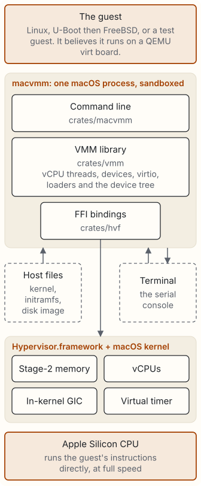
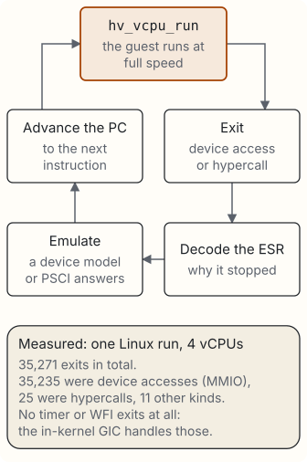
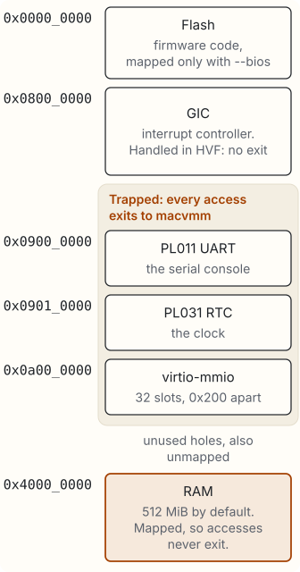
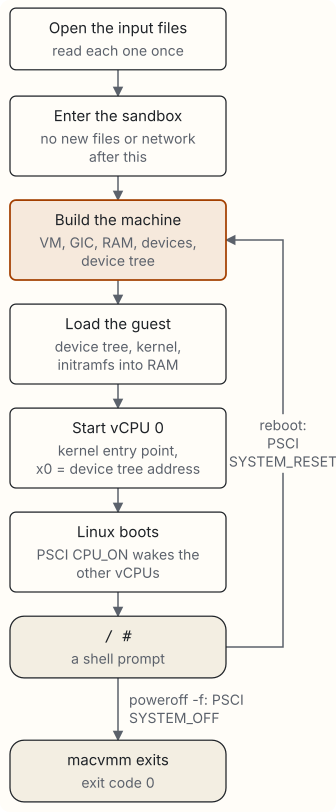
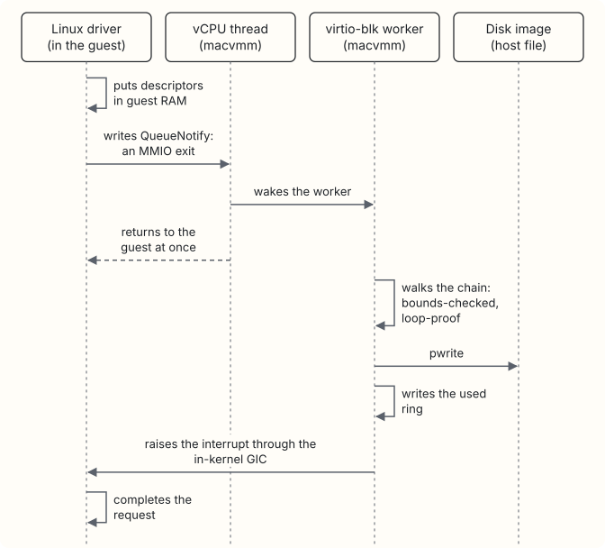

# macvmm

A virtual machine monitor written from scratch in Rust on Apple's Hypervisor.framework, for
Apple Silicon Macs. It is a teaching codebase first (the course lives at
<https://indicogni.com/build-your-own/vmm/>) and is built to be productizable: hand-written FFI,
`unsafe` quarantined to two modules, every guest-controlled value treated as hostile.

Status: version 1. Everything below was observed on one machine, an Apple M5 Pro running macOS
27.2 (`docs/validation/` holds the recorded runs). On a QEMU-`virt`-compatible machine model with
a generated device tree:

- **Linux/arm64** (stock Alpine `linux-virt` 6.18) boots directly to a shell, with virtio-blk
  (an ext4 root that survives a reboot), virtio-rng, virtio-console, virtio-net over a Unix
  datagram socket, and up to 64 vCPUs through PSCI.
- **U-Boot** (`qemu_arm64`) runs from an emulated flash ROM, and **FreeBSD 15.1/arm64** boots
  through it (U-Boot's EFI) to a login prompt.
- **macOS guests** are a stretch goal and do **not** boot: `tools/vz-mac` shows the
  Virtualization.framework path, and an experimental `vmapple` board runs Apple's AVPBooter
  until it stops making progress after its accesses to a device macvmm does not model yet, the
  `cfg` block (`docs/macos/status.md`).
- Hardening: a threat model (`docs/security/threat-model.md`), hostile-input tests,
  dependency-free fuzzers (`scripts/fuzz.sh`), a macOS sandbox that `macvmm run` applies to
  itself by default (`--no-sandbox` opts out, for debugging) and resource limits.

macvmm has **not had an independent security audit**. Treat it as a teaching VMM: do not rely on
it to contain a guest you do not trust. The threat model lists the risks it accepts, and
[SECURITY.md](SECURITY.md) says how to report a problem.

See `docs/PLAN.md` for the milestones and `docs/architecture.md` for the design;
[`docs/README.md`](docs/README.md) explains how to read those records.

## How it works

Five diagrams show the whole design. The
[visual tour](https://indicogni.com/build-your-own/vmm/how-it-works/) on the course site explains
each one for a reader new to virtualization.

macvmm is one macOS process between the guest and Hypervisor.framework, and the guest's
instructions run directly on the CPU.



Each vCPU thread runs this loop. The CPU stops the guest when it touches a device or makes a
hypercall, and macvmm decodes why, emulates the access and runs the guest again.



RAM is mapped, so the guest uses it with no exit. The device addresses are left unmapped on
purpose, so every access to them exits to macvmm.



`macvmm run` opens its files, enters its sandbox, builds the machine and starts vCPU 0 at the
kernel. A reset rebuilds the machine from the bytes it already read.



A virtio-blk write needs one exit to start. The vCPU thread hands the request to a worker thread,
which checks the descriptor chain and writes the disk image.



The diagrams are generated by `node course/site/tools/diagrams.mjs` (see the top of that file).

## Prerequisites

- An Apple Silicon Mac (M1 or later) running **macOS 15.0 or later**: the in-kernel GICv3
  (`hv_gic_create`) first shipped in macOS 15 (decision D7). A virtual machine will not do:
  Hypervisor.framework needs the physical CPU.
  **Tested only on macOS 27.2 on an M5 Pro.** Older Macs and macOS versions back to that floor
  are expected to work but have not been tried (decision D23); reports are welcome.
- Xcode command line tools (`xcode-select --install`): clang, `codesign`, `otool`.
- [rustup](https://rustup.rs). The toolchain is pinned in `rust-toolchain.toml` (Rust 1.99.0)
  and installed on first use.
- Optional, reported by `scripts/setup.sh` with the milestone that needs each: `dtc`, `xz`,
  `e2fsprogs`, `shellcheck` (all from Homebrew).

No `sudo` is needed, and nothing is installed outside the repository and rustup.

## Quickstart

Clone the repository (`git clone https://github.com/Indicogni/macvmm.git`) and `cd` into it, then:

<!-- ANCHOR: quickstart -->
```sh
scripts/setup.sh                 # checks the Mac, completes the Rust toolchain; ends "setup: OK"
scripts/doctor.sh                # a 20-line C probe: is the hypervisor usable at all? "DOCTOR OK"
cargo run -p macvmm -- doctor    # builds, signs and runs macvmm; ends "DOCTOR OK"
scripts/fetch.sh linux           # Alpine's kernel + initramfs over HTTPS, sha256-pinned
scripts/run-linux.sh             # boots Linux to "/ # " on the PL011 (Ctrl-A x quits)
```
<!-- ANCHOR_END: quickstart -->

At the `/ # ` prompt, `echo macvmm-shell: $((6*7))` prints `macvmm-shell: 42`, `uname -a`
prints `Linux (none) 6.18.60-0-virt … aarch64 Linux`, and `poweroff -f` ends macvmm with exit
code 0 and your terminal restored. `scripts/fresh-clone-check.sh` runs this block literally,
from a fresh copy and an empty download cache, and types those same lines.

The same boot without the wrapper, then the checks:

```sh
cargo run -p macvmm -- run --kernel .cache/macvmm/Image-virt \
    --initrd .cache/macvmm/initramfs-test.img --mem 512M
scripts/check.sh                 # the full host quality gate; ends "CHECK OK"
scripts/test-e2e.sh guests linux # the bare-metal test guests and the Linux suite
```

`check.sh` prints `SKIP` for a step it cannot run on your Mac and still ends `CHECK OK`. One
step needs the macOS 27 SDK: the FFI oracle (`scripts/check-ffi.sh`), which compares the
hand-written declarations with Apple's headers. The course-site step needs Node 22 or later.

## More guests and tests

```sh
scripts/fetch.sh uboot rootfs    # U-Boot (from Alpine's package) and the root-filesystem inputs
cargo xtask mkrootfs --out .cache/macvmm/rootfs.img --size 256M   # needs e2fsprogs
cargo run -p macvmm -- run --bios .cache/macvmm/u-boot.bin --mem 512M   # the U-Boot prompt
scripts/fetch.sh freebsd         # about 600 MB download, 6.5 GB sparse image; see docs/compat/freebsd.md
scripts/test-e2e.sh all          # every end-to-end suite (needs all four sets above)
scripts/checkpoint.sh all --ref  # the course's chapter checkpoints against this code
scripts/learner init             # start your own VMM in ./learner (course/checkpoints/README.md)
```

`scripts/fresh-clone-check.sh --from-worktree --with-freebsd` (or `--from-git URL`) is the
release gate: it does all of the above in a fresh copy and ends with `FRESH CLONE OK`.

`cargo run` and `cargo test` go through `scripts/sign-and-run.sh` (configured in
`.cargo/config.toml`), which ad-hoc signs each binary before running it. Without that step
`hv_vm_create` fails with `HV_DENIED (0xfae94007)`.

## Signing

- `scripts/sign.sh BINARY` signs with `codesign -s - -o runtime --entitlements entitlements.plist`:
  an ad-hoc signature, the hardened runtime, and exactly one entitlement. It refuses files
  outside `target/` and verifies the result.
- The runner gives the entitlement only to binaries that link Hypervisor.framework (`macvmm` and
  the test binaries of `hvf`, `vmm` and `macvmm`); everything else, such as `xtask`, is signed
  without entitlements (threat model SIGN-4).
- `scripts/sign.sh --debug` omits the hardened runtime so a debugger can attach, and says so.
  `macvmm doctor` then reports `hardened runtime: no (debug signing)`.

### Why one entitlement

`entitlements.plist` contains only `com.apple.security.hypervisor`, and `scripts/sign.sh`,
`macvmm doctor` and `cargo xtask audit` each check that the whole set is exactly that
(threat model SIGN-1). Be clear about what this buys:

- The hypervisor entitlement is a **capability marker, not a security boundary.** Any local user
  can ad-hoc sign a binary with it. Compromising macvmm gives an attacker nothing the same user
  did not already have.
- **"No network entitlement" confines nothing on its own.** Outside the App Sandbox, a process
  without `com.apple.security.network.*` can still open sockets, files and child processes.
  Containment comes from a sandbox profile and, later, from splitting device emulation into a
  separate unentitled process, never from the entitlement list. `macvmm run` applies that
  profile to itself by default, once every file is open and before the first guest
  instruction: from then on it can open no file by path, reach no network and start no
  process. `--no-sandbox` turns it off (for debugging, or for `--net ...,learn`, whose peer is
  not known in advance); see threat model §7.12.
- What the minimal set does do is keep the signature honest and reviewable, and keep out the
  entitlements that would weaken the process: `allow-jit`, `allow-unsigned-executable-memory`,
  `disable-library-validation`, `allow-dyld-environment-variables`, `get-task-allow`.
- The **hardened runtime** (`-o runtime`, a signing flag, not an entitlement) matters more: without
  it, dyld honours `DYLD_*` environment variables in the entitled process, so anything that can
  set the launch environment could inject code (threat model SIGN-3, verified on hardware).

## Downloads

`scripts/fetch.sh <set>` downloads guest artifacts listed in `scripts/fetch-manifest.txt`
over HTTPS only, checks each against a pinned sha256, and stores it in `.cache/macvmm/`
(`MACVMM_CACHE` overrides the location). Nothing downloaded is ever executed on the host.

## Repository layout

`crates/hvf` FFI and safe wrappers · `crates/vmm` the VMM library · `crates/macvmm` the CLI ·
`crates/xtask` repository tooling (anchor check, security audit, rootfs, checkpoints) ·
`crates/fuzz` the dependency-free fuzzers · `guests/` bare-metal Rust test guests ·
`tools/vz-mac` the Virtualization.framework companion (Swift) · `scripts/` setup, signing,
fetch, checks, e2e · `docs/` architecture, plan, ADRs, threat model, validation ·
`course/` lesson sources, primers, checkpoints, scaffolds.

## Licence

Copyright © 2026 Indicogni LLC.

- **Code** (the crates, guests, scripts, tools, the site builder and labs, and the code blocks in
  the lessons) is licensed under either of [MIT](LICENSE-MIT) or
  [Apache-2.0](LICENSE-APACHE), at your option.
- **Course text and diagrams** (the prose and figures under `course/` and `docs/`) are licensed
  under [CC BY 4.0](course/LICENSE). That file sits in `course/` but covers prose and figures
  only: code under `course/` (the site builder, labs, checkpoints, scaffolds, examples and
  patches) is code, under the two licences above.
- **Captured output** in `course/captures/` and the docs includes text printed by other software
  (Linux, FreeBSD, U-Boot, Apple tools). That text remains its authors'; it is reproduced as a
  record of a run.

The crates are not published to crates.io (`publish = false`); they are meant to be read and built
from this repository.
