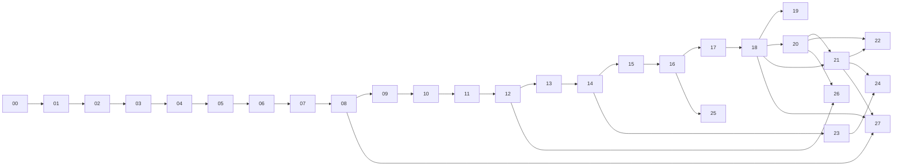

# macvmm course curriculum: Build a VMM from scratch on Apple Silicon

This is the master plan for the course published at `https://indicogni.com/build-your-own/vmm/`.
It is written for lesson authors, the site builder, and the people building the reference
implementation and the checkpoint harness. Lesson prose follows `course/STYLE.md`. Page layout
and lab mechanics follow `course/site/DESIGN.md`. Engineering decisions follow `CLAUDE.md`, then
`docs/architecture.md` (v1.1), then `docs/PLAN.md`. Where this plan and those files disagree,
they win and this file gets fixed.

Status: plan, **v3.1** (2026-11-18; v3 plus the novice review, section 10.1a). v2 folded in `course/reviews/first-principles.md` (the problem
ledger, the derivation chain, R1 to R14, B1 and B2) and `course/reviews/socratic.md` (refined
questions, Predict forks, the productive-failure catalogue), and mapped every chapter to the PLAN
milestones and the real acceptance commands its checkpoint is built from. v3 follows the
`course/CONCEPTS.md` audit: Part 0 is rebuilt so that it builds the mental model of
virtualization from zero (ch00 is the general theory with an in-browser toy machine, ch01 places
our VMM on a Mac before the first FFI line), every chapter's **Concepts you'll need** box is
complete, every GAP the audit found is closed, and the primer set grows from 12 to 24. Chapter
IDs and slugs do not change. Section 10 lists every change. No chapter here is "done" until its checkpoint passes against the reference on a
real Apple Silicon Mac. Chapters 22 to 24 (FreeBSD, macOS) are marked **SHOULD** or **STRETCH**:
they say honestly what we observed, not what we hope.

**This file is for authors, not learners.** Learners never see it. Their way in is the one-page
**Start here** (section 4.0), and from there each lesson. Author notation used in this file
(PLAN milestone IDs such as M4, risk IDs such as K11, the L1/L2/L3 checkpoint levels, the `[V]`
and `[U]` evidence tags, and the design-method vocabulary of section 1) never appears in learner
pages as is; section 7 item 10 says how each is translated. v3.1 (2026-11-18) folds in
`course/reviews/novice.md`; section 10.1a lists those changes.

Evidence tags used below: `[V]` verified on the reference machine (spike `spikes/hvf-hello/RESULTS.md`
item number given), `[U]` unverified, must be captured before a lesson states it (risk K3).
"(per Mn acceptance)" means the PLAN acceptance test encodes the expectation but it has not yet
been captured.

---

## 1. Design method

The course was designed **backwards** (Wiggins and McTighe): first the evidence we want a
finished learner to produce, then the assessments that collect it, and only then the lessons.
v2 adds a second organising rule: every mechanism is **derived from the problem it solves**
(sections 1.4 and 1.5). Chapters are ordered by "this breaks, so we need that", not by the parts
of the machine.

### 1.1 Desired results (what a graduate can do)

| # | Performance goal | Evidence |
|---|------------------|----------|
| G1 | Boot an unmodified Linux/arm64 kernel to a shell on a VMM they wrote | Checkpoint 14, then 18 with a virtio-blk ext4 root filesystem |
| G2 | Explain any VM exit from its raw syndrome: who caused it, what the guest wanted, what the VMM must do, and where the PC must go next | Checkpoints 02, 07 and 08, plus the trace explain-back in Part III |
| G3 | Implement a device that hostile guest code cannot use to read or corrupt host memory, crash the VMM, or hang it | Checkpoints 16 to 19 run a hostile corpus; checkpoint 25 runs fuzzing and the hostile guest |
| G4 | Reason about concurrency across vCPU threads, device workers and a guest that shares memory with no lock | Checkpoints 16 (ordering, TOCTOU) and 20 (SMP Linux, 4 vCPUs, stress) |
| G5 | Read primary specs (ARM ARM, GICv3, PSCI, SMCCC, virtio 1.2, DT spec, Linux `booting.rst`) to settle a question instead of guessing | Every chapter's spec hunt; capstone rubric criterion R2 |
| G6 | Judge honestly how far a hard goal (a macOS guest) can go, and write that up as a design record | Capstone chapter 24 |
| G7 | Predict a VMM's cost in exits before measuring it, and justify a design by the exits it removes | The ch03 `exit-bench` number, reused in ch11, ch12, ch15, ch17 and ch27 |

### 1.2 Enduring understandings

These are the five ideas every chapter comes back to. Lessons name them when they recur.

1. **A kernel assumes it owns the machine; a VMM keeps that assumption true.** The hardware runs
   the guest. The VMM acts only when the hardware stops and says why. Almost everything we write
   is a handler for one exit kind, or set-up that decides what exits.
2. **Most virtualization is not done by the VMM.** Stage-2 translation, the in-kernel GIC and the
   virtual timer do most of the work in hardware or in the macOS kernel. There are two
   supervisors: HVF at EL2 decides what leaves the guest, and we decide what to do with what HVF
   forwards.
3. **Every exit costs about a microsecond or more, measured.** Nearly every later design choice
   (in-kernel GIC, WFI in the kernel, virtio, notification suppression) exists to have fewer of
   them.
4. **The guest is an adversary.** Every number the guest hands us (an address, a length, a
   descriptor index, a header field on disk) is hostile until it has been checked, and memory it
   shares with us can change between the check and the use.
5. **The device tree is a promise.** The guest believes the machine description we give it. Every
   bug where the DTB says one thing and the device model does another shows up as a hang.

### 1.3 Learning-science principles used, and where

| Principle | How it shows up |
|-----------|-----------------|
| Cognitive load theory: manage intrinsic load | Roughly one new hardware concept per chapter. Each concept needs only earlier ones, and each is introduced as the answer to a problem the learner has already met (the ledger, 1.4). The timer (the problem) comes before the interrupt controller (the solution). |
| Avoid split attention | Code is embedded next to its explanation through anchors (`:::code anchor=`), never pasted by hand. Labs sit inside the lesson they serve. |
| Worked examples, then faded guidance | Four fading stages (section 3.4). Within one part, the first instance of a pattern is worked and the second is faded. |
| Expertise reversal | `scripts/learner start NN --level spec` hands out the faded version of an early chapter. |
| Retrieval practice and spacing | Each lesson opens with a three-question warm-up drawn from chapters N-1, N-3 and N-7 (section 6.2). Forward "park it" questions are answered in a later chapter (spaced on purpose). |
| Generation and prediction | Every chapter has one **Predict experiment written as a fork**: two plausible outcomes where the tempting branch is the chapter's misconception. The learner's guess is recorded before the run (section 3.7). |
| Productive failure | About 25 mandatory deliberate breaks (section 3.7, and each chapter's **Breaks** line). Each is predicted first, bounded by a watchdog, diagnosable with tools the learner already has, and debriefed by naming the misconception. |
| Interleaving | Bug hunts at the end of each Part mix faults from several earlier chapters (section 6.4), drawn from the break catalogue of *other* chapters. |
| Elaboration (Socratic) | 3 to 5 journal questions per chapter, ordered concrete (observe or compute), then mechanism (explain), then transfer (break or generalise). Each names its **evidence source** (a trace, a dump, a spec table, a two-minute run). The transfer question is the lesson's closing open question (STYLE.md section 11). |
| Misconception-targeted instruction | Each chapter names one misconception, makes it visible with the Predict fork or a break, and resolves it. |
| Concrete before abstract | Every chapter opens with a failure or puzzle (STYLE.md section 3) and cites the ledger row it closes. |
| Simplified model first, then the real one (an advance organiser) | ch00 teaches every strategy on a toy machine in the browser (`toy-vmm`: two privilege modes, eleven instructions, one device) before any ARM detail. ch01 adds one picture of the real stack. Every later chapter hangs its mechanism on those two pictures. ch02 retires the toy on purpose, saying where it was wrong (STYLE.md section 5: an analogy is scaffolding that comes down). |
| Prior-knowledge audit | Every concept a lesson borrows is tiered in `course/CONCEPTS.md` and appears in the chapter's **Concepts you'll need** box, as core (taught here or earlier), a primer, a pointer, or a forward definition. No concept is used before one of those (section 7). |

### 1.4 The problem ledger (the course spine)

Chapter 00, after its opening puzzle, runs a thought experiment: "load a Linux Image into an
ordinary process and jump to it. What breaks?" The learner's predictions become this ledger.
Every later chapter opens by citing the row it closes ("this chapter closes row 6"). The
*strategies* column is where the vocabulary `CLAUDE.md` requires is derived rather than defined:
emulation, trap-and-emulate, Popek and Goldberg's condition, binary translation,
paravirtualization and hardware-assisted virtualization. ch00 derives them in historical order,
because each one was invented to fix the cost or the hole of the one before.

| # | The kernel assumes it owns... | Breaks in a process because... | Possible strategies | Our mechanism | Chapters |
|---|---|---|---|---|---|
| 1 | the privileged CPU state (EL1 registers, `ERET`, `MSR`) | EL0 cannot execute them; the process gets SIGILL | interpret everything (an emulator); deprivilege and trap (needs hardware that traps *every* sensitive instruction: Popek and Goldberg); translate the guest's code as it runs (binary translation); rewrite the guest (paravirtualization); a more privileged hardware level that traps for you (hardware assist) | the guest runs at a real EL1 under HVF at EL2 | 00, 01, 02, 06 |
| 2 | physical memory (it writes `TTBR`, turns the MMU on) | the process only has virtual addresses; other processes own the rest of physical memory | shadow page tables (trap every page-table write); a second hardware translation stage | stage 2 | 04, 05 |
| 3 | devices at fixed physical addresses | nothing answers at `0x0900_0000` | emulate each access; a paravirtual device | stage-2 holes left on purpose, then MMIO emulation | 05, 07, 09 |
| 4 | a way to ask the platform for power and CPU control | no firmware exists | emulate a power controller; a standard call | PSCI over HVC (SMCCC) | 08, 20 |
| 5 | a description of the machine | an Arm kernel cannot probe platform devices | hardcode addresses; firmware tables | a generated DTB | 10 |
| 6 | asynchronous attention from devices | no interrupt lines exist | poll; inject a pending bit; a virtual interrupt controller | a raw IRQ (ch11), then the in-kernel GICv3 | 11, 12 |
| 7 | an alarm clock, to preempt and to sleep | no timer is wired to it | the VMM emulates ticks; virtualized per-CPU timer hardware | the virtual timer and counter offset | 11, 12 |
| 8 | bulk I/O at reasonable cost | each register access is an exit (row 8 is measured in ch03) | faster exits; fewer exits | virtio rings and a doorbell | 03, 15 to 19 |
| 9 | several CPUs | one host thread per process context; HVF ties a vCPU to its thread | | one thread per vCPU, PSCI `CPU_ON` | 20 |
| 10 | a boot chain | nothing loads it | VMM as bootloader; real firmware | direct boot, then U-Boot | 13, 14, 21 |

Type 1 versus type 2 is an Aside in ch01 (Goldberg's original definitions, and why they blur);
the lesson keeps only the useful question, "who owns the privileged level?", which ch02 makes
exact as "who sits at EL2" (v3.1, novice review 2.1.2). The `toy-vmm` lab in ch00 lets the learner *run* each strategy of
row 1, 2 and 3 on a toy machine. The `trap-or-not` lab in ch01 is an *application* of the ledger
to real Arm instructions ("which row does `str` to the UART belong to, and which layer decides?"),
not a memory test.

### 1.5 The derivation chain (the "why" order of the whole course)

Each step is forced by the one before. A lesson that introduces a mechanism must be able to point
to the step that made it necessary. Chapter numbers are v2 IDs.

| Step | Forced idea | Chapters |
|---|---|---|
| 1 | A kernel assumes it owns the CPU, memory, devices, interrupts and time (the ledger). | 00 |
| 2 | Interpreting it is slow, so let the real CPU run it in a deprivileged mode, and make the hardware stop whenever it reaches for something it does not really own. That works only if every sensitive instruction traps (Popek and Goldberg). Where it does not, translate the guest's code or rewrite the guest; CPU makers then added a more privileged level that traps for you, and a second translation stage for memory. | 00 |
| 3 | Stopping means taking an exception to a more privileged level, leaving behind *why* (ESR, FAR) and *how to resume* (ELR, SPSR). On a Mac that level belongs to macOS, which offers it to ordinary processes as Hypervisor.framework behind one entitlement; HVF at EL2 hands the exit to our EL0 thread. `hv_vcpu_run` is a syscall that returns when the guest takes an exception HVF chooses to forward. | 01, 02 |
| 4 | Every stop costs about a microsecond or more (measured). Everything after this tries to have fewer of them. | 03 |
| 5 | Memory: the guest's physical addresses must be translated again, by hardware (stage 2), or every page-table write would have to stop. The only safe access to memory a concurrent guest shares is a copy. | 04, 05 |
| 6 | Devices: registers have side effects, so they cannot be RAM. Leave stage-2 holes so each access stops; the syndrome lets us emulate the *access*, not the instruction. | 05, 07 |
| 7 | Some stops are requests (power off, CPU on): a standard call instead of a fake power controller. Some are things we do not virtualize: inject the exception the real CPU would have raised, by doing by hand what the hardware does in step 3. | 08 |
| 8 | A device is a state machine behind side-effecting registers. A general kernel cannot hardcode the machine, so we describe it (DTB), from the same source as the devices. | 09, 10 |
| 9 | A kernel must get the CPU back: an alarm that interrupts. An interrupt is a pending bit, a mask and a vector, and a level line is state that cannot be lost. Feel the cost of one exit per tick and per idle. | 11 |
| 10 | Many sources need a controller (priority, routing, acknowledge). Put the controller and the timer in the kernel, and measure the exits disappear; pay in wake-up latency. | 12 |
| 11 | Now Linux can boot: placement contracts, then integration and diagnosis. | 13, 14 |
| 12 | Per-access stops make bulk I/O too slow: put the data in shared rings and stop only to ring a doorbell (virtio). | 15 |
| 13 | Shared memory with a concurrent adversary needs paired ordering, copy-then-validate (TOCTOU) and caps on everything. | 16 to 19 |
| 14 | More CPUs: one thread per vCPU, and every device becomes a concurrent data structure. | 20 |
| 15 | Real boot chains and other OSes are stricter guests; they reach the paths we refused (ISV=0). | 21 to 24 |
| 16 | Product concerns (hardening, snapshots, debugging) follow from steps 3, 9 and 13: hostile input, hidden state, and the cost of stops. | 25 to 27 |

---

## 2. Audience and prerequisites

**Who this is for** (this follows `CLAUDE.md`, which wins over any earlier wording here):
programmers who know some Rust *or* C and know what a process and a memory address are. We
assume **no** knowledge of virtualization in any form (what a VM, VMM or hypervisor is,
trap-and-emulate, Popek and Goldberg, type 1 versus type 2, emulation versus virtualization
versus paravirtualization, two-stage translation, virtual devices, why virtio exists), **no**
ARM64 knowledge, and only a light picture of operating systems. Syscalls, page tables and
interrupts are primed (section 2.1) or taught in the chapters that need them. Because the
audience has at most "run a VM in an app", Part 0 builds the whole mental model of
virtualization (what a VM is and why, the CPU, memory and device problems, the strategies in
historical order, hypervisor types, and where Hypervisor.framework and our VMM sit) before any
code beyond `hv_vm_create`. Arm64 itself starts in ch02, after the `aarch64-reading` primer, which
every learner reads (it is not remedial: no Arm knowledge is assumed).

**Hardware:** a physical Apple Silicon Mac running a macOS version recent enough for the in-kernel
GIC (`hv_gic_create` needs macOS 15+). The reference machine is an M5 Pro on macOS 27.2. Whether
M1 to M4 machines run `hv_gic_create` is unverified (architecture risk R1, PLAN D7), so the stated
floor is the lead's decision before launch. Hypervisor.framework does not work inside most macOS
VMs, which includes hosted CI runners, so the native parts need real hardware. The browser labs
run anywhere.

**Entry self-check** (`/build-your-own/vmm/setup/`, browser only, 12 questions, not graded):
reading hex and bit fields (v3.1 adds a **bit-field warm-up** item, because the course reads
fields out of words far more than most programmers practise: "bits 31 to 26 of `0x5a00_0000`
hold which number?", answered by shifting and masking, with the working shown), two's complement, **byte order** (read the same four bytes as a
little-endian and as a big-endian `u32`), Rust ownership and `Result`, Rust traits, pointers and
`repr(C)` layout, "what does a process see when it reads address X". It tests only what
`CLAUDE.md` assumes (some Rust or C, processes, addresses). It does not test virtualization, Arm
or OS internals, because the course teaches those. A learner who misses more than three is
pointed to:

- **Appendix A, "Rust for C systems programmers":** ownership as lifetime discipline you already
  practise in C; **RAII and `Drop`** (the `Vm` of ch01 destroys itself); `unsafe` as "the C you
  know, fenced"; **what `&T` and `&mut T` promise** (no one else mutates or reads through another
  path while the reference lives), which ch04 needs to explain why shared guest memory gets no
  `&[u8]`; slices as pointer plus length; traits and `dyn Trait` as vtables; **Cargo workspaces,
  features and lints** (`--features hvf-tests`, `#![forbid(unsafe_code)]`, `cargo xtask`). About
  3 hours.
- **Byte order** is a prerequisite but gets one short section in the `aarch64-reading` primer,
  because ch04 (little-endian helpers) and ch10 (a big-endian DTB) both depend on it.

**Words on every page (v3.1).** Two rules hold for every learner page, lessons and primers alike:

- Every acronym is **expanded at its first use on each page**, not once per course (`ESR_EL2`,
  "the Exception Syndrome Register for EL2"; `IPA`, "intermediate physical address"). A learner
  arrives from search, a link or a lifeline, not always from the previous page.
- Every course term links on first use to the **site glossary** (`/build-your-own/vmm/glossary/`),
  built from `course/CONCEPTS.md` section 4: a one-line plain definition and a link to the page
  that teaches it. A term not in the glossary is not used.
- **"VM exit" and "exit code" are two words.** "VM exit" (or "exit" after its first use in a
  chapter, when unambiguous) names only the moment the guest stops and our VMM runs. What the
  `macvmm` process returns to the shell is always its "exit code". Neither is ever "exit" alone
  when both could be meant (for example in ch03, ch05 and ch08, which use both).

v2's **Appendix B, "AArch64 reading kit"** becomes the required primer `aarch64-reading` (section
2.1), read by everyone before ch02. The site may keep `/appendix-b/` as a redirect.

### 2.1 Primers

A primer is a standalone 15 to 30 minute tutorial in `course/primers/<slug>.md` with objectives, a
self-check and a lab where useful. A chapter's "Concepts you'll need" box links the primers it
requires. A primer is read *before* the chapter that first requires it.

| Primer | Covers | First required by | Also used by |
|---|---|---|---|
| `os-basics` | process and exit status; privilege (user versus kernel); virtual memory and page faults (a page table as a lookup from virtual to physical page, with a worked two-level example, not only one picture); the syscall **at the hardware level**: the mode switch, the PC jumping to a kernel entry address taken from a table of handler addresses (the **exception vector table**), and the return address saved in a *register*, not on a stack, on Arm (a surprise for x86-trained readers); interrupts; what firmware and a kernel do at boot ("firmware is the program the CPU runs first; it sets up the hardware, then loads and starts the kernel, and stays behind to answer a few requests such as power-off"). | 00 | 01, 02, 05, 08, 09, 11 |
| `codesign-entitlements` | **Need to know** (10 minutes): "macOS will not let an unsigned program use the virtualization hardware; we sign ours ad hoc with one permission, `com.apple.security.hypervisor`, and the kernel checks it when we call", plus how to read `codesign -d --entitlements :-`. **Going deeper** (optional until ch19 and ch25): ad-hoc signing, entitlements, why `com.apple.security.hypervisor` is checked at run time (AMFI and the kernel, each claim `[V]` or cited), the hardened runtime and why `DYLD_*` injection matters, restricted entitlements and provisioning profiles (`com.apple.vm.networking`), and a plain statement that macvmm needs no SIP change and no sudo, with the reason | 01 | 00 (doctor line), 19, 23, 25 |
| `aarch64-reading` | (v2's Appendix B, now required) general registers, `xN`/`wN`, register 31 as `xzr` or `sp`, `pc`, `lr`; the AAPCS64 argument and result registers (`x0` to `x7`, `x0`); system-register naming (`MRS`/`MSR`, `_ELn`); fixed 32-bit instruction words and their fields; the dozen instructions in our traces; reading a disassembly; byte order | 02 | 03, 07, 08, 21 |
| `smccc` | SMC Calling Convention: function-ID fields, conduits, registers as the API (builds on AAPCS64 from `aarch64-reading`) | 03 | 08, 20 |
| `bare-metal-rust` | (new) what `no_std` and `no_main` remove; target triples and `rustup target add`; the sections a linker produces (`.text`, `.rodata`, `.data`, `.bss`); a linker script that puts `_start` at `0x4008_0000`; load versus run address; BSS and stack; ELF to flat binary with `objcopy` | 03 | 13 |
| `page-granules` | 4 KiB and 16 KiB granules; stage 1 belongs to the guest, stage 2 to HVF, and they are independent | 04 | 02 (one link), 05, 26 |
| `page-tables` | stage-1 translation: VA split, `TTBR0/1`, `TCR`, levels, descriptors, MMU on and off; **memory attributes** (Normal versus Device memory, `MAIR_EL1`, cacheability) in one section | 05 | 06, 21, 27 |
| `caches` | (new) cache lines, data versus instruction caches, Point of Coherency and Point of Unification, clean and invalidate, `CTR_EL0.DIC/IDC`, cacheable versus Device memory, what `booting.rst` means by "cleaned to PoC"; ends with the two evidence experiments (MMU-off `memtest`, the `BRK` I-cache test) and says which result was observed | 13 | 04 (optional Under the hood, one link), 27 |
| `arm64-boot-protocol` | `Documentation/arch/arm64/booting.rst`: registers, MMU and cache state, placement; marks which part ch06 (MMU and caches), ch10 (`x0`) and ch13 (everything) need | 06 | 10, 13 |
| `reading-arm-specs` | (new) how the ARM ARM (DDI 0487) is organised, a register page and its field tables, the ESR ISS tables, pseudocode conventions, and the vocabulary RAZ/WI, RES0/RES1, UNDEFINED, UNKNOWN, IMPLEMENTATION DEFINED; a short section on virtio's MUST/SHOULD and the DT spec's chapter 5 | 07 | 08, 09, 10, 12, 15 |
| `host-concurrency` | (new) threads and per-thread state, timer-driven preemption and file descriptors; threads in Rust, `Arc`, `Mutex`, `Condvar` (spurious wake-ups and the predicate loop), `thread::scope`, channels, atomics as flags with `SeqCst`, deadlock and a fixed lock order; what the borrow checker proves about data races and what it leaves to you | 09 | 02 (one link), 11, 17, 20, 26 |
| `unix-signals` | (new) what a signal is, default actions, exit status `128 + n`, async-signal safety, the self-pipe trick; SIGINT, SIGTERM and SIGUSR1 as macvmm uses them | 09 | 14, 26 |
| `tty-termios` | (new) TTY, pty and `script`; canonical versus raw mode, echo, how the line discipline turns Ctrl-C into SIGINT, `stty -g`; escape sequences (CSI, OSC, DCS) and why bytes from a guest can change, query or spoof the host terminal | 09 | 14, 25 |
| `primecell-ids` | AMBA PrimeCell and Peripheral ID registers at `0xFE0`, how Linux matches on them | 09 | 14, 22 |
| `elf` | ELF64 headers and program headers, `filesz` versus `memsz` | 13 | 03 (one link), 27 |
| `cpio-initramfs` | newc cpio, how the kernel unpacks an initramfs | 13 | 14 |
| `efi-zboot` | why Alpine's `vmlinuz-virt` is an EFI zboot wrapper, and how `cargo xtask unzboot` gets the Image; gzip (RFC 1952) as a container; **one page on UEFI applications and the PE/COFF header**, pointing at `uefi` for the rest | 13 | 21 |
| `linux-boot-sequence` | (new) from the first instruction at the Image entry to `/init`: early console, MMU on, DT unflattening, driver binding by `compatible`, clocksource and delay calibration, initcalls, initramfs unpacking, `/init` and BusyBox, `dmesg`; kernel modules and Alpine's `modloop`; each stage mapped to the boot-log lines learners will see | 14 | 10 (one paragraph), 18, 22 |
| `memory-ordering` | weak memory on arm64, acquire and release, fences, paired barriers, the lost-wakeup race, the doorbell as a synchronisation point; starts from the atomics of `host-concurrency` | 16 | 04 (seed), 17, 20 |
| `block-storage` | (new) sectors and raw images (versus qcow2), a filesystem on a whole disk, ext4 in one picture (superblock, journal), `mkfs` and `e2fsck`, mounting and `root=`, the page cache, `fsync` versus `F_FULLFSYNC` on macOS, `pread`/`pwrite`, advisory file locks (`flock`, `fcntl`), APFS clones (`cp -c`) | 18 | 22 |
| `unix-sockets` | (new) Unix domain sockets, stream versus datagram (message boundaries), the filesystem path and its permissions (0600, a 0700 directory), stale socket files and why macvmm replaces only a socket it owns, why no entitlement is needed | 19 | 27 |
| `uefi` | (new) UEFI as an interface, not a program: boot services versus runtime services, EFI applications as PE/COFF images, the EFI system partition, configuration tables (how a DTB or ACPI reaches the OS), where U-Boot's `bootefi` and EDK2 fit | 21 | 13 (one link), 22 |
| `u-boot` | what U-Boot does, its prompt, `bootefi`, `virtio scan`, its environment; assumes `uefi` | 21 | 22 |
| `macos-sandbox` | (new) Seatbelt and SBPL in brief, `sandbox-exec` versus `sandbox_init`, `(deny default)` and the operation classes macvmm denies (file, network, `process-exec`, `mach-lookup`, `iokit-open`); resource limits (`RLIMIT_CORE`, `RLIMIT_NOFILE`) and core dumps; `umask`, `O_CLOEXEC`, and why the run path never uses `fork`/`exec`; which parts are undocumented (`[H]`) and what was observed | 25 | 26 |

Reading times (the site shows them):
30-minute `os-basics`, 20-minute `codesign-entitlements`, 30-minute `aarch64-reading`,
20-minute `smccc`, 25-minute `bare-metal-rust`, 15-minute `page-granules`,
30-minute `page-tables`, 20-minute `caches`, 25-minute `arm64-boot-protocol`,
25-minute `reading-arm-specs`, 30-minute `host-concurrency`, 15-minute `unix-signals`,
20-minute `tty-termios`, 15-minute `primecell-ids`, 20-minute `elf`, 15-minute `cpio-initramfs`,
20-minute `efi-zboot`, 30-minute `linux-boot-sequence`, 30-minute `memory-ordering`,
30-minute `block-storage`, 15-minute `unix-sockets`, 25-minute `uefi`, 20-minute `u-boot`,
25-minute `macos-sandbox`. About 6.75 hours of primers lie on the path to a Linux shell (ch00
to ch14) and about 9 hours in all.

"Also used by" with "(one link)" means that chapter links the primer in plain words for the
curious; it does not require it. The primers marked (new) come from `course/CONCEPTS.md` section
3.2; their suggested labs are listed in section 8.

### 2.2 Concept register

`course/CONCEPTS.md` is the register of every borrowed concept (tier, first use, where it is
taught). It replaces v2's table here. Each chapter's **Concepts you'll need** box in section 5 is
built from it, and the two must agree: when a lesson starts using a new concept, add the row to
`CONCEPTS.md` and the item to the box in the same change. Tiers follow `CLAUDE.md`: **core** gets
a full chapter derived from its problem, **primer** gets section 2.1, **pointer** gets an Aside
plus an authoritative link, and a **forward definition** is one or two sentences at first use
plus "full story in NN" (section 7).

---
## 3. How learners write code: learner mode

Learners **build their own copy** of the VMM, chapter by chapter. The repo's reference
implementation is never the learner's starting point. It is the oracle that checkpoint tests
are kept honest against, and an emergency lifeline. The harness is PLAN **M27**.

### 3.1 Two workspaces, one harness

```
macvmm/                          (the repo learners clone)
  crates/{hvf,vmm,macvmm,xtask}/ reference implementation (read-only by convention)
  guests/                        bare-metal Rust test guests, shared by both workspaces
  course/
    CURRICULUM.md                this file
    chapters.json                generated from section 5 (site builder input)
    chapters/<part>/<NN-slug>.md lesson sources
    primers/<slug>.md            primers (section 2.1)
    checkpoints/NN/              per-chapter checkpoint definitions (section 3.2)
    breaks/NN/<name>/            deliberate-break definitions (section 3.7)
    scaffolds/NN/                starter files for the learner workspace (section 3.4)
    journal/NN.md                journal prompt templates and rubrics
    retrieval/NN.toml            warm-up question banks (section 6.2)
    bughunts/<part>/             planted faults for bug hunts (section 6.4)
  scripts/
    setup.sh  doctor.sh  fetch.sh  learner  checkpoint.sh  capture.sh  bughunt.sh
  learner/                       created by `scripts/learner init`; gitignored by the repo,
    Cargo.toml                   and initialised as the learner's OWN git repo
    crates/{hvf,vmm,macvmm}/
    journal/NN.md
    .progress.toml               local only; never uploaded (no telemetry)
```

- `scripts/learner init` creates `learner/` from `course/scaffolds/00/`: an empty Cargo
  workspace with the same crate names, the lints from `CLAUDE.md` (`forbid(unsafe_code)` outside
  `crates/hvf` and `memory/host.rs`), the one-key entitlements plist and the signing runner. It
  runs `git init` inside `learner/` and prints `learner: ready`.
- `scripts/learner start NN [--level worked|completion|spec|open]` copies the chapter's new
  scaffold files into `learner/`. It **never overwrites** a learner file. If a scaffold wants to
  change an existing file, it writes `<file>.scaffold` next to it and prints the diff. It also
  copies `course/journal/NN.md` to `learner/journal/NN.md`. Rerunning it prints
  `learner: 0 files copied, N already present`.
- `scripts/learner hint NN [1-4]` prints a hint ladder: 1 is conceptual, 2 points to a spec
  section, 3 gives pseudocode, 4 points to the reference anchor to read.
- `scripts/learner lifeline <module>` is the escape hatch for a stuck learner (section 3.5).
- `scripts/learner break NN-name` and `scripts/learner unbreak` run a deliberate break (3.7).
- `scripts/learner status` shows checkpoints and course milestones passed, from `.progress.toml`.

### 3.2 Checkpoint definitions

Each chapter has `course/checkpoints/NN/checkpoint.toml`. Expectation files use the **marker
syntax** of PLAN §0.3 (architecture §19 item 14, PLAN D9), not regular expressions: one marker
per line, matched in order as substrings, `*` matches any run of non-newline characters, a
`[stderr] ` prefix matches stderr, and a leading `!` means "must appear nowhere".

```toml
id = "07"
slug = "exit-loop"
requires = ["06"]                 # checkpoints that must already pass (re-run quickly first)

[contract]                        # L1: host-only tests against the public API, no HVF
crate = "vmm"
tests = ["contract/esr_decode.rs", "contract/mmio_decode.rs"]

[[run]]                           # L2: real HVF run of a test guest
name = "mmio-probe"
guest = "mmio-probe"              # built from guests/ for aarch64-unknown-none by the harness
args = ["run", "--mem", "64M", "--testdev", "--kernel", "{guest}",
        "--trace", "exits:{out}/trace.jsonl:mmio", "--timeout", "10"]
expect_exit_code = 0              # test guests end with DEBUG_EXIT(0) (ch03) or PSCI SYSTEM_OFF (ch08 on)
serial = "expected/mmio-probe.txt"        # marker file over stdout/stderr
trace  = "expected/mmio-probe.trace.txt"  # marker file over the JSONL trace

[journal]                         # L3: reflection; checked for presence, not graded by machine
file = "journal/07.md"
questions = 4                     # 3 to 5 (section 6.1)
predict = true                    # the Predict fork's recorded guess must be present
```

### 3.3 What `scripts/checkpoint.sh NN` does

```
scripts/checkpoint.sh 07                # targets ./learner if it exists, else the reference
scripts/checkpoint.sh 07 --ref          # run against the reference (CI and authors use this)
scripts/checkpoint.sh 07 --impl DIR     # run against another tree (harness self-tests)
scripts/checkpoint.sh all --ref         # the "curriculum is not broken" gate
```

1. **L1, contract tests (no HVF).** The harness generates a throwaway crate under
   `target/checkpoint/NN/` whose `Cargo.toml` depends on `vmm = { path = "<impl>/crates/vmm" }`,
   copies in the contract tests and runs `cargo test`. Contract tests use only public items the
   chapter's lesson names (for example `vmm::arch::esr::Exit::decode(u64) -> Exit`), and host
   test doubles such as `VecMemory` (ch04) and `TestIrq` (ch12).
2. **L2, black-box HVF runs.** The harness builds the learner's `macvmm`, signs it through the
   runner (ad-hoc, only `com.apple.security.hypervisor`), builds the guest, runs it with
   `--timeout` plus a hard kill at timeout + 10 s, and matches the serial and trace marker files
   and the exit code. Golden files are real captures from the reference, made only by
   `scripts/capture.sh NN` on real hardware. Runs written below as `--kernel <guest>` are
   executed as `--raw <guest>.bin@0x40080000` for chapters before 13, because learners write the
   ELF loader in ch13; markers and exit codes are identical.
3. **L3, journal.** The harness checks that `learner/journal/NN.md` exists, that each question
   has a non-empty answer, and that the Predict guess was recorded. It then prints the rubric
   ("ideas a strong answer contains") and the reference's observed Predict outcome. Nothing is
   uploaded.

Passing output always has this shape (the lesson's `expect:` front matter uses the last line):

```
[PASS] L1 contract  esr_decode (40 tests), mmio_decode (12 tests)
[PASS] L2 run       mmio-probe: 3/3 serial markers, 6/6 trace markers, exit 0 in 0.21s
[INFO] L3 journal   4/4 answered, predict recorded; rubric printed below
CHECKPOINT 07 PASS
```

With a lifeline it prints `CHECKPOINT 07 PASS (borrowed: vcpu::mmio)`. On failure the harness
prints the first mismatching marker, the last 20 exits and a register dump. Reading this dump *is*
part of the skill being taught (ch06 and ch07 teach how).

**Contracts the harness depends on** (the reference implements them; the lessons teach them as
requirements; risk K1):

- **CLI:** architecture §13.1 is authoritative. Learners meet the flags in this order: `doctor`
  (01), `first-exit` (02), `run --mem --raw --timeout --trace` (03), `--unhandled-mmio` (05),
  `--testdev` (07), `--on-reset --no-debug-hvc --debug-hvc` (08), `--serial` (09), `--dtb-out`
  (10), `--irqchip none --stats` (11), `--kernel` for ELF and Image, `--initrd --cmdline
  --dry-run` (13), `--rng --console` (17), `--disk` (18), `--net unixgram:LOCAL[,peer=REMOTE][,mac=..]`
  (19), `--cpus` (20), `--bios` (21), `--machine vmapple` (24), `--sandbox` (25),
  `--snapshot-to --restore` (26), `--gdb` (27). Unknown flags are an error (exit 2).
- **Exit trace:** one JSON object per line, fields as in architecture §16 (64-bit values are hex
  strings), for example
  `{"t_ns":1234,"vcpu":0,"reason":"exception","ec":"0x24","pc":"0x40080010","ipa":"0x9000000","wnr":true,"size":4,"reg":2,"value":"0x48","action":"mmio"}`.
  The schema lives in `course/checkpoints/TRACE.md`. Learners build a subset in ch03 (`hvc`
  records) and the rest in ch07 and ch08.
- **Exit codes** (architecture §13.2): 0 power off or DEBUG_EXIT(0); 1 VMM error; 2 usage or
  config error; 3 guest fatal (unhandled MMIO, instruction abort, undecodable ISV=0 before ch21,
  reset storm); 4 reset with `--on-reset exit`; 5 timeout; 6 DEBUG_EXIT with a non-zero code;
  130 user quit.
- **Test guests** print through DEBUG_PUTC (`hvc #0`, `x0 = 0xC600_0001`, `x1 = byte`) until the
  PL011 exists (ch09), then through the PL011. They end with DEBUG_EXIT(0) (`0xC600_0002`) until
  ch08, then PSCI `SYSTEM_OFF`. A guest panic calls DEBUG_EXIT with a non-zero code (exit 6).
  (v1 said "SYSTEM_RESET with a code in x1"; PSCI SYSTEM_RESET takes no argument.)

### 3.4 The fading schedule

| Stage | Chapters | What the learner gets | What the learner does |
|-------|----------|-----------------------|-----------------------|
| **Worked** | 00 to 05 | Full code in the lesson (anchors), explained a few lines at a time | Types it in (typing, not pasting, is asked for explicitly), runs it, makes small "Try it" variations |
| **Completion** | 06 to 12 | Scaffold files with signatures, doc comments, types and `todo!()` holes marked `// LEARNER: <hole name>` | Fills the holes. The lesson explains the concept and shows one worked case of each pattern. |
| **Spec** | 13 to 20 | The contract (public API plus CLI behaviour), the tests, and a design sketch | Writes the module from the spec citations. The lesson teaches the spec, not the code. |
| **Open** | 21 to 27 | A design brief and acceptance criteria | Writes a short ADR first, then the code. The lesson shows the reference's choices *after* the learner's attempt. |

Within each stage the first instance of a pattern is worked and the second is faded: PL011 is
worked, PL031 is completion; virtio-rng is worked, virtio-console is faded; the Image loader is
worked, the ELF loader is a spec exercise. Abstractions arrive with their need (first-principles
R8): `GuestRam` is built before the `GuestMemory` trait is extracted (ch04), a `match` on one IPA
comes before the `Bus` (ch09), and the `VirtioDevice` trait is extracted from rng in ch17.

### 3.5 Lifelines (getting unstuck without losing the thread)

`scripts/learner lifeline vmm::virtio::queue` **copies** the reference module's source file into
the learner tree, keeping the learner's version as `<file>.mine` (architecture §19 item 13, PLAN
D10; v1's `pub use macvmm_ref::…` re-export would not type-check against the learner's own
frozen types). The lifeline is recorded in `.progress.toml`, `scripts/learner status` shows it
as "borrowed", and checkpoints pass as `PASS (borrowed: queue)`. `learner lifeline --return`
restores `<file>.mine`.

Lifelines need a few **frozen contracts** whose signatures learners implement exactly as the
lesson gives them (architecture §6, risk K2): `GuestAddress` and `GuestMemory` (ch04),
`Exit` (ch07), `MmioDevice`, `AccessSize` and `Bus` (ch09), `IrqLine` (ch12), and
`GuestMemoryOrdered` (ch16).

### 3.6 Instructors and authors

- `scripts/checkpoint.sh all --ref` must pass on the reference machine before any lesson ships.
- `scripts/check-anchors` must pass. Every `:::code anchor=` must resolve.
- Golden captures (`course/captures/*.txt`, `course/checkpoints/NN/expected/*`) are regenerated
  only by `scripts/capture.sh NN` on real hardware. Never edit them by hand.
- Every Predict outcome and every break symptom marked `[U]` below is run on the reference first
  and stored under `course/captures/`. If the observation differs from this file, the lesson
  follows the observation and this file is corrected.

### 3.7 Productive failure: deliberate breaks

A failure is *productive* when (a) the learner predicted first, (b) the diagnostic tool already
exists (register dump from ch06, exit trace from ch03 and ch07, last-N exits from ch07), (c) it is
bounded in time and cannot harm the host, and (d) the debrief names the misconception. No hard
break comes before ch06's dump exists; ch00's break happens in the browser (the `toy-vmm`
sneaky-instruction mode), ch01's is a clean error return, and the ch02 breaks are deliberately
benign.

There are three kinds, because a patch cannot be applied blindly to code the learner wrote:

| Kind | What changes | How the harness runs it |
|---|---|---|
| **guest** | a broken guest or guest input (missing `hvc`, self-fault, bad DTB node request) | `learner break` builds the variant guest and runs it against the learner's VMM |
| **input** | a corrupted file or hostile corpus (Image header, DTB, snapshot, descriptor chain) | `learner break` feeds the input to the learner's VMM or contract API |
| **edit** | the learner's own code (delete the PC advance, remove a `checked_add`) | the lesson gives the edit in a block marked **Deliberate breakage**; the learner makes it by hand |

`scripts/learner break NN-name`:

1. records a snapshot of the learner tree (`git stash create`, so nothing is lost);
2. asks "Predict: what will you see?" and stores the answer in `journal/NN.md`;
3. for guest and input breaks, runs the scenario; for edit breaks, waits for the learner's edit
   and then runs the named checkpoint step;
4. runs everything under a **watchdog** (default 10 s) so hangs end with "hung, as expected; dump
   the last exits";
5. prints the symptom to look for, never the cause; after 10 minutes it offers the hint ladder.

`scripts/learner unbreak` restores the snapshot and checks the tree is clean. Authors verify every
break against the reference with `course/breaks/NN/<name>/ref.patch` and `--ref`, which is where
the captured symptom comes from. Each debrief is three lines: what you saw, which misconception it
exposed, which tool found it.

Two breaks do not reliably fail on a laptop (the ch16 missing fence, the ch18 FLUSH no-op). The
lessons say so, and use a litmus-test lab and a latency measurement instead. A course that claims a
bug appears when it does not teaches the wrong lesson about evidence.

The mechanics in this section are new harness scope for PLAN M27 (risk K10).

---

## 4. Learner journey: from `git clone` to a Linux shell

### 4.0 Start here (the learner's first page)

The course landing page links one page, `/build-your-own/vmm/start/`, and nothing else first. It
is at most half a page and contains only this (prose per STYLE.md; no author vocabulary):

1. **What you will build.** "A program, written by you in Rust, that runs Linux on your Mac as an
   ordinary app: Linux boots in your terminal and believes it owns a whole computer. Along the
   way you will learn how every virtual machine app you have used actually works."
2. **What you need.** A physical Apple Silicon Mac (not a VM), the macOS floor the lead sets
   (risk K15), about 20 GB of free disk, and some Rust *or* C. No virtualization, Arm or kernel
   knowledge: the course teaches all of it. The browser labs run on any computer.
3. **Tonight.** Step 1: run `scripts/setup.sh` (about 30 minutes, it says `setup: OK`). Step 2:
   take the 12-question self-check (not graded). Step 3: read the `os-basics` primer, then
   chapter 00.
4. **What the first nine hours are like, and why.** "Chapters 00 and 01 are mostly reading,
   thinking and browser labs; your own code first touches the hardware at the end of chapter 01,
   and runs guest instructions in chapter 02. That is on purpose: a virtual machine is an
   illusion with many moving parts, and the code only makes sense once you can see the trick.
   If you prefer to start with code, skim 00 and come back to it when chapter 02 surprises you."
5. **How long.** About 68 hours to a Linux shell, about 149 hours for everything, for the target
   learner. "If Arm assembly is new to you, chapters 02 and 08 may take longer than stated; that
   is normal, and both are split into two sittings."
6. **Keep these open.** The glossary (section 2 rule), and the one-page **reference card**:
   the `macvmm` exit-code table (section 3.3, written for learners: code, meaning, the chapter
   that introduces it), the CLI flags in the order you meet them, and the evidence words the
   lessons use ("we checked this on a real Mac" and "we have not checked this yet", the learner
   form of `[V]` and `[U]`).

### 4.1 The journey

| Step | What happens | Checkpoint | Time (cumulative) |
|------|--------------|------------|-------------------|
| 1 | `git clone`, then `scripts/setup.sh`: checks Apple Silicon, the macOS version, Xcode CLT and rustup, adds `aarch64-unknown-none`, ends `setup: OK` | none | 0.5 h |
| 2 | Primer `os-basics`, then ch00: what a virtual machine is, the problem ledger, every strategy run on the `toy-vmm` toy machine in the browser, and a readiness check (`scripts/doctor.sh`, provided) | 00 | 4.5 h |
| 3 | `scripts/learner init` creates the learner's own workspace | none | 4.5 h |
| 4 | Primer `codesign-entitlements`, then ch01: where our VMM sits on a Mac (the stack, the two supervisors, `trap-or-not`), the entitlement gate, and the first FFI (`hv_vm_create` and `hv_vm_destroy` only), so `hv_vm_create` works from *your* crate | 01 | 9 h |
| 5 | Primer `aarch64-reading`, then Part I: the exception model (ch02 sitting A, no Rust) and the first VM exit (sitting B), then your own bare-metal guest prints "hello" and measures an exit | 02, 03 | 19 h |
| 6 | Part II: guest memory and the address-space map (with the page primers) | 04, 05 | 27.5 h |
| 7 | Part III: a vCPU that runs, decodes its exits, emulates MMIO and shuts down through PSCI (ch08 in two sittings) | 06 to 08 | 38.5 h |
| 8 | Part IV: PL011, PL031 and a generated DTB (with the concurrency, signal and terminal primers) | 09, 10 | 49 h |
| 9 | Part V: the timer and a raw interrupt with no controller, then the in-kernel GIC | 11, 12 | 58 h |
| 10 | `scripts/fetch.sh linux`: sha256-pinned Alpine 3.24.4 `linux-virt` 6.18.60 over HTTPS into `.cache/macvmm`, never executed on the host; `Image-virt` is derived with `cargo xtask unzboot` | none | 58 h |
| 11 | Part VI: the Image loader, then `macvmm run --kernel Image-virt --initrd initramfs-test.img` reaches `/ # ` (the `caches` primer now sits here, before ch13) | 13, 14 | **about 68 h** |

After that the journey branches. Part VII (virtio) is the main path. Parts VIII to XI can be
taken in any order once ch18 is done, with the prerequisites in section 5's graph.

Hours are hands-on estimates for the target learner (reading, building, debugging, breaks),
including the primers on the path (about 6.75 h of them). Lesson reading time per STYLE.md is 20
to 35 minutes; the rest is building and debugging. The full course is about 149 hours (140 h of
chapters in section 5 plus about 9 h of primers). v3.1 raised ch00 (3 to 3.5 h), ch02 (4 to 5.5 h)
and ch08 (3.5 to 4.5 h) after the novice review judged them under-estimated for a learner new to
Arm; pilot timings replace all of these numbers before launch.

---

## 5. The chapters

Chapter IDs are **stable two-digit numbers** (`00` to `27`). They appear in checkpoint commands,
scaffolds, journals and PLAN's chapter-to-milestone map. The site shows part.chapter numbers (for
example "IV.2"), derived from this table into `course/chapters.json`. Lesson files live at
`course/chapters/<part>/<NN-slug>.md`. "Modules" are paths in the reference layout (architecture
§3); learners use the same paths.

Each entry has: **Ledger** (row closed, derivation step), objectives (measurable, with an action
verb and a test), **Concepts you'll need** (core, primer, pointer), prereqs, what you build,
modules, **PLAN** (milestones and the reference tests the checkpoint is cut from), checkpoint,
lab, **Predict fork**, **journal questions**, **Breaks**, the targeted misconception, time.

Journal questions carry a kind tag (observe, mechanism, transfer, park) and an evidence source.
The last question is the transfer question and becomes the lesson's closing open question. A
**park** question is answered in the chapter named. The expected reasoning path and the common
wrong answer for each question are in `course/reviews/socratic.md` Part B; authors copy them into
`course/journal/NN.md` as the rubric, with the corrections noted here. Where this file's wording
differs from socratic.md, this file wins.

Breaks are tagged **M** (mandatory, main line) or **O** (optional, a Try it), plus their kind
(guest, input, edit; section 3.7).

### Overview

| ID | Part | Slug | Title | Stage | PLAN | Time |
|----|------|------|-------|-------|------|------|
| 00 | 0 | `orientation` | Two kernels, one Mac: what a virtual machine is | Worked | M0 | 3.5 h |
| 01 | 0 | `ffi` | Where our VMM sits: Hypervisor.framework and a hand-written FFI | Worked | M0, M1 | 4 h |
| 02 | I | `first-exit` | An exception, one level up: your first VM exit | Worked | M1 | 5.5 h |
| 03 | I | `test-guests` | A guest of your own, and what an exit costs | Worked | M3 (+M4 trace) | 3.5 h |
| 04 | II | `guest-memory` | Guest memory: the only safe access is a copy | Worked | M2, M3 | 3.5 h |
| 05 | II | `address-space` | Two stages, one map: holes in stage 2 on purpose | Worked | M2, M3 | 3.5 h |
| 06 | III | `vcpu-state` | vCPU state: registers, PSTATE and reset | Completion | M4 | 2 h |
| 07 | III | `exit-loop` | The exit loop: decoding syndromes and emulating MMIO | Completion | M4 | 4 h |
| 08 | III | `traps-psci` | System registers, injection, hypercalls and PSCI | Completion | M5 | 4.5 h |
| 09 | IV | `mmio-pl011` | A device is a state machine: the bus, PL011 and PL031 | Completion | M6 | 4 h |
| 10 | IV | `device-tree` | The Device Tree: the VMM's promise to the guest | Completion | M7 | 4.5 h |
| 11 | V | `timer-irq` | Getting the CPU back: the timer and a bare interrupt | Completion | M8 (Part A, `--irqchip none`) | 4.5 h |
| 12 | V | `gicv3` | Why an interrupt controller, and why in the kernel | Completion | M8 | 4.5 h |
| 13 | VI | `loaders` | Loading kernels: arm64 Image, initramfs and ELF | Spec | M3 (ELF), M9 | 4.5 h |
| 14 | VI | `linux-boot` | Booting Linux to a shell | Spec | M10 (Gate G1) | 5 h |
| 15 | VII | `virtio-mmio` | Rings and a doorbell: the virtio-mmio transport | Spec | M11 | 4.5 h |
| 16 | VII | `virtqueues` | Split virtqueues: shared memory with an adversary | Spec | M11 | 6.5 h |
| 17 | VII | `virtio-rng-console` | virtio-rng (worked) and virtio-console (faded) | Spec | M12, M13 | 4.5 h |
| 18 | VII | `virtio-blk` | virtio-blk: a root filesystem that persists | Spec | M14, M15 | 5.5 h |
| 19 | VII | `virtio-net` | virtio-net without a networking entitlement | Spec | M24 | 6 h |
| 20 | VIII | `smp` | SMP: many vCPUs, many threads | Spec | M16 | 6 h |
| 21 | IX | `firmware` | Firmware: a stricter guest (U-Boot, flash, ISV=0) | Open | M17, M18 | 8 h |
| 22 | IX | `freebsd` | FreeBSD through U-Boot EFI (SHOULD) | Open | M19 | 6 h |
| 23 | X | `vz-macos` | macOS guests, the high road: Virtualization.framework | Open | M20 | 3 h |
| 24 | X | `vmapple` | macOS guests, the low road: vmapple and AVPBooter (capstone, STRETCH) | Open | M21 | 10 h |
| 25 | XI | `security` | Hardening: threat model, fuzzing and sandboxing | Open | M22 | 6 h |
| 26 | XI | `snapshots` | Snapshots: save, restore, resume (post-v1) | Open | M25 | 6 h |
| 27 | XI | `debug-perf` | Debugging and performance: gdbstub, exit profiling (post-v1) | Open | M17, M26 | 7 h |

Slugs of ch11 and ch12 changed in v2 (v1: `gicv3`, `time`). PLAN M27 creates
`course/checkpoints/11` and `12` with the new slugs (risk K12).

Dependency graph (an arrow means "needs"):



ch21 needs ch20 because PLAN M18 depends on M16, and ch22's FreeBSD test runs `--cpus 2`. ch27
needs ch21 for the stage-1 walker its `m` command uses.

---

### Part 0: What a virtual machine is, and where ours sits

#### 00 `orientation`: Two kernels, one Mac: what a virtual machine is

This chapter builds the mental model of virtualization from zero, for a learner who has at most
run a VM in an app. It is general theory, not Arm and not macOS: every strategy is *run* on a toy
machine in the browser before the real machine appears (ch01 places our VMM on a Mac; ch02 meets
the real Arm mechanism and retires the toy). The only native step is the provided readiness
check at the end.

- **Ledger.** Builds the ledger itself (section 1.4); derivation steps 1 and 2.
- **Lesson outline** (sections in order; about 3,300 words, K11).
  0. *Optional warm-up (5 minutes, before reading).* Open any VM app you have (UTM, Parallels
     Desktop, VMware Fusion), boot anything, and look at Activity Monitor: the whole guest is one
     or a few ordinary processes on your Mac. That process is what the lesson means by "the
     program that keeps the illusion". Learners without a VM app skip this; nothing depends on it.
  1. *Opening puzzle (first 5 lines).* You run Linux in a VM app on your Mac. Linux believes it
     owns the CPU, the RAM and the devices; so does macOS. Both cannot be right. Who is fooled?
     There is an easy answer: a program that *pretends* to be a CPU, reading Linux's instructions
     one by one, and it works, but runs many times slower than the real chip. So the real puzzle
     is: how does the fooling stay fast? (The tension is named here; section 4 measures it.)
  2. *The words, earned.* The illusion of a whole machine is a **virtual machine**; the OS inside
     is the **guest**, the real machine's OS the **host**; the program that keeps the illusion is
     the **virtual machine monitor (VMM)**. Why people want VMs, one line each: isolation, another
     OS, many servers on one machine, snapshots and migration, kernel development without
     rebooting. Then **hypervisor**, said plainly (v3.1, novice review 1.4): "Most of the world
     uses *hypervisor* and *VMM* for the same thing: you will read 'QEMU is a hypervisor' and
     'KVM is a hypervisor', and both are fine. This course needs to tell apart two pieces that
     most write-ups lump together, so it uses the word narrowly: the **hypervisor** is the part
     that runs at the CPU's most privileged level and controls its virtualization hardware (on a
     Mac, a part of macOS; ch01 shows it), and the **VMM** is the ordinary program that builds the
     machine around the guest (on a Mac, ours). When you read elsewhere that a program 'is a
     hypervisor', translate it as 'is a VMM, or a VMM plus its privileged part'." The glossary
     entry carries both senses.
  3. *Thought experiment.* "A Linux kernel is a file of machine code. Copy it into an ordinary
     process's memory, mark that memory executable, and call its first instruction as if it were
     a function. What breaks?" The learner writes predictions first (journal), with three
     scaffolding prompts on screen, because a reader who has never read kernel code cannot
     generate the list from nothing (v3.1, novice review 2.0.1): "When a kernel starts, what does
     it need to set up before any app runs? (Think: memory, the screen or a console, a disk.)",
     "What does it need from the hardware while it runs? (Think: a key press, a clock tick.)",
     "What does it do that an app is not allowed to do? (Think: the `os-basics` primer's user and
     kernel modes.)" Coarse answers count ("it can't talk to the disk" is a full answer). The
     lesson then shows the ledger as **the boxes your guesses fall into**, not as an answer key:
     each learner guess is placed in a row, and rows nobody guessed are introduced as "one more
     the kernel needs that is easy to miss". The rows: the CPU (row 1), memory (row 2), devices
     (rows 3 and 5), asking the platform for power (row 4), interrupts and time (rows 6 and 7),
     cheap I/O (row 8), several CPUs (row 9), a boot chain (row 10). Rows 1 to 3 and 6 and 7 are
     explained here; the others are named and dated to their chapters.
  4. *Strategy 1: interpret it.* A program reads each guest instruction and does what it says on
     a software copy of the machine: an **emulator**. Correct for any guest on any host; tens of
     host instructions per guest instruction. `toy-vmm` mode C counts the cost.
  5. *Strategy 2: deprivilege, trap, emulate, resume.* Recall the `os-basics` picture: a CPU
     has (at least) two privilege modes, **user mode** for apps and **kernel mode** for the
     kernel, and the toy machine uses exactly that picture with the same two names. Run the guest
     kernel natively in user mode. When it does something only a kernel may do, the CPU traps into the VMM,
     which updates the guest's *virtual* state and resumes it: **trap-and-emulate**. Memory and
     devices get the same treatment: device addresses are left unmapped so each access traps and
     is emulated; the guest's page tables are copied into "shadow" tables (one paragraph; ch05
     names why this was abandoned). Historical anchor: IBM CP-40 and CP-67 in the 1960s, VM/370 in
     1972. `toy-vmm` mode D, and the chapter's Predict fork.
  6. *When trapping is not enough.* Start with the failure, in one concrete sentence before any
     term (v3.1, novice review 2.0.3): "the guest kernel asks the CPU 'am I in kernel mode?'; the
     CPU, which really is running it in user mode, answers 'no'; nothing traps, so the VMM never
     gets the chance to lie; and the guest panics, because it believed it was the kernel." The
     instruction ran and did the wrong thing, and nobody told the VMM. Then the names: an
     instruction is **sensitive** if it reads or changes machine state the VMM must control,
     **privileged** if it traps when run in user mode. **Popek and Goldberg** (1974): a machine
     can be virtualized by trap-and-emulate when every sensitive instruction is privileged. The
     toy ISA has one sensitive, unprivileged instruction (`GETMODE`); `toy-vmm` mode E shows the
     sentence above happening. The theorem's three properties (equivalence, resource control,
     efficiency) and the real x86 cases go in an **Aside**: "x86, the instruction set of most PCs
     before Apple Silicon, had seventeen such instructions (Robin and Irvine, 2000); one, `POPF`,
     restores a saved flags word, and in user mode silently ignores the bit that turns interrupts
     on or off, so a guest kernel that disables interrupts this way believes it did."
  7. *Two ways around a broken ISA.* **Binary translation**: scan guest code before it runs and
     rewrite the bad instructions into traps or calls (VMware). **Paravirtualization**:
     change the guest's source so it asks the VMM instead (Xen); the cost is a
     modified guest; the idea survives as hypercalls (our PSCI, ch08) and paravirtual devices
     (virtio, ch15). `toy-vmm` modes F and G.
  8. *Hardware assist.* CPU makers added a more privileged level whose software chooses what traps,
     so the guest kernel runs in a real kernel mode and every sensitive operation the VMM asked
     for stops: on PCs, Intel's VT-x (2005); on Arm, a level called EL2. One sentence places it
     (v3.1, novice review 2.0.5): "Arm numbers its privilege levels EL0 (apps) to EL3, and the
     level that supervises kernels is EL2; chapter 02 meets them properly. Arm has added EL2 to its
     instruction set architecture, the rulebook every Arm chip follows, since the version called
     ARMv8-A that your Mac's chip implements." Then memory: a **second translation stage**
     removes shadow page tables (ch05). Devices stay the VMM's job, as **emulated devices**
     (ch09) or **paravirtual devices** (ch15). `toy-vmm` mode H. **History in prose is four
     anchors only** (v3.1, novice review 2.0.4): an emulator (QEMU), binary translation (VMware),
     paravirtualization (Xen), hardware assist (VT-x and Arm EL2). The one-screen timeline figure
     that closes the section carries the rest (CP-40, CP-67 and VM/370; Denali; AMD-V; ARMv7-A's
     Virtualization Extensions; Intel EPT and AMD NPT as the memory step), each with its date and
     source, and an Aside says "you do not need to remember these names".
  9. *What is left for a VMM.* From the learner's own lab runs: set up memory, set the first
     registers, describe the machine, answer device accesses and requests, decide what each stop
     means. That list is the course. ch01 asks who owns the privileged level on a Mac.
  10. *Is this Mac ready?* Run `scripts/setup.sh` and `scripts/doctor.sh` (provided). One sentence
      per line here ("`hv_vm_create: OK` means this Mac has the hardware-assisted level and lets
      this process use it"); ch01 interprets every line. Said before the output block (v3.1,
      novice review 2.0.7): "Three of these lines (max IPA, EL2 supported, entitlements) will not
      mean anything to you yet. That is expected. Check that the last line says `DOCTOR OK`;
      chapter 01 explains the others."
- **Objectives.** (1) Explain, with an example, what a VM, host, guest, VMM and hypervisor are
  (including that most writing uses "hypervisor" for both), and give two reasons to want a VM.
  (2) Predict, for the thought experiment, at least three things that break, in your own words,
  then place each in a ledger row (coarse answers count; the rows you missed are part of the
  lesson, not a failure). (3) Run the same toy guest in `toy-vmm` under
  interpretation, trap-and-emulate, binary translation, paravirtualization and hardware assist;
  record for each the VMM interventions per 1,000 guest instructions and whether the console
  output matches bare metal; explain every difference. (4) State Popek and Goldberg's condition
  in one sentence, name the toy ISA's sensitive but unprivileged instruction, and explain from it
  why a CPU with such instructions needs binary translation or paravirtualization. (5) Place the
  four strategies on a timeline with one real system each (QEMU, VMware, Xen, VT-x or Arm EL2),
  saying which problem each solved and what it cost. (6) Run
  `scripts/setup.sh` and `scripts/doctor.sh` and say what `hv_vm_create: OK` means in this
  chapter's terms.
- **Concepts you'll need.**
  - *Core, taught here:* virtual machine, host, guest, VMM, hypervisor (and that they differ);
    the problem ledger; emulation (interpretation); trap-and-emulate (deprivilege, trap,
    emulate, resume); sensitive versus privileged instructions and Popek and Goldberg's
    condition; binary translation; paravirtualization; hardware-assisted virtualization (the
    idea; the Arm mechanism is ch02); a second translation stage (the idea; ch05); emulated
    versus paravirtual devices (the idea; ch09, ch15).
  - *Primers (read first):* `os-basics` (process, privilege, syscall, virtual memory in one
    picture, interrupt).
  - *Pointers (Aside plus link):* QEMU TCG (an emulator that translates blocks, not a pure
    interpreter; said honestly); x86 VT-x and the VMCS, and KVM; IBM VM/370 (Creasy 1981);
    Robin and Irvine (USENIX Security 2000) for the seventeen x86 instructions and `POPF`;
    Popek and Goldberg's three properties; the timeline's other systems; popular desktop VM
    apps (UTM, Parallels Desktop, VMware Fusion) appear in the opening puzzle as things the
    learner has used, and ch01 places them in the stack.
  - *Forward definitions:* "VM exit" (the moment the guest stops and the VMM runs; ch02 gives the
    mechanism; never confused with a process's exit code, section 2); EL0 to EL3 and ARMv8-A in
    the one sentence of item 8 (ch02); Virtualization.framework is named in one sentence as "Apple's ready-made machine,
    which we will not use; ch01 says why, ch23 uses it"; the doctor's IPA, EL2 and entitlement
    lines are explained in ch01 (the `codesign-entitlements` primer is read before ch01).
- **Prereqs.** The entry self-check.
- **Build.** Nothing of your own. Labs in the browser, then the provided readiness probes.
- **Modules.** `scripts/setup.sh`, `scripts/doctor.sh` (run, not yet read).
- **PLAN.** M0 (`scripts/setup.sh`, `scripts/doctor.sh` acceptance).
- **Checkpoint.** `scripts/checkpoint.sh 00`. L2 runs `scripts/setup.sh` (ends `setup: OK`) and
  `scripts/doctor.sh`, matching in order: `doctor: hv_vm_create: OK` ·
  `doctor: max IPA: * bits (default *)` · `doctor: EL2 supported: *` ·
  `doctor: codesign entitlements: com.apple.security.hypervisor only` · `DOCTOR OK`, exit 0. (The
  reference machine prints `max IPA: 40 bits (default 36)` and `EL2 supported: yes`; other Macs may
  differ, hence the `*`.) L3: the journal and the recorded Predict guess. PLAN M23's fresh-clone
  smoke test runs this checkpoint, so it must need nothing the learner has built.
- **Lab.** `toy-vmm` (new, v1 core; full spec in section 8.1): a toy CPU with two privilege
  modes, eleven instructions and one console device, a 20-instruction toy kernel and a toy app, and
  eight run modes from "bare metal" to "hardware assist", each with counters for native
  instructions, VMM interventions and correctness. The labs of ch01 and ch02 reuse its vocabulary.
  Before the chapter, `syscall-stepper` (in the `os-basics` primer): an app's `svc`, the kernel's
  handling, the return, on ch02's `exception-stepper` engine at EL0 to EL1.
- **Predict fork.** In `toy-vmm` mode D (trap-and-emulate), the toy guest runs 1,000
  instructions. How many does the VMM execute on its behalf: (a) all 1,000, it is a hypervisor;
  (b) about 1,000 plus overhead; (c) a handful? Tempting: (a), the chapter's misconception.
  Expected: (c), exactly the privileged instructions and device accesses (the lab's model fixes
  the number; the lesson quotes it from `lab.json`, not from memory). Second fork, mode E: will the
  guest notice it is not really in kernel mode? Tempting: no. Expected: yes; `GETMODE` reads
  "user", the guest takes its panic branch, and no trap ever tells the VMM.
- **Journal questions.**
  1. *Observe (evidence: your lab counters).* Compare the VMM interventions per 1,000 guest
     instructions for interpretation, trap-and-emulate and hardware assist. Which number decides
     whether a VM is usable, and why?
  2. *Observe (evidence: the mode E step trace).* The guest went wrong under trap-and-emulate and
     nothing trapped. Which instruction did it, and why can the VMM not repair it afterwards?
  3. *Mechanism (evidence: lab).* Using only your lab runs, list everything still left for the
     VMM under hardware assist. (Memory set-up, first registers, the machine description,
     device accesses, requests; not "running the guest's instructions".)
  4. *Mechanism.* Paravirtualization fixes `GETMODE` by editing the guest. Name what that costs,
     and one place you expect the idea to survive in this course. (Park: hypercalls in ch08,
     virtio in ch15.)
  5. *Transfer, open question.* A new CPU adds one instruction that reads the current privilege
     level and does not trap. Which strategies still work unchanged, and what would you ask the
     CPU designers for?
- **Breaks.** M lab (browser): `toy-vmm` mode E, the sneaky instruction; the guest panics with no
  trap, then the learner fixes it three ways (make `GETMODE` privileged, translate it, para-
  virtualize it) and compares the counters.
- **Misconception.** "A hypervisor emulates the CPU." (That is an emulator, such as QEMU TCG. A
  VMM lets the real CPU run the guest and handles only what the hardware stops for.)
- **Sources.** Every date and claim in sections 5 to 8 cites a primary source, verified before
  publishing (risk K16): Popek and Goldberg, "Formal Requirements for Virtualizable Third
  Generation Architectures", CACM 17(7), 1974; Creasy, "The Origin of the VM/370 Time-Sharing
  System", IBM J. R&D 25(5), 1981; Robin and Irvine, USENIX Security 2000; Bugnion et al., "Bringing
  Virtualization to the x86 Architecture with the Original VMware Workstation", ACM TOCS 30(4),
  2012; Barham et al., "Xen and the Art of Virtualization", SOSP 2003; Adams and Agesen, "A
  Comparison of Software and Hardware Techniques for x86 Virtualization", ASPLOS 2006; Russell,
  "virtio: Towards a De-Facto Standard for Virtual I/O Devices", OSR 42(5), 2008; the ARM ARM's
  introduction to EL2 (DDI 0487, the virtualization chapter of part D).
- **Time.** 3.5 h (plus the 30-minute `os-basics` primer).

#### 01 `ffi`: Where our VMM sits: Hypervisor.framework and a hand-written FFI

ch00 ended with "a more privileged level that traps for you". This chapter answers who owns that
level on a Mac and how an ordinary process gets to use it, draws the stack every later chapter
refers to, and only then writes the first Rust against it.

- **Ledger.** Row 1 (the mechanism we will use needs an API first). Steps 2 and 3.
- **Lesson outline** (about 3,800 words; K11 fallback below).
  1. *Opening puzzle.* `scripts/doctor.sh` printed `hv_vm_create: OK`. Which program answered,
     at which privilege level, and what stopped every other app on this Mac from doing the same?
  2. *Who owns the privileged level?* (v3.1: the type 1 and type 2 taxonomy is an **Aside**, not a
     section, novice review 2.1.2.) The useful question for a VMM builder is "which software owns
     the CPU's most privileged level, and what does it let us do?"; ch02 makes it exact ("who sits
     at EL2"). The Aside: "You will meet 'type 1' (runs on the bare machine, such as Xen) and
     'type 2' (runs as a program on another OS, such as VirtualBox), from Goldberg's 1973 thesis.
     Modern systems blur the line, because the host OS kernel itself takes the privileged part
     (Linux does this with a feature called KVM; macOS with Hypervisor.framework). This course
     never needs the labels."
  3. *The stack, in one picture* (the figure below, drawn in SVG from a Mermaid source). Before
     the figure, the three level names in plain words, so no label is cold (v3.1, novice review
     2.1.3): "EL0 is where ordinary programs run, EL1 where a kernel runs, and EL2 the level that
     supervises kernels. You will meet them properly in chapter 02; for now, higher number, more
     power." Guest apps at EL0 and the guest kernel at EL1 run natively on the CPU. The macOS
     kernel (called XNU; "the macOS kernel" is enough here), with its virtualization part, owns
     EL2: it configures what traps and how guest memory is translated, and decides which
     exceptions leave the guest. **Hypervisor.framework is a user-space library: ordinary code in
     our process that makes system calls into that kernel part** (one sentence, novice review
     2.1.4). Our VMM, `macvmm`, is an ordinary EL0 process that calls `hv_vcpu_run` and handles
     what comes back. **Two supervisors**: HVF decides what leaves the guest; we decide what to
     do with it. Evidence is said in plain words, not tags: "we checked that the guest kernel runs
     at EL1 (chapter 06 reads it back)"; "the EL2 part must exist, because the controls it uses
     only exist at EL2"; "whether *all* of the macOS kernel runs at EL2 we do not know, so the
     figure says 'EL2 part'".
  4. *Where the apps and Apple's other framework sit.* Desktop VM apps (UTM, Parallels Desktop,
     VMware Fusion) sit at our layer, on HVF or on **Virtualization.framework (VZ)**, Apple's
     complete machine with Apple-chosen devices and firmware. Why HVF, in the learner's terms
     (v3.1, novice review 2.1.9): with VZ you configure a machine Apple built; with HVF you build
     it, so you choose every device, the memory map and the firmware, you can run guests and
     firmware VZ does not offer (U-Boot, FreeBSD through it), and you see every VM exit, which is
     how you learn what a VM is. What VZ can do that HVF alone cannot is preview here and paid off
     in ch23: run macOS itself as a guest, which needs Apple's paravirtualized devices. Which app uses which framework
     is checked against each vendor's documentation before publishing, or the lesson says
     "unknown" (`[U]`).
  5. *Sorting real instructions.* The `trap-or-not` lab, **exploratory and unscored** (v3.1,
     novice review 2.1.5: the learner has met no Arm yet, so a score would reward guessing): ten
     real Arm guest actions, each described in plain words first ("load a value from RAM", "store
     a byte to the UART's address") with the instruction name second, sorted into "stops and
     reaches our VMM", "handled by hardware or HVF" and "never leaves the guest". The learner
     sorts, then reads the feedback; what counts is the explanation afterwards, not the sort. Feedback defines each item in one line where it appears
     (`wfi`: "wait until an interrupt"; `mrs CNTVCT_EL0`: "read a clock the hardware
     virtualizes, ch11"; a page fault in the guest's own tables: "the guest kernel's business,
     `os-basics`"; `svc`: "an app calling its own kernel, ch02").
  6. *The gate.* Using the CPU's virtualization level is a host capability, granted by an
     entitlement (`com.apple.security.hypervisor`) in an ad-hoc signature and checked when the
     call is made (primer, "need to know" part). The Predict fork runs the learner's doctor
     unsigned; its three branches are set up with one reminder the C and Rust audience already
     has (novice review 2.1.6): "the linker joins your code to the framework at build time; a
     run-time check happens only when the call executes". Every doctor line
     interpreted: `hv_vm_create`, max IPA (parked for ch05), EL2 supported (nested virtualization,
     an Aside in ch02), the entitlement set.
  7. *The FFI, for two functions only* (v3.1, novice review 2.1.1: the learner should not
     declare functions whose meaning is not yet taught). Read the SDK headers, not memory;
     `extern "C"`, C types to Rust types, out-pointers, `unsafe` and its `// SAFETY:` comments,
     for `hv_vm_create` and `hv_vm_destroy`; `hv_return_t` as "the kernel's own error numbering"
     (Mach is an Aside); `HvError`; one VM per process, said as the surprising fact it is: "HVF
     keeps the VM as state of the whole process, and allows exactly one; we model that with a
     value, `Vm`, that destroys the VM when it is dropped". The vCPU and mapping declarations
     arrive in ch02, the chapter that first calls them, and `hv_vm_allocate` in ch04.
- **Figure (stack).** At most 8 boxes (STYLE.md section 10), arrows labelled with verbs, the
  guest/host trust boundary marked. Its caption carries the legend: "EL0 = ordinary programs,
  EL1 = a kernel, EL2 = the level that supervises kernels (chapter 02). Notice that our VMM sits
  at EL0, beside every other app." The kernel box names no virtual interrupt controller or timer
  yet (v3.1): those labels are added to the same figure when ch11 and ch12 reuse it.

  ```mermaid
  graph TB
    subgraph G["Guest: believes it owns the machine"]
      GA["guest apps, EL0"]
      GK["guest kernel, EL1"]
    end
    subgraph H["macOS host"]
      VMM["macvmm, our VMM: an ordinary process, EL0<br/>memory map, devices, DTB, exit handling"]
      HVF["Hypervisor.framework (library)"]
      K["macOS kernel, EL2 part: decides what traps, translates guest memory"]
    end
    CPU["Apple Silicon CPU"]
    GA -- "syscalls handled by" --> GK
    GK -- "runs natively on" --> CPU
    CPU -- "takes a trapped exception to" --> K
    K -- "returns the exit from hv_vcpu_run to" --> VMM
    VMM -- "calls hv_vcpu_run through" --> HVF
    HVF -- "enters" --> K
  ```

- **Objectives.** (1) Say which software owns the CPU's privileged level on a Mac, and what it
  lets an ordinary process do. (2) Draw the macOS stack from memory (guest EL0 and EL1, our process,
  Hypervisor.framework, the kernel's EL2 part, the CPU), mark which layer decides what traps and
  which decides what to do, and say what Virtualization.framework adds and why this course uses
  HVF. (3) After sorting the ten guest actions in `trap-or-not` (unscored), explain three
  of them in your own words: which ledger row, and which layer decides. (4) Interpret every line of the doctor
  output, and explain from the Predict run why a missing entitlement is a run-time error and not
  a link error. (5) Write `extern "C"` declarations for `hv_vm_create` and `hv_vm_destroy` that match
  the SDK headers, checked by reading
  `$(xcrun --show-sdk-path)/System/Library/Frameworks/Hypervisor.framework/Headers/`, not from
  memory. (6) Convert `hv_return_t` into an `HvError` enum whose `Display` names the error and
  preserves unknown codes, write a `// SAFETY:` comment for each `unsafe` call stating the
  invariant relied on, and observe and explain "one VM per process".
- **Concepts you'll need.**
  - *Core, taught here:* who owns the privileged level (exact for Arm in ch02); the
    macOS virtualization stack and the two supervisors; where Virtualization.framework sits (named
    here, used in ch23); `unsafe` Rust (five extra powers, invariants become yours); FFI
    (`extern "C"`, linking a framework with `build.rs`, C types to Rust types, out-pointers);
    `repr(C)` layout (the `repr-c-layout` lab).
  - *Core, from earlier:* the ledger and the strategies (ch00).
  - *Primers (read first):* `codesign-entitlements` (ad-hoc signing, the hardened runtime, AMFI,
    restricted entitlements, no SIP change and no sudo); Appendix A if new to Rust (RAII and
    `Drop`, Cargo workspaces and features).
  - *Pointers (Aside plus link):* type 1 and type 2 hypervisors (Goldberg 1973; why KVM and HVF
    blur them); the Rustonomicon FFI chapter; Mach error codes (`hv_return_t`
    is a `mach_error_t`, `0xfae94000 | n`; link `mach/error.h`); the Cargo book (workspaces,
    features, `cargo xtask`); desktop VM apps and the framework each uses (`[U]` until checked).
    The reading-specs primer is linked for the curious ("how to read a header against a spec");
    it is required from ch07.
  - *Forward definitions:* `trap-or-not`'s one-line definitions of `wfi`, `CNTVCT_EL0`, `svc` and
    guest page faults (the lab feedback carries them; full stories in ch02, ch05, ch11); IPA, as
    "the address the guest thinks is physical" (doctor's max IPA line; ch05); EL0, EL1, EL2 in
    the one sentence of outline item 3 (ch02).
- **Prereqs.** 00.
- **Build.** `crates/hvf`: raw FFI for `hv_vm_create` and `hv_vm_destroy` plus a thin safe `Vm`
  (RAII: `Drop` calls `hv_vm_destroy`),
  `HvError`, and `build.rs` linking `-framework Hypervisor`; a learner `macvmm doctor` subcommand.
  The rule that `hvf` (and later `memory/host.rs`) is the only place `unsafe` is allowed. You read
  the signing runner and the entitlements plist, which contains only
  `com.apple.security.hypervisor`.
- **Modules.** `crates/hvf/src/{ffi.rs, error.rs, vm.rs, lib.rs}`, `crates/hvf/build.rs`,
  `crates/macvmm/src/doctor.rs`; `scripts/sign-and-run.sh`, `scripts/sign.sh` and
  `entitlements.plist` (read only).
- **PLAN.** M0 (`error::tests::known_codes_map_to_names`, `macvmm doctor`, the `--no-entitlements`
  negative test), M1 (`check-ffi.sh` oracle, restricted at this checkpoint to the declarations
  the learner has written so far; hvf tests `vm_create_twice_is_busy`,
  `vm_recreate_after_destroy`).
- **Checkpoint.** `scripts/checkpoint.sh 01`. L1: the nine known `hv_return_t` codes map to their
  names (`HvError::from(0xfae94001)` and siblings), an unknown code is preserved, and the
  learner's constants match the header-derived oracle (the `hv_vcpu_exit_t` layout check moved to
  checkpoint 02 in v3.1, with the declaration). L2: (a) `cargo run -p macvmm -- doctor` through the signing runner
  matches `hv_vm_create: OK` · `vm create/destroy x100: OK` · `DOCTOR OK`, exit 0 (the x100 line
  checks that `Drop` works and nothing leaks); (b) the learner's binary signed with
  `scripts/sign.sh --no-entitlements` and run as `doctor` matches
  `[stderr] HV_DENIED (0xfae94007)` · `[stderr] scripts/sign-and-run.sh`, exit 1 (PLAN M0's
  negative test).
- **Lab.** `trap-or-not` (moved from ch00 in v3, because it needs the stack picture and real Arm
  instruction names): drag guest actions (`ldr` from RAM, `str` to the UART, `wfi`, `hvc`,
  `mrs CNTVCT_EL0`, a page fault inside the guest's own tables, an `svc` from a guest app, and
  so on) into buckets. Feedback cites the ledger row, the deciding layer (hardware, HVF, our VMM)
  and a one-line definition; unscored (outline item 5). Plus `repr-c-layout`: type a Rust struct
  and see its `repr(C)` layout and padding next to a C struct from the header (`hv_vcpu_exit_t`
  is the worked example, read only; the learner declares it in ch02).
- **Predict fork.** Run *your* doctor **unsigned** (`scripts/sign.sh --no-entitlements`). (a)
  link error, (b) crash, (c) a clean error value at run time? Tempting: (a), "a missing permission
  is a build problem". Expected (per M0 negative test): (c), `HV_DENIED (0xfae94007)`. The gate is
  checked when the call is made, not by the linker.
- **Journal questions.**
  1. *Observe (evidence: your `trap-or-not` answers).* You sorted `ldr` from RAM and `str` to the
     UART into different buckets. What is physically different about them, when both are "a store
     to an address"? (The CPU knows only "mapped or not"; a device is a hole we answer.)
  2. *Observe (evidence: the header).* The header says `hv_return_t` is 32 bits wide. Suppose you
     had declared the return type as `u64`. Which results would still look right, and when would
     it first go wrong, silently? (v3.1: the `hv_vcpu_t` version of this question moved to ch02
     with the vCPU declarations.)
  3. *Mechanism.* What does the borrow checker see when you call `hv_vcpu_run`, and what does it
     not see? Name one thing `unsafe` leaves switched on. (The retained exit-struct pointer,
     thread affinity, VM-outlives-vCPU; the borrow checker and type checks stay on.)
  4. *Park, answered in ch05 (evidence: doctor output).* Doctor printed a maximum IPA size. Why
     might a VM have a limit on its *physical* addresses when the host has plenty of memory? A
     thread to hold until then (novice review 2.5.6): "every guest physical address is looked up
     in a table the hardware walks; how many bits wide can the input to a table lookup be?"
  5. *Transfer, open question (evidence: `entitlements.plist`, the primer).* Why does macOS make
     you ask for an entitlement for something any process could seemingly do by running
     arbitrary code?
- **Breaks.** M edit: create a second `Vm` in the same process (a busy error; drop both and a third
  create succeeds, so `Drop` is what makes the next create work). M guest: the unsigned run (the
  Predict fork). (The O edit `u32` for `hv_vcpu_t` moved to ch02 in v3.1.)
- **Misconception.** "`unsafe` turns off Rust's checks." (It allows five extra operations. The
  invariants become your job, which is why each one is written down.) Secondary, from the stack
  section: "our VMM is the hypervisor and runs at a privileged level" (it is an EL0 process; the
  privileged half is Apple's).
- **Time.** 4 h (plus the 20-minute `codesign-entitlements` primer). If the lesson exceeds 4,000
  words, sections 2 to 6 stay and the `HvError` half of section 7 moves into a completion
  scaffold with a worked example (risk K11); no new ID.

---

### Part I: The bare machine, first VM exit

#### 02 `first-exit`: An exception, one level up: your first VM exit

This chapter carries the **exception model** as a core concept (first-principles R2; `CLAUDE.md`
tiers exception levels and ESR as core). It is derived from the syscall, then shown one level up,
and the first VM exit is its demonstration. IDs stay stable; no new chapter was added.

**Two sittings, one ID (v3.1, novice review 2.2.1, the course's most likely drop-out point).** The
lesson file has two halves with a natural stopping point between them, and the site shows a
"good place to stop" marker there:

- **Sitting A, "Exceptions, on paper" (about 2 h, no Rust, no Mac needed).** Lab first: the
  `exception-stepper` runs an app's `svc` at EL0 before any register is named, and the learner
  watches what changes. Only then the names, one at a time, each as the answer to a question the
  stepper raised. Then "the same thing one level up", routing, and retiring the toy.
- **Sitting B, "Your first VM run" (about 3.5 h).** The vCPU FFI, one mapping, three instruction
  words, the PSTATE value, one `hv_vcpu_run`, and reading the result.

Sitting A opens Part I from the two pictures of Part 0: it recalls ch00's "a more privileged
level that traps for you" and ch01's stack, then asks what "traps" means on a real Arm CPU. It
**retires the toy** with a side-by-side table, not a list (novice review 2.2.8):

| Toy machine (ch00) | Arm (from now on) | Where the toy was wrong |
|---|---|---|
| user mode | EL0 | |
| kernel mode | EL1 | |
| "hardware assist" mode | EL2 | on a Mac, the software at EL2 is Apple's, not ours |
| (none) | EL3 (firmware's level; unused by us) | Arm has four levels, the toy two or three |
| "trap" | an exception taken to a higher EL | the real trap leaves *why* (`ESR`) and *where to return* (`ELR`) in registers |

The `exception-stepper` and `toy-vmm` render their state with the same names (mode, PC, "saved
return address", "reason") so the mapping is visible on screen (section 8.1).

Sitting A's derivation, in order, each step a short paragraph:

1. *Lab first.* In the stepper, an app at EL0 runs `svc #0` (an instruction that asks the kernel
   for a service: the Arm form of a system call). The learner watches the PC jump, the mode change
   and three registers fill, before any of them is named.
2. *What would you need?* "You are the kernel and an app just called you. What must you know?"
   (who called, why, where to go back to, in which mode). Then each answer gets its register:
   `ELR_EL1` (Exception Link Register, the return address), `SPSR_EL1` (Saved Program Status
   Register, the mode and flags to go back to), `ESR_EL1` (Exception Syndrome Register, why), and
   `FAR_EL1` (Fault Address Register, which address, for faults only).
3. *Where does the CPU go?* The kernel registered a table of handler addresses, the **exception
   vector table** (the `os-basics` primer calls it "the table of handler addresses"), whose base
   is in `VBAR_EL1` (Vector Base Address Register). The entry used depends on the kind of
   exception and where it came from; the stepper shows the offset it picked (the full 16-entry
   table is drawn in ch08, when we must pick an entry ourselves).
4. *Why the PC lands where it does.* One sentence carries the rule before any table (novice
   review 2.2.5): "for a call, the caller wants to continue *after* it; for a fault, the faulting
   instruction must be *retried* once the cause is fixed." So the saved return address, which the
   ARM ARM calls the **preferred return address**, is after an `svc` or `hvc` and at a faulting
   load. (`smc` is the odd one: it is a call, yet stays at the instruction under HVF `[V]`; the
   lesson shows it as an observation.) This assumes, and the lesson says, that the PC holds the
   address of the instruction being executed and every Arm instruction is 4 bytes
   (`aarch64-reading`).
5. *Reading the reason.* `ESR`'s top six bits are the **exception class** (EC). A half-page
   guided walk through the real ARM ARM table (the `ESR_EL2` register page, field EC, value
   `0x16`, "HVC instruction execution in AArch64 state") is the learner's first look at the spec;
   the `reading-arm-specs` primer, required from ch07, is linked for the curious (novice review
   2.7.2).
6. *The same thing one level up.* `hvc` is the `svc` of EL1; a stage-2 fault is the page fault of
   EL1 (forward definition below); HVF at EL2 owns the vector table there.
7. *Two kinds, two destinations.* Synchronous (caused by an instruction) versus asynchronous
   (timer, interrupt, our own kick); routed to EL1 (the guest's own table) or EL2 (HVF's).

Sitting B's one picture is a call-stack figure (novice review 2.2.9) for the sentence the chapter
says once: "`hv_vcpu_run` is a system call: our thread enters the kernel, the kernel runs the
guest on this CPU core, and when the guest takes an exception HVF chooses to forward, the call
returns to us with the reason."

- **Ledger.** Row 1. Step 3.
- **Objectives.**
  *Sitting A.* (1) Before the registers are named, list the state a kernel needs when an app runs
  `svc #0` (who, why, where to return, in what mode); after the reveal, match each item to
  `ELR_EL1`, `SPSR_EL1`, `ESR_EL1` or `FAR_EL1`, and say what `VBAR_EL1` is for. (2) Explain "the
  same thing one level up": `hvc` is the `svc` of EL1, HVF at EL2 owns the vector table, and
  `hv_vcpu_run` returns when the guest takes an exception HVF forwards. (3) Say, for `svc`, `hvc`,
  a faulting load and a timer interrupt, whether it is synchronous or asynchronous and where the
  saved PC points, using the call-versus-retry rule.
  *Sitting B.* (4) Declare the vCPU and mapping functions from the SDK headers, map one 16 KiB page
  of guest RAM at guest address `0x4000_0000`, place three given instruction words, set PC and
  PSTATE to the value the lesson explains field by field, and run. (5) Extract EC (`ESR >> 26`),
  identify `0x16` as HVC64 from the ARM ARM table, and predict then observe the PC after the
  exit.
- **Concepts you'll need.**
  - *Core, taught here:* exception levels EL0 to EL3; the exception registers (`ELR`, `SPSR`,
    `ESR` with EC, IL and ISS, `FAR`, `VBAR`) and the exception vector table; synchronous versus
    asynchronous; routing; preferred return address (call continues, fault retries); "who sits at
    EL2"; the VM exit as an exception taken to EL2 and forwarded; reading `0x3c5` with the lesson's
    field table (ch06 builds PSTATE values yourself).
  - *Core, from earlier:* hardware assist and the toy machine (ch00); the stack and the two
    supervisors (ch01); `HvError`, `Vm` and the FFI pattern (ch01).
  - *Primers (read first):* `aarch64-reading` (registers, `xzr` and `sp`, `x0` as the result
    register, instruction words, reading `movz` and `hvc`, and the fields of those two and `b`);
    `os-basics` (the syscall at the hardware level, the exception vector table).
  - *Pointers (Aside plus link):* nested virtualization: EL2 can be offered to the guest
    (`hv_vm_config_set_el2_enabled`, `[V]` RESULTS #22); then HVF emulates EL2 for it and the
    guest's own `hvc` lands in its `VBAR_EL2`; link the ARM ARM's EL2 chapter and `hv_vm_config.h`
    (needed by journal Q5). The page-granules primer, the reading-specs primer and the
    host-concurrency primer (threads) are linked for the curious.
  - *Forward definitions:* **IPA**, "the address the guest believes is physical; HVF translates it
    to host memory; full story in ch05"; `hv_vm_map` as "a **stage-2 mapping**, named in ch05";
    "the host's page size is 16 KiB (4 KiB on most PCs), so mappings come in 16 KiB pieces; ch04
    says why that matters"; "`0x4000_0000` (1 GiB) is where RAM starts on the standard Arm virtual
    machine layout that stock kernels expect; ch05 says why we copy it"; **thread**, "an
    independent flow of execution inside a process, with its own registers; HVF ties a vCPU to the
    thread that created it because the vCPU's register state lives with that thread in the kernel,
    so moving it would need a state transfer HVF does not offer; full story in ch20 and the
    host-concurrency primer"; **SP_EL1**, **EL1h** and **DAIF** in the `0x3c5` field table below.
- **The `0x3c5` field table** (taught as reading, in the lesson body; ch06 builds values):
  `M[3:0] = 0b0101` means "EL1, using EL1's own stack pointer `SP_EL1`", written **EL1h**
  ("h" for handler stack); bit 4 = 0 means AArch64, the 64-bit instruction set; bits 6 to 9 are
  **DAIF**, four "mask" bits (debug, SError, IRQ, FIQ: kinds of asynchronous exception), all set
  so nothing interrupts our three instructions; together `0x3c0 | 0x5 = 0x3c5`.
- **Prereqs.** 01.
- **Build.** (Sitting B.) `extern "C"` declarations for `hv_vm_map`, `hv_vcpu_create`,
  `hv_vcpu_run`, `hv_vcpu_get_reg` and `hv_vcpu_set_reg`, and the `repr(C)` `hv_vcpu_exit_t` (moved
  from ch01 in v3.1); a `first-exit` subcommand: VM, one mapping, one vCPU, one `hv_vcpu_run`,
  then print the exit reason, syndrome, PC and `x0`. The vCPU is created and run on the same
  thread.
- **Modules.** `crates/hvf/src/vcpu.rs` (new), `crates/hvf/src/ffi.rs` (extended),
  `crates/macvmm/src/first_exit.rs`.
- **PLAN.** M1 (`cargo run -p macvmm -- first-exit`; `check-ffi.sh` oracle; hvf tests
  `hvc_pc_already_advanced`, `smc_pc_not_advanced`, `map_requires_16k_alignment`).
- **Checkpoint.** `scripts/checkpoint.sh 02`. L1: the learner's declarations and
  `hv_vcpu_exit_t` layout (32 bytes, offsets 0, 8, 16, 24) match the header-derived oracle (moved
  from checkpoint 01). L2 runs `macvmm first-exit` and matches exactly:
  `first-exit: mapped 16 KiB at IPA 0x40000000` ·
  `first-exit: exit reason=EXCEPTION syndrome=0x5a000000 ec=0x16 (HVC64) imm=0x0` ·
  `first-exit: pc=0x40000008 x0=0x2a`, exit 0.
- **Lab.** `exception-stepper` (new; shares code with ch06's `pstate-builder`; sitting A opens
  with it): pick a source EL and a cause (`svc`, `hvc`, data abort, IRQ), watch ELR, SPSR, ESR and
  PC update, then `ERET` back. Plus `a64-encoder` (sitting B), **exploratory and unscored**
  (novice review 2.2.6): its first screen shows the bit fields of `movz`, `hvc` and `b` with each
  field labelled, so "encode it yourself" is reading a diagram, not guessing; the lesson then
  gives the three words (`movz x0, #0x2a` = `0xD2800540`, `hvc #0` = `0xD4000002`, `b .` =
  `0x14000000`), so a learner who skips the lab loses nothing.
- **Predict fork.** Where will the PC point after the HVC exit: at the `hvc` (`0x40000004`) or
  after it (`0x40000008`)? The tempting branch is "at the `hvc`, so add 4". Observed `[V]`
  (RESULTS #5): after it, as the call-versus-retry rule of sitting A predicts. For SMC the PC
  stays at the instruction `[V]` (#6), and for data aborts and sysreg traps the VMM must advance
  it.
- **Journal questions.**
  1. *Observe (evidence: your run).* Print the PC and `x0` after the exit. What does the PC tell
     you about who advanced it?
  2. *Mechanism (evidence: the stepper lab).* Before reading the reveal, list the state the kernel
     needs when `svc` happens. Which register holds each item, and which would you have forgotten?
  3. *Mechanism (evidence: a run under the harness watchdog).* Delete the `hvc` (two words
     remain: `movz`, `b .`). Predict the exit count. What does a hang with no exit tell you about
     the need for an external way to stop a vCPU? (Answered by `--timeout` in ch03 and kicks in
     ch20.)
  4. *Park, answered in ch20 (evidence: the thread forward definition).* A vCPU's registers live
     with the thread that created it. If a guest has four CPUs, how many host threads must the
     VMM have at least, and which thread must call `hv_vcpu_run` for each? (v3.1: the reasoning is
     supplied, so the question asks for its consequence, novice review 2.2.10.)
  5. *Transfer, open question (evidence: spike RESULTS #22, captured).* With EL2 enabled for the
     guest, the same `hvc` executed at virtual EL2 lands in the *guest's own* `VBAR_EL2` vector,
     not in our VMM `[V]`. What changed: the instruction, or the routing?
- **Breaks.** M guest: remove the `hvc` (the run never returns; watchdog). M edit (Try it in the
  main line): remove the `b .` and call `run()` a second time; the next word is zero (`udf`),
  taken at EL1, vectored to `VBAR_EL1 + 0x200` which is unmapped, giving an instruction abort exit
  at a tiny IPA rather than an "undefined instruction" exit (`[U]`, consistent with M4's
  `self_fault` expectation `pc=0x200`; capture first). The lesson only names the surprise here and
  says "chapter 06 traces this chain link by link". O edit: `u32` for `hv_vcpu_t` in an
  out-pointer (corruption of a neighbour; `[U]`, capture first; moved from ch01).
- **Misconception.** "After any trap, the VMM must add 4 to the PC." (The preferred return address
  depends on the exception class: calls continue, faults retry.)
- **Time.** 5.5 h in two sittings (A about 2 h, B about 3.5 h; v3.1, was 4 h). If the lesson
  exceeds 4,000 words, the hand-encoding moves into the `a64-encoder` lab (risk K11), and
  sitting A may become its own lesson file sharing checkpoint 02.

#### 03 `test-guests`: A guest of your own, and what an exit costs

From this chapter on there are two Rust programs, and the lesson never lets them blur (v3.1,
novice review 2.3.1). They get fixed names, used everywhere: **the guest** (`guests/`, built for
`aarch64-unknown-none`, runs *inside* the VM, has no OS and no `main` in the usual sense) and
**the monitor** (`crates/`, our VMM, an ordinary macOS program). The lesson opens its build
section with a two-column figure of the build layout (directory, target triple, how it is built,
where it runs) before any guest code appears, and every later code block is captioned "guest" or
"monitor".

- **Ledger.** Row 8 (measured, not yet solved). Step 4.
- **Objectives.** (1) Build a `no_std`, `no_main` Rust program for `aarch64-unknown-none` with a
  linker script that puts `_start` at `0x4008_0000`, and turn it into a flat binary. (2) Explain
  each line of a 15-line `_start`: set the stack, zero BSS, call `main`. (3) Implement the debug
  hypercalls DEBUG_PUTC (`x0 = 0xC600_0001`, `x1 = byte`) and DEBUG_EXIT (`0xC600_0002`,
  `x1 = code`) and recognise their IDs as SMCCC vendor-hypervisor fast calls. (4) Write a run loop
  that handles exits repeatedly, a `--timeout` that stops a hung guest (exit 5), and the first
  version of the exit trace (`hvc` records with `t_ns`, `pc`, `ec`, `imm`). (5) Measure the cost of
  one HVC round trip including VMM handling with `guests/exit-bench`, record the number in your
  journal, and compare it with the native cost of a store to RAM.
- **Concepts you'll need.**
  - *Core, taught here:* a bare-metal program (entry point, stack, BSS zeroing, `no_std`,
    `no_main`, a panic handler); exit cost, measured; the debug hypercalls as SMCCC vendor calls;
    the VMM's own exit codes (exit code 5 on timeout; "exit status" from `os-basics`; the learner's
    reference card of section 4.0 lists them all).
  - *Core, from earlier:* the first exit and the PC rule (ch02).
  - *Primers (read first):* `bare-metal-rust` (target triples, sections, the linker script, load
    versus run address, `objcopy`); `smccc`.
  - *Pointers (Aside plus link):* the `aarch64-unknown-none` target docs.
  - *Forward definitions:* ELF, "the linker writes an ELF file, a container of segments with
    their load addresses; we strip it to raw bytes until ch13 (the ELF primer)".
- **Novice repairs (v3.1; the lesson must contain these).**
  - *The hypercall ID in three lines* (novice review 2.3.2): "`0xC600_0001` means: fast
    call (bit 31: it runs to completion and cannot be interrupted part-way, the opposite of a
    'yielding' call), 64-bit convention (bit 30), owner `0x06`,
    'vendor-specific hypervisor service' (bits 29 to 24), function 1. We could have used any
    number; this convention means a real kernel, which uses the same calling convention for its
    own requests, will never mistake our call for one of its own."
  - *BSS made concrete* (novice review 2.3.5): the lesson shows `static COUNTER: AtomicU32 = AtomicU32::new(0);`,
    the linker map line that puts it in `.bss`, and that the flat binary contains no bytes for
    it, so `_start` must zero that range.
- **Prereqs.** 02.
- **Build.** `guests/common` (start code, the debug calls, a panic handler that calls DEBUG_EXIT
  with a non-zero code), `guests/hello`, `guests/exit-bench`; the `--raw FILE@ADDR` loader;
  `--timeout`; a first `trace.rs`.
- **Modules.** `guests/common/{start.rs, hvc.rs, link.ld}`, `guests/{hello,exit-bench}/main.rs`,
  `crates/vmm/src/loader/raw.rs`, `crates/vmm/src/vcpu/run_loop.rs` (first version),
  `crates/vmm/src/trace.rs` (first version), `crates/macvmm/src/cli.rs`.
- **PLAN.** M3 (`hello_raw`, `timeout`; `raw_loader.rs`; `exit-bench`, which architecture §19
  item 19 assigns to M3), M4 (`hello_trace_counts`, the trace anchor `trace_record`).
- **Checkpoint.** `scripts/checkpoint.sh 03`. L1: `raw_loader` parsing (`F@0x40080000`, missing
  `@`, non-hex address, address outside RAM, file larger than the remaining RAM) and CLI rejection
  of unknown flags. L2: (a) `run --mem 64M --raw <hello.bin>@0x40080000 --timeout 10` matches
  `hello from guest, x0=0x*` · `guest done` · `!unhandled`, exit 0; (b) the same with
  `--trace exits:{out}/h.jsonl:hvc`: the number of `"ec":"0x16"` records equals the printed
  characters plus 1 (the DEBUG_EXIT), the first time learners *count* exits; (c) a 4-byte `b .`
  blob with `--timeout 1` gives `[stderr] timeout`, exit 5; (d) `exit-bench` prints
  `exit-bench: * hvc round trips, * ns each`, exit 0 (format only; the number is journal data).
- **Lab.** `linker-map` (in the `bare-metal-rust` primer): drag sections, see load addresses,
  `filesz` versus `memsz`, and what the flat binary contains. The lesson itself uses a static
  version of the same figure.
- **Predict fork.** Before running `exit-bench`, write your estimate for one HVC round trip:
  nanoseconds (it is a function call) or microseconds (it is a world switch)? Anchor: the spike
  measured about 1.0 to 1.6 µs from `hv_vcpu_run` entry to return *before any VMM work* `[V]`
  (that is a lower bound, not the round trip). Then compute the ratio to a `str` to RAM (roughly
  1,000×). That ratio is the argument of Part VII. How the store is measured is shown, not
  assumed (novice review 2.3.4): the guest's counter (`CNTVCT_EL0`) ticks at 24 MHz, about
  41.7 ns per tick, so one store (well under a nanosecond) cannot be timed alone; `exit-bench`
  times a loop of 1,000,000 stores and 1,000,000 `hvc` calls with the same counter, divides each
  by the count, and prints both. The lesson walks this arithmetic once. (The store-loop line is
  added to `guests/exit-bench` and its marker file with PLAN M3's `exit-bench` e2e, risk K10.)
- **Journal questions.**
  1. *Observe (evidence: trace timestamps and your `exit-bench` number).* Estimate, then measure,
     printing 4 KiB through DEBUG_PUTC. What does the number suggest about how real devices should
     accept data?
  2. *Mechanism (evidence: a run).* Delete the stack-pointer setup from `_start`. What does `sp`
     hold, and what do you see? (Nothing in the CPU provides a stack.)
  3. *Transfer, open question.* A guest sends a million bytes through DEBUG_PUTC. What does the
     VMM do with them, and which limit would you add? (The first hostile-guest thought.)
- **Breaks.** O edit: delete the BSS-zeroing loop, then have the VMM fill RAM with `0xA5` before
  loading; a `static` counter prints garbage. (Fresh RAM is zero-filled, which made the bug
  invisible.) O edit: delete the stack setup (data abort near address 0).
- **Misconception.** "A bare-metal program needs an OS underneath, or at least a C runtime." (It
  needs a stack, zeroed BSS and an entry point, which `_start` provides.)
- **Time.** 3.5 h.

---

### Part II: Memory

#### 04 `guest-memory`: Guest memory: the only safe access is a copy

- **Ledger.** Row 2 (half: owning the memory; translation is ch05). Step 5.
- **Objectives.** (1) Allocate guest RAM with `hv_vm_allocate` aligned to the host page (16 KiB)
  and map it with `hv_vm_map`; explain from its consequences why 16 KiB (`hv_vm_map` rejects
  anything else `[V]` #1; stage-2 permissions per 16 KiB; MMIO holes have no such rule).
  (2) Implement the frozen `GuestMemory` contract of architecture §6.1: `read`, `write`,
  `check_range` and the provided little-endian helpers and `read_obj`, with `checked_add` bounds
  checks that reject every out-of-range or overflowing access, one region per access, through
  **volatile element copies**. (3) Explain why there is **no `get_slice`**: a `&[u8]` into guest
  RAM promises Rust that nobody else mutates it, which a concurrent guest breaks. (4) Explain,
  with one concrete overflow attack, why a VMM never forms a host pointer from a guest address
  without a checked range test.
- **Concepts you'll need.**
  - *Core, taught here:* guest memory and the frozen `GuestMemory` contract; copy-only access;
    checked arithmetic (`checked_add`, wrapping overflow as an attack); why a `&[u8]` into shared
    guest memory breaks Rust's promise (recall Appendix A, "what a reference promises"); volatile
    element copies versus `copy_nonoverlapping`; the little-endian helpers (byte order, from
    `aarch64-reading`).
  - *Core, from earlier:* `hv_vm_map` and the 16 KiB forward definition (ch02).
  - *Primers (read first):* `page-granules`.
  - *Pointers (Aside plus link):* the caches primer is linked in plain words from the optional
    MMU-off coherence Under the hood (required from ch13); `memory-ordering` is seeded with one
    forward pointer (no ordered accessors yet); TOCTOU is named and parked (ch16).
  - *Forward definitions:* **DMA**, one sentence (novice review 3.6): "real devices read and write
    RAM by themselves, without the CPU, which is called DMA; our emulated devices will do the same
    through this API, which is why every device in this course touches guest memory only through
    `GuestMemory`; ch15 builds on it."
- **Novice repairs (v3.1; the lesson must contain these).**
  - *Why a slice into guest RAM is wrong, shown, not asserted* (novice review 2.4.1): a 10-line
    example where the optimiser hoists a read out of a loop over a `&[u8]` because the slice
    "cannot change", with the generated code side by side, so the promise has a visible cost.
  - *Honest about today* (2.4.1): "This is not a bug you can trigger today: there is one vCPU,
    and it is stopped while we handle its exit. It becomes real with device threads (Part VII) and
    several vCPUs (ch20). We set the rule now because retrofitting it later means rewriting every
    device."
  - *What volatile does and does not give you* (2.4.2): it makes the compiler perform every
    access, at its size, in program order relative to other volatile accesses, and never assume
    the value is unchanged; it gives **no** atomicity across elements and **no** ordering with
    other threads or the guest (that is `memory-ordering`, ch16). "In C you may have heard
    volatile means thread-safe. It does not, in C or in Rust."
  - *Why 16 KiB, said* (2.4.3): "Apple Silicon Macs use 16 KiB memory pages; HVF's stage-2 table,
    the one that maps guest memory to ours, uses the same page size, so permissions and mappings
    come in 16 KiB pieces. The guest's own page tables are separate and may use 4 KiB pages."
    The `page-granules` primer defines "granule" as "the page size a translation table uses".
  - *The trait in the lesson* (2.4.4): the frozen `GuestMemory` trait is reproduced in the lesson
    through a `:::code anchor=` to the reference, with no reference to "architecture §6.1" in
    learner text.
- **Prereqs.** 03.
- **Build.** First a `GuestRam` struct, used directly; then show the ch03 raw loader's unchecked
  out-of-range write; then the checked API; then extract the `GuestMemory` trait, justified in one
  sentence by its two real needs: `VecMemory` as a host test double (L1 needs it) and lifelines.
  `GuestAddress` newtype. All `unsafe` lives in `memory/host.rs` and `hvf`. The raw loader is
  rewritten on `GuestMemory`.
- **Modules.** `crates/vmm/src/memory/{mod.rs, address.rs, region.rs, host.rs, vec_mem.rs}`,
  `crates/vmm/src/loader/raw.rs`.
- **PLAN.** M2 (`memory_hostile.rs` ≥ 30 cases; hvf test `guest_store_is_visible_through_guest_memory`),
  M3 (`memtest` e2e, and the MMU-off coherence evidence recorded in `guest-boot.md`).
- **Checkpoint.** `scripts/checkpoint.sh 04`. L1 (against the learner's `VecMemory` and region
  table): about 30 hostile cases, each `Err` and never a panic: `addr = u64::MAX - 3, len = 8`; a
  range ending exactly at the region end (OK) and one byte past it; zero length (`check_range` is
  false); a range spanning two regions; region constructor rejecting overlap, zero size,
  non-16 KiB alignment and `base + size` overflow; little-endian round trips. L2:
  `run --mem 64M --raw <memtest.bin>@0x40080000 --timeout 10` (learners load ELF only from ch13;
  the reference's M3 test uses `--kernel <memtest>`) matches
  `memtest: pattern 1 ok` … `memtest: pattern 8 ok` · `memtest: memhash ok` ·
  `memtest: memhash rejects overflow ok`, exit 0.
- **Lab.** `gpa-translator`: a region table plus an address input that shows the host address or
  "fault", with an overflow mode that shows what an unchecked `addr + len` does.
- **Predict fork.** Call `hv_vm_map` with a 4 KiB region at a 4 KiB-aligned IPA. Success, error,
  or silent misalignment? Observed `[V]` (#1): `HV_BAD_ARGUMENT`. Then note the guest's own page
  tables will use 4 KiB pages anyway (ch05): two granules, two owners.
- **Journal questions.**
  1. *Observe (evidence: compute it).* In the lab's overflow mode, `addr = 0xFFFF_FFFF_FFFF_FFFC,
     len = 8` passes `addr + len <= region_end` in wrapping arithmetic. Compute the sum and the
     host address you would have formed.
  2. *Mechanism (evidence: the trait as the lesson shows it).* Is the promise of a Rust `&[u8]` into guest memory
     true? What does the contract offer instead, and why does it copy with volatile accesses
     rather than `copy_nonoverlapping`?
  3. *Park, answered in ch16 and ch17.* Today one vCPU stops while we handle its exit. When could
     the guest change memory *while* we look at it? Write down the first chapter where you expect
     it to become possible. (Not yet: TOCTOU becomes real with worker threads and SMP.)
  4. *Mechanism (evidence: the Predict run).* Why 16 KiB? Where else will the host page size come
     back (layout, flash, dirty tracking in ch26)?
  5. *Transfer, open question.* You cap guest RAM at the host's free memory. Which other guest
     actions can exhaust host resources without touching RAM?
- **Breaks.** M edit: replace `checked_add` with `+` in the bounds check; the L1 overflow case
  passes the check and reads out of range or panics. (The TOCTOU break moved to ch16, where it is
  real.)
- **Misconception.** "If the address is in range, the access is safe." (`addr + len` can wrap,
  and a range must lie in one region; later, the memory can also change after the check.)
- **Coherence evidence.** `memtest` passes with the guest's MMU off, so HVF makes the VMM's
  cacheable view and the guest's MMU-off view agree. Record the result (`[U]` until M3 captures
  it). In the lesson this is one **optional, clearly labelled** Under the hood callout of two
  sentences, with no cache vocabulary (v3.1, novice review 2.4.5): "Our VMM and the guest look at
  the same RAM through different settings (the guest has not turned on its memory-management
  unit yet). They agreed in every test; why that is not automatic is the subject of the caches
  primer before chapter 13." The full explanation lives in that primer.
- **Time.** 3.5 h (plus the `page-granules` primer).

#### 05 `address-space`: Two stages, one map: holes in stage 2 on purpose

- **Ledger.** Rows 2 and 3. Steps 5 and 6.
- **Objectives.** (1) Explain why a device register cannot be a page of RAM (reading PL011 `DR`
  pops a FIFO, writing it transmits) and therefore why device windows are stage-2 holes left on
  purpose. (2) Explain stage 2 as the solution to "every guest page-table write would have to
  trap" (shadow paging, the rejected alternative, in one paragraph). (3) Write `arch/layout.rs` as
  the single source of truth for the QEMU-`virt` map (architecture §5.1, PLAN §1) and test its
  invariants (no overlaps, mapped regions 16 KiB-aligned, everything under the IPA limit, unique
  INTIDs). Choose the IPA size with `ipa_bits_needed` capped by HVF's maximum. (4) In the `two-stage-walker` lab, after one
  pre-worked example and a three-level toy table, walk a guest VA through a stage-1 table to an
  IPA, then say whether stage 2 maps it, with stage 1 and stage 2 using **independent granules**
  (the lab does the arithmetic on request; the learner predicts each level's index first; v3.1,
  novice review 2.5.2: the hardest objective of Parts 0 to III, so it is scaffolded). (5) Make an access to the never-populated hole produce
  a data-abort exit with its IPA, and stop cleanly with exit 3.
- **Lesson order (v3.1, novice review 2.5.1).** The two-stage picture comes first, recapping the
  `page-tables` primer on screen (VA → stage 1, the guest's tables → IPA → stage 2, HVF's tables →
  host memory), then the problem ("without stage 2, every guest page-table write would have to
  trap so the VMM could keep shadow tables"), then the rejected alternative, then the solution.
- **Novice repairs (v3.1; the lesson must contain these).**
  - *The UART in two sentences at first mention* (2.5.5): "A UART is the simplest serial port:
    write a byte to its data register and it sends the byte out (on our machine, to your
    terminal); read the register and you get the next byte received. Chapter 09 builds one."
  - *Why the fault gives an IPA, in prose* (2.5.3): "By the time stage 2 fails, the hardware has
    already translated the guest's virtual address through stage 1, so it knows the IPA and
    reports it in `HPFAR_EL2` (Hypervisor IPA Fault Address Register); the VA in `FAR_EL2` means
    something only inside the guest." Every fault acronym is expanded at first use: ESR (Exception
    Syndrome Register), FAR (Fault Address Register), DFSC (Data Fault Status Code, the low bits
    of the ESR that say which kind of fault).
  - *Every checkpoint constant traced to a sentence* (2.5.4): `ipa_bits_needed(0x6000_0000) == 36`
    because 36 bits (64 GiB) is HVF's default IPA size and our floor: the function returns the
    smallest size of at least 36 bits that covers the layout, so a small layout still gets 36
    (31 bits would cover `0x6000_0000`; the lesson says so and has the learner compute it);
    `0x0a00_0000` and the `0x200` stride are QEMU `virt`'s virtio window, which we copy so stock
    kernels and firmware work (ch21); a virtio slot *i*'s INTID is `48 + i` because QEMU wires slot
    *i* to shared interrupt line (SPI) `16 + i`, and SPIs are numbered from INTID 32, so slot 31 is
    INTID 79 at `0x0a00_0000 + 31 × 0x200 = 0x0a00_3e00`.
- **Concepts you'll need.**
  - *Core, taught here:* stage-2 translation; IPA; holes as traps; data aborts versus
    instruction aborts, DFSC (translation versus address-size fault), `HPFAR_EL2`; IPA size and
    `hv_vm_config_set_ipa_size`; `layout.rs` as the single source of truth.
  - *Core, from earlier:* the IPA and stage-2 forward definitions (ch02); copy-only memory (ch04).
  - *Primers (read first):* `page-tables` (now including Normal versus Device memory and
    `MAIR_EL1`), `page-granules`.
  - *Pointers (Aside plus link):* shadow paging (one paragraph, the rejected alternative from
    ch00); write-protect dirty tracking (`[V]` #11, used in ch26); the QEMU `virt` machine as the
    reference platform (parked to ch21); port I/O versus MMIO, one sentence for learners who know
    x86 (Arm has only MMIO).
  - *Forward definitions:* **INTID**, "the number that will name a device's interrupt line; ch11
    and ch12" (the L1 invariant checks only that they are unique); **virtio slot**, "one of 32
    reserved MMIO windows for paravirtual devices, used from ch15".
- **Prereqs.** 04.
- **Build.** `layout.rs` with constants and invariant tests; IPA sizing through
  `hv_vm_config_set_ipa_size`; the unhandled-MMIO policy (`--unhandled-mmio fatal|log`).
- **Modules.** `crates/vmm/src/arch/layout.rs`, `crates/vmm/src/vm.rs`, `crates/hvf/src/vm.rs`
  (config), `crates/hvf/src/caps.rs`.
- **PLAN.** M2 (`layout_invariants.rs`), M3 (`mmio_poke` e2e).
- **Checkpoint.** `scripts/checkpoint.sh 05`. L1: no overlaps; mapped regions 16 KiB-aligned;
  everything below `1 << 40`; INTIDs unique within 32..=1019; `virtio_slot(0) == (0x0a00_0000, 48)`,
  `virtio_slot(31) == (0x0a00_3e00, 79)`, `virtio_slot(32) == None`; `ipa_bits_needed(0x6000_0000)
  == 36`. L2: `run --mem 64M --kernel <mmio-poke> --timeout 10` matches
  `[stderr] unhandled MMIO write at 0xc000000 size 4 pc 0x4008*`, exit **3**. (`mmio-poke` targets
  the permanently empty hole at `0x0c00_0000`, not the PL011, which exists from ch09 on;
  architecture §19 item 3.)
- **Lab.** `two-stage-walker` (DESIGN.md §8.2): stage-1 VA to IPA, then stage-2 IPA to PA, with
  the stage-1 granule and the stage-2 granule set **separately**. A fault shows the ESR, FAR and
  HPFAR the hardware would report, with a link into the ESR lab.
- **Predict fork.** Map a RAM page at `0x0900_0000` and run a guest that "prints" by storing to
  the UART's data register. Does text appear? Tempting branch: yes, it is the UART address.
  Answer: the bytes land in RAM and nobody prints them; there is no exit, so the VMM never knows.
- **Journal questions.**
  1. *Observe (evidence: the exit record).* Our VMM never reads the guest's page tables, yet the
     abort exit gives an address. Which one is it (VA, IPA, PA)? (The lesson body states the
     mechanism; the question asks the learner to confirm it from their own record.)
  2. *Observe (evidence: lab and DFSC).* Pick an IPA beyond the configured `ipa_size`. Predict
     translation fault or address-size fault, and decode the DFSC. (`[U]` for the live case.)
  3. *Park, answered in ch21.* Why mirror QEMU's `virt` layout instead of inventing a cleaner one?
  4. *Transfer, open question.* From the guest's view, what is the difference between "no device
     here" and "a device that ignores you"?
- **Breaks.** O edit: set `ipa_size` below the layout's highest region; RAM mapping fails, or the
  exit shows an address-size fault.
- **Misconception.** "The VMM sees guest virtual addresses." (It sees IPAs. The VA in the exit is
  meaningful only inside the guest's current address space.)
- **Time.** 3.5 h (plus the `page-tables` primer).

---

### Part III: A CPU that runs: registers, exits, sysregs

#### 06 `vcpu-state`: vCPU state: registers, PSTATE and reset

- **Ledger.** Row 1 (applied). Step 3 applied: the exception model from ch02 now explains a crash
  inside the guest.
- **Lesson order (v3.1, novice review 2.6.1).** The chapter opens with a question, not a bit
  list: "What has to be true about a CPU for it to start running someone else's code correctly?"
  The registers arrive as its answers: which instruction to run first (PC); which level and stack,
  with what masked (PSTATE, `CPSR`); which CPU am I (`MPIDR_EL1`); is address translation on, and
  are caches on (`SCTLR_EL1`). The bit tables follow as reference.
- **Novice repairs (v3.1; the lesson must contain these).**
  - *Why `MPIDR_EL1` matters* (2.6.2): "an OS tells its CPUs apart by this number (it is how the
    kernel says 'start CPU 2', and how the interrupt controller finds a CPU); we give vCPU 0 the
    value `0x8000_0000`: bit 31 is defined as always 1 (RES1) by the architecture, and the
    affinity fields below it are all 0 for the first CPU."
  - *Caches in one paragraph, no primer* (2.6.4): "`SCTLR_EL1.M = 0` and `C = 0` mean address
    translation and data caching are off, which is how a kernel expects to be entered: it turns
    them on itself, in an order it controls. Why caches need care is the caches primer, before
    chapter 13."
  - *"Reset" has two meanings* (2.6.5): the CPU's **reset state** (the register values a CPU has
    when it is powered on or restarted, which `Vcpu::reset` recreates) versus a **system reset**
    the guest requests through PSCI in ch08, which leads to a reset state on every vCPU. Ours is
    always a cold start; a warm start that keeps RAM is not modelled.
  - *The self-fault chain, link by link* (2.6.3): half a page, a numbered trace with the register
    values after each link, so the learner learns to tell a *first* fault from a *second*:
    1. The guest sets `SCTLR_EL1.A = 1` (alignment checking on) and loads 8 bytes from an address
       that is not a multiple of 8. → an alignment fault.
    2. That fault is routed to EL1, the guest's own level, not to EL2. We see nothing yet.
       `ELR_EL1` = the faulting load's address (`0x4008…`), `ESR_EL1` = EC `0x25` (data abort at
       the current level), `0x96…`.
    3. The CPU jumps to the guest's vector table entry: `VBAR_EL1 + 0x200` (current level, using
       `SP_EL1`, synchronous). `VBAR_EL1` is 0, so the PC becomes `0x200`.
    4. Nothing is mapped at IPA `0x200`, so fetching the handler's first instruction fails in
       stage 2.
    5. That instruction abort is routed to EL2; HVF forwards it to us: our first VM exit of the
       run, with PC `0x200`.
    6. Our dump shows the second fault (instruction abort at `0x200`) *and*, in `ELR_EL1` and
       `ESR_EL1`, the first one. Rule: when the PC is a vector offset, read `ELR_EL1` and
       `ESR_EL1` for what really went wrong.
- **Objectives.** (1) Build PSTATE and SPSR values bit by bit (M[3:0], DAIF, SPSel) and name the
  mode that `0x3c5` encodes. (2) Implement `Vcpu::reset(&BootParams)` that sets only what test
  guests need now: PC, CPSR, `MPIDR_EL1` and `SCTLR_EL1` with the MMU and caches off. (`x0` as the
  DTB pointer arrives in ch10, the rest of `booting.rst` in ch13.) (3) Print a register dump on any
  unexpected exit (GPRs, PC, CPSR, `ELR_EL1`, `ESR_EL1`, `FAR_EL1`, `VBAR_EL1`, `SCTLR_EL1`) and
  use it to find the *first* fault of a guest that faulted inside itself and then faulted again
  on its missing vector table.
- **Concepts you'll need.**
  - *Core, taught here:* PSTATE and SPSR in full (`M[3:0]`, SPSel, DAIF); `SCTLR_EL1` (M, C, I, A);
    `MPIDR_EL1`; alignment faults; the reset state; the register dump as a diagnostic tool.
  - *Core, from earlier:* the exception model and routing to EL1 versus EL2 (ch02); the `0x3c5`
    decode (ch02).
  - *Primers (read first):* `arm64-boot-protocol` (the MMU and cache rules only). (v3.1: the
    caches primer moved to ch13, which needs PoC; this chapter's paragraph above is enough.)
- **Prereqs.** 05.
- **Build.** A `Vcpu` owning the `hvf` handle, reset logic, typed register enums and the dump
  formatter.
- **Modules.** `crates/vmm/src/vcpu/{mod.rs, regs.rs, dump.rs}`, `crates/vmm/src/arch/regs.rs`,
  `crates/hvf/src/{vcpu.rs, regs.rs}`.
- **PLAN.** M4 (`regcheck`, `self_fault` e2e; `dump::tests::format_golden`).
- **Checkpoint.** `scripts/checkpoint.sh 06`. L1: the dump's golden format; PSTATE helpers. L2:
  (a) `regcheck` matches `regcheck: CurrentEL=0x4` · `regcheck: MPIDR_EL1=0x80000000` ·
  `regcheck: SCTLR_EL1.M=0` · `regcheck: DAIF=0x3c0` · `regcheck: x0=0x*`, exit 0;
  (b) `self-fault` (sets `SCTLR_EL1.A = 1`, takes an unaligned load with `VBAR_EL1 = 0`) matches
  `[stderr] guest fatal: instruction abort` · `[stderr] pc=0x200` · `[stderr] ELR_EL1=0x4008*` ·
  `[stderr] ESR_EL1=0x96*`, exit **3** (per M4 acceptance). The `last exits:` marker is added in
  ch07, when the ring buffer exists.
- **Lab.** `pstate-builder`: toggle bits and see the mode name, the masked exceptions and the hex
  value (same code as ch02's `exception-stepper`).
- **Predict fork.** Run `self-fault`. Will the VMM report (a) an alignment fault, or (b) something
  else? Tempting branch: (a), "the hardware sends every guest exception to us". Expected: (b), an
  instruction abort at `0x200`; the alignment fault went to the guest's own EL1 vector, and its
  syndrome is in `ESR_EL1` (EC `0x25`), which the dump shows.
- **Journal questions.**
  1. *Observe (evidence: your dump).* You got no alignment-fault exit. What did you get, and where
     did the alignment fault go? Which two registers name the first fault?
  2. *Mechanism (evidence: `booting.rst` §4).* Why does Linux insist on the MMU off and caches in a
     defined state at entry?
  3. *Park, answered in ch20 (evidence: DT spec `/cpus`, GICv3 redistributor lookup).* `MPIDR_EL1`
     looks like trivia. Find three later places that look this value up.
  4. *Transfer, open question.* Your dump is the only window into a crashed guest. Which five
     registers would you add, and what question does each answer?
- **Breaks.** M guest: run `self-fault` (second-order fault; first in `ESR_EL1`). O edit: wrong
  CPSR (`0x3c4`, or `0x3c9` with EL2 off; `[U]`, capture), and `regcheck` shows the difference.
- **Misconception.** "Every guest exception becomes a VM exit." (Exceptions routed to EL1 are
  handled by the guest's own vector table. Only what is routed to EL2, and forwarded by HVF,
  reaches us.)
- **Time.** 2 h (shorter than v1: the mechanism is taught in ch02; the v3.1 self-fault trace is
  paid for by dropping the `caches` primer).

#### 07 `exit-loop`: The exit loop: decoding syndromes and emulating MMIO

- **Ledger.** Row 3. Step 6.
- **Novice repairs (v3.1; the lesson must contain these).**
  - *The story before the table* (2.7.1): "The guest ran `str w2, [x1]` and `x1` pointed at a
    hole. Before handing us the exit, the hardware wrote a note: this was a write (**WnR**, write
    not read), of 4 bytes (**SAS**, syndrome access size), from register 2 (**SRT**, syndrome
    register transfer), a 32-bit register (**SF**, sixty-four-bit flag, here 0); for loads, whether
    to sign-extend (**SSE**). **ISV** (instruction syndrome valid) says whether the note was
    written at all." Then the contrast: on x86 the VMM must fetch and decode the instruction
    itself, which is why ISV matters. Then the bit table.
  - *Why `ldp` gives ISV=0, in the body* (2.7.3): "the note has room for one register number
    (SRT); `ldp` loads two registers, so the hardware cannot describe it and leaves ISV = 0. The
    same goes for other instructions the note cannot describe (exclusives, atomics, vector
    loads)."
  - *Fault means retry, linked back* (2.7.6): the Predict fork's debrief links ch02's
    call-versus-retry rule: a data abort's saved PC is the faulting instruction, so if we do not
    advance it, the guest retries the same store forever.
  - *The panic sweep, in one line* (2.7.5): "your decoder must not panic for any 64-bit input,
    because the value comes from hardware describing a hostile guest; the checkpoint feeds it a
    million random values."
- **Objectives.** (1) Decode any `ESR_EL2` value into the frozen `Exit` enum, shown in full in
  the lesson: `Canceled`, `VtimerActivated`, `Wfx`, `Hvc`, `Smc`, `SysReg`, `InstructionAbort`,
  `DataAbort`, `Brk`, `Unknown`; `Exit::decode` never panics for any `u64`. Only `Canceled` (our own
  kick, already met as ch03's `--timeout` stop), `Hvc`, `Smc`, `InstructionAbort`, `DataAbort` and
  `Unknown` are *handled* now; the others are decoded and stop the VM with a clear message until
  their chapters (`SysReg` ch08; `VtimerActivated` and `Wfx`, "wait for interrupt or event",
  ch11; `Brk`, a breakpoint instruction, ch27) (novice review 2.7.4). (2) For a data abort with ISV=1,
  decode SAS, SSE, SRT, SF and WnR and emulate the access: mask a write to its size, sign-extend a
  read, treat SRT=31 as XZR (never SP), then advance the PC by 4 using the PC-advance table.
  (3) For ISV=0, stop with a clear `GuestFatal` that prints the instruction word, not a guess.
  (ch21 implements ISV=0, when firmware needs it.) (4) Complete the exit trace (MMIO fields) and a
  per-vCPU ring of the last 256 exits printed on a fatal stop.
- **Concepts you'll need.**
  - *Core, taught here:* MMIO decode from the syndrome (ISV, SAS, SSE, SRT, SF, WnR, IL); the
    frozen `Exit` enum; the PC-advance table; SRT=31 as `xzr`.
  - *Core, from earlier:* ESR's EC (ch02); stage-2 holes (ch05); the dump (ch06).
  - *Primers (read first):* `reading-arm-specs` (a register page, the ESR ISS tables, the
    vocabulary used from here on).
  - *Pointers (Aside plus link):* the ARM ARM register page for `ESR_EL2` (ISS encoding for data
    aborts); exclusives, LSE atomics, SIMD loads and `DC ZVA`, which give ISV=0 (named here,
    handled in ch21).
- **Prereqs.** 06.
- **Build.** `arch/esr.rs` (a pure, host-testable decoder), the dispatching run loop,
  `MmioAccess`, the test device (`--testdev`, 512 scratch registers at `0x0b00_0000`), the trace
  and its ring.
- **Modules.** `crates/vmm/src/arch/esr.rs`, `crates/vmm/src/vcpu/{exit.rs, run_loop.rs, mmio.rs}`,
  `crates/vmm/src/devices/testdev.rs`, `crates/vmm/src/trace.rs`.
- **PLAN.** M4 (`esr_vectors.rs` with the 1,000,000-ESR panic sweep; `mmio::tests`;
  `trace::tests::jsonl_golden`; `mmio_probe` and `hello_trace_counts` e2e). M17 is the ISV=0
  extension, taught in ch21.
- **Checkpoint.** `scripts/checkpoint.sh 07`. L1: about 40 ESR vectors (the same JSON vectors the
  ESR lab uses, `course/site/labs/vectors/esr.json`), a decode sweep that must not panic, and the
  sign-extension matrix {B, H, W} × {32, 64} × {SSE 0, 1}, XZR store gives 0, XZR load discarded,
  write masked to size. L2: `run --mem 64M --testdev --kernel <mmio-probe> --trace
  exits:{out}/t.jsonl:mmio` matches `mmio-probe: 10/10 ok`, exit 0; trace markers require
  `"ipa":"0xb000000"` with sizes 1, 2, 4 and 8, a `"reg":31` store with `"value":"0x0"`, and an
  `ldrsh` read. `self-fault` is re-run with the added marker `[stderr] last exits:`.
- **Lab.** `esr-decoder` (DESIGN.md §8.1) and `mmio-trap` (DESIGN.md §8.3).
- **Predict fork.** Comment out the PC advance after a data abort. (a) crash, (b) the same exit
  forever, (c) the store is skipped? Tempting: (a). Expected: (b), identical trace records with
  only `t_ns` growing, until `--timeout`. Predict the exits per second too, using your ch03 number.
- **Journal questions.**
  1. *Observe (evidence: a trace record and the ESR lab).* Decode ISV, SAS, SRT and WnR of a
     data-abort ESR from your trace by hand, and say what the guest instruction was.
  2. *Mechanism.* Why does the hardware give us the register number and size at all? What would we
     need without them? (A stage-1 walker and an instruction decoder, which is ch21's cost.)
  3. *Mechanism (evidence: ARM ARM ISS encoding).* `ldp x0, x1, [mmio]` gives ISV=0 `[V]` (#8 for
     `stp`). Why, and is it the guest's bug or ours? What would adding a decoder commit you to?
  4. *Transfer, open question.* After emulating a store you advance the PC by 4. What does the IL
     bit tell you, and what would you do if it ever said 16 bits?
- **Breaks.** M edit: delete the PC advance (identical exits forever). M edit: treat SRT=31 as a
  real register (a store from `xzr` writes garbage; `mmio-probe` fails). O edit: "emulate" `ldp`
  by guessing (works once, breaks the next case).
- **Misconception.** "MMIO emulation means emulating instructions." (With ISV=1 the hardware has
  already decoded the instruction. We emulate the *access*.)
- **Time.** 4 h.
- **End-of-Part III explain-back** after ch08 (section 6.3).

#### 08 `traps-psci`: System registers, injection, hypercalls and PSCI

- **Ledger.** Rows 1 and 4. Step 7.
- **Two sittings, one ID (v3.1, novice review 2.8.1).** *Sitting A, "What the guest touches that
  reaches us"* (about 2.5 h): sysreg traps, the policy table, and exception injection, objectives
  (1) to (3). *Sitting B, "Asking the platform"* (about 2 h): SMCCC, PSCI and exit codes,
  objectives (4) and (5). The site shows a "good place to stop" marker between them.
- **Novice repairs (v3.1; the lesson must contain these).**
  - *Principle first, then mechanism* (2.8.2): "Which guest actions reach us is decided by
    trap-control settings we do not own: HVF sets them. So 'which system registers trap?' is an
    experiment you run, not a fact you look up." Only then: those settings live in `HCR_EL2`
    (Hypervisor Configuration Register) and `MDCR_EL2` (Monitor Debug Configuration Register).
  - *Why a guest probes, in one sentence* (2.8.4): "Kernels discover features by reading ID
    registers, asking the CPU 'do you have a performance counter?'; if we answer every unknown
    read with zeros, the kernel believes whatever zero means. Real hardware raises an Undefined
    Instruction exception for a register it does not have, so UNDEF is the honest answer."
  - *Firmware, recalled* (2.8.5): PSCI is "asking the platform", where the platform is the
    firmware and power hardware that the `os-basics` primer introduced; on our machine there is
    no firmware, so the VMM plays its part.
  - *Fast versus yielding* (2.8.6): a fast call runs to completion without interruption; a
    yielding call may be paused and resumed. Every call in this course is fast.
  - *Injection as a worked example with real numbers* (2.8.3). First why: "HVF delivered this
    exception to us instead of to the guest's EL1 vector, but the guest expects exactly what the
    hardware would have done, so our code does the hardware's job." Then the same table as ch02's
    exception entry, filled in for one real trap: the guest at EL1h reads `PMCR_EL0` at PC
    `0x4008_0124` with CPSR `0x3c5` and `VBAR_EL1 = 0x4008_1000`; after injection `ELR_EL1 =
    0x4008_0124`, `SPSR_EL1 = 0x3c5`, `ESR_EL1 = 0x0200_0000` (EC 0, "unknown reason", IL = 1,
    ISS = 0), CPSR `0x3c5`, PC `0x4008_1000 + 0x200 = 0x4008_1200`. And the **whole 16-entry
    vector table drawn once**: four groups by where the exception came from (current EL with
    `SP_EL0`, `+0x000`; current EL with `SP_ELx`, `+0x200`; lower EL in AArch64, `+0x400`; lower
    EL in AArch32, `+0x600`, which we never use), each with four kinds (synchronous `+0x0`, IRQ
    `+0x80`, FIQ `+0x100`, SError `+0x180`). Injection of a synchronous exception picks one of
    the first three groups.
  - *The exit-code table* (2.8.7): the full learner table (codes 0, 1, 2, 3, 4, 5, 6, 130, each
    with its cause and the chapter that introduced it), the same table as the reference card.
- **Objectives.** (1) Decode an EC `0x18` ISS into (Op0, Op1, CRn, CRm, Op2, Rt, direction) and
  name the register (`OSLAR_EL1`, `PMCR_EL0`, or `S3_0_C15_C0_0` for unnamed ones). (2) Explain
  "our half" of trapping: HVF's trap settings (`HCR_EL2`, `MDCR_EL2`) forward only some accesses,
  so which registers trap is *measured*, and our policy table says what to do with them (emulate the
  OS lock, RAZ/WI for debug registers, **inject UNDEF** for everything else, with a written reason
  per entry). (3) Inject UNDEFINED by doing by hand what the hardware does when taking an exception
  to EL1 (ch02), following the worked example: `ELR_EL1 ← PC`, `SPSR_EL1 ← CPSR`,
  `ESR_EL1 ← EC<<26 | IL | ISS`, `CPSR ← EL1h with DAIF`, `PC ← VBAR_EL1 +` the synchronous entry of
  the group chosen by where the exception came from (`0x000`, `0x200` or `0x400`; the 16-entry
  table is drawn in the lesson). (4) Implement an
  SMCCC dispatcher and PSCI 1.1 `PSCI_VERSION`, `PSCI_FEATURES`, `SYSTEM_OFF` and `SYSTEM_RESET`,
  returning `NOT_SUPPORTED (-1)` for unknown IDs with a rate-limited warning; accept HVC and SMC
  conduits with their different PC rules. `CPU_ON` comes in ch20. (5) Map stops to exit codes
  (architecture §13.2), including `--on-reset reboot|exit`.
- **Concepts you'll need.**
  - *Core, taught here:* sysreg trap ISS (Op0, Op1, CRn, CRm, Op2, Rt, direction); the policy
    table (emulate, RAZ/WI, inject UNDEF); exception injection by hand; SMCCC dispatch; PSCI
    (`VERSION`, `FEATURES`, `SYSTEM_OFF`, `SYSTEM_RESET`); exit codes.
  - *Core, from earlier:* the exception entry sequence (ch02); the two supervisors (ch01).
  - *Primers (read first):* `smccc` (review); `reading-arm-specs` (RAZ/WI, UNDEFINED).
  - *Pointers (Aside plus link):* ID registers and feature discovery (`ID_AA64PFR0_EL1`,
    `ID_AA64DFR0_EL1.PMUVer`; the register pages in DDI 0487), needed by journal Q2 and the Predict
    fork; `HCR_EL2` and `MDCR_EL2` are HVF's; the debug OS lock (`OSLAR_EL1`, `OSLSR_EL1`) in one
    sentence ("a debugger handshake register; we emulate its lock bit").
  - *Forward definitions:* none (v3.1: the `AtomicBool` stop flag moved to ch09, where the stdin
    thread and the Ctrl-C handler that write it first exist, novice review 2.8.8).
- **Prereqs.** 07.
- **Build.** `arch/sysreg.rs` (encoding, names, policy), `arch/inject.rs`, `smccc.rs`, `psci.rs`,
  `control.rs` (the stop reasons and their exit codes; the cross-thread stop flag is added in
  ch09). From here on every test guest ends with `SYSTEM_OFF`, and the VMM's exit code is 0.
- **Modules.** `crates/vmm/src/arch/{sysreg.rs, inject.rs}`, `crates/vmm/src/{smccc.rs, psci.rs,
  control.rs}`.
- **PLAN.** M5 (`sysreg_policy`, `inject`, `smccc_dispatch`, `psci_state`, `control::tests::exit_codes`;
  `sysreg_probe`, `psci_probe_reboot`, `psci_probe_exit` e2e).
- **Checkpoint.** `scripts/checkpoint.sh 08`. L1: vector offsets EL1t `+0x000`, EL1h `+0x200`,
  EL0 `+0x400`; CPSR after injection `0x3c5`; unknown sysreg gives UNDEF; one SMCCC row per
  function of architecture §8.6 that this chapter implements; `hvc` with `imm ≠ 0` returns -1; the
  exit-code table. L2: (a) `run --kernel <sysreg-probe> --trace exits:{out}/s.jsonl:sysreg` matches
  `sysreg-probe: undef count=1 ec=0x0` · `sysreg-probe: oslsr ok`, trace markers
  `"sysreg":"PMCR_EL0"` then `"action":"inject_undef"`, exit 0; (b) `run --kernel <psci-probe>`
  matches `psci-probe: version=0x10001` · `psci-probe: boot 0` · `psci-probe: boot 1`, exit 0;
  (c) with `--on-reset exit`: `psci-probe: boot 0` · `!psci-probe: boot 1`, exit **4**.
- **Lab.** `sysreg-smccc`: decode an `mrs`/`msr` encoding into a register name, and build an SMCCC
  function ID from its fields (fast or yielded, 32 or 64, owner, number).
- **Predict fork.** Make the handler return 0 for every unknown sysreg read, then run
  `sysreg-probe`. Will the guest notice? Tempting: "no harm, nothing crashed". Expected: the probe
  "passes" while being told a lie; a guest that decodes features would conclude a feature is
  absent or present wrongly. Contrast with the UNDEF version.
- **Journal questions.**
  1. *Observe (evidence: the trace).* For `PSCI_FEATURES` of an unknown function, which register
     carries the function ID, and which the result? ("The registers are the API".)
  2. *Mechanism.* Return 0 or inject UNDEFINED for a register we do not emulate: who does each
     choice hurt? Why does PMU get UNDEF when the guest sees `PMUVer = 0`?
  3. *Mechanism (evidence: spike RESULTS #5, #6).* We accept PSCI over both `hvc` and `smc`. Why
     must the PC be advanced for SMC but not for HVC, and what does the DTB's `method = "hvc"`
     promise the guest?
  4. *Transfer, open question.* Why is PSCI a *standard*? What would Linux need if every VMM
     invented its own way to power off and start CPUs?
- **Breaks.** M edit: return 0 for every unknown sysreg (the probe passes while lying). O edit:
  ignore `SYSTEM_OFF` (the process never exits; `--timeout` gives exit 5).
- **Misconception.** "Hypercalls are a special CPU mode." (An HVC is an ordinary trapping
  instruction with an agreed calling convention, SMCCC.)
- **Time.** 4.5 h in two sittings (A about 2.5 h, B about 2 h; v3.1, was 3.5 h), plus the `smccc`
  primer review.

---

### Part IV: Devices: MMIO, PL011, DTB

#### 09 `mmio-pl011`: A device is a state machine: the bus, PL011 and PL031

- **Ledger.** Row 3. Step 8 (first half).
- **Objectives.** (1) Implement the PL011 registers Linux and U-Boot use (DR, FR, IBRD/FBRD,
  LCR_H, CR, IFLS, IMSC, RIS, MIS, ICR) and the PrimeCell and Peripheral ID registers at `0xFE0`
  to `0xFFC`, as a state machine with side-effecting reads (a `DR` read pops the RX FIFO), total
  over its window (any offset and width: RAZ/WI plus a rate-limited warning). (2) Feed RX from a
  stdin reader thread through a bounded `SerialInput`, and filter guest output before it reaches
  the terminal; restore raw TTY mode on every exit path. (3) Start with a `match` on the IPA for
  one device; when PL031 arrives, generalise to the frozen `Bus` of `Arc<Mutex<dyn MmioDevice>>`
  that rejects overlaps, size 0 and overflow at insert time. Justify the `Mutex` by the stdin
  thread, a real second thread. (4) As a completion exercise, implement PL031 reads from the host
  wall clock.
- **Concepts you'll need.**
  - *Core, taught here:* a device as a state machine with side-effecting reads; the frozen
    `Bus`, `MmioDevice` and `AccessSize`; totality over a window (RAZ/WI plus a warning); output
    filtering and raw-mode restore on every exit path.
  - *Core, from earlier:* MMIO decode (ch07); RAZ/WI (ch08).
  - *Primers (read first):* `primecell-ids`; `host-concurrency` (threads, `Arc`, `Mutex`, lock
    order, needed for the stdin thread and journal Q3); `unix-signals` (SIGINT, SIGTERM, exit 130,
    the self-pipe trick in `signals.rs`); `tty-termios` (raw mode, `stty -g`, escape sequences and
    why guest output is filtered).
  - *Pointers (Aside plus link):* UART basics (FIFOs, transmit and receive, baud divisors,
    flow-control flags) with ARM DDI 0183 (PL011 TRM); DDI 0224 (PL031 TRM); panics and panic hooks
    (why a worker panic must restore the terminal and stop the VM; `std::panic::set_hook`).
  - *Forward definitions:* interrupt status and mask (`RIS`, `MIS`, `IMSC`), "the device remembers
    that it wants attention, and a mask says whether to say so; who listens is ch11 and ch12"
    (relies on `os-basics`, interrupt); terminal injection, "guest bytes can drive the host
    terminal; the threat model is ch25".
  - *Core, taught here (v3.1, moved from ch08):* the `AtomicBool` stop flag in `control.rs`,
    written by the signal thread on Ctrl-C and read by the vCPU loop, as the first use of the
    atomics in `host-concurrency` (ch16's memory-ordering primer refines them).
- **Prereqs.** 08.
- **Build.** `bus.rs`, `devices/pl011.rs`, `devices/pl031.rs`, `backend/serial.rs`, terminal
  raw-mode handling, `--serial stdio|file:F|none`, and the stop flag in `control.rs`. Test guests switch from DEBUG_PUTC to the
  PL011.
- **Modules.** `crates/vmm/src/{bus.rs, devices/pl011.rs, devices/pl031.rs, backend/serial.rs,
  control.rs}`, `crates/macvmm/src/{term.rs, signals.rs}`.
- **PLAN.** M6 (`pl011_regs`, `pl031_regs`, `bus_overlap`; `uart_echo`, `serial_file`,
  `tty_escape`, `sigterm` e2e).
- **Checkpoint.** `scripts/checkpoint.sh 09`. L1: FR is `0x90` after reset; a DR write emits the
  byte and keeps TXFE = 1; an RX push clears RXFE and sets RIS.RX; IMSC/MIS/ICR semantics; the ID
  bytes; 8- and 16-bit accesses; a 33rd input byte stays queued; Bus overlap, adjacency, size 0,
  overflow, and straddling accesses. L2: (a) `uart-echo`: after `uart-echo: ready` the harness
  sends `ping\n`; markers `pong` · `uart-echo: rtc year=20*` (year ≥ 2025 checked in code),
  exit 0; (b) `--serial file:{out}/s.txt` puts `hello from guest` in the file and not on stdout;
  (c) under `script -q /dev/null`, `Ctrl-A x` after `ready` gives exit **130** with `stty -g`
  unchanged; (d) SIGTERM gives `[stderr] user quit`, exit **130**.
- **Lab.** `pl011-poke`: write registers and watch FR, the RX FIFO, RIS and MIS change. Before
  the chapter, `lock-order` (in the `host-concurrency` primer): two threads and two locks stepped
  by hand until they deadlock, then fixed by an order, plus a condvar "lost wake-up" mode; and
  `ansi-filter` (in the `tty-termios` primer): paste bytes and see what a terminal would do with
  them and what the `safe` and `strict` policies of architecture §21.4 output (vectors exported
  from `backend/ansi.rs`).
- **Predict fork.** Make `FR` always report `RXFE = 1` and send `ping\n`. Does the guest print
  `pong` anyway? Tempting: "yes, the byte is in the FIFO". Expected: no, the guest polls forever;
  the status register is half of the data path.
- **Journal questions.**
  1. *Observe (evidence: L1 test output).* Read `FR` twice after one `DR` write. What do TXFE,
     BUSY and RXFE show each time, and what would a real UART show? Why is a *consistent* lie fine?
  2. *Mechanism (draw it).* For one received byte, draw the state machine through `DR`, `RIS`,
     `MIS`, `IMSC` and `ICR`. Which reads have side effects?
  3. *Mechanism (evidence: architecture §14.2).* Two vCPUs write the UART at once (ch20). What
     does the device lock protect, and what does it not? Why must it never be held while blocking
     on host I/O?
  4. *Park, answered in ch14; transfer, open question.* What happens to a guest that probes our
     UART and reads zeros from the ID registers at `0xFE0`? Record a guess now.
- **Breaks.** M edit: `FR` always `RXFE = 1` (guest spins) or `TXFF = 1` (guest never sends).
- **Misconception.** "A device is whatever the datasheet's register list says." (A device is a
  state machine. Side effects on read matter as much as values.)
- **Time.** 4 h (plus the `primecell-ids` primer).

#### 10 `device-tree`: The Device Tree: the VMM's promise to the guest

- **Ledger.** Row 5. Step 8 (second half).
- **Objectives.** (1) Feel the need first: move the PL011 in `layout.rs` and watch `uart-echo`,
  which hardcodes `0x0900_0000`, break, while `dtb-reader` follows the move. A general kernel
  cannot hardcode, and Arm platform devices cannot be probed. (2) Write an FDT from scratch per the
  DT spec v0.4 chapter 5: header (magic, version 17, last_comp 16), 8-byte-aligned reservation
  map, structure block tokens, a deduplicated strings block, all big-endian, under 2 MiB, names
  without NUL. (3) Generate `/memory`, `/cpus`, `/psci` (`method = "hvc"`), `/timer`, the PL011
  (with an `apb_pclk` fixed clock), the PL031 and `/chosen` (`bootargs` ≤ 2048 bytes,
  `stdout-path`) from `layout.rs`. Interrupt properties and the GIC node come in ch12. (4) Pass
  the DTB in `x0` at `0x4000_0000`. (5) Predict the byte length of a `reg` property from the
  parent's `#address-cells` and `#size-cells`.
- **Concepts you'll need.**
  - *Core, taught here:* the FDT blob (header, structure block, strings, cells, `compatible`,
    `reg`, `#address-cells`, `/chosen`); the DTB as a promise; why Arm platform devices cannot be
    probed; driver binding by `compatible`, in one paragraph (the full sequence is the
    linux-boot-sequence primer, before ch14).
  - *Core, from earlier:* `layout.rs` (ch05); byte order, now big-endian (`aarch64-reading`).
  - *Primers (read first):* `arm64-boot-protocol` (`x0`).
  - *Pointers (Aside plus link):* PCI enumeration and ACPI (why x86 can probe); the kernel command
    line (`bootargs`, `console=`, `root=`, `panic=-1`) with
    `Documentation/admin-guide/kernel-parameters.rst`; fixed clocks (`apb_pclk`) and the clock
    binding; `dtc` as a checking tool; the DT spec v0.4 chapter 5.
- **Prereqs.** 09.
- **Build.** `fdt/writer.rs` (generic, no dependency, as `CLAUDE.md` requires), `fdt/machine.rs`,
  `fdt/reader.rs` (used only by tests), `--dtb-out F`, `x0 = DTB` in `BootParams`.
- **Modules.** `crates/vmm/src/fdt/{writer.rs, machine.rs, reader.rs}`, `crates/vmm/src/vcpu/mod.rs`.
- **PLAN.** M7 (`fdt_writer`, `fdt_machine` without the GIC checks; `dtb_reader`,
  `hello_x0_is_dtb`, `dtb_out_dtc_clean` e2e).
- **Checkpoint.** `scripts/checkpoint.sh 10`. L1: header fields; alignment; one strings entry for
  two `compatible` properties; a property after a child is an error; unbalanced `end_node`,
  NUL in a name and a blob over 2 MiB are errors; a round trip through the harness's independent
  reader preserves the tree; every expected node exists with its unit address matching `reg`. L2:
  (a) `run --mem 64M --kernel <dtb-reader>` matches `dtb-reader: magic ok` ·
  `dtb-reader: model=macvmm-virt` · `dtb-reader: memory@40000000 reg=0x40000000+0x4000000` ·
  `dtb-reader: pl011@9000000 compatible=arm,pl011` · `dtb-reader: cpus=1`, exit 0;
  (b) `hello` now prints `hello from guest, x0=0x40000000`; (c) if `dtc` is installed,
  `--dtb-out {out}/v.dtb` then `dtc -I dtb -O dts` exits 0 with no warnings (reported as INFO when
  `dtc` is absent).
- **Lab.** `dtb-explorer` (DESIGN.md §8.5): load the sample DTB or your own `--dtb-out` file
  (parsed locally, never uploaded) and click a node to highlight its bytes; the `reg` interpreter
  flags cell-count mismatches.
- **Predict fork.** Change the root's `#address-cells` from 2 to 1 and run `dtb-reader`. Will it
  print the same memory size? Tempting: "yes, the values did not change". Expected: garbage or a
  parse error; the cells are read at the wrong offsets. The DTB is parsed, not read.
- **Journal questions.**
  1. *Observe (evidence: `--dtb-out` hex).* With `<2>` and `<2>`, how many bytes is the PL011's
     `reg`? With `<1>` and `<1>`?
  2. *Mechanism.* Who reads the DTB first, and what happens if it describes a device the bus does
     not have? (Our ch05 answer to unmapped reads becomes part of the machine.)
  3. *Mechanism (evidence: corrupt one byte of `off_dt_strings`).* What does the independent reader
     report? Which header fields would you check if the VMM ever *read* a DTB (it never does; ch21's
     firmware edits its own copy)?
  4. *Transfer, open question.* The DTB and the device models come from one `layout.rs`. Which
     class of bug does that remove, and which does it not?
- **Breaks.** M edit: change `#address-cells` on the root (garbage sizes). O edit: a DTB node for
  a device the bus lacks (the guest's access hits the unhandled-MMIO path).
- **Misconception.** "The DTB is configuration the guest may ignore." (For Linux on arm64 it is
  the only source of truth about the machine.)
- **Time.** 4.5 h.

---

### Part V: Interrupts and time

v1 taught the GIC first and then built ch12 on a timer model that does not exist once the GIC is
in the kernel `[V]` (RESULTS #13; first-principles B2 and R3; architecture §19 item 2). v2 teaches
the **problem** first with no interrupt controller (ch11, using the reference's hidden
`--irqchip none` mode, architecture §9.1), then the in-kernel GIC as the **solution**, measured
(ch12). If the lead removes `--irqchip none` (PLAN D13), ch11 falls back to captured spike traces
and the `timer-timeline` lab, with no learner L2 run (risk K13).

#### 11 `timer-irq`: Getting the CPU back: the timer and a bare interrupt

- **Ledger.** Rows 6 and 7. Step 9.
- **Objectives.** (1) Derive why a kernel needs an *interrupting* alarm and not only a counter
  (to preempt a spinning loop, to wake a sleeper, to time out I/O). Explain `CNTVCT_EL0`,
  `CNTV_CVAL_EL0` and `CNTV_CTL_EL0`, and derive the counter offset: the guest expects a counter
  that starts near zero and never goes backwards, so `CNTVCT = mach_absolute_time() - offset`.
  (2) With no interrupt controller, handle `VTIMER_ACTIVATED`: set the vCPU's IRQ pending with
  `hv_vcpu_set_pending_interrupt` (`[U]` without a GIC; M8 Part A verifies), leave the vtimer
  masked, and before each re-entry clear the pending IRQ and unmask once `CNTV_CTL` shows the
  condition gone. Observe level semantics: the exit fires even with `PSTATE.I` masked, and
  unmasking while `ISTATUS = 1` exits again at once `[V]` (#12). (3) Handle WFI exits (EC `0x01`
  `[V]` #10) by sleeping the vCPU thread on a condvar until the `CVAL` deadline or a kick, PC + 4,
  and show idle host CPU stays under 10%. (4) Count exits per second for a 10 Hz and a 250 Hz tick
  and turn them into host CPU cost with your ch03 number. (5) Explain why a level line is *state*
  that cannot be lost while masked, and an edge is an *event* that needs latching.
- **Concepts you'll need.**
  - *Core, taught here:* interrupts as state (pending, mask, vector); level versus edge; the
    generic timer (`CNTVCT_EL0`, `CNTV_CVAL_EL0`, `CNTV_CTL_EL0`, `CNTFRQ`) and the counter
    offset; `WFI` and `WFE` (closing ch01's forward definitions); exits per tick as cost.
  - *Core, from earlier:* exit cost (ch03); the PL011 status and mask registers (ch09).
  - *Primers (read first):* `os-basics` (interrupt; timer-driven preemption, the "why an alarm"
    of objective 1); `host-concurrency` (review: the condvar wait of the WFI sleep).
  - *Pointers (Aside plus link):* Linux's `arch_timer` driver; `mach_absolute_time` and the host
    timebase against the 24 MHz guest counter.
- **Prereqs.** 10.
- **Build.** `timer.rs` (offset policy and deadline conversion, host-testable), the `--irqchip
  none` path in `vcpu/exit.rs` (VTIMER and WFX handling), a per-vCPU wait primitive, `--stats`.
  The guest vector at `VBAR_EL1 + 0x280` (current EL, SPx, IRQ) is in `guests/common`.
- **Modules.** `crates/vmm/src/{timer.rs, stats.rs, vcpu/exit.rs, vcpu/wait.rs}`,
  `guests/common/{exceptions.rs, timer.rs}`, `guests/timer-nogic/main.rs`.
- **PLAN.** M8 Part A (the no-GIC teaching mode, `guests/timer-nogic`, verification of
  `hv_vcpu_set_pending_interrupt`; named by architecture §9.1 and §19 item 16, to be added to
  PLAN under D13); M8 `timer::tests` (offset keeps the guest counter monotonic).
- **Checkpoint.** `scripts/checkpoint.sh 11`. L1: the offset rule keeps the guest counter
  monotonic across a simulated pause; CVAL-to-host-deadline conversion with the 24 MHz counter and
  the host timebase; the unmask rule as a pure function of `CNTV_CTL`. L2: (a) `run --irqchip none
  --mem 64M --kernel <timer-nogic> --stats --trace exits:{out}/t.jsonl:all` matches the guest's
  `timer-nogic: 10/10 intervals within 95..150 ms` (marker text fixed when M8 Part A captures it),
  trace markers `"reason":"vtimer"` and `"ec":"0x1"`, host CPU under 10% from the `stats:` line,
  exit 0; (b) `--irqchip none --cpus 2` is refused, exit 2.
- **Lab.** `timer-timeline`: host counter, offset, `CNTVCT`, `CVAL`, the exit, the mask and the
  WFI sleep on one timeline. `irq-lifecycle` (level mode): a line that stays high while masked.
- **Predict fork.** How many exits will ten 100 ms sleeps produce: (a) about zero, the timer is
  hardware; (b) about 20 to 30 (a VTIMER and a WFI per tick, plus re-exits); (c) thousands?
  Tempting: (a). Expected: (b) (`[U]` exact count; capture). Then predict the count at 250 Hz.
- **Journal questions.**
  1. *Observe (evidence: a run with the offset forced to 0).* What `CNTVCT` does the guest read at
     start? What does that leak about the host, and what would a fresh machine show?
  2. *Mechanism (evidence: the break below).* The timer fired once, you made the IRQ pending, the
     guest handled it, and the timer never fires again. What did you forget?
  3. *Mechanism (evidence: RESULTS #12).* The VTIMER exit arrived while the guest had `PSTATE.I`
     set. When does the handler run, and where does the interrupt wait meanwhile?
  4. *Mechanism (evidence: `--stats` and `top`).* If WFI returns at once, what still works, and
     what is the cost? (WFI may wake spuriously, so everything is correct; a core is pinned.)
  5. *Transfer, open question.* The UART also wants to interrupt. With one IRQ line, how does the
     handler know which source fired, which is more urgent, and which CPU should take it?
- **Breaks.** M edit: WFI returns immediately (100% of a core for an idle guest; the CPU marker
  fails). M edit: never clear the vtimer mask (one tick, then the guest hangs in its sleep).
- **Misconception.** "An interrupt is a function call into the guest." (It is state: pending,
  masked, delivered when the guest unmasks.)
- **Time.** 4.5 h.

#### 12 `gicv3`: Why an interrupt controller, and why in the kernel

- **Ledger.** Rows 6 and 7 (solved). Step 10.
- **Objectives.** (1) Derive the controller from ch11's open question: many sources, priorities,
  routing to CPUs, acknowledge and end-of-interrupt, per-CPU private lines (SGI, PPI) and shared
  lines (SPI). (2) Create the in-kernel GIC with `hv_gic_create` after `hv_vm_create` and before
  any vCPU, with the distributor at `0x0800_0000` and redistributors at `0x080A_0000`; assert the
  sizes (`0x1_0000`, `0x2_0000`) and INTIDs 27 and 30 at startup. (3) Drive the PL011 RX interrupt
  as a level SPI (SPI 1 → INTID 33) through the frozen `IrqLine` (justified by testability: the
  PL011 level rule is tested on the host with `TestIrq`); add the GIC node, `interrupt-parent` and
  3-cell `interrupts` properties to the DTB, including the SPI offset (DT SPI *n* = INTID 32 + *n*)
  and the timer PPIs. (4) Run the ch11 workload with the GIC and **measure**: zero VTIMER and WFI
  exits `[V]` (#13), idle CPU near 0%, and timer wake-ups 2 to 4 ms late `[V]` (#25). State the
  trade: fewer exits, less control of wake-up latency.
- **Concepts you'll need.**
  - *Core, taught here:* GICv3 (distributor, redistributor, CPU interface `ICC_*`, INTIDs,
    SGI, PPI, SPI, IAR and EOI, affinity routing); the DT interrupt binding (`interrupt-parent`,
    3-cell `interrupts`, the SPI offset); the frozen `IrqLine`.
  - *Core, from earlier:* interrupts as state and level lines (ch11); the INTID forward definition
    (ch05).
  - *Pointers (Aside plus link):* the GICv3 architecture spec (IHI 0069); redistributor frames
    follow vCPU creation order (`[V]` #17); LPIs, the ITS and the MSI range, in one Aside with a
    link to IHI 0069's LPI chapter (why `GicSpi` refuses the MSI range).
- **Prereqs.** 11.
- **Build.** `crates/hvf/src/gic.rs`, `vmm/src/irq.rs` (`IrqLine`, `GicSpi`, `TestIrq`), PL011
  and PL031 interrupt outputs, the GIC DTB node.
- **Modules.** `crates/hvf/src/gic.rs`, `crates/vmm/src/{irq.rs, vm.rs, devices/pl011.rs,
  devices/pl031.rs, fdt/machine.rs}`.
- **PLAN.** M8 (`irq_lines`; `fdt_machine` GIC checks; `irq`, `timer`, `hvf_gic_live`).
- **Checkpoint.** `scripts/checkpoint.sh 12`. L1: `GicSpi` refuses INTIDs outside the SPI range
  and inside the MSI range; the PL011 level drops when the RX FIFO drains and when IMSC masks it;
  GIC phandle, `#interrupt-cells = 3`, timer interrupts exactly `[1,13,4, 1,14,4, 1,11,4, 1,10,4]`,
  PL011 interrupts `[0,1,4]`. L2: (a) `irq`: after `irq: ready` the harness sends `a`, `b`, `c`
  200 ms apart; marker `irq: 3 irqs intid=33 spurious=0`, exit 0; (b) `run --kernel <timer>
  --stats --trace exits:{out}/t.jsonl:all` matches `timer: 10/10 intervals within 95..150 ms`,
  host CPU under 10%, and trace markers `!"reason":"vtimer"` and `!"ec":"0x1"`, exit 0;
  (c) the HVF test asserting GIC sizes and INTIDs 27 and 30.
- **Lab.** `irq-lifecycle` (GIC mode): one level and one edge line, with IAR read and EOI steps,
  and what happens if the device drops the line early or never.
- **Predict fork.** Run the same ten 100 ms sleeps with the GIC. Exit count: (a) the same as
  ch11, (b) about half, (c) zero? Tempting: (a) or (b), "the VMM must see every interrupt".
  Expected: (c) for VTIMER and WFI. Then predict whether the intervals got *more* or *less*
  accurate. (Less: 2 to 4 ms late.)
- **Journal questions.**
  1. *Observe (evidence: both traces and `--stats`).* Compare the ch11 and ch12 runs exit by exit.
     What did the in-kernel GIC remove, and what did we give up?
  2. *Observe (evidence: the break below).* Enable the RX interrupt but do not read `DR` in the
     handler. How many IRQs per typed character, and whose fault is it?
  3. *Mechanism (evidence: the header comment).* Create the GIC after the first vCPU. What happens,
     and what per-vCPU state explains the ordering rule?
  4. *Mechanism.* Why route device interrupts through `IrqLine` instead of letting devices call
     HVF? (Host tests, INTID numbering, the `unsafe` quarantine.)
  5. *Transfer, open question (evidence: RESULTS #14).* Who wakes a vCPU sleeping in WFI when a
     UART byte arrives now, and why does it no longer need a kick from us?
- **Breaks.** M edit: never lower the level line (interrupt storm, no progress). O edit: create the
  GIC after a vCPU (an API error). O edit: DTB SPI cell `1` written as a PPI type (a different
  INTID arrives).
- **Misconception.** "The VMM must see every interrupt." (With the in-kernel GIC and vtimer, the
  timer path and idle never exit; our job is set-up and device lines.)
- **Time.** 4.5 h.
- **End-of-Part V explain-back** (section 6.3).

---

### Part VI: Booting Linux

#### 13 `loaders`: Loading kernels: arm64 Image, initramfs and ELF

- **Ledger.** Row 10. Step 11.
- **Objectives.** (1) Parse the arm64 Image header per `booting.rst`: magic `ARM\x64` at `0x38`,
  `text_offset`, `image_size`, flags (little-endian, 4 KiB page size). Treat every field as
  hostile. (2) Recognise Alpine's `vmlinuz-virt` as an EFI zboot wrapper and refuse it with a
  named error; get the Image with `cargo xtask unzboot`. (3) Plan placement in a printable,
  testable `BootPlan`: DTB at `0x4000_0000`, Image at `0x4020_0000 + text_offset`, initrd at
  `align_up(kernel_load + image_size, 2 MiB)`, all inside RAM and the 1 GiB window rule, then
  patch `/chosen` with `linux,initrd-start` and `-end`. (4) Set the full `booting.rst` entry
  state: `x0 = DTB`, `x1..x3 = 0`, `CPSR = 0x3c5`, MMU off. (5) As a spec exercise, write an
  ELF64 loader that rejects malformed program headers.
- **Concepts you'll need.**
  - *Core, taught here:* placement as a contract (`BootPlan`); the Image header as hostile input;
    the full `booting.rst` entry state.
  - *Core, from earlier:* `x0 = DTB` (ch10); checked arithmetic (ch04).
  - *Primers (read first):* `arm64-boot-protocol`, `elf`, `cpio-initramfs`, `efi-zboot` (now with
    its one page on UEFI applications and PE/COFF); `caches` (moved here from ch06 in v3.1: the
    copy of the Image must be "cleaned to PoC", the first text that needs it).
  - *Pointers (Aside plus link):* sha256 pinning, HTTPS-only fetches and "never executed on the
    host", linking `docs/security/threat-model.md` (supply chain); property-based testing, for the
    10,000-case `BootPlan` test (a seeded PRNG, PLAN §0.3); gzip (RFC 1952). The UEFI primer is
    linked for the curious (required by ch21).
- **Prereqs.** 12. Run `scripts/fetch.sh linux` (prints `fetch: OK` per artifact, `fetch: cached`
  on a second run; never executes anything).
- **Build.** `loader/{plan.rs, image.rs, initrd.rs, elf.rs}`, `--kernel` (ELF or Image,
  auto-detected), `--initrd`, `--cmdline`, `--dry-run` (no HVF calls).
- **Modules.** `crates/vmm/src/loader/*`, `crates/vmm/src/fdt/machine.rs` (`/chosen`),
  `crates/macvmm/src/cli.rs`.
- **PLAN.** M3 (`elf_hostile.rs` ≥ 20, `hello_elf`), M9 (`image_hostile` ≥ 15, `bootplan`
  including the 10,000-case property test, `--dry-run`, the zboot refusal).
- **Checkpoint.** `scripts/checkpoint.sh 13`. L1: Image corpus (file under 64 bytes, bad magic,
  BE flag, 64K page size, `image_size = 0` and `u64::MAX`, unaligned `text_offset`, beyond RAM);
  ELF corpus (truncated `e_ident`, ELFCLASS32, `e_machine ≠ 183`, `e_phnum = 65535`, `p_filesz >
  p_memsz`, segment over the DTB slot); the Alpine plan (`image_size = 0x22a0000`, 512 MiB RAM)
  gives kernel `0x40200000..0x424a0000` and initrd at `0x42600000`. L2: (a) `run --mem 64M --kernel
  <hello>` (ELF) passes the ch03 markers; (b) `run --dry-run --kernel .cache/macvmm/Image-virt
  --initrd .cache/macvmm/initramfs-test.img --mem 512M`, run **unsigned** to prove it makes no HVF
  call, prints `kernel  0x40200000..0x424a0000` · `initrd  0x42600000..` · `dtb     0x40000000` ·
  `entry   pc=0x40200000 x0=0x40000000 cpsr=0x3c5`, exit 0; (c) `run --kernel
  .cache/macvmm/vmlinuz-virt` gives `EFI zboot image`, exit **2**.
- **Lab.** `image-inspector`: drop an Image file and see its header fields and validity checks,
  parsed locally in the browser. Before the chapter, `elf-inspector` (in the `elf` primer) and
  `cpio-inspector` (in the `cpio-initramfs` primer), which share its drop zone, and `cache-views`
  (in the `caches` primer): two observers (the VMM's cacheable mapping, the guest with its MMU
  off) and a toy cache; toggle clean and invalidate and see who reads stale data.
- **Predict fork.** Patch `image_size` at offset `0x10` to `0xFFFF_FFFF_FFFF_FFFF` in a copy and
  run. (a) Linux fails to boot silently, (b) the VMM refuses with a named error? Tempting: (a),
  "it is the kernel's problem". Expected with your parser: (b). The VMM acts on the header before
  the kernel ever runs.
- **Journal questions.**
  1. *Observe (evidence: `--dry-run` output).* What does `image_size` tell us that the file size
     does not? Find the gap in your plan's numbers.
  2. *Mechanism.* What goes wrong if the initramfs overlaps the kernel's BSS, and why is the
     symptom far from the cause?
  3. *Mechanism (evidence: the zboot refusal).* Why does `vmlinuz-virt` not start with `ARM\x64`,
     and why do we unwrap it on the host rather than in the VMM at boot?
  4. *Transfer, open question.* An ELF program header says `filesz = 4096, memsz = 2^40`. What is
     the rule, and which two numbers do you compare it with?
- **Breaks.** M input: place the initrd inside the kernel's BSS range via a crafted plan (boot gets
  far, then a bad-cpio panic). O input: flip the magic byte (a clear error with your parser; a
  silent hang without it).
- **Misconception.** "Loading a kernel means copying the file to the start of RAM." (Placement is a
  contract: alignment, `text_offset`, BSS not in the file, where the DTB and initrd go.)
- **Time.** 4.5 h (plus about 1 h 50 min of primers, with `caches`; risk K18 applies).

#### 14 `linux-boot`: Booting Linux to a shell

- **Ledger.** Closes rows 1 to 7 and 10 for one CPU; opens row 8 for real. Step 11.
- **Objectives.** (1) Boot the pinned Alpine `linux-virt` 6.18.60 with the test initramfs to the
  shell, and power off cleanly. (2) Diagnose three injected boot failures from their symptoms alone:
  a missing `/timer` node, a wrong GIC redistributor base, missing PL011 ID registers. (3) Map 20
  lines of a real boot log to the device or DTB node responsible. (4) Add debugging affordances:
  the last-exits dump on `Ctrl-A t` and SIGUSR1, trace filters. (5) Measure what PL011 output costs:
  exits for 64 KiB of console output (the number ch15 starts from).
- **Concepts you'll need.**
  - *Core, from earlier:* all of Parts 0 to V; the last-exits dump (ch07).
  - *Primers (read first):* `linux-boot-sequence` (what each boot-log stage means, so the
    annotator lab and the hang diagnosis make sense); `primecell-ids` (the ch09 park resolves).
  - *Primers (review):* `unix-signals` (the SIGUSR1 dump); `tty-termios` (`Ctrl-A t`).
- **Prereqs.** 13.
- **Build.** Nothing new by design. Integration and debugging, plus the dump triggers.
- **Modules.** `crates/vmm/src/trace.rs`, `crates/macvmm/src/{main.rs, signals.rs}`, fixes
  anywhere.
- **PLAN.** M10 (Gate G1: `linux_boot`, `linux_shell`, `linux_panic_resets`, `linux_sigint`,
  `linux_timer_latency`).
- **Checkpoint.** `scripts/checkpoint.sh 14`. L2: (a) `macvmm.test=boot`, `--timeout 30` matches
  in order `Booting Linux on physical CPU 0x0000000000` · `Machine model: macvmm-virt` ·
  `psci: PSCIv1.1 detected in firmware.` · `arch_timer: cp15 timer(s) running at 24.00MHz (virt).` ·
  `ttyAMA0 at MMIO 0x9000000` · `rtc-pl031 9010000.pl031: registered as rtc0` ·
  `Run /init as init process` · `macvmm-initramfs: ready 6.18.60-0-virt` · `reboot: Power down`,
  and none of `Kernel panic`, `[stderr] unhandled MMIO`, `[stderr] unknown SMCCC`; exit 0 in under
  30 s; (b) `macvmm.test=shell`: wait for `/ # `, send `echo macvmm-shell: $((6*7))`, expect
  `macvmm-shell: 42`, send `poweroff -f`, exit 0; (c) `macvmm.test=panic` gives
  `Kernel panic - not syncing`, exit **4**; (d) SIGINT at the prompt exits within 2 s, exit
  **130**; (e) `macvmm.test=timer-latency` prints `macvmm-timer: 100x usleep(10ms) took *`
  (recorded; passes under 2.0 s). Linux strings come from 6.18 sources and are corrected to the
  captured text, never weakened.
- **Lab.** `boot-log-annotator`: paste a boot log, each line links to the chapter and DTB node
  that explains it. `boot-timeline` (DESIGN.md §8.6) on the learner's own trace.
- **Predict fork.** Remove the `/timer` node and boot. Predict the last line of serial output.
  Tempting: "a clean error about the timer". Expected: output stops around clocksource and delay
  calibration, with no error (`[U]`; capture to `course/captures/`).
- **Journal questions.**
  1. *Observe (evidence: trace, `--dtb-out`, the dump).* The kernel printed nothing. List the
     first three things you check, ordered by cost, and the evidence each needs.
  2. *Mechanism (evidence: the annotator).* Map five lines of your log to the node or device that
     caused them. Which line proves the GIC works? Which proves the timer?
  3. *Mechanism (evidence: grep the test guests for `0xFE0`).* Which parts of our machine did
     Linux use that the test guests never did? Check your ch09 guess about the ID registers.
  4. *Transfer, open question.* Linux booted. List three things a useful VM must do that this one
     cannot, and defend the order you would build them in.
- **Breaks.** M input (via `learner break`, which passes DTB-override flags to the reference-built
  DTB, or an edit for learner trees): remove `/timer`; wrong GICR base; missing PL011 ID registers.
  Three distinct fingerprints.
- **Misconception.** "If Linux boots, the devices are correct." (Linux tolerates many device bugs
  until a workload hits them. Booting is the start of testing.)
- **Milestone.** End of the core path; PLAN Gate G1; course milestone "It boots" (section 6.5).
- **Time.** 5 h.

---

### Part VII: Virtio

#### 15 `virtio-mmio`: Rings and a doorbell: the virtio-mmio transport

- **Ledger.** Row 8. Step 12.
- **Objectives.** (1) Derive the design before any register (first-principles R7): the ch14
  measurement (one exit per PL011 byte) and the ch03 exit cost make per-byte I/O unaffordable; put
  the data in RAM the guest already owns and let the device read and write it there, which real
  hardware calls **DMA** (bus mastering), exit only to say "look now" (a doorbell) and interrupt
  only to say "done". Compare honestly with emulated NVMe, which also uses rings and doorbells:
  virtio's programming model is designed around the exit as the expensive operation, has no
  register access on the data path, and is a standard with defined hostile-driver behaviour
  (`DEVICE_NEEDS_RESET`). (2) Derive each virtio-mmio v2 register (virtio 1.2 §4.2.2) from a
  question the ring raises: where (`QueueDesc/Driver/Device`), how big (`QueueNumMax`, `QueueNum`),
  ready (`QueueReady`), look now (`QueueNotify`), done (`InterruptStatus`, `InterruptACK`), which
  device (`MagicValue 0x74726976`, `Version 2`, `DeviceID`), which options (paged feature
  registers), finished configuring (`Status`, `DRIVER_OK`). (3) Enforce the status state machine,
  refuse `FEATURES_OK` without `VIRTIO_F_VERSION_1` or with unoffered bits, ignore queue writes
  after `QueueReady`/`DRIVER_OK`, and drive the interrupt as a level line (ADR-0003; recall ch11).
  (4) Serve 32 slots, with empty slots answering `DeviceID 0` on the bus but absent from the DTB.
- **Concepts you'll need.**
  - *Core, taught here:* why virtio exists (one driver for every hypervisor; fewer exits), as
    one paragraph before any register; **DMA** (bus mastering: a device reads and writes RAM
    itself), named in the derivation because "put the data in RAM the guest already owns" is
    what real NVMe and AHCI controllers do; the doorbell and the used-buffer interrupt; the
    virtio-mmio v2 transport and status state machine.
  - *Core, from earlier:* exit cost (ch03, ch14); level interrupts (ch11, ch12); paravirtual
    devices as an idea (ch00); the virtio-slot forward definition (ch05).
  - *Pointers (Aside plus link):* emulated NVMe and AHCI (rings in real hardware); virtio 1.2
    §4.2.2; MUST and SHOULD as the reading-specs primer taught.
- **Prereqs.** 14.
- **Build.** `virtio/mmio.rs` (transport implementing `MmioDevice`), `virtio/null.rs` (the empty
  slot), `virtio/interrupt.rs`, DTB `virtio_mmio@` nodes for populated slots. The transport holds
  its device through a minimal `VirtioDevice` trait named here with its need (the null device and
  rng are two implementations within two chapters); ch17 completes the trait by extraction.
- **Modules.** `crates/vmm/src/virtio/{mod.rs, mmio.rs, null.rs, interrupt.rs}`,
  `crates/vmm/src/fdt/machine.rs`.
- **PLAN.** M11 (`virtio_mmio_state` ≥ 20; `virtio_probe_empty`).
- **Checkpoint.** `scripts/checkpoint.sh 15`. L1: status-bit order; `FEATURES_OK` refused without
  `VERSION_1` and with unoffered bits; queue-register writes after `QueueReady` or `DRIVER_OK`
  ignored; non-power-of-two or oversized `QueueNum` ignored; `QueueSel` out of range reads 0;
  narrow control access RAZ/WI; `ConfigGeneration`; writing 0 resets; `DRIVER_OK` with an
  out-of-RAM ring sets `NEEDS_RESET` and raises a config interrupt; `InterruptACK` lowers
  `TestIrq`. L2: `run --kernel <virtio-probe>` matches `virtio-probe: 32 slots magic ok version 2`
  · `virtio-probe: 32 empty (device id 0)` · `virtio-probe: narrow read RAZ ok`, exit 0.
- **Lab.** `virtio-status`: step through feature negotiation and the status bits, with "driver
  misbehaves" presets. A 10-minute toy ring (one descriptor, one doorbell) in
  `virtqueue-visualizer` comes before the real layout.
- **Predict fork.** Before being told: exits per 4 KiB block write for (a) an emulated NVMe
  controller and (b) virtio-blk. Tempting: "the same, both use rings". Expected: both are far below
  PL011's 4096; NVMe touches more registers per request (doorbells, interrupt masking, completion
  handling) than virtio's single notify, and virtio can suppress even that.
- **Journal questions.**
  1. *Observe (evidence: `virtio-probe`).* What does the guest read in a slot with no device? Why
     does an empty slot answer at all when it is not in the DTB?
  2. *Mechanism.* Why does feature negotiation need a `FEATURES_OK` step that the *device* can
     refuse?
  3. *Mechanism (evidence: virtio 1.2 §2.5).* `ConfigGeneration` exists for a race. Describe it.
     (The guest's own TOCTOU, built into the spec.)
  4. *Transfer, open question.* The driver writes `QueueDescLow/High`, a guest physical address.
     What must you check before activating the queue, and what can still change after?
- **Breaks.** O edit: accept queue writes after `DRIVER_OK` (the L1 state test fails; the
  hostile guest can corrupt a live queue).
- **Misconception.** "virtio is a protocol on a wire." (It is a shared-memory contract. The
  transport only finds the queues and signals; data never passes through MMIO registers.)
- **Time.** 4.5 h.

#### 16 `virtqueues`: Split virtqueues: shared memory with an adversary

- **Ledger.** Row 8. Step 13. The security core of G3 and G4.
- **Objectives.** (1) Lay out a split virtqueue (descriptor table, available ring, used ring) with
  virtio 1.2 §2.7 alignment and sizes computed by `checked_add` and checked against RAM; explain
  why there are two rings plus a table (completions can be out of order; each direction has one
  writer) and why `u16` indices are free-running. (2) Walk descriptor chains: copy each descriptor
  exactly once with `read_obj` and validate only the copy; hop budget of N per chain (catches
  loops without a visited set); `next < N`; `addr + len` checked and in RAM; readable before
  writable; indirect tables validated; totals capped per device. (3) Introduce
  `GuestMemoryOrdered` (frozen here; architecture §6.1, PLAN D12) and use exactly two ordered
  accesses: an acquire load of `avail.idx` and a release store of `used.idx`, each pairing with a
  barrier in the guest driver; then a `fence(SeqCst)` before reading `avail.flags` (the
  store-load ordering that prevents the lost-wakeup race; v1 core code, not an extension).
  (4) Put the device into `NEEDS_RESET` on any queue error, never panic, and bound work per call
  (at most N chains). (5) Make TOCTOU *felt*: a host test with the `VecMemory` mutation hook
  rewrites a descriptor after the first read, and the walker must act on its first copy.
  `VIRTIO_F_EVENT_IDX` is a pointer only; it is not offered in v1.
- **Concepts you'll need.**
  - *Core, taught here:* split virtqueues (descriptor table, available and used rings,
    free-running `u16` indices, indirect descriptors); TOCTOU and copy-then-validate; hop budgets;
    `GuestMemoryOrdered`.
  - *Core, from earlier:* copy-only memory (ch04); the transport (ch15).
  - *Primers (read first):* **`memory-ordering`** (required; it starts from the atomics of the
    host-concurrency primer).
  - *Pointers (Aside plus link):* packed rings, `VIRTIO_F_EVENT_IDX`.
- **Prereqs.** 15.
- **Build.** `virtio/queue.rs` and `virtio/chain.rs`, pure modules over `GuestMemoryOrdered` with
  no HVF, so the whole chapter is testable on the host. A `DescriptorChain` iterator that yields
  `Result`.
- **Modules.** `crates/vmm/src/virtio/{queue.rs, chain.rs}`, `crates/vmm/src/memory/mod.rs`
  (`GuestMemoryOrdered`).
- **PLAN.** M11 (`virtqueue_hostile` ≥ 40, `virtqueue_toctou`, the release-ordering check through
  the `VecMemory` access log; architecture §11.2 items 1 to 13).
- **Checkpoint.** `scripts/checkpoint.sh 16`. L1 only (the queue's first L2 is ch17): a self-loop,
  2- and 5-cycles; `next ≥ N`; `head ≥ N`; a chain longer than N; `len = u32::MAX`; `addr =
  u64::MAX`; an address inside MMIO; a zero-length descriptor; indirect pointing at itself, nested,
  combined with NEXT, length not a multiple of 16, outside RAM; writable before readable; totals
  over the cap; `avail.idx` jumping by N + 1; unaligned and RAM-straddling rings; index wrap at
  65535 (positive case); exact `used.len`; release ordering of `used.idx` and the `SeqCst` fence
  before `avail.flags` visible in the access log; each descriptor read exactly once under the
  mutation hook. Every hostile case returns `Err` or sets `NEEDS_RESET`; none panics, hangs or
  reads out of bounds. A differential test runs the learner's queue and the reference's on 10,000
  random valid workloads and compares the used rings (harness feature, risk K10).
- **Lab.** `virtqueue-visualizer` (DESIGN.md §8.4) with hostile mode, including a "flip `len`
  after the check" toggle. `litmus` (in the `memory-ordering` primer): message passing with and
  without acquire and release.
- **Predict fork.** Make a descriptor whose `next` points at itself and run your walker with the
  hop budget commented out, under `timeout 5`. Panic, error, or hang? Tempting: "error, the index
  is valid". Expected: hang, a denial of service with no memory bug at all.
- **Journal questions.**
  1. *Observe (compute).* `avail.idx` was `0xFFFE`, then the guest bumps it by 4. In `u16`
     arithmetic, how many new entries? What if it jumped by 65535?
  2. *Mechanism.* Why is `avail.idx` free-running instead of an index into the ring?
  3. *Mechanism (evidence: the TOCTOU test).* The guest rewrites a descriptor while we walk it.
     Which of our checks still hold afterwards, and why does reading it once fix it?
  4. *Mechanism (evidence: the primer's pairing table).* What exactly do the release store and the
     `SeqCst` fence order, what does each pair with in the driver, and why might the bug never show
     on x86, or even on this Mac in a test?
  5. *Transfer, open question.* A hostile guest sends `[writable header, readable data, readable
     status]` to blk. What does your device do, and what would a naive one do?
- **Breaks.** M edit: remove the hop budget and walk a self-loop (worker pegged; watchdog). M edit:
  re-read `desc.len` after validation (only the mutation-hook test catches it). O lab only: remove
  the release store; the lesson says plainly that we can explain this bug but may not reproduce it.
- **Misconception.** "Validating a descriptor once makes it safe." (Only if we use the copy we
  validated.)
- **Time.** 6.5 h (plus the `memory-ordering` primer).
- **End-of-Part VII explain-back** after ch18 (section 6.3).

#### 17 `virtio-rng-console`: virtio-rng (worked) and virtio-console (faded)

- **Ledger.** Row 8. Step 13.
- **Objectives.** (1) Implement virtio-rng (DeviceID 4, §5.4) end to end on a **device worker
  thread**: notify wakes the worker through a mutex and condvar (the doorbell's happens-before
  chain), fill only writable descriptors from `getentropy` in chunks, at most 64 KiB per request,
  report the exact `used.len`, interrupt. (2) Extract the `VirtioDevice` trait from rng, now that
  a second device is coming. (3) As a faded exercise, implement virtio-console (DeviceID 3, §5.3),
  one port, no multiport, backed by a sink, and make it the Linux console `hvc0`. (4) Measure exits
  per KiB for PL011 against virtio-console with `--stats`, and explain the ratio with ch03's
  number. (5) Notice that the ch04 park is now real: a worker reads rings while vCPUs run.
- **Concepts you'll need.**
  - *Core, taught here:* device worker threads; the doorbell's happens-before chain; extracting
    the `VirtioDevice` trait; virtio-rng and virtio-console semantics.
  - *Core, from earlier:* virtqueues (ch16).
  - *Primers (read first):* `memory-ordering` (the doorbell chain); `host-concurrency` (review:
    mutex, condvar, joining a worker).
  - *Pointers (Aside plus link):* `getentropy`.
- **Prereqs.** 16.
- **Build.** `virtio/worker.rs`, `virtio/rng.rs` (worked), `virtio/console.rs` (faded),
  `backend/entropy.rs`, `--rng`, `--console stdio|file:F`.
- **Modules.** `crates/vmm/src/virtio/{worker.rs, rng.rs, console.rs}`, `crates/vmm/src/backend/entropy.rs`.
- **PLAN.** M12 (`virtio_rng`, worker tests, `virtio_probe_rng`, `linux_rng`), M13 (console;
  optional per PLAN D5).
- **Checkpoint.** `scripts/checkpoint.sh 17`. L1: only writable descriptors filled; at most 64 KiB
  per request with exact `used.len`; a hostile chain gives `NEEDS_RESET` with the VMM running; 10
  notifies give between 1 and 10 process calls with every buffer consumed; `stop()` joins within
  100 ms. L2: (a) `run --rng --kernel <virtio-probe>` matches `virtio-probe: slot 0 device 4
  features ok` · `virtio-probe: rng 32 bytes nonzero`; (b) Linux with `--rng`, `macvmm.test=rng`:
  `macvmm-rng: hw_random=virtio_rng.0` · `macvmm-rng: read 1048576 bytes ok`; (c) if M13 is kept:
  `--console file:{out}/hvc0.out`, `macvmm.test=console-tx` gives `macvmm-console: tx done` and the
  file's sha256 equals that of the 65,536 expected bytes; `--console stdio --serial stdio` is
  refused, exit 2.
- **Lab.** None new; the ch16 visualizer has an rng preset.
- **Predict fork.** In the guest, `dd if=/dev/hwrng bs=1M count=1 | wc -c`. Do notifications scale
  with bytes or with buffers posted? Tempting: bytes. Expected: buffers.
- **Journal questions.**
  1. *Observe (evidence: `--stats` for 4 KiB to PL011 and to `hvc0`).* Count exits for each. What
     is the ratio, and what does one `QueueNotify` buy?
  2. *Mechanism.* The guest gave a 1 MiB writable buffer. How much must you fill, and what goes in
     `used.len`? What happens to a guest if you report more than you wrote?
  3. *Mechanism.* Why does a console want two queues when a UART needs none?
  4. *Transfer, open question.* The guest posts a zero-length writable buffer. What does rng do,
     and what does it report?
- **Breaks.** O edit: report `used.len = buffer length` regardless (the guest consumes
  uninitialised bytes as entropy). O guest: TEST-7 phase 5 (`scripts/test-e2e.sh hostile`) against
  rng, the live-TOCTOU attack from a second vCPU (available after ch20).
- **Misconception.** "A paravirtual device is faster because its code is faster." (It is faster
  because it needs far fewer exits.)
- **Time.** 4.5 h.

#### 18 `virtio-blk`: virtio-blk: a root filesystem that persists

- **Ledger.** Row 8. Step 13. Completes G1.
- **Objectives.** (1) Implement virtio-blk (DeviceID 2, §5.2): header (type, sector), data
  descriptors and status byte for `IN`, `OUT`, `FLUSH`, `GET_ID`, with `F_RO`, `F_FLUSH`,
  `F_SEG_MAX`. (2) Bounds-check every request: `sector × 512` with `checked_mul`, `+ len` with
  `checked_add`, against capacity; status descriptor writable and last; `IOERR` instead of
  touching the file out of range; `OUT` on a read-only disk is `IOERR`; bounce buffers capped and
  zeroed. (3) Back the device with a raw image through `pread`/`pwrite`, lock the image against a
  second VMM, and give `FLUSH` real durability (`File::sync_all`, which issues `F_FULLFSYNC` on
  macOS; verify against the pinned std source) with the cost explained. (4) Boot Linux from an
  ext4 root on `/dev/vda` and prove persistence across an in-process reboot.
- **Concepts you'll need.**
  - *Core, taught here:* virtio-blk requests and their bounds checks; durability as part of the
    device contract; image locking.
  - *Core, from earlier:* virtqueues (ch16); workers (ch17).
  - *Primers (read first):* `block-storage` (raw images and sectors, ext4, mounting and `root=`,
    the page cache, `fsync` versus `F_FULLFSYNC`, `pread`/`pwrite`, advisory locks).
  - *Pointers (Aside plus link):* `man fsync` and `F_FULLFSYNC` on macOS; APFS clones (`cp -c`,
    `clonefile`), also used in ch22; kernel modules and Alpine's `modloop-virt` (a read-only
    squashfs of modules), one Aside that the linux-boot-sequence primer already prepared;
    Homebrew `e2fsprogs` (PLAN D8).
- **Prereqs.** 17. `scripts/fetch.sh rootfs`, `cargo xtask mkrootfs` (needs Homebrew
  `e2fsprogs`, PLAN D8).
- **Build.** `virtio/blk.rs`, `backend/file.rs`, `--disk F[,ro]` (repeatable).
- **Modules.** `crates/vmm/src/virtio/blk.rs`, `crates/vmm/src/backend/file.rs`.
- **PLAN.** M14 (`virtio_blk_hostile` ≥ 15; `linux_vda_read`, `linux_vda_write`, `linux_vda_ro`,
  `disk_locked`, `virtio_probe_blk`), M15 (`linux_rootfs_persist`, `rootfs_fsck_clean`).
- **Checkpoint.** `scripts/checkpoint.sh 18`. L1: sector past the end; `sector × 512` overflow;
  length not a multiple of 512; missing, read-only or zero-length status; header shorter than 16
  bytes or writable; `OUT` on read-only gives `IOERR`; unknown type gives `UNSUPP`; `GET_ID` writes
  `macvmm-disk0`; FLUSH syncs once; data over 126 × 64 KiB gives `IOERR`. L2 (disk from `cargo
  xtask mkdisk --size 64M --seed 1`): (a) `macvmm.test=vda` prints `macvmm-vda: sha256=<host
  sha>`; (b) `vda-write` writes 1 MiB at 8 MiB and the host bytes match; (c) `,ro` gives
  `macvmm-vda-ro: write rejected` and an unchanged hash; (d) a second VMM on the same image gives
  `[stderr] disk image is locked`, exit 2; (e) on an APFS clone of the rootfs plus `modloop-virt`
  read-only, `root=/dev/vda macvmm.test=rootfs` matches `macvmm-rootfs: mounted ext4 /dev/vda` ·
  `macvmm-rootfs: boot 1` · `macvmm-rootfs: boot 2` · `macvmm-rootfs: persist ok sha256=*` ·
  `!EXT4-fs error`, exit 0, then `e2fsck -fn` exits 0.
- **Lab.** `blk-request`: build a request chain and see the bytes, the validation decisions and the
  status byte. Before the chapter, `durability-ladder` (in the `block-storage` primer): a write's
  path through the guest's cache, virtio FLUSH, the host page cache and the drive, with "process
  killed" and "power lost" buttons that show what survives (the honest answer to the Predict fork).
- **Predict fork.** Time `dd if=/dev/zero of=/f bs=1M count=64 conv=fsync` in the guest with FLUSH
  as `fsync` and as `F_FULLFSYNC`. Predict the ratio (`[U]`, depends on the drive). Then: does
  `kill -9` of the VMM mid-write lose data? Tempting: yes. Honest answer: the host page cache
  survives a process kill; only power loss shows the difference. The experiment shows latency, not
  corruption.
- **Journal questions.**
  1. *Observe (compute).* For `sector = 0x1FFF_FFFF_FFFF_FFFF`, what is `sector * 512` in `u64`,
     and what would `pread` do with it? (Wrapped offsets are valid and wrong.)
  2. *Mechanism.* What is the worst a guest can do to the *host* through virtio-blk if one bounds
     check is missing? Contrast a bad file offset with a bad buffer address.
  3. *Mechanism (evidence: `man fsync` on this Mac).* Why does macOS `fsync` not mean what Linux
     `fsync` means, and which does a guest's FLUSH need?
  4. *Transfer, open question.* Read-only disk: refuse writes or drop them? Defend from the guest's
     view.
- **Breaks.** M edit: unchecked `sector * 512` (the hostile test reads the wrong sector). O
  explain-back: FLUSH as a no-op (no visible failure; explain why).
- **Misconception.** "The guest's filesystem keeps the disk consistent, so the VMM can cache
  freely." (The guest relies on FLUSH meaning durable.)
- **Milestone.** G1 complete; course milestone "It persists".
- **Time.** 5.5 h.

#### 19 `virtio-net`: virtio-net without a networking entitlement

- **Ledger.** Row 8. Step 13.
- **Objectives.** (1) Implement virtio-net (DeviceID 1, §5.1) with RX and TX queues, the 12-byte
  `virtio_net_hdr` (implied by `VERSION_1`, with `gso_type = 0` and `flags = 0` validated),
  `F_MAC`, TX frames capped at 12 + 1514 bytes, and RX that drops and counts when the guest has no
  buffer posted, never blocking a vCPU or worker. (2) Design a `NetBackend` trait and implement
  `--net unixgram:LOCAL[,peer=REMOTE][,mac=..]` (PLAN D11) over Unix datagram sockets (0600, only
  replacing a stale socket we own), so two VMs talk with no entitlement and no root. (3) Explain
  why `vmnet.framework` and `com.apple.vm.networking` are out of the default path, and that "no
  network entitlement" is not containment (architecture §19 item 17; containment is ch25's
  sandbox).
- **Concepts you'll need.**
  - *Core, taught here:* virtio-net RX and TX, the 12-byte header, drop-and-count; the
    `NetBackend` trait; "no network entitlement" is not containment.
  - *Core, from earlier:* virtqueues (ch16); workers (ch17).
  - *Primers (read first):* `unix-sockets` (datagram sockets, path permissions, stale sockets).
  - *Pointers (Aside plus link):* Ethernet, IPv4 and ICMP headers (the `frame-dissector` lab);
    network offloads in one two-line Aside each (checksum offload, TSO/GSO, mergeable RX buffers),
    needed by journal Q4; `vmnet.framework` and the restricted `com.apple.vm.networking`
    (codesign primer).
- **Prereqs.** 18.
- **Build.** `virtio/net.rs`, `net/{backend.rs, unixgram.rs}`, the backend I/O thread, `--net`.
- **Modules.** `crates/vmm/src/virtio/net.rs`, `crates/vmm/src/net/*`.
- **PLAN.** M24 (`virtio_net_hostile` ≥ 12, unixgram tests; `two_vms_ping_and_nc`,
  `net_bind_refuses_file`, `virtio_probe_net`).
- **Checkpoint.** `scripts/checkpoint.sh 19`. L1: TX longer than 12 + 1514 or shorter than 12; a
  writable descriptor in TX; non-zero `gso_type` or `flags`; an RX chain too small or with a
  readable descriptor; RX with no buffer dropped and counted; a 1514-byte frame round-trips through
  `MockBackend`; a backend `send` error is counted, never propagated. L2: (a) VM B
  (`macvmm.test=net-b`) then VM A (`net-a`) on a socket pair: A prints `macvmm-net: eth0 10.0.0.1 up`
  · `macvmm-net: ping 5/5 ok` · `macvmm-net: sent 33554432 bytes sha256=*`, B prints
  `macvmm-net: received 33554432 bytes sha256=*`, hashes equal, both exit 0; (b) `--net
  unixgram:<regular file>` gives `[stderr] refusing to replace non-socket path`, exit 2;
  (c) `virtio-probe` sees `slot 0 device 1 features ok`.
- **Lab.** `frame-dissector`: decode a `virtio_net_hdr` followed by Ethernet, IPv4 and ICMP.
- **Predict fork.** Send a frame with a 10-byte (legacy) header instead of 12. Valid packet,
  corrupted packet, or nothing? Tempting: valid. Expected: every field shifted by two bytes.
- **Journal questions.**
  1. *Mechanism.* RX buffers are posted by the guest, packets arrive whenever. Where does a packet
     wait, and what do we do when no buffer is posted?
  2. *Observe (evidence: `--stats` drop counters, `ip -s link`).* Blast 10,000 small datagrams at
     VM B. Where did the missing ones go, and which counter says so?
  3. *Mechanism.* Why does `unixgram:` need no entitlement, and what can it not do? (Treat Apple's
     reasons for gating vmnet as inference, not fact.)
  4. *Transfer, open question.* Which offload (checksum, TSO, mergeable buffers) would you add
     first for speed, and what new parsing risk does each bring?
- **Breaks.** M edit: block the worker when no RX buffer is posted (the guest stalls under load).
- **Misconception.** "A network device needs a network." (It moves frames between rings and a
  backend; what sits behind the backend is a separate decision.)
- **Time.** 6 h.

---

### Part VIII: SMP

#### 20 `smp`: SMP: many vCPUs, many threads

- **Ledger.** Row 9. Step 14.
- **Objectives.** (1) Create all vCPUs at startup, one host thread each, sequentially, because
  redistributor frames follow vCPU creation order `[V]` (#17); set `MPIDR_EL1 = 0x8000_0000 |
  (i/16)<<8 | (i%16)`, matching `/cpus` `reg` and the redistributor. Park secondaries until PSCI
  `CPU_ON(target, entry, context)`, which validates the MPIDR and entry point and returns
  `ALREADY_ON`, `ON_PENDING`, `INVALID_PARAMETERS` or `INVALID_ADDRESS` correctly; implement
  `CPU_OFF` and `AFFINITY_INFO`. (2) Stop a running vCPU from another thread with `hv_vcpus_exit`
  (a kick, which can be sticky or spurious `[V]` #19) and state what must hold before it resumes.
  (3) Find and fix a race in shared device state with the stress test, and explain the lock order
  for bus, device and vCPU state (architecture §14.2). (4) Recall the `memory-ordering` primer: the
  guest's ordering assumptions between its CPUs now pass through our devices.
- **Concepts you'll need.**
  - *Core, taught here:* one thread per vCPU; kicks (`hv_vcpus_exit`); PSCI `CPU_ON`, `CPU_OFF`,
    `AFFINITY_INFO`; `MPIDR_EL1` affinity fields against `/cpus` and the redistributors; lock order
    for bus, device and vCPU state, applied.
  - *Core, from earlier:* `MPIDR_EL1` (ch06, park answered); PSCI (ch08).
  - *Primers (read first):* `memory-ordering`; `host-concurrency` (review: deadlock and a fixed
    lock order).
- **Prereqs.** 18 (stress uses the disk), 12.
- **Build.** `vcpu/manager.rs` (spawn, park, mailbox, kick), `CPU_ON`/`CPU_OFF`/`AFFINITY_INFO`
  in `psci.rs`, per-vCPU wait state, `--cpus N` (capped at `min(64, caps)`).
- **Modules.** `crates/vmm/src/vcpu/{manager.rs, wait.rs}`, `crates/vmm/src/psci.rs`,
  `crates/vmm/src/fdt/machine.rs`, `guests/smp-race/main.rs`.
- **PLAN.** M16 (`psci_smp`, `mpidr_for_index`, 4-CPU DTS golden; `smp_race`, `linux_smp`,
  `linux_smp_hotplug`, `linux_smp_stress`, `linux_smp_64`, `cpus_65_rejected`).
- **Checkpoint.** `scripts/checkpoint.sh 20`. L1: 8 threads race `CPU_ON` on one target and exactly
  one gets `SUCCESS`; `CPU_OFF` then `CPU_ON` works; `AFFINITY_INFO` correct in each transition;
  `mpidr_for_index(17) == 0x8000_0101`. L2: (a) `--cpus 4 --kernel <smp-race>` matches
  `smp-race: cpu_on(1) first=0 second=-*` · `smp-race: cpu 1 up mpidr=0x80000001` … `cpu 3 up` ·
  `smp-race: cpu_off(3) affinity=1` · `smp-race: done`; (b) Linux `--cpus 4`: `smp: Brought up 1
  node, 4 CPUs` · `macvmm-smp: nproc=4` · `macvmm-smp: timer irqs on 4 cpus`; (c) hotplug ok;
  (d) 30 s stress on every CPU: `macvmm-smp: stress done` with no `rcu: INFO` and no
  `soft lockup`; (e) `--cpus 64` gives `nproc=64`; (f) `--cpus 65` is refused, exit 2.
- **Lab.** `smp-boot-timeline`: the boot CPU issues `CPU_ON`, the secondary wakes with its reset
  state; shows a mismatched MPIDR.
- **Predict fork.** Remove the PL011's lock on a scratch branch and run the stress test. Predict:
  garbled output, crash, hang, or does it *compile*? Tempting: garbled output. Expected: it does
  not compile in safe Rust; the races left to you are logic races across two locks.
- **Journal questions.**
  1. *Mechanism.* How does another thread make a running vCPU stop, and what must be true before it
     resumes? (The vCPU thread owns its registers; RESULTS #19.)
  2. *Mechanism.* Two vCPUs notify the same virtqueue at once. Which data is shared, and where must
     the critical section begin and end?
  3. *Observe (evidence: a break run).* Give two vCPUs the same MPIDR. What do `nproc`, `dmesg` and
     the PSCI return show? (Answers ch06's park.)
  4. *Transfer, open question.* Why does `CPU_ON` take a context ID, and where does it land?
- **Breaks.** M edit: duplicate MPIDR, or one that disagrees with the DTB (`nproc` 1, `CPU_ON`
  error). O edit: take two locks in opposite orders (hang under stress, caught by the watchdog).
- **Misconception.** "More vCPUs is more threads doing the same thing." (Every device becomes a
  concurrent data structure.)
- **Milestone.** Course milestone "It scales" (with ch19).
- **Time.** 6 h.

---

### Part IX: Firmware and FreeBSD

#### 21 `firmware`: Firmware: a stricter guest (U-Boot, flash, ISV=0)

- **Ledger.** Row 10. Step 15.
- **Objectives.** (1) Map flash bank 0 at `0x0` as read-and-execute ROM (capped at 64 MiB, never
  reachable through `GuestMemory`), with guest writes trapped and ignored (v1 has no CFI command
  set; record what U-Boot does about it). (2) Implement the QEMU-`virt` firmware boot protocol:
  firmware at `0x0`, DTB at the start of RAM, `PC = 0`, `x0 = DTB`, and explain how it differs from
  direct boot. (3) Implement ISV=0 data-abort emulation (the path ch07 refused): translate the
  faulting PC through a bounded **stage-1 walker** (4K and 16K guest granules, independent of
  HVF's 16 KiB stage 2), decode LDR/STR/LDP/STP and their writeback forms, treat the exit IPA as
  authoritative and cross-check the decoded access against it and `WnR`, write back only after
  both halves of a pair succeed, and inject a synchronous external abort for anything else
  (exclusives, atomics, SIMD, `DC ZVA`, or a mismatch). (4) Write an ADR comparing U-Boot and
  EDK2 as first firmware, then read ADR-0007.
- **Concepts you'll need.**
  - *Core, taught here:* ISV=0 decode; a bounded stage-1 walker; the QEMU-`virt` firmware boot
    protocol; synchronous external abort injection; flash is not RAM.
  - *Core, from earlier:* MMIO decode with ISV=1 (ch07); injection (ch08); stage 2 (ch05).
  - *Primers (read first):* `uefi` (boot and runtime services, EFI applications, configuration
    tables; needed for the U-Boot versus EDK2 ADR); `u-boot`; `page-tables`.
  - *Pointers (Aside plus link):* CFI flash (JEDEC JESD68); EDK2 `ArmVirtQemu`; architecture
    decision records, one Aside pointing at `docs/adr/` and Nygard's format, because the learner
    writes one here; exclusives, LSE atomics, SIMD and `DC ZVA` in the ARM ARM's A64 instruction
    chapters.
- **Prereqs.** 18, 20.
- **Build.** `devices/flash.rs`, `loader/firmware.rs`, `--bios F`, `arch/insn.rs`,
  `arch/stage1_walk.rs`, the ISV=0 path in `vcpu/mmio.rs`, `inject::data_abort`.
- **Modules.** `crates/vmm/src/devices/flash.rs`, `crates/vmm/src/loader/firmware.rs`,
  `crates/vmm/src/arch/{insn.rs, stage1_walk.rs, inject.rs}`, `crates/vmm/src/vcpu/mmio.rs`,
  `docs/adr/` (the learner's own ADR).
- **PLAN.** M17 (`insn_decode` ≥ 60, `check-insn-corpus.sh`, `stage1_walk`, `isv0_probe`), M18
  (`firmware` and `flash` host tests; `uboot_prompt`, `uboot_reset`, `uboot_no_disk`).
- **Checkpoint.** `scripts/checkpoint.sh 21`. L1: decoder vectors for every class × writeback ×
  size plus an undecodable list; walker cases (4K at 3 and 4 levels, 16K, block and page,
  TTBR1, invalid descriptor, table outside RAM, T0SZ out of range, MMU off is identity, bounded by
  the level count); firmware loader (size 0, over 64 MiB); flash writes ignored at every width.
  L2: (a) `run --testdev --kernel <isv0-probe> --trace exits:{out}/i.jsonl:mmio` matches
  `isv0-probe: mmu on` · `isv0-probe: 14/14 ok` · `isv0-probe: simd store -> sync external abort
  ok`, trace contains `"isv":false`; (b) `--bios .cache/macvmm/u-boot.bin --mem 512M --disk
  {out}/disk.img --on-reset exit`: interrupt autoboot, at `=> ` send `version` and expect
  `U-Boot 2026.04`, send `virtio scan; virtio info` and expect `Device 0`, then `poweroff`; no
  `"Synchronous Abort"`, no `[stderr] unhandled MMIO`; exit 0; (c) `reset` at the prompt gives
  `resetting`, exit **4**; (d) with no disk the prompt is still reached.
- **Lab.** `boot-chain`: direct boot against firmware boot: who loads what, where, and who writes
  the DTB, with a UEFI path (firmware, `loader.efi`, kernel, and who owns the DTB at each step)
  that the `uefi` primer also embeds.
- **Predict fork.** Boot `isv0-probe` with the ISV=0 path still refusing (your ch07 code). What
  happens: a crash of the VMM, or your own ch07 error message naming the instruction? Expected:
  your ch07 message, exit 3. Then predict whether U-Boot will hit the same path (record the answer
  from `docs/compat/uboot.md`).
- **Journal questions.**
  1. *Observe (evidence: U-Boot's `fdt addr $fdtcontroladdr; fdt print /` or `bdinfo`).* Where
     does U-Boot say our DTB is, and does it match what you placed?
  2. *Mechanism (evidence: the first flash abort in the trace).* The firmware writes its
     environment to flash. What happens, and why is "read-write memory" not "flash"?
  3. *Mechanism (evidence: architecture §8.3, MMIO-4).* Why must the emulated access use the exit's
     IPA rather than one recomputed from the guest's page tables? What can a second vCPU do between
     the fault and our instruction fetch?
  4. *Mechanism.* We can boot Linux directly. Name one thing firmware gives a guest that direct
     boot does not.
  5. *Transfer, open question.* Who owns the DTB in firmware boot, and what if the firmware edits
     it?
- **Breaks.** O edit: map flash read-write RAM (`saveenv` appears to work, then nothing persists).
  M guest: `isv0-probe` against the ch07 refusal (above). O edit: recompute the IPA from the walk
  instead of trusting the exit (a TEST-7 phase 2 case catches it).
- **Misconception.** "Firmware is a black box that works." (Firmware is a guest with stricter
  expectations than Linux, and it reaches paths Linux never takes.)
- **Time.** 8 h. This is the longest Open chapter; if it exceeds the word budget, ISV=0 becomes its
  own lesson file sharing checkpoint 21 (risk K11).

#### 22 `freebsd`: FreeBSD through U-Boot EFI (SHOULD)

- **Ledger.** Row 10. Step 15.
- **Objectives.** (1) Boot the pinned FreeBSD 15.1-RELEASE arm64 UFS image (verified against the
  official `CHECKSUM.SHA256`, decompressed with Homebrew `xz`, used only through APFS clones)
  through U-Boot's EFI path (`bootefi`, `loader.efi`, kernel) on virtio-blk with `--cpus 2`, to
  `login:`. (2) Diagnose a guest-specific failure by comparing FreeBSD's device probing and DTB
  expectations with Linux's (GIC, PL011 clocks, virtio-mmio), using primary sources and QEMU
  `virt` as a reference. (3) Record findings in `docs/compat/freebsd.md`. Stretch: EDK2
  `ArmVirtQemu` (needs two flash banks and CFI writes), documented, not required.
- **Concepts you'll need.**
  - *Core, from earlier:* firmware boot (ch21); SMP (ch20); the DTB as a promise (ch10).
  - *Primers (review):* `uefi`; `u-boot`; `block-storage` (APFS clones, raw images).
  - *Pointers (Aside plus link):* the FreeBSD boot chain (`loader.efi`, `loader(8)`) and UFS; xz
    as a compression container; pointer authentication, MTE and other features a guest may
    probe, as an Aside only if a capture shows one matters.
- **Prereqs.** 21, 20.
- **Build.** Fixes found along the way, recorded as a compatibility log. Investigative.
- **Modules.** Varies; usually `fdt/machine.rs`, `devices/*`, the sysreg policy.
- **PLAN.** M19 (`freebsd_login`; the SHOULD rule).
- **Checkpoint.** `scripts/checkpoint.sh 22`. L2: `--bios u-boot.bin --disk {out}/f.raw --mem 2G
  --cpus 2 --timeout 240 --on-reset exit`; at `login: ` send `root`, at `# ` send `uname -sr`;
  markers `U-Boot 2026.04` · `FreeBSD/arm64 EFI loader` · `FreeBSD 15.1-RELEASE` · `login: ` ·
  `FreeBSD 15.1-RELEASE`; `shutdown -p now`, exit 0. **SHOULD.** If the reference has not reached
  `login:`, the checkpoint instead checks `docs/compat/freebsd.md` for the last transcript, the
  trace and dump at the blocker, the root cause and a ranked fix list, and the lesson says exactly
  how far it got. Never write "FreeBSD boots" unless `freebsd_login` passed.
- **Lab.** None.
- **Predict fork.** Remove `apb_pclk` from the PL011 node. Which OS complains first, Linux or
  FreeBSD, and what does each log? Tempting: "both or neither, the UART is the same". Expected:
  they differ (`[U]`; capture).
- **Journal questions.**
  1. *Observe (evidence: `--dtb-out` against a pinned QEMU `virt` DTB capture in `docs/compat`).*
     Diff the two. Which three differences might matter to FreeBSD, and what symptom would each
     cause?
  2. *Mechanism.* Linux boots, FreeBSD does not. Is our machine wrong, or is FreeBSD? How do you
     decide with primary sources rather than majority vote?
  3. *Mechanism.* What does UEFI give an OS that a DTB alone does not?
  4. *Transfer, open question.* What evidence would convince you a FreeBSD boot is "working" and
     not merely "printing"?
- **Breaks.** O edit: alter `apb_pclk` (one OS complains, the other does not).
- **Misconception.** "If one OS boots, the machine is correct." (Compatibility is measured guest
  by guest.)
- **Time.** 6 h.

---

### Part X: macOS guests

#### 23 `vz-macos`: macOS guests, the high road: Virtualization.framework

- **Ledger.** Beyond the ledger: a machine is its whole device and firmware contract.
- **Objectives.** (1) Explain what Virtualization.framework (VZ) does that Hypervisor.framework
  does not: a complete Apple-designed machine, `VZMacOSRestoreImage` and IPSW install,
  `VZMacPlatformConfiguration` (hardware model, machine identifier, auxiliary storage),
  `VZMacOSBootLoader`, paravirtual graphics. (2) Run the provided Swift tool `tools/vz-mac/`
  (outside the Rust workspace, signed with exactly `com.apple.security.virtualization`), first
  booting *our* Linux test initramfs under VZ, then optionally installing macOS. (3) Compare its
  entitlement and attack surface with macvmm's, and write the inventory of pieces a low-level VMM
  would have to provide (input to ch24).
- **Concepts you'll need.**
  - *Core, from earlier:* the stack picture and VZ's place in it (ch01); a machine as a device
    and firmware contract (Parts IV to IX).
  - *Primers (review):* `codesign-entitlements` (a second entitlement, `com.apple.security.virtualization`).
  - *Pointers (Aside plus link):* Apple's VZ documentation; IPSW restore images,
    `VZMacPlatformConfiguration` and auxiliary storage; Apple's licence for macOS VMs (cited, not
    paraphrased as legal advice); Swift, one Aside ("you will read and run, not write, a small
    Swift tool") with a link to The Swift Programming Language.
- **Prereqs.** 14.
- **Build.** No Rust. A comparison table and `docs/macos/inventory.md`.
- **Modules.** `tools/vz-mac/` (provided, read and run), `docs/macos/inventory.md`.
- **PLAN.** M20 (`tools/vz-mac/test.sh`; the optional install and boot).
- **Checkpoint.** `scripts/checkpoint.sh 23`. L2: `tools/vz-mac/test.sh` runs `vz-mac linux
  --kernel .cache/macvmm/Image-virt --initrd .cache/macvmm/initramfs-test.img --cmdline
  "console=hvc0 macvmm.test=boot"` and expects `macvmm-initramfs: ready`, exit 0. Optional (a
  multi-GB IPSW): `vz-mac boot --bundle DIR --seconds 60` prints `VZ guest state: running` then
  `VZ guest state: stopped (requested)`.
- **Lab.** None.
- **Predict fork.** The same initramfs boots under VZ. Which console does it print on, and why
  `hvc0` rather than `ttyAMA0`? Tempting: "the same PL011". Expected: VZ offers virtio-console,
  not a PL011; the machine differs even when the kernel is identical.
- **Journal questions.**
  1. *Observe (evidence: `codesign -d --entitlements :-` on both binaries).* What does each right
     allow, and whose code defines the devices in each case?
  2. *Mechanism (evidence: the VZ configuration class names).* Which of VZ's devices are standard
     virtio and which are Apple-specific?
  3. *Mechanism.* Apple offers a working macOS VM in a few hundred lines of Swift. Why would anyone
     take the low road? Give both sides.
  4. *Transfer, open question.* From your inventory, which three pieces will be hardest for a
     low-level VMM, and is each hard because it is complex or because it is undocumented?
- **Breaks.** O guest: run `vz-mac` without its entitlement (fails at run time, as in ch01).
- **Misconception.** "Virtualization.framework is a wrapper around Hypervisor.framework that we
  could reimplement in a weekend." (VZ supplies a whole machine definition, firmware and devices,
  much of it undocumented.)
- **Time.** 3 h.

#### 24 `vmapple`: macOS guests, the low road: vmapple and AVPBooter (capstone, STRETCH)

- **Ledger.** Beyond the ledger. Step 15.
- **Objectives.** (1) Summarise, with citations verified against a pinned QEMU commit, how QEMU's
  `vmapple` machine boots macOS on HVF: AVPBooter loaded from the host's Virtualization.framework
  resources (never copied), the configuration, backdoor and AES devices, `apple-gfx` through
  ParavirtualizedGraphics.framework, disk and auxiliary images from a VZ install. (2) Add
  observable increments behind `--features experimental-vmapple`: load AVPBooter, run it, and
  produce an annotated exit trace to the first unhandled device access; implement the next device
  the trace asks for, and repeat. (3) Write a design record (ADR plus `docs/macos/design.md`) that
  separates *observed*, *inferred* and *unknown*.
- **Concepts you'll need.**
  - *Core, from earlier:* all of Parts III to IX.
  - *Pointers (Aside plus link):* QEMU `hw/vmapple/` docs at a pinned commit;
    ParavirtualizedGraphics.framework; Apple's macOS boot chain for VMs (AVPBooter, later stages,
    the kernelcache), one Aside that separates observed, inferred and unknown and cites only QEMU's
    documentation and our own traces (PLAN D4).
- **Prereqs.** 21, 23. **Blocked by PLAN D4** (AVPBooter tracing scope under the licence).
- **Build.** The `vmapple` profile (architecture §5.2) and devices as far as evidence allows. The
  deliverable is the trace and the design record, *not* a boot.
- **Modules.** `crates/vmm/src/machine/vmapple/*` (feature-gated), `docs/macos/`.
- **PLAN.** M21 (feature build; refusal without the feature; the first-probe trace;
  `tools/hv-denied-probe/run.sh`; the no-copy hash check).
- **Checkpoint.** `scripts/checkpoint.sh 24`. L1: the design record has the required sections;
  no file in the repo or cache has AVPBooter's sha256. L2: (a) a default build's `run --machine
  vmapple` gives `built without experimental-vmapple`, exit 2; (b) the feature build with `--bios
  <AVPBooter path> --mem 4G --unhandled-mmio log --trace exits:{out}/avp.jsonl --timeout 20`
  prints `vmapple: first exit at pc=0x1*` and either `vmapple: * unknown MMIO accesses logged` or
  `vmapple: stopped at unsupported HVC 0x*`, and reaches at least the milestone recorded in
  `course/checkpoints/24/milestones.toml` (the reference's observed progress); (c)
  `tools/hv-denied-probe/run.sh` prints `hv_vm_create with private ISA 3: HV_DENIED (0xfae94007)`.
  The checkpoint never asserts "macOS booted" unless a captured transcript proves it.
- **Lab.** `vmapple-map`: a static, cited memory map and device inventory, each entry tagged
  observed, inferred or unknown.
- **Capstone.** Option A (section 6.6).
- **Predict fork.** Return all-ones for every unhandled read, then zero. Predict the number of
  distinct IPAs touched before the next stall in each case. "Unknown" is a valid outcome; the point
  is a controlled variable.
- **Journal questions.**
  1. *Observe (evidence: your annotated trace).* Take the first unhandled access. Write three
     hypotheses for what the register is, and the cheapest experiment that separates them.
  2. *Mechanism (evidence: the last 10 ms of exits).* What separates "the firmware stopped making
     progress" from "the firmware waits for a device we lack"? How does the trace show it?
  3. *Mechanism.* Where does reverse engineering end and redistribution begin, and how does "load
     from the host, never copy" respect that line?
  4. *Transfer, open question.* After five devices, what would convince you to stop and write
     "not feasible in the time we have"? Set the criteria now.
- **Breaks.** M input: all-ones against zero for unknown reads (an observation log, not a fix).
- **Misconception.** "If QEMU can do it, it is a few days of porting." (Each device is an
  investigation. Honest progress reports are part of the engineering.)
- **Time.** 10 h or more.

---

### Part XI: Productization

#### 25 `security`: Hardening: threat model, fuzzing and sandboxing

- **Ledger.** Step 16 (hostile input).
- **Objectives.** (1) Write a STRIDE-style threat model for your VMM: assets, every trust boundary
  (guest to VMM, host files, other local users), attacker capabilities; cross-check against
  `docs/security/threat-model.md`. (2) Build a dependency-free fuzz harness (seeded PRNG,
  structure-aware mutation of descriptor chains, MMIO sequences, Image and DTB headers) that runs
  device models on the host with no HVF, and point it at a planted copy of the reference's queue
  and blk modules (through the frozen APIs) until it finds all three planted bugs; minimise each
  reproducer. (3) Run the hostile guest (TEST-7: MMIO sweep, ISV=0 garbage, sysreg sweep, SMCCC
  garbage, virtqueue attacks including live TOCTOU, terminal attack strings, a reset storm, an
  output flood) and explain each expected outcome. (4) Confine the process after set-up with
  `--sandbox` (`sandbox_init`), set `RLIMIT_CORE = 0`, and measure what the sandbox denies.
- **Concepts you'll need.**
  - *Core, taught here:* fuzzing (seeded PRNG, structure-aware mutation, a corpus,
    minimisation); the hostile guest; the trust boundaries of a VMM.
  - *Core, from earlier:* the guest as an adversary (ch04, ch16); copy-then-validate (ch16).
  - *Primers (read first):* `macos-sandbox` (Seatbelt, SBPL, `sandbox_init`, rlimits and core
    dumps, `umask`, `O_CLOEXEC`, no `fork`/`exec`).
  - *Primers (review):* `tty-termios` (the terminal attack strings).
  - *Pointers (Aside plus link):* STRIDE and `docs/security/threat-model.md`; `cargo fuzz` as an
    optional dev-only tool (`docs/dependencies.md`); the confused deputy in one sentence (a
    privileged program tricked into using its rights for someone else; Hardy 1988), because the
    misconception names it.
- **Prereqs.** 16; ideally 18, 19, 21.
- **Build.** Fuzz harness binaries, `sandbox.rs`, a threat-model document.
- **Modules.** `crates/fuzz/`, `crates/macvmm/src/sandbox.rs`, `docs/security/` (learner copy).
- **PLAN.** M22 (`scripts/fuzz.sh`, `scripts/bughunt-selftest.sh`, `--sandbox-selftest`,
  rlimits); threat model TEST-7 (`scripts/test-e2e.sh hostile`).
- **Checkpoint.** `scripts/checkpoint.sh 25`. L1: the learner's fuzzer finds each planted bug (a
  missing `checked_add`, a missing hop budget, an off-by-one in a ring index) within 10 minutes;
  reference equivalent `scripts/bughunt-selftest.sh` prints `bughunt: 3/3 planted bugs found`.
  L2: (a) `run --sandbox-selftest --kernel <hello>` prints `sandbox: open denied, socket denied,
  spawn denied`, then the hello markers, exit 0 (if `sandbox_init` proves incompatible with HVF,
  PLAN M22 records the evidence and the checkpoint follows that record); (b) `--stats` shows
  `rlimit core=0`; (c) `scripts/test-e2e.sh hostile` phases end with their defined exit codes
  (0, or 3 for the reset storm), and the captured stdout contains none of the forbidden escape
  sequences.
- **Lab.** `hostile-guest`: a browser fuzzer running the ch16 virtqueue model against mutated
  chains, showing the first failing input.
- **Predict fork.** Plant one bug (drop the hop budget) and predict how long your fuzzer needs:
  10 s, 10 min, never. Then plant a bug that needs a specific three-descriptor sequence and predict
  again. Record both actual times.
- **Journal questions.**
  1. *Mechanism (evidence: your threat model).* An attacker fully compromises the VMM process.
     What can they do next, and which specific mechanism guards each asset?
  2. *Mechanism (evidence: your own code).* Name a bug class Rust's memory safety does not prevent
     here, and show an instance in your VMM.
  3. *Observe (evidence: your fuzzer's findings).* Rank the three planted bugs by exploitability,
     using what the attacker controls and what breaks.
  4. *Transfer, open question.* Your fuzzer is structure-aware. Which input shape does it never
     generate, and what bug could hide there?
- **Breaks.** M input: the planted bugs (the checkpoint itself).
- **Misconception.** "Memory-safe language means secure VMM." (Logic bugs, resource exhaustion,
  infinite loops, TOCTOU and confused-deputy file access survive `forbid(unsafe_code)`.)
- **Milestone.** Course milestone "It ships" (v1 part).
- **Time.** 6 h.

#### 26 `snapshots`: Snapshots: save, restore, resume (post-v1)

- **Ledger.** Step 16 (hidden state).
- **Objectives.** (1) Enumerate the complete state of a VM and justify each item: guest RAM; every
  vCPU's GPRs, SIMD, system and ICC registers; the vtimer offset and the timer mask (the state you
  handled by hand in ch11); GIC state (`Gic::save_state`/`restore_state`, a binary plist of about
  123 KiB `[V]` #21); device and virtqueue state; in-flight backend I/O; SME state saved or refused.
  (2) Implement pause (kick every vCPU, quiesce workers), then save to a versioned,
  length-prefixed, authenticated file (HMAC-SHA256 under a per-user 0600 key, threat model
  POST-1); restore into a fresh process, treating the file as hostile. (3) Show the bug when the
  timer offset is not recomputed on restore, and fix it with `offset = mach_now − saved_cntvct`.
  (4) Predict the cost of 16 KiB stage-2 dirty tracking for a 4 KiB guest page (up to 4× write
  amplification).
- **Concepts you'll need.**
  - *Core, taught here:* a snapshot as complete state; pause and quiesce; an authenticated,
    versioned format; restoring time.
  - *Core, from earlier:* everything with state from Parts III to VIII; the timer offset (ch11);
    workers (ch17); kicks (ch20).
  - *Primers (review):* `unix-signals`; `host-concurrency`.
  - *Pointers (Aside plus link):* MAC and HMAC-SHA256 (RFC 2104) and per-user key files, one Aside;
    the GIC state blob is a binary plist, one sentence; SME and streaming SVE state
    (`hv_sme_config.h`); live migration and dirty-page tracking.
- **Prereqs.** 20, 12.
- **Build.** `snapshot/{mod.rs, format.rs}`, `save`/`restore` on every device, `--snapshot-to F`,
  `--restore F`, `guests/counter`.
- **Modules.** `crates/vmm/src/snapshot/*`, every device, `crates/hvf/src/gic.rs`.
- **PLAN.** M25 (post-v1: hostile snapshot corpus; `counter` restore; Linux mid-`dd` restore).
- **Checkpoint.** `scripts/checkpoint.sh 26`. L1: truncated, length-overflow, wrong-version,
  wrong-framework-version and tampered files each give a clean `Err`. L2: `counter` is snapshotted
  at a random point, the process is killed, the snapshot restored; the counter continues with no
  gap and no repeat and uptime never goes backwards. A Linux variant snapshots mid-`dd` on
  virtio-blk; after restore the `dd` completes and the file hash matches.
- **Lab.** `snapshot-diff`: compare two snapshot manifests field by field and see which
  differences would break the guest.
- **Predict fork.** Snapshot `counter`, `sleep 30`, restore. Uptime: continues, jumps by about
  30 s, or resets? Tempting: "continues, time is in RAM". Expected: depends on the offset policy;
  the intended behaviour is "continues".
- **Journal questions.**
  1. *Observe (evidence: the break run).* Without recomputing the offset, what uptime does
     `counter` show after restore, and why?
  2. *Mechanism.* Is a snapshot taken while a virtio request is in flight consistent? With what,
     exactly?
  3. *Mechanism.* Why can a snapshot file be an attack vector, and against whom (the VMM's parser,
     the guest's integrity)?
  4. *Transfer, open question.* What extra state would live migration to a *different* Mac need?
- **Breaks.** M edit: skip the offset recompute (uptime jumps; timers fire at once or never). M
  input: flip one byte of a snapshot (a clean refusal is expected; a panic is the bug).
- **Misconception.** "A snapshot is a memory dump." (Hidden state in the GIC, the timers and
  in-flight I/O is where restores go wrong.)
- **Time.** 6 h.

#### 27 `debug-perf`: Debugging and performance: gdbstub, exit profiling (post-v1)

- **Ledger.** Step 16 (the cost of stops), closing the loop to ch03.
- **Objectives.** (1) Implement a GDB Remote Serial Protocol stub: `qSupported`, `?`, `g`/`G`,
  `p`/`P`, `m`/`M` (through `GuestMemory`, translating guest VAs with ch21's stage-1 walker), `c`,
  `s` (single step through `MDSCR_EL1.SS`), `Z0`/`z0` (software breakpoints, debug exceptions
  trapped with `hv_vcpu_set_trap_debug_exceptions`). Bind it to a Unix socket in a 0700 directory by
  default, with loopback TCP opt-in behind a token (architecture §13.1, threat model POST-3);
  validate every packet length and address. (2) Investigate whether a `BRK` written by the VMM is
  fetched by the guest without I-cache maintenance (`[U]`; test with a breakpoint on an
  instruction executed in a loop). (3) Build an exit profiler (histogram by EC and IPA, time per
  exit from `hv_vcpu_get_exec_time` and the host clock) and remove the top exit source in a
  workload, measured before and after. (4) Describe the test pyramid (pure unit, contract, HVF
  integration behind `--features hvf-tests`, end-to-end) and why hosted CI cannot run the upper
  layers.
- **Concepts you'll need.**
  - *Core, taught here:* software breakpoints (`BRK`) and single step (`MDSCR_EL1.SS`,
    `SPSR.SS`), debug exceptions trapped to the VMM; an exit profiler; the test pyramid.
  - *Core, from earlier:* the stage-1 walker (ch21); the exit trace (ch03, ch07); exit cost (ch03).
  - *Primers (review):* `caches` (a `BRK` written without I-cache maintenance); `unix-sockets` (the
    stub's socket in a 0700 directory).
  - *Pointers (Aside plus link):* the GDB Remote Serial Protocol; `VIRTIO_F_EVENT_IDX` as a
    notification-suppression option; why hosted CI cannot run HVF.
- **Prereqs.** 08, 18, 21.
- **Build.** `gdbstub/` (framing, checksum, dispatch), `--gdb`, the `--stats` profile, one measured
  performance fix.
- **Modules.** `crates/vmm/src/gdbstub/*`, `crates/vmm/src/{trace.rs, stats.rs}`,
  `crates/vmm/src/arch/stage1_walk.rs`.
- **PLAN.** M17 (walker), M26 (post-v1: RSP host tests; scripted LLDB session; profile). PLAN M26
  says `gdb-remote 127.0.0.1:<port>`, while architecture v1.1 makes a Unix socket the default; the
  checkpoint follows the architecture (risk K14).
- **Checkpoint.** `scripts/checkpoint.sh 27`. L1: RSP framing and checksums; malformed packets
  (wrong checksum, overlong, truncated); memory-read bounds. L2: a scripted `lldb --batch` session
  connects, sets a breakpoint on `main` in `guests/hello` (ELF), continues, reads `x0`, steps 3
  instructions, continues to `SYSTEM_OFF`; `macvmm` exits 0. A profile run prints a top-5 exit
  table whose top entry matches the workload's known dominant exit.
- **Lab.** `rsp-decoder`: paste RSP traffic and see each packet decoded, checksums verified.
- **Predict fork.** Before looking at the profile of a serial Linux boot, predict the top exit kind
  and IPA; then predict how the histogram changes with `console=hvc0`. Expected: PL011 `DR` and
  `FR` dominate the serial boot; virtio notifies replace them.
- **Journal questions.**
  1. *Observe (evidence: LLDB and the trace).* Single-step three instructions over `_start`. After
     each, what changed, and how did the stub get control back?
  2. *Mechanism.* A debugger can read and write guest memory. Why is a loopback port not the whole
     security story, and what does the Unix socket default fix?
  3. *Mechanism (evidence: your profile and your ch03 number).* 60% of exits are one MMIO
     register. What are your options, ranked by exits removed, and which change the machine the
     guest sees?
  4. *Transfer, open question.* Pick the last bug you found in this course. Which layer of the
     pyramid would have caught it earliest, and what test will you add now?
- **Breaks.** Reasoning only: bind the stub to all interfaces (the lesson asks the learner to
  reason about it, not to do it).
- **Misconception.** "Performance work starts with a faster exit handler." (It starts with *fewer
  exits*.)
- **Milestone.** Course milestone "It ships" (complete).
- **Time.** 7 h.

---

## 6. Assessment

All assessment is **local and private**: no accounts, no upload, no telemetry. The site's
progress check marks are toggled by the learner in their own browser (DESIGN.md section 1).

### 6.1 Formative, every chapter

1. **Checkpoint L1 and L2** (automatic): the evidence that the code works.
2. **The Predict fork**, recorded before the run (by `learner break` or in the journal). The L3
   step prints "You predicted X; the reference run shows Y". Calibration, how often your guesses
   are right, is a learning outcome in itself.
3. **Journal (L3):** 3 to 5 questions in `learner/journal/NN.md`, ordered observe, mechanism,
   transfer, each naming its evidence source. Parts II and VII have 5, because they carry the
   security core. The checkpoint prints a rubric of *ideas* a strong answer contains (for
   example ch16 Q3: "names reading once into a copy; notes every check is on the copy; mentions
   that ring entries and data buffers can change too"), never model prose. Park questions are
   answered in the named later chapter, whose journal links back to the earlier guess.

Question-writing rules (from socratic.md Part A): a question must be answerable from what the
learner has seen or can run in two minutes; its stem must not contain the answer; one question per
question (follow-ups go in the rubric); the closing open question is always the transfer one.

### 6.2 Retrieval warm-ups (spaced)

Each lesson opens with three short questions (about 3 minutes): one from chapter N-1, one from
N-3 and one from N-7, where those exist. They are answered before reading and checked at once.
Banks live in `course/retrieval/NN.toml`, 6 to 10 items per chapter, so repeat visits rotate.
Items test *use*, not recall of names. Examples: "This ESR is `0x93C08047`. What size is the
access, and which register?"; "Which DTB property tells Linux how to call PSCI?"; "Your
`exit-bench` number is X. How much of a core does a 250 Hz tick cost in ch11's mode?"

### 6.3 Explain-backs (end of Parts 0, III, V, VII)

Learners get an unseen artifact and write about 200 words:

- Part 0 (after ch01): two short, cited descriptions of real systems (for example the abstract of
  the 2003 Xen paper and a VZ-based desktop app's architecture page). Place each on ch00's
  strategies timeline and on ch01's stack, and say for each which layer decides what traps and
  what the VMM still has to do.

- Part III (after ch08): an exit trace from an unknown guest. What was it doing?
- Part V (after ch12): two traces of the same timer workload, one with `--irqchip none` and one
  with the in-kernel GIC, plus a boot log that hangs. Explain every difference between the traces,
  then where the boot hangs, why, and the next experiment.
- Part VII (after ch18): a hostile descriptor chain. Which checks fire, in what order, and what
  does the device do?

Self-scored on a 3-criterion rubric: correct mechanism, evidence cited from the artifact, and a
next step that is testable. Peer review is optional, through the repo's discussions if the learner
chooses.

### 6.4 Bug hunts (interleaved, end of each Part from III on)

`scripts/bughunt.sh <part>` copies the *reference* to a scratch directory, applies one planted
fault from `course/bughunts/<part>/`, runs the matching checkpoint and prints only the failing
symptom; the working tree is unchanged afterwards (PLAN M27). Faults are drawn from the break
catalogue of *different* chapters than the Part that has ended, and never reuse a mandatory break
the learner has already seen in that chapter. Examples: the PC not advanced after a sysreg trap,
a missing `#interrupt-cells`, a vtimer mask never cleared in `--irqchip none` mode, a missing
`SeqCst` fence before `avail.flags`, an MPIDR collision. The learner finds the fault in under 45
minutes with the trace, the dump and (later) the gdbstub. Fault patches stay out of the lesson
text so they cannot be read ahead.

### 6.5 Course milestones (summative, automatic)

Named, not numbered, so they cannot be confused with PLAN's M0 to M27.

| Milestone | Gate | Meaning | PLAN equivalent |
|-----------|------|---------|-----------------|
| "It traps" | 02 to 08 pass | The learner owns the exit loop | M1 to M5 |
| "It boots" | 09 to 14 pass, no lifelines in Parts III to VI | Linux boots on a VMM the learner wrote | Gate G1 (M10) |
| "It persists" | 15 to 18 pass, plus the hostile corpus | A useful, defensively written VM | M11 to M15 |
| "It scales" | 19 and 20 pass | Network plus SMP | M16, M24 |
| "It ships" | 25 passes (v1); 26 and 27 pass (post-v1) | Hardened, then restorable and debuggable | M22; M25, M26 |

`scripts/learner status` shows milestones. Passing with lifelines is allowed and shown
(`"It boots" (borrowed: gic)`). This is honest, not punitive.

### 6.6 Capstone (choose one)

- **A. macOS low road** (ch24): trace, increments and an honest design record.
- **B. A new virtio device** from the spec alone, for example virtio-vsock (§5.10) or
  virtio-balloon, with a hostile-input corpus and a checkpoint definition written by the learner
  in the section 3.2 format.
- **C. A security audit:** a fuzz campaign and hostile-guest phases over the learner's own VMM,
  with a written report of findings, fixes and regression tests.

Capstone rubric (4 levels per criterion: beginning, developing, proficient, exemplary):

| Criterion | Proficient looks like |
|-----------|-----------------------|
| R1 Correctness | Acceptance tests written and passing on real hardware, with transcripts captured |
| R2 Spec fidelity | Every behaviour traced to a spec section or an observed experiment; inferences labelled |
| R3 Safety | Every guest-controlled input listed, with the check that guards it and a test that attacks it |
| R4 Communication | An ADR a new contributor could act on. It states plainly what does not work |

---

## 7. Chapter authoring template

Every `course/chapters/<part>/<NN-slug>.md` contains these, in this order (STYLE.md governs the
prose):

1. Front matter (DESIGN.md section 9): `title`, `part`, `chapter` (display number), `id` (two
   digits), `runs`, `minutes`, `prereqs` (IDs), `start_tag` (the lead's tagging convention,
   DESIGN.md open question 4), `labs`, `command: scripts/checkpoint.sh NN`,
   `expect: CHECKPOINT NN PASS`.
2. Retrieval warm-up (3 items, rendered from `course/retrieval/`).
3. **Concepts you'll need** box, copied from this file's entry, in five labelled groups:
   *Core, taught here*; *Core, from earlier* (with the chapter); *Primers (read first)* and
   *Primers (review)*; *Pointers* (each becomes an Aside of one or two sentences that says what
   the thing is and why it matters here, plus one authoritative link); *Forward definitions*
   (one or two sentences at first use, plus "full story in NN"). Never use a concept before it is
   taught, primed, pointed to or forward-defined. Conventions that the site depends on: a primer
   the chapter *requires* is written as its backticked slug (`gen-chapters.mjs` links it as "read
   first"); a primer merely linked for the curious is named in plain words ("the ELF primer"), so
   it is not marked required. A new borrowed concept goes into `course/CONCEPTS.md` and the box in
   the same change (section 2.2).
4. Opening puzzle (STYLE.md section 3), usually the Predict fork or a break, and one sentence
   citing the ledger row this chapter closes.
5. `:::objectives`, copied from this file. Measurable verbs (implement, decode, predict, diagnose,
   explain with an example, measure), never "understand".
6. Body: the derivation (problem, plain description, then the name), a worked example or scaffold
   walk-through by fading stage, the **Predict** fork, the run, the mandatory breaks with their
   debrief, then Your turn. Code only through `:::code anchor=`. Every `[U]` claim is replaced by
   the captured observation before publishing.
7. The embedded lab, if there is one.
8. `## Checkpoint`: the command, the expected output (from `course/captures/`), what now works,
   What's next, and the closing open question, which is the transfer journal question. The other
   questions go to the journal.
9. Spec hunt: 2 or 3 primary-source references by section or register name, each paired with the
   question it answers.
10. **Learner-facing translation (v3.1, novice review 1.6 and 4.10).** Nothing from this file's
    author notation reaches a learner page as is. `[V]` becomes "we checked this on a real Mac"
    (with what was run), `[U]` is replaced by the captured observation before publishing (section
    3.6) or, where nothing can be captured, by "we have not been able to check this"; PLAN IDs
    (M4), risk IDs (K11), architecture section numbers and "L1/L2/L3" never appear (the checkpoint
    output says "contract tests", "runs on your Mac", "journal"). Acronyms are expanded at first
    use per page, and terms link to the glossary (section 2).
11. **Novice repairs.** Where an entry in section 5 has a **Novice repairs** or **Lesson order**
    bullet, its items are requirements on the lesson text, checked by the reviewer like the
    objectives. Where an entry has **Two sittings**, the lesson file carries a visible stopping
    point between the halves, and each half ends in a state that builds.

---

## 8. Shared resources the plan assumes

These belong to other team members. They are listed so the dependencies are visible.

- **Test guests** (`guests/`, architecture §3): `common`, `hello` (03), `exit-bench` (03),
  `memtest` (04), `mmio-poke` (05), `regcheck` and `self-fault` (06), `mmio-probe` (07),
  `sysreg-probe` and `psci-probe` (08), `uart-echo` and `tty-hygiene` (09), `dtb-reader` (10),
  `timer-nogic` (11), `irq` and `timer` (12), `virtio-probe` (15 to 19), `smp-race` (20),
  `isv0-probe` (21), `hostile` (25, TEST-7), `counter` (26, post-v1). Each is about 50 to 300
  lines of `no_std` Rust using `guests/common`.
- **Pinned artifacts** (`scripts/fetch.sh`, sha256 manifest, HTTPS only, never executed):
  Alpine 3.24.4 `linux-virt` 6.18.60 (`vmlinuz-virt`, unwrapped to `Image-virt` by `cargo xtask
  unzboot`), `initramfs-virt`, the built `initramfs-test.img` with the `/init` test scripts and
  `macvmm-<area>:` markers, `modloop-virt`, `alpine-minirootfs` for the ext4 root, U-Boot 2026.04
  `qemu_arm64` (from the Alpine apk), FreeBSD 15.1-RELEASE arm64 UFS raw image, EDK2
  `ArmVirtQemu` (stretch).
- **Lab vectors** (`course/site/labs/vectors/*.json`): exported by `cargo xtask export-vectors`
  from the reference's unit tests for ESR, sysreg, FDT, virtqueue, PSTATE and RSP, so labs and
  Rust agree.
- **Labs, by priority.** *v1 core* (DESIGN.md §8 plus four this plan depends on):
  `esr-decoder`, `two-stage-walker`, `mmio-trap`, `virtqueue-visualizer`, `dtb-explorer`,
  `boot-timeline`, `toy-vmm`, `trap-or-not`, `exception-stepper` (with `pstate-builder` mode),
  `litmus`. *v1 optional* (a static figure is an acceptable fallback): `repr-c-layout`,
  `a64-encoder`, `gpa-translator`, `sysreg-smccc`, `pl011-poke`, `timer-timeline`,
  `irq-lifecycle`, `image-inspector`, `boot-log-annotator`, `virtio-status`, `blk-request`,
  `frame-dissector`, `smp-boot-timeline`, `boot-chain`, `vmapple-map`, `hostile-guest`, and the
  primer labs `syscall-stepper`, `linker-map`, `cache-views`, `lock-order`, `ansi-filter`,
  `elf-inspector`, `cpio-inspector`, `durability-ladder`. *Post-v1:* `snapshot-diff`,
  `rsp-decoder`.
- **The harness** (PLAN M27): `scripts/checkpoint.sh`, `scripts/learner` (including `break` and
  `unbreak`, section 3.7), `scripts/capture.sh`, `scripts/bughunt.sh`, `course/checkpoints/TRACE.md`.
- **`course/CONCEPTS.md`** (the concept register, v1 audit plus the v3 closure) and the 24
  primers of section 2.1 (none written yet; writing order in risk K17).

### 8.1 Lab spec: `toy-vmm` (ch00, v1 core)

This is the pedagogical contract; the site builder owns the implementation (`course/site/LABS.md`).
The lab exists so that a learner with no virtualization background *runs* every strategy of
ch00 before meeting a real CPU. It must stay small enough to read in full.

- **The toy machine.** Four registers `r0` to `r3`, `pc`, a one-bit mode (user or kernel), an
  interrupt-enable bit, 256 words of memory addressed through one base-and-limit register (the
  toy's whole "MMU"), and one console device at addresses `0xF0` to `0xFF` (a store to `0xF0`
  prints a character). Eleven instructions: `LI`, `ADD`, `LD`, `ST`, `JNZ`, `SYSCALL n` (app to
  kernel), and the privileged `SETBASE`, `IRET`, `CLI`/`STI`; plus `GETMODE r`, which is
  **sensitive but not privileged**: in user mode it silently returns "user" instead of trapping.
  In paravirtual mode only, `HCALL n` asks the VMM directly.
- **The guest.** A toy kernel of about 20 instructions sets its base, enables interrupts, checks
  `GETMODE` ("am I the kernel?", panicking otherwise, as real kernels check their privilege
  level), and runs a toy app in user mode that loops, adds and prints through `SYSCALL`. Its
  console output on bare metal is the reference string.
- **Modes, in lesson order.** A, bare metal (the reference). B, as a process with no VMM: the
  first privileged instruction kills it ("SIGILL"), and the readout names the ledger row. C,
  interpret: the VMM executes every instruction in software. D, trap-and-emulate: the guest runs
  in user mode; privileged instructions and console accesses trap; the VMM keeps a *virtual* mode
  bit and a virtual base, and composes the virtual base with its own (shadowing in one line). E,
  the sneaky instruction: as D, and the guest panics because `GETMODE` read "user"; a toggle
  "make `GETMODE` privileged" shows the Popek and Goldberg fix to the ISA. F, binary translation:
  the VMM scans each basic block before it runs and rewrites `GETMODE` into a trap (a translation
  cache count is shown). G, paravirtualization: a guest variant uses `HCALL` instead. H, hardware
  assist: a third, more privileged mode; the guest runs in a real kernel mode; checkboxes choose
  what traps (base writes, interrupt enable, the console range); a second base register is the
  toy's "second translation stage".
- **Readout for every run.** Guest instructions run natively; VMM interventions (traps,
  interpretations, hypercalls, translations); whether the console output equals mode A; and an
  estimated time from a stated toy cost model (1 ns per native instruction, 1 µs per
  intervention, labelled "toy model; the real exit cost is measured in ch03").
- **Step mode.** Single-step any mode and see, per instruction, *who* executes it: the CPU
  natively, or the VMM. This is the evidence for the ch00 Predict fork and journal Q1 to Q3.
- **Model rules.** Deterministic; all logic in `model.mjs` with `node --test` tests asserting
  that modes A, C, D (with the fix), F, G and H print the reference string, that B stops at the
  first privileged instruction, that E panics, and the exact intervention counts. The counts are
  written to `lab.json`, and the lesson quotes them from there, never from memory.
- **Shared names (v3.1, novice review 2.0.6 and 2.2.8).** The toy's two modes are called "user
  mode" and "kernel mode", exactly as in the `os-basics` primer's picture and its
  `syscall-stepper`, and the state panel uses the same labels as ch02's `exception-stepper`
  ("mode", "PC", "saved return address", "reason"), so ch02's toy-to-Arm table can be read off the
  two screens side by side.
- **Honesty notes the lab carries.** The toy has two privilege modes where Arm has four; its
  "trap" leaves no syndrome; QEMU TCG translates blocks rather than interpreting one instruction
  at a time; the cost model is invented. ch02 retires the toy against the real mechanism.

---

## 9. Open risks and decisions for the lead

- **K1, trace and CLI contracts.** Section 3.3 defers to architecture §13 and §16. Every L2 check
  depends on them; changing them later means changing every checkpoint.
- **K2, frozen-contract types.** `GuestAddress`, `GuestMemory` (ch04), `Exit` (ch07),
  `MmioDevice`, `AccessSize`, `Bus` (ch09), `IrqLine` (ch12), `GuestMemoryOrdered` (ch16). Treat
  them as public API from their chapter on. If the lead vetoes the `GuestMemoryOrdered` split
  (PLAN D12), the two methods fold into `GuestMemory` with a doc comment pointing at ch16, and only
  ch04's and ch16's text change.
- **K3, facts to verify on hardware before the lesson states them.** Already `[V]`: PC after HVC
  (advanced) and SMC (not) (#5, #6); `stp` to MMIO gives ISV=0 (#8); 4 KiB `hv_vm_map` gives
  `HV_BAD_ARGUMENT` (#1); VTIMER fires with `PSTATE.I` masked and level re-exit on unmask (#12);
  WFI exits without a GIC (#10) and never with one (#13); `hv_gic_set_spi` from another thread
  wakes WFI (#14); 2 to 4 ms wake-up lateness (#25); redistributors in creation order (#17); hvc at
  vEL2 goes to the guest's `VBAR_EL2` (#22). Still `[U]`, each with its owner (architecture §19
  item 19): `hv_vcpu_set_pending_interrupt` without a GIC (M8 Part A); the `exit-bench` round trip
  including handling (M3); MMU-off guest writes visible without cache maintenance (M3 `memtest`,
  recorded in `guest-boot.md`); `BRK` fetched without I-cache maintenance (M26); the exact
  `self-fault` and "remove `b .`" outcomes (M4); the ch11 exit count; which sysregs trap under HVF
  on macOS 27 (M10, M18, M19 logs); the Linux hang point with no `/timer` node (M10); `hv_gic_state`
  restore semantics (M25); `sandbox_init` with HVF (M22); FLUSH latency ratio (M14); the
  `apb_pclk` difference between Linux and FreeBSD (M19).
- **K4, part grouping and lab count differ from DESIGN.md section 1 and §8.** DESIGN.md has 7
  parts, "30 chapters" and 6 labs, and its Part 0 row ("What a VMM is; ARM virtualization model;
  setup & signing") predates v3's Part 0 (ch00 general theory with `toy-vmm`, ch01 the macOS
  stack and FFI; Arm starts in ch02). This plan has 12 parts (0 to XI), 28 chapters and the lab
  priority list of section 8. `course/chapters.json` is generated from section 5 here; DESIGN.md's
  landing copy and lab placement table need updating.
- **K5, firmware and FreeBSD.** CFI flash emulation is the most likely time sink. ch21 uses a
  write-ignored flash and records whether U-Boot needs more (PLAN M18 decision procedure). ch22 is
  SHOULD.
- **K6, the macOS capstone.** ch24 is assessed on the trace and the design record, never on
  booting. AVPBooter is read from the host and never redistributed. ch24 is blocked by PLAN D4.
- **K7, networking.** The default path uses only Unix datagram sockets. vmnet needs
  `com.apple.vm.networking`, which is restricted. Confirm current Apple policy before publishing.
- **K8, CI.** Hosted macOS runners cannot use HVF, so L2 runs only on real hardware
  (`scripts/checkpoint.sh all --ref` on a developer or self-hosted Mac). L1 and `node --test` for
  labs run in hosted CI.
- **K9, scope and time.** About 68 h to a Linux shell and about 149 h in total (v3.1). If the core path
  must shrink, the safest merges are 03 into 02 only if `exit-bench` moves to ch07, and 17 into 18
  (dropping console, PLAN D5). Do not merge 15 and 16, and do not merge 11 and 12 (the measured
  contrast between them is the point).
- **K10, new harness and reference scope this plan needs.** For PLAN M27: `learner break` and
  `unbreak` with snapshots and watchdog (3.7); recording Predict guesses and printing the reference
  outcome; `course/breaks/NN/` with `ref.patch` verification; the ch16 differential test against
  the reference; journals with 3 to 5 questions. For PLAN M8: Part A (`--irqchip none`,
  `guests/timer-nogic`, verification of `hv_vcpu_set_pending_interrupt`), already in architecture
  §9.1 but not yet in PLAN (D13). For PLAN M3 or M4: an `exit-bench` e2e test and marker file. These
  are additive; none changes a frozen contract.
- **K11, word budgets.** ch00, ch01, ch02 and ch21 carry the most material. If any lesson passes
  4,000 words: ch00 moves the history details (dates, products) into the `toy-vmm` mode
  descriptions and a timeline figure, keeping the derivation in prose; ch01 moves the `HvError`
  half of its FFI section into a completion scaffold with one worked case; ch02 moves hand
  encoding into `a64-encoder`; ch21 splits ISV=0 into a second lesson file sharing checkpoint 21.
  No new chapter IDs.
- **K12, slug changes.** ch11 is now `timer-irq` and ch12 `gicv3` (v1: `gicv3`, `time`). The
  `irq` guest moved from ch11 to ch12. PLAN M27's `course/checkpoints/{11,12}` must use the new
  slugs and runs.
- **K13, if `--irqchip none` is removed.** ch11 keeps its objectives but replaces its L2 run with
  captured spike traces, the `timer-timeline` lab and an L1-only checkpoint. The Part V
  explain-back then uses captured traces.
- **K14, gdbstub transport.** PLAN M26 uses `gdb-remote 127.0.0.1:<port>`; architecture v1.1 and
  threat model POST-3 make a Unix socket the default with token-gated loopback TCP. ch27 follows
  the architecture; PLAN M26 needs the same correction.
- **K15, hardware floor.** Whether `hv_gic_create` works on M1 to M4 is unverified (architecture
  R1, PLAN D7). The landing page's stated floor waits for that evidence.
- **K16, Part 0 facts and history.** ch00 and ch01 make historical and platform claims (dates,
  which product used which technique, which desktop app uses HVF or VZ, which part of macOS runs
  at EL2). Each is cited to a primary source listed in ch00's **Sources** or tagged `[U]` and
  phrased as unknown, under the same rule as K3. No claim about Apple internals beyond our own
  `[V]` observations and Apple's published documentation.
- **K17, primer authoring load.** 24 primers (12 new in v3, including `aarch64-reading`, the old
  Appendix B). Write them in the order the path needs them: `os-basics`,
  `codesign-entitlements`, `aarch64-reading`, `bare-metal-rust`, `smccc`, `page-granules`,
  `page-tables`, `arm64-boot-protocol`, `reading-arm-specs`, `host-concurrency`,
  `unix-signals`, `tty-termios`, `primecell-ids`, then the ch13 ones (now including `caches`,
  v3.1) and later ones. A chapter cannot
  ship before every primer in its *Primers (read first)* group. Each new primer lab is v1
  optional; its static figure is the fallback.
- **K19, novice-review items that need other owners (v3.1).** The plan now assumes: a site
  glossary page and term links built from `course/CONCEPTS.md` section 4, the Start here page and
  the learner reference card (section 4.0), and "good place to stop" markers for two-sitting
  chapters (site builder, DESIGN.md); a pre-worked example and a three-level toy mode in
  `two-stage-walker`, labelled bit fields on `a64-encoder`'s first screen, an unscored mode for
  `trap-or-not`, shared state names in `toy-vmm` and `exception-stepper` (LABS.md); the store-loop
  line in `exit-bench` (PLAN M3); and a `check-ffi.sh` mode that checks only the declarations a
  checkpoint's chapter has reached (01: two functions; 02: the rest), for the harness (PLAN M27).
  Until each exists, the lesson carries a static fallback (a
  glossary table at the foot of the page; a worked figure instead of the lab mode).
- **K18, front-loaded reading before ch09.** ch09 requires four primers (about 80 minutes). If
  pilots show that is too much in one sitting, `unix-signals` and `tty-termios` merge into one
  "terminal and signals" primer (their topics meet at Ctrl-C), with no change to chapter IDs.

---

## 10. Changes

### 10.1a Changes in v3.1 (from v3)

Source: `course/reviews/novice.md` (N below, by item number). Chapter IDs, slugs, parts, PLAN
mappings and checkpoint markers are unchanged except where noted; 28 chapters.

| Change | Where | Source |
|---|---|---|
| File marked author-only; learner Start here page (what you build, what you need, tonight's steps, why the first nine hours are reading, time) and a reference card (exit codes, flags, evidence words) specified | header, 4.0 | N 1.1, 1.2, 1.6, 2.3.3, 4.2 |
| Acronyms expanded per page; glossary links; "VM exit" versus "exit code" kept apart; author notation translated for learners | 2, 7 items 10 and 11 | N 1.3, 2.2.4, 4.4, 4.10 |
| Entry self-check gains a bit-field warm-up (12 questions) | 2 | N 3.2 |
| `os-basics` cut to six topics, with the syscall at the hardware level, the exception vector table, a real page-table example and what firmware is; threads, preemption and file descriptors moved to `host-concurrency` | 2.1 | N 2.2.2, 2.2.3, 2.8.5, 3.2 |
| `codesign-entitlements` split into "need to know" and optional "going deeper" | 2.1 | N 3.3 |
| `caches` primer moved from ch06 to ch13 (with `cache-views`); ch06 gets one paragraph; ch04's coherence callout made optional and vocabulary-free | 2.1, 04, 06, 13 | N 2.4.5, 2.6.4 |
| ch00: optional VM-app warm-up; puzzle names the speed tension; "hypervisor" used narrowly and said so, with the wider usage; scaffolded thought experiment, coarse answers accepted, ledger shown as boxes not an answer key (objective 2 lowered to three); concrete sentence before Popek and Goldberg; x86 and `POPF` to an Aside; history cut to four anchors; EL2 and ARMv8-A in one sentence; doctor output pre-warned | 00 | N 1.4, 2.0.1 to 2.0.8 |
| ch01: type 1 and type 2 become an Aside; EL legend before and under the stack figure, no vGIC or vtimer labels; HVF as a user-space library; XNU and Mach glossed; plain-word evidence; VZ versus HVF in learner terms; `trap-or-not` unscored, objective is "explain three"; FFI cut to `hv_vm_create`/`hv_vm_destroy` (vCPU and map declarations and the `hv_vcpu_exit_t` layout check move to ch02) | 01, 1.4 | N 2.1.1 to 2.1.9 |
| ch02: two sittings (exceptions without Rust, then the first run), lab first, names after need; toy-to-Arm table; vector table defined; call-versus-retry rule; guided ESR table walk; `0x3c5` field table with SP_EL1, EL1h, DAIF glossed; `0x4000_0000` and thread affinity explained; `a64-encoder` exploratory with fields shown; park Q4 rewritten; 5.5 h | 02 | N 2.2.1 to 2.2.10, 2.7.2 |
| ch03: "the guest" and "the monitor" named and laid out; `0xC600_0001` explained; BSS example; how a store is timed | 03 | N 2.3.1 to 2.3.5 |
| ch04: aliasing shown with a hoisted read; "not a bug today"; what volatile does not give; why 16 KiB; trait reproduced in the lesson; DMA forward note | 04, CONCEPTS | N 2.4.1 to 2.4.4, 3.6 |
| ch05: two-stage picture before the problem; UART intro; HPFAR reasoning in prose; every checkpoint constant explained (`ipa_bits_needed == 36` floor, virtio INTID `48 + i`); scaffolded walk objective | 05 | N 2.5.1 to 2.5.6 |
| ch06: opens with a question; `MPIDR_EL1` motivated; two meanings of reset; the six-link self-fault trace | 06 | N 2.6.1 to 2.6.5 |
| ch07: syndrome story before the table; ISV=0 for `ldp` in the body; which `Exit` variants are handled now; panic sweep explained; retry linked back | 07 | N 2.7.1 to 2.7.6 |
| ch08: two sittings; principle before `HCR_EL2`; probing explained; worked injection with real numbers and the 16-entry vector table; fast versus yielding; exit-code table; `AtomicBool` moved to ch09; 4.5 h | 08, 09 | N 2.8.1 to 2.8.8 |
| `toy-vmm` and `exception-stepper` share state names | 8.1 | N 2.0.6, 2.2.8 |
| Hours: ch00 3.5 h, ch02 5.5 h, ch08 4.5 h; about 68 h to a shell, about 149 h in all | 4, 5, K9 | N 1.5 |
| New risk K19 (items owned by the site, labs and PLAN) | 9 | — |

**Deliberately not done**, with the reason:

- *Splitting ch02 (and ch08) into new chapter IDs* (N 2.2.1, 6.3). IDs are stable by rule
  (section 5) and `gen-chapters.mjs` requires exactly 28; two sittings inside one ID give the same
  stopping point, and K11 allows a second lesson file sharing the checkpoint.
- *Moving `reading-arm-specs` to ch02* (N 2.7.2). It would add 25 minutes to the heaviest chapter;
  ch02 instead does one guided half-page walk of the EC table, and the primer stays required by
  ch07, where the ISS tables need it.
- *Moving `trap-or-not` after the `aarch64-reading` primer* (N 2.1.5). Its point is applying the
  ch01 stack picture; making it unscored and describing each action in plain words first removes
  the guessing problem without losing that.
- *Moving the ch01 stack figure after ch02* (N 4.3). Every later chapter hangs on it; a legend and
  plain-word EL names fix the forward use.
- *Splitting `os-basics` into two primer slugs* (N 3.2, 4.9). A new slug needs site changes
  (`PRIMER_TITLES`); moving three topics to `host-concurrency` gives the same relief.
- *A "bit fields" lab* (N 3.2). A self-check item is enough for a prerequisite skill, and
  `a64-encoder` and `pstate-builder` already practise it in context.

### 10.1 Changes in v3 (from v2)

Source: `course/CONCEPTS.md` (v1 audit) and the `CLAUDE.md` audience contract. Chapter IDs,
slugs, parts and PLAN mappings are unchanged; 28 chapters.

| Change | Where |
|---|---|
| Part 0 rebuilt to teach virtualization from zero. ch00 is general theory: what a VM is and why, the ledger, then interpretation, trap-and-emulate, Popek and Goldberg, binary translation, paravirtualization and hardware assist in historical order with cited sources, all run on the new `toy-vmm` lab; readiness check only. ch01 places our VMM on a Mac (hypervisor types, the stack figure, the two supervisors, VZ versus HVF, desktop apps, the entitlement gate) before the FFI. ch02 opens from those pictures and retires the toy | 00, 01, 02, 8.1 |
| `trap-or-not` and the unsigned Predict fork move from ch00 to ch01; ch00 gets the `toy-vmm` forks; journal questions redistributed (old ch00 Q1, Q3, Q4 now ch01 Q1, Q4, Q5; old ch01 Q3 folded into the second-`Vm` break; "what does `unsafe` turn off" folded into ch01 Q3) | 00, 01 |
| Ledger row 1 and derivation steps 2 and 3 name binary translation, hardware assist and the macOS gate; types introduced in ch01, exact in ch02 | 1.4, 1.5 |
| Two learning-science rows: simplified model first; prior-knowledge audit | 1.3 |
| Every chapter's **Concepts you'll need** box rewritten in five groups (core here, core earlier, primers, pointers, forward definitions); template rules and the slug convention | 5, 7 |
| Forward definitions at first use: IPA, stage 2 and 16 KiB pages (02); `0x3c5` decoded in 02; INTID and virtio slot (05); `AtomicBool` (08); interrupt status and mask, terminal injection (09); ELF (03); `wfi`, `CNTVCT_EL0`, `svc`, guest page faults in `trap-or-not` feedback (01) | 01 to 09 |
| Pointer Asides added: nested virtualization (02), desktop VM apps (00, 01), Mach error codes (01), port I/O (05), ID registers and the OS lock (08), UART basics and panic hooks (09), kernel command line (10), LPIs and the ITS (12), sha256 pinning and property testing (13), APFS clones and modloop (18), network offloads (19), ADRs (21), Swift (23), Apple's VM boot chain (24), confused deputy (25), HMAC and binary plists (26) | entries |
| Boxes corrected: FFI, `unsafe`, `repr(C)` core in 01; bare-metal entry core in 03; fuzzing core in 25; breakpoints and single step core in 27; DMA named in 15; driver binding paragraph in 10 | 01, 03, 10, 15, 25, 27 |
| Primers: 12 new (`aarch64-reading`, `bare-metal-rust`, `caches`, `reading-arm-specs`, `host-concurrency`, `unix-signals`, `tty-termios`, `linux-boot-sequence`, `block-storage`, `unix-sockets`, `uefi`, `macos-sandbox`); scope extended for `os-basics`, `codesign-entitlements`, `page-tables`, `efi-zboot`, `memory-ordering`, `u-boot`; `arm64-boot-protocol` now required by 06; `codesign-entitlements` now required by 01; reading times listed | 2.1 |
| Appendix B becomes the required primer `aarch64-reading` (no Arm knowledge assumed); Appendix A gains `Drop`, reference aliasing promises and Cargo features; the entry self-check gains a byte-order question | 2 |
| §2.2 points at `CONCEPTS.md` as the register | 2.2 |
| New labs: `toy-vmm` (v1 core) and eight primer labs (v1 optional); Part 0 explain-back | 8, 8.1, 6.3 |
| Time: ch00 3 h (was 2.5), ch01 4 h (was 3); about 65 h to a shell, about 146 h in total | 4, 5 |
| New risks K16 (Part 0 facts), K17 (primer authoring order), K18 (ch09 reading load); K4 and K11 updated | 9 |

### 10.2 Changes in v2 (from v1)

Sources: FP = `course/reviews/first-principles.md`, SR = `course/reviews/socratic.md`.

| Change | Where | Source |
|---|---|---|
| Problem ledger as the course spine; every chapter cites its row | 1.4, every entry | FP R1 |
| Derivation chain mapped to chapters | 1.5 | FP §4 |
| Fifth enduring understanding (exit cost) and G7 | 1.1, 1.2 | FP R4 |
| Audience follows `CLAUDE.md`: no OS prerequisites assumed; primers table; concept tiers for `CONCEPTS.md`; Appendix B shrunk | 2 | FP R14 |
| Exception model made core inside ch02 (no new ID); injection in ch08 derived from it; ch06 shortened | 02, 06, 08 | FP R2 |
| `exit-bench` and the measured exit cost in ch03, reused in 11, 12, 15, 17, 27 | 03 and later | FP R4 |
| ch04 uses the frozen copy-only `GuestMemory`; `get_slice` removed; ordered accessors moved to `GuestMemoryOrdered` in ch16; TOCTOU parked until it is real | 04, 16 | FP B1, R9; architecture §6.1 |
| Stage-2 holes derived from side effects; `mmio-poke` at `0x0c00_0000`; two granules separated | 05 | FP R5, R12; architecture §19 item 3 |
| Who decides what traps (two supervisors) | 00, 08 | FP R10 |
| Abstractions arrive with their need (`GuestRam` before the trait; `match` before `Bus`; `x0` in ch10; `VirtioDevice` extracted in ch17) | 04, 06, 09, 10, 15, 17 | FP R8 |
| DTB derived from our own hardcoded addresses | 10 | FP R11 |
| Part V rebuilt: ch11 timer and bare IRQ with `--irqchip none`, ch12 in-kernel GIC with measured exit removal; ch12's wrong model removed; level-triggering derived | 11, 12 | FP B2, R3; architecture §9.1 |
| Virtio opened with the ring-and-doorbell derivation and the honest NVMe comparison; empty slots off the DTB | 15 | FP R7; architecture §19 item 8 |
| Memory-ordering primer required by ch16, including the `SeqCst` fence before `avail.flags`; EVENT_IDX demoted to a pointer | 16 | FP R6; architecture §11.2 |
| ISV=0 and the stage-1 walker taught in ch21 (where firmware needs them), reused by ch27 | 07, 21, 27 | PLAN M17; architecture §8.3 |
| Caches answered by evidence (MMU-off `memtest`; `BRK` I-cache test) | 04, 27 | FP R13 |
| 3 to 5 journal questions, concrete to transfer, each with an evidence source; park questions; transfer question closes the lesson | every entry, 6.1 | SR Part A, Part B |
| A Predict fork per chapter with the misconception as the tempting branch | every entry | SR Part B |
| Productive-failure catalogue, three break kinds, `learner break`/`unbreak`, watchdog, honest non-reproducible failures | 3.7, every entry | SR Part C (reshaped: patches cannot target learner code) |
| Every chapter mapped to PLAN milestones and the reference's real acceptance commands and markers | every entry, overview | PLAN §2 |
| Marker syntax instead of regexes; lifelines copy files; DEBUG_EXIT for panics; CLI and exit codes from the architecture; `--net` syntax | 3.2, 3.3, 3.5, 19 | PLAN D9, D10, D11; architecture §13, §19 |
| ch23 gets a native checkpoint (our initramfs under VZ) | 23 | PLAN M20 |
| ch25 runs the hostile guest; ch26 snapshots authenticated; ch27 gdbstub on a Unix socket | 25, 26, 27 | threat model TEST-7, POST-1, POST-3 |
| Course milestones renamed to avoid clashing with PLAN's M-numbers | 6.5 | — |
| Time: about 61 h to a shell (v1: 54 h), about 140 h total (v1: 130 h), from primers, ch02's exception model, ch21's ISV=0 and the breaks | 4, 5 | — |
