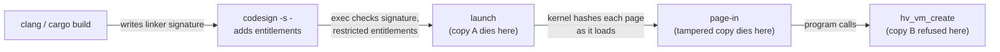

# Same program, three fates: why macOS gates the hypervisor

A **virtual machine** (VM) is a pretend computer, made of real CPU time and real memory, in which a
second operating system can run as if it owned the hardware. The program that builds and runs that
pretend computer is a **hypervisor**, also called a **Virtual Machine Monitor (VMM)**; macvmm is one.
Modern CPUs have special hardware for this, and only the **kernel** (the privileged core of macOS
that controls the hardware and every running program) may touch it. Apple lets ordinary programs
use it through a library called **Hypervisor.framework**: the program asks, the kernel does the
work. This primer is about the permission slip the kernel wants to see first.

Here is an eight-line C program that asks macOS for a virtual machine. You do not need to read C
fluently: it calls one function, `hv_vm_create`, and prints the number it gets back. We compile it once and make
three byte-for-byte identical copies of the code. Copy A is killed before it prints anything. Copy B
runs, prints, and is told "no". Copy C gets its VM. Nothing differs between them except a few
hundred bytes at the end of the file that no instruction ever reads. By the end of this primer you
will read those bytes yourself and know exactly which copy will do what before you run it.

:::objectives
- Predict, from `codesign -dv` and `codesign -d --entitlements -` output, whether a program is killed at launch, gets `HV_DENIED` from `hv_vm_create`, or creates a VM.
- Ad-hoc sign a program with exactly one entitlement and confirm the result by reading the signature back.
- Explain why every rebuild must be re-signed, and therefore why macvmm runs through a signing runner.
- (Going deeper) Name the moments macOS checks a signature (launch, page-in, the hypervisor call) and say which one catches tampering, a restricted entitlement and a missing hypervisor entitlement.
- (Going deeper) Show with `DYLD_PRINT_LIBRARIES` what the hardened runtime changes, and say why macvmm signs with `-o runtime`.
- (Going deeper) Explain why macvmm needs no provisioning profile, no SIP change and no sudo, and why its entitlement is not a security boundary.
:::

:::prereqs
- No earlier primer. You need to be able to type commands in Terminal; you do not need to read C
  fluently, because the primer says what each program does.
- A Mac with Apple Silicon and the Xcode command-line tools (`clang`, `codesign`). This primer
  never needs sudo, and never asks you to change your Mac's security settings.
:::

The primer has two parts. **Need to know** (about 10 minutes) is all that chapter 01 requires.
**Going deeper** is optional until chapters 19 and 25; read it now if you are curious, or come back
later.

## Need to know: the experiment

Make an empty scratch directory anywhere you like (not inside the macvmm repo) and put this file in
it. It is the smallest possible Hypervisor.framework program: create a VM, report the result,
destroy the VM if we got one.

`hvtry.c`

```c
#include <stdio.h>
#include <Hypervisor/Hypervisor.h>
int main(void) {
    hv_return_t r = hv_vm_create(NULL);
    printf("hv_vm_create -> 0x%08x\n", (unsigned)r);
    if (r == HV_SUCCESS) hv_vm_destroy();
    return r == HV_SUCCESS ? 0 : 1;
}
```

We also need a small property list, the XML format macOS uses for settings. It holds a single key
set to true. What the key means is the subject of the next section.

`hv.plist`

```xml
<?xml version="1.0" encoding="UTF-8"?>
<!DOCTYPE plist PUBLIC "-//Apple//DTD PLIST 1.0//EN" "http://www.apple.com/DTDs/PropertyList-1.0.dtd">
<plist version="1.0">
<dict>
	<key>com.apple.security.hypervisor</key>
	<true/>
</dict>
</plist>
```

Build once, then make the three copies. Copy A has its signature stripped, copy B is left as the
compiler made it, and copy C is re-signed with the plist.

```sh
clang -o hvtry hvtry.c -framework Hypervisor
cp hvtry copy-a
codesign --remove-signature copy-a
cp hvtry copy-b
cp hvtry copy-c
codesign -s - --entitlements hv.plist -f copy-c
```

The last command prints one line, `copy-c: replacing existing signature`. Copy C already had a
signature before we touched it, put there by the compiler's last step; that is why the command
needs `-f` (force) to overwrite it. The next section explains where that signature came from, and
`--remove-signature` is how copy A lost its copy of it.

> **Predict.** Run each copy with `./copy-a; echo "exit status $?"` (and the same for B and C).
> `$?` is the **exit status**: the number a program hands back to the shell when it ends, 0 for
> success and anything else for failure.
> Which one is killed, which one is refused, which one succeeds? Commit to a guess.

Here is what the reference Mac (M5 Pro, macOS 27.2) printed:

```text
--- copy-a
exit status 137
--- copy-b
hv_vm_create -> 0xfae94007
exit status 1
--- copy-c
hv_vm_create -> 0x00000000
exit status 0
```

Copy A also makes your shell print a kill notice in its own words (bash prints `Killed: 9`). A
**signal** is a numbered notice the kernel delivers to a process; signal 9, `SIGKILL`, ends it on
the spot and cannot be refused. When a process dies from a signal, the shell reports 128 plus the
signal number, so exit status 137 is 128 + 9: the kernel killed the process before `main` (the
program's first line) ran.
Copy B ran happily and was refused at the call: `0xfae94007` is `HV_DENIED` in the SDK's
`hv_error.h`. Copy C got `HV_SUCCESS`, which is 0. Let's find out why.

## Every program on Apple Silicon carries a signature

When you compile, the result is a Mach-O file (Apple's executable format): machine code plus
tables saying where it goes in memory. Three terms before we go on:

- The **linker** is the last step of a build: the tool that joins the compiled pieces into one
  executable file.
- A **page** is a fixed-size chunk of memory (on Apple Silicon, 16 KiB). The kernel does not read
  a whole program into memory at launch; it brings pages in one at a time as they are first used,
  which is called **page-in**.
- A **hash** (here SHA-256) is a short fingerprint computed from data. Change any byte of the data
  and the fingerprint changes.

On an Apple Silicon Mac, the linker appends one more thing without being asked: a list of hashes,
one per page of the file, plus a little descriptive data, all wrapped up and hashed again. That
bundle is a **code signature**. Hashing per page, rather than the whole file, is what lets the
kernel check each page as it brings it in, without reading the whole file first. A page that does
not match its listed hash is never run.

Ask `codesign` to describe copy B (`-d` is "display", `-v` is "verbose"):

```sh
codesign -dv copy-b
```

The interesting lines are:

```text
CodeDirectory v=20400 size=382 flags=0x20002(adhoc,linker-signed) hashes=9+0 location=embedded
Signature=adhoc
TeamIdentifier=not set
```

For now, ignore everything except the names in parentheses after `flags=` and the `Signature=`
line; the going-deeper part explains the rest. `linker-signed` says the linker made this signature. `adhoc` says nobody vouched for it: there is
no certificate, no developer identity, no Apple involvement. An **ad-hoc signature** proves only
that these exact bytes have not changed since they were signed. It is like a tamper-evident
sticker you put on your own lunchbox: anyone can tell whether it was opened, nobody can tell that
the lunch is yours. (Where the picture breaks: the kernel does not check the sticker once at the
door. It re-checks each page as the page is brought into memory, which the going-deeper part
shows.)

Now copy A makes sense. All three copies started as the same linker-signed file; `cp` copies every
byte, signature included, and only copy A had its signature removed. `codesign -dv copy-a` reports
`code object is not signed at all`, and on Apple Silicon the kernel refuses to run native arm64
code (code for the Mac's own processor) that has no signature, not even an ad-hoc one. That is the
`SIGKILL`. You will never meet this in practice, because the linker always signs; we had to strip
the signature on purpose to see it.

## An entitlement is a permission written into the signature

Copy B has a valid signature, so it launched. Why was it refused? Because nothing in its signature
asked for the hypervisor.

Some things a process can do on macOS are not available just by calling the right function
(the **API**, the set of functions a library offers). The process has to carry a named permission,
stated in its signature, before the system will agree. Such a permission is an **entitlement**: a
key (a name) and a value in a property list, embedded in the code signature and covered by its
hashes. The key we need is `com.apple.security.hypervisor`, and the value `true` says "this program
uses Hypervisor.framework". That is all `hv.plist` contains.

Why gate the hypervisor at all? It is a powerful feature that very few programs need, so Apple
wants every program that uses it to say so up front, where tools (and you) can see it. The VM a
program creates still runs with that user's own rights and under the kernel's supervision, so the
entitlement grants no new power over the Mac; it is a declaration, which is why anyone may sign it
into their own program.

`codesign -s - --entitlements hv.plist -f copy-c` did three things. `-s -` means "sign with
identity `-`", which is how you spell ad-hoc. `--entitlements hv.plist` embeds the plist. `-f`
(force) replaces the signature already there. Read the entitlements back with `--entitlements -`
(the `-` means "write to standard output"):

```sh
codesign -d --entitlements - copy-c
```

```text
Executable=/path/to/your/scratch/copy-c
[Dict]
	[Key] com.apple.security.hypervisor
	[Value]
		[Bool] true
```

Every program has two output streams: **standard output** for its results and **standard error**
for messages about what it is doing; your terminal shows both. The `Executable=` line goes to
standard error and the dictionary to standard output, so adding `2>/dev/null` (discard standard
error) leaves only the dictionary. Run the same command on copy B and you get the
`Executable=` line and nothing else: no entitlements at all. Add `--xml` to get the dictionary as
one line of XML, which is the easiest form for a script to check.

You will find many older guides, and a few places in this course's own plans, writing
`--entitlements :-`. On macOS 27.2 that form still works but warns
`Specifying ':' in the path is deprecated and will not work in a future release`. Use
`--entitlements -`, with `--xml` when a script reads it.

## The kernel checks it when you call

Look again at copy B's run. It launched, `printf` worked, and the refusal came back as an ordinary
return value from `hv_vm_create`. The missing entitlement was not a link error (the program linked
against Hypervisor.framework without complaint) and not a launch error (the program started). It
was checked **at the moment we asked for a VM**, and the answer came back as `HV_DENIED`.

That timing matters for macvmm. A VMM binary without the entitlement builds, starts, parses its
command line, and fails only at its first hypervisor call. In chapter 01 you build `doctor`, a
macvmm subcommand that checks whether your Mac is ready, and it turns that failure into a readable
message.

> **Under the hood.** Hypervisor.framework is a thin library. Creating a VM asks the macOS kernel
> to do the real work, and the kernel decides whether this process may. Apple documents that the
> entitlement is required; it does not document the internals of the check. What we can observe
> is when it happens (at the call, not at launch) and what comes back (`HV_DENIED`). Treat the
> rest as a black box we have measured from the outside.

## Why macvmm runs through a signing runner

macvmm is written in Rust, and **Cargo** is Rust's build tool: `cargo build` compiles the
project, and `cargo run` builds it and then runs the result. (Chapter 00 sets it up.)

Here is the practical consequence. `cargo build` invokes the linker, the linker writes a fresh
`linker-signed` signature, and that signature has no entitlements. On the reference machine, a
plain `cargo build` of macvmm gave exactly copy B's state:

```text
CodeDirectory v=20400 size=26320 flags=0x20002(adhoc,linker-signed) hashes=819+0 location=embedded
```

So every rebuild throws the entitlement away, and the binary must be re-signed after every build
and before every run. Doing that by hand is a recipe for confusing `HV_DENIED` errors at 11 pm.
macvmm therefore uses a Cargo setting (a "runner") that makes `cargo run` hand the freshly built
program to a small script, `scripts/sign-and-run.sh`, instead of running it directly. The script
signs it with the repository's `entitlements.plist` (the same single key as `hv.plist`) and
then runs the program. `scripts/sign.sh` does the signing alone, and `sign.sh --no-entitlements`
produces a deliberately un-entitled binary for chapter 01's negative test. You will read both in
chapter 01; for now, know that `cargo run` is safe because the runner signs first.

That is everything chapter 01 needs. In one sentence: **macOS will not let a program use the
virtualization hardware unless its signature carries `com.apple.security.hypervisor`; we give ours
an ad-hoc signature with that one permission, and the kernel checks it when we call.**

## Going deeper: what a signature really contains

**Everything from here to the self-check is optional until chapters 19 and 25.** It uses more
jargon; each term is explained once, but skimming is fine on a first read.

Ask for more detail on copy C (each extra `v` adds detail; six is the maximum):

```sh
codesign -d -vvvvvv copy-c
```

Among the output:

```text
CodeDirectory v=20400 size=456 flags=0x2(adhoc) hashes=3+7 location=embedded
Hash type=sha256 size=32
Page size=16384
CDHash=b29dbc68ef528a13f765b6797b4a59090447566a
```

The core of a signature is the **code directory** (`CodeDirectory`; `v=20400` is its format
version, `location=embedded` says it lives inside the file). `hashes=3+7` means three page hashes
(the code is hashed in 16 KiB pages, `Page size=16384`) and seven special slots. Copy B showed
`hashes=9+0` for the very same code because the linker hashes in 4 KiB pages (its `Page size=4096`)
while `codesign` re-signs in 16 KiB pages: the page count changed, the code did not.

The special slots exist so that the parts of a signature that are not code, such as the
entitlements, are hashed too and cannot be altered without detection. They are numbered backwards
from -1 to keep them apart from the code pages, which count up from 0. Slot -5 is the entitlements
plist and slot -7 is the same entitlements in a binary (DER) encoding (constant names
`CSSLOT_ENTITLEMENTS` and `CSSLOT_DER_ENTITLEMENTS` in `osfmk/kern/cs_blobs.h` of XNU, the
open-source macOS kernel). The code
directory is hashed in turn; that hash is the **cdhash**, which names this exact code plus these
exact entitlements. Your cdhash will differ from the one above, since it depends on every byte.

Because the entitlements are inside the hashed data, you cannot edit them without re-signing.
Changing a single byte of the code breaks the signature too, and the kernel notices at run time.

> **Try it.** Change one string inside the signed copy C and run it:
>
> ```sh
> cp copy-c copy-t
> perl -pi -e 's/hv_vm_create ->/hv_vm_CREATE ->/' copy-t
> codesign -v copy-t
> ./copy-t; echo "exit status $?"
> ```
>
> The `perl` line edits the file in place, replacing one text string with another of the same
> length, so only the bytes of one page change.
>
> `codesign -v` (verify) reports `copy-t: invalid signature (code or signature have been modified)`,
> and the run ends with `exit status 137`. The kernel's log says why; look with
> `/usr/bin/log show --last 1m --style compact --predicate 'eventMessage CONTAINS "copy-t"'`
> (spell out `/usr/bin/log`, because zsh has a built-in `log` that means something else). On the
> reference Mac it read, trimmed: `CODE SIGNING: process ...[copy-t]: rejecting invalid page at
> address ... from offset 0x0`. The check was per page, at page-in.

## Going deeper: who enforces it, and when

We have now seen three different checks fire at three different moments. The figure lines them up,
from build to the first hypervisor call. Notice that the hypervisor entitlement is checked last,
long after launch, which is why copy B could print. (`exec` is the kernel operation that starts a
program from a file: the moment you press Enter on `./copy-c`.)



*Caption: three checks at three moments; only the last one is about the hypervisor.*

The kernel component that applies code-signing policy is **AMFI**, Apple Mobile File Integrity
(the name comes from iOS, where it started). It is a kernel extension (a module loaded into the
kernel) that, at launch, decides whether a signature is acceptable and whether the entitlements it
claims are allowed. For any program that is not part of macOS itself, it asks a helper that runs
as an ordinary background process (a daemon), `amfid`, and amfid reports back what kind of
signature it found; for our tampered copy it answered `The file is adhoc signed or signed by an
unknown certificate chain`. You can see it
working in the log entries tagged `(AppleMobileFileIntegrity)`. Page-by-page checking is done by
the kernel's virtual memory system as pages come in. The hypervisor check is the kernel's
hypervisor code asking about the calling process when you ask for a VM, as described above.

## Going deeper: restricted entitlements and provisioning profiles

If anyone can write `com.apple.security.hypervisor` into an ad-hoc signature, what stops anyone
from writing any entitlement they like? For most entitlements, nothing, and that is fine: they
gate things an ordinary user is allowed to do anyway. But some entitlements are **restricted**:
macOS honours them only if Apple has vouched that this developer may hold them.

Apple vouches with a **provisioning profile**, a small document signed by Apple that names a
developer team (the `TeamIdentifier` we saw as `not set`), the entitlements that team may use, and
sometimes the devices. A program claiming a restricted entitlement must be signed by that team and
carry a matching profile. An ad-hoc signature has no team, so it can never match one.

`com.apple.vm.networking` is one such entitlement. It lets a VM program manage virtual network
interfaces, such as bridging a guest onto your physical network, without root, and Apple grants it
on request. Let's try to grant it to ourselves anyway. Make `net.plist` as a copy of `hv.plist`
with a second key, `com.apple.vm.networking`, also `<true/>`, and sign a fresh copy with it:

```sh
cp hvtry copy-n
codesign -s - --entitlements net.plist -f copy-n
codesign -v copy-n
./copy-n; echo "exit status $?"
```

`codesign -v` is satisfied (the signature is internally consistent), but the run ends in
`exit status 137`. Unlike copy B, this one never reaches `main`. Look at the log the same way as
before:

```sh
/usr/bin/log show --last 1m --style compact --predicate 'eventMessage CONTAINS "copy-n"'
```

On the reference Mac, trimmed, the kernel said:

```text
AMFI: When validating /path/to/copy-n:
  Code has restricted entitlements, but the validation of its code signature failed.
```

and amfid's line next to it gave the reason in one sentence:

```text
amfid: /path/to/copy-n not valid: ... Code=-424 "The file is adhoc signed but contains restricted entitlements"
```

followed by the kernel's `AMFI: bailing out because of restricted entitlements.`

So the two kinds of entitlement fail differently. A missing ordinary entitlement fails late, at the
call (`HV_DENIED`). A restricted entitlement without Apple's blessing fails early, at launch
(`SIGKILL`). This is why macvmm's `entitlements.plist` holds exactly one key, and why chapter 19
builds guest networking over Unix sockets, which need no entitlement at all.

What to retain from this section: restricted entitlements need Apple's approval tied to a named
developer team; an ad-hoc signature has no team, so it can never hold one, and AMFI kills the
program at launch if it tries.

> **Production note (skippable).** Software shipped to other people's Macs is usually signed with a Developer ID
> certificate (an identity Apple issues to a paying developer) and notarized (scanned and
> approved by Apple), so Gatekeeper, the macOS check on downloaded apps, trusts it on first launch. A learner building
> and running on their own Mac needs neither, which is why this course uses ad-hoc signing
> throughout. Chapter 23's Virtualization.framework tool uses a second self-grantable entitlement,
> `com.apple.security.virtualization`, also ad hoc.

## Going deeper: the hardened runtime and `DYLD_*`

Most programs do not contain all their code. They use **dynamic libraries**: shared files of
code (Hypervisor.framework, the C library and so on) that are attached to the program each time it
starts. The **dynamic loader**, `dyld`, does that attaching. It also obeys **environment
variables** (named settings a program inherits from whoever starts it, such as your shell) whose
names start with `DYLD_`. One of them, `DYLD_INSERT_LIBRARIES`, loads any library you name into the
process *before* `main` runs: a way to inject foreign code. A harmless cousin,
`DYLD_PRINT_LIBRARIES`, prints each library as it loads, so we can use it to see whether dyld is
listening. Each dyld line starts with `dyld[`; `2>&1` merges standard error (where dyld prints)
into standard output, and `grep -c '^dyld\['` counts the lines that begin that way:

```sh
DYLD_PRINT_LIBRARIES=1 ./copy-c 2>&1 | grep -c '^dyld\['
```

```text
705
```

dyld is listening. Now re-sign copy C with one extra option, `-o runtime`, and count again:

```sh
codesign -s - -o runtime --entitlements hv.plist -f copy-c
codesign -dv copy-c
DYLD_PRINT_LIBRARIES=1 ./copy-c 2>&1 | grep -c '^dyld\['
```

`codesign -dv` now shows `flags=0x10002(adhoc,runtime)`, the program still prints
`hv_vm_create -> 0x00000000`, and the count is `0`. The exact count of 705 depends on your macOS
version; the drop to zero is what matters.

`-o runtime` turns on the **hardened runtime**. In the words of `codesign(1)`, it opts the process
into "runtime code signing enforcement, library validation, hard, kill, and debugging
restrictions". ("Hard" and "kill" are older `codesign` options folded in here: with them the
kernel refuses to load a page that fails its check, or kills the process, instead of letting it
continue.) Among its effects: dyld ignores `DYLD_*` variables, and debuggers may not attach
unless the signature carries `com.apple.security.get-task-allow` (a debugger is a tool that
pauses a running program and inspects its memory; `lldb` is the one that ships with Xcode). Each restriction can be relaxed by
a specific entitlement, such as `com.apple.security.cs.allow-dyld-environment-variables`. macvmm
forbids every one of them.

> **Security.** Without the hardened runtime, anything that can set the environment of a macvmm
> launch (a line in a shell startup file, a per-directory environment file of the kind tools such as
> `direnv` load automatically, an `[env]` table in a cloned repo's Cargo config) can run its own
> code inside the VMM, the process that holds guest memory and your disk
> images. That is why macvmm signs every normal build with `-o runtime`. Notice what the entitlement
> is *not*: `com.apple.security.hypervisor` is a capability marker, not a security boundary. Any
> local user can ad-hoc sign it into any program, so stealing it gains an attacker nothing. Real
> confinement comes from careful code and the sandbox of chapter 25.

The hardened runtime is a signing *flag*, not an entitlement, so "exactly one entitlement" stays
true. The price is debugging: on the reference Mac, lldb refused to attach to a `-o runtime` build.
`scripts/sign.sh --debug` signs without the flag, and warns you that it did.

## Going deeper: no SIP change, no sudo

**System Integrity Protection (SIP)** is the macOS feature that keeps even root from modifying the
system's own files and from loosening code-signing enforcement. Guides for some low-level projects
tell you to switch it off, or to set kernel boot arguments that disable AMFI. Both weaken every
program on your Mac, not only yours. The course never asks you to run csrutil (the command that
switches SIP off from the recovery system).
It uses no amfi_get_out_of_my_way boot argument either.

macvmm needs no SIP change and no sudo, for three reasons we have now seen:

1. The one entitlement it needs is self-grantable: an ad-hoc signature carries it.
2. Hypervisor.framework is offered to ordinary user processes. The kernel checks the entitlement,
   not whether you are root.
3. Everything macvmm reads or writes lives in your repository or your cache directory.

If a step in any tutorial, including this one, seems to need more than that, stop and ask why.

## Self-check

Commit to an answer before you open each one. Questions 1, 2 and 5 need only the need-to-know
part; questions 3 and 4 are marked where they use the going-deeper part.

:::predict A binary shows `flags=0x20002(adhoc,linker-signed)` and `codesign -d --entitlements - --xml` prints nothing to standard output. You run it. What does `hv_vm_create` return, and what fixes it?
It launches (the linker signature is valid) and `hv_vm_create` returns `HV_DENIED` (`0xfae94007`), because no entitlement is present. Re-sign it with `codesign -s - -o runtime --entitlements entitlements.plist -f`, which in macvmm is what `scripts/sign.sh` does.
:::

:::predict You signed `target/debug/macvmm` by hand, then changed one line and ran `cargo build` followed by `./target/debug/macvmm doctor`. It reports `HV_DENIED`. Why?
`cargo build` relinked the binary, and the linker wrote a fresh `linker-signed` signature with no entitlements, replacing yours. Every build must be re-signed, which is why `cargo run` goes through `scripts/sign-and-run.sh`.
:::

:::predict (Going deeper) `codesign -dv` on a binary shows `flags=0x10002(adhoc,runtime)` and `TeamIdentifier=not set`. Can you tell from this whether it can create a VM? Will `DYLD_INSERT_LIBRARIES` work on it? Could it carry `com.apple.vm.networking` and launch?
VM: you cannot tell; the flags say nothing about entitlements, so read them with `codesign -d --entitlements -`. `DYLD_INSERT_LIBRARIES`: no, the hardened runtime makes dyld ignore `DYLD_*` variables. `com.apple.vm.networking`: no; it is restricted, and with no team identifier there is no provisioning profile that could authorise it, so AMFI kills it at launch.
:::

:::predict (Going deeper) A colleague adds `com.apple.vm.networking` to macvmm's plist "to get bridged networking". What happens on the next `cargo run`, and at which moment?
Signing succeeds and `codesign -v` passes, but the kernel kills the process at launch (`SIGKILL`, exit status 137) before `main` runs. The log shows AMFI's "Code has restricted entitlements, but the validation of its code signature failed". Compare `HV_DENIED`, which arrives later, at the call.
:::

:::predict Why is it reasonable for macOS to let any user grant `com.apple.security.hypervisor` to their own programs, when the hypervisor is such a powerful feature?
A VM created through Hypervisor.framework runs with the user's own rights and is supervised by the kernel; it gives no access a same-user program does not already have. The entitlement marks "this program uses the hypervisor", which keeps unrelated programs from using it by accident and makes the use visible. It is a capability marker, not a security boundary, which is why macvmm's real defences are its own code and its sandbox.
:::

## Where this shows up in macvmm

- **Chapter 00, [`orientation`](../../start/orientation/)**: `scripts/doctor.sh` prints
  `codesign entitlements: com.apple.security.hypervisor only`; you now know how it finds out.
- **Chapter 01, [`ffi`](../../start/ffi/)**: the entitlement gate. You read `entitlements.plist`,
  `scripts/sign.sh` and `scripts/sign-and-run.sh`, run your `doctor` signed with
  `--no-entitlements`, and explain the resulting `HV_DENIED (0xfae94007)`.
- **Chapter 19, [`virtio-net`](../../virtio/virtio-net/)**: guest networking without
  `com.apple.vm.networking`, over Unix datagram sockets that need no entitlement.
- **Chapter 23, [`vz-macos`](../../macos/vz-macos/)**: a second, separate tool holding one
  different self-grantable entitlement, `com.apple.security.virtualization`; you compare the two
  with `codesign -d --entitlements -`.
- **Chapter 25, [`security`](../../production/security/)**: the hardened runtime as part of the
  signing contract, why the entitlement is not containment, and the sandbox that is.

## Going further

- `man codesign` and `man dyld` on your Mac: the `-s -` (ad-hoc), `--entitlements`, `runtime` and
  `linker-signed` entries, and the `DYLD_*` variables.
- Apple Developer Documentation, "Hardened Runtime" and the entitlement reference pages for
  `com.apple.security.hypervisor` and `com.apple.vm.networking`
  (developer.apple.com/documentation/security/hardened-runtime,
  developer.apple.com/documentation/bundleresources/entitlements).
- Apple Technical Notes TN3125 "Inside Code Signing: Provisioning Profiles" and TN3126 "Inside Code
  Signing: Hashes" (developer.apple.com/documentation/technotes).
- XNU source, `osfmk/kern/cs_blobs.h`: the code directory layout and the special-slot numbers.

## Checkpoint

**What you can now do.** Take any binary and predict its fate from two commands:

```sh
codesign -dv copy-c
codesign -d --entitlements - copy-c
```

If you followed along, copy C shows `flags=0x10002(adhoc,runtime)`, a dictionary holding exactly
`com.apple.security.hypervisor`, and running it prints `hv_vm_create -> 0x00000000`. Delete your
scratch directory when you are done; nothing in the macvmm repo was changed.

**What's next.** Chapter 01 puts this to work: you will place macvmm in the macOS stack, write your
first FFI declarations for `hv_vm_create` and `hv_vm_destroy`, and watch your own binary meet the
same gate copy B did.

**One open question.** The kernel checks the hypervisor entitlement at the call, but checks
restricted entitlements at launch. Why might a system designer choose a late check for one and an
early check for the other? Hint: think about what each check costs, who it protects, and what
could already have gone wrong by the time a late check runs.
