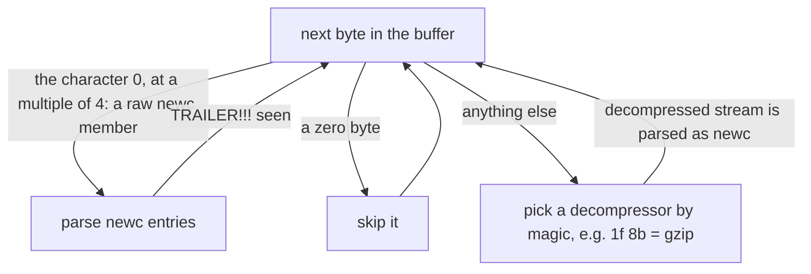

# Why does cpio hide my /init?

`cpio` is an archive tool, like `tar`: it packs many files into one file and unpacks them
again. When Linux starts, the first program it runs is called **init**; everything else on
the system is started by init. Linux can take that program out of a cpio archive.

Here is a preview of what this primer explains. Make two tiny archives on your Mac. Each holds
one file called `init`; the first says `echo hello`, the second `echo second`. Glue them
together with `cat` and ask `cpio` what is inside. (These commands need files we have not
built yet. If you want to run them now, skip ahead to "Building an archive on your Mac" and
"The puzzle, solved".)

```sh
cat tiny.cpio second.cpio > both.cpio
cpio -itv < both.cpio 2>/dev/null
```

```text
-rwxr-xr-x   1 root     wheel          21 Nov 19 00:53 init
```

One file, 21 bytes: the *first* `init`. The second has vanished. Yet when macvmm hands an
archive built exactly like this to Linux (in chapter 13 of the course, which loads a Linux
kernel), the kernel runs the *second* one, every time. The date and time will differ on your
machine; the size and the single line will not.

> **Predict.** Is `cpio` wrong, is the kernel wrong, or are they both right? Hold your guess; we
> come back to it once we can read the bytes.

:::prereqs
- What a kernel does at boot, and what a filesystem and a file mode are ([`os-basics`](/build-your-own/vmm/primers/os-basics/)).
- Hexadecimal and byte offsets, and reading `xxd` output ([`aarch64-reading`](/build-your-own/vmm/primers/aarch64-reading/)).
- Where the boot loader puts the kernel and the initramfs in RAM ([`arm64-boot-protocol`](/build-your-own/vmm/primers/arm64-boot-protocol/), "Placement").
:::

:::objectives
- Explain in two sentences why Linux needs files before it has a disk driver, and how an initramfs differs from the older initrd.
- Decode a newc cpio header from a hex dump into its 13 fields, including the file type and permissions packed into `c_mode`.
- Compute where the name, the data and the next header start, given `c_namesize` and `c_filesize` and the 4-byte padding rule.
- Predict what the kernel builds from two concatenated archives, and why a host `cpio` tool shows you something different.
- Name the boot-log lines that show the initramfs being unpacked and run, and what the kernel does when unpacking fails.
:::

## The kernel needs files before it has a disk

Picture the end of a kernel's boot. It has switched on address translation (the MMU), found its
devices in the **Device Tree** (a small table of hardware descriptions it is handed at boot) and
started its timer. Now it wants to run a first user program, by convention called `init`.
Programs live in files, and files live on a filesystem. Where is that filesystem?

On a disk, usually. But reading a disk needs a disk driver, and a general-purpose distribution
such as **Alpine** (the small Linux distribution this course boots) has to run on thousands of
different machines. So most drivers are not built into the kernel. They are **kernel modules**:
separate files the kernel loads on demand. Modules keep the kernel image small, and each machine
loads only the drivers it needs. Our virtual disk's driver, `virtio_blk.ko`, is one of them. The
module that can read the disk lives on the disk. That is a chicken-and-egg problem, and every
distribution kernel has it.

The way out is for the **boot loader**, the program that loads the kernel into memory and jumps
to it, to bring some files along. Before the kernel starts, the boot loader copies a bundle of
files into RAM next to the kernel and tells the kernel where it is. The kernel unpacks the
bundle into a filesystem that lives entirely in memory, runs `/init` from it, and that `/init`
loads whatever modules it needs to reach the real disk. The bundle, and the memory filesystem
made from it, is called the **initramfs** (initial RAM filesystem).

On a real PC the boot loader is firmware plus a program such as GRUB. In macvmm there is no
firmware for Linux: macvmm itself loads the kernel and the archive into the guest's memory and
starts the kernel. That is what **direct kernel boot** means, and it makes the boot loader's job
ours. It is a small job: copy the file's bytes into guest RAM (the memory the VMM gives the
virtual machine) and write two numbers into the Device Tree's `/chosen` node, the part of the
tree that carries boot-time settings rather than hardware: `linux,initrd-start` and
`linux,initrd-end`. The end is **exclusive**: it is the first address *after* the archive. An
archive at 100 with size 10 has end 110 and covers bytes 100 to 109. The kernel takes
`end - start` as the size (`drivers/of/fdt.c`, `early_init_dt_check_for_initrd`). The VMM never
looks inside the bundle.

## initrd and initramfs: two answers to one problem

You will see two names for this, often used as if they were one. They were not always.

The older scheme, the **initrd** (initial RAM disk), handed the kernel a whole *disk image*,
typically formatted as ext2 (an old Linux disk filesystem). The kernel copied it into a
RAM-backed **block device** (something that looks like a disk), `/dev/ram0`, mounted it with a
real filesystem driver and ran `/linuxrc`. It worked, but it was clumsy: the image had a fixed
size, building one meant root privileges and a "loop device" (a file pretending to be a disk),
and the kernel kept every block in memory twice, once in the RAM disk and once in its cache of
file contents (the page cache).

The **initramfs** scheme, added during the 2.5 development series, replaced the disk image with
an *archive*: a stream of file names, metadata and contents. The kernel unpacks it into a
filesystem called **rootfs**, an instance of `tmpfs` (or `ramfs`), a filesystem kept purely in
memory that grows and shrinks with its files. No block device, no filesystem driver, no fixed size. The format is defined in
`Documentation/driver-api/early-userspace/buffer-format.rst`, and it is the subject of this
primer.

The old name refuses to die. The Device Tree properties say `initrd`, the kernel option that
enables the feature is `CONFIG_BLK_DEV_INITRD`, and macvmm's flag is `--initrd`, as in QEMU.
Inside, it is an initramfs. Alpine's kernel does not even support the old scheme any more; you
can check its config once you have run `scripts/fetch.sh linux` for chapter 13:

```sh
grep -E 'CONFIG_BLK_DEV_INITRD=|CONFIG_BLK_DEV_RAM\b' .cache/macvmm/config-6.18.60-0-virt
```

```text
CONFIG_BLK_DEV_INITRD=y
# CONFIG_BLK_DEV_RAM is not set
```

No RAM disk driver, so an archive is the only thing this kernel will accept.

## Building an archive on your Mac

The archive format Linux reads is **cpio**, a Unix archiver older than `tar`, and in particular
its **newc** variant (the "new ASCII" or SVR4 format). macOS ships `cpio` in `/usr/bin`; it is
`bsdcpio`, built on libarchive, and it can write newc. Let us make the first archive from the
opening. Each command runs in a fresh scratch directory:

```sh
cd "$(mktemp -d)"
mkdir tree
printf '#!/bin/sh\necho hello\n' > tree/init
chmod 755 tree/init
(cd tree && echo init | cpio -o -H newc -R 0:0) > tiny.cpio
wc -c < tiny.cpio
```

```text
1 block        <- printed by cpio, on standard error
     512       <- printed by wc -c: the archive is 512 bytes
```

`cpio -o` reads a list of file names on standard input and writes an archive on standard
output. `-H newc` picks the format. `-R 0:0` records the owner as root (user 0, group 0)
instead of your own user ID, because inside the guest your Mac's 501 means nothing. The
`1 block` line is `cpio` reporting, on standard error (so it is not part of the archive), that
it wrote one 512-byte block. `wc -c` counts the archive's bytes: 512.

> **Predict.** Leave out `-H newc` and the archive starts with different bytes. What will
> Linux say when it meets it?

Try it: `(cd tree && echo init | cpio -o) | head -c 6` prints `070707`. A **magic** (or magic
number) is a fixed set of bytes at the start of a file that says which format it is. This is
the magic of
the older "odc" format, which is `bsdcpio`'s default. The kernel recognises it only to refuse
it, with the most helpful error message in all of `init/initramfs.c`: `incorrect cpio method
used: use -H newc option`.

## Anatomy of a newc entry

An archive is a sequence of entries, one per file, and each entry is a fixed header, then the
file's name, then its contents. The header is 110 bytes of plain ASCII: a 6-byte magic,
`070701`, then thirteen fields, each eight hexadecimal digits. Here are the first bytes:

```sh
xxd -l 16 tiny.cpio
```

```text
00000000: 3037 3037 3031 3031 3632 3733 3865 3030  0707010162738e00
```

Text, not binary integers. That choice makes the format endian-free and readable with your
eyes. The 13 fields of 8 characters make 13 × 8 = 104 bytes, and 6 + 104 = 110. To see them,
take the first 110 bytes (`head`), drop the 6-byte magic by keeping the last 104 (`tail`), and
break the result into 8-character lines (`fold`):

```sh
head -c 110 tiny.cpio | tail -c 104 | fold -w 8
```

```text
0162738e
000081ed
00000000
00000000
00000001
6afeb8f4
00000015
00000001
00000010
00000000
00000000
00000005
00000000
```

Line N of the output is row N of this table (names from `buffer-format.rst`; `c_maj`/`c_min`
and `c_rmaj`/`c_rmin` take two lines each):

| Line | Field | Value | Meaning |
|---|---|---|---|
| 1 | `c_ino` | `0162738e` | inode number on your Mac (varies) |
| 2 | `c_mode` | `000081ed` | file type and permissions |
| 3 | `c_uid` | `00000000` | owner: root, thanks to `-R 0:0` |
| 4 | `c_gid` | `00000000` | group: root |
| 5 | `c_nlink` | `00000001` | number of hard links |
| 6 | `c_mtime` | `6afeb8f4` | modification time, seconds since 1970 (varies) |
| 7 | `c_filesize` | `00000015` | 21 bytes of data |
| 8, 9 | `c_maj`, `c_min` | `00000001`, `00000010` | the Mac disk the file came from (varies) |
| 10, 11 | `c_rmaj`, `c_rmin` | `00000000`, `00000000` | only for device files |
| 12 | `c_namesize` | `00000005` | `init` plus its terminating NUL byte |
| 13 | `c_chksum` | `00000000` | always zero for `070701` |

Your `c_ino`, `c_mtime`, `c_maj` and `c_min` will differ; everything else should match.

Three terms in that table. An **inode** is the filesystem's record for one file, and its
number identifies the file on that disk. A **hard link** is another name for the same inode,
so `c_nlink` counts names. A **NUL** is a zero byte, which C uses to mark the end of a string.
A **device file** (or device node) is a file that stands for a piece of hardware; its *major*
number picks the driver and its *minor* number the device within it. `c_maj:c_min` say which
disk the file was on; `c_rmaj:c_rmin` say which device a device file stands for.

The one field that needs decoding is `c_mode`. It is the `st_mode` value that `stat(2)` would
return: the low 12 bits are the permissions, and the bits above them are the file type.
Permissions are traditionally written in **octal** (base 8), because each octal digit is
exactly 3 bits, one `rwx` group. So convert the hex to octal by going through binary:

```text
hex      8    1    e    d
binary   1000 0001 1110 1101
regroup  1 000 000 111 101 101      (threes, from the right)
octal    1  0   0   7   5   5   =  0100755
```

`printf '%o\n' 0x81ed` prints `100755` and confirms it. Split it: `0100000` is `S_IFREG`, a
regular file, and `0755` is `rwxr-xr-x` (7 = `rwx` for the owner, 5 = `r-x` for group and
others). Going the other way, octal to hex, is the same trick backwards: write each octal digit
as 3 bits, then regroup in fours. The table of types is short:

| Octal type | Name | What the entry's data holds |
|---|---|---|
| `0100000` | regular file | the file's bytes |
| `0040000` | directory | nothing (`c_filesize` is 0) |
| `0120000` | symbolic link | the link's target path |
| `0020000` | character device | nothing; the device number is in `c_rmaj:c_rmin` |

The last row deserves a second look. An entry with mode `020600` and `c_rmaj:c_rmin = 5:1`
*is* `/dev/console`, and the kernel creates that device node as it unpacks. Making a device
node on your Mac needs root; writing these 110 bytes does not. That is why macvmm's own
archive writer (`crates/xtask`) emits headers directly instead of archiving real files.

## Padding: where the next entry starts

Now the bytes after the header. The dump below starts 6 bytes before the header ends, at
offset 104 (`0x68`), and shows 40 bytes:

```sh
xxd -s 104 -l 40 tiny.cpio
```

```text
00000068: 3030 3030 3030 696e 6974 0000 2321 2f62  000000init..#!/b
00000078: 696e 2f73 680a 6563 686f 2068 656c 6c6f  in/sh.echo hello
00000088: 0a00 0000 3037 3037                      ....0707
```

Read it in five regions:

| Offsets (decimal) | Bytes | What |
|---|---|---|
| 104 to 109 | `30 30 30 30 30 30` | last 6 characters of the header (`c_chksum`) |
| 110 to 114 | `69 6e 69 74 00` | the name `init` and its NUL (5 bytes) |
| 115 | `00` | 1 byte of padding |
| 116 to 136 | `23 21 ... 6f 0a` | the 21 data bytes, ending in a newline |
| 137 to 139 | `00 00 00` | 3 bytes of padding |
| 140 onward | `30 37 30 37 ...` | the next header (`0707...`) |

The rule (`buffer-format.rst`) is that **every header starts on a 4-byte boundary, and so does
every file's data**. "Round up to the next multiple of 4" can be written as
`(n + 3) / 4 * 4` in whole-number division: `(115 + 3) / 4 * 4 = 116`, and
`(137 + 3) / 4 * 4 = 140`. A number already on a boundary stays put: `(116 + 3) / 4 * 4 = 116`.

```text
 0          110      116                    137    140
 | header   | init\0 |p| #!/bin/sh ... hello\n |ppp| next header ...
 |<- 110 -->|<- 5 -->|1|<-------- 21 -------->| 3 |
```

*One entry: header, name, pad, data, pad. Both pads round up to the next multiple of 4.*

Because 110 is not a multiple of 4, the name's padding depends on the header too. The quantity
to round up is **`110 + c_namesize`**, not `c_namesize` alone: for `init`, `110 + 5 = 115`
rounds up to 116, so the data starts 116 bytes after the start of the entry. Then the data ends
at `116 + c_filesize`, and that is rounded up to give the next header. (In `init/initramfs.c`
you will see this written as a bit trick, `N_ALIGN`; it computes the same thing.)

The entry at 140 is not a file. Its name is `TRAILER!!!`, its size is 0, and it marks the end
of the archive. `cpio` then fills the rest of the 512-byte block with zeros, which is where our
file's size came from.

> **Aside.** "cpio" is "copy in, copy out", after its two modes (`-i` and `-o`). The odc format
> stored numbers in octal and newc switched to hexadecimal so the fields could hold larger
> inode and device numbers. The `070702` "crc" variant fills `c_chksum` with a plain 32-bit sum
> of the data bytes, which `buffer-format.rst` notes is "clearly incorrect" to call a CRC.

## How the kernel unpacks it

The unpacker is `init/initramfs.c`, about 800 lines, and it is more forgiving than a host tool
in three ways that matter to us. Its main function, `unpack_to_rootfs`, runs twice: first on a
tiny archive built into the kernel itself (Alpine's holds `/dev`, `/dev/console` and `/root`),
then on the buffer the boot loader described in `/chosen`.

The kernel does not assume the buffer holds one archive. It treats it as a sequence of
**members**: each member is one cpio archive, either raw or squeezed by a compressor such as
gzip, and members simply follow one another. To tell them apart it checks the magic. A raw
newc member starts with the character `0` (of `070701`); a gzip member starts with the bytes
`1f 8b`. A **decompressor** is the code that turns a compressed member back into a raw one. So
the kernel loops, looking at the byte at the current position:



*The buffer is a sequence of members, each raw or compressed; a trailer ends a member, not the
buffer.*

That loop is the grammar of `buffer-format.rst`, `initramfs := ("\0" | cpio_archive |
cpio_compressed_archive)*`, written in C. Three consequences follow.

**Members can be compressed independently.** Alpine's `initramfs-virt` starts with `1f 8b`,
the gzip magic (check it with `xxd -l 4`). The Alpine kernel accepts gzip, xz, lz4 and zstd
members (`CONFIG_RD_GZIP=y` and friends in its config).

**A trailer is not the end.** After `TRAILER!!!` the kernel forgets what it knew about the
member it just finished (its list of hard links) and keeps reading. Zero bytes between members
are skipped.

**Later entries win.** Before creating each name, the kernel removes an existing entry of a
different type (`clean_path`), and it opens regular files with `O_TRUNC`, which means "open the
file and empty it first". A second `init` overwrites the first. Names that a later member does
not mention are left untouched.

When the buffer is used up, the kernel looks for the program named by the `rdinit=` option on
its command line, by default `/init`. If it is there and executable, you see the line chapter
14's checkpoint waits for. If not, the kernel gives up on the initramfs and falls back to
mounting a disk named by the `root=` option. With no disk that ends in
`VFS: Unable to mount root fs on unknown-block(0,0)`, a panic (the kernel stops for good).

The lines to look for in a boot log are these (chapter 14 shows them in a real capture, and the
aside below explains why other lines can appear between them). `<size>` is the initramfs size
in KiB, rounded *down* to whole 4 KiB pages, because only pages that lie entirely inside the
initramfs are freed: the 9,404,792-byte Alpine initramfs is 2296.09 pages and prints `9184K`.

```text
Unpacking initramfs...
Freeing initrd memory: <size>K
Run /init as init process
```

A kernel that still has the RAM disk driver prints `Trying to unpack rootfs image as
initramfs...` instead of the first line. If unpacking fails, the kernel prints `Initramfs
unpacking failed:` followed by the reason (`no cpio magic`, `broken padding`, `junk within
compressed archive`, and so on) and carries on with whatever it unpacked before the error.

> **Under the hood (optional).** Since Linux 5.13 the unpacking runs in the background while
> the kernel carries on setting up drivers, unless you boot with `initramfs_async=0`. That is
> why "Unpacking initramfs..." can appear some lines before the unpacking actually finishes,
> with unrelated driver messages in between. The three lines still come in the order shown.

## The puzzle, solved

Now the opening makes sense. Build the second archive and the pair:

```sh
printf '#!/bin/sh\necho second\n' > tree/init
(cd tree && echo init | cpio -o -H newc -R 0:0) > second.cpio
cat tiny.cpio second.cpio > both.cpio
cpio -itv < both.cpio 2>/dev/null
tail -c 512 both.cpio | cpio -itv 2>/dev/null
```

```text
-rwxr-xr-x   1 root     wheel          21 Nov 19 00:53 init
-rwxr-xr-x   1 root     wheel          22 Nov 19 00:53 init
```

The first line is the opening's output: 21 bytes, `echo hello`, from the first archive. Each
archive is exactly one 512-byte block (we saw `wc -c` print 512), so the second archive starts
at byte 512 of `both.cpio`, and `tail -c 512` hands `cpio` only that second archive. The
second `init` was there all along, 22 bytes (`second` is one letter longer than `hello`). `bsdcpio`
treats `TRAILER!!!` as the end of *everything* and stops reading; the kernel treats it as the
end of *one member* and continues, and the second `init` replaces the first. Both tools follow
their own specification. Only one of them boots your VM.

This is exactly how macvmm builds `initramfs-test.img`. It takes Alpine's stock
`initramfs-virt` and appends a small, uncompressed newc member holding our own `/init` script.
No re-packing of Alpine's archive, no root privileges, and Alpine's busybox and modules are
still there for our script to use. After `scripts/fetch.sh linux` you can measure Alpine's
archive yourself:

```sh
f=.cache/macvmm/initramfs-virt
wc -c < "$f"                                 # size on disk, gzip-compressed
gzip -dc "$f" | wc -c                        # size once decompressed
gzip -dc "$f" | cpio -it 2>/dev/null | wc -l # number of entries
gzip -dc "$f" | cpio -itv init 2>/dev/null   # Alpine's own /init
```

```text
 9404792
 25713532
     288
-rwxr-xr-x   1 root     wheel       30369 Nov  5 01:19 init
```

> **Security.** The VMM treats the initramfs as opaque bytes. What it must check is the part
> it does use: the file's length, and that `start + length` fits inside guest RAM and inside
> the address range `booting.rst` allows. The addition uses `checked_add`, Rust's addition that
> reports overflow instead of silently wrapping around to a small number. A hostile archive
> can only mislead the guest kernel that unpacks it, which is the guest's own problem.
>
> The host is different: our host tools *do* parse downloaded archives. An entry is just a
> name and some bytes, and nothing stops the name being `../../.ssh/authorized_keys`. A tool
> that extracts it into a folder would climb out of that folder and overwrite a real file in
> your home directory ("path traversal"). The same can happen in two steps: one entry is a
> symbolic link pointing outside the folder, and a later entry with the same name writes
> through it. `bsdcpio` refuses both unless you pass `--insecure`. So list downloaded
> archives with `cpio -it` rather than extracting them, never pass `--insecure`, and see
> `docs/security/threat-model.md` for the rules macvmm's own archive code follows.

## Lab

*Optional, and coming later: this in-browser lab is not built yet. Nothing else in the primer
depends on it.*

The `cpio-inspector` lab (embedded here and in chapter 13) takes a file you drop on the page,
parsed locally in your browser and never uploaded. It shares its drop zone with
`image-inspector` and `elf-inspector`. For each entry it shows the 13 header fields with their
offsets, decodes `c_mode` into type and permissions, and highlights the name, data and padding
bytes. Unlike `bsdcpio`, it walks every member the way the kernel does, marks each
`TRAILER!!!`, and flags entries that a later member overwrites. Drop `both.cpio` into it, then
break a copy and see which kernel error message the lab predicts. To change the sixth byte of
the magic from `1` to `8` (offset 5, counting from 0):

```sh
cp both.cpio bad.cpio
printf '8' | dd of=bad.cpio bs=1 seek=5 conv=notrunc 2>/dev/null
head -c 6 bad.cpio     # prints 070708
```

## Self-check

:::predict An entry's header says c_namesize = 0x0000000b and c_filesize = 0. It starts at offset 140. Where does the next header start?
At 264. The name occupies the 11 bytes from 250 (`140 + 110`) to 260. `110 + c_namesize`
is `110 + 11 = 121`, which rounds up to 124, so the name plus padding ends at
`140 + 124 = 264`; with no data there is nothing more to pad. This is the trailer from `tiny.cpio`: `TRAILER!!!` is 10 characters plus a NUL.
:::

:::predict What is the c_mode of a directory with permissions 0755, in hexadecimal? And of a symbolic link with 0777?
Directory: type `0040000` plus permissions `0755` is `040755` octal. Write each octal digit as
3 bits (`100 000 111 101 101`), regroup in fours from the right (`0100 0001 1110 1101`), and
read off `0x41ed`. Symlink: `0120777` octal is `1 010 000 111 111 111`, regrouped
`1010 0001 1111 1111`, which is `0xa1ff`. Check both with
`printf '%x %x\n' $((8#40755)) $((8#120777))`, which prints `41ed a1ff` (`8#` tells the shell
the number is octal). The symlink's data is its target path, so its `c_filesize` must not be
zero.
:::

:::predict You build an archive with plain `cpio -o` on macOS and boot Linux with it. What do you see in the log, and does Linux run your /init?
`Initramfs unpacking failed: incorrect cpio method used: use -H newc option`. The archive
starts with `070707`, the odc format. Your `/init` never appears in rootfs, so the kernel falls
back to `root=` and, with no disk, panics with `VFS: Unable to mount root fs`.
:::

:::predict Alpine's initramfs-virt is gzip-compressed and ends with a trailer. You append an uncompressed archive whose only entry is etc/motd. Which /etc/motd does the guest see, and does Alpine's /init still run?
Yours: later entries overwrite earlier ones. Alpine's `/init` still runs, because your member
did not contain an `init` entry; the kernel kept everything from the first member and added or
replaced only what the second one names.
:::

:::predict Why does Linux need an initramfs at all on a distribution kernel, and why could it not read the initramfs from the disk instead?
The disk driver (`virtio_blk.ko` for us) is a module stored on the disk, so the kernel cannot
read the disk until it has loaded a file it would find on the disk. The boot loader breaks the
loop by putting the needed files in RAM before the kernel starts.
:::

:::predict A VMM writes linux,initrd-end = initrd-start + size - 1. What goes wrong?
The kernel treats the end as exclusive and computes the size as `end - start`, so it sees one
byte too few: an archive at 100 with size 10 should have end 110, but this VMM writes 109, and
byte 109 is lost. If that last byte was only padding, nothing visible happens. Bonus: if it was
the last byte of a compressed member, the decompressor finds its input cut short and unpacking
fails with an error. An off-by-one that only sometimes bites is the worst kind, which is why
chapter 13 has a test for exactly this.
:::

## Where this shows up in macvmm

- **[Chapter 13, `loaders`](../../linux/loaders/)** places the initramfs: at the first 2 MiB
  boundary after the kernel's `image_size`, checked against RAM and the `booting.rst` window,
  then written to `/chosen` as `linux,initrd-start` and `linux,initrd-end`
  (`crates/vmm/src/loader/`, `crates/vmm/src/fdt/machine.rs`). It also builds
  `initramfs-test.img` with `cargo xtask` (`crates/xtask`), the concatenation from "The puzzle,
  solved". Its Breaks exercise puts the initramfs inside the kernel's BSS (memory the kernel zeroes and uses for its
  variables once it starts, beyond the end of the file you loaded) and lets you watch an
  unpacking error appear far from its cause.
- **[Chapter 14, `linux-boot`](../../linux/linux-boot/)** reaches `Run /init as init process`
  and then `macvmm-initramfs: ready`, printed by our appended `/init`. The [`linux-boot-sequence`](/build-your-own/vmm/primers/linux-boot-sequence/)
  primer explains where the unpacking sits among the other boot stages.
- **[Chapter 23, `vz-macos`](../../macos/vz-macos/)** boots the same `initramfs-test.img` under
  Apple's Virtualization.framework, a reminder that the archive is a contract with Linux, not
  with any particular VMM.

## Going further

- Linux 6.18, `Documentation/driver-api/early-userspace/buffer-format.rst`: the grammar, the
  header table, hard links and the trailer rule. Short, and the authority for everything here.
- Linux 6.18, `Documentation/filesystems/ramfs-rootfs-initramfs.rst`: what rootfs is, why
  ramfs and tmpfs, and why the archive replaced the RAM disk.
- Linux 6.18, `init/initramfs.c` (`unpack_to_rootfs`, `do_header`, `do_name`, `clean_path`,
  `do_populate_rootfs`) and `drivers/of/fdt.c` (`early_init_dt_check_for_initrd`).
- `man 5 cpio` on your Mac, section "New ASCII Format", and `man 1 cpio` for `-H`, `-R` and
  `--insecure`.

## Checkpoint

**What you can now do.** Given an initramfs file, you can say whether it is raw or compressed,
read its newc headers by hand, find each entry and the next one, and predict what the kernel's
rootfs will contain after every member is unpacked. Verify the core skill in the scratch
directory you used above:

```sh
strings both.cpio | grep -c TRAILER
```

```text
2
```

Two trailers, so two members: the kernel will read both, `bsdcpio` only the first.

**What's next.** Chapter 13 turns placement into a contract: where the initramfs may go, how
big the kernel really is once its BSS is counted, and how two numbers in `/chosen` tell Linux
all of it. Get either number wrong and the failure appears in the unpacker, long after the VMM
has finished its work.

**One open question.** The kernel happily lets a later member overwrite any file from an
earlier one, including `/init`. Distributions use that to add drivers or firmware to a stock
initramfs. If a boot loader could append a member you did not ask for, what could it change
about your system, and what would you need to detect it?
