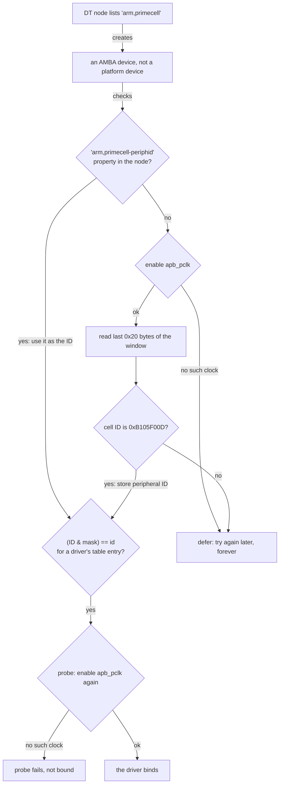

# How does a device say what it is?

First, some words. A **UART** is a serial-port chip: it sends and receives bytes one at a time, and
it is how a computer with no screen prints its boot messages. The **PL011** is Arm's UART design,
and it is the console our VMM emulates. Like every device we emulate, it answers a fixed range of
addresses, its **register window**; an **offset** is an address counted from the start of that
window. Numbers written with `0x` are hexadecimal (base 16).

The PL011's register map, the one we implement in Chapter 09, ends at offset `0x048`. Then
nothing for almost four kilobytes. Then, at the very top of the window, eight registers that hold
constants: `0x11`, `0x10`, `0x14`, `0x00`, `0x0D`, `0xF0`, `0x05`, `0xB1`. None of them sends or
receives a byte. A UART has no use for them.

So who reads them? The **guest**, the operating system running inside our virtual machine, does.
And why does the Linux kernel, which has already been told "there is a PL011 at `0x0900_0000`",
read them before it touches a single UART register?

> **Predict.** Suppose our VMM answers zero for all eight. The UART registers themselves are
> perfect. Does Linux still use the UART? Write down a guess. This primer gives you enough to
> reason it out, and Chapter 14 shows the answer on a real boot log.

:::prereqs
- Memory-mapped I/O (MMIO): a device register is an address, and a guest read or write there is a request to the device, which our VMM answers (Chapters 05 and 07).
- Little-endian byte order: in a multi-byte number, the lowest-value byte comes first (the [`aarch64-reading`](/build-your-own/vmm/primers/aarch64-reading/) primer).
- RAZ/WI, "reads as zero, writes ignored": reads return 0 and writes are thrown away (Chapter 08 and the [`reading-arm-specs`](/build-your-own/vmm/primers/reading-arm-specs/) primer).
:::

## A family of devices that cannot be discovered

Two words before we start. A **driver** is the piece of kernel code that knows how to operate one
kind of device, and **binding** is the kernel deciding which driver gets which device. Once a
driver is chosen, the kernel calls its **probe** function, which sets the device up for use.

Now the problem the bytes solve. On a PC, plug-in cards sit on a PCI bus, and every PCI device
answers a standard set of questions at a standard place: "who made you, what are you?" The kernel
walks the bus and asks. The small devices inside an Arm system chip (a UART, a real-time clock, a
GPIO block of general-purpose pins) are not like that. They are wired at fixed addresses, and
there is no bus-wide "who is there?" question to ask. Reading an address where nothing lives does
not return a polite "nobody home"; depending on the chip it returns garbage, zeros, or faults.

So the kernel needs to be told where things are. On Arm that list is the **Device Tree**: a data
structure handed to the kernel at boot by whatever ran before it (on real boards, the firmware,
the small program in flash that starts the machine; for us, the VMM). It has one node per device,
giving its address range (the `reg` property) and a string naming what it is (the `compatible`
property). Chapter 10 builds one from scratch; for now, read a node like this fragment (Device
Tree source syntax, not code we run):

```
pl011@9000000 {
    compatible = "arm,pl011", "arm,primecell";
    reg = <0x0 0x09000000 0x0 0x1000>;     // address 0x0900_0000, size 0x1000 (4 KiB)
    clocks = <&apb_pclk &apb_pclk>;        // the clocks this device uses...
    clock-names = "uartclk", "apb_pclk";   // ...and a name for each entry of `clocks`
};
```

`reg` is an address followed by a size. Each is written as two 32-bit cells, high half first, so
`0x0 0x09000000` is the address and `0x0 0x1000` the size; why two cells is a Chapter 10 detail.
`clocks` points at clock nodes elsewhere in the tree, and `clock-names` labels those entries in
order. Labels alone name nothing, so if you copy this node, copy both lines. A chip needs clocks
because digital logic only does anything on the tick of a clock signal; a peripheral whose clock is
switched off ("gated") does not respond at all.

Two `compatible` strings. The first is the specific part. The second says "this belongs to a
family", and that family is what this primer is about.

Arm, the company, does not only design processors. It also sells ready-made designs for the
ordinary peripherals that every chip needs, so that a chip maker can drop in a UART instead of
designing one. That catalogue is called **PrimeCell**, and its parts have names like PL011 (UART),
PL031 (real-time clock) and PL061 (GPIO). They sit on Arm's on-chip bus standard, **AMBA**
(Advanced Microcontroller Bus Architecture), usually on its simple, slow branch for peripherals,
**APB** (Advanced Peripheral Bus). The clock named `apb_pclk` above is that bus's clock.

Here is the catch. A PL011 licensed by ST Microelectronics is not quite a PL011 from Arm: ST moved
some registers around. And a PL011 from 2001 is not quite a PL011 from 2007: the later revision
has deeper FIFOs (first-in, first-out queues that hold bytes waiting to be sent or read). The Device
Tree string `"arm,pl011"` says none of that. The device itself has to.

## Eight bytes at the top of the window

Every PrimeCell carries a small, standard self-description in the last 32 bytes of its register
window. The PL011's window is 4 KiB, which is 4096 bytes or `0x1000`, so its last 32 bytes are
offsets `0xFE0` to `0xFFF`: eight 32-bit registers, each holding one meaningful byte in bits
`[7:0]` (the low eight bits), with the upper bits reading as zero.

```
offset   register        PL011 byte   meaning
0x000    DR              (data)       \
 ...     (UART registers)              > the device's real work, up to 0x048
0x048    DMACR                        /
 ...     (unused, RAZ/WI)
0xFE0    PeriphID0       0x11    \
0xFE4    PeriphID1       0x10     |  Peripheral ID: what part, who designed it,
0xFE8    PeriphID2       0x14     |  which revision, which configuration
0xFEC    PeriphID3       0x00    /
0xFF0    PCellID0        0x0D    \
0xFF4    PCellID1        0xF0     |  PrimeCell ID: a fixed signature that says
0xFF8    PCellID2        0x05     |  "this window follows the PrimeCell rules"
0xFFC    PCellID3        0xB1    /
```

`DR` (the data register) and `DMACR` (DMA control) are just the first and last UART registers,
shown for scale; Chapter 09 covers them, and you can ignore them here.

*Notice that the IDs are pinned to the end of the window, not to a fixed offset after the
device's own registers.* A device with three registers and one with three hundred keep their IDs
in the same place relative to the top. That pays off in the next section: one piece of kernel code
reads the IDs of every PrimeCell, and the only thing it needs to know is the window's size.

The two groups have different jobs. The four **PrimeCell ID** bytes (the PL011 manual calls them
`UARTPCellID0-3`) are the same for every PrimeCell. They are a signature: if you find them, the
other four bytes are worth decoding. The four **Peripheral ID** bytes (`UARTPeriphID0-3`) say which
peripheral this is.

To read either group as one number, put byte 0 in the lowest eight bits, byte 1 in the next eight,
and so on. That is little-endian order. Three operators do the work:

- a **shift** `x<<n` slides the bits of `x` left by `n` places (`0xf0<<8` is `0xf000`), and `x>>n`
  slides them right, dropping the bits that fall off the end;
- `|` (OR) combines values whose bits do not overlap;
- a **mask** `x & m` (AND) keeps only the bits of `x` where `m` has a 1, and zeroes the rest.

By hand, for the PrimeCell ID: `0x0d` stays put, `0xf0<<8` is `0x0000f000`, `0x05<<16` is
`0x00050000`, `0xb1<<24` is `0xb1000000`. OR them and you get `0xb105f00d`. Your Mac agrees:

```sh
printf '0x%08x\n' $(( 0x0d | 0xf0<<8 | 0x05<<16 | 0xb1<<24 ))
```

```
0xb105f00d
```

(`$(( ... ))` is shell arithmetic, `<<` binds tighter than `|` as in C, and `%08x` prints eight hex
digits.) That is the PrimeCell signature Linux looks for.

> **Aside (skippable).** Read the hex as letters and `B105 F00D` spells "BIOS FOOD", the kind of
> joke engineers hide in magic numbers. It is also useful: a pattern this specific is very unlikely
> to appear by accident in an unrelated register.

## Decoding the Peripheral ID

Assemble the PL011's Peripheral ID bytes the same way:

```sh
printf '0x%08x\n' $(( 0x11 | 0x10<<8 | 0x14<<16 | 0x00<<24 ))
```

```
0x00141011
```

That 32-bit value is cut into four fields, and the field edges do not fall on byte boundaries.
This is the part people get wrong, so work it in binary once. Recall that one hex digit is exactly
four bits (a **nibble**): `0x1` is `0001`, `0x4` is `0100`. So each byte is two hex digits, and the
fields below are cut along hex-digit lines:

```
 hex digits of 0x00141011:   0  0  |  1  |  4  1  |  0  1  1
 bits:                      31..24 |23..20| 19..12 | 11..0
 field:              configuration |  rev | designer | part number
 value:                      0x00  |  0x1 |  0x41   |  0x011
```

And here is which byte each field comes from:

| field (bits) | taken from | value |
|---|---|---|
| part number `[11:0]` | all of `PeriphID0` (`0x11`) + low digit of `PeriphID1` (`0x0`) | `0x011` |
| designer `[19:12]` | high digit of `PeriphID1` (`0x1`) + low digit of `PeriphID2` (`0x4`) | `0x41` |
| revision `[23:20]` | high digit of `PeriphID2` (`0x1`) | `1` |
| configuration `[31:24]` | all of `PeriphID3` (`0x00`) | `0` |

*Notice the designer straddles two bytes, and the revision is simply the top hex digit of
`PeriphID2`.* Remember that second fact; FreeBSD relies on it later.

- **Part number** (12 bits): `0x011`, the "011" in PL011. The PL031 real-time clock is `0x031`.
- **Designer** (8 bits): `0x41`, which is the ASCII code for the letter `'A'`, for Arm. Linux names
  this constant `AMBA_VENDOR_ARM`; ST's code is `0x80`.
- **Revision** (4 bits): which version of the design. This one says `1`.
- **Configuration** (8 bits): build-time options; `0` here.

Let the shell cut the fields for you, with a shift to bring each field down to bit 0 and a mask to
keep only its bits:

```sh
pid=0x00141011
printf 'part=0x%03x designer=0x%02x rev=%d config=%d\n' $(( pid & 0xfff )) $(( (pid>>12) & 0xff )) $(( (pid>>20) & 0xf )) $(( (pid>>24) & 0xff ))
```

```
part=0x011 designer=0x41 rev=1 config=0
```

These four shifts and masks are, byte for byte, the macros `AMBA_PART_BITS`, `AMBA_MANF_BITS`,
`AMBA_REV_BITS` and `AMBA_CONFIG_BITS` in Linux's `include/linux/amba/bus.h`.

> **Try it.** Our PL031 real-time clock answers `0x31`, `0x10`, `0x14`, `0x00` at `0xFE0` to `0xFEC`.
> Set `pid` to the assembled value and rerun the `printf`. You should see `part=0x031`, the same
> designer, and revision 1. Then try the bytes of an ST UART, `0x02 0x08 0x38 0x00`: which designer
> and part do you get? (The answer is in the next section.)

## How Linux matches on them

Now the payoff. For most Device Tree nodes the kernel binds by comparing `compatible` strings: the
node becomes a generic **platform device**, and any driver that lists the same string gets it. For
PrimeCells, it does something stricter: the node becomes an **AMBA device**, which is bound by the
ID bytes. The steps are short enough to follow in full (Linux 6.18, `drivers/of/platform.c` and
`drivers/amba/bus.c`). The numbered list after the diagram says the same thing in words.



*Notice that `compatible` only gets the node onto the AMBA bus; the bytes the device reports
decide which driver binds.*

Step by step:

1. **The family string routes the node.** When the kernel walks the Device Tree, any node whose
   `compatible` contains `"arm,primecell"` becomes an AMBA device instead of an ordinary platform
   device (`of_platform_bus_create()`).
2. **An override is allowed.** If the node carries `arm,primecell-periphid = <...>`, that number is
   used as the Peripheral ID and the hardware is never asked (`of_amba_device_create()`). This exists
   for chips whose ID registers are wrong (the Raspberry Pi's UART is the famous one).
3. **Otherwise, read the hardware.** `amba_read_periphid()` first switches on the device's bus clock,
   the one the node names `apb_pclk`, because a peripheral with its clock off cannot answer.
   Then it reads eight 32-bit words at `size - 0x20` to `size - 0x04`, where `size` is the second
   number in the node's `reg`, keeps the low byte of each (`& 255`), and assembles the two IDs
   little-endian, exactly as we did with `printf`.
4. **Check the signature.** If the cell ID is `0xB105F00D` (or a variant used by Arm's debug
   blocks), the Peripheral ID is stored. If not, or if step 3 could not even find the clock,
   `amba_match()` turns the error into `-EPROBE_DEFER`: "defer", a code that tells the kernel to
   retry this device later, in case something it needs has not appeared yet. Nothing ever changes,
   so the device sits there, retried and never bound.
5. **Match with a mask.** Each AMBA driver carries a table of `{ id, mask }` pairs. The mask says
   which bits of the ID matter: 1 bits are compared, 0 bits are ignored. A device matches an entry
   when `(periphid & mask) == id`. The PL011 driver (`drivers/tty/serial/amba-pl011.c`) has two:

   | `id` | `mask` | Means |
   |---|---|---|
   | `0x00041011` | `0x000fffff` | Arm's PL011, any revision, any configuration |
   | `0x00380802` | `0x00ffffff` | ST's variant, revision 3 exactly |

   Decode ST's `id` with the field table: hex digits `00 | 3 | 80 | 802`, so part `0x802`,
   designer `0x80` (ST), revision 3, configuration 0. (Those are the ST bytes from the *Try it*.)
6. **Probe, which needs the clock again.** When a match is found, `amba_probe()` enables `apb_pclk`
   once more before calling the driver. So even when the override in step 2 skips the hardware
   read, the clock is mandatory either way.

The mask is the clever part. `0x000fffff` has 1s over the part number and designer and 0s over the
revision and configuration, so one entry matches every Arm PL011 ever made. ST's `0x00ffffff` also
covers the revision digit, so only revision 3 matches. Check ours:

```sh
echo $(( (0x00141011 & 0x000fffff) == 0x00041011 ))
echo $(( (0x00141011 & 0x00ffffff) == 0x00380802 ))
```

```
1
0
```

Arm's entry matches; ST's does not. The kernel now knows not only *that* this is a PL011 but
*whose*, and the driver picks its register layout from the matching entry: the ST variant gets a
different table of register offsets. The revision, ignored for matching, comes back a moment later:
the driver sizes its FIFO with `amba_rev(dev) < 3 ? 16 : 32`, meaning "revision below 3: 16 bytes;
otherwise 32".

> **Under the hood.** Two different "revisions" meet here. The PL011 *manual* has document
> revisions like r1p5; the *Peripheral ID* has a 4-bit revision field, the one Linux reads. Real
> PL011 hardware with revision field 3 has 32-byte FIFOs; revision field 0 to 2 means 16 bytes.
> Our PL011, like QEMU's, reports revision field 1, so Linux assumes 16-byte FIFOs, while our
> emulated receive FIFO actually holds 32 bytes when the guest enables FIFOs. Is that a lie? Yes,
> and a conservative one: a driver that believes the queue is smaller than it is never overfills
> it. The opposite lie, claiming 32 and holding 16, would lose bytes. When you fake hardware, lie in
> the direction the guest can survive.

## What this asks of a VMM

Read the steps again from our side of the table. For Linux to bind our emulated UART, three
things must hold, and only one of them lives in the device model:

- **The bytes.** Our device must answer reads at `0xFE0` to `0xFFC` with the eight bytes above.
  This is the part Chapter 09 builds.
- **The window size.** Linux finds the IDs at `size - 0x20`, using the size *we* wrote as the
  second number of the node's `reg` property. Our layout table says `0x1000`, so Linux reads
  `0xFE0`. Declare `0x2000` by mistake and Linux reads `0x1FE0`, where our device answers zero.
- **The clock.** Steps 3 and 6 both ask for a clock named `apb_pclk`, so it is needed even with
  the override property. No such clock in the Device Tree, no binding. Real clocks are programmable
  hardware, but Linux only needs to *find* one here. Chapter 10 adds a **fixed clock**: a Device
  Tree node with `compatible = "fixed-clock"` that simply declares a clock running at a constant
  frequency, which is enough to satisfy the lookup.

Two other guests, two other habits. **U-Boot** is a small open-source bootloader (the firmware we
boot FreeBSD through), and its PL011 driver binds by `compatible` alone. **FreeBSD** is another
Unix-like operating system; its driver (`sys/dev/uart/uart_dev_pl011.c`) also binds by
`compatible`, never checks `0xB105F00D`, then reads `PeriphID2` (and only that byte). It takes the
top hex digit of that byte as the revision, which is the same 4-bit revision field as bits
`[23:20]` of the assembled ID. A revision of 2 or below means 16-byte FIFOs; 3 or above means 32.
If the node carries the override property, FreeBSD uses that instead. Chapter 22 meets it. Same
eight bytes, three different amounts of trust.

> **Security.** The guest controls every access to this window: any offset, any width, reads and
> writes. The ID registers are read-only constants, so a write there must be ignored (RAZ/WI, with
> a rate-limited warning), never stored, and never allowed to panic the VMM. Reads that straddle or
> fall between registers still get a defined answer. The trust runs the other way too: the guest
> believes whatever IDs we report. Inside a VM, a device's identity is a claim the VMM makes, not
> something the guest can check.

## Self-check

:::predict Our PL031 answers 0x31, 0x10, 0x14, 0x00, 0x0D, 0xF0, 0x05, 0xB1 at 0xFE0 to 0xFFC. Does it bind to Linux's rtc-pl031 table entry { id 0x00041031, mask 0x000fffff }?
Yes. The cell ID assembles to `0xB105F00D`, so the Peripheral ID is accepted. That ID is
`0x00141031`: part `0x031`, designer `0x41` (Arm), revision 1. Masking with `0x000fffff` drops
the revision and gives `0x00041031`, equal to the table's `id`.
:::

:::predict A VMM puts the PL011 at 0x0900_0000 with reg size 0x2000 in the Device Tree, but its device only answers IDs at 0xFE0 to 0xFFC. Which addresses does Linux read, and what happens?
Linux reads at `size - 0x20` and `size - 0x10`, that is `0x0900_1FE0` to `0x0900_1FFC`. Whatever
the VMM returns there (zero, if that range is RAZ) does not form `0xB105F00D`, so the device gets
no Peripheral ID, is deferred forever, and is never bound. The UART registers are fine; the promise
in `reg` broke it.
:::

:::predict Why does Arm's PL011 entry use the mask 0x000fffff while ST's uses 0x00ffffff?
Arm's mask ignores the revision (bits 20 to 23) and configuration (bits 24 to 31), so every
revision of Arm's PL011 binds to one entry; the driver reads the revision afterwards to size its
FIFOs. ST's mask keeps the revision digit, so only an ST part 0x802 at revision 3 matches that
entry.
:::

:::predict A guest writes 0xFF to offset 0xFE0 of our PL011, then reads it back. What should it see, and what should the VMM do?
It should read `0x11` again. The ID registers are read-only: the write is ignored (with a
warning), never stored, and must not crash or stop the VMM. Any guest, buggy or hostile, can
issue that write.
:::

:::predict FreeBSD boots on our machine. Does it check the cell ID 0xB105F00D before using the UART? What does it read, and what does it conclude?
No. FreeBSD binds its PL011 driver by `compatible`. It reads `PeriphID2` (`0x14`) and takes the top
hex digit as the revision: 1, which is 2 or below, so it assumes 16-byte receive FIFOs, unless the
node has `arm,primecell-periphid`, which then takes precedence.
:::

## Where this shows up in macvmm

- **[Chapter 09, `mmio-pl011`](../../devices/mmio-pl011/)** implements the eight ID registers for
  the PL011 and PL031 (`crates/vmm/src/devices/pl011.rs`, `crates/vmm/src/devices/pl031.rs`) as
  part of making each device total over its 4 KiB window. Its checkpoint tests the ID bytes, and
  journal question 4 asks you to guess what an ID-less UART does to Linux.
- **[Chapter 10, `device-tree`](../../devices/device-tree/)** writes the other half of the bargain:
  `"arm,primecell"` in `compatible`, a `reg` size taken from `crates/vmm/src/arch/layout.rs`, and
  the `apb_pclk` fixed clock with `clocks`/`clock-names` on each PrimeCell node
  (`crates/vmm/src/fdt/machine.rs`).
- **[Chapter 14, `linux-boot`](../../linux/linux-boot/)** resolves the Chapter 09 guess. One of its
  three injected failures removes the PL011's ID registers; the boot-log lines
  `ttyAMA0 at MMIO 0x9000000` and `rtc-pl031 9010000.pl031: registered as rtc0` are only printed
  after a match succeeds.
- **[Chapter 22, `freebsd`](../../firmware/freebsd/)** boots a guest that trusts the bytes less and
  the `compatible` string more, and asks which OS complains first when `apb_pclk` is missing.

## Going further

- *ARM PrimeCell UART (PL011) Technical Reference Manual*, ARM DDI 0183G, §3.3.15 to §3.3.22
  (`UARTPeriphID0-3`, `UARTPCellID0-3`), with the bit fields of each byte; and the *ARM PrimeCell
  Real Time Clock (PL031) Technical Reference Manual*, ARM DDI 0224, its identification registers.
- *Arm CoreSight Architecture Specification*, ARM IHI 0029, the chapter on component and
  peripheral identification: the general form of these registers, the component class digit that
  distinguishes `0xB105F00D` from the debug variant `0xB105900D`, and how the designer field later
  moved to JEDEC JEP106 codes.
- Linux 6.18: `drivers/amba/bus.c` (`amba_read_periphid()`, `amba_match()`, `amba_probe()`,
  `amba_lookup()`), `include/linux/amba/bus.h` (the field macros and `AMBA_CID`), and the binding
  `Documentation/devicetree/bindings/arm/primecell.yaml` (`arm,primecell-periphid`, `apb_pclk`).
- FreeBSD: `sys/dev/uart/uart_dev_pl011.c`, `uart_pl011_bus_probe()`, for a driver that reads
  one ID byte and trusts `compatible` for the rest.

## Checkpoint

**What you can now do.** Given eight bytes from the top of a PrimeCell's window, you can say what
the device is, who designed it and which revision it claims, and whether a Linux driver will take
it. Verify the core skill on your Mac:

```sh
echo $(( ((0x31 | 0x10<<8 | 0x14<<16 | 0x00<<24) & 0x000fffff) == 0x00041031 ))
```

```
1
```

That is the PL031's Peripheral ID, assembled and matched against the `rtc-pl031` driver's entry
in one line.

**What's next.** In Chapter 09 these eight bytes become eight arms of a `match` in a device that
also has a FIFO, an interrupt mask, and a host thread feeding it keystrokes. The IDs are the
easiest registers in the chapter, and the only ones Linux checks before it trusts the rest.

**One open question (for discussion; this primer does not answer it).** The Peripheral ID let
Linux tell Arm's UART from ST's. Nothing stops a VMM from claiming any designer and any revision it
likes. Could a guest ever *verify* that a device is what it says it is? Hint: the guest can't do it
alone. Look up "attestation" and "hardware root of trust", where a key the VMM cannot forge signs
a report about the machine.
