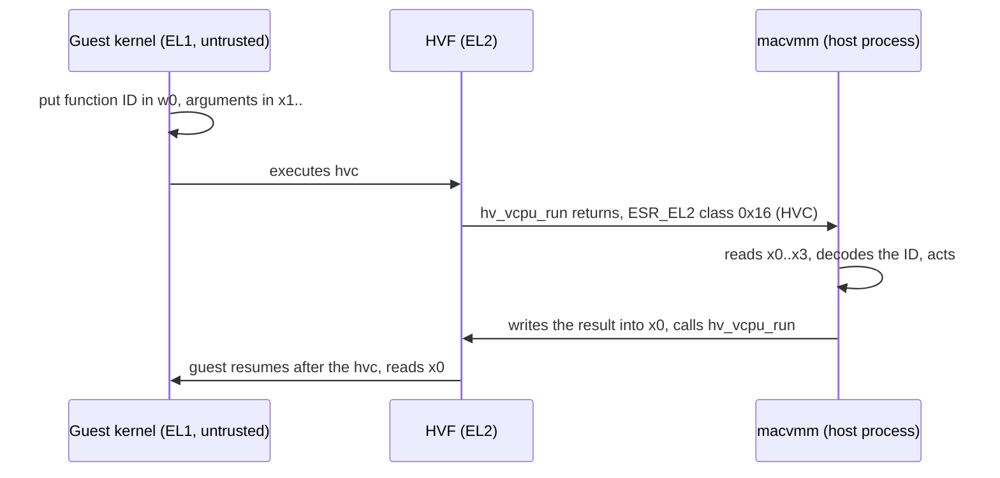

# Who decided that 0x8400_0008 means "power off"?

When a Linux guest shuts down on macvmm, its last act is to put the number `0x8400_0008` in
register `x0` and execute the instruction `hvc #0`. (`x0` is one of the CPU's 64-bit
general-purpose registers; every AArch64 instruction is exactly 4 bytes, and this one is the 32-bit
word `0xD4000002`.) Our VMM sees the call and the whole VM powers off. Now put the same four bytes
in an ordinary Mac program, and the program dies on the spot with exit status 132 (which means
"killed by signal 4, an illegal instruction"; we decode it in the first section). Two puzzles,
then. Why do identical bytes power off one machine and kill another program? And nobody ever told
our VMM that `0x8400_0008` means "off": who decided, and how would you read that number if you met
it cold?

:::objectives
- Decode and encode SMCCC function IDs by their four fields.
- Name the registers that carry the ID, the arguments and the results.
- Explain why calls to a higher level use registers and not memory.
- Distinguish the HVC and SMC conduits and their PC rules under HVF.
- Predict the answer to an unknown call, and describe discovery.
:::

:::prereqs
- The [`os-basics`](/build-your-own/vmm/primers/os-basics/) primer (privilege, signals, exit statuses) and the [`aarch64-reading`](/build-your-own/vmm/primers/aarch64-reading/) primer
  (registers `x0`/`w0`, AAPCS64, reading hex bit fields).
- Chapter 02, where you ran a guest and saw your first VM exit. The terms you need from it are
  recapped in the box below.
:::

> **Words you will meet.**
> - **Exception levels.** An AArch64 CPU always runs at one of four privilege levels, and a higher
>   number means more privilege: **EL0** for user programs, **EL1** for an operating-system
>   kernel, **EL2** for a hypervisor, **EL3** for the most trusted firmware. Code moves *up* a level
>   only by **taking an exception**: the CPU stops what it was doing, saves where it was, and jumps
>   to code chosen by the level above.
> - **HVF** is Apple's Hypervisor.framework. It owns EL2 on a Mac and runs our guest at EL1 for us.
>   `hv_vcpu_run` means "run the guest until it needs the VMM", and it returns with an *exit*.
> - **Exception class.** Each exit carries a reason code read from the `ESR_EL2` register (the
>   Exception Syndrome Register); its top field, the exception class, says what kind of event
>   caused it. `0x16` means "the guest executed `hvc`".
> - **PC** is the program counter, the address of the instruction the CPU runs next.
> - **Trap.** The hardware redirects an instruction to the hypervisor instead of letting the guest
>   run it.

## Same four bytes, two fates

Let's reproduce the second half of the puzzle first, because it costs one minute. Save this as
`hvc.c` anywhere on your Mac:

```c
#include <stdio.h>
int main(void) {
    printf("about to execute hvc #0\n");
    fflush(stdout);
    __asm__ volatile("hvc #0");
    printf("we came back\n");
    return 0;
}
```

> **Predict.** Does the second line ever print?

```sh
clang -o hvc hvc.c
./hvc; echo "exit status: $?"
```

```text
about to execute hvc #0
exit status: 132
```

An interactive zsh also prints its own one-line complaint about an illegal instruction. From
`os-basics` you know how to read 132: it is `128 + 4`, and signal 4 is `SIGILL` (check with
`kill -l 4`, which prints `ILL`). The CPU refused the instruction, the kernel turned that into a
signal, and the signal killed the process.

The reason is privilege. Your program runs at EL0, the user level. The Arm Architecture Reference
Manual (the ARM ARM) defines `HVC` as UNDEFINED at EL0: it is an instruction for a kernel at EL1 to
call the level above it, EL2, where the hypervisor lives. In chapter 02 you saw the other fate.
Executed by a guest kernel at EL1, `hvc #0` is an exception taken to EL2. HVF, sitting at EL2,
hands the event to our VMM: `hv_vcpu_run` returns with exception class `0x16`, "HVC instruction
execution in AArch64 state", and with the PC already past the `hvc`.

So `hvc` is a doorbell. It says "the level above, please", plus a 16-bit number (the immediate,
`#0` here), and nothing else. "Power off" is not in the instruction at all. It must be somewhere
else, and the only other place both sides can see is the **register file**, the CPU's set of
registers.

> **Try it.** Change `hvc #0` to `smc #0` and rebuild. You should see the same exit status, 132:
> `SMC` is also UNDEFINED at EL0. We meet `smc` properly in a moment.

## A call with no shared memory

Think about what the guest wants to say: "power the machine off", or "start CPU 2 at address
`0x4008_0000` with this value in `x0`". On one machine, inside one program, you would make a
function call, and the `aarch64-reading` primer gave you the rules for that: **AAPCS64**, the
procedure call standard, with arguments in `x0` to `x7` and the result in `x0`.

A call to a higher level breaks two assumptions behind those rules. First, there is no function
address to branch to; the caller can only raise an exception, and the higher level decides what
runs. Second, the two sides do not share a view of memory.

> **Sidebar: two kinds of address.** Inside the guest, a program's pointers are *guest virtual*
> addresses. The guest kernel's **page tables**, data structures in guest RAM, map each of them
> to a *guest-physical* address, a place in the RAM we gave the VM. The **MMU** (memory
> management unit) is the part of the CPU that does this translation on every access, using the
> current page tables. The hypervisor does not run with the guest's page tables loaded, so to
> follow a guest pointer it would have to find those tables and walk them itself, in software,
> and repeat that on every call. Firmware at EL3 would have the same problem.

Passing a pointer to a structure is therefore possible in principle and miserable in practice.
What both sides *do* see identically is the register file. When the exception is taken, the
general-purpose registers keep their values, and the higher level can read and write them before
it returns. So Arm made registers the entire interface: a call is "these values in these
registers before", and the answer is "these values in these registers after". We say **the
registers are the API**.

The rules for which value goes in which register are the **SMC Calling Convention**, or
**SMCCC**, Arm document DEN0028. It is named after the `SMC` instruction, which it was first
written for, but it covers `HVC` the same way. Here it is next to the rules you already know, for
a 64-bit caller:

| | AAPCS64 (a normal call) | SMCCC (a call to a higher level) |
|---|---|---|
| What chooses the callee | an address, via `bl` | a 32-bit **function ID** in `w0` |
| Arguments | `x0` to `x7` | from `x1` upward (up to `x17`) |
| Results | `x0` (`x0` to `x7` for some types) | from `x0` upward (up to `x17`) |
| Callee must preserve | `x19` to `x29`, `sp` (and `d8` to `d15`) | `x18` to `x30` and the stack pointers |

"Callee must preserve" means the called code may use those registers, but must put their old
values back before it returns, so the caller can keep live values in them across the call. (A
kernel has one stack pointer per level, `SP_EL0` and `SP_EL1`; the callee leaves both alone.) The
exact upper limits changed between SMCCC versions: early versions passed only `x1` to `x6` and
returned only `x0` to `x3`, and that is all macvmm ever uses.

Notice what moved. `x0` stops being the first argument and becomes the function selector, so the
arguments start at `x1`. And the callee promises to preserve far more than a normal function does,
which lets a kernel make these calls without saving half its registers around each one. Only the
low 32 bits of `x0`, written `w0`, are the function ID.

## Reading a function ID

Thirty-two bits must say, without any other context, who should answer the call and what is being
asked. SMCCC splits them into four fields:

```text
 31   30   29 ........ 24   23 ...... 16   15 .................. 0
+----+----+---------------+--------------+------------------------+
| F  | W  |  owner (OEN)  |  zero (MBZ)  |    function number     |
+----+----+---------------+--------------+------------------------+
  F: 1 = fast call, 0 = yielding call
  W: 0 = 32-bit convention (SMC32/HVC32), 1 = 64-bit (SMC64/HVC64)
  MBZ: "must be zero"
```

*The layout of an SMCCC function ID: read it from the left, coarse to fine.*

- **Bit 31, call type.** 1 means a **fast call**, which runs to completion before it returns; 0
  means a yielding call. The next section explains the difference. Every call in macvmm is fast.
- **Bit 30, convention width.** 0 means the 32-bit convention: only the low 32 bits of each
  register (`w0`, `w1`, ...) carry meaning. 1 means the 64-bit convention, needed whenever an
  argument can be a 64-bit address.
- **Bits 29 to 24, the owner.** The **owning entity number** (OEN) says which service the call
  belongs to. This is how Arm keeps everyone's numbers apart.
- **Bits 23 to 16** must be zero in a fast call (newer SMCCC versions give bit 16 an optional
  meaning; we ignore it).
- **Bits 15 to 0, the function number** inside that owner's range.

The three owners this course uses (Arm defines others, for chip vendors, board makers and secure
firmware):

| OEN | Owner | Examples |
|---|---|---|
| 0 | Arm architecture calls | `SMCCC_VERSION` = `0x8000_0000`, `SMCCC_ARCH_FEATURES` = `0x8000_0001` |
| 4 | Standard secure service calls | PSCI: `PSCI_VERSION` = `0x8400_0000`, `SYSTEM_OFF` = `0x8400_0008` |
| 6 | Vendor-specific hypervisor service calls | macvmm's `DEBUG_PUTC` = `0xC600_4D01` |

Let's decode the number from the puzzle with nothing but shell arithmetic. In `$(( ... ))`,
`id>>31` shifts the bits right by 31 places so that bit 31 lands in bit 0, and `&1` then keeps
only that bit (a *mask*). The owner is six bits wide (bits 29 to 24), so after shifting by 24 we
keep it with `&0x3f`, which is binary `111111`.

```sh
id=0x84000008
printf 'fast=%d wide=%d owner=%d func=%d\n' $(( (id>>31)&1 )) $(( (id>>30)&1 )) $(( (id>>24)&0x3f )) $(( id&0xffff ))
```

```text
fast=1 wide=0 owner=4 func=8
```

A fast call, 32-bit convention (`wide=0`), owner 4 (standard secure services), function 8. Owner
4's functions `0x00` to `0x1F` belong to **PSCI**, the Power State Coordination Interface, Arm's
standard for powering CPUs and systems on and off. Its first functions are:

| PSCI function | Name | What it asks |
|---|---|---|
| 0 | `PSCI_VERSION` | which PSCI version do you implement? |
| 1 | `CPU_SUSPEND` | put this CPU into a low-power state |
| 2 | `CPU_OFF` | turn this CPU off |
| 3 | `CPU_ON` | start another CPU core at this address |
| 4 | `AFFINITY_INFO` | is that CPU on or off? |
| 6 | `MIGRATE_INFO_TYPE` | is there a trusted OS I must care about? |
| 8 | `SYSTEM_OFF` | power the whole machine off |
| 9 | `SYSTEM_RESET` | reboot the whole machine |
| 10 | `PSCI_FEATURES` | do you implement this function ID? |

Function 8 is `SYSTEM_OFF`. That answers "who decided": Arm did, in two published documents
(SMCCC for the bit layout, PSCI for the meaning), and Linux and macvmm both read them. PSCI itself
is chapter 08's subject.

Encoding goes the other way: shift each field to its place and combine them with `|` (bitwise
OR). Here is the first hypercall you will write in chapter 03, `DEBUG_PUTC`, "print one
character":

```sh
printf '0x%08X\n' $(( (1<<31) | (1<<30) | (6<<24) | 0x4D01 ))
```

```text
0xC6004D01
```

Fast, 64-bit, owner 6 (vendor-specific hypervisor service), function `0x4D01` (`0x4D` is ASCII
`M`, for macvmm). Owner 6 is the range where a hypervisor may define calls of its own. Arm does not
say what any number in it means: the meaning depends on which hypervisor answers. Two hypervisors
can therefore give the same number different meanings, and a guest has to avoid such collisions or
discover who it is talking to. The section "Asking before calling" shows a collision we hit on this
very machine, and why our debug calls start at `0x4D01` rather than at 1.

> **Aside.** Version 1.0 of SMCCC called yielding calls "standard calls", and Linux still names
> bit 31 being zero `ARM_SMCCC_STD_CALL`. Owner 4 is "standard *service*". The two "standards" are
> unrelated: `0x8400_0008` is a standard service reached by a *fast* call. When the names confuse
> you, trust the bits.

## Fast calls and yielding calls

A **fast call** appears atomic to the calling CPU: the callee does the whole job, then returns.
"Read the version", "power off" and "print one byte" are fast calls. The caller does not run
again until the answer is in `x0`.

A **yielding call** is for long jobs, mostly inside secure firmware: the callee may stop part-way,
return "not finished, call me again", and let the caller handle interrupts meanwhile.

Everything a VMM like ours provides is short, so all of our calls are fast. Our **dispatcher**,
the VMM function that looks at the function ID and decides what to do, can answer "not supported"
straight away when it sees bit 31 clear.

The width bit has a practical consequence too. PSCI's `CPU_ON` takes an entry-point address, which
on a 64-bit machine may not fit in 32 bits, so the function exists twice: `0x8400_0003` (32-bit
convention) and `0xC400_0003` (64-bit convention), the same function number with bit 30 flipped.
A 64-bit Linux kernel uses the `0xC4` form. A VMM that implements one and forgets the other has a
bug that only some guests find.

The entry point is a *physical* address, and for a second reason besides the registers-are-the-API
argument: a CPU that `CPU_ON` has just started begins with its MMU off, so no page tables are in
use yet and every address it touches is physical.

## Conduits: HVC or SMC

SMCCC defines the register contents, not the door. There are two doors, called **conduits**:

- `SMC`, the secure monitor call, raises an exception to EL3, where the board's most trusted
  firmware lives on real hardware.
- `HVC`, the hypervisor call, raises an exception to EL2.

Inside a VM there is no firmware at EL3. The VMM plays the role that firmware plays on real
hardware, so the guest must call *us*. It learns which conduit to use from the **device tree**, a
data blob the VMM hands the guest that describes the machine's hardware: its `/psci` entry carries
`method = "hvc"` (chapter 10 writes it). Linux reads it once and uses that conduit for every SMCCC
call afterwards. The immediate is always 0: `hvc #0`. A call with another immediate is not an
SMCCC call, and macvmm answers it with "not supported".

Here is the whole round trip for a fast call over HVC. The guest is untrusted: everything it hands
us must be checked before we act on it.



*Everything passed between guest and VMM is a register value; the guest never learns it was
paused.*

Both conduits work under HVF, but they land differently, and spike results #5 and #6 in
`spikes/hvf-hello/RESULTS.md` record what this machine does. After an HVC exit the PC already
points past the `hvc`, so we resume without touching it. After an SMC exit (exception class
`0x17`) the PC still points *at* the `smc`, and the VMM must add 4 or the guest will execute the
same call forever.

> **Under the hood (optional).** The difference is the ARM ARM's *preferred return address*, the
> address the CPU resumes at after an exception. `HVC` is an exception-generating instruction: it
> executes, then the exception is taken, so the return address is the next instruction, as with
> `svc` in a system call. A guest's `SMC` is different: HVF sets the `HCR_EL2.TSC` control bit,
> which *traps* the instruction to EL2 before it executes, and a trapped instruction's preferred
> return address is the instruction itself. One is a finished call; the other is an instruction
> someone stopped. Chapter 08 handles both.

## Asking before calling

A kernel boots on many machines, and it cannot know in advance what any of them implements. SMCCC
gives it two tools.

The first is a guaranteed answer for the unknown. A callee that does not implement a function ID
must return **`NOT_SUPPORTED`**, the value -1 (all ones), in `w0`/`x0`. It must not crash, hang or
ignore the call. That makes probing safe.

The second is a set of query calls. Linux's sequence on macvmm is:

1. `PSCI_VERSION` (`0x8400_0000`), so Linux knows which PSCI functions may exist at all. We answer
   `0x0001_0001`: the major version sits in the upper 16 bits and the minor in the lower, so
   `0x0001` and `0x0001` mean PSCI 1.1.
2. `PSCI_FEATURES(0x8000_0000)`: "do you implement `SMCCC_VERSION`?" This call exists because
   SMCCC 1.0 had no version call, and calling a function that might not exist on an old firmware
   is exactly what Linux wants to avoid.
3. `SMCCC_VERSION` (`0x8000_0000`), so Linux knows which register rules apply. We answer
   `0x0001_0001`: SMCCC 1.1.
4. `SMCCC_ARCH_FEATURES` (`0x8000_0001`), asked once per optional call, chiefly the workarounds for
   CPU security bugs such as Spectre that a firmware may offer. We answer 0 ("implemented") only
   for `SMCCC_VERSION` and -1 ("not here") for everything else, including every workaround.

The vendor range needs one more care. Owner 6 numbers mean whatever *this* hypervisor says, so a
guest that wants to use them first calls that range's standard **Call UID** function,
`0x8600_FF01`, which returns a 128-bit identifier of the hypervisor in `x0` to `x3`. Linux does
this at boot to find out whether it is running on KVM, Linux's own hypervisor. macvmm does not
implement Call UID, so it answers -1; Linux concludes "not KVM" and uses no vendor calls at all.
macvmm's own test guests skip discovery, because they are built for macvmm and nothing else.

The collision is real, not theoretical, and we measured it on this machine. Hypervisor.framework
itself answers function IDs `0xC600_0000` to `0xC600_001F` inside the macOS kernel: the guest gets
`0xFFFF_FFFF` back in `x0` and our VMM never sees an exit (`docs/research/hvf-api.md` §15). macvmm's
debug calls were first planned as `0xC600_0001` to `0xC600_0004`; a guest calling the planned
`DEBUG_PUTC` printed nothing, and its `DEBUG_EXIT` was silently swallowed. So they moved to
`0xC600_4D01` to `0xC600_4D04`, well clear of that block. KVM shows the same thing from another
side: Linux's `Documentation/virt/kvm/arm/hypercalls.rst` gives `0xC600_0002` to `0xC600_0004` to
a protected-KVM memory-information and memory-sharing interface. Three hypervisors, one number,
different meanings. That is legal precisely because the range is vendor-specific, and it is one
reason macvmm, by default, turns its debug calls on only for its own test guests.

> **Security.** Every register value in an SMCCC call is chosen by the guest, which may be
> hostile. The dispatcher must give a defined answer for all 2^32 possible function IDs, compare
> only `w0`, return -1 for anything unknown (logging a warning at most a few times, so a guest
> cannot flood our log), and treat every argument as an untrusted number. When an argument is an
> address, such as `CPU_ON`'s entry point (where the new CPU starts running), it is checked against
> guest RAM before use; when it is a length, it is capped. A call is a request, never a command.

> **Production note.** On Linux, KVM answers most SMCCC calls inside the host kernel, without a
> trip to the userspace VMM, and lets the VMM claim selected ranges of IDs for itself. HVF
> forwards almost every guest `hvc` to us and answers only that small vendor block itself (the
> measurement above). Each forwarded call costs a round trip (chapter 03 measures it), but the
> whole dispatcher lives in readable Rust.

## Self-check

Commit to an answer before you reveal it.

:::predict Decode `0xC400_0004`. Is it fast or yielding, which convention, which owner, which function?
Fast (bit 31 set), 64-bit convention (bit 30 set, which is why the top byte is `0xC4` and not
`0x84`), owner 4 (standard secure services), function 4. Owner 4's functions 0 to 31 are PSCI, and
the PSCI table gives function 4 as `AFFINITY_INFO`. It needs a 64-bit form because the CPU it asks
about is named by a 64-bit value.
:::

:::predict Build the function ID for a fast, 32-bit call to the Arm architecture owner, function 1. What is it called?
`(1<<31) | (0<<30) | (0<<24) | 1` = `0x8000_0001`, which is `SMCCC_ARCH_FEATURES` (see the owner
table, OEN 0).
:::

:::predict A guest calls `PSCI_VERSION` with `x0 = 0xFFFF_FFFF_8400_0000`. What should a correct dispatcher do?
Treat it as `PSCI_VERSION`. The function ID is `w0`, the low 32 bits, so the upper half of `x0` is
ignored. A dispatcher that compared all 64 bits would answer -1 and confuse the guest.
:::

:::predict Why does `CPU_ON` take the new CPU's entry point as a plain physical address in a register, and not a pointer to a structure in the guest's memory?
Because the registers are the API. A structure would sit at a guest virtual address that the
callee would have to translate through the guest's page tables, and the new CPU starts with its MMU
off, so it could not use a virtual address anyway. A plain number in a register needs no shared
view of memory.
:::

:::predict Your VMM handles an SMC exit exactly like an HVC exit and resumes the guest. What happens?
The guest executes the same `smc` again, exits again, and loops forever: under HVF the PC after a
trapped SMC still points at the `smc`, so the VMM must add 4. After an HVC it already points past
the instruction.
:::

:::predict A Linux guest calls `0x8600_FF01`, the vendor-hypervisor Call UID query, and macvmm does not implement it. What exactly does the guest get back, and what does Linux conclude?
-1 (`NOT_SUPPORTED`) in `x0`, and execution continues after the `hvc`. That is not KVM's
identifier, so Linux decides it is not on KVM and uses no vendor-specific calls. A guaranteed,
harmless answer to the unknown is what makes probing safe; without it, a kernel could not ask a
question without risking its life.
:::

## Lab

:::lab sysreg-smccc
:::

In the `sysreg-smccc` lab you work SMCCC function IDs in both directions. Toggle the fast and
64-bit bits, pick an owner from a list and type a function number, and watch the 32-bit ID and its
hex digits change; or paste an ID from a trace and see its fields and, where the lab knows it, its
name. The lab flags IDs that break the rules, such as a fast call with bits 23 to 16 set. The other
half of the lab decodes `mrs`/`msr` instruction words, which chapter 08 needs.

## Where this shows up in macvmm

- [Chapter 03, test-guests](/build-your-own/vmm/bare-machine/test-guests/) (requires this primer):
  the guest-side debug calls in `guests/common/hvc.rs` put `0xC600_4D01` (`DEBUG_PUTC`) or
  `0xC600_4D02` (`DEBUG_EXIT`) in `x0` and the byte or code in `x1`, then execute `hvc #0`; the
  first run loop answers them.
- [Chapter 08, traps-psci](/build-your-own/vmm/cpu/traps-psci/): the SMCCC dispatcher
  (`crates/vmm/src/smccc.rs`) and PSCI (`crates/vmm/src/psci.rs`): `SMCCC_VERSION`,
  `SMCCC_ARCH_FEATURES`, `PSCI_VERSION`, `PSCI_FEATURES`, `CPU_SUSPEND`, `MIGRATE_INFO_TYPE`,
  `SYSTEM_OFF` and `SYSTEM_RESET` among others, -1 for everything else, both conduits with their PC
  rules.
- [Chapter 10, device-tree](/build-your-own/vmm/devices/device-tree/): the `/psci` node and its
  `method = "hvc"`, the promise that tells the guest which conduit to use.
- [Chapter 20, smp](/build-your-own/vmm/smp/smp/): PSCI `CPU_ON` in both widths, `CPU_OFF` and
  `AFFINITY_INFO`, with every argument validated.
- [Chapter 25, security](/build-your-own/vmm/production/security/): a hostile guest sweeps SMCCC
  function IDs and checks that each gets a defined answer.

## Checkpoint

- **What you can do now.** Encode the debug hypercall from its fields and check the result:
  `printf '0x%08X\n' $(( (1<<31) | (1<<30) | (6<<24) | 0x4D01 ))` prints `0xC6004D01`. Decode any
  ID into its four fields, say which registers carry the ID, arguments and results, and say what an
  unknown call returns and where the PC goes after HVC and SMC exits.
- **What's next.** Chapter 03 builds a guest of your own that talks to your VMM through exactly
  these calls: one `hvc` per character it prints. You will also measure what each of those round
  trips costs, and the number will surprise you.
- **One open question.** Every SMCCC call is a full exit to our process, even "print one byte".
  If a guest needed to send us a megabyte, registers alone would be hopeless. What would you have
  to agree on with the guest to pass bulk data, and what new dangers would that agreement bring?
  (Hint: think about what the two sides must agree on about where the data lives, and who can
  change it while you are reading it.)

## Going further

- Arm, *SMC Calling Convention* (DEN0028), the current issue: the sections on function
  identifiers (the bit-field table and the owning-entity ranges), fast and yielding calls, the
  32-bit and 64-bit register rules (including how they changed between versions), and the Arm
  architecture calls (`SMCCC_VERSION`, `SMCCC_ARCH_FEATURES`). Section numbers shift between
  issues; search for the titles.
- Arm, *Procedure Call Standard for the Arm 64-bit Architecture* (AAPCS64), §6.1.1, the
  general-purpose and SIMD register roles.
- Arm, *Power State Coordination Interface* (DEN0022), the function list and its IDs, and
  `PSCI_FEATURES`; the subject of chapter 08.
- Arm, *Arm Architecture Reference Manual for A-profile architecture* (DDI 0487): the instruction
  pages for `HVC` and `SMC` (when each is UNDEFINED), the `ESR_EL2` register page (exception
  classes `0x16` and `0x17`, the 16-bit immediate in ISS bits 15 to 0), and the exception-model
  chapter's definition of the preferred return address.
- Linux, `include/linux/arm-smccc.h` (the same bit fields as C macros, owner constants and the
  vendor-hypervisor Call UID included) and `Documentation/virt/kvm/arm/hypercalls.rst` (a real
  hypervisor's vendor-specific calls).
- macvmm, `docs/research/hvf-api.md` §15: the probe that found HVF's private `0xC600_0000` to
  `0xC600_001F` block.
