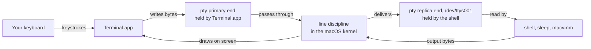

# Where does Ctrl-C go?

Open Terminal, run `sleep 30`, and press Ctrl-C. The program dies at once, and `echo $?` prints
`130`. But `sleep` never reads the keyboard: it asks the kernel to wake it in 30 seconds and does
nothing else. So who read the keystroke, who decided it meant "stop", and how did a key turn into
a number?

macvmm, the program this course builds, runs a whole second operating system, the **guest**
(Linux, say), inside your Terminal window. In chapter 09 your keystrokes must go to the guest's
shell, not to macvmm. So macvmm needs the opposite of the `sleep` story: Ctrl-C must reach the
guest, macvmm itself must survive it, and when macvmm exits your shell must still work. By the
end of this primer you can explain the first story and design the second.

:::objectives
- Say what a TTY and a pseudo-terminal (pty) are, name the two ends of a pty and which program holds each, and use `tty` and `script` to find out whether a program's input is a terminal.
- Predict what a program reads in canonical mode and in raw mode for the same keystrokes (including Delete, Return and Ctrl-C), and check the prediction with `od -c`.
- Explain, step by step, how the byte 0x03 becomes SIGINT for the foreground job, which termios flag controls it, and why the shell then reports exit status 130.
- Save a terminal's settings with `stty -g`, change them, and restore them exactly; list the exit paths on which a program that sets raw mode must restore it.
- Take apart a CSI escape sequence (ESC, `[`, parameter bytes, intermediate bytes, final byte) and an OSC string, and say what `CSI 31 m`, `CSI 6 n` and `OSC 0 ; text BEL` ask a terminal to do.
- Give one example each of guest output that changes, queries and spoofs the host terminal, and say why macvmm filters guest output with an allow-list, whether or not stdout is a terminal.
:::

:::prereqs
The [`os-basics`](/build-your-own/vmm/primers/os-basics/) primer (processes, the kernel, system calls) and the [`unix-signals`](/build-your-own/vmm/primers/unix-signals/) primer. The
two ideas you need from the second one: a **signal** is a small numbered notification the kernel
delivers to a process (SIGINT is number 2), and a process that does not handle it dies; the shell
then reports exit status `128 + n` for a death by signal *n*. You need a Mac with Terminal (or any
terminal app) and the stock shell tools; nothing to install.
:::

## A terminal is a file with a driver behind it

A **file descriptor** is a small number the kernel gives a program for each file it has open.
Every program on your Mac reads input from file descriptor 0 and writes output to descriptors 1
and 2. Those descriptors can point at an ordinary file, a pipe, or something special: a device
that stands for "the place a human is typing". That device is called a **TTY**. The name comes
from *teletypewriter*, the electromechanical printers-with-keyboards that early Unix machines
used as consoles; the kernel code that drives them kept the name.

Ask the shell which TTY it is attached to:

```sh
tty
```

In a Terminal window you see a path such as `/dev/ttys001` (the number differs per window). Run
the same command with its input from a pipe, as a script or CI job would, and you get:

```text
not a tty
```

and exit status 1. That difference matters a lot to us: macvmm behaves differently when a human
is at the keyboard and when a test harness feeds it from a pipe.

Your Terminal window is not a teletype, of course. It is an app that draws characters in a
window. To give a shell a TTY anyway, macOS creates a **pseudo-terminal**, or **pty**: a pair of
connected devices. This primer uses the names from macOS's own `man 4 pty`: the **primary**
end and the **replica** end. (POSIX.1-2024 says "manager" and "subsidiary"; older documents
and APIs say "master" and "slave".) Terminal.app holds the primary end. The shell and everything
it runs hold the replica end, the device `/dev/ttys001`; that replica is the TTY. Between the two
ends sits the kernel's terminal driver, and the most interesting part of it, the **line
discipline**.



*Notice that every byte you type, and every byte a program prints, passes through the line
discipline in the kernel. Neither the app nor the program talks to the other directly.*

The tool `script` makes a fresh pty on demand: it creates a pty pair, runs a command on the
replica end, and copies bytes between the primary end and its own input and output. Its
original job is recording a session to a file; with `script -q /dev/null` it records nothing and
is useful for one thing: giving a program a real TTY when none exists. Chapter 09's checkpoint
uses exactly that trick, because the test harness itself has no terminal.

## The line discipline is a small editor in the kernel

Here is an experiment. Run this, then type `a`, `b`, `c`, press the Delete (backspace) key once,
type `d`, and press Return:

```sh
head -c 4 | od -c
```

`head -c 4` reads the first four bytes of its input; `od -c` prints bytes one per column, with
escapes for the invisible ones, and prints any byte it has no name for as a three-digit
**octal** (base 8) number. Captured on an M5 Pro, macOS 27.2 (yours should match):

```text
abc
0000000    a   b   d  \n
0000004
```

(The first line is your typing as it appeared on screen, after the Delete.) Two things happened
that `head` never asked for. The Delete removed the `c` *before* `head` saw anything: the
program received `a b d`, not `a b c 177 d` (octal 177 is hex 0x7F, the byte the Delete key
sends). And Return, which sends a carriage return (byte 0x0D, `\r`), arrived as a newline (0x0A,
`\n`).

The line discipline did both. By default it collects your typing into a line buffer, handles
editing keys itself, and hands the program nothing until you press Return. This is
**canonical mode** (informally, "cooked" mode, the opposite of "raw"). It also **echoes**: it
sends each byte you type back towards the screen, so you can see what you typed. The program did
not print `abc`; the kernel did. When you pressed Delete, the echo was the three bytes backspace
(0x08), space (0x20), backspace, which step left, overwrite the `c` with a blank, and step left
again.

One more canonical-mode key: Ctrl-D (byte 0x04) means "end of file". The line discipline does not
deliver it; it makes the program's pending read return whatever is in the line buffer. On an
empty line that is zero bytes, and a program that reads zero bytes treats it as the end of its
input. That is why Ctrl-D at an empty prompt logs you out of a shell.

All of this is configurable, per terminal, through a structure called **termios** (after the
header `<termios.h>`). It has four sets of flags and an array of special characters. Only three
flags matter for the rest of this primer, in bold; the others are listed so you recognise them in
`stty` output:

| Field | Controls | Flags we meet |
|---|---|---|
| `c_iflag` | input translation | `ICRNL` (turn `\r` into `\n`), `IXON` (Ctrl-S/Ctrl-Q flow control) |
| `c_oflag` | output translation | `OPOST` (post-process output), `ONLCR` (turn `\n` into `\r\n`) |
| `c_lflag` | "local" behaviour | **`ICANON`** (canonical mode), **`ECHO`**, **`ISIG`** (signal keys), `IEXTEN` (extra editing keys such as Ctrl-V) |
| `c_cc[]` | special characters | `VERASE` (Delete), `VINTR` (Ctrl-C), `VEOF` (Ctrl-D), `VMIN`, `VTIME` (both explained under raw mode) |

`stty -a` prints the current settings of the terminal on its standard input. Part of its output,
from the same machine:

```text
lflags: icanon isig iexten echo echoe -echok echoke -echonl echoctl
oflags: opost onlcr -oxtabs -onocr -onlret
cchars: discard = ^O; dsusp = ^Y; eof = ^D; eol = <undef>;
	eol2 = <undef>; erase = ^?; intr = ^C; kill = ^U; lnext = ^V;
```

A leading `-` means "off". `erase = ^?` says the Delete key (byte 0x7F, which `stty` writes as
`^?`) erases a character. `intr = ^C` is the next section. Your `stty -a` shows more lines,
and the `speed` line at the top shows your window's real rows and columns.

## Ctrl-C is a byte, until the line discipline says otherwise

What does Ctrl-C actually send? Terminals inherited a simple rule from teletypes: holding Ctrl
clears the top bits of the letter's code. `C` is 0x43, in binary `010 00011`; keep only the low
five bits, `00011`, and you get 0x03. In the same way Ctrl-A is 0x01 and Ctrl-D is 0x04. Ctrl-C
is a byte, like `a`.

When `ISIG` is on, the line discipline compares each incoming byte with the special characters
in `c_cc`. If it matches `VINTR` (0x03 by default), the byte is *not* delivered as data. Instead
the kernel sends the signal SIGINT (signal number 2) to every process in the terminal's
**foreground process group**. A process group is the set of processes the shell started together
as one job; the foreground one is the job the shell is currently waiting for. `sleep` has no
handler for SIGINT, so the default action kills it. The shell, which was waiting for `sleep`,
learns that its child died of signal 2 and reports `128 + 2 = 130`. The same check turns Ctrl-\
(`VQUIT`) into SIGQUIT, and Ctrl-Z (`VSUSP`) into SIGTSTP, the signal that pauses a job until you
type `fg`.

That solves the opening puzzle. Nobody "read" the keystroke: the kernel inspected it on the way
past, recognised it, and sent a signal. The `^C` you saw on screen was the echo of the special
character (`echoctl` prints control characters as `^` plus a letter).

> **Under the hood.** Why does Ctrl-C kill `sleep` and not your shell, when both share the same
> TTY? An interactive shell with job control puts each job in its own process group and tells the
> terminal driver which group is in the foreground (`tcsetpgrp`); the line discipline signals
> only that group. Run a command from a *non*-interactive `sh -c '...'` inside a pty and press
> Ctrl-C, and the outer `sh` dies too, because it shares the job's group. POSIX.1-2017, XBD
> section 11.1.9, "Special Characters", gives the exact rules.

## Raw mode: every byte, as typed

A shell wants line editing. A full-screen editor such as `vi` does not: it wants each key the
moment you press it, it does its own echo, and it wants Ctrl-C as a byte it can interpret. For
that, a program turns most of the line discipline off. The usual name for "almost everything
off" is **raw mode**.

> **Predict.** Below, we save the settings, switch to raw mode with echo off, and read six bytes.
> You will type `a`, `b`, `c`, Delete, `d`, Return. What does `od -c` print, and where on the
> screen does its second line start? Expect nothing to appear while you type: the command has not
> hung, and it returns by itself after the sixth key.

```sh
saved=$(stty -g); stty raw -echo; head -c 6 | od -c; stty "$saved"
```

The bytes `od` wrote were captured on the same Mac; this is how a terminal draws them (the first
line ends in spaces that `od` adds for alignment):

```text
0000000    a   b   c 177   d  \r
                                                                        0000006
```

Nothing appeared as you typed, because echo was off. All six keystrokes arrived exactly as sent:
the Delete as byte 0177 (octal for 0x7F), not as an edit, and Return as `\r`, untranslated,
because raw mode turns off `ICRNL`. And `od` returned after the sixth byte, without waiting for a
line, because `ICANON` was off.

The odd indent of `0000006` is the output side. Raw mode also clears `OPOST`, so the `\n` that
`od` printed was no longer expanded to `\r\n`. A bare line feed moves the cursor down but not back
to the left edge, so `0000006` starts in the column where the first line ended instead of at the
left margin. If you ever see output
creep diagonally down the screen like a staircase, someone left `OPOST` off.

Now the case chapter 09 cares about. Same command, but read one byte and press Ctrl-C:

```sh
saved=$(stty -g); stty raw -echo; head -c 1 | od -An -tx1; stty "$saved"
```

```text
           03
```

No signal, no exit 130: with `ISIG` off, 0x03 is data. Now change `head -c 1` to `head -c 3`
and press the up-arrow key: you read three bytes, `1b 5b 41`, one key press. (With `head -c 1`
you would see only `1b`: `head` passes on one byte and drops the other two.) Hold on to those;
they are an escape sequence travelling in the *input* direction, and the second half of this
primer is about them.

`stty raw` is shorthand for a list of flags; the C library function `cfmakeraw(3)` sets the same
kind of list in a `termios` structure (off: `ICANON`, `ISIG`, `IEXTEN`, `ECHO`, `ICRNL`, `IXON`,
`OPOST` and a few others; on: 8-bit characters). Two more `c_cc` entries control when a raw
`read` returns: `VMIN` (wait for at least this many bytes) and `VTIME` (in tenths of a second).
With `VMIN` above 0, `VTIME` is the gap allowed between bytes, and the timer starts only after
the first byte; with `VMIN = 0`, it is a timeout for the whole read. With `VMIN = 1, VTIME = 0`,
a read returns as soon as one byte arrives.

Why does a VMM want raw mode? Because the guest already has a line discipline of its own. The
guest's console is a simulated serial port, a **UART**, that macvmm emulates (chapter 09 builds
it). Linux inside the VM feeds that port into *its own* terminal layer, which does canonical
editing, echo and Ctrl-C for the guest's shell. If the host's line discipline also edited and
echoed, you would see every character twice, Delete would be eaten on the host before the guest
saw it, and Ctrl-C would kill macvmm instead of the program inside the guest. So macvmm puts the
host TTY in raw mode and passes bytes straight to the emulated UART. The price: with `ISIG` off,
the user has lost the usual way to stop macvmm. Like QEMU (the widely used open-source VMM),
macvmm reserves a two-key escape: Ctrl-A, then `x`, quits (`t` dumps a trace, `s` prints stats, and Ctrl-A twice
sends a literal 0x01 to the guest). macvmm checks for it before any byte reaches the guest.

## Leaving the terminal as you found it

Raw mode belongs to the terminal, not to your process. If a program sets raw mode and then exits
without restoring it, the setting stays, and your shell inherits the broken terminal. What you
see depends on the shell. In bash or sh you type and nothing appears, and Return may do nothing.
zsh, the macOS default, hides part of the damage, because its line editor does its own echo and
fixes some flags each time it shows a prompt; but command output creeps down the screen in a
staircase and Ctrl-C no longer stops anything. The general repair is to type `stty sane` (blind,
if nothing echoes) and press Return, or Ctrl-J if Return does nothing: Ctrl-J sends a bare `\n`,
which works even when Return's `\r` is no longer translated.

The well-behaved pattern has two halves. Before changing anything, save the exact settings;
afterwards, put them back. `stty -g` prints the settings in a form `stty` can read back. Captured
inside a fresh pty made by `script`:

```text
gfmt1:cflag=4b00:iflag=2b02:lflag=5cb:oflag=3:discard=f:dsusp=19:eof=4:eol=ff:eol2=ff:erase=7f:intr=3:kill=15:lnext=16:min=1:quit=1c:reprint=12:start=11:status=14:stop=13:susp=1a:time=0:werase=17:ispeed=9600:ospeed=9600
```

Every flag word and special character is there in hex (`intr=3` is Ctrl-C, `erase=7f` is
Delete). The format is BSD's and differs on Linux, so treat it as opaque: save the string,
pass it back to `stty` unchanged. In C or Rust you do the same with `tcgetattr` before and
`tcsetattr` after, keeping the whole `termios` structure.

"Afterwards" is harder than it sounds, because a program can end in many ways. macvmm restores
the terminal on all of them: a normal return, a fatal signal such as SIGTERM, a Ctrl-A x, and a
panic in any thread (through a panic hook, since a panic on another thread does not run the main
thread's cleanup). The one exit no program can intercept is SIGKILL, which is why `stty sane` is
still worth knowing. Chapter 09 builds this as a `Drop` guard plus a panic hook plus the signal
path, and its checkpoint runs macvmm under `script`, quits with Ctrl-A x, and compares
`stty -g` before and after. You do not need to follow these Rust mechanisms now; chapter 09
explains each one. The point here is the list of exits.

Restoring settings is not the whole job. Bytes may still be waiting in the TTY's input queue:
keystrokes meant for the guest, or worse, replies the terminal typed on the guest's behalf (the
next section shows how). If macvmm exits and leaves them there, your shell reads them as a
command. So macvmm also discards pending input after restoring termios, with the call
`tcflush(STDIN_FILENO, TCIFLUSH)` ("flush the terminal's input queue on standard input").

## Output has a language too: escape sequences

So far, bytes travelled from keyboard to program. Now the other way. Print this:

```sh
printf 'red: \033[31mRED\033[0m done\n'
```

In Terminal, `RED` appears in red. Pipe the same bytes through `cat -v`, which shows control
characters instead of sending them to the terminal, and you see what really went out:

```text
red: ^[[31mRED^[[0m done
```

`^[` is byte 0x1B, **ESC**. The terminal app, not the kernel, reads the bytes after it as a
command. This is a different layer from the line discipline: the line discipline passes these
bytes through untouched (apart from `\n` to `\r\n`), and the terminal emulator at the primary
end interprets them. The grammar is standardised in ECMA-48 (the same text as ISO/IEC 6429; "ANSI
escape codes" is the popular name). Its most common form is the **control sequence**, which
starts with the **CSI** (Control Sequence Introducer), `ESC [`:

```text
 ESC   [     3 1        (none)        m
 1B    5B    30-3F ...  20-2F ...     40-7E
 \_CSI_/     parameter  intermediate  final byte: which command
             bytes      bytes
```

*Notice that a parser can find the end of any CSI sequence without knowing what it means: it
ends at the first byte from 0x40 to 0x7E.*

Here the final byte `m` is **SGR**, Select Graphic Rendition; parameter `31` means red
foreground, `1` means bold, `0` means reset all attributes, and several parameters can be joined
with `;` (`ESC [ 1 ; 31 m` is bold red). Other final bytes move the cursor (`H`, `A` to `D`),
erase parts of the screen (`J`, `K`) or set modes (`h` and `l`); the up-arrow you read in raw mode,
`ESC [ A`, is the same grammar in the input direction. (One trap for filter writers, which the
lab lets you try: a single byte, 0x9B, can stand in for `ESC [`. A filter that only looks for
0x1B misses it.)

The second family is longer strings. **OSC** (Operating System Command, `ESC ]`) carries text up
to a terminator: **ST**, the String Terminator `ESC \`, per ECMA-48, or BEL (0x07), the xterm
convention that almost every terminal accepts. Terminals use OSC for the window title, the
clipboard, hyperlinks and notifications:

```sh
printf '\033]0;hello\007' | cat -v
```

```text
^[]0;hello^G
```

Without the `| cat -v`, that sets your window title to `hello`. A few rarer string types
(**DCS**, `ESC P`, is the one you may meet) work the same way; macvmm treats them all like OSC.

You do not need to memorise any of this to read it. Real programs emit escape sequences
constantly. Here is part of what an interactive zsh wrote to its pty while showing its
prompt and running `sleep 30`, captured as raw bytes on the same Mac (`\x1b` is ESC, `\x08` is
backspace; the prompt text, which contains the machine's name, is replaced by `<prompt>`):

```text
\x1b[0m\x1b[27m\x1b[24m\x1b[J<prompt>% \x1b[K\x1b[?2004hs\x08sleep 30\x1b[?2004l\r\r\n
```

Token by token:

- `\x1b[0m`, `\x1b[27m`, `\x1b[24m`: SGR resets (all attributes, then reverse video off,
  underline off).
- `\x1b[J`: erase from the cursor to the end of the screen. Then the prompt text.
- `\x1b[K`: erase to the end of the line.
- `\x1b[?2004h`: turn on **bracketed paste** (the terminal marks pasted text so the shell can
  tell it from typing). The `?` makes it a private, xterm-defined mode.
- `s\x08sleep 30`: zsh's line editor drawing your typing. It echoed `s`, stepped back over it
  with backspace, and redrew the whole word as you typed on.
- `\x1b[?2004l`: bracketed paste off again, before the command runs.
- `\r\r\n`: zsh moved to the left edge, then the newline went through `ONLCR`, which made it
  `\r\n`.

## Why bytes from a guest are dangerous

Whatever the guest writes to its UART, macvmm writes to your terminal. The guest is untrusted (the
project brief treats every guest byte as hostile), and escape sequences give it three kinds of
power over the host terminal:

- **Change.** Hide the cursor; switch to the **alternate screen** (a second, blank screen that
  full-screen programs such as `vi` draw on, hiding your scrollback); switch to the DEC
  line-drawing character set (`ESC ( 0`), which turns most lowercase text into line-drawing
  symbols; turn on **mouse reporting**, so every click and scroll is typed into the input as
  escape sequences; set the window title. If macvmm exits with any of these still on, your shell
  inherits a broken terminal. (macvmm deliberately lets a guest use some of them, such as line
  drawing, because real guest programs need them, and resets every one of those on exit.)
- **Query.** Some sequences ask the terminal a question, and the terminal *answers by typing*.
  `CSI 6 n` (Device Status Report, ECMA-48 §8.3.35) asks for the cursor position, and the
  terminal replies with a Cursor Position Report, `CSI row ; col R` (§8.3.14), written into the
  primary end exactly as if you had typed it. Those bytes land in the input queue. While macvmm
  runs, they go to the guest, which is harmless. But if they are still queued when macvmm exits,
  your shell reads them; that is why the `tcflush` in the previous section exists. Worse, some
  older terminals would also report the window *title* on request. A program could set the
  title to a shell command ending in a newline, then ask for the title back: the terminal
  "typed" the command into the input, and the shell ran it. A remote, keyless way of typing on
  your keyboard.
- **Spoof.** Text alone can lie. A guest can print a fake host prompt after "exit", or a line
  that starts `macvmm: error:`, or redraw the screen to look like something else.

> **Security.** The attacker controls every byte the guest prints. What breaks without a filter:
> the host terminal's state (change), its input queue (query, with the reply read by your
> shell), what you believe you are looking at (spoof), and, through bugs in terminal emulators'
> handling of complex strings such as OSC and DCS, sometimes code on the host (CVE-2019-9535 was a
> remote code execution through iTerm2's tmux integration). macvmm therefore runs every
> guest-originated stream through one allow-list filter before any **sink** (anywhere output
> goes: your screen, a log file, a pipe). The project's threat model, in `docs/security/`, lists
> the terminal requirements as TTY-1 to TTY-10. The filter has two modes. The default, `safe`,
> keeps printable text, a few basic controls (newline, tab, backspace, carriage return), and CSI
> sequences with small numeric parameters and a fixed set of final bytes, so colours, cursor
> motion and line editing work. It drops every query (such as `CSI 6 n`), mouse modes, and all
> OSC and DCS strings. `strict`, meant for logs, shows every control visibly (`^[`). The
> filter runs whether or not stdout is a TTY: `macvmm run ... | tee log` makes stdout a pipe,
> but `tee` still copies every byte to your terminal.

An allow-list, not a block-list, because the escape-sequence zoo is open-ended: every terminal
adds private extensions, and the one you forgot is the one that bites. On exit, macvmm also sends
a reset for every mode `safe` lets the guest set, restores termios, flushes input, and prints a
final `macvmm: <reason>` line on stderr, so a fake prompt drawn by the guest is never the last
thing on your screen.

> **Try it.** It is harmless. In Terminal, run `printf '\033[6n'`, then press Return. What you
> see varies by shell: stray characters such as `^[[24;1R` or `;1R` at the prompt, a
> "command not found" for them, or nothing at all if your shell's line editor swallowed the
> reply. Where it shows, look for the shape `ESC [ row ; col R`. That is your terminal answering
> a question, through your keyboard's input path.

## Self-check

Commit to an answer before you reveal it.

:::predict In canonical mode you type `x`, Delete, `y`, Return into `head -c 2 | od -c`. What does the program read?
`y \n`. The line discipline applies the Delete to its line buffer before the program reads
anything, and `ICRNL` turns the Return key's `\r` into `\n`. The program never sees the `x`.
:::

:::predict The same keystrokes after `stty raw -echo`, reading four bytes. What arrives, and what appears on screen while you type?
`x 177 y \r`. Nothing appears while you type, because `ECHO` is off; Delete is data (0x7F) because
`ICANON` is off; Return stays `\r` because `ICRNL` is off.
:::

:::predict Ctrl-D is 0x04. What turns it into "end of file" in a shell, and what does a raw-mode program receive when you press it?
In canonical mode the line discipline treats `VEOF` (0x04 by default) specially: it makes a
pending `read` return what is buffered, and on an empty line that is zero bytes, which programs
treat as end of file. In raw mode there is no canonical processing, so the program receives the
byte 0x04.
:::

:::predict macvmm sets raw mode and is killed by SIGKILL. What state is your terminal in, and how do you repair it?
Raw mode with echo off persists, because termios belongs to the TTY, not the process, and
SIGKILL cannot be caught, so no cleanup ran. In bash you see no echo; in zsh you see staircase
output and a dead Ctrl-C. Type `stty sane` and press Return, or Ctrl-J (a bare `\n`) if Return
does nothing. Saving with `stty -g` beforehand lets you restore the exact original instead.
:::

:::predict Which bytes end `ESC [ 1 ; 3 1 m`, and what does `ESC ] 0 ; h i BEL` do?
The first is CSI with parameters `1;31` and final byte `m` (SGR): bold, red foreground. It ends
at `m`, the first byte in 0x40 to 0x7E. The second is OSC 0, terminated by BEL: it sets the
window and icon title to `hi`. macvmm's `safe` policy keeps the first and drops the second
entirely.
:::

:::predict A guest prints `CSI 6 n` and then halts. macvmm exits without calling `tcflush`. What does your shell do next?
The terminal answered the query by writing a Cursor Position Report, `ESC [ row ; col R`, into the
TTY's input queue. Nobody read it before macvmm exited, so the shell reads it as if you had typed
it: stray characters at the prompt. With `safe`, the query never reaches the terminal; with
`tcflush`, any reply that did is discarded. Defence in depth.
:::

## Lab

:::lab ansi-filter
:::

In the `ansi-filter` lab you paste or type a byte string, with escapes such as `\x1b[31m`, and
see three views side by side. The first shows the bytes split into tokens (text, C0 control,
CSI with its parameter, intermediate and final bytes, OSC or DCS up to its terminator) and what a
terminal would do with each: change a mode, move the cursor, answer a query, set the title. The
second and third show exactly what macvmm's `safe` and `strict` policies output for the same
input, with every dropped sequence highlighted and the rule that dropped it. The test vectors are
exported from macvmm's own filter (`backend/ansi.rs`), so the lab and the VMM cannot disagree.
Start with these two, predicting the `safe` output before you press Run, then try the attack
strings the lab suggests (a title query, a 10 MB OSC string, a lone `0x9B`).

:::predict Input `\x1b[1;31mhi\x1b[0m`. What does `safe` output?
The same bytes, unchanged. Both are SGR (final byte `m`) with small numeric parameters, which
`safe` allows: you see `hi` in bold red.
:::

:::predict Input `\x1b]0;rm -rf ~\x07ok`. What does `safe` output?
Only `ok`. The OSC string, from `ESC ]` up to and including its BEL terminator, is dropped
whole: no title change, and nothing of the command text survives.
:::

## Where this shows up in macvmm

- [Chapter 09, mmio-pl011](/build-your-own/vmm/devices/mmio-pl011/) (requires this primer):
  the stdin reader thread feeds the emulated UART, `term.rs` in `crates/macvmm/` puts the TTY
  in raw mode only when stdin is a TTY and restores it on every exit path, Ctrl-A x quits with
  exit 130, and every byte the guest writes passes through the `AnsiFilter` in
  `crates/vmm/src/backend/ansi.rs`. Its checkpoint runs macvmm under `script -q /dev/null` and
  checks that `stty -g` is unchanged afterwards.
- [Chapter 14, linux-boot](/build-your-own/vmm/linux/linux-boot/): Linux's own line discipline
  runs on `ttyAMA0`, BusyBox's shell edits lines with CSI sequences that `safe` lets through, and
  Ctrl-A t dumps the trace ring.
- [Chapter 25, security](/build-your-own/vmm/production/security/): the threat model's TTY
  requirements, and a hostile guest that prints the full list of terminal attack strings while
  the test checks the captured output for forbidden sequences and the terminal settings for
  changes.

## Going further

- POSIX.1-2017 (The Open Group Base Specifications, Issue 7), XBD chapter 11, "General Terminal
  Interface": 11.1.6 "Canonical Mode Input Processing", 11.1.7 "Non-Canonical Mode Input
  Processing" (`VMIN` and `VTIME`), 11.1.9 "Special Characters", and 11.2, the `termios`
  structure and its flags.
- On your Mac: `man 4 termios` (every flag, including the BSD-only ones), `man 4 pty`,
  `man 1 stty`, `man 1 script`, `man 3 tcsetattr` and `man 3 cfmakeraw`.
- ECMA-48, *Control Functions for Coded Character Sets*, fifth edition (free from ecma-international.org):
  §5.4 "Control sequences" (the byte ranges above), §8.3.16 CSI, §8.3.117 SGR, §8.3.35 DSR,
  §8.3.14 CPR, §8.3.89 OSC, §8.3.27 DCS and §8.3.143 ST.
- Edward Moy, Stephen Williams, Thomas Dickey, *XTerm Control Sequences* (`ctlseqs`, on
  invisible-island.net): the de facto reference for the private modes (`?1049`, `?2004`, mouse
  modes) and replies that real terminals implement. Its "Operating System Commands" section shows
  how much an OSC can do.

## Checkpoint

- **What you can do now.** Run `printf 'x\033[31my\n' | xxd -p` and see `781b5b33316d790a`:
  `x`, then ESC `[` `3` `1` `m`, then `y` and a newline. You can name every byte of that
  sequence, explain why Ctrl-C ends `sleep` with 130 but reaches a raw-mode program as 0x03,
  and save and restore a terminal with `stty -g`.
- **What's next.** Chapter 09 builds macvmm's first real device, a UART, and connects it to your
  keyboard and screen. That means a second thread reading stdin in raw mode, a filter between
  the guest and your terminal, and a terminal you get back intact however the VM ends.
- **One open question.** macvmm checks for Ctrl-A x before any byte reaches the guest, so the
  guest cannot send that command itself. But the guest *can* make your terminal type bytes into
  macvmm's input, through a query reply. Which parts of a reply can a guest choose, and is there
  any reply that could contain Ctrl-A followed by `x`? (A hint, not an answer: the guest can move
  the cursor anywhere before it sends `CSI 6 n`, so it chooses the row and column digits. Which
  bytes of the reply are fixed?)
