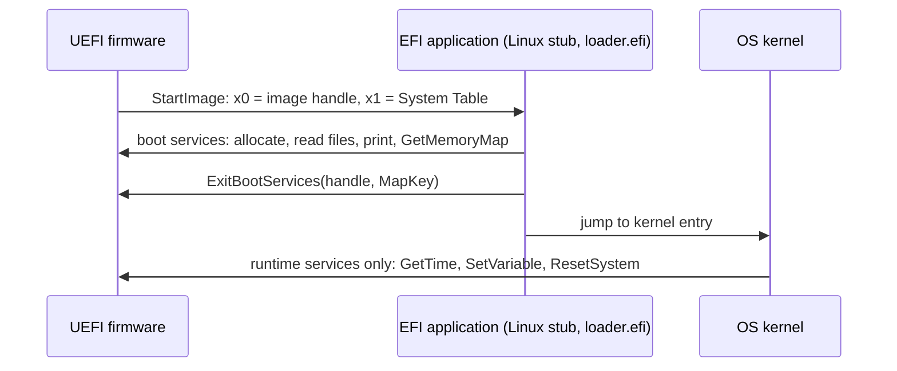

# Why does a Linux kernel look like a Windows program?

When a machine powers on, the first program its CPU runs is **firmware**: code stored in flash
(memory that keeps its contents with the power off) that sets up the machine, finds an operating
system and starts it. A **bootloader** is a program, often part of the firmware or started by it,
whose job is to load an OS kernel into memory and jump to it.

Chapter 13 handed you a file called `vmlinuz-virt`, the Linux kernel that the Alpine distribution
ships for virtual machines. Our chapter 13 loader refused to start it, printing `EFI zboot image`
and exiting with status 2. A **zboot image** is a compressed kernel wrapped in a PE header (the
header this primer is about). Ask macOS what the file is:

```sh
file -b .cache/macvmm/vmlinuz-virt
```

```text
PE32+ executable (EFI application) Aarch64 (stripped to external PDB), for MS Windows
```

A Linux kernel, built for a 64-bit Arm virtual machine, wearing the executable format of
Windows, and labelled an "EFI application". EFI is the Extensible Firmware Interface, today
called UEFI (Unified EFI): a standard for how firmware and the programs it starts talk to each
other. This primer is about that standard. Stranger still, in chapter 21 U-Boot (an open-source bootloader that also acts as
firmware, placed in the picture near the end of this primer) will run this exact file with one command,
`bootefi`, although U-Boot is not Windows and has never heard of Alpine. So there are two
questions. Why would anyone wrap a Linux kernel this way? And what does U-Boot know about this
file that our chapter 13 loader does not?

:::prereqs
- [`os-basics`](/build-your-own/vmm/primers/os-basics/): its section "Before the kernel: firmware and boot"
- [`arm64-boot-protocol`](/build-your-own/vmm/primers/arm64-boot-protocol/): the entry contract a kernel expects (`x0` = DTB, MMU off)
- [`efi-zboot`](/build-your-own/vmm/primers/efi-zboot/): its page on EFI applications and the PE/COFF header
- Chapter 10: what a Device Tree Blob (DTB) is and why the guest needs one
:::

:::objectives
- Read the first bytes of an EFI application and say what each field tells the firmware.
- Explain how an EFI application with no imports reaches the firmware's functions.
- Sort services into boot and runtime, and say what `ExitBootServices` ends.
- Trace how a DTB or ACPI reaches an OS, and who owns the DTB at each step.
- Find the default boot program on a disk, and place U-Boot and EDK2 in the picture.
:::

## Look inside the file

You fetched this file in chapter 13 (`scripts/fetch.sh linux`). Run every command in this primer
from the repository root. `xxd` prints a file as a hex dump: each line gives an offset, then 16
bytes in hex (grouped in pairs), then the same bytes as text. Dump the first 64 bytes:

```sh
xxd -l 64 .cache/macvmm/vmlinuz-virt
```

```text
00000000: 4d5a 0000 7a69 6d67 78ca 0000 4bfb 9d00  MZ..zimgx...K...
00000010: 0000 0000 0000 0000 677a 6970 0000 0000  ........gzip....
00000020: 0000 0000 0000 0000 0000 0000 0000 0000  ................
00000030: 0000 0000 0000 0000 cd23 8281 4000 0000  .........#..@...
                                        ^^^^^^^^^
                                        bytes 0x3c to 0x3f: 40 00 00 00
```

Three things to notice, and the bytes after `MZ` will differ if Alpine has shipped a newer kernel.
The file opens with `MZ`, the signature of a 1980s MS-DOS program. The words `zimg` and `gzip` are
the zboot wrapper's own markers, which the `efi-zboot` primer explains. And the last four bytes of
the `0x30` line, at offsets `0x3c` to `0x3f`, are `40 00 00 00`. Arm and x86 store numbers
**little-endian**: the lowest-value byte comes first in memory, so those four bytes read as the
32-bit number `0x00000040`, or `0x40`. In this format, the number at `0x3c` is always the offset
of the real header. Follow it:

```sh
xxd -s 0x40 -l 8 .cache/macvmm/vmlinuz-virt
```

```text
00000040: 5045 0000 64aa 0200                      PE..d...
```

`PE\0\0` is the signature of the **Portable Executable** format, PE for short, which Microsoft
built on an older format called COFF; together they are written **PE/COFF**. The next two bytes,
`64 aa`, are the little-endian number `0xAA64`, the PE **machine** code for a 64-bit Arm CPU (an
x86-64 PC program would say `0x8664` here). Then `02 00`: the file has two **sections**. A section
is a named chunk of the file, such as code or data, that the loader copies into memory. macOS's
`objdump` (LLVM's, installed with Xcode's command-line tools) reads the headers of an executable
file and prints them in words, so it can read the rest for us:

```sh
objdump -p .cache/macvmm/vmlinuz-virt | grep -E '^(Magic|AddressOfEntryPoint|Subsystem |Entry 1 )'
```

```text
Magic                   020b	(PE32+)
AddressOfEntryPoint     0000000000001028
Subsystem               0000000a	(EFI application)
Entry 1 0000000000000000 00000000 Import Directory [parts of .idata]
```

`PE32+` is the 64-bit flavour. The **entry point** is the first instruction to run, here `0x1028`
bytes from wherever the file gets loaded. The **subsystem** field says who may run this program,
and 10 means "an EFI application". The last line is the strangest. A PE header ends with a short
array of "data directory" slots, each an address and a size; `Entry 1` is the second slot (counting
from 0), the **import directory**. A Windows program lists there every named function it needs
from the system (`CreateFileW` from the Windows library `kernel32.dll`, and so on). This one has
an import directory of address zero and size zero. It imports nothing.

> **Predict.** A program that names no outside functions still prints text, allocates memory and
> reads files once it runs. Where could it get those abilities from, if not from imports?

## A program that imports nothing

The answer is that the abilities arrive as an argument. A **calling convention** is the agreement
between caller and callee on which registers hold the arguments and the return value; arm64's is
called AAPCS64 (see [`aarch64-reading`](/build-your-own/vmm/primers/aarch64-reading/)). In it, `x0` and `x1`, the first two general-purpose
registers, carry the first two arguments, and `x0` carries the result back. When firmware starts
an EFI application, it calls the entry point like an ordinary function under that convention,
with two arguments:

- `x0`: an **image handle**, an opaque token (a value the program never looks inside, only hands
  back) that names "this loaded program" in later requests to the firmware.
- `x1`: a pointer to the **EFI System Table**, a structure in memory that the firmware built.

The System Table is a directory of everything the firmware offers. It starts with a header whose
signature is the eight ASCII bytes `IBI SYST`, then holds pointers to the firmware vendor's name,
three console interfaces (input, output, error), a **Boot Services** table, a **Runtime Services**
table, and an array called the **configuration table**. Each services table is a list of function
pointers. To print, the program follows `SystemTable->ConOut->OutputString` and calls it. To get
memory, it calls `SystemTable->BootServices->AllocatePages`. The program returns a status in
`x0` when it finishes: zero for success, or a value with the top bit set for an error.

So we have the need, and now the name. **UEFI**, the Unified Extensible Firmware Interface, is a
specification of exactly this: the binary format of programs firmware will run (PE/COFF), the
calling convention, the System Table's layout, and what every service does. It is an interface,
not a program. EDK2, an open-source firmware, is one implementation of it; U-Boot contains
another; a Mac with an Intel CPU had Apple's own. (A later section compares EDK2 and U-Boot.) A
program written against the specification runs on all of them.

That is why Linux wears PE/COFF. The Linux kernel is configured at build time with switches named
`CONFIG_...`. With `CONFIG_EFI_STUB=y` (Alpine's build has it), the kernel
starts with a small **EFI stub**: a PE header and a little code that runs as an EFI application,
asks the firmware for what the kernel needs, and then jumps into the kernel proper. Any
UEFI firmware can then start Linux directly, with no Linux-specific bootloader in between.

> **Aside.** UEFI grew out of Intel's EFI, written in the late 1990s for Itanium servers, whose
> designers did not want to carry the PC BIOS forward. PE/COFF was chosen because Microsoft's
> toolchain already produced it, which is how a firmware standard came to start every program
> with an MS-DOS signature.

## Two kinds of service, and the moment between them

UEFI firmware is a small operating system while it runs: it owns memory, drives the disk and
console, and handles a timer. Then it must hand all of that to a real OS, which brings its own
drivers and its own memory manager. Two owners of one disk controller or one page of RAM would
corrupt each other, so the firmware's must stop. The program in between, which runs under the
firmware and starts the OS, is called the **OS loader** (the Linux stub, or FreeBSD's
`loader.efi`). The specification splits its services along that hand-over:

| Boot services (UEFI 2.10 §7) | Runtime services (UEFI 2.10 §8) |
|---|---|
| Memory: `AllocatePages`, `AllocatePool`, `GetMemoryMap` | Variables: `GetVariable`, `SetVariable` |
| Protocols: `LocateProtocol`, `HandleProtocol` (disks, files, console) | Time: `GetTime`, `SetTime` |
| Images: `LoadImage`, `StartImage`, `ExitBootServices` | `ResetSystem` (reboot, power off) |
| Events and timers: `CreateEvent`, `SetTimer` | `SetVirtualAddressMap` |
| **Gone** after `ExitBootServices` | **Still callable** after it, by the OS |

A **protocol** in UEFI is not a network protocol. It is a table of functions that the firmware
publishes for one device or feature (a disk, a file system, the console), found by its GUID
(defined below); `HandleProtocol` and `LocateProtocol` look one up. An **event** is a callback the
firmware runs later, for example when a timer fires. `SetVirtualAddressMap` lets the OS, once it
has turned on its own address translation, tell the firmware where runtime services now live in
the OS's virtual addresses.

The dividing call is `ExitBootServices(ImageHandle, MapKey)`. Before it, the loader may use
everything. After it returns, every boot service is gone, the firmware's drivers stop, and the
memory they used is the OS's to reuse. Only runtime services remain, which is how an OS later
reads the clock, stores a boot setting, or asks the platform to reboot.



*Caption: notice that the arrows after `ExitBootServices` only go from the OS to the firmware,
and only to runtime services.*

How does the OS know which memory is free to reuse? The memory map. A **physical address** is
the real location of a byte in RAM; a **virtual address** is the one a program uses after the
MMU, the CPU's address-translation unit, has been switched on and maps it to a physical one.
Firmware runs with physical addresses (or an identity map, where the two are equal).
`GetMemoryMap` returns an array of **descriptors**, each describing one physical address range
and its **type**: `EfiConventionalMemory` (free), `EfiLoaderCode` and `EfiLoaderData` (what the
application allocated), `EfiBootServicesCode` and `EfiBootServicesData` (reusable once boot
services end), `EfiRuntimeServicesCode` and `EfiRuntimeServicesData` (the OS must keep these, and
keep them mapped in its page tables for as long as it runs), and a few more, such as reserved
ranges. The OS builds its own picture of RAM from this array, and it counts as usable only the
free and reclaimable types. The runtime and reserved ranges are set aside, which is why an OS
booted through UEFI usually sees a little less usable RAM than the machine has.

Along with the map, `GetMemoryMap` returns a **`MapKey`**, a number that identifies this exact
version of the map. `ExitBootServices` takes that key and fails with `EFI_INVALID_PARAMETER` if
the map has changed since the key was issued, because the OS would otherwise be handed a wrong
picture of memory.

> **Under the hood.** Allocating the buffer for the map, printing, or even a firmware timer event
> can change the map between `GetMemoryMap` and `ExitBootServices`. Timer events run on their own,
> so no amount of care by the loader guarantees success. Loaders therefore size the buffer with
> some slack, then loop: get the map, call `ExitBootServices`, and on `EFI_INVALID_PARAMETER`
> call only `GetMemoryMap` again and retry. "Only" is a rule of the specification: after a failed
> `ExitBootServices` the firmware may already have shut part of itself down, so `GetMemoryMap` is
> the one boot service still allowed. See `ExitBootServices` in §7.4.

## The configuration table: how a DTB reaches the OS

In direct boot (chapter 13), our VMM loads the kernel itself, with no firmware, and starts it with
the DTB at `0x4000_0000` and that address in `x0`. Under UEFI,
`x0` holds the image handle, so the DTB needs another route. That route is the **configuration
table**: an array of pairs, each a 128-bit **GUID** (a globally unique identifier that says what
the entry is) and a pointer to the data.

| What | GUID | Defined by |
|---|---|---|
| Device Tree Blob | `b1b621d5-f19c-41a5-830b-d9152c69aae0` | UEFI 2.10 §4.6 |
| ACPI 2.0+ root pointer (RSDP) | `8868e871-e4f1-11d3-bc22-0080c73c8881` | UEFI 2.10 §4.6 |

**ACPI** (Advanced Configuration and Power Interface) is the other way to describe hardware: a
set of tables, some containing bytecode the OS interprets, that firmware provides in place of a
DTB. Its entry in the configuration table points at the RSDP, the root pointer from which the OS
finds every other ACPI table. An OS loader scans the array for the GUID it understands. A
firmware may publish a DTB, ACPI tables, or both. Arm servers mostly use ACPI, because server
operating systems and the PC world already expect it; small boards and virtual machines like
ours mostly use a DTB. Whichever it is, it describes the same machine that chapter 10 taught you
to describe: memory, CPUs, interrupt controller, UART, virtio devices.

The Linux stub then does something useful to know about. It takes the DTB from the
configuration table (or builds an empty one when the firmware offered only ACPI, because the
kernel still reads its boot parameters from a DTB). Into the DTB's `/chosen` node, the node that
carries boot parameters from a loader to a kernel, it writes the facts the kernel proper (the
kernel itself, as opposed to the stub in front of it) will need after boot services are gone:

- `bootargs`, the kernel command line;
- `linux,uefi-system-table`, where the System Table is;
- `linux,uefi-mmap-start`, `-mmap-size`, `-mmap-desc-size` and `-mmap-desc-ver`, where the final
  memory map is and how to read its descriptors;
- `kaslr-seed`, a random number the kernel uses to pick where in memory to place itself.

The initrd (initial RAM disk, the small file system the kernel unpacks first) is not in `/chosen`
on this path. Since Linux 6.1 the stub loads the initrd itself and passes it to the kernel through
a configuration-table entry with a GUID of Linux's own. Then the stub calls `ExitBootServices` and
enters the kernel with `x0` pointing at that modified DTB, following `booting.rst`. The kernel
proper never sees the UEFI entry convention; the stub translates.

> **Security.** From macvmm's side, everything in this section happens inside the guest. The
> firmware, the stub and the loader are guest code, and the DTB the OS finally reads may differ
> from the one we wrote: firmware can edit it, a loader can apply overlays (patches merged into a
> DTB). Nothing the guest reports back about its machine is evidence of what our VMM built. Our
> rule is unchanged: every value the guest gives us at an exit (the moment the guest stops and
> control returns to our VMM, for example when it touches a device register or makes a
> hypercall) is hostile, however respectable the program that produced it.

## Where the firmware finds a program

Firmware must find the EFI application on a disk before it can start it. The specification
fixes three layers (UEFI 2.10 §5 and §13.3):

1. A **partition** is a labelled slice of a disk. The disk starts with a **GUID Partition Table**
   (GPT), the table that lists its partitions, each with a type GUID.
2. One partition has the type GUID `C12A7328-F81F-11D2-BA4B-00A0C93EC93B`: the **EFI system
   partition**, or ESP. It holds a FAT filesystem (the simple one from MS-DOS days), chosen
   because every firmware can read it.
3. On it, a removable disk, or one the firmware has not been told about, is booted from a fixed
   path per architecture. For 64-bit Arm it is `\EFI\BOOT\BOOTAA64.EFI` (§3.5.1.1).

Installed systems usually do better than the default path. The boot manager reads **UEFI
variables**, small named settings the firmware keeps across reboots: `Boot0000`, `Boot0001` and
so on (each a path to an application) and `BootOrder` (which to try first). Those variables are
stored through the runtime `SetVariable` service, usually in flash, which is one reason firmware
cares whether its flash is writable; chapter 21 meets this from the VMM's side.

The FreeBSD image in chapter 22 follows the default path. Its ESP contains
`\EFI\BOOT\BOOTAA64.EFI`, which is FreeBSD's `loader.efi`. That loader uses boot services to read
the kernel from FreeBSD's own UFS file system on another partition, finds the DTB in the configuration table, hands both to the
FreeBSD kernel, and calls `ExitBootServices` on the way out.

## Where U-Boot and EDK2 fit

U-Boot is a bootloader with its own prompt and commands, which the [`u-boot`](/build-your-own/vmm/primers/u-boot/) primer covers. It
also carries an implementation of the UEFI interface, large enough to run EFI applications, which
Arm's **EBBR** (Embedded Base Boot Requirements) describes as the subset a small board must offer.
Its `bootefi` command starts that implementation: `bootefi <image address> [<fdt address>]`
builds a System Table, installs the given DTB in the configuration table (or, without one, the
DTB U-Boot itself is running with), and calls the image's PE entry point. U-Boot's "distro boot"
scripts, which search attached disks for something bootable, can also find `\EFI\BOOT\BOOTAA64.EFI` on a disk and do the same without you typing anything.

EDK2 (TianoCore) is the reference implementation of the full specification, written by Intel and
now an open project. Its `ArmVirtQemu` platform is built for QEMU's `virt` machine, whose memory
map ours mirrors. It reads the DTB that the VMM placed at the start of RAM and publishes it in the
configuration table. EDK2 does not build ACPI tables itself: QEMU builds them and hands them to
EDK2 over fw_cfg, a QEMU-specific device for passing files to firmware, and EDK2 publishes them in
the configuration table. Without fw_cfg (macvmm today), EDK2 publishes only the DTB. EDK2 also
keeps its variables in a second flash bank, which it writes through the flash chip's command
interface, so the VMM must emulate writable flash. That is one reason it is the stretch goal of
chapter 22 and not the starting point.

| | U-Boot `qemu_arm64` | EDK2 `ArmVirtQemu` |
|---|---|---|
| UEFI coverage | EBBR subset; some runtime services limited | Full specification |
| Hardware description | DTB | DTB; ACPI only if the VMM supplies tables (QEMU's fw_cfg) |
| Variable storage | In memory or a file on the ESP; `SetVariable` after `ExitBootServices` usually unsupported | A dedicated flash bank the firmware writes to |
| Also a shell with commands | Yes | A UEFI shell application, optional |

> **Production note.** Cloud VMs on Arm mostly boot through EDK2 with ACPI, because ACPI is
> what server operating systems expect, and full runtime variables make Secure Boot possible
> (firmware refusing to start any program not signed by a trusted key). macvmm starts with U-Boot
> because it asks for less from our machine (one flash bank, no writes that must persist), so the
> first firmware boot needs fewer devices. Chapter 21 asks you to write that trade-off down as an
> ADR (architecture decision record: a short document stating a decision, the options and why).

## Who owns the DTB, step by step

This is the question the `boot-chain` lab and chapter 21's journal both ask. Here is the U-Boot
to Linux chain, with the owner of the DTB at each step:

```text
 VMM (host)          builds DTB, puts it at 0x4000_0000, x0 = DTB, PC = 0x0
   |
 U-Boot (guest)      reads it at RAM base, may fix it up, keeps its own copy
   |  bootefi
 UEFI interface      installs U-Boot's DTB in the configuration table
   |  StartImage: x0 = handle, x1 = System Table
 Linux EFI stub      copies the DTB, adds /chosen (bootargs, uefi-system-table, mmap, kaslr-seed)
   |  ExitBootServices, then x0 = DTB
 Linux kernel        reads the stub's DTB; uses runtime services afterwards
```

*Caption: notice that below the first line, every arrow is inside the guest, and the DTB the
kernel reads is a descendant of ours, not ours.*

`PC` is the program counter, the address of the next instruction the CPU will run. Our machine
copies QEMU `virt`'s memory map: flash, holding the firmware, sits at address `0x0`, and RAM starts
at `0x4000_0000`. So the VMM starts the CPU at `0x0`, inside the firmware, and leaves the DTB at
the base of RAM where that firmware expects to find it.

For FreeBSD, swap the stub for `loader.efi`: it fetches the DTB from the configuration table,
loads the kernel, and passes the DTB along in FreeBSD's own metadata (a list of tagged records
the loader leaves in memory for the kernel), not in `x0`.

## The puzzle, solved

Why is a Linux kernel a Windows-format program? Because PE/COFF is the binary format UEFI
specifies for applications, and an EFI stub makes the kernel an application that any UEFI
firmware can start. The `MZ` is a fossil kept for compatibility; the real information is the PE
header at `0x40`, the machine `0xAA64`, and subsystem 10.

What does U-Boot know that chapter 13's loader does not? It implements the interface. It can
build a System Table, offer boot services that allocate memory and read files, publish our DTB in
the configuration table, and call the entry point with `x0` and `x1` as the specification says.
Our direct-boot loader offers none of that, so it rightly refuses the file and asks for the plain
Image underneath.

## Lab

:::lab boot-chain

In the `boot-chain` lab you step through two boots side by side: direct boot (VMM, kernel) and
firmware boot (VMM, U-Boot, `bootefi`, `loader.efi` or the Linux stub, kernel). At each step the
lab shows what is in `x0` and `x1`, which memory regions exist, whether boot services are still
alive, and who currently owns the DTB. You can make the firmware edit the DTB, or call
`ExitBootServices` with a stale map key, and see what each later step receives.

## Self-check

Commit to an answer before you reveal it.

:::predict A file's word at offset `0x3c` is `0x80`, and at `0x80` you find `PE\0\0` followed by `64 86`. Will U-Boot's `bootefi` run it on our machine?
No. The machine field reads `0x8664`, not `0xAA64`: it is the PE code for x86-64, and the
firmware runs only images for its own
architecture, so it refuses to load it. The `MZ` and `PE` signatures say "PE/COFF"; the machine
field says for which CPU.
:::

:::predict An EFI application calls `AllocatePages` after `ExitBootServices` has returned successfully. What should it expect?
Nothing good. Boot services no longer exist and their memory is the OS's to reuse. Conforming
firmware (EDK2 does this) also sets `BootServices` and the console pointers in the System Table
to NULL, so a naive `SystemTable->BootServices->AllocatePages` usually faults on a NULL pointer.
Only runtime services may be called after the exit, which is why a loader allocates everything
it needs before leaving.
:::

:::predict Classify each: `GetVariable`, `LoadImage`, `ResetSystem`, `GetMemoryMap`, `GetTime`, `HandleProtocol`.
Runtime: `GetVariable`, `ResetSystem`, `GetTime`. Boot: `LoadImage`, `GetMemoryMap`,
`HandleProtocol`. A quick test: would an OS that already owns the hardware still need it? Reading
the clock and rebooting, yes; loading another image or finding a disk driver, no.
:::

:::predict A loader prints "exiting boot services" between its call to `GetMemoryMap` and its call to `ExitBootServices`. Sometimes the boot fails. Why?
Printing can allocate memory inside the firmware, or give a timer event the chance to run, and
either can change the memory map, so the `MapKey` the loader holds is stale and `ExitBootServices` returns `EFI_INVALID_PARAMETER`. If the loader
does not fetch the map again and retry, the boot fails intermittently, depending on what the
console did.
:::

:::predict In the U-Boot to Linux chain, macvmm's DTB lists 512 MiB of RAM. Linux reports a little less usable RAM than it does under direct boot. Is the DTB being ignored?
No. On the UEFI path Linux takes its picture of RAM from the UEFI memory map the stub left it
(that is what `linux,uefi-mmap-start` is for), and the firmware keeps some ranges for itself: runtime services code and data, and anything marked reserved. Those
must stay untouched for runtime services to work, so they are not counted as free.
:::

:::predict Why does FreeBSD's image put its loader at `\EFI\BOOT\BOOTAA64.EFI` and not somewhere of its own choosing?
Because that is the default path the specification fixes for 64-bit Arm removable media, and a
fresh VM has no `Boot####` variables telling the firmware where else to look. Any conforming
firmware, U-Boot's included, will find it there with no configuration.
:::

## Where this shows up in macvmm

- [Chapter 13, loaders](/build-your-own/vmm/linux/loaders/) (linked): the loader recognises
  `vmlinuz-virt` as an EFI application wrapping a compressed kernel and refuses it with a named
  error, because macvmm's direct boot provides no UEFI interface; `cargo xtask unzboot` extracts
  the plain Image instead.
- [Chapter 21, firmware](/build-your-own/vmm/firmware/firmware/) (requires this primer): macvmm
  loads U-Boot into flash at `0x0` and starts it with the DTB at RAM base. The firmware loader
  (`crates/vmm/src/loader/firmware.rs`) and flash device (`crates/vmm/src/devices/flash.rs`) are
  where the firmware path begins. Your ADR compares U-Boot and EDK2 using the services and
  tables from this primer.
- [Chapter 22, freebsd](/build-your-own/vmm/firmware/freebsd/) (review): the full chain of this
  primer, U-Boot `bootefi` to `loader.efi` to the FreeBSD kernel, on a virtio-blk disk with an ESP;
  journal question 3 asks what UEFI gives an OS that a DTB alone does not.

## Checkpoint

- **What you can do now.** Confirm that Alpine's kernel is an EFI application:
  `objdump -p .cache/macvmm/vmlinuz-virt | grep -o '(EFI application)'` prints
  `(EFI application)`. Read the PE header by hand from `xxd`, explain how an import-free program
  reaches firmware through `x1`, split services into boot and runtime, and draw the DTB's journey
  from our VMM to a kernel through U-Boot.
- **What's next.** Chapter 21 makes macvmm run firmware for the first time. U-Boot is a stricter
  guest than Linux: it starts at `0x0` from flash, writes where Linux never writes, and executes
  memory accesses our chapter 07 decoder refused.
- **One open question.** Runtime services keep firmware code alive inside a running OS, run
  with the same full powers as the OS kernel itself, containing whatever the firmware vendor
  wrote years ago. If you were designing an
  OS, how much of that code would you be willing to trust, and what would you do to contain it?

## Going further

- UEFI Forum, *Unified Extensible Firmware Interface Specification*, version 2.10: §2.1 and §2.3.6
  (images, applications, and the AArch64 calling convention and entry state), §3.5.1.1 (removable
  media default paths), §4 (System Table and configuration table GUIDs), §5 (GPT), §7 (boot
  services, including `ExitBootServices` in §7.4), §8 (runtime services), §13.3 (the EFI system
  partition). If your edition numbers differ, search for the section titles.
- Arm, *Embedded Base Boot Requirements* (EBBR): the UEFI subset U-Boot implements, and what it
  allows a platform to leave out at runtime.
- Linux, `Documentation/arch/arm/uefi.rst` (the stub and the `/chosen` properties it writes) and
  `Documentation/arch/arm64/booting.rst` (the entry state the stub must produce).
- U-Boot documentation, *UEFI on U-Boot* (`doc/develop/uefi/uefi.rst`) and the `bootefi` command
  page; FreeBSD `loader.efi(8)`.
