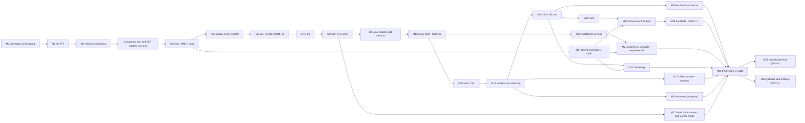

# macvmm implementation plan

- **Status:** v1 plan, rev 1.2, 2026-11-18. Each milestone below is sized for **one engineer-agent
  session** (about 1–3k lines including tests). Execute them literally, in dependency order; §2.1
  says which ones may run at the same time.
- **Rev 1.1** folds in `docs/security/threat-model.md` (requirement IDs such as `VQ-12`, flaws
  F1–F18) and the architecture-level items of `course/reviews/first-principles.md` (B1, R3, R4,
  R6, R9, R13). Every milestone now ends with a **Security checklist** (threat-model IDs to tick)
  and **Security tests** (named tests that must pass). Where an earlier instruction in a
  milestone conflicts with its checklist, the checklist wins.
- **Rev 1.2** (same day) folds in threat-model revision 2: flaws F19–F24 and requirements
  SINK-1, TTY-10 (M6), MEM-11 (M2), FDT-4 (M7), SC-14 (M15), NET-1..6 (M24), and the on-machine
  results of threat model §13 (hardened runtime works with HVF, so SIGN-3 is the M0 default;
  HVF needs no `mach-lookup` or `iokit-open` under `sandbox-exec`, so the M22 profile starts
  from none). New decisions D17 and D18; D14 is resolved. Changed text is marked "(rev 1.2)".
- **Milestones:** M0–M24 and M27 form v1, gated by M23 (fresh clone). M25 (snapshots) and M26
  (gdbstub) are post-v1. EDK2 is a stretch item inside M19's follow-ups (ADR-0007 item 5).
- **Decisions:** `docs/adr/0001`–`0008`. ADR-0008 is the macOS-guest strategy (S0/S1, claims
  policy, prohibitions, the proposed IPSW exception).
- **Design authority:** `docs/architecture.md` (what to build) and `docs/adr/` (why). When this plan
  and the architecture disagree, the architecture wins; fix this file in the same change.
- **Course mapping:** chapter IDs refer to `course/CURRICULUM.md` §5.

---

## 0. Rules for every milestone

### 0.1 Definition of done (all must hold)

1. `scripts/check.sh` passes. It runs:
   - `cargo fmt --all --check`
   - `cargo clippy --workspace --all-targets -- -D warnings`
   - `cargo test --workspace`
   - `scripts/check-unsafe`
   - `scripts/check-ffi.sh`
   - `scripts/check-anchors`
   - `scripts/build-guests.sh`
2. The milestone's **on-machine acceptance tests were run on the Apple Silicon dev machine**, and
   their real output is included in the hand-off report. Never claim that a guest booted, or that a
   test passed, without having seen it. If something could not be run, say so.
3. Every file under "Create / modify" exists. Each new module has a `//!` doc comment explaining
   *why*, with spec citations by section. Examples: ARM ARM D17.2.40 (ESR_EL2), virtio 1.2 §2.7,
   booting.rst §4, DT spec §5.
4. Every anchor listed under "Anchors" exists (`// ANCHOR: name` … `// ANCHOR_END: name`), per ADR-0006.
5. No new dependency unless it is justified in `docs/dependencies.md`. The default is std only,
   plus `libc` inside `crates/hvf`.
6. Every guest-controlled value is validated (architecture §1, principle 1). New parsers get
   hostile-input tests.
7. Any research claim the milestone verified or refuted is re-tagged in `docs/research/*.md`.
   For example, `[U]` becomes `[verified-on-machine]` with the evidence.
8. **Do not commit.** The lead commits.
9. **(rev 1.1)** The §2.2 every-milestone security checklist holds, every item of the milestone's
   own **Security checklist** is ticked (or has a written exception approved by the lead), and
   every **Security test** passes. A requirement without a passing test is not done.

### 0.2 Hand-off report (the agent's final message)

- Files created and modified.
- The commands run, with **verbatim** key output (marker lines, exit codes, test counts).
- Deviations from this plan, and why.
- Open issues and newly discovered risks.
- **(rev 1.1) Security:** the milestone's checklist with each threat-model ID ticked and the test
  that proves it; every new guest-controlled value with the check applied to it; any new surface
  (and the threat-model §5 row added for it).

### 0.3 Test conventions (created in M3, used everywhere)

- **Host tests:** `cargo test --workspace`. They need no HVF and run in hosted CI.
- **HVF tests:** `cargo test -p <crate> --features hvf-tests -- --test-threads=1`. The serial
  thread count is required because there is one VM per process.
- **End-to-end tests:** `scripts/test-e2e.sh <suite>|all`. This wraps
  `cargo test -p macvmm --features hvf-tests --test e2e_<suite> -- --test-threads=1`.
  - Suites: `guests`, `hygiene` (rev 1.2, SINK-1/TTY-10/TEST-8, from M6), `hostile` (rev 1.1,
    TEST-7, from M11), `linux`, `virtio`, `net`, `smp`, `firmware`, `freebsd`, `vmapple`, `vz`.
  - The `vz` suite is shell only, in `tools/vz-mac/test.sh`.
  - The harness lives in `crates/macvmm/tests/support/mod.rs`. It:
    - signs the binary once (`scripts/sign.sh`);
    - builds the guests once (`scripts/build-guests.sh`);
    - runs `macvmm` as a child process with `--timeout` and a hard kill at timeout + 10 s;
    - supports interaction steps: `WaitFor(marker)`, `Send(bytes)`, `Sleep(ms)`;
    - captures stdout and stderr separately;
    - returns `Outcome { code, stdout, stderr, wall }`.
  - A test that needs a fetched artifact **fails** (it does not skip) with
    `missing artifact X: run scripts/fetch.sh <set>`. The exception is when
    `MACVMM_E2E_ALLOW_SKIP=1` is set, which hosted CI only.
- **Marker files:** `crates/macvmm/tests/expect/<test>.txt`.
  - Each non-empty line is one marker.
  - Markers must appear **in order** as substrings. `*` matches any run of non-newline characters.
  - A line prefixed `[stderr] ` matches against stderr. Otherwise the marker matches stdout, which
    is the serial output.
  - A line starting `!` must appear nowhere.
  - Exit codes are asserted in the test code.
  - Trace markers (`<test>.trace.txt`) apply the same rules to the JSONL trace file.
  - **(rev 1.1, AS10)** A guest can print any marker and exit through DEBUG_EXIT(0), so every e2e
    test asserts the process exit code, and tests whose verdict comes from the VMM (unhandled
    MMIO, reset storm, path refusals, caps) assert a `[stderr]` marker that only the VMM prints.
    Byte-level checks (for example "stdout contains no `ESC ]`") are made in test code.
- **(rev 1.1) Property tests without dependencies:** the in-tree xorshift PRNG (a `test-util`
  module shared with `crates/fuzz`), a fixed seed printed on failure, ≥ 10,000 iterations in
  `cargo test` and more under `--release`.
- **Guest-side markers** printed by our initramfs and test guests use the form
  `macvmm-<area>: <message>` (initramfs) or `<guest-name>: <message>` (bare-metal guests).
- **Exit codes:** `docs/architecture.md` §13.2. 0 = power off, 3 = guest fatal, 4 = reset with
  `--on-reset exit`, 5 = timeout, 6 = DEBUG_EXIT ≠ 0, 130 = user quit.

### 0.4 Artifacts

- Downloads use `scripts/fetch.sh <set>` with `scripts/fetch-manifest.txt`.
  - HTTPS only, redirects included: `curl --proto '=https' --proto-redir '=https' --tlsv1.2 -fSL --retry 3 --max-filesize <cap>`
    (SC-2). Never `-k`.
  - Files are written to `${MACVMM_CACHE:-./.cache/macvmm}/<name>.part`, checked with
    `shasum -a 256` (exact compare, 64 lowercase hex), then renamed.
  - A hash mismatch is fatal. A cached file with a bad hash is deleted and fetched again.
  - Nothing downloaded is ever executed on the host: not run, not `source`d, not `chmod +x`ed,
    not mounted (`hdiutil attach`), not opened with `open(1)` (SC-4).
  - **Verify before parse** (SC-5): no host tool (gzip, xz, xtask extractors, `mkfs.ext4`) touches
    an artifact until its sha256 matched a pinned value. TOFU pins are the documented exception
    (SC-10): the modloop pin is cross-checked once by a maintainer against Alpine's signed release
    metadata, recorded in a dated manifest comment.
  - The cache dir is created 0700. If it exists it must be a real directory (not a symlink),
    owned by the current uid, and not group- or world-writable; otherwise exit with a clear
    error (SC-3).
- Manifest line format: `<set> <name> <sha256> <url> [<mirror-url>...]`. `name` must match
  `^[A-Za-z0-9._-]+$` and must not be `.` or `..`; every URL must start with `https://` (SC-2).
- Derived artifacts (`derive:` lines) are built by `cargo xtask …` and hash-checked too. The
  exception is files we build from tracked sources, such as `initramfs-test.img`, whose hash is
  printed but not pinned.

---

## 1. Machine memory map (exact; `crates/vmm/src/arch/layout.rs` encodes it)

This table is identical to `docs/architecture.md` §5.1. SPI *n* is INTID 32+*n*. Every device
interrupt is **level-high** (DT `<0 n 4>`).

| Region | Base | Size | End (exclusive) | Stage-2 | Interrupt | DT node |
|---|---|---|---|---|---|---|
| Flash bank 0 (firmware) | `0x0000_0000` | `0x0400_0000` | `0x0400_0000` | READ+EXEC with `--bios`; else unmapped | — | none (until CFI) |
| Flash bank 1 (vars) | `0x0400_0000` | `0x0400_0000` | `0x0800_0000` | unmapped | — | — |
| GICD | `0x0800_0000` | `0x0001_0000` | `0x0801_0000` | in-kernel (HVF) | — | `intc@8000000` |
| reserved (QEMU GICv2 CPU) | `0x0801_0000` | `0x0001_0000` | `0x0802_0000` | unmapped | — | — |
| GICv2m MSI frame (PCI only) | `0x0802_0000` | `0x0001_0000` | `0x0803_0000` | in-kernel when PCI enabled | SPI 48–111 → INTID 80–143 | `v2m@8020000` (PCI only) |
| reserved (QEMU ITS) | `0x0808_0000` | `0x0002_0000` | `0x080A_0000` | unmapped | — | — |
| GICR (`ncpus` frames) | `0x080A_0000` | `ncpus × 0x0002_0000` | `0x080A_0000 + ncpus×0x2_0000` | in-kernel | SGI/PPI | `intc@8000000` reg[1] |
| GICR window remainder | GICR end | to `0x0900_0000` | `0x0900_0000` | trap → RazWi | — | — |
| PL011 UART0 | `0x0900_0000` | `0x0000_1000` | `0x0900_1000` | trap | **SPI 1 → INTID 33** | `pl011@9000000` |
| PL031 RTC | `0x0901_0000` | `0x0000_1000` | `0x0901_1000` | trap | **SPI 2 → INTID 34** | `pl031@9010000` |
| reserved fw_cfg | `0x0902_0000` | `0x0000_0018` | — | unmapped | — | — |
| reserved PL061 | `0x0903_0000` | `0x0000_1000` | — | unmapped | SPI 7 → INTID 39 | — |
| virtio-mmio slot *i* | `0x0a00_0000 + i×0x200` | `0x0000_0200` | slot 31 ends `0x0a00_4000` | trap | **SPI 16+i → INTID 48+i** | `virtio_mmio@a000000` (+0x200·i), populated only |
| testdev (`--testdev`) | `0x0b00_0000` | `0x0000_1000` | `0x0b00_1000` | trap | — | none |
| never-populated hole | `0x0c00_0000` | `0x0200_0000` | `0x0e00_0000` | unmapped, no device | — | — |
| reserved PCIe MMIO | `0x1000_0000` | `0x2eff_0000` | `0x3eff_0000` | — | INTx SPI 3–6 → INTID 35–38 | — |
| reserved PCIe PIO | `0x3eff_0000` | `0x0001_0000` | `0x3f00_0000` | — | — | — |
| reserved PCIe ECAM | `0x3f00_0000` | `0x0100_0000` | `0x4000_0000` | — | — | — |
| RAM | `0x4000_0000` | `--mem`: default 512 MiB; 64 MiB ≤ size ≤ 255 GiB; multiple of 2 MiB | ≤ `0x40_0000_0000` | READ+WRITE+EXEC | — | `memory@40000000` |

**PPIs.** DT `timer` lists `<1 13 4>, <1 14 4>, <1 11 4>, <1 10 4>`, which are INTIDs 29, 30,
**27 (virtual timer)** and 26. INTID 25 (maintenance) and INTID 23 (PMU) are not described.

**Placement in RAM:**

| Item | Address |
|---|---|
| DTB | `0x4000_0000`, ≤ 2 MiB, and ≤ 512 KiB when a test guest is loaded |
| Test guests | link address `0x4008_0000` |
| Linux Image | `0x4020_0000 + text_offset` |
| initrd | `align_up(kernel_load + image_size, 2 MiB)`. For Alpine 6.18.60: kernel `0x4020_0000..0x424a_0000`, initrd at `0x4260_0000`. |

**IPA bits:** the smallest value ≥ 36 that covers the layout, capped at the HVF maximum (40 on the M5 Pro).

**vmapple profile (M21 only):** see architecture §5.2.

---

## 2. Milestone graph



Edges are *hard* dependencies (the later milestone uses code or artifacts of the earlier one),
with three exceptions that are only the default order for a single engineer: **M5 → M6**,
**M6 → M7** and **M10 → M11**. §2.1 relaxes them. If M6 runs before M5 is merged, M6 adds the
`StopReason::UserQuit` variant (exit 130) to `control.rs` itself, as an additive edit.

**Chapter → milestone map**

| Chapters | Milestones |
|---|---|
| 00 | M0 |
| 01 | M0, M1 |
| 02 | M1 |
| 03 | M3 |
| 04 | M2, M3 |
| 05 | M2, M3 |
| 06, 07 | M4, plus M17 for the ISV=0 extension |
| 08 | M5 |
| 09 | M6 |
| 10 | M7 |
| 11 | M8 Part A (no-GIC mode, rev 1.1) |
| 12 | M8 Part B (in-kernel GIC) |
| 13 | M3 (ELF), M9 |
| 14 | M10 |
| 15, 16 | M11 |
| 17 | M12, M13 |
| 18 | M14, M15 |
| 19 | M24 |
| 20 | M16 |
| 21 | M17, M18 |
| 22 | M19 |
| 23 | M20 |
| 24 | M21 |
| 25 | M22 |
| 26 | M25 |
| 27 | M17, M26 |
| every checkpoint (CURRICULUM §3) | M27 (harness); each later milestone adds its chapter's `course/checkpoints/NN/` |

### 2.1 Parallel execution plan

Milestones in the same wave touch **disjoint primary files** and may be given to different
engineer-agents at the same time. A wave starts when every hard dependency (graph above) of its
members is done.

| Wave | Milestones (run concurrently) | Why they do not collide |
|---|---|---|
| W0 | M0 | everything depends on it |
| W1 | M1 · M20 (Swift build and CLI only; its acceptance waits for M9's initramfs) | `crates/hvf/**` vs `tools/vz-mac/**` |
| W2 | M2 | — |
| W3 | M3 | — |
| W4 | M4 | — |
| W5 | M5 · M6 · M7 · M17 (host-only half: `arch/insn.rs`, `arch/stage1_walk.rs` and their tests) | sysreg/PSCI/control vs devices/tty vs `fdt/` vs decoder files |
| W6 | M8 · M17 (on-machine half, after M5's `inject.rs`) | GIC/timer files vs `vcpu/mmio.rs` ISV=0 path |
| W7 | M9 · M11 (host-only parts) · M27 | loaders and xtask zboot/cpio vs `virtio/` vs `crates/xtask/src/{checkpoint,learner}/` and `course/` |
| W8 | M10 · M11 (on-machine part) | integration fixes vs the virtio transport |
| W9 | M12 · M21 (if D4 is decided) | `virtio/{worker,rng}.rs` vs `machine/vmapple/**` |
| W10 | M13 · M14 · M24 | `virtio/console.rs` vs `virtio/blk.rs` + `backend/file.rs` vs `virtio/net.rs` + `net/**` |
| W11 | M15 · M16 · M22 | rootfs tooling vs SMP files vs `crates/fuzz/**` + `sandbox.rs` |
| W12 | M18 | — |
| W13 | M19 | — |
| W14 | M23 (gate) | reruns everything |
| post-v1 | M25 · M26 | `snapshot/**` vs `gdbstub/**` |

**Shared registration files.** Parallel milestones may only make *additive, block-local* edits
to these files, always with an exact-match edit on a freshly read copy, never a whole-file rewrite:
`crates/macvmm/src/cli.rs` (new flags), `crates/vmm/src/machine/virt.rs` (device registration),
`crates/vmm/src/lib.rs` and `crates/vmm/src/*/mod.rs` (`mod` lines), `guests/Cargo.toml`
(`[[bin]]` entries), `guests/common/lib.rs`, `crates/xtask/src/main.rs` and `src/vectors.rs`,
`crates/hvf/src/host.rs` (new shims), `scripts/initramfs/init` (new `case` arms),
`scripts/fetch-manifest.txt`, `scripts/setup.sh` (optional-tool checks), `docs/dependencies.md`,
`docs/research/*.md` (re-tagging) and `crates/macvmm/tests/support/mod.rs` (new helpers only).
Rev 1.1 adds `crates/vmm/src/backend/hostio.rs` (new input and output kinds),
`crates/vmm/src/vcpu/exit.rs` (new dispatch arms, M8 Part A vs M17) and
`docs/security/threat-model.md` (§5 rows and `[U]` re-tagging) to this list.
If two agents need to change the *same existing* line of one of these files, the milestones are
not parallel; run them in graph order.

### 2.2 Security: rules for every milestone, and the per-milestone index (rev 1.1)

`docs/security/threat-model.md` is normative (architecture §21). Its requirement IDs (`MEM-5`,
`VQ-12`, `TTY-3`, …) are cited in each milestone's **Security checklist**. "Hostile test" means a
host test that feeds deliberately malformed values and asserts `Err`, a drop, NEEDS_RESET, an
injected exception or a defined stop, **never a panic**. Exit code 1 caused by a guest is always a
bug and gets a regression test.

**Every milestone (threat model §10.1).** Before the hand-off report, the reviewer ticks:

- [ ] New guest-facing code follows architecture §4 (RUST-1..7): the module-level
      `#![deny(clippy::arithmetic_side_effects, clippy::indexing_slicing, clippy::cast_possible_truncation)]`,
      no `unwrap`/`expect`/`panic!` on guest paths, `.get()` instead of guest-bounded slicing,
      and every guest-controlled value listed in the PR with its check.
- [ ] Every new parser or device has a hostile-input test file; from M22 on, also a fuzz target.
- [ ] No new `unsafe` outside the quarantine; every `unsafe` block has `// SAFETY:`.
- [ ] No host file is opened outside `HostIo::open` (HOSTIO-1); new outputs follow PATH-3..6.
- [ ] Guest bytes reaching any sink go through `AnsiFilter` (TTY-1) and the sink's bounded
      queue (rev 1.2, SINK-1): no vCPU or worker thread ever blocks on host I/O. Logs use
      `{:?}`; guest-triggerable messages use `guest_warn!` (LOG-1).
- [ ] Every allocation sized by a guest value has a named cap (RUST-4, architecture §21.5).
- [ ] No new dependency, entitlement, network use or process spawn without updating
      `docs/dependencies.md` and the threat model.
- [ ] The threat model's §5 inventory is updated if a surface was added, and any `[U]` it lists
      for this milestone is re-tagged with evidence.
- [ ] Scripts touched follow SC-1 (`set -euo pipefail`, `IFS=$'\n\t'`, `umask 077`, quoted
      expansions, `--` before paths, `"${var:?}"` in every `rm -rf`, `mktemp -d` + `trap`).

**Index** (details live in each milestone's Security checklist):

| M | Threat-model IDs | Key security tests |
|---|---|---|
| M0 | SIGN-1..4 (SIGN-3 default-on, rev 1.2), SC-1, SC-2 (manifest), SC-3, SC-11, SC-12, RUST-2, TEST-1, TEST-2 | `audit_rejects_extra_entitlement`, `test-fetch.sh`, `sign_runtime_strips_dyld_env` |
| M1 | exit-struct volatile reads, `Vcpu` `!Send`, `OwnedMapping` bounds | `vcpu_not_send` (compile-fail doc test), `owned_mapping_write_bounds` |
| M2 | MEM-1..11 (MEM-11 rev 1.2, F22), RUST-1, RUST-7, LOG-1 | `memory_hostile` ≥ 30, `volatile_copy_property`, `hv_allocate_is_zeroed`, `teardown_action_table`, `hvf/tests/teardown.rs` |
| M3 | HOSTIO-1, PATH-1, PATH-2, PATH-6, PATH-8, LDR-1, LDR-2, PROC-3, PROC-4, TTY-1 (basic), RUST-5 | `elf_hostile` ≥ 20, `paths.rs` (inputs), `ansi_filter` (basic), `rlimit_core_zero` |
| M4 | MMIO-1..3, MMIO-7, MMIO-8 (testdev), LOG-3, TTY-8, PATH-3..6 (trace) | ESR sweep 1e6, `sinks_cap` (trace), `trace_json_escape_golden` |
| M5 | HC-1..7 | `hypercall_caps`, `reset_storm` e2e (exit 3) |
| M6 | TTY-1..10, SINK-1 (rev 1.2, F20/F21), MMIO-8/9, LOG-4, PATH-3..6, PROC-1..3 | `ansi_filter` ≥ 40, `tty_hygiene` e2e (TEST-8), `paths.rs` (outputs), `sinks_cap` (file), `sink_queue`, `e2e_hygiene` (`sink_backpressure`, `stdin_escape_when_full`) |
| M7 | FDT-1..4 (FDT-4 rev 1.2, F23) | `seeds_differ_per_run`, `fdt_reader_unreachable` audit, `dtb_out_zeroes_seeds`, `dtb_out_has_no_seeds` |
| M8 | GicSpi INTID validation; no-GIC mode restrictions | `irq_lines`, `irqchip_none_restrictions` |
| M9 | LDR-3..5, SC-2..7 (F10), SC-4, SC-5 | `image_hostile` ≥ 15, `tar.rs` symlink-chain canary, `test-fetch.sh` (full) |
| M10 | threat-model v0 review; TTY-3 from inside Linux | `linux_tty_attack` e2e |
| M11 | VQ-1..7, VQ-9, VQ-10, VQ-13..16, MEM-7 | `virtqueue_hostile` ≥ 40, `virtqueue_toctou`, `virtio_mmio_state` ≥ 20, `hostile` suite phases 1, 3, 6, 7, 8 |
| M12 | VQ-8 (rng), VQ-11, VQ-12, FDT-3 (entropy source) | `worker_budget`, `hostile` phase 5 on rng |
| M13 | TTY-1 (console TX), VQ-8 (console), bounded RX | `virtio_console` hostile cases, `console_tx_filtered` |
| M14 | BLK-1..11, PATH-4, PATH-5, MEM-5 benchmark | `virtio_blk_hostile` ≥ 15, `blk_short_read`, `disk_ro_is_o_rdonly`, `hostile` phase 5 on blk |
| M15 | SC-5, SC-7..10, SC-14 (rev 1.2, F24) | `mkrootfs_staging_only`, modloop pin cross-check recorded, `audit_rejects_host_mount_of_guest_image` |
| M16 | HC-3 under SMP races; TEST-7 phases 4, 5 (live TOCTOU) | `psci_smp`, `hostile_smccc_storm`, `hostile_vq_live_toctou` |
| M17 | MMIO-4, MMIO-5, MMIO-6 | `isv0_ipa_mismatch_aborts`, `stage1_walk` bounds, `hostile` phase 2 |
| M18 | LDR-1 (firmware), MEM-3, MMIO-10, HC-2 (`--bios`) | `firmware_loader` caps, `rom_unreachable_by_dma` |
| M19 | SC-6, SC-10 (derived FreeBSD pin) | xz output cap, free-space check |
| M20 | single VZ entitlement, AS9 | `vz_entitlements_exact` |
| M21 | POST-6, PATH-7, TEST-11 | `avpbooter_never_copied`, unknown-MMIO logger cap |
| M22 | TEST-3, TEST-4 (4 planted bugs), SBX-1..4 (no mach/IOKit allowances by default, rev 1.2), PROC-4 (NOFILE), TEST-7 complete, TEST-10 | `fuzz.sh all`, `bughunt-selftest.sh` 4/4, `--sandbox-selftest` (SMP, reboot, blk) |
| M23 | SC-2..5 from an empty cache; every checklist row green or excepted | `fresh-clone-check.sh` |
| M24 | NET-1..6 (rev 1.2, F19) | `virtio_net_hostile` ≥ 12, `unixgram.rs` (NET-1..4 cases), `net_foreign_sender_dropped`, `net_requires_peer`, `net_refuses_live_socket`, `net` fuzz target |
| M25 | POST-1, POST-2 | hostile snapshot corpus, `restore_rejects_bad_mac` |
| M26 | POST-3 | `gdb_packet` hostile cases, `gdb_no_host_packets`, `brk_icache` |
| M27 | harness hygiene (no uploads, size caps, no overwrites) | `toml_lite`/`json_lite` caps, `learner_never_overwrites` |

---

## Phase 1: to a Linux shell

### M0: Workspace, toolchain, signing runner, CI scripts, doctor

- **Serves:** ch00 and the ch01 `macvmm doctor`.
- **Depends on:** nothing.
- **Goal:** a clean clone builds, signs and runs `macvmm doctor` through `cargo run`, and
  `scripts/check.sh` is the single quality gate.

**Create**

- Root files:
  - `Cargo.toml`: `[workspace] resolver = "3"`; members `crates/hvf`, `crates/vmm`,
    `crates/macvmm` and `crates/xtask`; exclude `guests`, `spikes` and `tools`.
    `[workspace.package]`: `edition = "2024"`, `rust-version = "1.99"`, `publish = false`. Leave
    `license` unset until the lead decides it (architecture §19 item 10).
    `[profile.release] overflow-checks = true` and `panic = "unwind"` (RUST-2).
  - `Cargo.lock`, committed by the lead; every cargo invocation in `check.sh` and CI uses
    `--locked` (SC-11).
  - `rust-toolchain.toml`: `channel = "1.99.0"`, `components = ["rustfmt", "clippy", "llvm-tools"]`,
    `targets = ["aarch64-unknown-none"]`.
  - `clippy.toml`: `allow-unwrap-in-tests = true`, `allow-expect-in-tests = true`.
  - `.cargo/config.toml`: `[target.aarch64-apple-darwin] runner = ["scripts/sign-and-run.sh"]`
    and `[alias] xtask = "run --quiet -p xtask --"`.
  - `entitlements.plist`: exactly `com.apple.security.hypervisor = true`.
  - `.gitignore`: `/target`, `/.cache`, `/learner`, `*.part`, `.DS_Store`.
  - `README.md`: a skeleton with prerequisites and a `<!-- ANCHOR: quickstart -->` block
    containing setup → doctor. M10 and M23 extend it.
  - `.github/workflows/ci.yml`: a hosted `macos-15` arm64 job running `scripts/check.sh` with
    `MACVMM_E2E_ALLOW_SKIP=1`. Hardened per SC-12: `permissions: contents: read`; every action
    pinned by **full commit SHA**; no `pull_request_target`; no secrets; no cache of
    `.cache/macvmm` shared with untrusted PRs; `shellcheck` installed and mandatory.
- `crates/hvf/`:
  - `Cargo.toml` (no dependencies yet), and `build.rs` printing
    `cargo:rustc-link-lib=framework=Hypervisor`.
  - `src/lib.rs`.
  - `src/ffi.rs`: the subset `hv_vm_create/destroy`, `hv_vm_config_create`,
    `_get_max_ipa_size`, `_get_default_ipa_size`, `_set_ipa_size`, `_get_el2_supported`,
    `hv_vm_get_max_vcpu_count`, `hv_gic_config_create`, `_set_distributor_base`,
    `_set_redistributor_base`, `hv_gic_create` and `os_release`.
  - `src/error.rs`, `src/caps.rs`, and `src/vm.rs` (`VmBuilder`, `Vm` with
    `Drop = hv_vm_destroy`).
- `crates/vmm/Cargo.toml` and `crates/vmm/src/lib.rs`: crate docs, `#![deny(unsafe_code)]`, and
  empty modules declared later.
- `crates/macvmm/`: `Cargo.toml` (features `hvf-tests`, `experimental-vmapple`),
  `src/main.rs` (subcommand dispatch, `--log`) and `src/doctor.rs`.
- `crates/xtask/`: `Cargo.toml`, `src/main.rs`, `src/anchors.rs` (ADR-0006 rules),
  `src/audit.rs` and `tests/{anchors.rs, audit.rs}`. The audit implements every check of
  architecture §4: unsafe/SAFETY, layout literals, `print!` family in `crates/vmm`,
  `std::process::Command`, `std::net`, `File::open`/`OpenOptions` locations, the dependency
  allow-list, and the `entitlements.plist` key set (TEST-1, F18). Checks whose target files do
  not exist yet pass vacuously.
- `scripts/`:
  - `lib/common.sh`: `set -euo pipefail` helpers, `die`, `info`, repo-root detection and cache dir.
  - `setup.sh`: checks arm64, macOS ≥ 15.0, `xcode-select -p`, rustup and clang. Adds the
    target and `llvm-tools` idempotently. Reports the optional Homebrew tools and the milestone
    that needs each: `dtc` (M7 golden DTS), `e2fsprogs` (M15) and `xz` (M19). On the dev machine
    `dtc` and `xz` are present and `e2fsprogs` is not (verified 2026-11-18). It never installs
    anything itself; it prints the `brew install` line.
  - `doctor.sh` and `doctor/hvprobe.c`: a 20-line C probe built with
    `clang -framework Hypervisor` into `target/doctor/`, then signed and run.
  - `sign.sh`: `codesign -s - -o runtime --entitlements entitlements.plist -f`. **(rev 1.2)** The
    hardened runtime is the **default** for every build, because threat model §13 verified `[V]`
    that ad-hoc `-o runtime` binaries still create VMs and run vCPUs, and that without it dyld
    honours `DYLD_*` variables in the entitled process (705 vs 0 lines of
    `DYLD_PRINT_LIBRARIES`). `--debug` omits `-o runtime` so lldb can attach, and prints a
    one-line warning. With `--no-entitlements` it signs ad-hoc
    without entitlements, for the negative test. Afterwards it verifies that the entitlement
    list is exactly the hypervisor key. It refuses any path outside `$CARGO_TARGET_DIR`
    (default `target/`).
  - `sign-and-run.sh`: the cargo runner. It refuses paths outside `$CARGO_TARGET_DIR`. It signs
    `$1` **with the hypervisor entitlement only when the binary needs HVF**: `macvmm`, and the
    test binaries of `hvf`, `vmm` and `macvmm` (matched by name). Everything else (xtask, other
    test binaries) is signed ad-hoc without entitlements (SIGN-4, F12). Then `exec "$@"`.
  - `check.sh`: the CI-like gate. It runs §0.1 item 1 in that order and prints `CHECK OK` last.
    `--hvf` additionally runs `cargo test -p hvf -p vmm --features hvf/hvf-tests,vmm/hvf-tests -- --test-threads=1`
    and `scripts/test-e2e.sh all`. `--strict` turns every SKIP into a failure (used by M23). On a
    host where `hv_vm_create` fails (hosted CI), it prints
    `CHECK OK (HVF unavailable: <err>; HVF checks skipped)`. It also runs the dependency audit
    (`cargo xtask audit --deps`: every crate in `cargo tree` must appear in the allowlist block of
    `docs/dependencies.md`), `bash -n` on every script, `shellcheck -S warning` on `scripts/`
    when installed (it prints `SKIP shellcheck (not installed)` otherwise, which `--strict`
    turns into a failure), and `scripts/test-fetch.sh`.
  - `fetch.sh` and `fetch-manifest.txt` (format in §0.4). M0 implements download, HTTPS-only
    checks, sha256 verification, the cache layout and `derive:` dispatch to `cargo xtask derive
    <kind>`. An xtask that does not implement a kind yet exits 64, and `fetch.sh` prints
    `fetch: PENDING <name> (needs cargo xtask <kind>, M<n>)` without failing. Every hash already
    known from the research goes into the manifest **now**: the `linux`, `rootfs`
    (minirootfs), `uboot` (apk + derived `u-boot.bin`) and `freebsd` (`.raw.xz`) sets, with the
    values listed in M9, M15, M18 and M19. A `TOFU` hash field (for `modloop-virt` and derived
    FreeBSD/EDK2 files) makes `fetch.sh` refuse the entry unless run with `--pin <name>`, which
    downloads, prints the sha256 for the engineer to paste into the manifest, and exits 1.
  - `check-anchors` (wraps `cargo xtask check-anchors`) and `check-unsafe` (wraps `cargo xtask audit`).
- `docs/dependencies.md`: a table with columns crate, used by, why, alternatives. Initially:
  "none". `libc` gets a planned line, added in M6.

**Design notes**

- `HvError` maps `0xfae94000 | n` to names: `HV_ERROR`, `HV_BUSY`, `HV_BAD_ARGUMENT`,
  `HV_ILLEGAL_GUEST_STATE`, `HV_NO_RESOURCES`, `HV_NO_DEVICE`, `HV_DENIED`, `HV_EXISTS` and
  `HV_UNSUPPORTED`. Unknown codes are kept verbatim.
- `doctor` checks, in order:
  1. `codesign -d --entitlements - <self>` lists exactly `com.apple.security.hypervisor`, and
     `codesign -dv` shows the `runtime` flag (rev 1.2, SIGN-3; a `--debug` build prints
     `hardened runtime: no (debug signing)` as a warning, not a failure);
  2. `hv_vm_create`;
  3. IPA limits;
  4. EL2;
  5. max vCPUs;
  6. `hv_gic_create` (risk R1);
  7. page size;
  8. 100 × create/destroy.

  On `HV_DENIED` it prints a hint naming `scripts/sign-and-run.sh`.

**Acceptance: host**

- `cargo test -p hvf`: `error::tests::known_codes_map_to_names` (all nine) and
  `unknown_code_is_preserved`.
- `cargo test -p xtask`: at least 10 anchor cases:
  - balanced, nested and duplicate anchors;
  - unterminated, END without START, and partial overlap;
  - an empty region and a region longer than 60 lines;
  - a missing file and a missing name;
  - three comment syntaxes.
- `scripts/check.sh` ends with `CHECK OK`.
- `scripts/test-fetch.sh` (offline, run by `check.sh`; uses a temporary cache, a temporary
  manifest and a stub `curl` placed first on `PATH`): comment lines are skipped; a line with a
  missing field, an `http://` or `file://` URL, a sha256 that is not 64 lowercase hex characters,
  or a `name` that is `..`, contains `/` or fails `^[A-Za-z0-9._-]+$` is rejected with the line
  number; a `TOFU` entry is refused without `--pin`; a `derive:` kind that xtask does not know
  yet yields `PENDING`; a hash mismatch deletes the `.part` and exits non-zero; a symlinked or
  group-writable cache dir is refused (SC-2, SC-3).

**Acceptance: on machine**

- `scripts/fetch.sh linux` prints `fetch: OK vmlinuz-virt cd05fed9…`, `fetch: OK initramfs-virt 18940293…`,
  `fetch: OK config-6.18.60-0-virt b7643cdd…` and `fetch: PENDING Image-virt (needs cargo xtask unzboot, M9)`,
  then exits 0. A second run prints `fetch: cached` for each file. Flipping one byte of the cached
  `vmlinuz-virt` makes the next run print `fetch: hash mismatch, refetching vmlinuz-virt` and end OK.
- `scripts/fetch.sh --pin modloop-virt` prints `fetch: sha256 <64 hex> modloop-virt` and exits 1
  (it never edits the manifest).
- `scripts/setup.sh` ends with `setup: OK`, exit 0. A second run is idempotent.
- `scripts/doctor.sh` prints these lines in order, then exits 0:
  ```
  doctor: hv_vm_create: OK
  doctor: max IPA: 40 bits (default 36)
  doctor: EL2 supported: yes
  doctor: codesign entitlements: com.apple.security.hypervisor only
  DOCTOR OK
  ```
- `cargo run -p macvmm -- doctor` prints this, then exits 0:
  ```
  macvmm doctor
  codesign entitlements: com.apple.security.hypervisor only
  hardened runtime: yes
  hv_vm_create: OK
  max IPA: 40 bits (default 36)
  EL2 supported: yes
  max vCPUs: 64
  in-kernel GICv3 (hv_gic_create): OK
  page size: 16384
  vm create/destroy x100: OK
  DOCTOR OK
  ```
- Negative test: `scripts/sign.sh --no-entitlements target/debug/macvmm && target/debug/macvmm doctor`
  exits 1. Its stderr contains `HV_DENIED (0xfae94007)` and `scripts/sign-and-run.sh`.

**Security checklist** (threat model §10.2 M0)

- [ ] SIGN-1: `entitlements.plist` has exactly `com.apple.security.hypervisor`; `doctor`,
      `sign.sh` and `cargo xtask audit` each verify the whole key set (none of `allow-jit`,
      `allow-unsigned-executable-memory`, `disable-library-validation`,
      `allow-dyld-environment-variables`, `get-task-allow`, `com.apple.vm.networking`,
      `com.apple.private.*`).
- [ ] SIGN-2: README section "Why one entitlement" says it is a capability marker, not a
      security boundary, and that "no network entitlement" confines nothing without a sandbox.
- [ ] SIGN-3 (rev 1.2, verified `[V]` in threat model §13): `sign.sh` and `sign-and-run.sh` sign
      with `-o runtime` by default; only `sign.sh --debug` omits it; `doctor` reports the flag.
      The remaining `[U]` (does lldb attach to a `-o runtime` build without `get-task-allow`?)
      is answered and recorded in threat model §13.
- [ ] SIGN-4: runner signs HVF entitlements only onto binaries that need HVF; refuses paths
      outside the target dir.
- [ ] SC-1 for every script; SC-2/SC-3 in `fetch.sh`; SC-11 (`--locked`); SC-12 CI hardening;
      `.gitignore` covers `/.cache`, `/target`, `/learner`, `*.part`.
- [ ] RUST-2 profile settings present.
- [ ] No secrets, telemetry or network calls besides `fetch.sh`.

**Security tests**

- Host: `cargo test -p xtask --test audit`: a temp tree whose plist adds `allow-jit` fails
  (`audit_rejects_extra_entitlement`); `println!` in a file under `crates/vmm` fails; an
  unlisted dependency fails; a clean tree passes.
- Host: `scripts/test-fetch.sh` as above, all cases passing.
- On machine (SIGN-3, rev 1.2): after `scripts/sign.sh target/debug/macvmm`,
  `codesign -dv target/debug/macvmm 2>&1` contains `runtime` in its `flags=` line, `macvmm doctor`
  prints `hardened runtime: yes` and `DOCTOR OK`, and
  `DYLD_PRINT_LIBRARIES=1 target/debug/macvmm doctor 2>&1 | grep -c dyld` prints `0`
  (`sign_runtime_strips_dyld_env`). The same command on a `sign.sh --debug` copy prints a
  non-zero count, which proves the test can fail.
- On machine: `scripts/sign.sh --debug` then `lldb -b -o 'process launch --stop-at-entry' -o kill target/debug/macvmm`;
  record whether it attaches (closes the last SIGN-3 `[U]`).
- On machine: the existing negative test (`--no-entitlements` → `HV_DENIED`).

**Anchors:** `sign_and_run` (sh), `entitlements_plist` (xml comment), `hv_error_from_code`,
`vm_builder_create`, `doctor_checks`.

---

### M1: `hvf` crate complete: FFI, safe wrappers, ABI oracle, `first-exit`

- **Serves:** ch01 and ch02.
- **Depends on:** M0.

**Create / modify**

- `crates/hvf/src/ffi.rs`, completed **from the SDK headers**. It covers everything in
  `docs/research/hvf-api.md` that is available in macOS 15.0:
  - vm, config, allocate, map/unmap/protect;
  - vCPU create/destroy/run, regs, sysregs, SIMD get, vtimer, exec time, pending interrupt;
  - debug traps, `hv_vcpus_exit`, vCPU config feature regs, SME config;
  - every `hv_gic_*` function, including the state functions, ICC get/set and the
    redistributor base.
- Other `crates/hvf/src/` files:
  - `optional.rs`: dlsym for `hv_vm_config_set_ipa_granule`, `hv_vcpu_get_wait_for_interrupt_time`,
    `hv_vcpu_set_serror` and `hv_vcpu_invalidate_tlb`.
  - `regs.rs`: `Reg`, plus `SysReg` with the `op0<<14|op1<<11|CRn<<7|CRm<<3|op2` constructor.
  - `vcpu.rs` and `simd.rs` (port the spike's trampoline).
  - `gic.rs`: `GicConfig`, `Gic`, `GicHandle`, `GicInterrupt`.
  - `host.rs`: `mach_absolute_time`, `timebase()` and `os_release`.
  - `vm.rs`: map/unmap/protect, plus `OwnedMapping<'vm>`, a safe owned 16 KiB-multiple
    allocation mapped at an IPA with a bounds-checked `write`, used by `first-exit` and tests.
- ABI oracle: `crates/hvf/abi/abi_dump.c`, `crates/hvf/examples/abi_dump.rs` and `scripts/check-ffi.sh`.
- `crates/hvf/tests/smoke.rs` (`hvf-tests`) and `crates/hvf/tests/support/enc.rs`, the A64
  encoder copied from `spikes/hvf-hello/src/enc.rs`.
- `crates/macvmm/src/first_exit.rs`, and register the `first-exit` subcommand in `main.rs`.

**Design notes**

- ADR-0002 rules:
  - `Vcpu<'vm>` is `!Send` and `!Sync`. `VcpuHandle` is `Copy + Send + Sync`.
  - Exit-struct reads are volatile.
  - `Vm::map` is `unsafe fn`.
  - `VmBuilder::with_gic` creates the GIC before any vCPU can exist.
- `first-exit` code at IPA `0x4000_0000`: `movz x0,#0x2a` (`0xD2800540`), `hvc #0`
  (`0xD4000002`), `b .` (`0x14000000`). `CPSR = 0x3c5`.

**Acceptance: host**

- `cargo test -p hvf`:
  - `size_of::<hv_vcpu_exit_t>() == 32`, with offsets 0, 8, 16 and 24;
  - `SysReg::CNTV_CTL_EL0 == 0xdf19`, `PMCR_EL0 == 0xdce0`, `MPIDR_EL1 == 0xc005`,
    `SP_EL1 == 0xe208`;
  - `SysReg::from_iss` round-trips;
  - the `hv_return_t` names.
- `scripts/check-ffi.sh` prints `FFI OK: <N> constants, <M> layouts match the SDK headers`, with
  N ≥ 150, and exits 0.

**Acceptance: on machine** (`cargo test -p hvf --features hvf-tests -- --test-threads=1`)

All of these pass:

- `vm_create_twice_is_busy`
- `vm_recreate_after_destroy`
- `map_requires_16k_alignment` (4 KiB IPA → `HV_BAD_ARGUMENT`)
- `hvc_pc_already_advanced`
- `smc_pc_not_advanced`
- `mmio_exit_reports_full_ipa_and_isv`
- `stp_to_mmio_gives_isv0`
- `pmcr_read_traps_ec_0x18`
- `vcpus_exit_from_other_thread`
- `sticky_kick_returns_canceled`
- `simd_q5_roundtrip`
- `gic_sizes_match_m5` (dist `0x10000`, redist `0x20000`)
- `redistributor_base_requires_mpidr`
- `gic_set_spi_from_other_thread_wakes_wfi`
- `vcpu_get_reg_from_other_thread_fails`, as a runtime check of the documented rule

`cargo run -p macvmm -- first-exit` prints exactly these lines, then exits 0:

```
first-exit: mapped 16 KiB at IPA 0x40000000
first-exit: exit reason=EXCEPTION syndrome=0x5a000000 ec=0x16 (HVC64) imm=0x0
first-exit: pc=0x40000008 x0=0x2a
```

**Security checklist** (threat model §10.2 M1)

- [ ] Every `unsafe` block in `crates/hvf` has `// SAFETY:`; `clippy::undocumented_unsafe_blocks`
      and `unsafe_op_in_unsafe_fn` are `deny`.
- [ ] The exit struct is read with `read_volatile` and copied into an owned `VcpuExit`.
- [ ] `Vcpu<'vm>` is `!Send` and `!Sync`; `Vm::map` is `unsafe fn`; no FFI function that could
      create an alias to guest memory is exposed as safe.
- [ ] `OwnedMapping::write` is bounds-checked with `checked_add`.
- [ ] Unknown `hv_return_t` codes never panic; `dlsym` names are static C strings.

**Security tests**

- Host: `vcpu_not_send` is a `compile_fail` doc test (`fn f<T: Send>() {} f::<Vcpu>()`).
- Host: `owned_mapping_write_bounds` on the pure range helper that `OwnedMapping::write` uses:
  offset + len past the end and `u64::MAX` offsets → `Err`.
- On machine: the existing `vcpu_get_reg_from_other_thread_fails`.

**Anchors:** `ffi_vm_create`, `ffi_vcpu_exit_t`, `ffi_gic_create`, `vcpu_not_send`,
`vcpus_exit_handle`, `simd_trampoline`, `first_exit_code_bytes`, `first_exit_run`.

---

### M2: Guest memory, machine layout, VM creation

- **Serves:** ch04 and ch05 (L1).
- **Depends on:** M1.

**Create**

- `crates/vmm/src/` files:
  - `error.rs`.
  - `log.rs`: the macros plus `guest_warn!`, rate-limited to the first 10 messages, then every 1000th.
  - `sync.rs`: `lock()`, which recovers from poisoning.
  - `vm.rs`: `create_vm(layout, ram_end, &caps) -> Result<(Vm, Gic)>`. It chooses the IPA bits
    and creates the GIC at the `layout.rs` bases.
- `crates/vmm/src/memory/`: `mod.rs`, `address.rs`, `region.rs`, `host.rs` (`GuestRam`,
  `RomRegion`; the only `unsafe` in `vmm`) and `vec_mem.rs` (behind feature `test-util`, and
  under `cfg(test)`).
- `crates/vmm/src/arch/`: `mod.rs`, and `layout.rs` with the **full** §1 table, including the
  regions whose devices arrive later.
- Tests: `crates/vmm/tests/memory_hostile.rs`, `crates/vmm/tests/layout_invariants.rs` and
  `crates/vmm/tests/hvf_memory.rs` (`hvf-tests`).

**Design notes**

- Follow architecture §6.1 exactly; that API is **frozen**. Rev 1.1: `GuestMemory` (read, write,
  check_range, provided LE helpers and `read_obj`) plus the extension trait
  `GuestMemoryOrdered` (the two ordered u16 accessors). Both are implemented by `GuestRam` and
  `VecMemory` now (PLAN D12; if the lead vetoes the split, put the two methods back into
  `GuestMemory`). There is **no** `get_slice`/`as_slice`/`as_ptr`.
- No Rust references into guest memory. **Copies are volatile element loops** (MEM-5, F4):
  `read_volatile`/`write_volatile` over `u64` for the aligned middle, `u8` for the edges.
  `ptr::copy_nonoverlapping` is forbidden on guest memory (the audit greps `memory/host.rs` for
  it). The ordered u16 accessors use `AtomicU16::from_ptr` on a 2-aligned address, with the
  MEM-6 SAFETY text.
- RAM is allocated with `hvf::host::allocate` (`hv_vm_allocate`).
- Drop order: unmap, VM destroy, deallocate (architecture §14.5), after all `Arc` holders are
  gone (MEM-9; a `debug_assert!` on `Arc::strong_count`).
- **Teardown fails closed (rev 1.2, MEM-11, F22).** `hvf::Vm` gains `Vm::destroy(self) ->
  Result<(), HvError>` (its `Drop` calls the same code and logs). `GuestRam` is released through
  `GuestRam::release(self, mappings_gone: bool)`: if any `hv_vm_unmap` or `hv_vm_destroy`
  returned an error, the host allocation is **leaked** (the allocation handle is forgotten and its
  size is added to a `LEAKED_BYTES` counter), never `hv_vm_deallocate`d or reused, and
  `vmm::run` returns `Error::Hv { op: "teardown", .. }` (exit 1) instead of rebooting. The
  decision is a pure function, `memory::host::teardown_action(unmap_ok, destroy_ok) ->
  {Deallocate, Leak}`, so it is host-testable. The `hvf` crate gets a `fault-injection` feature
  (enabled only together with `hvf-tests`) whose `hvf::testing::fail_next(Op)` makes the next
  unmap or destroy return `HV_ERROR`; it is never compiled into a release binary (the audit
  checks the feature is absent from `macvmm`'s default features).
- `VecMemory` gets the access log and the after-N-reads mutation hook (architecture §6.1) now,
  because M11's TOCTOU and ordering tests need them.
- `sync::lock()` docs state RUST-7: poison recovery is for shutdown and TTY restore only.
- Every guest-facing module created here (`memory/`) carries the RUST-1 deny attribute.

**Acceptance: host**

- `memory_hostile.rs` has at least 30 cases. Each returns `Err` and never panics:
  - `addr = u64::MAX - 3, len = 8`;
  - a range ending exactly at the region end is OK, and one byte past it is `Err`;
  - zero length (`check_range` → false);
  - a range spanning two regions;
  - unaligned acquire and release accessors;
  - writes to a ROM address through `GuestMemory`;
  - the region constructor rejects overlap, zero size, non-16 KiB alignment, and `base + size`
    overflow;
  - LE round-trips of the u16, u32 and u64 accessors.
- `layout_invariants.rs`:
  - no overlaps;
  - mapped regions 16 KiB-aligned;
  - everything below `1 << 40`;
  - INTIDs unique and within 32..=1019;
  - `virtio_slot(0) == (0x0a00_0000, 48)`, `virtio_slot(31) == (0x0a00_3e00, 79)`,
    `virtio_slot(32) == None`;
  - `ipa_bits_needed(0x6000_0000) == 36` and `ipa_bits_needed(0x40_0000_0000) == 38`.
- `log::tests::guest_warn_rate_limits`.

**Acceptance: on machine** (`cargo test -p vmm --features hvf-tests --test hvf_memory -- --test-threads=1`)

- `map_512m_ram_and_roundtrip`
- `guest_store_is_visible_through_guest_memory`: a 3-instruction guest stores `0x1234` at
  `0x4000_1000`, and `read_u32` returns `0x1234`
- `rom_region_maps_rx_and_rejects_guest_memory_write`
- `hv_allocate_is_zeroed` (MEM-10): allocate 64 MiB and check every byte is 0. Record the result
  in `docs/research/hvf-api.md` and re-tag the threat model's `[U]`. If it fails, `GuestRam::new`
  zeroes RAM with volatile writes and the test checks that instead.

**Security checklist** (threat model §10.2 M2)

- [ ] MEM-1: no module other than `memory/host.rs` holds a host pointer to guest RAM
      (`scripts/check-unsafe`).
- [ ] MEM-2: `addr.checked_add(len)`; one region per access; `len == 0` → `check_range` false.
- [ ] MEM-3: ROM, MMIO and unmapped IPAs are unreachable through `GuestMemory`.
- [ ] MEM-4: host mappings of RAM are never executable.
- [ ] MEM-5/6/7: volatile copies; `AtomicU16::from_ptr` with the SAFETY text; `read_obj` copies
      once.
- [ ] MEM-8: region table rejects overlap, zero size, non-16 KiB alignment, overflow, and any
      region at or above `1 << ipa_bits`.
- [ ] MEM-9: drop order and the strong-count assertion.
- [ ] MEM-10: zero-fill verified on machine.
- [ ] MEM-11 (rev 1.2, F22): an unmap or destroy error leaks the allocation and stops the
      process with exit 1; no reboot after a failed teardown; `fault-injection` is test-only.
      Answer the threat model §13 open question (can unmap/destroy fail after a normal run, and
      with which codes?) from the M1/M2 HVF tests and record it.
- [ ] RUST-1 deny attribute in every `memory/` file; RUST-7 documented on `sync::lock`.
- [ ] LOG-1: `guest_warn!` rate limit (first 10, then every 1000th with a suppressed count).

**Security tests**

- Host: `memory_hostile.rs` ≥ 30 cases (above), plus a region whose end is `1 << 40` exactly.
- Host: `volatile_copy_property`: 10,000 random `(offset, len)` pairs over a `VecMemory` and a
  `GuestRam`-shaped pure range function agree with a `u128` model (accepted iff inside one
  region), seed printed on failure.
- Host: `vec_memory_access_log` records every read with its length, so M11 can assert "each
  descriptor read once".
- On machine: `hv_allocate_is_zeroed`, `rom_region_maps_rx_and_rejects_guest_memory_write`.
- Host (rev 1.2, MEM-11): `teardown_action_table`: only `(unmap_ok, destroy_ok) = (true, true)`
  yields `Deallocate`; the other three yield `Leak`.
- On machine (rev 1.2, MEM-11): `crates/hvf/tests/teardown.rs`
  (`cargo test -p hvf --features hvf-tests,fault-injection --test teardown -- --test-threads=1`):
  `unmap_failure_leaks_allocation` and `destroy_failure_leaks_allocation` assert, through a
  deallocate call counter, that `hv_vm_deallocate` is never called and `LEAKED_BYTES` equals
  the region size; `run_refuses_reboot_after_failed_teardown` asserts `Error::Hv { op: "teardown" }`.

**Anchors:** `guest_address_checked_add`, `guest_memory_trait`, `guest_memory_ordered_trait`,
`guest_ram_bounds_check`, `guest_ram_copy_safety`, `guest_ram_volatile_copy`, `layout_virt_regions`,
`layout_ipa_bits`, `vm_create_with_gic`.

---

### M3: Test-guest toolchain, first guests, raw and ELF loaders, run loop, e2e harness

- **Serves:** ch03, the ch04 L2 test (memtest), the ch05 L2 test (mmio-poke) and the ELF half of ch13.
- **Depends on:** M2.

**Create**

- Guest build setup:
  - `guests/Cargo.toml`: one package `macvmm-guests` with its own `[workspace]`;
    `[lib] name = "guest", path = "common/lib.rs"`; one `[[bin]]` per guest with
    `path = "<name>/main.rs"` and `test = false`; `panic = "abort"` in both profiles; release
    `opt-level = "s"`, `debug = true`.
  - `guests/build.rs`: `cargo:rustc-link-arg=-T<CARGO_MANIFEST_DIR>/common/link.ld`.
  - `guests/.cargo/config.toml`: `[build] target = "aarch64-unknown-none"`.
- `guests/common/`:
  - `link.ld`: `. = 0x40080000`; `.text.boot` first; 64 KiB × 8 stacks in `.bss`.
  - `start.rs`: `global_asm!` `_start`. CPU 0 zeroes the BSS. The stack is chosen by MPIDR Aff0.
    It calls `main(x0)`, then `power_off()`. `_secondary_start` is reserved for M16.
  - `hvc.rs`: `debug_putc`, `debug_exit`, `memhash`, `boot_count`.
  - `psci.rs`: `power_off` and `reset` (completed in M5).
  - `console.rs`: `core::fmt::Write` over a selectable backend, `Hvc` (default) or `Pl011` (M6).
  - `exceptions.rs`: a minimal vector table. Any exception prints and calls `debug_exit(0xE0 + kind)`.
  - `lib.rs`: a `#[panic_handler]` that prints `guest panic: …` and calls `debug_exit(1)`.
- Guests: `guests/hello/main.rs`, `guests/memtest/main.rs`, `guests/mmio-poke/main.rs`, and
  (rev 1.1, first-principles R4) `guests/exit-bench/main.rs`.
- `scripts/build-guests.sh`: runs `cd guests && cargo build --release --target-dir ../target/guests`,
  then `llvm-objcopy -O binary` for each ELF into `<name>.bin`. The tool lives at
  `$(rustc --print sysroot)/lib/rustlib/aarch64-apple-darwin/bin/llvm-objcopy`. Prints
  `built N guests`.
- `crates/vmm/src/`:
  - `config.rs`.
  - `control.rs`: `StopReason`, `VmControl` (single vCPU for now) and `exit_code()`.
  - `smccc.rs`: the `0xC600_0001..4` debug calls, plus `PSCI_SYSTEM_OFF`/`SYSTEM_RESET` so
    guests can end cleanly from now on.
  - `loader/mod.rs` (`detect`), `loader/raw.rs`, `loader/elf.rs`, `loader/plan.rs` (images only;
    the DTB comes in M7).
  - `vcpu/mod.rs`, `vcpu/run_loop.rs`, `vcpu/exit.rs` (Hvc, Smc, DataAbort → unhandled policy;
    others fatal), `vcpu/manager.rs` (one vCPU).
  - `machine/mod.rs` (`Machine::build(cfg, host, generation)/run`), `machine/virt.rs`,
    `backend/serial.rs` (sinks: stdout and file; `write_all`, EPIPE → the sink becomes `none`
    with one warning, RUST-5).
  - **(rev 1.1)** `backend/hostio.rs`: `HostIo` and `HostIo::open` for the inputs that exist now
    (`--kernel`, `--raw`), per architecture §21.2–§21.3: `O_CLOEXEC`, `S_ISREG` on the fd, size
    cap before reading, `take(cap + 1)`. Loaders take `&[u8]` from `HostIo` and never open files
    (HOSTIO-1, LDR-1). Later milestones add input and output kinds here.
  - **(rev 1.1)** `backend/ansi.rs`: `AnsiFilter` with the full `safe` allow-list of threat
    model TTY-3 and the TTY-4 state bound. DEBUG_PUTC goes through it (TTY-1). `strict`, `raw`
    and exit hygiene arrive in M6.
  - `lib.rs` `run()`.
- `crates/hvf/src/host.rs`: `set_umask`, `set_rlimit` (rev 1.1: the `libc` dependency arrives
  here rather than in M6; record it in `docs/dependencies.md`).
- `crates/macvmm/src/main.rs`: at startup, before anything else, `umask(0o077)` (PATH-6) and
  `setrlimit(RLIMIT_CORE, 0)` (PROC-4, protecting asset AS7: guest RAM never lands in a core
  dump).
- Host tests: `crates/vmm/tests/elf_hostile.rs`, `crates/vmm/tests/raw_loader.rs`,
  `crates/vmm/tests/ansi_filter.rs` (the first ≥ 20 cases) and `crates/macvmm/tests/paths.rs`
  (input cases).
- `crates/macvmm/src/cli.rs`: `run` with `--mem`, `--kernel` (ELF; an Image is rejected with
  "not yet supported" until M9), `--raw`, `--timeout`, `--unhandled-mmio` and `--log`. Unknown
  flag → exit 2 with usage. Sizes use checked multiplication; `--raw` addresses need `0x` and
  must not overflow (PATH-8).
- E2E harness: `crates/macvmm/tests/support/mod.rs` (§0.3), `crates/macvmm/tests/e2e_guests.rs`,
  `crates/macvmm/tests/expect/{hello,memtest,mmio-poke}.txt` and `scripts/test-e2e.sh`.

**Design notes**

- Guests print through DEBUG_PUTC (`hvc #0`, `x0 = 0xC600_0001`, `x1 = byte`) and finish with
  PSCI SYSTEM_OFF.
- `aarch64-unknown-none` links with the bundled `rust-lld` (GNU flavour) by default, so no
  external cross toolchain is needed; `scripts/build-guests.sh` only needs rustup's target and
  `llvm-tools` component.
- **Alignment with the MMU off.** At entry `SCTLR_EL1.M = 0`, so architecturally every data
  access is Device-nGnRnE and *any* unaligned access faults (ARM ARM, "behavior when stage 1
  translation is disabled"), unless HVF sets `HCR_EL2.DC` `[U]`. Set
  `rustflags = ["-C", "target-feature=+strict-align"]` in `guests/.cargo/config.toml`. The
  precompiled `core`/`compiler_builtins` for this target are not built with `+strict-align`; if a
  guest takes an alignment fault inside `memcpy`/`memset` (the fatal dump shows `ESR_EL1` EC
  0x25, DFSC 0x21), switch that guest to the identity-mapped MMU from `guests/common/mmu.rs`
  (pull that file forward from M17) instead of weakening the test.
- `memtest` works on the fixed window `0x4100_0000..0x4200_0000`, so it needs `--mem ≥ 64M`. It:
  1. writes 8 patterns and verifies each locally;
  2. calls `memhash` for the same window and compares against its own FNV-1a-64;
  3. calls `memhash(0xFFFF_FFFF_FFFF_FFF0, 0x20)` and expects `x0 = -2`.
- `mmio-poke` stores `0x4d` to `0x0c00_0000`.
- **`memtest` is also the MMU-off coherence evidence** (first-principles R6/R13). It runs with
  `SCTLR_EL1.M = 0`, so its stores are Device or Non-cacheable at stage 1 while the VMM reads
  cacheable. If `memhash` matches, record in `docs/research/guest-boot.md` "MMU-off guest writes
  are visible to the VMM without cache maintenance `[verified-on-machine]`"; if not, that is a
  blocking finding for the lead.
- **`exit-bench`** (first-principles R4) executes 100,000 × `hvc #0` with an unknown function ID
  in `x0` (`0xC600_00FF`, so the VMM answers `-1` without other work; debug HVC is on for ELF),
  timed with `CNTVCT_EL0` (24 MHz) before and after, and prints
  `exit-bench: 100000 hvc in <ticks> ticks, <ns> ns/exit`. Record the number in
  `docs/research/hvf-api.md` as the reference round-trip cost (it includes our handling, unlike
  the spike's 1.0–1.6 µs `hv_vcpu_run` figure). `guest_warn!`'s rate limit keeps stderr quiet.
- **Debug-call defaults** are `Auto` from M3 on: ELF and `--raw` boots get them, which is all M3
  boots (HC-2 is completed in M5).

**Acceptance: host**

- `elf_hostile.rs` has at least 20 cases:
  - a truncated `e_ident`;
  - ELFCLASS32, big-endian, `e_machine ≠ 183`, `ET_DYN`;
  - `e_phentsize ≠ 56`, `e_phnum = 65535`, `e_phoff + size` overflow;
  - `p_offset + p_filesz` beyond the file, `p_filesz > p_memsz`;
  - a segment beyond RAM end, a segment overlapping the DTB slot, two overlapping segments;
  - `e_entry` outside an executable segment;
  - plus a valid minimal ELF, which loads.
- `raw_loader.rs`: parsing `F@0x40080000`, a missing `@`, a non-hex address, an address outside
  RAM, and a file larger than the remaining RAM.
- `macvmm` CLI unit tests: an unknown flag fails; `--mem 63M` and `--mem 1000K` are rejected;
  `--mem 1G` is accepted; `--mem 99999999999G` is rejected (no wrap); `--raw f@40080000` (no
  `0x`) and `--raw f@0xffffffffffffffffff` are rejected.

**Acceptance: on machine**

- `scripts/build-guests.sh` prints `built 4 guests`.
- `scripts/test-e2e.sh guests` runs these:

| Test | Command (via harness) | Expect | Exit |
|---|---|---|---|
| `hello_raw` | `run --mem 64M --raw <hello.bin>@0x40080000 --timeout 10` | `hello from guest, x0=0x*` · `guest done` · `!unhandled` | 0 |
| `hello_elf` | `run --mem 64M --kernel <hello> --timeout 10` | same | 0 |
| `memtest` | `run --mem 64M --kernel <memtest> --timeout 10` | `memtest: pattern 1 ok` … `memtest: pattern 8 ok` · `memtest: memhash ok` · `memtest: memhash rejects overflow ok` | 0 |
| `mmio_poke` | `run --mem 64M --kernel <mmio-poke> --timeout 10` | `[stderr] unhandled MMIO write at 0xc000000 size 4 pc 0x4008*` | **3** |
| `timeout` | the test writes `$T/spin.bin` = the 4 bytes `00 00 00 14` (`b .`); `run --mem 64M --raw $T/spin.bin@0x40080000 --timeout 1` | `[stderr] timeout` | **5** |
| `exit_bench` | `run --mem 64M --kernel <exit-bench> --timeout 30` | `exit-bench: 100000 hvc in * ticks, * ns/exit`. The test parses the ns value, asserts it is > 0, and prints it for the report. | 0 |
| `input_not_regular` | `run --kernel /dev/zero`, then `--kernel $T/fifo` (a `mkfifo`), then `--kernel $T` (a directory) | `[stderr] not a regular file:` each time, within 2 s (no hang on the FIFO) | **2** |
| `input_too_large` | `run --mem 64M --raw $T/big.bin@0x40080000` with a 65 MiB sparse file | `[stderr]` names the size cap | **2** |

**Security checklist** (threat model §10.2 M3)

- [ ] HOSTIO-1: every input is opened and read once in `HostIo::open`; `Machine::build` takes
      bytes. This is in place now, before the M5 reboot loop needs it.
- [ ] PATH-1/2: `O_CLOEXEC`, `S_ISREG` on the fd, `not a regular file: <path>` → exit 2.
- [ ] LDR-1: size checked against the cap before reading; `take(cap + 1)`.
- [ ] LDR-2: the ELF rules of architecture §12.1, section headers ignored.
- [ ] PATH-6: `umask(0o077)`; PROC-4: `RLIMIT_CORE = 0`; PROC-3: no `fork`/`exec` on `run`.
- [ ] PATH-8: checked size and address parsing.
- [ ] TTY-1/3/4: DEBUG_PUTC → `AnsiFilter` (`safe`) on every sink, regardless of `isatty`.
- [ ] RUST-5: no `print!` family in `crates/vmm` (audit passes with real files now).
- [ ] RUST-1 deny attribute in `loader/`, `smccc.rs`, `vcpu/exit.rs`, `backend/`.

**Security tests**

- Host: `elf_hostile.rs` ≥ 20 (above).
- Host: `ansi_filter.rs` first ≥ 20 cases: each allowed CSI passes byte-exact; DA `CSI c`, DSR
  `CSI 6 n`, `CSI 21 t`, OSC 0/52/1337, DCS `$ q`, APC, ENQ, SO/SI, raw `0x9b` and UTF-8 U+009B
  produce **no ESC** in the output; a 10 MB OSC is dropped in bounded memory; byte-by-byte pushes
  equal one push; property `filter(filter(x)) == filter(x)` over 10,000 random inputs.
- Host: `crates/macvmm/tests/paths.rs` (input half): FIFO, `/dev/zero`, a directory and a
  symlink to `/dev/zero` → exit 2.
- Host: `rlimit_core_zero`: a unit test of `main`'s startup-hardening function that reads back
  `getrlimit(RLIMIT_CORE)` = 0 and the umask = 0o077 (it runs in its own test process).
- On machine: `input_not_regular`, `input_too_large`, and every M3 e2e row.

**Anchors:** `guest_start_asm`, `guest_linker_script` (ld `#` comments), `guest_debug_putc`,
`elf_validate_header`, `elf_load_segments`, `raw_parse_spec`, `run_loop`,
`smccc_debug_calls`, `unhandled_mmio_policy`, `hostio_open_input`, `ansi_filter_safe`,
`exit_bench_loop`.

---

### M4: vCPU state, ESR decoding, MMIO emulation (ISV=1), exit trace, register dump

- **Serves:** ch06 and ch07.
- **Depends on:** M3.

**Create / modify**

- `crates/vmm/src/arch/`: `esr.rs` (frozen `Exit`, `DataAbort`, `SysRegAccess`) and `regs.rs`.
- `crates/vmm/src/vcpu/`: `regs.rs` (`RegDump`), `exit.rs` (the full PC-advance table),
  `mmio.rs` (`MmioAccess`, ISV=1 emulation, IPA classification), `dump.rs`, and `mod.rs`
  (`Vcpu::reset(BootParams)`).
- `crates/vmm/src/`:
  - `trace.rs`: JSONL in the architecture §16 field order, plus the per-vCPU ring.
  - `stats.rs`: counters only.
  - `bus.rs`: the final frozen API.
  - `devices/mod.rs` and `devices/testdev.rs`.
- `crates/macvmm/src/cli.rs`: `--trace exits:F[:cats]` and `--testdev`.
- Guests: `guests/common/exceptions.rs` (full 16-entry vector table with hooks for catching
  synchronous exceptions), `guests/regcheck/main.rs`, `guests/self-fault/main.rs` and
  `guests/mmio-probe/main.rs`.
- ESR test data: `crates/vmm/tests/esr_vectors.rs` and `crates/vmm/tests/data/esr_vectors.json`
  (≥ 40 vectors with ESR → expected decode).
- `crates/xtask/src/vectors.rs`: `cargo xtask export-vectors` writes
  `course/site/labs/vectors/esr.json`.
- `course/checkpoints/TRACE.md`: the trace schema, copied from architecture §16.
- Marker files `crates/macvmm/tests/expect/{regcheck,self-fault,mmio-probe}.txt` and
  `mmio-probe.trace.txt`.

**Design notes**

- Sign extension follows SSE/SF: `ldrsh w` sign-extends to 32 bits and zero-extends the upper 32
  bits; `ldrsh x` sign-extends to 64 bits. `SRT = 31` means XZR.
- `TestDev` holds 512 u64 scratch registers. A read returns the last value written at that
  offset, truncated to the access size.
- The fatal dump is laid out as in architecture §15.

**Acceptance: host**

- `esr_vectors.rs`: all vectors pass, and `Exit::decode` never panics. The panic check is a
  deterministic sweep of 1,000,000 xorshift ESRs.
- `mmio::tests`:
  - a sign-extension matrix over {B, H, W} × {32, 64} × {SSE 0, 1};
  - an XZR store gives value 0, and an XZR load is discarded;
  - a write value is masked to the access size;
  - classification of RAM, ROM, Bus and unmapped IPAs.
- `trace::tests::jsonl_golden`: exact strings for an MMIO record, an HVC record and a CANCELED
  record.
- `dump::tests::format_golden`.

**Acceptance: on machine** (`scripts/test-e2e.sh guests`, plus everything from M3)

| Test | Args | Expect | Exit |
|---|---|---|---|
| `regcheck` | `--mem 64M --kernel <regcheck>` | `regcheck: CurrentEL=0x4` · `regcheck: MPIDR_EL1=0x80000000` · `regcheck: SCTLR_EL1.M=0` · `regcheck: DAIF=0x3c0` · `regcheck: x0=0x*` | 0 |
| `self_fault` | `--mem 64M --kernel <self-fault>` (sets `SCTLR_EL1.A = 1` first, so the unaligned `ldr` faults whether HVF treats MMU-off accesses as Device or Normal memory; `VBAR_EL1 = 0`) | `[stderr] guest fatal: instruction abort` · `[stderr] pc=0x200` · `[stderr] ELR_EL1=0x4008*` · `[stderr] ESR_EL1=0x96*` · `[stderr] last exits:` | **3** |
| `mmio_probe` | `--mem 64M --testdev --kernel <mmio-probe> --trace exits:$T/t.jsonl:mmio` | `mmio-probe: 10/10 ok`. The trace markers check records with `"ipa":"0xb000000"` and sizes 1, 2, 4 and 8, a `"reg":31` store with `"value":"0x0"`, and an `ldrsh` read | 0 |
| `hello_trace_counts` | hello with `--trace exits:$T/h.jsonl:hvc` | the number of trace lines with `"ec":"0x16"` equals the printed characters + 1 (SYSTEM_OFF), asserted in code | 0 |

**Security checklist** (threat model §10.2 M4)

- [ ] MMIO-1: `Exit::decode` is total; unknown EC → `Unknown` → fatal stop with dump.
- [ ] MMIO-2: classify by the exit IPA against our map, never by DFSC; `S1PTW = 1` → fatal.
- [ ] MMIO-3: `size = 1 << SAS`; SRT = 31 is XZR (never SP); write values masked; sign
      extension per SSE/SF.
- [ ] MMIO-7: `Bus` rejects overlap, size 0 and overflow; lookup never panics for any
      `(ipa, size)`; straddles → `Straddle`.
- [ ] MMIO-8: `TestDev` handles every offset and width in its window.
- [ ] LOG-3 (F2): `--trace exits:F[:cats][,max=SIZE]`, default cap 1 GiB, one
      `trace_truncated` record, one warning.
- [ ] TTY-8: trace fields are numbers and static names; the string escaper exists and is tested.
- [ ] PATH-3..6 for `--trace` (the first output file): `HostIo` opens it
      `O_WRONLY|O_CREAT|O_CLOEXEC|O_NOFOLLOW`, 0600, regular file owned by the uid, truncated only
      after the checks; it must not share an inode with any input. Add `hvf::host::O_NOFOLLOW`
      and `O_NOFOLLOW_ANY` now (M6 reuses them).

**Security tests**

- Host: the 1,000,000-ESR sweep (above); `bus_lookup_property`: 10,000 random `(ipa, size)`
  against a linear-scan model.
- Host: `crates/vmm/tests/sinks_cap.rs` (trace half): a writer with `max = 4096` fed 1 MiB of
  records stops at ≤ 4096 bytes plus exactly one `trace_truncated` line.
- Host: `trace_json_escape_golden`: a string field containing ESC, `"`, `\`, NUL, U+009B and
  U+2028 serializes to the exact escaped golden string.
- Host: `crates/macvmm/tests/paths.rs` (trace cases): a symlinked `--trace` target → exit 2
  `refusing symlinked output`; `--trace exits:<the kernel file>` → exit 2 (same inode); a created
  trace file has mode 0600.

**Anchors:** `esr_decode`, `esr_decode_data_abort`, `exit_pc_rules`, `mmio_classify_ipa`,
`mmio_from_data_abort`, `mmio_sign_extend`, `vcpu_reset`, `trace_record`, `regdump_format`.

---

### M5: System registers, exception injection, SMCCC/PSCI, VmControl, exit codes, reset

- **Serves:** ch08.
- **Depends on:** M4.

**Create / modify**

- `crates/vmm/src/arch/`: `sysreg.rs` (names and the policy table from architecture §8.4) and
  `inject.rs`.
- `crates/vmm/src/`:
  - `smccc.rs`: the complete table from architecture §8.6.
  - `psci.rs`: the per-vCPU state machine; single CPU here, extended in M16.
  - `control.rs`: complete, with the exit codes from §13.2.
  - `lib.rs`: the reboot loop, with `generation` passed to DEBUG_BOOT_COUNT.
- `crates/macvmm/src/cli.rs`: `--on-reset reboot|exit`, `--debug-hvc` and `--no-debug-hvc`
  (`DebugHvc::Auto` default: on for ELF/`--raw`, off for Image, `--bios`, vmapple; HC-2).
- Guests: `guests/common/psci.rs` (all calls), `guests/sysreg-probe/main.rs` and
  `guests/psci-probe/main.rs`.
- Host tests in `crates/vmm/tests/`: `sysreg_policy.rs`, `inject.rs`, `psci_state.rs` and
  `smccc_dispatch.rs`.
- Marker files `crates/macvmm/tests/expect/{sysreg-probe,psci-probe-reboot,psci-probe-exit}.txt`.

**Design notes**

- PMU registers get an injected UNDEF (`PMUVer = 0`). The OS-lock registers are emulated. Any
  other trapped register gets an injected UNDEF.
- `sysreg-probe`:
  - reads `PMCR_EL0` and expects exactly **one** UNDEF with `ESR_EL1.EC = 0x00`, caught by its
    vector;
  - writes `OSLAR_EL1 = 1` and reads `OSLSR_EL1`, expecting `OSLK = 1`; then writes 0 and expects
    `OSLK = 0`. This works whether or not these registers trap; the trace records which.
- `psci-probe`:
  - VERSION → `0x10001`; SMCCC_VERSION → `0x10001`;
  - FEATURES(CPU_ON) → 0; FEATURES(`0x8400_0099`) → -1;
  - the SiP call `0x8200_0000` → -1;
  - AFFINITY_INFO(0, 0) → 0; CPU_ON(MPIDR 1) on 1 CPU → -2;
  - then `boot_count`: on 0 it prints `psci-probe: boot 0` and calls SYSTEM_RESET; on 1 it prints
    `psci-probe: boot 1` and calls SYSTEM_OFF.

**Acceptance: host**

- `sysreg_policy`: OS-lock state transitions; PMU → Undef; unknown → Undef; name formatting
  (`S3_0_C15_C0_0` for unnamed registers).
- `inject`:
  - vector offsets EL1t → `+0x000`, EL1h → `+0x200`, EL0 → `+0x400`;
  - the ELR, SPSR and ESR values;
  - the CPSR after injection is `0x3c5`.
- `psci_state`: every transition, including ALREADY_ON, ON_PENDING, an invalid MPIDR (-2), and an
  invalid entry point outside RAM and ROM (-9).
- `smccc_dispatch`: one case per row of architecture §8.6, plus a check that `hvc` with
  `imm ≠ 0` returns -1. With `--no-debug-hvc`, the debug calls return -1.
- `control::tests::exit_codes`: the whole §13.2 table.

**Acceptance: on machine**

| Test | Args | Expect | Exit |
|---|---|---|---|
| `sysreg_probe` | `--kernel <sysreg-probe> --trace exits:$T/s.jsonl:sysreg` | `sysreg-probe: undef count=1 ec=0x0` · `sysreg-probe: oslsr ok` · trace marker `"sysreg":"PMCR_EL0"` then `"action":"inject_undef"` | 0 |
| `psci_probe_reboot` | `--kernel <psci-probe>` (default `--on-reset reboot`) | `psci-probe: version=0x10001` · … · `psci-probe: boot 0` · `psci-probe: boot 1` | 0 |
| `psci_probe_exit` | `--kernel <psci-probe> --on-reset exit` | `psci-probe: boot 0` · `!psci-probe: boot 1` | **4** |

All M3 and M4 e2e tests still pass.

**Security checklist** (threat model §10.2 M5)

- [ ] HC-1: SMCCC dispatch is total over `x0`; `imm ≠ 0` and unknown IDs → `-1` with a
      rate-limited warning; only x0–x3 are written, and only as defined.
- [ ] HC-2 (F7): `DebugHvc::Auto` defaults per boot source; `DEBUG_MEMHASH` refuses `len > 1 GiB`
      (`-2`) and hashes in 64 MiB chunks, checking the stop flag between chunks.
- [ ] HC-3/4: CPU_ON validates the MPIDR and requires the entry in RAM or ROM (`-9`);
      `AFFINITY_INFO` level > 0 → `-2`.
- [ ] HC-5: more than 10 SYSTEM_RESETs in 10 s → `GuestFatal("reset storm")`, exit 3.
- [ ] HC-6: every forwarded, unlisted sysreg → inject UNDEF; writes never reach host state.
- [ ] HC-7: `inject.rs` vector-offset `match` is total; unknown modes → GuestFatal.
- [ ] The reboot loop rebuilds only from `HostIo` bytes (HOSTIO-1, F3); no file is opened on
      reboot.

**Security tests**

- Host: `crates/vmm/tests/hypercall_caps.rs`: MEMHASH `len = 1 GiB + 1` → `-2`; a 1 GiB hash
  over `VecMemory` with the stop flag set after the first chunk returns early; debug HVC is off
  for an Image `BootSource` and on for ELF under `Auto`; the reset-storm counter trips on the
  11th reset within 10 s and not on 10 spread over 11 s (injected clock).
- Host: `smccc_dispatch` property: 10,000 random `x0..x3` → no panic, x4+ untouched.
- Host: `reboot_reads_no_paths`: a `HostIo` built from a temp file; the file is deleted, then
  two in-process reboots still build the `Machine` (unit test with a fake VM builder).
- On machine: `reset_storm`: a 6-line guest that calls SYSTEM_RESET at once, under the default
  `--on-reset reboot` → `[stderr] reset storm`, exit **3**, wall time < 5 s.

**Anchors:** `sysreg_policy_table`, `inject_sync_exception`, `smccc_dispatch`, `psci_cpu_on`,
`vm_control_request_stop`, `reboot_loop`, `exit_codes`.

---

### M6: MMIO bus wiring, PL011, PL031, terminal and stdin

- **Serves:** ch09.
- **Depends on:** M5.

**Create / modify**

- Devices: `crates/vmm/src/devices/{pl011.rs, pl031.rs, razwi.rs}`.
- `crates/vmm/src/irq.rs`: the `IrqLine` trait, `TestIrq` and `NullIrq`. `GicSpi` comes in M8;
  PL011 already drives an `IrqLine`.
- `crates/vmm/src/backend/serial.rs`: `SerialInput`, bounded to 4 KiB, with a push hook and a
  `dropped` counter (rev 1.2, TTY-10). **(rev 1.2, SINK-1)** `SinkHandle`: a bounded 64 KiB
  byte queue (`SINK_QUEUE_CAP`) plus one writer thread per sink that drains it with `write_all`.
- `crates/hvf/src/host.rs`: `Termios` raw-mode guard, `SignalPipe` (SIGINT, SIGTERM, SIGHUP,
  SIGUSR1), `isatty`, `tcflush_input` and the `O_NOFOLLOW`/`O_NOFOLLOW_ANY` constants (`libc`
  is already a dependency since M3).
- CLI: `crates/macvmm/src/term.rs` (raw mode only for a TTY, the stdin thread, Ctrl-A escapes
  `x`/`t`/`s`/Ctrl-A, a panic hook that restores the TTY), `crates/macvmm/src/signals.rs`, and
  `--serial stdio|file:F|none` in `cli.rs`.
- Guests: `guests/common/uart.rs` (polled PL011, enabling `Pl011` console mode),
  `guests/uart-echo/main.rs` and (rev 1.2) `guests/flood/main.rs`, which prints
  `flood: <n>\n` through the PL011 forever (reused by TEST-7 phase 8 as `hostile-flood`).
- Host tests: `crates/vmm/tests/{pl011_regs.rs, pl031_regs.rs, bus_overlap.rs, sink_queue.rs}`.
- E2E (rev 1.2): `crates/macvmm/tests/e2e_hygiene.rs` (threat model §9.2).
- Marker file `crates/macvmm/tests/expect/uart-echo.txt`.

**Design notes**

- Follow architecture §10, the §14.2 lock order and §14.4.
- **No vCPU blocks on host output (rev 1.2, SINK-1, F20).** A PL011 DR write runs the byte
  through `AnsiFilter` and pushes the result into the sink's `SinkHandle` queue. It never calls
  `write(2)` on the vCPU thread. DEBUG_PUTC moves onto the same queue (M3's direct write on the
  vCPU thread is replaced here). If the queue is full, the producer waits on the queue's condvar
  for at most `SINK_FULL_WAIT = 10 ms`, waking early on the stop flag, then drops the byte and
  increments `sink_dropped` (shown by `--stats`, one rate-limited warning). This is the only
  bounded wait allowed under a device mutex (architecture §14.2). A writer error such as EPIPE
  turns that sink into `none` with one warning (RUST-5). On stop, each writer drains for at most
  500 ms; the stdio writer then emits the TTY-6 reset sequence **after** the guest's last queued
  byte, and only then does `term.rs` restore termios and `tcflush`.
- **The stdin thread never blocks on the guest (rev 1.2, TTY-10, F21).** It always reads stdin
  and always parses Ctrl-A escapes. When `SerialInput` is full it drops guest-bound bytes and
  counts them (`serial_input_dropped` in `--stats`, one rate-limited warning). This replaces the
  "reader blocks when full" backpressure of the earlier design.
- `uart-echo`:
  1. prints `uart-echo: ready`;
  2. reads one line by polling;
  3. if the line is `ping`, prints `pong`;
  4. reads PL031 DR, converts seconds to a year, and prints `uart-echo: rtc year=<Y>`;
  5. then powers off.

**Acceptance: host**

- `pl011_regs`:
  - FR is `0x90` after reset;
  - a DR write sends the byte to the sink, sets `RIS.TX`, and leaves FR.TXFE at 1;
  - an RX push clears FR.RXFE and sets RIS.RX and RIS.RT;
  - the IMSC/MIS/ICR semantics hold;
  - the PeriphID and PCellID bytes match;
  - 8-bit and 16-bit accesses work;
  - a 33rd input byte stays in `SerialInput`;
  - `TestIrq` sees exactly the expected level transitions.
- `pl031_regs`: DR advances with host time; an LR write shifts DR; the PeriphID bytes match.
- `bus_overlap`: overlapping ranges are rejected; adjacent ranges are OK; size 0 and
  `base + size` overflow are rejected; a straddling access returns `Straddle`.

**Acceptance: on machine**

| Test | Args / steps | Expect | Exit |
|---|---|---|---|
| `uart_echo` | `--kernel <uart-echo>`; `WaitFor("uart-echo: ready")`, then `Send("ping\n")` | `uart-echo: ready` · `pong` · `uart-echo: rtc year=20*`. The test parses the year and asserts ≥ 2025. | 0 |
| `serial_file` | `--kernel <hello> --serial file:$T/s.txt` | the file contains `hello from guest` and stdout does not | 0 |
| `tty_escape` | `script -q /dev/null target/debug/macvmm run --kernel <uart-echo>`; after `ready`, `Send("\x01x")` | exit 130; `stty -g` is the same before and after | **130** |
| `sigterm` | `uart-echo`; send SIGTERM after `ready` | `[stderr] user quit` | **130** |

**Security checklist** (threat model §10.2 M6)

- [ ] TTY-1..5: `AnsiFilter` complete with `safe`, `strict` and `raw`; applied to PL011 TX on
      every sink regardless of `isatty`; `,raw` prints a one-line stderr warning.
- [ ] TTY-6/7 (F1): exit hygiene on every exit path (normal, signal, panic hook): mode reset
      sequence, termios restore, `tcflush(STDIN_FILENO, TCIFLUSH)`, then the newline and
      `macvmm: <reason>` on stderr.
- [ ] TTY-9: the Ctrl-A escape is processed before bytes reach the guest.
- [ ] MMIO-8/9: PL011 and PL031 accept every offset and width (RAZ/WI); RX FIFO 32;
      `SerialInput` bounded at 4 KiB.
- [ ] LOG-4 (F2): file sinks capped (`,max=`, default 1 GiB), one warning, guest not stopped.
- [ ] PATH-3..6 for `--serial file:`; PATH-4 inode-clash check across all inputs and outputs.
- [ ] PROC-1..3: raw mode only for a TTY; the signal handler only `write(2)`s one byte, saving
      `errno`; the self-pipe is non-blocking and `O_CLOEXEC`.
- [ ] SINK-1 (rev 1.2, F20): no `write(2)` to a sink on a vCPU or worker thread (the audit greps
      `devices/` and `virtio/` for `write_all`/`Write` on sink types); bounded queue, stop-aware
      10 ms wait, drop counter; ordered drain before the TTY-6 reset.
- [ ] TTY-10 (rev 1.2, F21): the stdin thread never blocks on `SerialInput`; drops are counted
      and visible in `--stats`.

**Security tests**

- Host: `ansi_filter.rs` grown to ≥ 40 cases: every forbidden class of threat model §9.2 (DA,
  DSR, `CSI t`, `CSI i`, DECRQM, mouse modes, OSC 0/2/8/52/1337, DCS DECRQSS, DCS tmux, APC, PM,
  SOS, ENQ, SO/SI, raw C1 `0x9b`/`0x9d`, UTF-8 U+009B) yields no ESC; the `strict` rendering
  golden; a reference-recognizer property: for 10,000 random inputs the `safe` output contains
  only allow-listed sequences; a 64-byte pending-state overflow resynchronises.
- Host: `crates/vmm/tests/sinks_cap.rs` (file half): `--serial file:F,max=1K` stops at 1 KiB with
  one warning.
- Host: `crates/macvmm/tests/paths.rs` (outputs): `--serial file:<symlink>` → exit 2;
  `--serial file:<the kernel>` → exit 2; a pre-existing file owned by another uid is refused
  (skipped with a message if the test cannot create one); created files are 0600.
- Host: `pl011_regs` and `pl031_regs` include an every-offset × every-width sweep without panic.
- On machine: `tty_hygiene` (TEST-8): under `script -q /dev/null`, `guests/tty-hygiene` enables
  the alternate screen, hides the cursor, sets bracketed paste, writes `CSI 6 n` and an OSC 52
  string, then calls DEBUG_EXIT(0). The captured stream contains no `ESC [ 6 n` and no `ESC ]`,
  ends with the TTY-6 reset sequence, and `stty -g` is unchanged. (Add `guests/tty-hygiene/main.rs`.)
- On machine: `serial_raw_warns`: `--serial stdio,raw` prints `[stderr] raw` warning, exit 0.
- Host (rev 1.2): `sink_queue.rs`: a writer that never drains → `push` returns within
  10 ms + scheduling slack and counts the drop; setting the stop flag wakes a waiting producer
  at once; a writer returning EPIPE turns the sink into `none` with exactly one warning; bytes
  are delivered in order when the consumer keeps up (byte-exact, 1 MiB).
- On machine (rev 1.2, `e2e_hygiene.rs`):
  - `sink_backpressure` (SINK-1): `--kernel <flood>` with stdout connected to a pipe that the
    test never reads; after 1 s send SIGTERM → exit **130** within 1 s, `[stderr] user quit`.
  - `stdin_escape_when_full` (TTY-10): the `timeout` test's `spin.bin` (`b .`, never reads the
    UART) as `--raw $T/spin.bin@0x40080000 --stats`; write 8 KiB to stdin, then `\x01x` → exit
    **130** within 1 s, and `[stderr] stats:*serial_input_dropped=*` with a non-zero count.

**Anchors:** `mmio_device_trait`, `bus_dispatch`, `pl011_write_dr`, `pl011_update_irq`,
`pl031_read_dr`, `term_raw_mode`, `stdin_escape`, `signal_pipe`.

---

### M7: FDT writer and the machine device tree

- **Serves:** ch10.
- **Depends on:** M6.

**Create / modify**

- `crates/vmm/src/fdt/`:
  - `mod.rs`;
  - `writer.rs` (architecture §6.7);
  - `machine.rs`: every node in architecture §12.2. The GIC, timer and virtio nodes are complete
    now, with values from `layout.rs`; virtio slots are listed only when populated (none yet).
  - `reader.rs`: a minimal parser, used by the tests and later by the fuzz crate.
- `crates/vmm/src/loader/plan.rs`: DTB placement at `0x4000_0000`, sized to the actual blob.
  The size limit is checked against the loaded images.
- `crates/macvmm/src/cli.rs`: `--dtb-out F`.
- Guests: `guests/common/fdt.rs` (guest-side reader) and `guests/dtb-reader/main.rs`.
- Host tests: `crates/vmm/tests/fdt_writer.rs`, `crates/vmm/tests/fdt_machine.rs` and the golden
  file `crates/vmm/tests/golden/virt-1cpu-512m.dts`.
- `crates/xtask/src/vectors.rs`: also exports `course/site/labs/vectors/fdt.json`.
- Marker file `crates/macvmm/tests/expect/dtb-reader.txt`.

**Design notes**

- `MachineDesc` takes `rng_seed` and `kaslr_seed` as inputs, so tests are deterministic. The
  machine build fills them from `HostIo.entropy` (`getentropy(2)` through `hvf::host`, in
  ≤ 256-byte calls), fresh on every boot. No CLI flag sets them (FDT-3).
- The golden DTS is produced once with `dtc -I dtb -O dts`, reviewed, and frozen.
  `fdt_machine.rs` compares against it when `dtc` is on the PATH. Without `dtc` it prints
  `dtc not installed; golden comparison skipped`. For acceptance it **must** have run once.

**Acceptance: host**

- `fdt_writer`:
  - the header magic, version 17 and last_comp 16;
  - the reservation map is 8-byte aligned, and the structure block 4-byte aligned;
  - strings are deduplicated (two `compatible` properties → one string-table entry);
  - a property after a child is an error; an unbalanced `end_node` is an error;
  - a NUL in a name is an error; a blob over 2 MiB is an error;
  - an empty root name works;
  - a round trip through `reader.rs` preserves the tree.
- `fdt_machine`:
  - every expected node exists, with unit addresses matching `reg`;
  - phandles are gic = 1 and apb_pclk = 2;
  - the GIC `#interrupt-cells` is 3;
  - the timer interrupts are exactly `[1,13,4, 1,14,4, 1,11,4, 1,10,4]`;
  - PL011 interrupts are `[0,1,4]`;
  - the DTS matches the golden file (with `dtc`).

**Acceptance: on machine**

| Test | Args | Expect | Exit |
|---|---|---|---|
| `dtb_reader` | `--mem 64M --kernel <dtb-reader>` | `dtb-reader: magic ok` · `dtb-reader: model=macvmm-virt` · `dtb-reader: memory@40000000 reg=0x40000000+0x4000000` · `dtb-reader: pl011@9000000 compatible=arm,pl011` · `dtb-reader: cpus=1` · `dtb-reader: rng-seed nonzero` (rev 1.2, FDT-4 counterpart) | 0 |
| `hello_x0_is_dtb` | hello | `hello from guest, x0=0x40000000` | 0 |
| `dtb_out_dtc_clean` | `--kernel <hello> --dtb-out $T/v.dtb`, then `dtc -I dtb -O dts $T/v.dtb` | `dtc` exits 0 with **no warnings** on stderr | 0 |

**Security checklist** (threat model §10.2 M7)

- [ ] FDT-1: `fdt/reader.rs` is test/fuzz only; the audit fails if `macvmm run` can reach it.
- [ ] FDT-2: names with NUL or `/` rejected; blob ≤ 2 MiB; `bootargs` ≤ 2048 bytes, no NUL.
- [ ] FDT-3: seeds from `HostIo.entropy`; no CLI flag sets them.
- [ ] FDT-4 (rev 1.2, F23): `--dtb-out` writes a copy with the `rng-seed` and `kaslr-seed`
      values **zeroed** (same length, so offsets and the golden DTS stay stable); the guest still
      gets the real seeds; `--dry-run` and logs never print seed bytes.
- [ ] `--dtb-out` is an output: PATH-3..6.
- [ ] The reader bounds every offset (it is a future fuzz target).

**Security tests**

- Host: `seeds_differ_per_run`: two machine builds with the real entropy source produce
  different `rng-seed` and `kaslr-seed`.
- Host: `fdt_reader_hostile`: truncated header, `totalsize` past the buffer, a string offset past
  the strings block, an unterminated name → `Err`, never a panic.
- Host: the audit check `fdt_reader_unreachable` passes.
- Host (rev 1.2, FDT-4): `dtb_out_zeroes_seeds`: `fdt::machine::redact_seeds(&blob)` returns a
  blob of identical length whose `rng-seed` value is 64 zero bytes and whose `kaslr-seed` is 0,
  and whose every other byte equals the original.
- On machine (rev 1.2, FDT-4): `dtb_out_has_no_seeds`: `--kernel <hello> --dtb-out $T/v.dtb`;
  the test parses `$T/v.dtb` with `reader.rs` and asserts both seed properties are all-zero, and
  `dtb-reader` (run in the same VM configuration) prints a non-zero `rng-seed` checksum
  (`dtb-reader: rng-seed nonzero`).

**Anchors:** `fdt_begin_node`, `fdt_prop`, `fdt_strings_dedup`, `fdt_finish_header`,
`fdt_machine_gic`, `fdt_machine_timer`, `fdt_machine_chosen`, `fdt_machine_virtio_slot`.

---

### M8: In-kernel GIC integration, `IrqLine`, PL011 interrupts, timer, stats

- **Serves:** ch11 and ch12.
- **Depends on:** M7.

**Create / modify**

- `crates/vmm/src/irq.rs`: `GicSpi`, which validates its INTID against
  `hv_gic_get_spi_interrupt_range`.
- `crates/vmm/src/timer.rs`: the boot vtimer offset, the restore formula, and the PL031 time base.
- `crates/vmm/src/vm.rs`: startup assertions on the GIC sizes and the INTIDs 27 and 30
  (architecture §9).
- `crates/vmm/src/vcpu/manager.rs`: applies the vtimer offset before the first run.
- `crates/vmm/src/stats.rs`: complete.
- `crates/vmm/src/devices/pl011.rs`: wire a `GicSpi(33)`. Also `pl031.rs`: `GicSpi(34)`.
- `crates/macvmm/src/cli.rs`: `--stats`.
- Guests: `guests/common/gic.rs` (GICv3 init, **64-bit GICR_TYPER reads**, redistributor lookup by
  affinity, GICR_WAKER), `guests/common/timer.rs`, `guests/irq/main.rs` and `guests/timer/main.rs`.
- Host tests: `crates/vmm/tests/irq_lines.rs`. HVF test: `crates/vmm/tests/hvf_gic_live.rs`.
- Marker files `crates/macvmm/tests/expect/{irq.txt, timer.txt, timer.trace.txt}`.
- Update `docs/research/hvf-api.md` with the live-vCPU `ID_AA64PFR0_EL1` value after
  `hv_gic_create` (risk R3).

**Design notes**

- The `irq` guest:
  1. Enables the GIC (DS = 1, Group 1).
  2. Routes SPI 33 to itself: `GICD_IROUTER` = its affinity, then enable and priority.
  3. Sets `ICC_PMR = 0xff` and `IGRPEN1 = 1`, and enables the PL011 `RXIM|RTIM` interrupts.
  4. Prints `irq: ready`, then sleeps in WFI.
  5. The handler acknowledges with IAR1, drains the RX FIFO, then writes EOIR.
  6. After 3 IRQs it prints `irq: 3 irqs intid=33 spurious=0`.
- The `timer` guest runs 10 × (arm `CNTV_CVAL` for 100 ms, then WFI). It measures each interval
  with `CNTVCT`, checks it against 95..150 ms itself, and prints each value plus
  `timer: 10/10 intervals within 95..150 ms`.

**Acceptance: host**

- `irq_lines`: `GicSpi` rejects an INTID outside the SPI range or inside the MSI range (fake range
  provider); the PL011 level drops when the RX FIFO drains and when IMSC masks it.
- `timer::tests`: the restore offset keeps the guest counter monotonic.
- `stats::tests::format`.

**Acceptance: on machine**

| Test | Args / steps | Expect | Exit |
|---|---|---|---|
| `irq` | `--kernel <irq>`; `WaitFor("irq: ready")`, then `Send("a")`, `Sleep(200)`, `Send("b")`, `Sleep(200)`, `Send("c")` | `irq: 3 irqs intid=33 spurious=0` | 0 |
| `timer` | `--kernel <timer> --stats --trace exits:$T/t.jsonl:all` | `timer: 10/10 intervals within 95..150 ms`. The test parses the `[stderr] stats: host cpu …(N%)` line and asserts N < 10. `timer.trace.txt` requires `!"reason":"vtimer"` and `!"ec":"0x1"`. | 0 |
| `hvf_gic_live` (`cargo test -p vmm --features hvf-tests --test hvf_gic_live`) | — | asserts the GIC sizes and the INTIDs 27 and 30; prints the live `ID_AA64PFR0_EL1` | — |

**Part A (rev 1.1, first-principles R3): the no-GIC teaching mode for ch11**

Do Part A first. Default: implement it. If `hv_vcpu_set_pending_interrupt` fails without a GIC
(risk R19), stop Part A, record the error in `docs/research/hvf-api.md`, remove the flag, and
tell the lead (D13); Part B is unaffected.

- Create / modify: `--irqchip none` (hidden) in `cli.rs`; `IrqChip` in `config.rs`;
  `machine/virt.rs` skips `hv_gic_create` and the DT `intc`/timer interrupts in that mode;
  `vcpu/exit.rs` and `timer.rs` implement the architecture §9.1 table (VTIMER_ACTIVATED →
  pending IRQ; unmask rule before re-entry; WFI sleeps until the `CNTV_CVAL` deadline or a kick,
  on the vCPU's condvar, so stop still works); `guests/timer-nogic/main.rs` (vector at
  `VBAR_EL1 + 0x280`, 10 × 100 ms intervals, the handler disables `CNTV_CTL.ENABLE`); the marker
  file `timer-nogic.txt`.
- Restrictions enforced by `config.rs` validation: ELF or `--raw` only, `--cpus 1` only;
  otherwise exit 2 `--irqchip none needs a test guest and --cpus 1`.
- Acceptance (on machine): `timer_nogic`: `--irqchip none --kernel <timer-nogic> --stats` prints
  `timer-nogic: 10/10 intervals within 95..150 ms`; the test parses `--stats` and asserts
  ≥ 10 VTIMER exits and ≥ 10 WFI exits. Then `timer` (Part B) asserts **zero** of each: that pair
  is the ch12 measurement.

**Part B** is the GIC work described above.

**Security checklist** (threat model §10.2 M8)

- [ ] `GicSpi::new` refuses INTIDs outside `hv_gic_get_spi_interrupt_range` and inside the MSI
      range; an `hv_gic_set_spi` failure is logged once per line and never fatal.
- [ ] The startup assertions (GIC sizes, INTIDs 27 and 30) fail with a message naming both values.
- [ ] `--irqchip none` restrictions enforced (exit 2), and in that mode the WFI sleep is bounded
      by the deadline and interruptible by stop (no guest-controlled unbounded block).
- [ ] RUST-1 deny attribute in `irq.rs` and `timer.rs`.

**Security tests**

- Host: `irq_lines` (above).
- Host: `irqchip_none_restrictions`: Image + `--irqchip none` and `--cpus 2 --irqchip none` →
  config errors.
- Host: `nogic_wfi_deadline`: the deadline computation for `CNTV_CVAL` in the past, `u64::MAX`,
  and `ENABLE = 0` (sleep only until a kick, re-checked every 100 ms against the stop flag).
- On machine: `timer_nogic` with `--timeout 5` and a guest that never arms the timer and sits in
  WFI → exit 5 within 6 s (stop is never blocked by WFI).

**Anchors:** `irq_line_trait`, `gic_spi_set_level`, `gic_create_checks`, `vtimer_offset_boot`,
`pl011_irq_wiring`, `guest_gic_init`, `stats_report`.

---

### M9: Linux loaders, BootPlan, fetch tooling and the test initramfs

- **Serves:** ch13.
- **Depends on:** M8.

**Create / modify**

- `crates/vmm/src/loader/`: `image.rs`, `initrd.rs`, and `plan.rs` (complete; it implements
  `Display`).
- `crates/vmm/src/fdt/machine.rs`: `/chosen` gets bootargs, the initrd range, and the two seeds.
- `crates/macvmm/src/cli.rs`: `--initrd`, `--cmdline` and `--dry-run`; `--kernel` now accepts an
  Image; a zboot input gets the hint and exit 2.
- Host tests: `crates/vmm/tests/{image_hostile.rs, bootplan.rs}`. Synthetic headers are built in
  the tests. **No kernel binaries are committed.**
- `crates/xtask/src/`:
  - `zboot.rs`: `unzboot IN OUT`. It parses `MZ`/`zimg` with checked offsets, requires
    `comp == "gzip"`, pipes the payload through `/usr/bin/gzip -dc` (absolute path, no shell)
    with the output capped at 256 MiB, and verifies `ARM\x64` at offset 56. `fetch.sh` runs it
    only after the input's sha256 matched (SC-5).
  - `cpio.rs`: `mkinitramfs --base F --init F [--add SRC:DST]... --out F`. Writes newc with
    mtime 0 and 4-byte padding. The result is the base archive followed by the uncompressed
    overlay.
  - `tar.rs`: a ustar reader and extractor following **SC-7** (rev 1.1, F10), not the old
    "reject symlinks escaping the root" rule. It writes regular files with
    `O_CREAT|O_EXCL|O_NOFOLLOW` (better `O_NOFOLLOW_ANY`) under a fresh `mktemp -d` staging root;
    verifies every parent component is a real directory it created; creates **all symlinks in a
    final pass** and never writes through one; keeps symlink *targets* unchanged (absolute links
    such as `/bin/sh -> /bin/busybox` are data for the guest); rejects `..` components, absolute
    member names, device/FIFO/socket nodes and hard links outside the archive; strips and logs
    setuid/setgid bits; caps each member and the total size. It uses `ignore_zeros`, for `.apk`
    files.
  - `disk.rs`: `mkdisk --size S --seed N --out F`, writing a deterministic xorshift pattern.
- xtask tests: `crates/xtask/tests/{zboot.rs, cpio.rs, tar.rs}`.
- `scripts/fetch.sh` and `scripts/fetch-manifest.txt` exist since M0. M9 makes the `unzboot`
  derive kind real and adds the initramfs build step. The `linux` set (already pinned in M0):
  - `vmlinuz-virt`: `cd05fed9e617b5df93dc62ece9b78c422fd94e9b432a2f7c092714b139d5eef4`
  - `initramfs-virt`: `189402937646965374ef2df5d37f76467135179ae168c88175df2fe3e264a0b0`
  - `config-6.18.60-0-virt`: `b7643cddcd3ba109183a2aaafa3c911d91e7d89485fd7b2caf5ede9396bf78ca`
  - All three from `https://dl-cdn.alpinelinux.org/alpine/v3.24/releases/aarch64/netboot-3.24.4/`.
  - The derived `Image-virt`: `a2cecb9b6fdbd83e87bd43c8040de67300d5b8dde1fc50c34714faa272888f17`.
  - The built `initramfs-test.img` (hash printed, not pinned).
- `scripts/initramfs/init`, a busybox `sh`:
  1. mounts proc, sys and devtmpfs;
  2. prints `macvmm-initramfs: ready $(uname -r)`;
  3. reads `macvmm.test=` from `/proc/cmdline` and dispatches;
  4. with no test set, runs `shell`.

  Test cases defined now: `boot` (power off), `shell` (`cd /; setsid cttyhack sh`, then power off
  on exit), `panic` (`echo c > /proc/sysrq-trigger`) and `timer-latency`. Later milestones add
  cases to the same file.

**Acceptance: host**

- `image_hostile` has at least 15 cases: a file under 64 bytes; bad magic; the BE flag; page
  size 3 (64K); `image_size = 0`; `image_size = u64::MAX`; an unaligned `text_offset`; load plus
  size beyond RAM; a file longer than `image_size`. Plus a valid Alpine-like header.
- `bootplan`:
  - Alpine numbers (`image_size = 0x22a0000`, `text_offset = 0`, 512 MiB RAM, a 9 MB initrd)
    give exactly a kernel at `0x40200000..0x424a0000` and an initrd at `0x42600000`.
  - An initrd too large for RAM is an error.
  - The 1 GiB window rule holds.
  - A deterministic property test over 10,000 random size combinations finds no overlap and
    nothing outside RAM.
- `xtask`:
  - zboot: a synthetic gzip-payload image round-trips; truncated or overlong offsets are errors;
    an unsupported compression name is an error.
  - cpio: golden bytes for a single `init` entry, and the trailer.
  - tar: path traversal, oversized size fields, truncated blocks, and an `.apk`-style multi-member
    archive.

**Acceptance: on machine**

- `scripts/fetch.sh linux` prints `fetch: OK vmlinuz-virt cd05fed9…`, `fetch: OK Image-virt a2cecb9b…`
  and `fetch: built initramfs-test.img sha256=…`, then exits 0.
- Running it again prints `fetch: cached` for each artifact.
- After corrupting one byte of the cached `vmlinuz-virt`, rerunning re-downloads it and the
  hash matches again.
- `macvmm run --dry-run --kernel .cache/macvmm/Image-virt --initrd .cache/macvmm/initramfs-test.img --mem 512M`
  prints a plan containing `kernel  0x40200000..0x424a0000`, `initrd  0x42600000..`,
  `dtb     0x40000000` and `entry   pc=0x40200000 x0=0x40000000 cpsr=0x3c5`, then exits 0.
  It **makes no HVF calls**. A test checks this by running the command unsigned (without
  entitlements).
- `macvmm run --kernel .cache/macvmm/vmlinuz-virt` exits 2 with `EFI zboot image`.
- All guest e2e tests still pass.

**Security checklist** (threat model §10.2 M9)

- [ ] LDR-3: the Image rules of architecture §12.1; LDR-4: zboot rejected in the VMM, and
      `xtask unzboot` caps output at 256 MiB; LDR-5: `plan()` is pure and property-tested.
- [ ] `--initrd` goes through `HostIo` (PATH-1/2, LDR-1 cap = RAM size).
- [ ] SC-2..5 in `fetch.sh` (already in M0) now exercised by the `linux` set end to end;
      `gzip` runs only after the hash matched.
- [ ] SC-7 (F10): `tar.rs` follows the extraction model above.
- [ ] `cpio.rs` reads only from the paths it is given, never follows a symlink out of the source
      tree, and writes newc entries with checked sizes.
- [ ] `--dry-run` makes no HVF call and needs no entitlement.

**Security tests**

- Host: `image_hostile` ≥ 15 and the `bootplan` property test (above).
- Host: `crates/xtask/tests/tar.rs` extended (run in a temp dir with a **canary file outside it**
  whose content and mtime are checked afterwards): the chain `a -> .`, `b -> a/../..`, then a
  member `b/x`; a file written through a symlinked directory; an absolute symlink target kept
  verbatim as data; device, FIFO and hard-link-outside entries rejected; setuid stripped; `..`
  and absolute member names rejected; an oversized member and total.
- Host: `crates/xtask/tests/zboot.rs`: a payload that inflates past 256 MiB is cut off with an
  error (a synthetic gzip of zeros).
- Host: `scripts/test-fetch.sh` gains the derived-artifact cases: a `derive:` line whose input
  hash mismatches never runs the xtask (the stub records invocations).

**Anchors:** `image_header_parse`, `bootplan_place_kernel`, `bootplan_place_initrd`,
`initrd_window_check`, `zboot_unwrap`, `cpio_newc_entry`, `fetch_verify` (sh), `initramfs_dispatch` (sh).

---

### M10: Linux boots to a shell (Gate G1)

- **Serves:** ch14.
- **Depends on:** M9.
- **Goal:** the stock Alpine kernel and initramfs reach `/ #` on the PL011 and power off cleanly.
  This milestone is integration and debugging; expect fixes across modules.

**Create / modify**

- `crates/macvmm/tests/e2e_linux.rs`.
- Marker files `crates/macvmm/tests/expect/{linux-boot,linux-shell,linux-panic}.txt`.
- `scripts/run-linux.sh`, an interactive convenience wrapper.
- `crates/vmm/src/trace.rs`: the `:cats` filter, plus dumping the ring on SIGUSR1 and Ctrl-A t.
- `docs/security/threat-model.md`: it already exists (v1 draft, written before implementation).
  M10 does the **v0 review against the code**: every §5 row for M0–M10 gets a pointer to the
  real file and test, `[U]` items owned by M0–M10 are re-tagged, and any drift is fixed in the
  code or the document.
- `README.md`: the quickstart up to the Linux shell, inside the `quickstart` anchor.
- `docs/research/hvf-api.md`: the observed EC `0x18` sysregs during boot, the vtimer latency
  under Linux, and risk R3 resolved.

**Commands.** Tests use this cmdline:

```
console=ttyAMA0 earlycon=pl011,0x09000000 panic=-1 macvmm.test=<t>
```

with `--on-reset exit` and `--mem 512M`.

**Acceptance: on machine** (`scripts/test-e2e.sh linux`)

| Test | Steps | Expect (in order) | Exit |
|---|---|---|---|
| `linux_boot` | `macvmm.test=boot`, `--timeout 30` | `Booting Linux on physical CPU 0x0000000000` · `Machine model: macvmm-virt` · `psci: PSCIv1.1 detected in firmware.` · `arch_timer: cp15 timer(s) running at 24.00MHz (virt).` · `ttyAMA0 at MMIO 0x9000000` · `rtc-pl031 9010000.pl031: registered as rtc0` · `Run /init as init process` · `macvmm-initramfs: ready 6.18.60-0-virt` · `reboot: Power down` · `!Kernel panic` · `![stderr] unhandled MMIO` · `![stderr] unknown SMCCC`. Wall time < 30 s. | 0 |
| `linux_shell` | `macvmm.test=shell`; `WaitFor("/ # ")`, then `Send("echo macvmm-shell: $((6*7))\n")`, `WaitFor("macvmm-shell: 42")`, `Send("poweroff -f\n")` | `macvmm-shell: 42` · `reboot: Power down` | 0 |
| `linux_panic_resets` | `macvmm.test=panic` | `Kernel panic - not syncing` | **4** |
| `linux_sigint` | `macvmm.test=shell`; send SIGINT after `/ # ` | exits within 2 s | **130** |
| `linux_timer_latency` | `macvmm.test=timer-latency`: 100 × `usleep 10000`, timed with `/proc/uptime` | `macvmm-timer: 100x usleep(10ms) took *`. **Record** the value in hvf-api.md. Pass if the total is < 2.0 s. | 0 |

- The exact Linux strings above come from Linux 6.18 sources. If a real capture differs, update
  the marker to the captured text. **Never** weaken the assertion to fewer markers.
- Manual check, recorded in the report: `scripts/run-linux.sh` in Terminal reaches the prompt,
  `uname -a` prints `Linux … 6.18.60-0-virt … aarch64`, and `poweroff -f` exits 0 with the
  terminal restored.

**Gate G1:** `scripts/check.sh` and `scripts/test-e2e.sh guests linux` are green.

**Security checklist** (threat model §10.2 M10)

- [ ] Threat model v0 review done (above); every M0–M10 surface row points at a file and a test.
- [ ] Every EC 0x18 seen while booting Linux is either in the policy table with a written reason
      or answered with UNDEF; no `unknown SMCCC` warnings.
- [ ] Debug HVC is off for the Image boot (HC-2): the trace shows no `0xC600_*` call succeeding.
- [ ] The TTY-3 forbidden list run from inside Linux is filtered.

**Security tests**

- On machine: `linux_tty_attack`: initramfs case `tty-attack` runs `printf` with the full TTY-3
  forbidden list (`\033]52;c;...\007`, `\033[6n`, `\033[c`, `\033P$q...\033\\`,
  `\033_G...`, `\302\233`, `\233`), then `poweroff -f`. The test asserts in code that stdout
  contains none of `ESC ]`, `ESC P`, `ESC [ c`, `ESC [ 6 n`, `ESC _`, `0x9b`, and exit 0.
- Host: `debug_hvc_auto_image_off` (from M5) is rerun against the real Alpine Image header:
  `DebugHvc::Auto` resolves to off.

**Anchors:** `linux_cmdline_default`, `trace_ring_dump`, `quickstart` (README, extended).

---

## Phase 2: devices, SMP, firmware, macOS stages

### M11: Virtio core: virtio-mmio transport, split queue, descriptor chains

- **Serves:** ch15 and ch16.
- **Depends on:** M10.

**Create / modify**

- `crates/vmm/src/virtio/`: `mod.rs` (the trait, IDs and feature constants), `mmio.rs`,
  `queue.rs`, `chain.rs`, `interrupt.rs` and `null.rs`.
- `crates/vmm/src/machine/virt.rs`: register all 32 slots, empty ones with `NullDevice`.
- `crates/vmm/src/fdt/machine.rs`: emit nodes for populated slots.
- Host tests: `crates/vmm/tests/{virtio_mmio_state.rs, virtqueue_hostile.rs}`, using `VecMemory`,
  `TestIrq` and a `MockDevice`.
- `guests/virtio-probe/main.rs`. It scans all slots. When a slot holds a device it performs the
  full handshake, used for rng in M12.
- `crates/xtask/src/vectors.rs`: also exports `course/site/labs/vectors/virtqueue.json`.
- Marker file `crates/macvmm/tests/expect/virtio-probe-empty.txt`.

**Design notes:** architecture §11.1 and §11.2. All 11 hardening checklist items are mandatory.

**Acceptance: host**

`virtio_mmio_state` has at least 20 cases:

- the status-bit order is enforced;
- FEATURES_OK is refused without `VERSION_1`, and refused when unoffered bits are set;
- queue-register writes after QueueReady or DRIVER_OK are ignored;
- a QueueNum that is not a power of two, or is above the max, is ignored;
- QueueSel out of range reads 0;
- a narrow access to a control register is RAZ/WI;
- ConfigGeneration behaves correctly;
- writing 0 resets everything;
- DRIVER_OK with an out-of-RAM ring sets NEEDS_RESET and raises a config interrupt;
- the InterruptACK protocol lowers `TestIrq`;
- an empty slot reads Magic, Version 2 and DeviceID 0.

`virtqueue_hostile` has at least 40 cases:

- a self-loop, a 2-cycle and a 5-cycle;
- `next ≥ N`; `head ≥ N`; a chain longer than N;
- `len = u32::MAX` with overflow; `addr = u64::MAX`; an address inside MMIO; a zero-length
  descriptor;
- indirect: pointing at itself, nested, combined with NEXT, length not a multiple of 16, length
  > N × 16, table outside RAM;
- a writable descriptor before a readable one;
- `readable_len` and `writable_len` over the cap;
- `avail.idx` jumping by N + 1;
- unaligned desc, avail and used rings; rings straddling the end of RAM;
- avail and used idx wrapping at 65535 (positive case);
- `add_used` writes the exact `len`;
- the release ordering of used.idx (checked via the VecMemory access log);
- NO_INTERRUPT is respected.

**Acceptance: on machine**

| Test | Args | Expect | Exit |
|---|---|---|---|
| `virtio_probe_empty` | `--kernel <virtio-probe>` | `virtio-probe: 32 slots magic ok version 2` · `virtio-probe: 32 empty (device id 0)` · `virtio-probe: narrow read RAZ ok` | 0 |

**Additional files (rev 1.1):** `crates/vmm/tests/virtqueue_toctou.rs`; guests
`guests/hostile-mmio`, `guests/hostile-sysreg`, `guests/hostile-tty`, `guests/hostile-reset`,
`guests/hostile-flood`, `guests/hostile-vq` (phase 5, extended in M12/M14/M16), sharing helpers in
`guests/common/hostile.rs`; `crates/macvmm/tests/e2e_hostile.rs` and `scripts/test-e2e.sh hostile`.
Queue code takes `&dyn GuestMemoryOrdered` (architecture §6.6).

**Security checklist** (threat model §10.2 M11)

- [ ] VQ-1..7, VQ-9, VQ-10, VQ-13..16 exactly as threat model §7.2 (architecture §11.1–§11.2).
- [ ] MEM-7: every descriptor, ring entry and indirect entry is read once with `read_obj`.
- [ ] VQ-9: `len` = bytes actually written; release store of `used.idx`; `fence(SeqCst)` before
      reading `avail.flags`; the barrier-pairing comment (first-principles R6) sits next to it.
- [ ] VQ-14: Status = 0 waits for the worker batch (takes the device mutex) before dropping queues.
- [ ] VQ-15: unoffered features (`EVENT_IDX`, `RING_PACKED`, `RING_RESET`, `ACCESS_PLATFORM`,
      `NOTIFICATION_DATA`) refused at FEATURES_OK.
- [ ] RUST-1 deny attribute in every `virtio/` file.

**Security tests**

- Host: `virtqueue_hostile` ≥ 40, `virtio_mmio_state` ≥ 20 (above).
- Host: `virtqueue_toctou.rs` (VQ-4, first-principles R9): with the `VecMemory` mutation hook,
  rewrite a descriptor after its first read, an `avail.ring` entry mid-pop, `used.idx` by the
  "guest", and an indirect table; each case is consistent with the first copy or NEEDS_RESET,
  and the access log shows each descriptor read **exactly once**. A second-thread variant flips
  `len` continuously for 1 s against a deliberately re-reading walker (which must fail) and the
  real walker (which must not).
- Host: `queue_pop_model`: 10,000 random rings against a reference model of the split ring.
- Host: `used_idx_release_order`: the access log shows the used element written before the
  `Release` store of `used.idx`, and a `SeqCst` fence before the `avail.flags` read.
- On machine: `scripts/test-e2e.sh hostile` (TEST-7, threat model §9.4), each phase with its
  defined exit code:
  - phase 1 `hostile-mmio`: every device window, widths 1/2/4/8, every 1-byte offset, random
    reads and writes (`--testdev`, all virtio slots empty) → exit 0 with `--unhandled-mmio log`;
  - phase 3 `hostile-sysreg`: a sweep over the `S3_*` encodings → UNDEFs counted, exit 0;
  - phase 5 (device-less part) `hostile-vq`: virtio handshakes on empty slots, `QueueNotify`
    out of range, narrow accesses → exit 0;
  - phase 6 `hostile-tty`: the full TTY-3 forbidden list on the PL011; the test asserts in code
    that stdout has no `ESC ]`, `ESC P`, `ESC [ c`, `ESC [ 6 n`, `ESC _`, `0x9b`; exit 0;
  - phase 7 `hostile-reset`: a reset storm → `[stderr] reset storm`, exit 3;
  - phase 8 `hostile-flood`: 4 MiB of output with `--serial file:$T/f,max=1M` → the file is
    exactly 1 MiB, one warning, exit 0.

**Anchors:** `virtio_mmio_registers`, `virtio_status_machine`, `virtio_features_ok`,
`queue_validate_rings`, `queue_pop_avail`, `chain_next_descriptor`, `chain_indirect`,
`queue_add_used`, `virtio_interrupt_level`.

---

### M12: Device worker threads and virtio-rng

- **Serves:** ch17 (the rng half).
- **Depends on:** M11.

**Create / modify**

- `crates/vmm/src/virtio/worker.rs` and `crates/vmm/src/virtio/rng.rs`.
- `crates/vmm/src/backend/entropy.rs`: `Entropy` over `hvf::host::getentropy` (≤ 256 bytes per
  call, looped), held in `HostIo`; no path is opened after setup, so it keeps working under the
  M22 lockdown (FDT-3).
- `crates/vmm/src/machine/virt.rs`: slot assignment per ADR-0005.
- `crates/macvmm/src/cli.rs`: `--rng`.
- `scripts/initramfs/init`: an `rng` case.
- Host tests: `crates/vmm/tests/virtio_rng.rs`. E2E: `crates/macvmm/tests/e2e_virtio.rs`.
- Marker files `crates/macvmm/tests/expect/{virtio-probe-rng.txt, linux-rng.txt}`.

**Guest driver (resolved, verified 2026-11-18).** `config-6.18.60-0-virt` has
`CONFIG_HW_RANDOM_VIRTIO=m` and `CONFIG_HW_RANDOM=m`, and the pinned `initramfs-virt` contains
`kernel/drivers/char/hw_random/virtio-rng.ko` and `rng-core.ko` plus `modules.dep`. The `rng`
case therefore runs `modprobe virtio_mmio && modprobe virtio-rng`; no modloop and no host
`unsquashfs` are needed (architecture §19 item 11). Re-tag the corresponding line in
`docs/research/guest-boot.md` as verified.

**Acceptance: host**

`virtio_rng`:

- only writable descriptors are filled, and readable descriptors are ignored;
- at most 64 KiB is written per request, with the used `len` exact;
- a hostile chain moves the device to NEEDS_RESET and leaves the VMM running.

Worker tests:

- notify coalescing (10 notifies → ≥ 1 and ≤ 10 process calls, with every buffer consumed);
- `stop()` joins within 100 ms;
- a reset during processing leaves no queues.

**Acceptance: on machine**

| Test | Args | Expect | Exit |
|---|---|---|---|
| `virtio_probe_rng` | `--rng --kernel <virtio-probe>` | `virtio-probe: slot 0 device 4 features ok` · `virtio-probe: rng 32 bytes nonzero` | 0 |
| `linux_rng` | `--rng`, `macvmm.test=rng` | `macvmm-rng: hw_random=virtio_rng.0` · `macvmm-rng: read 1048576 bytes ok` | 0 |

**Security checklist** (threat model §10.2 M12)

- [ ] VQ-12 (F8): `process_queue(index, budget = N)`; the worker unlocks between batches and
      checks stop/pause; stop latency < 100 ms under a ring that is refilled forever.
- [ ] VQ-8: rng writes ≤ 64 KiB per request, writable descriptors only; VQ-11: zeroed per-request
      buffers.
- [ ] FDT-3: the entropy source is `getentropy`, held in `HostIo`; nothing is opened after setup.
- [ ] RUST-7: a panic on a worker thread stops the VM with exit 1 (no poisoned-mutex continue).

**Security tests**

- Host: `crates/vmm/tests/worker_budget.rs`: a test thread refills the ring forever; the worker
  releases the device mutex at least once per `N` chains (observed by a second thread acquiring
  it), and `stop()` returns within 100 ms.
- Host: `worker_panic_stops_vm`: a `MockDevice` that panics in `process_queue` makes `run` return
  the exit-1 stop reason, and the panic hook ran.
- Host: `virtio_rng` (above) includes "readable descriptors are never written" via the access log.
- On machine: `hostile-vq` gains rng attacks (descriptor loops, rings at the end of RAM,
  `avail.idx` jumps, indirect tables pointing at MMIO): the device reaches NEEDS_RESET, the VM
  keeps running, exit 0.

**Anchors:** `worker_loop`, `worker_notify`, `rng_process_queue`, `slot_assignment`.

---

### M13: virtio-console (optional, per CURRICULUM K9)

- **Serves:** ch17 (the console half).
- **Depends on:** M12.
- If the lead drops this milestone, ch17 loses its faded console exercise. Everything else is
  unaffected.

**Create / modify**

- `crates/vmm/src/virtio/console.rs`.
- `crates/vmm/src/backend/serial.rs`: bind stdin to the console when its sink is `stdio`.
- `crates/macvmm/src/cli.rs`: `--console stdio|file:F`. Error if both sinks are `stdio`.
- `scripts/initramfs/init`: `console-tx` and `console-rx` cases.
- Host tests: `crates/vmm/tests/virtio_console.rs`.
- Marker files `crates/macvmm/tests/expect/linux-console-*.txt`.

**Acceptance: host:** TX writes the exact bytes to the sink; RX with no buffers posted holds the
input; a hostile chain triggers NEEDS_RESET.

**Acceptance: on machine**

| Test | Args | Expect | Exit |
|---|---|---|---|
| `linux_console_tx` | `--console file:$T/hvc0.out`, `macvmm.test=console-tx` (`yes macvmm \| head -c 65536 > /dev/hvc0`) | `macvmm-console: tx done`. The test asserts sha256(`$T/hvc0.out`) equals the sha256 of the same 65536 bytes generated in Rust. | 0 |
| `linux_console_rx` | `--console stdio --serial file:$T/s.txt`, `macvmm.test=console-rx`; `WaitFor` through a file poll for `macvmm-console: rx ready`, then `Send("macvmm-rx-test\n")` | `$T/s.txt` contains `macvmm-console: rx macvmm-rx-test` | 0 |
| `both_stdio_rejected` | `--console stdio --serial stdio` | `[stderr] only one of --serial/--console may be stdio` | **2** |

**Security checklist** (threat model §10.2 M13)

- [ ] TTY-1: console TX → `AnsiFilter` → sink, on every sink type; LOG-4 caps for `file:`.
- [ ] VQ-8: console `max_total` 64 KiB per chain.
- [ ] RX is bounded (`SerialInput` 4 KiB) while the guest posts no buffers. **(rev 1.2,
      TTY-10)** The stdin reader never blocks: when full it drops and counts guest-bound bytes
      and still parses Ctrl-A escapes. Console TX goes through the sink queue (SINK-1); the
      worker never blocks on stdout.
- [ ] `--console file:F` follows PATH-3..6.

**Security tests**

- Host: `virtio_console`: TX bytes containing OSC 52 and DSR come out filtered;
  `console_tx_filtered` asserts no ESC `]` in the sink; a TX chain > 64 KiB → NEEDS_RESET; RX
  with no buffers holds at most 4 KiB.
- On machine (rev 1.2, TTY-10): `console_stdin_escape_when_full`: `--console stdio --serial
  file:$T/s.txt`, `macvmm.test=idle` (a new initramfs case that sleeps 60 s without opening
  `/dev/hvc0`, so little or no RX buffer space is consumed); write 8 KiB to stdin, then `\x01x`
  → exit **130** within 1 s.
- On machine: `linux_console_tx` (above) still byte-exact under the default `safe` policy (its
  bytes are plain text, TTY-2).

**Anchors:** `console_tx`, `console_rx`.

---

### M14: virtio-blk over a raw disk

- **Serves:** ch18 (part 1).
- **Depends on:** M12.

**Create / modify**

- `crates/vmm/src/virtio/blk.rs` and `crates/vmm/src/backend/file.rs` (`try_lock`/`try_lock_shared`,
  `read_at`/`write_at`, `sync_all`).
- `crates/macvmm/src/cli.rs`: `--disk F[,ro]` (repeatable).
- `scripts/initramfs/init`: `vda`, `vda-write` and `vda-ro` cases. Each runs
  `insmod virtio_mmio.ko virtio_blk.ko` from `/lib/modules/$(uname -r)/kernel/drivers/…`.
- Host tests: `crates/vmm/tests/virtio_blk_hostile.rs`, using `VecMemory` and a mock backend.
- Marker files `crates/macvmm/tests/expect/linux-vda*.txt`.
- Risk R11 is **resolved** (std 1.99.0 `sync_all` → `fcntl(F_FULLFSYNC)` on Apple, threat model
  BLK-9). Re-check the std source only if `rust-toolchain.toml` changed, and say so in the report.
- `crates/vmm/tests/volatile_copy_bench.rs` (`#[ignore]`, run with `--release -- --ignored`;
  no bench dependency) times 64 KiB volatile copies and prints MB/s.
  Record the number in the threat model §13 (MEM-5, risk R15).

**Acceptance: host**

`virtio_blk_hostile` has at least 15 cases:

- a sector past the end; `sector × 512` overflow; a length not a multiple of 512;
- a missing status descriptor; a read-only status descriptor; a zero-length status;
- a header shorter than 16 bytes; a writable header;
- OUT on a read-only disk → IOERR; an unknown type → UNSUPP;
- GET_ID writes 20 bytes `macvmm-disk0`;
- FLUSH calls `sync` once (mock counter);
- data longer than 126 × 64 KiB → IOERR;
- capacity rounds down for a file size that is not a multiple of 512.

**Acceptance: on machine**

Setup: `cargo xtask mkdisk --size 64M --seed 1 --out $T/disk.img`, and compute the host
sha256 with `shasum -a 256`.

| Test | Args | Expect | Exit |
|---|---|---|---|
| `linux_vda_read` | `--disk $T/disk.img`, `macvmm.test=vda` | `macvmm-vda: sha256=<host sha>` (inserted by the test) | 0 |
| `linux_vda_write` | `macvmm.test=vda-write`: 1 MiB `yes macvmm` pattern at byte 8 MiB, `conv=fsync` | `macvmm-vda: write done`. On the host, bytes `[8M, 9M)` equal the pattern. | 0 |
| `linux_vda_ro` | `--disk $T/disk.img,ro`, `macvmm.test=vda-ro` | `macvmm-vda-ro: write rejected`; the file hash is unchanged | 0 |
| `disk_locked` | a second `macvmm` on the same image while the first is at `/ # ` | `[stderr] disk image is locked` | **2** |
| `virtio_probe_blk` | `--disk $T/disk.img --kernel <virtio-probe>` | `virtio-probe: slot 0 device 2 features ok` | 0 |

**Security checklist** (threat model §10.2 M14)

- [ ] BLK-1..11 exactly as threat model §7.3: header read once; `sector.checked_mul(512)` and
      `+ len ≤ capacity`; status descriptor last, writable, ≥ 1 byte, one byte written; GET_ID
      writes `min(20, writable_len)`; `,ro` opened `O_RDONLY`; capacity from `fstat` on the fd;
      short reads → IOERR with zeroed buffers and exact `len`; flock semantics documented; FLUSH
      status only after `sync_all` is `Ok`; raw only, no probing; regular files only.
- [ ] PATH-4/5: disk inodes de-duplicated; an output can never be a disk image.
- [ ] VQ-11/BLK-7: no buffer reuse across requests or disks.
- [ ] MEM-5 benchmark recorded (risk R15).

**Security tests**

- Host: `virtio_blk_hostile` ≥ 15 (above).
- Host: `crates/vmm/tests/blk_short_read.rs`: the mock backend returns short reads and EIO;
  status IOERR, used `len` = bytes produced, the buffer is zero beyond the short read.
- Host: `disk_ro_is_o_rdonly`: a `,ro` `DiskFile`'s fd rejects `write_at` with `EBADF` even if
  the device logic were bypassed.
- Host: `paths.rs`: `--disk F --disk F` → exit 2; `--serial file:disk.img` with
  `--disk disk.img` → exit 2; `--disk /dev/disk0` → exit 2 `not a regular file`.
- On machine: `hostile-vq` gains blk attacks (sector past end, overflowing `sector`, writable
  header, missing status, 127 segments) → IOERR/UNSUPP/NEEDS_RESET, exit 0; the image's sha256 is
  unchanged afterwards for the read-only run.
- On machine (rev 1.2, first-principles §5 / R6, the lost-wakeup check for the §11.2 item 9
  `SeqCst` fence): `linux_blk_soak`: `--cpus 2 --disk $T/disk.img,ro --timeout 120`,
  `macvmm.test=vda-soak` (a new initramfs case: 20 rounds of `dd if=/dev/vda of=/dev/null bs=4k
  count=16384 iflag=direct`, alternating with 1 s idle periods so the driver toggles
  `NO_INTERRUPT` on and off) → `macvmm-vda: soak 20/20 ok`, exit 0. A lost wakeup shows up as a
  hang, so the test fails on the timeout. Record the wall time in the hand-off report.

**Anchors:** `blk_parse_request`, `blk_bounds_check`, `blk_execute`, `file_backend_read_at`.

---

### M15: ext4 root filesystem and reboot persistence

- **Serves:** ch18 (part 2).
- **Depends on:** M14.

**Create / modify**

- `scripts/fetch-manifest.txt`: a `rootfs` set.
  - `alpine-minirootfs-3.24.4-aarch64.tar.gz`, sha256
    `4b14c18f7e90a063b61462ea1462a5732c154bf6adad594974fe6487cd98a8de`, from
    `https://dl-cdn.alpinelinux.org/alpine/v3.24/releases/aarch64/`.
  - `modloop-virt` from `https://dl-cdn.alpinelinux.org/alpine/v3.24/releases/aarch64/netboot-3.24.4/modloop-virt`.
    Its hash is TOFU: pin it with `scripts/fetch.sh --pin modloop-virt` and paste it into the
    manifest with a dated comment.
- `crates/xtask/src/rootfs.rs`: `mkrootfs --out F --size 256M`.
  1. Extract the minirootfs into a staging directory with `tar.rs`.
  2. Add `scripts/rootfs/macvmm-init` as `/sbin/macvmm-init`.
  3. Run `mkfs.ext4 -F -L root -d <staging> -E root_owner=0:0` from Homebrew e2fsprogs
     (`$(brew --prefix e2fsprogs)/sbin/mkfs.ext4`; **not installed on the dev machine today**,
     PLAN D8).
- `scripts/rootfs/macvmm-init`.
- `scripts/initramfs/init`: a `rootfs` case. `ext4.ko` is not in `initramfs-virt` (verified), so
  the test attaches `modloop-virt` as a **second, read-only disk** and the case:
  1. `modprobe virtio_mmio virtio_blk squashfs` (all present in the initramfs, verified);
  2. `mount -t squashfs -o ro /dev/vdb /.modloop`;
  3. `insmod` `ext4.ko` and its dependencies from `/.modloop/modules/$(uname -r)/…`, in the order
     given by that tree's `modules.dep` (jbd2, mbcache, crc16 and friends, whichever are modular);
  4. mounts `/dev/vda` on `/newroot` and runs `exec switch_root /newroot /sbin/macvmm-init`.

  No host `unsquashfs` is needed.
- `scripts/setup.sh`: checks for e2fsprogs, with the install hint `brew install e2fsprogs`.
- Marker file `crates/macvmm/tests/expect/linux-rootfs.txt`.

**Design notes**

- `macvmm-init` runs `chown -R 0:0 /` on first boot, because staged files carry uid 501.
- First boot (no `/persist.bin`): print `macvmm-rootfs: boot 1`, write 16 MiB from `/dev/urandom`
  to `/persist.bin` and its sha to `/persist.sha`, `sync`, then `reboot -f`, which becomes PSCI
  SYSTEM_RESET.
- Second boot: verify the file, print `macvmm-rootfs: persist ok sha256=<h>`, then `poweroff -f`.

**Acceptance: on machine**

- `scripts/fetch.sh rootfs` succeeds, and `cargo xtask mkrootfs --out .cache/macvmm/rootfs.img --size 256M`
  prints `mkrootfs: OK`.

| Test | Args | Expect | Exit |
|---|---|---|---|
| `linux_rootfs_persist` | `cp -c` the image to `$T/r.img`; `--disk $T/r.img --disk .cache/macvmm/modloop-virt,ro --cmdline "… root=/dev/vda macvmm.test=rootfs" --timeout 120` (default `--on-reset reboot`) | `macvmm-rootfs: mounted ext4 /dev/vda` · `macvmm-rootfs: boot 1` · `macvmm-rootfs: boot 2` · `macvmm-rootfs: persist ok sha256=*` · `!EXT4-fs error` | 0 |
| `rootfs_fsck_clean` | `e2fsck -fn $T/r.img` after the test | e2fsck exits 0 | 0 |

**Security checklist** (threat model §10.2 M15)

- [ ] SC-5: `mkrootfs` runs only on a minirootfs whose sha256 matched; the modloop is attached
      read-only and is never extracted on the host.
- [ ] SC-7: extraction into a fresh `mktemp -d` staging dir with the M9 model; setuid stripped.
- [ ] SC-9: `mkfs.ext4 -d <staging>` reads only that staging dir; ownership is fixed inside the
      guest (`chown 0:0`).
- [ ] SC-10: the modloop TOFU pin is cross-checked once against Alpine's signed release metadata
      (the GPG-signed netboot tarball's sha256 in `latest-releases.yaml`), recorded with the date
      and method in a manifest comment.
- [ ] The test disk is an APFS clone (`cp -c`), never the cached image.
- [ ] SC-14 (rev 1.2, F24): after a VM has run, its writable disk is guest-controlled and
      hostile to host parsers. `e2fsck` runs only in `rootfs_fsck_clean`, only with `-n`, only on
      the per-test clone; `setup.sh` requires a current Homebrew e2fsprogs. No script, test or
      doc `hdiutil attach`es, `mount`s or `open`s a guest-written image; guest disks are
      inspected by attaching them `,ro` to a fresh guest.

**Security tests**

- Host (rev 1.2, SC-14): the `cargo xtask audit` script scan fails on `hdiutil attach`, `mount `
  or `open ` applied to a `*.img`/`*.raw` path anywhere under `scripts/`, `crates/` and
  `course/` (`audit_rejects_host_mount_of_guest_image`, a temp tree with one offending line).
- Host: `mkrootfs_staging_only`: with a canary file next to the staging dir and a tarball
  containing `a -> ..` followed by `a/canary`, the canary is untouched and the build fails or
  keeps the link as data.
- On machine: `rootfs_fsck_clean` (above) and `linux_rootfs_persist`.

**Anchors:** none new (reuses `reboot_loop`).

---

### M16: SMP

- **Serves:** ch20.
- **Depends on:** M14.

**Create / modify**

- `crates/vmm/src/vcpu/manager.rs`: N vCPUs created sequentially; mailbox; park; kick.
- `crates/vmm/src/vcpu/wait.rs`.
- `crates/vmm/src/psci.rs`: multi-CPU, with concurrency-safe state (a `Mutex` per target).
- `crates/vmm/src/fdt/machine.rs`: N `cpu@` nodes, the GICR size `N × 0x20000`, and
  `#address-cells` chosen by Aff3.
- `crates/macvmm/src/cli.rs`: `--cpus N` (1..=min(64, caps)).
- `guests/common/start.rs`: `_secondary_start` with a per-CPU stack and `x0 = context`.
- `guests/smp-race/main.rs`.
- `scripts/initramfs/init`: `smp`, `smp-hotplug` and `smp-stress` cases.
- Host tests: `crates/vmm/tests/psci_smp.rs` and the golden file
  `crates/vmm/tests/golden/virt-4cpu-1g.dts`.
- Marker files `crates/macvmm/tests/expect/{smp-race,linux-smp*}.txt`.
- `docs/research/hvf-api.md`: IPIs verified (or not), and late vCPU creation unused.

**Acceptance: host**

- `psci_smp`:
  - 8 threads race CPU_ON on the same target: exactly one gets SUCCESS and the rest get
    ALREADY_ON or ON_PENDING;
  - CPU_OFF followed by CPU_ON works;
  - AFFINITY_INFO is correct during each transition.
- `mpidr_for_index`: i = 0 → `0x8000_0000`, i = 17 → `0x8000_0101`.
- The 4-CPU DTS matches the golden file.

**Acceptance: on machine**

| Test | Args | Expect | Exit |
|---|---|---|---|
| `smp_race` | `--cpus 4 --mem 64M --kernel <smp-race>` | `smp-race: cpu_on(1) first=0 second=-*` (the guest checks for -4 or -5) · `smp-race: cpu 1 up mpidr=0x80000001` … `cpu 3 up` · `smp-race: cpu_off(3) affinity=1` · `smp-race: done` | 0 |
| `linux_smp` | `--cpus 4 --mem 1G`, `macvmm.test=smp` | `smp: Brought up 1 node, 4 CPUs` · `macvmm-smp: nproc=4` · `macvmm-smp: timer irqs on 4 cpus` | 0 |
| `linux_smp_hotplug` | `--cpus 4`, `macvmm.test=smp-hotplug` | `macvmm-smp: hotplug ok` | 0 |
| `linux_smp_stress` | `--cpus 4 --disk $T/disk.img,ro`, `macvmm.test=smp-stress` (30 s of parallel `dd` reads plus serial output on every CPU), `--timeout 90` | `macvmm-smp: stress done` · `!rcu: INFO` · `!soft lockup` | 0 |
| `linux_smp_64` | `--cpus 64 --mem 2G`, `macvmm.test=smp`, `--timeout 120` | `macvmm-smp: nproc=64` | 0 |
| `cpus_65_rejected` | `--cpus 65` | `[stderr] --cpus` | **2** |

**Security checklist** (threat model §10.2 M16)

- [ ] HC-3 under races: PSCI state changes run under the per-target mutex; at most one SUCCESS
      per CPU_ON race; a CPU_ON storm cannot spawn threads (all vCPUs exist from startup).
- [ ] `--cpus` capped at `min(64, caps)`; the per-vCPU MPIDR and DT `reg` agree.
- [ ] Devices are reached concurrently from N vCPUs: the §14.2 lock order holds (reviewed).

**Security tests**

- Host: `psci_smp` (above), run 100 times in a loop under `--release`.
- On machine: `hostile_smccc_storm` (TEST-7 phase 4): 4 vCPUs issue random `x0`, CPU_ON to bad
  MPIDRs and entry points, and a CPU_ON storm at one target → no VMM error, exit 0.
- On machine: `hostile_vq_live_toctou` (phase 5, live TOCTOU): vCPU 1 rewrites rng and blk
  descriptors in a tight loop while vCPU 0 notifies, for 10 s → NEEDS_RESET or success, never
  exit 1, and no access outside RAM (`--trace` shows none).

**Anchors:** `vcpu_sequential_create`, `vcpu_park_wait`, `psci_cpu_on_mailbox`, `mpidr_for_index`,
`kick_all_vcpus`.

---

### M17: ISV=0 data-abort emulation and the stage-1 walker

- **Serves:** ch07 (an extension of objective 3), ch21, ch27, and macOS W14.
- **Depends on:** M4. It is scheduled after M16 on the critical path to M18.

**Create / modify**

- `crates/vmm/src/arch/`: `insn.rs`, `stage1_walk.rs`, and `inject.rs` (`data_abort`).
- `crates/vmm/src/vcpu/mmio.rs`: the ISV=0 path.
- `crates/vmm/src/vcpu/dump.rs`: show the instruction at the PC through the walk.
- `crates/vmm/src/trace.rs`: add `"isv"` to data-abort records.
- Guests: `guests/common/mmu.rs` (4K identity map; RAM Normal, the testdev and UART Device) and
  `guests/isv0-probe/main.rs`.
- Host tests: `crates/vmm/tests/{insn_decode.rs, stage1_walk.rs}` and
  `crates/vmm/tests/data/insn_corpus.txt` (assembly text → expected decode).
- `scripts/check-insn-corpus.sh`: assembles the corpus with clang and compares the encodings, as
  the spike's `check-encodings.sh` does. Add it to `check.sh`.
- Marker files `crates/macvmm/tests/expect/isv0-probe.txt`.

**Decoder scope**

- **Supported:**
  - `LDR/STR` (immediate unsigned offset, pre-index, post-index, register offset with
    extend/shift) and `LDUR/STUR`;
  - the B/H/W/X forms, plus `LDRSB`/`LDRSH`/`LDRSW` with 32- or 64-bit destinations;
  - `LDP/STP` W and X with offset, pre-index and post-index, and `LDPSW`;
  - `PRFM` is a no-op that advances the PC.
  - `DC`/`IC` maintenance by VA other than `DC ZVA` is skipped: no bus access, PC += 4, when
    ESR.CM = 1. This is the KVM rule, and hardware does not fault there (review fix, MMIO-6).
- **Unsupported**, answered with an injected synchronous external abort (DFSC `0x10`):
  - exclusives and atomics (LDXR, STXR, LDADD, CAS, …);
  - SIMD/FP loads and stores;
  - `DC ZVA`.
- Writeback is applied **after** both bus accesses of a pair succeed.

**Acceptance: host**

- `insn_decode`: at least 60 vectors (every class × writeback × size), plus an undecodable list.
- `check-insn-corpus.sh` prints `OK: N instructions match clang`.
- `stage1_walk`:
  - 4K at 3 and 4 levels, and 16K;
  - block and page descriptors;
  - TTBR1 for high addresses;
  - an invalid descriptor, a table outside RAM, and T0SZ out of range are errors;
  - MMU off means identity;
  - the walk is bounded by the number of levels, so it cannot loop.

**Acceptance: on machine**

| Test | Args | Expect | Exit |
|---|---|---|---|
| `isv0_probe` | `--testdev --kernel <isv0-probe> --trace exits:$T/i.jsonl:mmio` | `isv0-probe: mmu on` · `isv0-probe: 14/14 ok` (stp, ldp, ldpsw, pre- and post-index forms; values and writeback checked) · `isv0-probe: simd store -> sync external abort ok`. The trace contains `"isv":false`. | 0 |

All earlier e2e tests still pass.

**Security checklist** (threat model §10.2 M17)

- [ ] MMIO-4 (F17): the exit IPA is authoritative; the decoded base + offset must translate to
      the same IPA page and the direction must match `WnR`, else inject an abort; LDP/STP's second
      access must hit the same device; writeback only after both accesses succeed; Rn = Rt
      writeback forms rejected; Rn = 31 writeback to the selected SP.
- [ ] MMIO-5: the walk is bounded by levels, reads only through `GuestMemory`, rejects T0SZ/T1SZ
      out of range, tables outside RAM and 52-bit addressing, never recurses.
- [ ] MMIO-6: unsupported classes → synchronous external abort, never a panic.
- [ ] RUST-1 deny attribute in `insn.rs` and `stage1_walk.rs`.

**Security tests**

- Host: `isv0_ipa_mismatch_aborts`: a decoded address in a different page from the exit IPA, and
  a store instruction with a read syndrome, both → `InjectAbort`, no bus access (mock bus log).
- Host: `stage1_walk` (above) plus a self-referencing table (a table entry pointing at itself)
  terminates within the level bound; `insn` property: 10,000 random u32 words decode totally.
- On machine: `hostile-isv0` (TEST-7 phase 2): STP/LDP across a device boundary and SIMD stores
  → external aborts counted by the guest, exit 0.

**Anchors:** `insn_decode_ldst`, `insn_decode_pair`, `isv0_emulate`, `stage1_walk`, `inject_data_abort`.

---

### M18: Firmware path: flash ROM and U-Boot to its prompt

- **Serves:** ch21.
- **Depends on:** M16 and M17.

**Create / modify**

- `crates/vmm/src/devices/flash.rs` (v1: writes ignored) and `crates/vmm/src/loader/firmware.rs`.
- `crates/vmm/src/memory/host.rs`: map `RomRegion` READ|EXEC at `0x0`.
- `crates/vmm/src/loader/plan.rs`: the firmware entry (`PC = 0`, `x0 = DTB`).
- `crates/macvmm/src/cli.rs`: `--bios F`.
- `scripts/fetch-manifest.txt`: a `uboot` set.
  - `u-boot-qemu-2026.04-r1.apk`: `b87f1d7ab06549d123a0776f65ddd82a81ae91d9cc4b0aebf2ae811a17e1ccb0`
    from `https://dl-cdn.alpinelinux.org/alpine/v3.24/main/aarch64/`, with a mirror slot (risk R7).
  - The derived `u-boot.bin` (from `cargo xtask extract-apk … usr/share/u-boot/qemu_arm64/u-boot.bin`):
    `e0155e525781e6f781eb90a8dbd680c9ecb53b21081fffdc636c8a7da63f7f12`.
- `crates/macvmm/tests/e2e_firmware.rs` and the marker files `crates/macvmm/tests/expect/uboot-*.txt`.
- `docs/compat/uboot.md`: the observed sysreg traps, ISV=0 accesses, flash writes, and unknown
  SMCCC calls.

**Decision procedure**

1. Boot first **without** a `flash@0` DT node.
2. If U-Boot hangs or aborts because of flash, implement the minimal CFI-01 state machine in
   `flash.rs`:
   - read-array `0xFF`, query `0x98`, read-status `0x70`, read-ID `0x90`;
   - romd: unmap on a command write, remap on read-array;
   - two 64 MiB banks with `bank-width = 4`;
   - add the `flash@0` node.
3. Record which path was taken in `docs/compat/uboot.md`. The acceptance criteria are the same
   either way.

**Acceptance: host:** `firmware` loader tests (size 0, size > 64 MiB, zero padding); `flash` tests
(write ignored, no panic on any width).

**Acceptance: on machine**

| Test | Args / steps | Expect | Exit |
|---|---|---|---|
| `uboot_prompt` | `--bios .cache/macvmm/u-boot.bin --mem 512M --disk $T/disk.img --on-reset exit --timeout 60`; `WaitFor("Hit any key to stop autoboot")`, then `Send("\n")`, `WaitFor("=> ")`, `Send("version\n")`, `WaitFor("U-Boot 2026.04")`, `Send("virtio scan; virtio info\n")`, `WaitFor("Device 0")`, `Send("poweroff\n")` | `U-Boot 2026.04` · `Device 0` · `!"Synchronous Abort"` · `![stderr] unhandled MMIO` | 0 |
| `uboot_reset` | same up to the prompt, then `Send("reset\n")` | `resetting` | **4** |
| `uboot_no_disk` | no `--disk`; at the prompt, `Send("poweroff\n")` | the prompt is reached | 0 |

**Security checklist** (threat model §10.2 M18)

- [ ] LDR-1: `--bios` through `HostIo`, regular file, 1 byte ≤ size ≤ 64 MiB.
- [ ] MEM-3: ROM mapped READ|EXEC only, and unreachable through `GuestMemory`, so virtio DMA can
      never hit firmware.
- [ ] MMIO-10: flash writes WI with a rate-limited log (or bounded CFI sequences if built).
- [ ] HC-2: debug HVC off for `--bios`.
- [ ] `extract-apk` runs only on a hash-verified apk (SC-5), with the M9 tar model and caps.
- [ ] Record in `docs/compat/uboot.md` whether U-Boot's terminal-size query (DSR) is dropped by
      `safe` and what delay that causes (risk R18).

**Security tests**

- Host: `firmware_loader` caps (above).
- Host: `rom_unreachable_by_dma`: a virtio-rng chain whose writable descriptor points at
  `0x0000_0000` → NEEDS_RESET, ROM bytes unchanged.
- On machine: `uboot_prompt` (above) with the default `safe` serial policy.

**Anchors:** `firmware_load_rom`, `flash_write_ignored`, `bootplan_firmware`.

---

### M19: FreeBSD through U-Boot EFI (SHOULD)

- **Serves:** ch22.
- **Depends on:** M18.

**Create / modify**

- `scripts/fetch-manifest.txt`: a `freebsd` set.
  - `FreeBSD-15.1-RELEASE-arm64-aarch64-ufs.raw.xz`:
    `36028829cbd5a74a050d9964cd5fd391c9d12edca1c3d520cbcce257e1d999c8`, from
    `https://download.freebsd.org/releases/VM-IMAGES/15.1-RELEASE/aarch64/Latest/`.
  - The derived `freebsd-15.1-ufs.raw`, built with `xz -dc … | cargo xtask write-sparse OUT`
    (Homebrew `xz`; stock macOS has none, verified). `write-sparse` seeks over all-zero 64 KiB
    blocks so APFS keeps the ~6 GiB image sparse. Its hash is TOFU, recorded at first build.
- `crates/xtask/src/sparse.rs` (`write-sparse`), with a host test: 1 MiB of mixed zero and
  non-zero blocks round-trips byte-identically.
- `scripts/fetch.sh`: check for at least 8 GiB of free space before decompressing.
- `crates/macvmm/tests/e2e_freebsd.rs` and the marker files `crates/macvmm/tests/expect/freebsd-*.txt`.
- `docs/compat/freebsd.md`: the compatibility log, the latest transcript, and the status line.
- Fixes found along the way, typically in `fdt/machine.rs`, the sysreg policy, `devices/` and
  `psci.rs`.

**Acceptance: on machine**

Each test runs on its own APFS clone of the image, `cp -c freebsd-15.1-ufs.raw $T/f.raw`, which
is instant.

| Test | Args / steps | Expect | Exit |
|---|---|---|---|
| `freebsd_login` | `--bios u-boot.bin --disk $T/f.raw --mem 2G --cpus 2 --timeout 240 --on-reset exit`; `WaitFor("login: ")`, then `Send("root\n")`, `WaitFor("# ")`, `Send("uname -sr\n")`, `WaitFor("FreeBSD 15.1-RELEASE")`, `Send("shutdown -p now\n")` | `U-Boot 2026.04` · `FreeBSD/arm64 EFI loader` · `FreeBSD 15.1-RELEASE` · `login: ` · `FreeBSD 15.1-RELEASE` | 0 |

**SHOULD rule.** If `login:` is not reached in this session, the milestone is still complete when
`docs/compat/freebsd.md` contains:

- the last transcript;
- the exit trace and register dump at the blocker, with the root cause identified;
- a ranked list of fixes.

In that case `freebsd_login` is marked `#[ignore = "SHOULD: see docs/compat/freebsd.md"]`. Never
write "FreeBSD boots" unless `freebsd_login` passed.

**Security checklist** (threat model §10.2 M19)

- [ ] SC-5: the `.raw.xz` hash matched (and agrees with the official `CHECKSUM.SHA256`) before
      `xz` runs.
- [ ] SC-6: `xz -dc` output capped (`head -c 16G` and a size check) after the 8 GiB free-space
      check; `write-sparse` writes only its output path.
- [ ] SC-10: the derived FreeBSD raw's TOFU pin documented as a regression check, not a trust root.
- [ ] Tests use APFS clones. Debug HVC is off (`--bios`).

**Security tests**

- Host: `sparse` round-trip (above) plus an output path that is a symlink → refused.
- Host: `scripts/test-fetch.sh` gains a case where the stub `xz` emits more than the cap → the
  derived file is deleted and `fetch.sh` exits non-zero.

**Anchors:** none required.

---

### M20: macOS S0: the Virtualization.framework companion tool

- **Serves:** ch23.
- **Depends on:** M10, which provides the same Linux artifacts.

**Create**

- `tools/vz-mac/`:
  - `Package.swift`: swift-tools 6.x, no dependencies.
  - `Sources/vz-mac/main.swift`, `LinuxBoot.swift`, `MacInstall.swift`, `MacBoot.swift`,
    `Bundle.swift` and `ECID.swift`.
  - `vz-mac.entitlements`: **only** `com.apple.security.virtualization`.
  - `run.sh`: `swift build -c release`, ad-hoc `codesign` with that entitlement, then `exec`.
  - `test.sh` and `README.md`.
- `docs/macos/inventory.md`: the VZ vs macvmm comparison table and the component inventory for M21.
- `docs/macos/status.md`.
- No new ADR: the IPSW trust-on-first-use exception is ADR-0008 decision 5 (status Proposed;
  **needs the lead's approval, D3**). Until it is approved, `vz-mac install` accepts only a
  user-supplied `--ipsw F`, and `--latest` prints `blocked: ADR-0008 decision 5 not approved`.

**Commands**

- `vz-mac linux --kernel K --initrd I --cmdline S [--mem 512M] [--cpus 2]`. This uses
  `VZLinuxBootLoader` and a virtio console serial port on stdio. **The guest console is
  `hvc0`**, so the cmdline needs `console=hvc0`.
- `vz-mac install --bundle DIR (--ipsw F | --latest)`.
- `vz-mac boot --bundle DIR [--seconds N]`.
- `vz-mac ecid --bundle DIR`.
- `vz-mac trim-aux --bundle DIR --out F`, which strips the first `0x4000` bytes.

**Acceptance: on machine**

- `tools/vz-mac/test.sh` runs `vz-mac linux --kernel .cache/macvmm/Image-virt --initrd .cache/macvmm/initramfs-test.img --cmdline "console=hvc0 macvmm.test=boot"`.
  The output contains `macvmm-initramfs: ready` and the exit code is 0.
- `docs/macos/status.md` records whether ad-hoc signing with `com.apple.security.virtualization`
  was sufficient `[U]`.
- macOS install and boot are **optional and manual**, because the IPSW is multi-GB. If they are
  done: `vz-mac boot --bundle DIR --seconds 60` prints `VZ guest state: running` and then
  `VZ guest state: stopped (requested)`. Record the build number, and the output of `vz-mac ecid`
  as `ECID=0x…`.

**Security checklist** (threat model §10.2 M20)

- [ ] `vz-mac` has exactly one entitlement, `com.apple.security.virtualization`, in its own
      binary; `macvmm`'s plist is unchanged.
- [ ] IPSW handling per ADR-0008 (TOFU plus Apple's restore signature); no IPSW or Apple binary
      in the repo; no private entitlements; no instruction anywhere asks to change SIP or AMFI
      or to use `sudo` (AS9).
- [ ] `run.sh` and `test.sh` follow SC-1.

**Security tests**

- On machine: `vz_entitlements_exact`: `codesign -d --entitlements - <vz-mac>` lists exactly the
  virtualization key (in `tools/vz-mac/test.sh`).
- Host: a grep test in `cargo xtask audit` fails if `csrutil`, `amfi_get_out_of_my_way` or
  `sudo` appears in `course/`, `docs/macos/` or `tools/` outside a sentence that forbids it
  (allow-list file `docs/security/forbidden-advice.txt`).

**Anchors:** `vz_linux_config` and `vz_mac_platform` (Swift `//` markers).

---

### M21: macOS S1: the vmapple profile and the AVPBooter first-probe trace (experimental)

- **Serves:** ch24.
- **Depends on:** M20, M17 and M8.
- **Blocked until** the lead records a written decision on risk R10 (SLA §2N and tracing) in
  `docs/adr/0009-avpbooter-tracing-scope.md`. If the decision is "no tracing", this milestone
  shrinks to the HV_DENIED probe plus the design record.

**Create / modify**

- `crates/vmm/src/machine/vmapple/`, behind feature `experimental-vmapple` in both `vmm` and `macvmm`:
  - `mod.rs`: the CPU starts at EL1 with `PC = 0x10_0000`, no DTB, and secondaries off.
  - `layout.rs`: architecture §5.2.
  - `unknown.rs`: a RAZ/WI logger of `(pc, ipa, size, rw, value)`. It stops with a summary after
    256 accesses.
  - A two-instance SLA lock using `${MACVMM_CACHE:-./.cache/macvmm}/vmapple-slots/{0,1}.lock` and
    `File::try_lock` (ADR-0008 decision 6).
- `crates/vmm/src/loader/firmware.rs`: AVPBooter is **read at run time** from
  `/System/Library/Frameworks/Virtualization.framework/Versions/A/Resources/AVPBooter.vmapple2.bin`
  into a host allocation, and never copied to disk.
- `crates/macvmm/src/cli.rs`: `--machine vmapple`. Without the feature it exits 2.
- `tools/hv-denied-probe/probe.c` and `run.sh`: the 20-line C program calling
  `__hv_vm_config_set_isa(cfg, 3)`. It lives outside macvmm and is covered by ADR-0009.
- `crates/macvmm/tests/e2e_vmapple.rs`.
- `docs/macos/status.md`: the honest status line.
- `course/checkpoints/24/milestones.toml`: the observed milestone.

**Acceptance: on machine**

- `cargo build -p macvmm --features experimental-vmapple` succeeds.
- The default `macvmm run --machine vmapple` exits 2 with `built without experimental-vmapple`.
- `macvmm run --machine vmapple --bios <AVPBooter path> --mem 4G --unhandled-mmio log --trace exits:$T/avp.jsonl --timeout 20`:
  - stderr contains `vmapple: first exit at pc=0x1*`, with the PC inside `0x10_0000..0x20_0000`;
  - and either `vmapple: N unknown MMIO accesses logged` or `vmapple: stopped at unsupported HVC 0x*`;
  - `docs/macos/status.md` gets the exact observed result as "observed X; blocked at Y".
  - **Never** write "boots".
- `tools/hv-denied-probe/run.sh` prints `hv_vm_create with private ISA 3: HV_DENIED (0xfae94007)`.
- Check that no file in the repo or in `.cache/` has AVPBooter's sha256 (a test does this).

**Security checklist** (threat model §10.2 M21)

- [ ] POST-6: if bdif is reached, every `{sector, data, retval}` triple is read once, length
      capped at 1 MiB per request, disk read-only; the unknown-MMIO logger escapes strings
      (TTY-8) and stops after 256 entries.
- [ ] PATH-7: the SLA lock files have fixed names in a 0700 dir.
- [ ] AVPBooter is read at run time into a host allocation and never written to disk (TEST-11).
- [ ] `hv-denied-probe` documents `HV_DENIED` and never suggests disabling SIP.
- [ ] HC-2: debug HVC off for vmapple.

**Security tests**

- On machine: `avpbooter_never_copied` (TEST-11, above).
- Host: `unknown_mmio_logger_cap`: 10,000 accesses → exactly 256 logged plus one summary.

**Anchors:** `vmapple_layout`, `unknown_mmio_logger`.

---

### M22: Hardening: threat model, fuzzers, sandbox, rlimits

- **Serves:** ch25.
- **Depends on:** M14 and M17. (Rev 1.1) Sandbox self-test items 1 (`--cpus 4`) and 4 (rootfs
  reboot) also need M16 and M15, which run in the same wave W11; if they are not merged when M22
  finishes, M22 hands off with those two items marked pending, and they are run before M23.

**Create / modify**

- `docs/security/threat-model.md` exists since before M0 (v1 draft, rev 1.1). M22 **completes it
  with measured results**: the sandbox self-test outcome (SBX-1..4, TEST-10), the fuzz campaign
  numbers (iterations, crashes, regressions added), the MEM-5 benchmark from M14, rlimits, every
  remaining `[U]` re-tagged, and the residual-risk review (§12 there).
- The `crates/fuzz` crate (`Cargo.toml`, add it to the workspace; also a library exporting
  `pub fn fuzz_<target>(data: &[u8])` so an optional out-of-workspace libFuzzer wrapper can reuse
  the targets, TEST-5):
  - `src/main.rs`, `src/rng.rs` (the xorshift PRNG; shared with tests through `test-util`) and
    `src/mutate.rs` (structural mutators: flip flags, point `next` at earlier nodes, overflow
    lengths, bias bytes toward ESC, `[`, `]`, `P`, `_`, `0x9b` and UTF-8 lead bytes);
  - `src/targets/` (threat model §9.3; each checks **invariants**, not only "no panic"):
    `virtqueue.rs`, `virtqueue_race.rs` (a second thread rewrites ring bytes during
    `process_queue`), `virtio_mmio.rs`, `blk.rs`, `rng.rs`, `console.rs`, `elf.rs`, `image.rs`,
    `initrd_plan.rs`, `esr.rs`, `insn.rs`, `stage1.rs`, `pl011.rs`, `pl031.rs`, `testdev.rs`,
    `razwi.rs`, `flash.rs`, `smccc.rs`, `ansi.rs`, `cli.rs`, and the xtask parsers `tar.rs`,
    `cpio.rs`, `zboot.rs` (extraction into a temp root with a canary outside it).
- `scripts/fuzz.sh`, `scripts/bughunt-selftest.sh` and `crates/fuzz/planted/*.patch`. There are
  **four** planted bugs (TEST-4):
  - a missing `checked_add` in the chain range check;
  - a missing hop budget;
  - an off-by-one in `used.idx` (`% N`);
  - (rev 1.1) a double fetch of `desc.len`: the walker re-reads it from guest memory after
    validation. Only `virtqueue_race` or `virtqueue_toctou` can catch it, which proves those
    targets have teeth.
- `crates/hvf/src/host.rs`: `sandbox_init_profile` and `RLIMIT_NOFILE` lowering.
  `crates/macvmm/src/sandbox.rs` (the SBPL profile as a `const &str`, anchored) and a
  `scripts/sandbox-exec-fallback.sh` wrapper (`sandbox-exec -p <profile> -D …`) used only if
  `sandbox_init` misbehaves (SBX-1). `crates/macvmm/src/cli.rs`: `--sandbox[=best-effort]` and
  the hidden `--sandbox-selftest`.
- `guests/hostile-*`: any TEST-7 phase still missing is completed here.

**Design notes**

- The fuzz crate has no dependencies and uses a deterministic xorshift PRNG.
- Run it with `cargo run -p fuzz --release -- <target> --seconds S --seed N`. It prints
  `fuzz <target>: <iters> iterations, 0 failures`.
- Failing inputs are saved to `target/fuzz/crashes/` (mode 0600) and `--replay F` reruns one.
  **Every crash becomes a regression case** in the matching `tests/*_hostile.rs` (TEST-3).
- The fuzz targets use `VecMemory`, `TestIrq` and mock backends through the `test-util` feature.
- **Lockdown timing (rev 1.1, SBX-3, F5).** The lockdown runs after `HostIo::open` is complete
  and before the first guest instruction. vCPU creation, and on reboot `hv_vm_create`,
  `hv_vm_allocate` and `hv_gic_create`, all run *after* it, so the profile must allow them and the
  self-test must exercise them. Profile (SBX-2): `(deny default)`; deny path-based `file-read*`
  and `file-write*` (already-open fds keep working; verify `[U]`); allow `sysctl-read`; deny
  `network*`, `process-exec*`, `process-fork`, `file-write-create`. **(rev 1.2)** Start with
  **no** `mach-lookup` and **no** `iokit-open`: threat model §13 verified `[V]` that VM create,
  vCPU runs and destroy work under a `sandbox-exec` `(deny default)` profile that grants
  neither. Add an allowance only if the GIC, SMP or reboot items below prove it necessary, and
  record which one and why in `sandbox.rs` and threat model §7.12. `RLIMIT_NOFILE` is lowered to
  the fds in use + 16 just before `sandbox_init`.
- **Order of attempts (rev 1.2).** (1) `sandbox_init` with the SBPL string mid-process (string
  mode is undocumented in the 27.2 SDK `[H]`); (2) if (1) fails or breaks HVF,
  `scripts/sandbox-exec-fallback.sh`, which applies the same profile from exec time and passes
  every user path as a `-D` parameter (the exec-time path is the one already shown to coexist
  with HVF `[V]`). Record the outcome of both in threat model §13.
- **Fail closed (SBX-4).** `--sandbox` exits 1 if `sandbox_init` returns an error;
  `--sandbox=best-effort` warns and continues. A sandbox flag never silently does nothing.

**Acceptance: host**

- `scripts/fuzz.sh all --seconds 60` finishes with 0 failures on every target.
- `scripts/bughunt-selftest.sh` prints `bughunt: 4/4 planted bugs found`. Each bug must be found
  within 10 minutes. The script works on a scratch copy of `crates/` and never touches the
  working tree (`git status --porcelain` is unchanged).
- Optional (TEST-6, needs nightly; report the result if run):
  `cargo +nightly miri test -p vmm --test virtqueue_hostile --test memory_hostile`.

**Acceptance: on machine**

- `macvmm run --sandbox --sandbox-selftest …` prints
  `sandbox: open denied, socket denied, spawn denied` and then completes **each** of these
  (SBX-3, TEST-10):
  1. `--cpus 4 --kernel <smp-race>`: the smp-race markers, exit 0;
  2. `--kernel <psci-probe>` with the default `--on-reset reboot`: `psci-probe: boot 1`, exit 0
     (an in-process reboot under the lockdown);
  3. `--disk $T/disk.img --kernel Image-virt --initrd initramfs-test.img`, `macvmm.test=vda`
     plus a FLUSH (`sync`): the `macvmm-vda: sha256=` marker, exit 0;
  4. the ch18 rootfs reboot test (`linux_rootfs_persist`) under `--sandbox`.
- **If** `sandbox_init` (and the `sandbox-exec` fallback) breaks any HVF call above, record the
  evidence in the threat model §7.12 and §13, leave `--sandbox` opt-in and off by default, and
  say so in `docs/security/threat-model.md` and the README. Otherwise the lead decides the
  default (D15); if it becomes on by default, rerun `scripts/test-e2e.sh all` green with it.
- `RLIMIT_CORE` is 0 inside macvmm; `--stats` prints `rlimit core=0 nofile=<n>`.
- `scripts/test-e2e.sh hostile` runs every TEST-7 phase (threat model §9.4) with its defined
  exit code.

**Security checklist** (threat model §10.2 M22)

- [ ] Threat model completed with measured results (fuzz, sandbox, rlimits, residual review).
- [ ] TEST-3: every fuzz target 60 s clean; weekly 3600 s run documented in `scripts/fuzz.sh`.
- [ ] TEST-4: 4/4 planted bugs, including the double fetch.
- [ ] SBX-1..4 and TEST-10 as above; PROC-4 `RLIMIT_NOFILE`. (rev 1.2) The shipped profile
      lists every `mach-lookup`/`iokit-open` allowance with the self-test item that needed it;
      none is the expected result.
- [ ] (rev 1.2) The lockdown does not break the SINK-1 writer threads or the TTY-10 stdin
      thread: the self-test run 2 (reboot) prints guest output after the reboot, and Ctrl-A x
      still exits 130 under `--sandbox`.
- [ ] TEST-7 complete (all eight phases).
- [ ] Every `[U]` owned by M22 in the threat model §13 re-tagged.

**Security tests:** the acceptance items above are the tests.

**Anchors:** `fuzz_virtqueue_target`, `sandbox_lockdown`, `sandbox_profile`.

---

### M24: virtio-net over Unix datagram sockets, no entitlement

- **Serves:** ch19.
- **Depends on:** M12 (worker) and M10 (Linux). Runs in wave W10 next to M13 and M14.
- **Size:** about 1.2k lines with tests.

**Create / modify**

- `crates/vmm/src/virtio/net.rs`: DeviceID 1; queues `rx0` and `tx0`, max size 256; features
  `VERSION_1 | MAC`; config space `mac[6]` (read-only, writes ignored); `virtio_net_hdr_v1` is
  12 bytes.
- `crates/vmm/src/net/mod.rs`, `net/backend.rs` (`trait NetBackend: Send + Sync { fn send(&self,
  frame: &[u8]) -> io::Result<()>; fn recv(&self, buf: &mut [u8]) -> io::Result<usize>; }`) and
  `net/unixgram.rs` (`UnixgramBackend` over `std::os::unix::net::UnixDatagram`).
- The RX thread per NIC, spawned and joined by `machine/virt.rs` like the virtio workers.
- `crates/hvf/src/host.rs`: `set_socket_buffers(fd, snd, rcv)` (`setsockopt` `SO_SNDBUF` and
  `SO_RCVBUF`).
- `crates/macvmm/src/cli.rs`: `--net unixgram:LOCAL,peer=REMOTE[,mac=XX:XX:XX:XX:XX:XX]`
  (rev 1.2: `peer=` required; `unixgram:LOCAL,learn` is the only alternative, NET-2/D17),
  repeatable up to 4 (architecture §13.1). Default MAC `02:6d:76` + 3 bytes from `HostIo.entropy` (`getentropy`).
- `scripts/initramfs/init`: `net-a` and `net-b` cases.
- Host tests: `crates/vmm/tests/virtio_net_hostile.rs` (with a `MockBackend`) and
  `crates/vmm/tests/unixgram.rs` (a real socket pair in a temp dir; needs no HVF).
- E2E: `crates/macvmm/tests/e2e_net.rs` and the marker files
  `crates/macvmm/tests/expect/{net-a,net-b}.txt`.
- `docs/research/guest-boot.md`: re-tag the virtio-net module facts (architecture §19 item 11).

**Design notes**

- macOS datagram limits, verified on the dev machine: `net.local.dgram.maxdgram = 2048`,
  `net.local.dgram.recvspace = 4096`, `kern.ipc.maxsockbuf = 8388608`. One 1514-byte frame per
  datagram fits; the 4 KiB receive queue does not, so the backend sets both buffers to 1 MiB and
  fails startup with a clear error if `setsockopt` is refused.
- **Socket setup (rev 1.2, NET-2..4, F19).** These replace the earlier "first sender becomes the
  peer" and "umask 077 around `bind`" rules, both of which were unsafe.
  1. **The directory** holding LOCAL (and the peer path) must be owned by the current uid and
     not group- or world-writable, checked with `symlink_metadata` on the directory; otherwise
     exit 2 `unsafe socket directory: <dir>` (NET-3).
  2. **An existing LOCAL** is inspected with `symlink_metadata` (never `metadata`, which follows
     a symlink to, say, `$SSH_AUTH_SOCK`). It is replaced only if it is a socket owned by the
     current uid **and stale**: a test `connect` fails with `ECONNREFUSED`. A live socket → exit
     2 `refusing to replace a live socket`; a symlink or any other file type → exit 2
     `refusing to replace non-socket path` (NET-4).
  3. `bind(LOCAL)`. The socket file is 0600 because `umask(0o077)` was set once at startup
     (PATH-6); there is no per-`bind` umask change, which would race with other threads.
  4. **`peer=REMOTE` is required** (NET-2). The socket is `connect`ed to it. Without `peer=`,
     the CLI exits 2 `--net unixgram needs peer=PATH (or ,learn)`. The opt-in `,learn` mode
     (PLAN D17) locks the peer to the first sender's path for the lifetime of the VM, logs that
     path on stderr, and from then on applies NET-1.
  5. **Every received datagram's source address is compared with the peer path** (NET-1),
     because a connected AF_UNIX datagram socket on macOS still accepts datagrams from any
     sender that can write to LOCAL `[V]` (threat model §13). A mismatch, including an unnamed
     sender, → drop and count `rx_dropped_foreign`.
- **TX** (worker thread, on QueueNotify): pop a chain; it must be readable-only, and its total
  length must be at least 12 and at most 12 + 1514. Copy it out once, validate the header
  (`flags == 0`, `gso_type == 0`), strip it, then `send`. The socket stays in blocking mode (an
  `O_NONBLOCK` flag would be shared with the RX thread's handle) with `set_write_timeout(10 ms)`.
  Any violation, timeout or send error → drop, count, `add_used(head, 0)`.
- **RX** (backend thread): `recv` with `set_read_timeout(100 ms)`, so the thread sees the stop
  flag and joins promptly. Receive into a 2048-byte buffer (the macOS `maxdgram`) and drop any
  datagram longer than 1514 or shorter than 14 bytes. Lock the device; if no RX chain is
  posted, drop and count. Otherwise the chain must be writable-only with capacity ≥ 12 + frame;
  write a zeroed header with `num_buffers = 1`, then the frame; `add_used(head, 12 + len)`; signal.
  A too-small chain gets `add_used(head, 0)` and a drop count.
- Counters (`tx_dropped`, `rx_dropped_no_buffer`, `rx_dropped_small`, `rx_dropped_foreign`, `tx_bytes`, `rx_bytes`) appear
  in `--stats`. Their warnings use `guest_warn!`.
- Guest side: `virtio_net.ko`, `net_failover.ko` and `failover.ko` are in the initramfs
  (verified), so `modprobe virtio_mmio virtio_net` is enough. `net-a` configures `10.0.0.1/24`,
  waits up to 10 s for `ping -c 1 10.0.0.2`, runs `ping -c 5 10.0.0.2`, writes 32 MiB from
  `/dev/urandom` to `/tmp/x`, prints its sha256 and sends it with `nc 10.0.0.2 5000 < /tmp/x`.
  `net-b` configures `10.0.0.2/24`, runs `nc -l -p 5000 > /tmp/y`, and prints its sha256. Busybox
  `nc` flags are `[U]`; adjust the case, not the VMM, if they differ.

**Acceptance: host**

`virtio_net_hostile` has at least 12 cases:

- a TX chain longer than 12 + 1514 bytes; a TX chain shorter than 12 bytes;
- a TX chain containing a writable descriptor;
- non-zero `gso_type`; non-zero `flags`;
- an RX chain smaller than 12 + frame; an RX chain with a readable descriptor;
- RX with no posted buffer (dropped, counted, nothing written);
- a 1514-byte frame round-trips byte-exactly through `MockBackend`;
- MAC config reads at every width; config writes are ignored;
- a backend `send` error is counted and never propagates;
- a hostile queue structure (loop) still gives NEEDS_RESET (shared queue code).

`unixgram`: bind/connect over a temp-dir pair moves a 1514-byte frame each way; replacing a
regular file at LOCAL is refused; replacing a stale socket owned by us works; both socket buffers
read back ≥ 1 MiB. Rev 1.2 cases (threat model §9.2, NET-1..4): a third socket sending to LOCAL
is dropped and counted; an unnamed sender is dropped; no `peer=` without `,learn` is a config
error; `,learn` locks to the first sender and then drops a second sender; LOCAL in a
world-writable (mode 0777) directory is refused; a **live** socket at LOCAL is refused; a
symlink at LOCAL pointing at a live socket elsewhere is refused and the target is untouched.

**Acceptance: on machine** (`scripts/test-e2e.sh net`)

| Test | Args / steps | Expect | Exit |
|---|---|---|---|
| `two_vms_ping_and_nc` | VM B: `--net unixgram:$T/b.sock,peer=$T/a.sock,mac=02:6d:76:00:00:02 --mem 512M`, `macvmm.test=net-b`. VM A, started after B prints `macvmm-net: listening`: `--net unixgram:$T/a.sock,peer=$T/b.sock,mac=02:6d:76:00:00:01`, `macvmm.test=net-a`. Both with `--timeout 120 --stats`. | A: `macvmm-net: eth0 10.0.0.1 up` · `macvmm-net: ping 5/5 ok` · `macvmm-net: sent 33554432 bytes sha256=*`. B: `macvmm-net: received 33554432 bytes sha256=*`. The test asserts the two hashes are equal. | 0 and 0 |
| `net_bind_refuses_file` | `touch $T/x; --net unixgram:$T/x` | `[stderr] refusing to replace non-socket path` | **2** |
| `virtio_probe_net` | `--net unixgram:$T/p.sock,peer=$T/q.sock --kernel <virtio-probe>` (rev 1.2: `peer=` is required) | `virtio-probe: slot 0 device 1 features ok` | 0 |
| `net_requires_peer` (rev 1.2, NET-2) | `--net unixgram:$T/p.sock --kernel <hello>` | `[stderr] needs peer=` | **2** |
| `net_foreign_sender_dropped` (rev 1.2, NET-1) | as `two_vms_ping_and_nc`, plus a test-owned third socket in `$T` that sends 100 forged ARP frames to `$T/a.sock` during the ping | A still prints `macvmm-net: ping 5/5 ok`; A's `[stderr] stats:` line shows `rx_dropped_foreign=100` | 0 and 0 |
| `net_refuses_live_socket` (rev 1.2, NET-4) | start VM B, then a second process with `--net unixgram:$T/b.sock,peer=$T/c.sock` | `[stderr] refusing to replace a live socket`; VM B keeps running | **2** |

Record the `--stats` drop counters of `two_vms_ping_and_nc` in the hand-off report (risk R12).

**Security checklist** (POST-5; rev 1.2: threat model §7.14 NET-1..6, §10.2 M24, F19)

- [ ] NET-5: TX frames ≤ 12 + 1514; header `gso_type = 0`, `flags = 0`; readable-only TX chains;
      writable-only RX chains with capacity ≥ 12 + frame; RX datagrams outside 14..=1514 bytes
      dropped; no offloads offered.
- [ ] RX never blocks a vCPU or the worker (100 ms read timeout); drops counted and logged with
      `guest_warn!`.
- [ ] NET-1: the source address of **every** datagram is compared with the peer path, even when
      the socket is connected; mismatches and unnamed senders are dropped and counted.
- [ ] NET-2: `peer=` required; `,learn` only as specified (lock once, log the path, then NET-1).
- [ ] NET-3: the socket directory is user-owned and not group- or world-writable; socket files
      are 0600 through the startup umask (no umask change around `bind`).
- [ ] NET-4: `symlink_metadata`, current-uid socket, stale (`ECONNREFUSED`) before replacing.
- [ ] NET-6: no `com.apple.vm.networking`, no host network stack, no TCP/UDP sockets; `std::net`
      and `std::os::unix::net` stay inside `net/` (audit).
- [ ] The threat model §5 row S20 points at the real files and tests.

**Security tests**

- Host: `virtio_net_hostile` ≥ 12 (above).
- Host: `unixgram.rs` with the rev 1.2 cases above; `net_peer_check` is the third-socket case.
- Host: the `net` fuzz target (frames and chains; caps and no panic), added to `crates/fuzz`
  next to the M22 targets.
- On machine: `two_vms_ping_and_nc`, `net_bind_refuses_file`, `net_requires_peer`,
  `net_foreign_sender_dropped` and `net_refuses_live_socket` (above).

**Anchors:** `net_tx_frame`, `net_rx_frame`, `unixgram_bind`, `socket_buffers`.

---

### M27: Checkpoint harness and learner mode

- **Serves:** every chapter's checkpoint (CURRICULUM §3, risks K1 and K2).
- **Depends on:** M8 (enough reference to validate checkpoints 00–12) and M4 (`TRACE.md`). It runs
  in wave W7, in parallel with M9–M16, and must land before M23. Every milestone that finishes
  **after** M27 also adds its chapter's `course/checkpoints/NN/` directory and checks
  `scripts/checkpoint.sh NN --ref` in its acceptance.
- **Size:** about 2.5k lines with tests.

**Create / modify**

- `crates/xtask/src/checkpoint/`: `mod.rs`, `toml_lite.rs`, `json_lite.rs`, `markers.rs`
  (shared with the e2e marker rules of §0.3), `run.rs` and `report.rs`. Command:
  `cargo xtask checkpoint <NN|all> [--ref | --impl DIR] [--keep]`.
- `crates/xtask/src/learner/`: `mod.rs`, `init.rs`, `start.rs`, `hint.rs`, `lifeline.rs`,
  `status.rs` and `scaffold.rs`. Command: `cargo xtask learner <init|start|hint|lifeline|status|gen-scaffold> …`.
- Wrappers: `scripts/checkpoint.sh`, `scripts/learner`, `scripts/capture.sh` (regenerates golden
  files from the reference on real hardware) and `scripts/bughunt.sh`.
- `course/checkpoints/README.md` (the format below) and `course/checkpoints/TRACE.md` (exists
  since M4; add the matcher semantics).
- `course/checkpoints/{00..12}/checkpoint.toml`, `expected/*` and `contract/*.rs` for the chapters
  whose reference exists when M27 runs. Later milestones add theirs.
- `course/scaffolds/00/`: the empty learner workspace template (three crates with the same names
  and lints, `entitlements.plist`, `.cargo/config.toml` pointing at `../scripts/sign-and-run.sh`,
  `.gitignore`). The template must build.
- `crates/xtask/src/anchors.rs`: also validate `// LEARNER: <hole>` … `// LEARNER_END: <hole>`
  markers (ADR-0006).
- `course/bughunts/README.md`, and the three planted faults from M22 moved or linked as
  `course/bughunts/vii/*.patch`.

**Design notes**

- `checkpoint.toml` follows CURRICULUM §3.2 exactly. **Serial and trace expectations use the
  marker syntax of §0.3** (in-order substrings, `*`, `!`, `[stderr] `), not regular expressions
  (architecture §19 item 14, D9).
- **L1.** Generate `target/checkpoint/NN/` as a throwaway crate whose `Cargo.toml` depends on
  `vmm = { path = "<impl>/crates/vmm", features = ["test-util"] }`; copy `contract/*.rs` to
  `tests/`; run `cargo test`. Contract tests use only items the chapter's lesson names.
- **L2.** Build `<impl>`'s `macvmm` (`cargo build` inside `<impl>`), sign it with `scripts/sign.sh`,
  build the shared `guests/`, run each `[[run]]` with its timeout, and match the serial, trace and
  exit code.
- **L3.** `learner/journal/NN.md` must exist and every `## Q<n>` heading must have a non-empty
  answer. Print `course/journal/NN.rubric.md` if present. Never upload anything.
- Output matches CURRICULUM §3.3 exactly: `[PASS] L1 contract …`, `[PASS] L2 run …`,
  `[INFO] L3 journal …`, then `CHECKPOINT NN PASS`. On failure, print the first mismatching
  marker, the last 20 trace records and the register dump that `macvmm` printed.
- **Lifelines copy files** (architecture §19 item 13): `learner lifeline vmm::virtio::queue`
  copies `crates/vmm/src/virtio/queue.rs` over the learner's file after saving it as
  `queue.rs.mine`, and records `borrowed = ["virtio::queue"]` in `learner/.progress.toml`.
  Checkpoints then report `CHECKPOINT NN PASS (borrowed: virtio::queue)`. `learner lifeline --return
  virtio::queue` restores the `.mine` file.
- **Scaffolds are generated from the reference**, never hand-written:
  `cargo xtask learner gen-scaffold NN` reads `course/scaffolds/NN/manifest.toml` (a list of
  reference files), replaces the body of each `LEARNER` region with `todo!("LEARNER: <hole>")`
  (Rust) or a `# LEARNER: <hole>` stub (shell), and writes `course/scaffolds/NN/files/…`.
  `learner start NN` copies those files into `learner/`, never overwriting: a conflicting file is
  written as `<file>.scaffold` and the diff is printed.
- `learner init` creates `learner/` from `course/scaffolds/00/`, runs `git init` inside it (the
  learner's own repository; the repo root's `.gitignore` already excludes `/learner`) and builds
  it once.
- `bughunt.sh <part>` copies the reference into `$TMPDIR`, applies one patch at random from
  `course/bughunts/<part>/`, runs the matching checkpoint, and prints only the failing symptom.

**Acceptance: host**

- `toml_lite`: parses every `checkpoint.toml`; rejects an unterminated string, a duplicate key,
  a table redefinition, input over 64 KiB and nesting beyond the supported subset (tables, arrays
  of tables, strings, integers, booleans, string arrays).
- `json_lite`: parses every line of a captured trace; rejects lines over 64 KiB and nesting
  deeper than 4.
- `markers`: the same fixture table as the e2e support crate, so both implementations agree.
- `scaffold`: golden output for a two-hole file; unbalanced LEARNER markers are an error.
- `lifeline`: borrow then return round-trips the learner file byte-exactly in a temp dir.

**Acceptance: on machine**

- `scripts/checkpoint.sh all --ref` prints `CHECKPOINT NN PASS` for 00 to 12 and ends with
  `CHECKPOINTS: 13/13 PASS`.
- `scripts/learner init` creates `learner/` with its own `.git` and prints `learner: ready`.
  `scripts/learner start 04 --level worked` copies the chapter 04 scaffold. Running it again
  changes nothing and prints `learner: 0 files copied, N already present`.
- In a scratch copy of the reference used as `--impl`, removing one `checked_add` in
  `memory/host.rs` makes `scripts/checkpoint.sh 04 --impl <copy>` print `CHECKPOINT 04 FAIL` and
  name the failing contract test. `scripts/learner lifeline memory` on a learner tree then gives
  `CHECKPOINT 04 PASS (borrowed: memory)`.
- `scripts/bughunt.sh iii` reports a failing checkpoint and leaves the working tree unchanged
  (`git status --porcelain` before and after are equal).

**Security checklist**

- [ ] The harness runs only local code and never uploads (no telemetry); `.progress.toml` stays
      local.
- [ ] `scripts/learner` never overwrites a learner file (writes `<file>.scaffold`) and refuses
      paths outside `learner/` (canonicalized, no `..`, no symlink escape).
- [ ] `toml_lite` and `json_lite` cap input size (64 KiB) and nesting.
- [ ] `bughunt.sh` works only in `$TMPDIR` copies (SC-1 temp-dir rules).
- [ ] The trace and checkpoint viewers on the course site follow SC-13 (`textContent`, strict
      CSP, no third-party scripts, no network beyond the site's origin), if M27 touches them.

**Security tests**

- Host: `toml_lite`/`json_lite` caps (above).
- Host: `learner_never_overwrites`: `learner start` over an existing file writes `.scaffold`;
  `learner lifeline ../../etc/x` and a symlinked target are refused.
- On machine: `bughunt.sh iii` leaves `git status --porcelain` unchanged (above).

**Anchors:** `checkpoint_l2_run`, `marker_match`, `lifeline_copy`.

---

### M23: Fresh-clone validation (the v1 release gate)

- **Serves:** every v1 chapter (00–25).
- **Depends on:** M0–M22, M24 and M27. M13 may be dropped and M19 may be in its documented
  SHOULD state.

**Create / modify**

- `scripts/fresh-clone-check.sh`.
- `README.md`: the final quickstart, inside `<!-- ANCHOR: quickstart -->`.
- `docs/validation/fresh-clone-v1.md`: the **verbatim** script output, unedited.

**What the script does**

1. Get the code:
   - `--from-git URL|PATH` (default after the lead commits) runs
     `git clone --no-local` into `$TMPDIR/macvmm-fresh-<ts>`.
   - `--from-worktree` copies `git ls-files -co --exclude-standard`.
2. Set `MACVMM_CACHE="$TMPDIR/macvmm-fresh-<ts>/cache"`, so the run downloads into a **fresh,
   empty cache**. `--reuse-cache` exists for iteration only. The gate run must not use it.
3. Run `scripts/setup.sh`, `scripts/doctor.sh` and `cargo run -p macvmm -- doctor`.
4. Run `scripts/check.sh`.
5. Run `scripts/fetch.sh linux uboot rootfs`, plus `freebsd` with `--with-freebsd`. Then
   `cargo xtask mkrootfs`.
6. Run `scripts/test-e2e.sh all` (which includes the `net` suite) and `tools/vz-mac/test.sh`.
   Then run `scripts/checkpoint.sh all --ref`, and a learner smoke test: `scripts/learner init`
   followed by `scripts/checkpoint.sh 00` inside the fresh clone.
7. Extract the README quickstart block between its anchor markers and execute it **literally**.
   It must print `macvmm-shell: 42`; the script drives the shell with the same steps as
   `linux_shell`.
8. Check that `git status --porcelain` in the clone is empty, so no untracked artifacts appear
   outside `.gitignore`.
9. Run `scripts/check-anchors` against whatever lessons exist.
10. Print a table of step, result (PASS/FAIL/SKIP), and duration, plus the time from start to
    `/ #`.
11. Print `FRESH CLONE OK` only if nothing FAILed. A SKIP is allowed only for M13, if dropped, and
    for `freebsd_login`, if it is ignored under the SHOULD rule.

**Acceptance: on machine**

- Run `scripts/fresh-clone-check.sh --from-worktree` (or `--from-git` once committed) with a fresh
  cache. The last line is `FRESH CLONE OK`.
- Commit the output to `docs/validation/fresh-clone-v1.md`. Any failure is fixed in the owning
  milestone's code, and then the **whole** script is rerun.

**Security checklist** (threat model §10.2 M23)

- [ ] The run fetches into an **empty** cache (SC-2..5 exercised end to end).
- [ ] `git status --porcelain` is empty afterwards (no stray artifacts).
- [ ] Every Security checklist above is green or has a recorded exception approved by the lead,
      listed in `docs/validation/fresh-clone-v1.md`.
- [ ] `scripts/check.sh --strict` (shellcheck installed, no SKIPs) and `scripts/test-e2e.sh all`
      (including `hostile` and `hygiene`) are green.
- [ ] (rev 1.2) Flaws F19–F24 are each closed by a passing test named in their milestone
      (M24, M6, M6, M2, M7, M15), and the shipped binary's `codesign -dv` shows the `runtime`
      flag (SIGN-3).

**Security tests:** the script steps above, plus `scripts/fuzz.sh all --seconds 60`.

**Anchors:** `quickstart` (README).

---

## Phase 3: post-v1 (course Part XI ch26–27)

Each of these ends by rerunning `scripts/fresh-clone-check.sh`. (virtio-net, ch19, moved into
v1 as M24 above.)

### M25: Snapshot and restore (ch26)

- **Create:**
  - `crates/vmm/src/snapshot/{mod.rs, format.rs, auth.rs}`;
  - `Snapshot` implementations for every device and transport;
  - `hvf::Gic::save_state/restore_state` usage;
  - vCPU register sets including SIMD, ICC and the timer;
  - SME, either saved or refused when PSTATE.SM/ZA is active;
  - `--snapshot-to F` (an output: PATH-3..6, mode 0600) and `--restore F` (an input:
    PATH-1/2, read once into `HostIo`), plus `--restore-unauthenticated`;
  - `snapshot/auth.rs`: HMAC-SHA256 under a per-user key in `~/.cache/macvmm/snapshot.key`
    (0600, in a 0700 dir, created on first use, never logged). SHA-256 and HMAC are
    hand-written (a lesson-sized module with the FIPS 180-4 and RFC 4231 test vectors) unless
    the lead approves a dependency in `docs/dependencies.md`;
  - the `snapshot` fuzz target in `crates/fuzz`;
  - `guests/counter/main.rs`;
  - `crates/macvmm/tests/e2e_snapshot.rs`.
- **Security checklist** (POST-1, POST-2, F14):
  - [ ] the file is hostile: length-prefixed sections, each length checked against the
        remaining file **and** a per-section cap (`MEMORY` = the configured RAM size, which must
        match); version, framework version and vCPU count must match;
  - [ ] the MAC is verified **before** any section is parsed and before the GIC blob reaches
        `hv_gic_set_state` (a kernel parser); a bad MAC is refused unless
        `--restore-unauthenticated`, which prints a warning;
  - [ ] register values go to HVF, which validates them; a rejection is a clean exit 2;
  - [ ] dirty tracking (POST-2): a page that faults twice without progress is fatal;
  - [ ] the snapshot file and the key are 0600; disks are `sync_all`ed before saving.
- **Security tests (host):** a hostile snapshot corpus (truncated, length overflow, section
  length past EOF, `MEMORY` ≠ RAM size, wrong version, wrong framework version, wrong vCPU
  count, a flipped byte → `restore_rejects_bad_mac`); each gives a clean `Err`; SHA-256 and HMAC
  test vectors; `fuzz snapshot --seconds 60` clean.
- **On machine:**
  - `counter` is snapshotted at a random point, the process is killed, and the snapshot is
    restored. The counter continues with no gap and no repeat, and uptime is monotonic.
  - A Linux variant snapshots mid-`dd` on virtio-blk, then restores. The `dd` completes and the
    file sha matches.
  - `stat -f %Lp` on the snapshot prints `600`.

### M26: gdbstub and exit profiling (ch27)

- **Create:**
  - `crates/vmm/src/gdbstub/{mod.rs, packet.rs, commands.rs}`;
  - `--gdb unix:PATH` (the default form; the socket is created 0600 inside a 0700 directory)
    and `--gdb tcp:127.0.0.1:PORT` (opt-in; refuses any non-loopback address; prints a one-time
    random token that the client must send in its first `qSupported` packet, and refuses a
    second connection) (POST-3, F13);
  - `--stats` extended into a profile: exits per second by EC, and the top MMIO addresses;
  - the `gdb_packet` fuzz target;
  - `crates/macvmm/tests/e2e_gdb.rs`, driven by `lldb --batch`.
- **Security checklist** (POST-3):
  - [ ] packets are capped at 4 KiB and checksummed; malformed packets are dropped with a `-`;
  - [ ] memory reads and writes go through `GuestMemory` and `stage1_walk`, with length caps;
  - [ ] **no host-side packets**: `vFile:*`, `vRun`, `qXfer:exec-file` and `!` (extended mode)
        are answered with an empty reply, and a test asserts it (`gdb_no_host_packets`);
  - [ ] the Unix socket and its directory have the stated modes; LOCAL replacement follows the
        M24 rule (only an existing socket owned by us).
- **Security tests (host):** RSP framing and checksums; malformed packets (wrong checksum,
  overlong, truncated, unbalanced escapes); memory-read bounds (address + length overflow, outside
  RAM); `gdb_no_host_packets`; `fuzz gdb_packet --seconds 60` clean.
- **On machine:** a scripted LLDB session (`process connect unix-connect://PATH`; if LLDB cannot
  connect over a Unix socket `[U]`, use the TCP form with the token and record the finding):
  1. connect;
  2. a breakpoint on `main` in `guests/hello`;
  3. continue, then `register read x0`;
  4. step 3 instructions;
  5. continue to SYSTEM_OFF; `macvmm` exits 0.

  Plus `brk_icache` (first-principles R13): a guest loop executes an instruction 1,000 times,
  the debugger sets a breakpoint on that same instruction, and the breakpoint must hit on the
  next iteration in 100/100 runs. Record whether the VMM needed I-cache maintenance
  (`sys_icache_invalidate` on its mapping) in `docs/research/hvf-api.md`.

  A profile run prints its top-5 exit table. One measured performance fix gets a before/after
  number in the report.

---

## 3. Decisions needed from the lead (blocking where marked)

| # | Decision | Blocks |
|---|---|---|
| D1 | Project licence (architecture §19 item 10) | M23 (README, release) |
| D2 | Mirror location for churning Alpine `.apk` files (u-boot, possibly modloop and busybox) | M18 robustness (risk R7) |
| D3 | IPSW trust-on-first-use exception (ADR-0008 decision 5, status Proposed) | M20, macOS install path only |
| D4 | AVPBooter tracing scope under SLA §2N (ADR-0009) | **M21** |
| D5 | Drop or keep M13 virtio-console (CURRICULUM K9) | M13 |
| D6 | Update `CLAUDE.md`'s timer line and CURRICULUM ch12, ch05 `mmio-poke`, §3.3 CLI, and the panic-signalling text (architecture §19) | course authoring for ch05, ch08, ch12 and ch17 |
| D7 | Course hardware floor if `hv_gic_create` fails on M1/M2 (risk R1) | course launch |
| D8 | Approve installing Homebrew `e2fsprogs` on the dev machine (verified absent today; `xz` and `dtc` are already there) | M15 (ext4 root); M19 needs `xz` |
| D9 | Checkpoint `expected/*` files use the marker syntax (§0.3), not regexes; CURRICULUM §3.2/§3.3 text to be updated | M27, course authoring |
| D10 | Lifelines copy reference files instead of `pub use macvmm_ref::…` (architecture §19 item 13); CURRICULUM §3.5 text to be updated | M27, course authoring |
| D11 | `--net unixgram:LOCAL[,peer=REMOTE]` replaces CURRICULUM's `--net unixgram:PATH` | M24, ch19 text |
| D12 | (rev 1.1, first-principles B1) Split the ordered accessors into `GuestMemoryOrdered` (ch16) and drop `get_slice` from CURRICULUM ch04. **Default if undecided: split** (architecture §6.1). A veto folds the two methods back into `GuestMemory`; nothing else changes. | M2 (contract freeze), ch04/ch16 text |
| D13 | (rev 1.1, first-principles R3) Keep the hidden `--irqchip none` teaching mode and rebuild ch11 as a no-GIC chapter. **Default: implement it in M8 Part A**; drop it if risk R19 fires or the lead declines the CLI surface. | M8 Part A, ch11/ch12 text |
| D14 | ~~(rev 1.1, SIGN-3) Sign release builds with the hardened runtime if the M0 probe shows HVF works~~ **Resolved (rev 1.2):** HVF works under ad-hoc `-o runtime` `[V]` (threat model §13), so it is the default for every build; only `sign.sh --debug` omits it | — |
| D15 | (rev 1.1, SBX-4) Make `--sandbox` the default after M22 if the self-test passes on SMP, reboot and blk | M22 → M23 |
| D16 | (rev 1.1, threat model F5/§19 item 17 of the architecture) Reword `CLAUDE.md` so "no networking entitlement" is not presented as confinement, and "sanitized when TTY" becomes "filtered on every sink" | course authoring, ch25 |
| D17 | (rev 1.2, NET-2, F19) `--net unixgram` requires `peer=`. Keep the opt-in `,learn` mode (locks to the first sender for the VM's lifetime, logs the path) for the ch19 lesson, or drop it. **Default if undecided: implement `,learn` as specified in M24**, because the lesson uses it to show the race | M24, ch19 text |
| D18 | (rev 1.2, SINK-1) Guest output to a stalled stdout is **dropped and counted** after a 10 ms stop-aware wait instead of blocking the vCPU. Confirm that losing console bytes when the reader stops is acceptable (the alternative, unbounded buffering, violates G3) | M6 |
