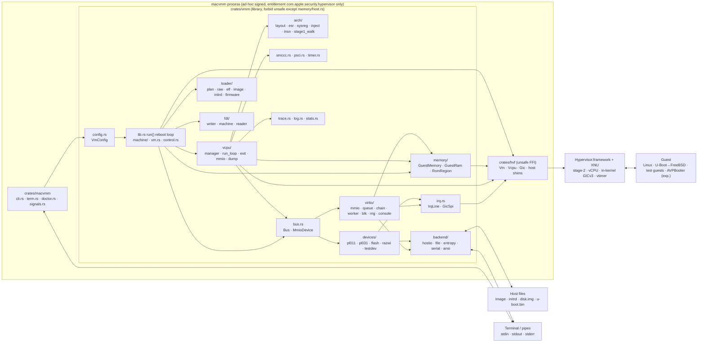
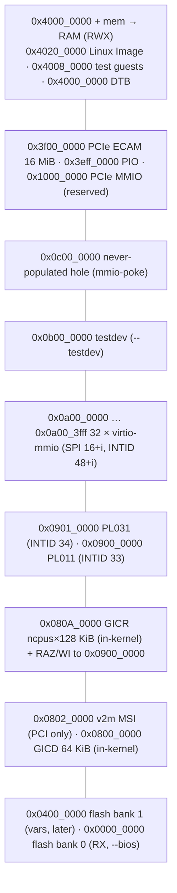
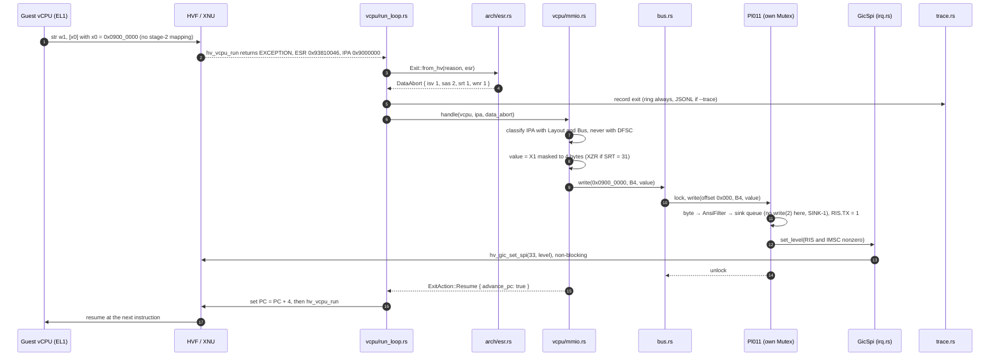
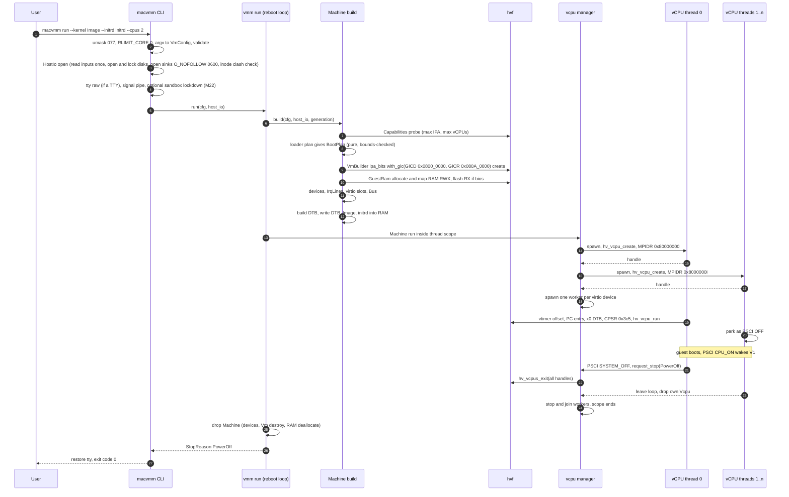
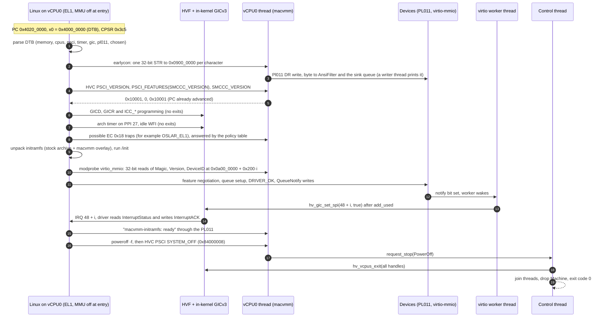
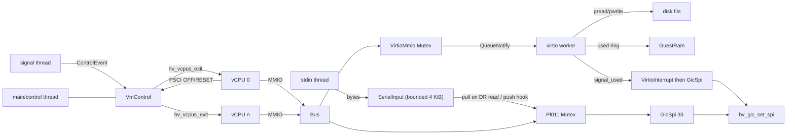

# macvmm architecture

- **Status:** definitive, v1.1. Written 2026-11-18 by the VMM architect. Revision 1.1 (same day)
  folds in the security hardening of `docs/security/threat-model.md` (flaws F1–F18, requirement
  IDs such as `VQ-12`, `TTY-3`) and the architecture-level findings of
  `course/reviews/first-principles.md` (B1, R3, R4, R6, R10, R12, R13). §21 and §22 are new; the
  changed sections are marked "(rev 1.1)".
- **Revision 1.2** (same day) folds in threat-model revision 2: flaws F19–F24, requirements
  SINK-1, TTY-10, MEM-11, FDT-4, SC-14 and NET-1..6, and the on-machine results of its §13
  (hardened runtime works with HVF; HVF needs no `mach-lookup` or `iokit-open` under an
  exec-time sandbox; connected AF_UNIX datagram sockets do not filter senders). §21.8 is the
  F19–F24 index; changed text is marked "(rev 1.2)".
- **Audience:** every engineer and agent building macvmm, and the course authors who cite it.
- **Inputs:**
  - `CLAUDE.md`
  - `docs/research/hvf-api.md`
  - `spikes/hvf-hello/RESULTS.md`
  - `docs/research/guest-boot.md`
  - `docs/research/macos-guest.md`
  - `course/CURRICULUM.md`
  - `docs/security/threat-model.md` (rev 1.1)
  - `course/reviews/first-principles.md` (rev 1.1)
- **Companions:** `docs/adr/0001`–`0008` (decisions; 0008 is the macOS-guest strategy),
  `docs/PLAN.md` (milestones M0–M27, which carries the exact memory-map table again), and
  `docs/security/threat-model.md`, which is **normative**: its requirement IDs are binding on the
  modules named in §21.7, and a conflict between it and this file is resolved in favour of the
  stricter rule, then fixed in both files in the same change.

Normative words: **MUST** and **MUST NOT** are binding. **SHOULD** means "do this unless you write
down why not in the PR". Facts that come from the research carry its tags: `[V]` verified on this
machine, `[H]` from headers, `[U]` unverified.

---

## 1. Goals, non-goals, principles

**Goals for v1**

- Boot an unmodified Linux/arm64 kernel (Alpine 3.24.4 `virt`) with a generated DTB:
  - to a shell on the PL011;
  - with virtio-blk (raw disk, then ext4 root), virtio-rng and virtio-console;
  - SMP up to 64 vCPUs.
- Boot U-Boot `qemu_arm64` to its prompt from flash, then FreeBSD 15.1 through U-Boot EFI (SHOULD).
- Bare-metal Rust test guests for every chapter checkpoint.
- macOS: stage S0, a Virtualization.framework companion tool, and stage S1, AVPBooter executing
  under our VMM with its first device accesses traced (experimental). **Never** claim a macOS boot.
  The strategy and its prohibitions are ADR-0008.
- Networking without any entitlement: virtio-net over point-to-point Unix datagram sockets
  (`--net unixgram:LOCAL,peer=REMOTE`, M24, CURRICULUM ch19). A multi-VM switch is a post-v1 seam.
- The course harness: `scripts/checkpoint.sh` and `scripts/learner` (M27, CURRICULUM §3).

**Non-goals for v1:** PCI, vmnet/`com.apple.vm.networking`, EL2 guests, a user-space GIC, live
migration, hotplug, Windows guests, running x86. Snapshots (M25) and the gdbstub (M26) are
post-v1, but their seams are designed now (§18).

**Principles**

1. **The guest is hostile.** Every guest-controlled value is validated, at the point of use,
   with checked arithmetic. This covers:
   - registers on exit, MMIO data and IPAs;
   - descriptor tables, rings, lengths and indices;
   - every byte of guest RAM.

   Files from disk (Image, ELF, DTB, firmware, disk images, snapshots) are parsed defensively
   too. A guest action MUST NOT be able to panic the VMM. It may only stop *its own* VM through a
   defined path.
2. **One source of truth.** Addresses and IRQs live in `arch/layout.rs`. CLI flags live in
   `macvmm/src/cli.rs`. The exit-trace schema lives in `trace.rs`. Docs and lessons quote these
   files through anchors (ADR-0006).
3. **Teach by structure.** Small modules, one concept per file, doc comments that explain *why*
   and cite the spec section, and code shaped so it can be anchored.
4. **Mechanism in `hvf`, policy in `vmm`, UX in `macvmm`.**
5. **Minimal dependencies.** std everywhere; `libc` only inside `crates/hvf`. Nothing that is
   itself a lesson topic comes from a crate (CLAUDE.md).
6. **Observable.** Every exit can be traced (JSONL). Every fatal stop prints a register dump and
   the last exits.
7. **Bounded (rev 1.1).** Host CPU time per exit, host memory and host disk writes are bounded by
   the configuration, never by a guest value. Every cap is a named constant (§21.5).
8. **Guest bytes are hostile to the terminal too (rev 1.1).** Every guest-originated byte stream
   that reaches a host sink passes through one allow-list filter, `AnsiFilter` (§21.4), whatever
   the sink is.
9. **Read the host once (rev 1.1).** Every host input is opened and read exactly once, before the
   first guest instruction, into `HostIo` (§21.2). Reboots rebuild from `HostIo`, never from paths.

---

## 2. System context



Layering rules, which reviewers enforce:

- `hvf` depends on nothing in the workspace.
- `vmm` depends only on `hvf`. `macvmm` depends on `vmm` and `hvf`.
- Inside `vmm`:
  - `arch/`, `memory/address.rs`, `fdt/writer.rs`, `virtio/queue.rs` and `virtio/chain.rs` are
    **pure**. They never import `hvf` and are fully host-testable.
  - Devices and virtio devices never import `hvf`. They see the world through `GuestMemory`,
    `IrqLine` and the backends.
  - Only `vm.rs`, `machine/`, `vcpu/`, `irq.rs`, `timer.rs`, `memory/host.rs`,
    `backend/hostio.rs` and `backend/entropy.rs` touch `hvf`. The last two use only `hvf::host`
    (libSystem shims: `O_NOFOLLOW_ANY`, `umask`, `getentropy`, `setrlimit`), never the
    hypervisor API (rev 1.1).
  - `backend/ansi.rs` is **pure** (no I/O, no `hvf`), so it is host-testable and a fuzz target.

---

## 3. Repository and crate layout

```
macvmm/
├── Cargo.toml                 workspace: crates/{hvf,vmm,macvmm,xtask,fuzz}; exclude guests/ spikes/ tools/
│                              [profile.release] overflow-checks = true, panic = "unwind" (RUST-2)
├── Cargo.lock                 committed; CI builds with --locked (SC-11)
├── rust-toolchain.toml        channel 1.99.0; components rustfmt clippy llvm-tools; target aarch64-unknown-none
├── clippy.toml                allow-unwrap-in-tests = true, allow-expect-in-tests = true
├── .cargo/config.toml         [target.aarch64-apple-darwin] runner = "scripts/sign-and-run.sh"; [alias] xtask
├── entitlements.plist         com.apple.security.hypervisor = true (nothing else; audited, SIGN-1)
├── README.md                  quickstart (fresh clone → Linux shell)
├── .github/workflows/ci.yml   hosted macOS runner: scripts/check.sh (HVF parts auto-skip); permissions
│                              contents: read; actions pinned by full SHA; no secrets (SC-12)
├── crates/
│   ├── hvf/                   FFI + thin safe wrappers (unsafe allowed here; SAFETY comments mandatory)
│   │   ├── build.rs           cargo:rustc-link-lib=framework=Hypervisor
│   │   ├── abi/abi_dump.c     clang oracle for scripts/check-ffi.sh
│   │   ├── examples/abi_dump.rs
│   │   ├── tests/smoke.rs     #![cfg(feature = "hvf-tests")]
│   │   └── src/
│   │       ├── lib.rs         crate docs, re-exports, lints
│   │       ├── ffi.rs         raw types/consts/extern blocks, macOS 15.0 baseline, mirrors header names
│   │       ├── optional.rs    dlsym-resolved post-15.0 symbols (4K granule, WFI time, SError, TLBI)
│   │       ├── error.rs       HvError (0xfae94000|n) with names and Display
│   │       ├── caps.rs        Capabilities: max vCPUs, IPA default/max, EL2, granule, SVL, feature regs
│   │       ├── vm.rs          VmBuilder, Vm (singleton, Drop=destroy), unsafe map, unmap, protect, allocate
│   │       ├── vcpu.rs        Vcpu<'vm> (!Send), VcpuHandle (Send+Copy), VcpuExit, vcpus_exit()
│   │       ├── regs.rs        Reg (hv_reg_t u32), SysReg (hv_sys_reg_t u16) incl. encode/decode helpers
│   │       ├── simd.rs        inline-asm trampoline for hv_vcpu_set_simd_fp_reg (value in v0)
│   │       ├── gic.rs         GicConfig, Gic (set_spi, send_msi, sizes, intid, state, reset), ICC regs
│   │       └── host.rs        libSystem shims: mach_absolute_time+timebase, os_release, termios raw,
│   │                          tcflush, signal self-pipe, isatty, setrlimit, umask, getentropy,
│   │                          O_NOFOLLOW/O_NOFOLLOW_ANY flags, sandbox_init (M22)
│   ├── vmm/                   the VMM library (#![deny(unsafe_code)]; only memory/host.rs allows it)
│   │   ├── tests/             host-only integration tests (hostile corpora); tests/hvf_*.rs behind hvf-tests
│   │   └── src/
│   │       ├── lib.rs         pub fn run(cfg, host) -> Result<StopReason> (the reboot loop)
│   │       ├── error.rs       Error, Result, GuestFatal
│   │       ├── log.rs         error!/warn!/info!/debug!/trace! + guest_warn! (rate-limited)
│   │       ├── sync.rs        lock(): Mutex lock that recovers from poisoning (no unwrap)
│   │       ├── config.rs      VmConfig + validate(); no argv parsing here
│   │       ├── vm.rs          capability probe → hvf::VmBuilder (IPA bits, GIC bases) → (Vm, Gic)
│   │       ├── control.rs     VmControl, StopReason, ControlEvent, ExitCode mapping
│   │       ├── trace.rs       ExitRecord, JSONL writer, per-vCPU ring buffer (last 256 exits)
│   │       ├── stats.rs       per-vCPU exit counters, exec/WFI time, printed by --stats
│   │       ├── bus.rs         Bus, MmioDevice, AccessSize, BusError            [frozen: ch09]
│   │       ├── irq.rs         IrqLine, GicSpi, TestIrq                          [frozen: ch11]
│   │       ├── smccc.rs       SMCCC dispatch (arch, PSCI, vendor-hyp debug calls)
│   │       ├── psci.rs        PSCI 1.1 state machine (per-vCPU power state)
│   │       ├── timer.rs       vtimer offset policy, PPI constants check, PL031 clock
│   │       ├── arch/
│   │       │   ├── layout.rs      MachineProfile, Layout, Region, IRQ map (single source of truth)
│   │       │   ├── esr.rs         Exit::decode(u64), DataAbort, SysRegAccess       [frozen: ch07]
│   │       │   ├── regs.rs        PSTATE/CPSR helpers, MPIDR builder, EL decode
│   │       │   ├── sysreg.rs      sysreg names + trap policy table
│   │       │   ├── inject.rs      synchronous exception injection (UNDEF, data abort)
│   │       │   ├── insn.rs        A64 load/store decoder for ISV=0 (M17)
│   │       │   └── stage1_walk.rs guest VA→IPA walk (4K/16K granules) for ISV=0 fetch, dumps, gdb
│   │       ├── memory/
│   │       │   ├── address.rs     GuestAddress                                       [frozen: ch04]
│   │       │   ├── mod.rs         GuestMemory trait, MemoryError                     [frozen: ch04]
│   │       │   ├── region.rs      region table: sorted, non-overlapping, aligned (pure)
│   │       │   ├── host.rs        GuestRam / RomRegion host backing + hv mapping (THE unsafe module)
│   │       │   └── vec_mem.rs     VecMemory: Vec-backed GuestMemory for host tests (cfg test-util)
│   │       ├── vcpu/
│   │       │   ├── mod.rs         Vcpu (wraps hvf::Vcpu) + reset(BootParams)
│   │       │   ├── regs.rs        RegDump capture/format
│   │       │   ├── exit.rs        ExitAction, PC-advance table, dispatch
│   │       │   ├── run_loop.rs    the loop
│   │       │   ├── mmio.rs        MmioAccess, data-abort emulation (ISV=1; ISV=0 via arch/insn)
│   │       │   ├── manager.rs     sequential creation, parking, mailbox, kick (hv_vcpus_exit)
│   │       │   ├── wait.rs        parked-vCPU wait primitive (Mutex+Condvar)
│   │       │   └── dump.rs        fatal-stop report (regs, decoded ESR, insn at PC, last exits)
│   │       ├── devices/           pl011.rs pl031.rs flash.rs razwi.rs testdev.rs
│   │       ├── virtio/            mod.rs mmio.rs queue.rs chain.rs interrupt.rs worker.rs
│   │       │                      null.rs rng.rs console.rs blk.rs net.rs (M24)
│   │       ├── backend/           hostio.rs (HostIo: every host input/output opened once, §21.2)
│   │       │                      ansi.rs (AnsiFilter, pure, §21.4) file.rs (block) entropy.rs
│   │       │                      serial.rs (sinks with caps) (ratelimit.rs post-v1)
│   │       ├── net/               (M24) mod.rs backend.rs (NetBackend trait) unixgram.rs
│   │       ├── loader/            mod.rs plan.rs raw.rs elf.rs image.rs initrd.rs firmware.rs
│   │       ├── fdt/               writer.rs machine.rs reader.rs
│   │       ├── machine/           mod.rs (Machine) virt.rs vmapple/ (feature experimental-vmapple)
│   │       └── (post-v1)          snapshot/ gdbstub/ pci/
│   ├── macvmm/                CLI binary
│   │   ├── src/               main.rs cli.rs term.rs doctor.rs first_exit.rs signals.rs sandbox.rs(M22)
│   │   └── tests/             e2e_*.rs (feature hvf-tests), support/mod.rs, expect/*.txt
│   ├── xtask/                 host tooling: check-anchors, audit (unsafe/literals/deps/print!/Command/
│   │                          std::net/File::open locations/entitlements plist, §4), unzboot,
│   │                          mkinitramfs, extract-apk, mkdisk, mkrootfs, write-sparse,
│   │                          export-vectors, checkpoint + learner (M27)
│   └── fuzz/                  (M22) dependency-free mutation fuzzers over the hostile-input parsers
├── guests/                    ONE package `macvmm-guests`, own [workspace], target aarch64-unknown-none
│   ├── Cargo.toml  build.rs  .cargo/config.toml
│   ├── common/                lib.rs start.rs link.ld hvc.rs psci.rs uart.rs gic.rs timer.rs
│   │                          exceptions.rs fdt.rs mmu.rs console.rs   (the `guest` library)
│   └── <name>/main.rs         hello exit-bench memtest mmio-poke regcheck self-fault mmio-probe
│                              sysreg-probe psci-probe uart-echo dtb-reader timer-nogic irq timer
│                              virtio-probe smp-race isv0-probe tty-hygiene flood (rev 1.2, SINK-1)
│                              hostile-{mmio,isv0,sysreg,smccc,vq,tty,reset,flood} (TEST-7)
│                              (counter: post-v1)
├── tools/vz-mac/              Swift package: Virtualization.framework companion (macOS S0)
├── scripts/                   setup.sh doctor.sh(+doctor/hvprobe.c) sign.sh sign-and-run.sh check.sh
│                              check-anchors check-unsafe check-ffi.sh build-guests.sh fetch.sh
│                              fetch-manifest.txt initramfs/{init,macvmm/t-*.sh} test-e2e.sh
│                              test-fetch.sh run-linux.sh fresh-clone-check.sh lib/common.sh
│                              fuzz.sh bughunt-selftest.sh (M22)
│                              checkpoint.sh learner capture.sh bughunt.sh (M27)
├── docs/                      architecture.md PLAN.md adr/ research/ dependencies.md security/
│                              compat/ macos/ diagrams/
└── course/                    (course team) CURRICULUM.md STYLE.md chapters/ checkpoints/ site/
```

**Guest-side note.** `guests/` contains `unsafe` (asm, MMIO, page tables). The VMM quarantine
does not apply to it, but every `unsafe` block still needs a `// SAFETY:` comment. Guests are
linked at `0x4008_0000` (CURRICULUM ch03) by `guests/common/link.ld`, which `guests/build.rs`
injects. `scripts/build-guests.sh` runs `cargo build --release` *from inside* `guests/`, because
cargo reads `guests/.cargo/config.toml` relative to the cwd. It writes ELFs to
`target/guests/aarch64-unknown-none/release/<name>`, and flat binaries `<name>.bin` via rustup's
`llvm-objcopy`.

---

## 4. Unsafe quarantine and lints

| Location | `unsafe` | Why |
|---|---|---|
| `crates/hvf/**` | allowed, `clippy::undocumented_unsafe_blocks = deny`, `unsafe_op_in_unsafe_fn = deny` | FFI is inherently unsafe |
| `crates/vmm/src/memory/host.rs` | allowed (`#![allow(unsafe_code)]` under a crate-level `#![deny(unsafe_code)]`) | raw host pointers into guest RAM; `unsafe fn Vm::map` |
| everything else in `crates/` | `#![forbid(unsafe_code)]` | |
| `guests/**` | allowed with SAFETY comments | bare metal |

- `scripts/check-unsafe` (a wrapper for `cargo xtask audit`) fails if the token `unsafe` appears
  outside the allowed files, or if an `unsafe {` lacks a `// SAFETY:` line directly above it.
- The same command also fails on hex literals of known layout addresses (`0x0900_0000`,
  `0x0a00_0000`, `0x4000_0000`, `0x0800_0000`, `0x080a_0000` in any spelling) outside
  `arch/layout.rs`, `machine/vmapple/layout.rs`, tests and `guests/`.
- Workspace lints: `clippy::unwrap_used = "deny"` and `clippy::expect_used = "deny"` in `vmm`
  and `hvf`. Tests are exempt via `clippy.toml`. Lock poisoning goes through
  `vmm::sync::lock(&m)`, which recovers the guard instead of unwrapping. **(rev 1.1, RUST-7,
  F15)** Recovery exists only so that shutdown, disk `sync_all` and TTY restore still work after
  a panic. A panic on any vCPU **or worker** thread stops the whole VM with exit 1; a poisoned
  device mutex is never used to keep a VM running.
- `cargo clippy --workspace --all-targets -- -D warnings` must pass.

**Guest-facing modules (rev 1.1, RUST-1..6, F9, F16).** These are `arch/{esr,insn,stage1_walk,sysreg,inject}.rs`,
`vcpu/{exit,mmio}.rs`, `bus.rs`, `smccc.rs`, `psci.rs`, `devices/`, `virtio/`, `backend/`,
`loader/`, `fdt/`, `memory/`, `trace.rs`, and later `snapshot/`, `gdbstub/`, `net/`.

- Each starts with `#![deny(clippy::arithmetic_side_effects, clippy::indexing_slicing, clippy::cast_possible_truncation)]`
  (as an inner attribute of the module file). A local `#[allow]` needs a comment that proves the
  bound. Use `checked_*` to reject, `wrapping_*` only where a spec says the value wraps (ring
  indices, PL031 seconds), and `saturating_*` for counters.
- No `slice[a..b]` with guest-derived bounds (use `.get(a..b)`), no `panic!`/`unreachable!` on a
  guest-reachable path, and no allocation sized by a guest value without a named cap (§21.5).
- `[profile.release] overflow-checks = true`, so an overflow we missed becomes a clean stop
  (exit 1, TTY restored), not silently wrong address arithmetic.

**`cargo xtask audit` (wrapped by `scripts/check-unsafe`) also fails on (rev 1.1):**

- `print!`, `println!`, `eprint!` or `eprintln!` anywhere in `crates/vmm` (they panic on EPIPE
  and bypass `AnsiFilter`; RUST-5);
- `std::process::Command` outside `crates/xtask` and `crates/macvmm/src/doctor.rs` (PROC-3);
- `std::net` outside the post-v1 `net/` and `gdbstub/`;
- `File::open`, `File::create` or `OpenOptions` inside `crates/vmm` outside `backend/hostio.rs`
  (HOSTIO-1);
- `copy_nonoverlapping` or `slice::from_raw_parts` in `memory/host.rs` (MEM-5: guest copies
  are volatile, and no reference to guest memory is ever created);
- any `[dependencies]` entry not listed in `docs/dependencies.md` (SC-11);
- an `entitlements.plist` whose key set is not exactly `{com.apple.security.hypervisor}`
  (SIGN-1, F18).

---

## 5. Machine model and memory map

### 5.1 `virt` profile: the authoritative table

These are the values that `arch/layout.rs` encodes, and they follow ADR-0003. Interrupt numbers
are given as `SPI n → INTID 32+n`. All device lines are level-high. The DT encodes an SPI as
`<0 n 4>` and a PPI as `<1 n 4>`.

| Region | Base | Size | Stage-2 mapping | Interrupt | DT node | First milestone |
|---|---|---|---|---|---|---|
| Flash bank 0 (firmware code) | `0x0000_0000` | `0x0400_0000` (64 MiB) | READ+EXEC with `--bios`, else unmapped | — | none until CFI (ADR-0007) | M18 |
| Flash bank 1 (firmware vars) | `0x0400_0000` | `0x0400_0000` | unmapped (EDK2 later) | — | — | post-v1 |
| GIC distributor | `0x0800_0000` | `0x0001_0000` | HVF in-kernel | — | `intc@8000000` reg[0] | M8 |
| *reserved* (QEMU GICv2 CPU/HYP/VCPU) | `0x0801_0000` | `0x0001_0000` | unmapped | — | — | never |
| GICv2m MSI frame | `0x0802_0000` | `0x0001_0000` | HVF in-kernel **only with PCI** | SPI 48–111 → INTID 80–143 | `v2m@8020000` (PCI only) | post-v1 |
| *reserved* (QEMU ITS) | `0x0808_0000` | `0x0002_0000` | unmapped (HVF has no ITS) | — | — | never |
| GIC redistributors | `0x080A_0000` | `ncpus × 0x2_0000` (64 vCPUs = `0x80_0000`) | HVF in-kernel | SGIs, PPIs | `intc@8000000` reg[1] | M8 |
| GICR window remainder | `0x080A_0000 + ncpus×0x2_0000` | up to `0x0900_0000` | trap → `RazWi` device | — | — | M8 |
| PL011 UART0 | `0x0900_0000` | `0x0000_1000` | trap | SPI 1 → INTID 33 | `pl011@9000000` | M6 |
| PL031 RTC | `0x0901_0000` | `0x0000_1000` | trap | SPI 2 → INTID 34 | `pl031@9010000` | M6 |
| *reserved* fw_cfg | `0x0902_0000` | `0x0000_0018` | unmapped | — | — | not planned |
| *reserved* PL061 GPIO | `0x0903_0000` | `0x0000_1000` | unmapped | SPI 7 → INTID 39 | — | post-v1 |
| virtio-mmio slot *i* (0 ≤ i < 32) | `0x0a00_0000 + i×0x200` | `0x0000_0200` (32 slots = `0x4000`) | trap | SPI 16+i → INTID 48+i | `virtio_mmio@<addr>`, populated slots only | M11 |
| testdev (debug echo, `--testdev` only) | `0x0b00_0000` | `0x0000_1000` | trap | — | none | M4 |
| never-populated probe hole | `0x0c00_0000` | `0x0200_0000` | unmapped, no device | — | — | M3 (`mmio-poke`) |
| *reserved* PCIe MMIO window | `0x1000_0000` | `0x2eff_0000` | — | INTx SPI 3–6 → INTID 35–38 | — | post-v1 |
| *reserved* PCIe PIO window | `0x3eff_0000` | `0x0001_0000` | — | — | — | post-v1 |
| *reserved* PCIe ECAM | `0x3f00_0000` | `0x0100_0000` | — | — | — | post-v1 |
| RAM | `0x4000_0000` | `--mem`: default 512 MiB, min 64 MiB, max 255 GiB, multiple of 2 MiB | READ+WRITE+EXEC | — | `memory@40000000` | M2 |

PPIs, private to each vCPU:

| PPI | INTID | Meaning | In DT `timer`? |
|---|---|---|---|
| 13 | 29 | secure EL1 physical timer, not reserved by HVF | yes, listed for binding compatibility |
| 14 | 30 | EL1 physical timer | yes |
| 11 | 27 | EL1 **virtual** timer, the one Linux and FreeBSD use at EL1 | yes |
| 10 | 26 | EL2 physical timer, EL2 only | yes |
| 9 | 25 | GIC maintenance, EL2 only | no |
| 7 | 23 | PMU | no, `PMUVer = 0` |

Placement inside RAM at boot (`loader/plan.rs`):

| Item | Address | Rule |
|---|---|---|
| DTB | `0x4000_0000` | 8-byte aligned. Max 2 MiB, or less if a loaded image starts earlier (test guests at `0x4008_0000` leave 512 KiB). Firmware also reads it here. |
| Test-guest ELF / `--raw` | link address, normally `0x4008_0000` | Every segment must lie inside RAM and must not overlap the DTB. |
| Linux Image | `0x4020_0000 + text_offset` | 2 MiB-aligned base, `image_size` bytes reserved (booting.rst §4). |
| initrd | `align_up(kernel_load + image_size, 2 MiB)` | Must end inside RAM and inside the 1 GiB-aligned window of ≤ 32 GiB that covers the kernel. |

The IPA size is the smallest value ≥ 36 that covers `max(RAM end, highest region end)`, capped at
`caps.max_ipa_bits` (40 on the M5 Pro `[V]`). It is an error if the layout does not fit.



### 5.2 `vmapple` profile (feature `experimental-vmapple`, M21)

The values are taken from `docs/research/macos-guest.md` §3.1 and are not verified by us beyond
`hv_gic_create` accepting the GIC bases `[V]`. They live in `machine/vmapple/layout.rs`.

| Region | Base | Size | IRQ |
|---|---|---|---|
| AVPBooter ROM | `0x0010_0000` | 1 MiB | — |
| cfg region (S2) | `0x0040_0000` | 64 KiB | — |
| GICD / GICR | `0x1000_0000` / `0x1001_0000` | 64 KiB / 4 MiB | — |
| PL011 | `0x2001_0000` | 64 KiB | SPI 1 |
| PL031 | `0x2005_0000` | 4 KiB | SPI 2 |
| PL061 GPIO | `0x2006_0000` | 4 KiB | SPI 5 |
| pvpanic | `0x2007_0000` | 2 B | — |
| bdif | `0x3000_0000` | 2 MiB | — |
| RAM | `0x7000_0000` | configured | — |

In S1, everything that is not RAM, ROM, GIC or PL011 is handled by an `UnknownMmio` logger (RAZ/WI).

### 5.3 `MachineProfile`

```rust
pub enum MachineProfile { Virt, #[cfg(feature = "experimental-vmapple")] VmApple }
pub struct Region { pub name: &'static str, pub base: u64, pub size: u64, pub kind: RegionKind }
pub enum RegionKind { Ram, Rom, GicDist, GicRedist, GicMsi, Mmio, Reserved }
pub struct Layout { pub profile: MachineProfile, pub regions: &'static [Region], /* + irq map fns */ }
impl Layout {
    pub fn virt() -> &'static Layout;
    pub fn virtio_slot(&self, i: usize) -> Option<(u64 /*base*/, u32 /*intid*/)>;
    pub fn find(&self, ipa: u64) -> Option<&Region>;
    pub fn ipa_bits_needed(&self, ram_end: u64) -> u32;
}
```

Required unit tests (M2):

- no two regions overlap;
- every mapped region is 16 KiB-aligned in base and size;
- every region fits under `1 << 40`;
- INTIDs are unique and inside the SPI range 32..1019 `[V]`;
- each DT unit-address string is derived from the base.

---

## 6. Key types and traits

Items marked **[frozen]** are learner-facing contracts (CURRICULUM §3.5, risk K2). Their
signatures MUST NOT change after the chapter that introduces them ships.

### 6.1 Guest memory: `memory/` [frozen ch04]

```rust
#[derive(Copy, Clone, Debug, PartialEq, Eq, PartialOrd, Ord, Hash)]
pub struct GuestAddress(pub u64);
impl GuestAddress {
    pub fn checked_add(self, off: u64) -> Option<GuestAddress>;
    pub fn offset_from(self, base: GuestAddress) -> Option<u64>;
    pub fn align_up(self, align: u64) -> Option<GuestAddress>;   // align is a power of two
}

pub trait GuestMemory: Send + Sync {
    /// Copy guest bytes out. The whole [addr, addr+buf.len()) must lie in ONE RAM region.
    fn read(&self, addr: GuestAddress, buf: &mut [u8]) -> Result<(), MemoryError>;
    /// Copy bytes into guest RAM (same rule). ROM is never writable through this trait.
    fn write(&self, addr: GuestAddress, buf: &[u8]) -> Result<(), MemoryError>;
    /// True if [addr, addr+len) lies in one RAM region. len 0 → false.
    fn check_range(&self, addr: GuestAddress, len: u64) -> bool;
    // Provided (little-endian, via read/write): read_u8/u16/u32/u64, write_u8/u16/u32/u64,
    // and read_obj::<T: FromLeBytes>(addr) -> Result<T> (copy size_of::<T>() bytes once, decode LE; MEM-7).
    // (M2) read_obj lives in the blanket extension trait `GuestMemoryExt: GuestMemory`, implemented for
    // every `M: GuestMemory + ?Sized`: a generic provided method would need `Self: Sized` and so would
    // not exist on `dyn GuestMemory`, and an inherent `impl dyn GuestMemory` copy is ambiguous (E0034).
}

/// (rev 1.1, first-principles B1) Introduced in ch16, where its need is felt. Frozen at ch16.
pub trait GuestMemoryOrdered: GuestMemory {
    /// Acquire-ordered 16-bit load (virtqueue avail.idx). addr must be 2-aligned.
    fn read_u16_acquire(&self, addr: GuestAddress) -> Result<u16, MemoryError>;
    /// Release-ordered 16-bit store (virtqueue used.idx). addr must be 2-aligned.
    fn write_u16_release(&self, addr: GuestAddress, val: u16) -> Result<(), MemoryError>;
}

pub enum MemoryError { Overflow { addr: u64, len: u64 }, OutOfBounds { addr: u64, len: u64 }, Unaligned { addr: u64 } }
```

**Why there is no `get_slice` (rev 1.1, B1).** A `&[u8]` into guest RAM promises Rust that nobody
else mutates those bytes while the reference lives. The guest (and other vCPUs and workers) can,
so that promise is false and the reference is unsound. The only safe primitive over memory shared
with a concurrent, hostile writer is a **copy**. There is no `get_slice`, `as_slice`, `as_ptr` or
`&mut T` accessor, and none may be added. CURRICULUM ch04's objective list must drop `get_slice`
(lead action, §19 item 15).

**Why two traits (rev 1.1, B1).** The ordered accessors exist only for the split-ring protocol
(ch16, §11.2 item 9, primer `memory-ordering`). Putting them in an extension trait keeps the ch04
contract minimal and lets ch16 introduce them with their reason. `GuestRam` and `VecMemory`
implement both traits from M2. Virtio code takes `&dyn GuestMemoryOrdered` (trait upcasting to
`&dyn GuestMemory` is stable). If the lead vetoes the split (PLAN D12), fold the two methods back
into `GuestMemory` with a doc comment pointing at ch16; nothing else changes.

Implementations:

- **`GuestRam`** in `memory/host.rs` is the only unsafe code outside `hvf`.
  - Each region is a `hv_vm_allocate`d host buffer, 16 KiB-aligned, mapped with `unsafe Vm::map`.
  - Accesses are bounds-checked with `checked_add` against the region table (one region per
    access; MEM-2), then performed with **volatile element copies** (rev 1.1, MEM-5, F4): a loop
    of `ptr::read_volatile`/`write_volatile` over `u64` for the aligned middle and `u8` for the
    edges. `ptr::copy_nonoverlapping` MUST NOT be used on guest memory. Reason: the guest and
    other VMM threads write this memory concurrently, so a plain copy is a data race in Rust's
    abstract machine, and the optimizer may legally re-read the source instead of the local copy
    (a compiler-introduced double fetch). rust-vmm `vm-memory` uses volatile access for the same
    reason. The two ordered accessors use `AtomicU16::from_ptr` on a 2-aligned address (MEM-6).
  - **No Rust reference (`&[u8]`, `&mut T`) to guest memory is ever created.** The guest can
    change memory concurrently. We only copy in and out, and we validate the copy, never the
    original. Structures (descriptors, blk headers, ring entries) are read exactly once into
    locals with `read_obj` (MEM-7). This defeats TOCTOU.
  - The SAFETY argument for `unsafe impl Send/Sync` is written down in the file: copy-only
    access, and the allocation is never freed while a mapping exists.
  - Host mappings of guest RAM are never executable, and the VMM never interprets guest memory
    as host code (MEM-4).
  - Fresh RAM is zero-filled; M2 verified that `hv_vm_allocate` returns zeroed pages `[V]`
    (MEM-10). Each reboot allocates fresh RAM.
  - Lifetime (MEM-9): drop order is unmap, `hv_vm_destroy`, then deallocate, and only after every
    worker holding an `Arc<dyn GuestMemoryOrdered>` has joined (a debug assertion checks the
    strong count).
  - **Teardown fails closed (rev 1.2, MEM-11, F22).** If `hv_vm_unmap` or `hv_vm_destroy`
    returns an error, the host allocation is **leaked**: never `hv_vm_deallocate`d and never
    reused, because stage 2 may still map it, and freeing it would hand recycled host memory to
    the guest. The process reports the error and exits 1; it does not reboot. The decision is
    the pure function `teardown_action(unmap_ok, destroy_ok)`, and the same rule covers a future
    CFI romd remap of `RomRegion`. The SAFETY comment on `GuestRam` cites this rule.
- **`RomRegion`** is the flash backing. The host writes it at load time. The guest cannot write
  it, and it is *not* reachable through `GuestMemory`, so devices cannot DMA into firmware.
- **`VecMemory`** is a `Mutex<Vec<u8>>`-backed region list for host unit tests and contract tests.
  It needs no HVF. **(rev 1.1)** It keeps an optional access log (address, length, read/write,
  ordering) and a mutation hook that can rewrite bytes after the N-th read. These drive the TOCTOU
  tests (VQ-4: "each descriptor is read once") and the ordering tests (§11.2 item 9).

Seams: `GuestRam::protect(range, flags)` together with a `DirtyBitmap` supports write-protect
dirty tracking `[V]`, used for snapshots and migration. `Backing::{Anonymous, SharedFd}`
supports vhost-user (§18).

### 6.2 MMIO bus: `bus.rs` [frozen ch09]

```rust
#[derive(Copy, Clone, Debug, PartialEq, Eq)]
pub enum AccessSize { B1 = 1, B2 = 2, B4 = 4, B8 = 8 }   // bytes(), mask()

pub trait MmioDevice: Send {
    /// `offset` is relative to the device base. Return value is zero-extended to 64 bits;
    /// the caller sign-extends if the instruction asked for it.
    fn read(&mut self, offset: u64, size: AccessSize) -> u64;
    /// `value` holds the low `size` bytes of the source register.
    fn write(&mut self, offset: u64, size: AccessSize, value: u64);
}

pub struct Bus { /* Vec<Entry> sorted by base, immutable after build */ }
impl Bus {
    pub fn new() -> Bus;
    pub fn insert(&mut self, name: &'static str, base: u64, size: u64,
                  dev: Arc<Mutex<dyn MmioDevice>>) -> Result<(), BusError>;  // rejects overlap, size 0, overflow
    pub fn read(&self, ipa: u64, size: AccessSize) -> Result<u64, BusError>;
    pub fn write(&self, ipa: u64, size: AccessSize, value: u64) -> Result<(), BusError>;
    pub fn device_at(&self, ipa: u64) -> Option<(&'static str, u64 /*offset*/)>;
}
pub enum BusError { Overlap { .. }, Unmapped { ipa: u64 }, Straddle { ipa: u64, size: AccessSize } }
```

- Lookup is a binary search.
- Each device has its own `Mutex`, and the Bus itself takes no lock. There is no hotplug.
- Devices decide how to handle odd widths. The convention is RAZ/WI plus `guest_warn!`.
- An access that straddles the end of a device is `Straddle`, which the caller handles like
  `Unmapped`.
- `Arc<Mutex<Pl011>>` coerces to `Arc<Mutex<dyn MmioDevice>>`, so the CLI's stdin thread keeps a
  typed handle to the same device.

### 6.3 Interrupt lines: `irq.rs` [frozen ch11]

```rust
pub trait IrqLine: Send + Sync {
    /// Drive the line. All macvmm device lines are level-sensitive: assert while the device
    /// condition holds, deassert when it clears. Idempotent.
    fn set_level(&self, high: bool);
}
pub struct GicSpi { intid: u32, gic: hvf::GicHandle }   // set_level → hv_gic_set_spi(intid, high)
pub struct TestIrq { /* records transitions; for host tests */ }
```

- `GicSpi::new` checks that `intid` lies inside `hv_gic_get_spi_interrupt_range` and outside the
  MSI range.
- An `hv_gic_set_spi` error is logged once per line and otherwise ignored, so a guest cannot turn
  it into a VMM crash.
- `hv_gic_set_spi` is thread-safe `[V]` and non-blocking, so it may be called while a device lock
  is held.

### 6.4 Exits: `arch/esr.rs`, `vcpu/exit.rs`, `vcpu/mmio.rs` [Exit frozen ch07]

```rust
pub enum Exit {
    Canceled,                                   // hv reason CANCELED (kick; may be spurious/sticky [V])
    VtimerActivated,                            // hv reason VTIMER_ACTIVATED (never with in-kernel GIC [V])
    Wfx { ti: u8 },                             // EC 0x01 (never with in-kernel GIC [V])
    Hvc { imm: u16 },                           // EC 0x16 — PC ALREADY ADVANCED [V]
    Smc { imm: u16 },                           // EC 0x17 — PC at the SMC [V]
    SysReg(SysRegAccess),                       // EC 0x18
    InstructionAbort { ifsc: u8, s1ptw: bool }, // EC 0x20
    DataAbort(DataAbort),                       // EC 0x24
    Brk { imm: u16 },                           // EC 0x3c (only with debug traps enabled)
    Unknown { ec: u8, esr: u64 },               // anything else, incl. hv reason UNKNOWN
}
impl Exit {
    /// Pure decode of an ESR_EL2 value with EC != hv-reason; never panics for any u64.
    pub fn decode(esr: u64) -> Exit;
    pub fn from_hv(reason: u32, esr: u64) -> Exit;  // CANCELED/VTIMER/UNKNOWN, else decode(esr)
}
pub struct DataAbort { pub isv: bool, pub sas: u8, pub sse: bool, pub srt: u8, pub sf: bool,
                       pub ar: bool, pub fnv: bool, pub s1ptw: bool, pub wnr: bool, pub dfsc: u8 }
pub struct SysRegAccess { pub op0: u8, pub op1: u8, pub crn: u8, pub crm: u8, pub op2: u8,
                          pub rt: u8, pub read: bool }   // .encoding() == hv_sys_reg_t layout [V]
pub struct MmioAccess { pub ipa: u64, pub size: AccessSize, pub write: Option<u64>,
                        pub reg: u8, pub sign_extend: bool, pub sixty_four: bool }
pub enum ExitAction { Resume { advance_pc: bool }, Stop(StopReason) }
```

### 6.5 vCPU: `vcpu/`

```rust
pub struct BootParams { pub pc: u64, pub x: [u64; 4], pub cpsr: u64 }   // cpsr 0x3c5 = EL1h, DAIF masked
pub struct Vcpu<'vm> { inner: hvf::Vcpu<'vm>, pub index: usize, pub mpidr: u64 }
impl Vcpu<'_> {
    pub fn reset(&mut self, boot: &BootParams) -> Result<()>;  // PC, X0..X3, CPSR, SCTLR_EL1.{M,C,I}=0, vtimer offset
    pub fn dump(&self) -> RegDump;
}
```

### 6.6 Virtio: `virtio/`

```rust
pub trait VirtioDevice: Send {
    fn device_id(&self) -> u32;                       // 2 blk, 3 console, 4 rng, 1 net
    fn queue_max_sizes(&self) -> &[u16];              // one entry per queue
    fn device_features(&self) -> u64;                 // MUST include VIRTIO_F_VERSION_1 (bit 32)
    fn ack_features(&mut self, accepted: u64);        // called once at FEATURES_OK
    fn read_config(&self, offset: u32, data: &mut [u8]);
    fn write_config(&mut self, offset: u32, data: &[u8]);
    fn activate(&mut self, mem: Arc<dyn GuestMemoryOrdered>, queues: Vec<Queue>,
                irq: Arc<VirtioInterrupt>) -> Result<(), VirtioError>;  // at DRIVER_OK
    /// On the worker thread. Processes at most `budget` chains, then returns (VQ-12, rev 1.1).
    fn process_queue(&mut self, index: usize, budget: u16) -> Result<QueueProgress, VirtioError>;
    fn reset(&mut self);                              // status ← 0; drop queues and mem handle
}
pub enum QueueProgress { Drained, MoreWork }          // MoreWork → the worker re-queues itself

pub struct Queue { /* size, ready, desc/avail/used GuestAddress, next_avail, next_used (Wrapping<u16>) */ }
impl Queue {
    pub fn validate(&self, mem: &dyn GuestMemory) -> Result<(), QueueError>;
    pub fn pop<'m>(&mut self, mem: &'m dyn GuestMemoryOrdered) -> Result<Option<DescriptorChain<'m>>, QueueError>;
    pub fn add_used(&mut self, mem: &dyn GuestMemoryOrdered, head: u16, written: u32) -> Result<(), QueueError>;
    pub fn should_interrupt(&self, mem: &dyn GuestMemoryOrdered) -> Result<bool, QueueError>;
}
pub struct DescriptorChain<'m> { /* head, hop budget, indirect state */ }
impl Iterator for DescriptorChain<'_> { type Item = Result<Descriptor, QueueError>; }
impl DescriptorChain<'_> { pub fn into_validated(self, max_total: u64) -> Result<ValidatedChain, QueueError>; }
pub struct ValidatedChain { pub head: u16, pub readable: Vec<Descriptor>, pub writable: Vec<Descriptor>,
                            pub readable_len: u64, pub writable_len: u64 }
pub struct VirtioInterrupt { /* Mutex<u32> status + Arc<dyn IrqLine> */ }
impl VirtioInterrupt { pub fn signal_used(&self); pub fn signal_config(&self); pub fn ack(&self, bits: u32); pub fn status(&self) -> u32; }
```

`virtio::mmio::VirtioMmio` implements `MmioDevice` and owns:

- the transport state machine;
- `Arc<Mutex<dyn VirtioDevice>>`;
- `Arc<VirtioInterrupt>`;
- a `WorkerHandle`.

### 6.7 Loaders, DTB, config, machine, control

```rust
// loader/plan.rs: pure, printable (Display), testable
pub struct BootPlan { pub entry: u64, pub cpsr: u64, pub x0: u64, pub dtb: Placement,
                      pub images: Vec<Placement>, pub initrd: Option<(u64, u64)>, pub firmware: Option<Placement> }
pub fn plan(layout: &Layout, ram: (u64, u64), inputs: &BootInputs) -> Result<BootPlan, LoaderError>;

// fdt/writer.rs: generic, dependency-free (DT spec v0.4 ch.5)
impl FdtWriter {
    pub fn new() -> Self;
    pub fn begin_node(&mut self, name: &str) -> Result<NodeId, FdtError>;
    pub fn end_node(&mut self, id: NodeId) -> Result<(), FdtError>;
    pub fn prop_null(&mut self, name: &str) -> Result<(), FdtError>;
    pub fn prop_u32 / prop_u64 / prop_cells(&[u32]) / prop_str / prop_strs(&[&str]) / prop_bytes(..);
    pub fn add_mem_reserve(&mut self, addr: u64, size: u64);
    pub fn finish(self, boot_cpuid: u32) -> Result<Vec<u8>, FdtError>;   // ≤ 2 MiB, strings deduplicated
}
// fdt/machine.rs
pub fn build_dtb(layout: &Layout, desc: &MachineDesc) -> Result<Vec<u8>, FdtError>;

// config.rs: produced by macvmm/src/cli.rs, consumed by vmm::run
pub struct VmConfig { machine, mem_bytes, cpus, boot: BootSource, disks: Vec<DiskSpec>, rng: bool,
    console: Option<SinkSpec>, serial: SinkSpec, trace: Option<TraceSpec>, dtb_out: Option<PathBuf>,
    on_reset: ResetAction, timeout: Option<Duration>, unhandled_mmio: MmioPolicy,
    debug_hvc: DebugHvc /* Auto | On | Off, HC-2 */, irqchip: IrqChip /* InKernelGicV3 | None, §9.1 */,
    testdev: bool, stats: bool, dry_run: bool, sandbox: SandboxMode /* Off | On | BestEffort, M22 */,
    net: Vec<NetSpec> /* M24 */, /* post-v1: gdb, snapshot_to, restore */ }
pub struct SinkSpec { pub kind: SinkKind /* Stdio | File(PathBuf) | None */,
                      pub policy: FilterPolicy /* Safe (default) | Strict | Raw */, pub max_bytes: u64 }
pub struct TraceSpec { pub path: PathBuf, pub cats: TraceCats, pub max_bytes: u64 /* default 1 GiB */ }

// backend/hostio.rs (rev 1.1, HOSTIO-1, §21.2): built once by the CLI before the first vCPU runs
pub struct HostIo {
    pub kernel: Option<Arc<[u8]>>, pub initrd: Option<Arc<[u8]>>, pub firmware: Option<Arc<[u8]>>,
    pub raw: Vec<(u64, Arc<[u8]>)>,
    pub disks: Vec<DiskFile>,          // open, locked, fstat'ed fds (capacity from the fd)
    pub serial: SinkHandle, pub console: Option<SinkHandle>, pub trace: Option<TraceWriter>,
    pub entropy: Entropy,              // getentropy(2) via hvf::host; no path opened after setup
    pub net: Vec<NetSocket>,           // M24: bound sockets
}
impl HostIo { pub fn open(cfg: &VmConfig) -> Result<HostIo, Error>; }   // PATH-1..8, LDR-1

// lib.rs
pub fn run(cfg: &VmConfig, host: &HostIo) -> Result<StopReason, Error>;   // reboot loop (§14.5)
// Machine::build(cfg, host, generation) reads boot inputs ONLY from `host`, never from paths.

// control.rs
pub enum StopReason { PowerOff, Reset, DebugExit(u32), GuestFatal(Box<GuestFatal>), Timeout, UserQuit, Vmm(Error) }
impl StopReason { pub fn exit_code(&self) -> i32; }   // §13.2
```

---

## 7. `crates/hvf`: the FFI layer

Its decisions are recorded in ADR-0002. The API surface, which is the minimum that `vmm` needs:

| Wrapper | Wraps | Thread rule |
|---|---|---|
| `caps::Capabilities::probe()` | `hv_vm_get_max_vcpu_count`, `hv_vm_config_get_{max,default}_ipa_size`, `_el2_supported`, `_default_ipa_granule`, `hv_sme_config_get_max_svl_bytes`, `hv_vcpu_config_get_feature_reg` | any |
| `VmBuilder::new().ipa_bits(n).with_gic(GicConfig{dist, redist, msi: None}).create() -> (Vm, Option<Gic>)` | `hv_vm_config_*`, `hv_vm_create`, `os_release`, `hv_gic_config_*`, `hv_gic_create` | any; one VM per process `[V]` |
| `unsafe Vm::map(host, ipa, len, flags)`, `Vm::unmap`, `Vm::protect` | `hv_vm_map/unmap/protect` | any |
| `host::allocate(len)`, `host::deallocate` | `hv_vm_allocate/deallocate` | any |
| `Vcpu::create(&vm) -> Vcpu<'_>` | `hv_vcpu_create`; keeps the framework-owned `hv_vcpu_exit_t*` | creating thread owns it |
| `Vcpu::run() -> VcpuExit { reason, esr, far, ipa }` | `hv_vcpu_run` + volatile read of the exit struct | owner |
| `get_reg/set_reg(Reg)`, `get_sys_reg/set_sys_reg(SysReg)`, `get_simd/set_simd(q)` | `hv_vcpu_*_reg`, the simd trampoline | owner |
| `vtimer_offset/set_vtimer_offset`, `set_vtimer_mask`, `exec_time`, `wfi_time() -> Option` | `hv_vcpu_*` | owner |
| `set_trap_debug_exceptions`, `set_trap_debug_reg_accesses` | gdbstub seam | owner |
| `Vcpu::handle() -> VcpuHandle`; `vcpus_exit(&[VcpuHandle])` | `hv_vcpus_exit` | **any** `[V]` |
| `Gic::handle() -> GicHandle` (Copy + Send + Sync, used by `GicSpi`); `GicHandle::set_spi`, `send_msi`; `Gic::distributor_size`, `redistributor_size`, `spi_range`, `intid(GicInterrupt)`, `reset`, `save_state() -> Vec<u8>`, `restore_state(&[u8])` | `hv_gic_*` | any |
| `Vcpu::gic_redistributor_base`, `gic_get_icc_reg/gic_set_icc_reg` | `hv_gic_get_redistributor_base`, `hv_gic_{get,set}_icc_reg` | owner |
| `host::{mach_absolute_time, timebase, Termios::raw(fd), tcflush_input, SignalPipe, isatty, set_rlimit, set_umask, getentropy, O_NOFOLLOW, O_NOFOLLOW_ANY}` | libSystem | any |
| `host::sandbox_init_profile(&str)` (M22) | `sandbox_init` with an SBPL string (deprecated, string mode undocumented in the 27.2 SDK `[H]`; SBX-1) | main thread, once |

`Vm`, `Gic` and `VcpuHandle` are `Send + Sync`. `Vcpu<'vm>` is neither, and borrows `Vm`, so it
cannot outlive the VM or move between threads. That rule is enforced at compile time.

---

## 8. vCPU execution

### 8.1 Lifecycle

1. `vcpu::manager` spawns vCPU threads **one at a time** inside a `std::thread::scope` that
   borrows the `Vm`.
2. Thread *i*:
   1. calls `Vcpu::create`;
   2. writes `MPIDR_EL1 = 0x8000_0000 | (i/16)<<8 | (i%16)`;
   3. verifies that the redistributor base is `GICR + i·redist_size`;
   4. sends its `VcpuHandle` back through a rendezvous channel.

   Only then is thread *i+1* spawned. This is needed because redistributor slots follow creation
   order `[V]`.
3. All vCPUs exist before any runs. The DT `cpu@N/reg` equals the MPIDR affinity bits.
4. vCPU 0 is reset with the `BootPlan` (`PC = entry`, `x0 = DTB`, `CPSR = 0x3c5`) and runs.
   Secondaries enter `Parked` (PSCI OFF) and wait in `vcpu/wait.rs` for a mailbox command.
5. Each vCPU sets the **same** `vtimer_offset`, the `mach_absolute_time()` captured once per boot
   in `Machine::build`, before its first run. The guest counter therefore starts near 0 and is
   coherent across CPUs.
6. On stop, every thread leaves its loop and drops its own `Vcpu` (`hv_vcpu_destroy`) on its own
   thread. The scope join guarantees that all vCPUs are gone before `Vm` is dropped.

### 8.2 The run loop (`vcpu/run_loop.rs`)

```
loop {
    if ctl.pending(i) { service mailbox: PowerOn{entry,ctx} | Pause | Save | Stop }   // between runs only
    if ctl.is_stopping() { break }
    let raw = vcpu.run()?;                       // hv_vcpu_run (HvError → StopReason::Vmm)
    let exit = Exit::from_hv(raw.reason, raw.esr);
    trace.record(i, &raw, &exit);                // ring always; JSONL if --trace
    match dispatch(&mut ctx, exit, raw) {        // vcpu/exit.rs
        ExitAction::Resume { advance_pc } => if advance_pc { pc += 4 },
        ExitAction::Stop(r) => { ctl.request_stop(r); break }
    }
}
```

**PC-advance table** (`vcpu/exit.rs`, anchored as `exit_pc_rules`, verified `[V]`):

| Exit | Handler | PC after |
|---|---|---|
| `Canceled` | check mailbox and stop flag; a kick may be sticky or spurious | unchanged |
| `Hvc` | `smccc::dispatch(Conduit::Hvc)` | **unchanged** (hardware already advanced it) |
| `Smc` | `smccc::dispatch(Conduit::Smc)` | +4 |
| `DataAbort` | `vcpu::mmio::handle` | +4 after emulation. Unchanged if retried after a mapping fix (dirty tracking). Set by `inject` on abort injection. |
| `SysReg` | `arch::sysreg::handle` | +4 on emulate. Set by `inject` on UNDEF. |
| `Wfx` | in-kernel GIC: defensive, `guest_warn!` once, `thread::yield_now()`. `--irqchip none` (§9.1): sleep until the vtimer deadline or a kick | +4 |
| `VtimerActivated` | in-kernel GIC: defensive, warn once, `set_vtimer_mask(false)`. `--irqchip none` (§9.1): assert the vCPU IRQ line | unchanged |
| `InstructionAbort`, `Brk` (without gdb), `Unknown` | `Stop(GuestFatal)` with dump | — |

**Exit-handling sequence** for the most common exit, a 32-bit guest store to the PL011 data
register. The syndrome is the one the spike observed for `str w1, [x0]` (`ESR 0x93810046`).
No lock is held while the guest runs; the only lock taken is the device's own mutex.



### 8.3 MMIO emulation (`vcpu/mmio.rs`)

1. **Classify the IPA with our own map, never with DFSC** `[V]`:
   - **RAM:** if dirty tracking is enabled for that page, record the page, re-protect it RW and
     retry without advancing. Otherwise `GuestFatal("stage-2 fault in RAM")`, which means a bug.
   - **ROM write:** go to the `FlashDevice` on the Bus (WI in v1).
   - **On the Bus:** dispatch to the device.
   - **Else:** apply the `--unhandled-mmio` policy. `fatal` (the default) stops with exit code 3
     and the message `unhandled MMIO {read|write} at 0x… size N pc 0x…`. `log` is RAZ/WI with
     `guest_warn!`.
2. `S1PTW = 1` means the guest's page-table walk hit non-RAM. That is fatal.
3. **ISV = 1** (`MmioAccess::from_data_abort`):
   - `size = 1 << SAS`, `reg = SRT`.
   - On a write the value is `X[SRT]` masked to the size, and `XZR` reads as 0 when `SRT = 31`.
   - On a read the device value is sign-extended to 32 or 64 bits per `SSE` and `SF`, then
     written to `X[SRT]`. Nothing is written when `SRT = 31`.
4. **ISV = 0** (M17): fetch the instruction at PC.
   - The PC is a guest VA when `SCTLR_EL1.M = 1`, so `arch::stage1_walk` translates it using
     `TTBR0`/`TTBR1`, `TCR_EL1` and 4K/16K granules.
   - `arch::insn` decodes LDR/STR (immediate, register offset, pre- and post-index, unscaled),
     the B/H/W/X and sign-extending variants, and LDP/STP/LDPSW (32/64-bit).
   - **The exit IPA is authoritative (rev 1.1, MMIO-4, F17).** The first emulated access uses
     the IPA reported by the exit, never one recomputed from the guest's page tables. The decoded
     base + offset, translated by `stage1_walk`, must land in the same IPA page, and the
     instruction's direction must match `WnR`. On a mismatch the guest changed its code or page
     tables between the fault and our fetch: inject a synchronous external abort and emulate
     nothing. This closes the confused-deputy race where a racing vCPU makes the emulated access
     differ from the one that faulted.
   - The access is emulated as one or two bus accesses. For LDP/STP the second access is
     `ipa + size` and must hit the **same device**, otherwise an abort is injected. The base
     register is written back only after both accesses succeed; with Rn = 31 writeback goes to the
     SP that PSTATE.SP selects. Writeback forms with Rn = Rt are rejected (abort).
   - `stage1_walk` is bounded by the granule's level count (≤ 4; 52-bit addressing is rejected),
     reads descriptors only through `GuestMemory`, rejects T0SZ/T1SZ out of range and table
     addresses outside RAM, and never recurses (MMIO-5). It supports the guest's 4K and 16K
     granules, which are **independent of HVF's 16 KiB stage-2 granule** (first-principles R12).
   - Exclusive, atomic, SIMD/FP, `DC ZVA` and anything else get an injected synchronous external
     data abort (`inject::data_abort`, DFSC `0x10`), never a panic (MMIO-6). Before M17 this case
     is `GuestFatal` and prints the instruction word (CURRICULUM ch07 objective 3).

### 8.4 System-register traps (`arch/sysreg.rs`)

The `SysRegAccess` encoding equals `hv_sys_reg_t` `[V]`. The policy is a static table and is
host-testable.

**Who decides what traps (rev 1.1, first-principles R10).** There are two supervisors. HVF at EL2
owns the trap configuration (`HCR_EL2`, `MDCR_EL2`, the ID-register values the guest sees) and
forwards only some exits to us (EC `0x18` for `PMCR_EL0` with EL2 off `[V]`; the PMU UNDEF with EL2
on is HVF's own decision `[V]`). This table is **our half**: what we do with what HVF forwards.
Which registers trap is therefore measured (M10/M18/M19 trap logs), not looked up in the ARM ARM.
The default for anything forwarded and not listed is **inject UNDEF** (HC-6); writes never reach
host state, and the OS-lock emulation is per-vCPU state.

| Registers | Policy | Notes |
|---|---|---|
| `OSLAR_EL1` (W), `OSLSR_EL1` (R), `OSDLR_EL1` | emulate the OS lock: OSLSR reports the lock state, writes update it | QEMU does the same; expected to trap `[U]` |
| `DBG{B,W}{V,C}R<n>_EL1`, `MDCCINT_EL1`, `MDSCR_EL1` if trapped | RAZ/WI | the gdbstub may later take these over |
| PMU (`PMCR_EL0` `[V]` traps, `PMCNTEN*`, `PMUSERENR_EL0`, `PMEV*`, …) | **inject UNDEF** | The guest sees `PMUVer = 0` `[V]`, so PMU registers do not exist and UNDEF is the architecturally correct response. HVF itself does the same with EL2 enabled `[V]`. Exceptions are added as RAZ/WI only when a real guest is *observed* touching one (M10/M18/M19 evidence). |
| anything else that traps | **inject UNDEF** (`ESR_EL1.EC = 0x00`, IL = 1) and `guest_warn!` with the register name | CURRICULUM ch08 checkpoint (`guests/sysreg-probe` uses `PMCR_EL0`) |

`M10` must log every EC 0x18 seen while booting Linux. Add the observed registers to this table,
with evidence, and record them in `docs/research/hvf-api.md` §13 item 6.

### 8.5 Exception injection (`arch/inject.rs`)

For a synchronous exception to EL1:

- `ELR_EL1 ← PC` (the faulting instruction)
- `SPSR_EL1 ← CPSR`
- `ESR_EL1 ← EC<<26 | 1<<25 | ISS`
- `FAR_EL1 ← VA` for aborts
- `CPSR ← EL1h | DAIF`, and clear `PSTATE.SS` and `IL`
- `PC ← VBAR_EL1 + offset`, where the offset depends on the CPSR mode at the time of the fault:
  - `0x000`: current EL with SP0 (`M = 0b0100`)
  - `0x200`: current EL with SPx (`0b0101`)
  - `0x400`: lower EL, AArch64
  - any other mode (for example an AArch32 encoding, which our vCPUs never run) →
    `GuestFatal`, never a panic. The `match` is total (rev 1.1, HC-7).

Why these registers: injection does by hand exactly what the hardware does when it takes an
exception to EL1, so resume needs *where* (`ELR`) and *in what state* (`SPSR`), and the handler
needs *why* (`ESR`, `FAR`) and *where to go* (`VBAR` + an offset chosen by source and stack). The
course derives this from the syscall path (first-principles R2).

Two users:

- `undef()`: EC 0x00.
- `data_abort(far, is_write)`: EC `0x25` from the same EL or `0x24` from a lower EL, with DFSC
  `0x10` (synchronous external abort).

### 8.6 SMCCC, PSCI and debug hypercalls (`smccc.rs`, `psci.rs`)

The SMCCC conduit is `hvc #0` (the DT says `method = "hvc"`). SMC is accepted the same way. HVC
with `imm ≠ 0` is not SMCCC: it returns `NOT_SUPPORTED (-1)` with a warning. The return value
goes in `x0`. `x1..x3` are only written where a call defines them.

| Function ID | Name | Behaviour |
|---|---|---|
| `0x8000_0000` | SMCCC_VERSION | returns `0x0001_0001` (1.1) |
| `0x8000_0001` | SMCCC_ARCH_FEATURES | `0` for SMCCC_VERSION, `-1` for everything else, including the ARCH_WORKAROUND_1/2/3 IDs |
| `0x8400_0000` | PSCI_VERSION | `0x0001_0001` (PSCI 1.1). The DT compatible list is `"arm,psci-1.0", "arm,psci-0.2", "arm,psci"`. |
| `0xC400_0001` / `0x8400_0001` | CPU_SUSPEND | treated as standby: returns `SUCCESS` immediately |
| `0x8400_0002` | CPU_OFF | caller → `Off`, then parks. Never returns on success. |
| `0xC400_0003` / `0x8400_0003` | CPU_ON(target MPIDR, entry, ctx) | `INVALID_PARAMETERS (-2)` for an unknown MPIDR, `INVALID_ADDRESS (-9)` if `entry` is not in RAM or ROM, `ALREADY_ON (-4)`, `ON_PENDING (-5)`. Otherwise the target goes `Off → OnPending`, `PowerOn{entry, ctx}` is posted to its mailbox, and the call returns `SUCCESS (0)`. The target resets with `PC = entry`, `x0 = ctx`, `CPSR = 0x3c5` and the MMU off, then becomes `On`. |
| `0xC400_0004` / `0x8400_0004` | AFFINITY_INFO(MPIDR, level 0) | 0 ON, 1 OFF, 2 ON_PENDING. Level > 0 returns `-2`. |
| `0x8400_0006` | MIGRATE_INFO_TYPE | 2 (no Trusted OS) |
| `0x8400_0008` | SYSTEM_OFF | `Stop(PowerOff)` |
| `0x8400_0009` | SYSTEM_RESET | `Stop(Reset)` |
| `0x8400_000A` | PSCI_FEATURES(fn) | `0` for every function in this table, `-1` otherwise |
| `0xC600_0001` | macvmm DEBUG_PUTC(x1 = byte) | byte → `AnsiFilter` → serial sink (TTY-1, every sink, not only TTYs). Returns 0. |
| `0xC600_0002` | macvmm DEBUG_EXIT(x1 = code) | `Stop(DebugExit(code))`. Code 0 → exit 0, otherwise exit 6. |
| `0xC600_0003` | macvmm DEBUG_MEMHASH(x1 = ipa, x2 = len) | `x0 = 0` and `x1 = FNV-1a-64` of the range, or `x0 = -2` if the range is not in RAM **or `len > 1 GiB`** (`MAX_MEMHASH_LEN`). Hashed in 64 MiB chunks; the stop flag is checked between chunks (HC-2, F7). |
| `0xC600_0004` | macvmm DEBUG_BOOT_COUNT | `x0 = 0`, `x1 = boot generation` (0 on the first boot, +1 per in-process reboot) |
| anything else | — | `NOT_SUPPORTED (-1)` and `guest_warn!("unknown SMCCC fn 0x…")`. Never silent. |

`0xC6…` is the SMCCC "vendor-specific hypervisor service" range, SMC64 fast calls (OEN 6). They
only affect the calling VM.

**Debug-call defaults (rev 1.1, HC-2, F7).** `DebugHvc::Auto` (the default) enables the debug
calls only for ELF and `--raw` boots (test guests). They are **off** for an arm64 Image, `--bios`
and `--machine vmapple`, so real OSes never see the extra surface; when off they return
`NOT_SUPPORTED (-1)`. `--debug-hvc` and `--no-debug-hvc` override Auto.

**Reset storms (rev 1.1, HC-5).** More than 10 `SYSTEM_RESET`s within 10 s → stop with
`GuestFatal("reset storm")` (exit 3). Otherwise a guest could turn the rebuild path (VM create,
RAM allocation, DTB) into a host CPU and VM-churn loop.

---

## 9. Interrupts and time

ADR-0004 records the decision to use HVF's in-kernel GICv3.

- **Creation:** distributor at `0x0800_0000` and redistributors at `0x080A_0000`, with no MSI
  frame in v1. `Machine::build` asserts:
  - `distributor_size == 0x1_0000`;
  - `redistributor_size == 0x2_0000`;
  - the SPI range contains every INTID in `layout.rs`;
  - `intid(EL1_VIRTUAL_TIMER) == 27` and `intid(EL1_PHYSICAL_TIMER) == 30`.

  A mismatch is a startup error naming both values.
- **Device lines** are `GicSpi` instances, created per device from `layout.rs`.
- **Timer:** the guest programs `CNTV_*` itself, and HVF delivers PPI 27 in the kernel `[V]`.
  `timer.rs` owns:
  - the boot-time vtimer offset (§8.1);
  - the restore rule: `offset = mach_now − saved_guest_cntvct`, so the guest clock never runs
    backwards;
  - the PL031 time base: `wall = SystemTime at boot + elapsed`, adjusted by guest `LR` writes.
- **WFI and WFE** stay in the kernel `[V]`, so an idle guest costs about 0% host CPU. The wake-up
  latency is 2–4 ms late `[V]`. This is risk R2, re-measured in M10.
- **IPIs** (SGIs) are expected to be in the kernel `[U]`, verified in M16.
- **Reset of GIC state** happens by rebuilding the VM (§14.5). `hv_gic_reset` is reserved for a
  future "warm reset" optimization.
- **Counter offset, derived (rev 1.1, first-principles R3).** A guest expects a counter that starts
  near zero and never goes backwards, including across pause and restore. The vtimer offset turns
  the host's monotonic `mach_absolute_time` into that per-VM clock; the restore formula above is
  the same rule applied after a gap.

### 9.1 The no-GIC teaching mode: `--irqchip none` (rev 1.1, first-principles R3)

CURRICULUM ch11 teaches "an interrupt is a pending bit, a mask and a vector" **before** the GIC,
by letting the learner feel the problem the in-kernel GIC solves. The reference therefore has a
second interrupt mode, selected by the hidden flag `--irqchip none` (not shown in `--help`; PLAN
D13 lets the lead remove it). Facts from the spike:

- Without a GIC the vtimer exits with `VTIMER_ACTIVATED` **even with PSTATE.I masked**, and HVF
  then sets the vtimer mask itself. Unmasking while `CNTV_CTL.ISTATUS = 1` re-exits at once
  (level semantics) `[V]` (RESULTS #12).
- WFI exits with EC `0x01` `[V]` (#10).
- `hv_vcpu_get_pending_interrupt` succeeds without a GIC `[V]`; `hv_vcpu_set_pending_interrupt`
  is `HV_UNSUPPORTED` *with* a GIC `[V]` (#20), and its behaviour without one is `[U]` (M8 Part A
  verifies it).

Behaviour in this mode (`vcpu/exit.rs`, `timer.rs`):

| Event | VMM action |
|---|---|
| `VTIMER_ACTIVATED` | `hv_vcpu_set_pending_interrupt(IRQ, true)`; leave the vtimer masked; resume without advancing PC |
| any exit, before re-entry | if the vtimer is masked and `CNTV_CTL` shows `ENABLE = 0`, `IMASK = 1` or `ISTATUS = 0`, clear the pending IRQ and `set_vtimer_mask(false)` |
| `Wfx` (WFI) | if no IRQ is pending, sleep on the vCPU's condvar until the `CNTV_CVAL` deadline (converted with the offset and timebase) or a kick; PC + 4 |
| (M8 review) entry with the line up | arm a one-shot `hv_vcpus_exit` kick about 1 ms ahead (`timer::LineKicker`, one helper thread per vCPU in this mode only), so the next exit re-reads `CNTV_CTL`: the framework holds the pending IRQ for the whole run and the guest silences the timer without a trap `[V]` (`timer.rs` "Why the kick") |

Restrictions, which keep the surface small:

- allowed only with ELF and `--raw` boots and `--cpus 1` (exit 2 otherwise);
- no device IRQs (PL011, virtio) are delivered: without a controller there is only one line;
- `Machine::build` skips `hv_gic_create`; the DTB omits the `intc` node and the `timer`
  `interrupts`, and test guests in this mode do not read the DTB anyway.

`guests/timer-nogic` arms `CNTV_CVAL` ten times and takes the IRQ through `VBAR_EL1 + 0x280`.
With `--stats` the learner counts the VTIMER and WFI exits, then runs `guests/timer` with the
in-kernel GIC and sees both drop to zero (ch12).

---

## 10. Platform devices (`devices/`)

All register offsets come from the TRMs (ARM DDI 0183 for PL011, DDI 0224 for PL031). The
behaviour notes for Linux come from `guest-boot.md` §1.4.

| Device | Registers | Key behaviour |
|---|---|---|
| `Pl011` | DR 0x000, RSR 0x004, FR 0x018, IBRD/FBRD 0x024/0x028, LCR_H 0x02c, CR 0x030, IFLS 0x034, IMSC 0x038, RIS 0x03c, MIS 0x040, ICR 0x044, DMACR 0x048. PeriphID 0xFE0–0xFEC = `11 10 14 00`, PCellID 0xFF0–0xFFC = `0d f0 05 b1`. | **TX (rev 1.2, SINK-1, F20):** a DR write passes the byte through `AnsiFilter` and pushes it onto the sink's bounded queue; a writer thread does the `write(2)`, never the vCPU. FR keeps TXFE = 1, and RIS.TX is set on every write (as QEMU does). **RX:** a 32-entry FIFO fed from `SerialInput`; RIS.RX and RIS.RT are set while it is non-empty. **IRQ:** `set_level((RIS & IMSC) != 0)` after every register access and every input push. Reset FR = `0x90`. 8-, 16- and 32-bit accesses are allowed, because earlycon uses 8-bit accesses `[U]`. |
| `Pl031` | DR 0x000, MR 0x004, LR 0x008, CR 0x00c, IMSC 0x010, RIS 0x014, MIS 0x018, ICR 0x01c. PeriphID `31 10 14 00`, same PCellID. | DR = host wall seconds + offset. A guest LR write changes the offset. The match interrupt drives a level line. |
| `FlashDevice` | the bank 0 region (writes only, since reads are mapped) | v1: write-ignored with `guest_warn!`. Later: a CFI-01 state machine with romd (ADR-0007). |
| `RazWi` | any range | reads 0, writes ignored. Logged at debug level. Covers the unused GICR window. |
| `TestDev` | 512 × u64 scratch registers (`--testdev` only) | A read returns the last value written at that offset, truncated to the access size. This lets `mmio-probe` and `isv0-probe` verify sizes, sign extension and XZR. |

Rules for every device (rev 1.1):

- **Total over its window (MMIO-8).** Every `MmioDevice` handles every `(offset, size)` inside
  its window, including unaligned offsets and widths it does not support: RAZ/WI plus
  `guest_warn!`. Register arrays use `.get()`. Each device has a host test that sweeps every
  offset × width and a fuzz target (M22).
- **PL011 TX goes through `AnsiFilter`** before it reaches the serial sink (TTY-1). The RX FIFO is
  32 entries and `SerialInput` is bounded to 4 KiB (MMIO-9).
- **PL031** offset arithmetic uses `wrapping_*` on u32 seconds, which is the RTC's semantics.
- **FlashDevice** ignores writes in v1. A later CFI-01 model must bound command sequences and keep
  the romd remap atomic relative to other vCPUs (MMIO-10).
- Why a device cannot simply be a page of RAM (first-principles R5): reading PL011 `DR` pops a FIFO
  and writing it transmits a byte. RAM cannot express "something happens when you touch this",
  so every device window is a **stage-2 hole left on purpose**, and ISV=1 syndromes let us
  emulate the access without decoding the instruction.

---

## 11. Virtio (`virtio/`)

### 11.1 Transport: virtio-mmio v2 (virtio 1.2 §4.2.2)

Register map:

| Offset | Register | Notes |
|---|---|---|
| 0x000 | MagicValue | `0x7472_6976` |
| 0x004 | Version | 2 |
| 0x008 | DeviceID | 0 for an empty slot |
| 0x00c | VendorID | `0x4d56_4d4d` |
| 0x010 / 0x014 | DeviceFeatures / DeviceFeaturesSel | |
| 0x020 / 0x024 | DriverFeatures / DriverFeaturesSel | |
| 0x030 | QueueSel | |
| 0x034 | QueueNumMax | |
| 0x038 | QueueNum | |
| 0x044 | QueueReady | |
| 0x050 | QueueNotify | |
| 0x060 | InterruptStatus | |
| 0x064 | InterruptACK | |
| 0x070 | Status | |
| 0x080 / 0x084 | QueueDesc Low / High | |
| 0x090 / 0x094 | QueueDriver Low / High | |
| 0x0a0 / 0x0a4 | QueueDevice Low / High | |
| 0x0c0 | QueueReset | RAZ: `VIRTIO_F_RING_RESET` is not offered |
| 0x0fc | ConfigGeneration | |
| 0x100+ | device config | |

Rules:

- Registers 0x000–0x0ff accept **only aligned 32-bit** accesses (§4.2.2.1). Anything else is
  RAZ/WI with `guest_warn!`. Config space accepts 8-, 16-, 32- and 64-bit accesses, and each
  access checks `offset.checked_add(size) ≤ config_len` **per device**; writes to read-only
  config fields are ignored (rev 1.1, VQ-13).
- A `QueueNotify` value ≥ the number of queues is ignored with a warning. InterruptACK values
  with unknown bits are masked to bits 0–1 (VQ-13, VQ-16).
- 64-bit queue addresses are assembled as `u64::from(hi) << 32 | u64::from(lo)`, never by adding
  (VQ-1).
- **Status state machine:**
  1. Bits may only be added in the order ACKNOWLEDGE(1) → DRIVER(2) → FEATURES_OK(8) → DRIVER_OK(4).
  2. On a FEATURES_OK write the transport checks two things: `accepted ⊆ offered`, and
     `VERSION_1` is accepted. If either fails, FEATURES_OK is not latched, so the driver reads it
     back and gives up.
  3. A DRIVER_OK write validates every ready queue with `Queue::validate`, then calls `activate`.
     If activation fails, the transport sets DEVICE_NEEDS_RESET(64) and raises a config interrupt.
  4. Writing 0 resets the device. FAILED(128) is latched. **(rev 1.1, VQ-14)** The reset takes
     the device mutex, so it waits for the worker to finish its current batch, then drops the
     queues and the memory handle. Nothing uses the old ring addresses after a reset.
  5. FEATURES_OK enforces `accepted ⊆ offered`, so the features v1 does not offer
     (`EVENT_IDX`, `RING_PACKED`, `RING_RESET`, `ACCESS_PLATFORM`, `NOTIFICATION_DATA`) are
     refused if a driver sets them. Offering any of them later requires new hostile tests (VQ-15).
- Queue registers written while `QueueReady = 1`, or after DRIVER_OK, are ignored with a warning.
  This is tested in the CURRICULUM ch15 L1.
- `QueueNum` must be a power of two and between 1 and `QueueNumMax`. `QueueSel` beyond the queue
  count reads 0 and ignores writes.
- **Interrupts (`virtio/interrupt.rs`):**
  - InterruptStatus bit 0 means a used buffer, bit 1 means a config change.
  - `signal_*` sets a bit and calls `set_level(true)`.
  - InterruptACK clears bits and calls `set_level(false)` when the status reaches 0.
  - Both happen under one mutex, so no interrupt is lost (level semantics, ADR-0003).
- **Empty slots** are `VirtioMmio<NullDevice>`: correct Magic and Version, DeviceID 0, everything
  else RAZ/WI. They are on the bus but not in the DT.
- Slot assignment: `--disk` in CLI order, then `--rng`, then `--console`, then `--net` (ADR-0005).

### 11.2 Split virtqueue hardening checklist (`virtio/queue.rs`, `virtio/chain.rs`)

Every item below is a test case in `crates/vmm/tests/virtqueue_hostile.rs`. CURRICULUM ch16 L1
uses about 40 of them. The threat model numbers the same rules VQ-1..16 (§7.2 there); items 12
and 13 are new in rev 1.1.

**Why the ordering rules exist (rev 1.1, first-principles R6).** The guest driver and the VMM are
two CPUs sharing memory with no lock: a lock-free producer/consumer protocol across a trust
boundary, on a weakly ordered CPU. Each of our barriers pairs with one of the driver's: our acquire
load of `avail.idx` pairs with the driver's write barrier before it bumps `avail.idx`, and our
release store of `used.idx` pairs with the driver's read barrier. One acquire load orders every
later plain copy of descriptors and buffers, and one release store orders every earlier plain
write, which is why only **two** ordered accessors exist (`GuestMemoryOrdered`). The doorbell is a
synchronisation point too: the driver's barrier before `QueueNotify`, the trap, then the vCPU
thread wakes the worker through a mutex and condvar (§14.1). Replacing that condvar with a relaxed
flag would break the chain.

1. **Ring placement** at activation, using virtio 1.2 §2.7 alignment:
   - descriptor table: 16-byte aligned, `16·N` bytes;
   - avail ring: 2-byte aligned, `6 + 2·N` bytes;
   - used ring: 4-byte aligned, `6 + 8·N` bytes.

   Every range is computed with `checked_add` and checked with `check_range` against RAM.
   Failure means NEEDS_RESET.
2. **avail.idx** is read with acquire ordering. `pending = avail_idx.wrapping_sub(next_avail)`;
   if `pending > N`, that is an error (the index jumped by more than the queue size).
3. **The head index** comes from `avail.ring[next_avail % N]` and must be `< N`.
4. **Each descriptor** (16 bytes) is copied out exactly once into a local `Descriptor`. Every
   later check uses the copy (TOCTOU).
   - `next < N` when `F_NEXT` is set.
   - `addr + len` must not overflow and must be RAM (`check_range`).
   - Zero-length descriptors are rejected.
5. **Loop and length bound:** a hop budget of `N` per chain. Exceeding it is an error, which
   catches self-loops and cycles without a visited set.
6. **Indirect descriptors** (`F_INDIRECT`, offered only for blk):
   - `len % 16 == 0` and `len / 16 ≤ N`;
   - the table must be in RAM;
   - no `F_NEXT` together with `F_INDIRECT`;
   - no nested indirect;
   - `F_INDIRECT` is accepted only if it was negotiated;
   - the hop budget restarts at `len / 16`.
7. **Ordering:** all device-readable descriptors come before all device-writable ones (§2.7.4.2).
   A violation is an error.
8. **Totals:** `readable_len` and `writable_len` are accumulated with `checked_add` and capped by
   the device's `max_total`: blk `seg_max × size_max = 126 × 64 KiB`; rng 64 KiB (writable
   only); console 64 KiB per chain; net `12 + 1514` TX (VQ-8).
9. **Used element:** `add_used` writes `{id, len}` with `len =` the bytes actually written into
   writable buffers (never the requested length), then does a `write_u16_release(used.idx)`. A
   `fence(SeqCst)` comes before reading `avail.flags` for `NO_INTERRUPT`. Release/acquire cannot
   order a store before a later load; without the full fence we can read a stale "no interrupt"
   flag after the driver re-enabled interrupts and went to sleep (the lost-wakeup race; Linux's
   `virtio_mb` in `virtqueue_enable_cb` is the other half). This fence is in v1 core code, not an
   `EVENT_IDX` extra.
10. **Error policy:** any `QueueError` puts the device into NEEDS_RESET and raises a config
    interrupt. The device then processes nothing more until the driver writes Status = 0. The
    error is logged with `guest_warn!` (rate-limited) and the VMM never panics.
11. **Bounce buffers** are capped per descriptor (≤ 64 KiB, `MAX_BOUNCE`), allocated per request,
    **zero-initialized** (`vec![0u8; n]`), and never reused across requests or devices (VQ-11,
    BLK-7). Never sized from a guest value without a cap.
12. **Worker budget (rev 1.1, VQ-12, F8).** One `process_queue` call handles at most `N` chains
    (one ring's worth), then returns `MoreWork`. The worker releases the device mutex, checks the
    stop and pause flags, and re-queues itself. A guest that refills the ring forever gets fair
    service but never holds the device mutex for more than one batch, and stop latency stays
    under 100 ms.
13. **TOCTOU tests (rev 1.1, VQ-4).** `virtqueue_toctou.rs` uses the `VecMemory` mutation hook to
    rewrite a descriptor, an `avail.ring` entry, `used.idx` and an indirect table after the first
    read. The device must act on the first copy or go to NEEDS_RESET, and the access log must
    show each descriptor read exactly once.

`VIRTIO_F_EVENT_IDX`, `VIRTIO_F_RING_PACKED` and `VIRTIO_F_RING_RESET` are not offered in v1.

### 11.3 Devices

| Device | ID | Queues (max size) | Features offered | Notes |
|---|---|---|---|---|
| `null` | 0 | 0 | — | empty slot |
| `rng` (§5.4) | 4 | 1 (64) | VERSION_1 | Fills writable buffers from `HostIo.entropy` (`getentropy(2)` in 256-byte calls, no path opened after setup), at most 64 KiB per request. Readable descriptors are never written. |
| `console` (§5.3) | 3 | 2: rx0, tx0 (64) | VERSION_1 | No MULTIPORT, no F_SIZE. TX → `AnsiFilter` → sink (TTY-1), at most 64 KiB per chain. RX ← `SerialInput` when bound to stdio, bounded while the guest posts no buffers. |
| `blk` (§5.2) | 2 | 1 (256) | VERSION_1, SIZE_MAX (64 KiB), SEG_MAX (126), BLK_SIZE (512), FLUSH, RO (if `,ro`), INDIRECT_DESC | Requests: IN(0), OUT(1), FLUSH(4), GET_ID(8, serial `macvmm-disk<N>`), anything else → UNSUPP. `sector·512` via `checked_mul`, and `+len ≤ capacity`. Data lengths must be multiples of 512. The status descriptor must be the last one, writable and ≥ 1 byte. OUT on a read-only disk → IOERR. Config `capacity` = file size / 512 (rounded down, with a warning). |
| `net` (§5.1, M24) | 1 | 2: rx0, tx0 (256) | VERSION_1, MAC | `virtio_net_hdr_v1` is 12 bytes. RX writes a zeroed header (`num_buffers = 1`) plus the frame. TX: readable descriptors only, total ≤ 12 + 1514, `gso_type` must be 0 and `flags` 0 (nothing else is offered). Violations are dropped and counted, and the chain is returned with `len = 0`; no NEEDS_RESET for frame-level errors. An RX frame with no posted buffer is dropped and counted; the backend thread never blocks on the guest. |

**Backends:**

- `backend/file.rs` uses `FileExt::read_at/write_at`, and `sync_all` on FLUSH. **Resolved (rev
  1.1, BLK-9, risk R11):** on Apple targets std's `sync_all` and `sync_data` call
  `fcntl(fd, F_FULLFSYNC)` `[V-src: rustup 1.99.0 library/std/src/sys/fs/unix.rs]`. The FLUSH
  status is written only after `sync_all` returns `Ok`; an error → IOERR. M14 re-checks this if the
  toolchain changes.
- Disk files are opened by `HostIo` (rev 1.1): they must be regular files (`S_ISREG` on the fd;
  `/dev/disk*` is refused, BLK-11), `,ro` disks are opened **`O_RDONLY`** so the kernel enforces
  read-only as well as our check (BLK-5), and `capacity` comes from `fstat` of the **open fd**,
  computed once (BLK-6). A short read (a non-macvmm process truncated the file) → IOERR, with the
  zeroed buffer and a used `len` counting only bytes actually read.
- Disk files are locked when opened: `File::try_lock()` for read-write, `try_lock_shared()` for
  read-only. On macOS these are `flock(2)` `[V-src]`: advisory, per open file description, and not
  reliable on SMB/NFS (BLK-8, residual RR6). A second VM on the same image, or the same image given
  twice to one VM (de-duplicated by inode, PATH-5), fails cleanly with exit code 2.
- Raw images only, with no format probing, ever. A future image format must never follow a
  backing-file path read from the image (BLK-10, CVE-2008-2004 class).
- `net/unixgram.rs` (M24) wraps std's `UnixDatagram`: one Ethernet frame per datagram, no extra
  header, `bind(LOCAL)` and `connect(peer)`. macOS defaults are too small for a NIC: verified on
  the dev machine, `net.local.dgram.maxdgram = 2048` (a 1514-byte frame fits) and
  `net.local.dgram.recvspace = 4096` (only about two frames queue before drops), with
  `kern.ipc.maxsockbuf = 8 MiB`. The backend therefore sets `SO_SNDBUF`/`SO_RCVBUF` to 1 MiB
  through `hvf::host::set_socket_buffers`. There is no host network stack (NET-6). **Socket
  rules (rev 1.2, NET-1..4, F19)**, which replace "first sender becomes the peer" and "umask
  077 around `bind`":
  - **NET-1:** the source address of **every** received datagram is compared with the peer
    path, even though the socket is `connect`ed: on macOS a connected AF_UNIX datagram socket
    still accepts datagrams from any sender that can write to LOCAL `[V]` (threat model §13). A
    mismatch or an unnamed sender → drop, `rx_dropped_foreign += 1`.
  - **NET-2:** `peer=` is mandatory. The opt-in `,learn` mode (PLAN D17) locks the peer to the
    first sender for the lifetime of the VM, logs that path, and applies NET-1 from then on.
    There is no silent first-sender learning.
  - **NET-3:** the directory holding LOCAL and the peer must be owned by the user and not group-
    or world-writable (`symlink_metadata` on the directory), else exit 2. The socket file is
    0600 through the process-wide `umask(0o077)` set once at startup (PATH-6); changing the
    umask around `bind` would race with other threads.
  - **NET-4:** an existing LOCAL is examined with `symlink_metadata` (never `metadata`, which
    would follow a symlink to, say, `$SSH_AUTH_SOCK`) and replaced only if it is a socket owned
    by the current uid **and stale** (a test `connect` fails with `ECONNREFUSED`). A live socket
    → exit 2 `refusing to replace a live socket`; anything else → exit 2.

---

## 12. Loading and boot

### 12.1 Loaders (`loader/`)

**Inputs are bytes, not paths (rev 1.1, HOSTIO-1, LDR-1, F3, F6).** Loaders never open files.
`HostIo::open` opens each input once (`O_CLOEXEC`), checks `S_ISREG` on the fd (FIFOs, `/dev/zero`,
`/dev/tty`, block devices and directories → exit 2, `not a regular file: <path>`), checks the size
against its cap **before** reading (kernel, Image, ELF and initrd ≤ RAM size; firmware ≤ 64 MiB),
and reads with `take(cap + 1)` so a file that grows during the read is detected. Loaders receive
`&[u8]` from `HostIo`, and the reboot loop reuses the same bytes, so swapping the kernel file
between boots has no effect. Symlinks the user passes for inputs are followed (that is user
intent).

`loader::detect(bytes)` recognises:

- ELF (`\x7fELF`);
- an arm64 Image (`ARM\x64` at offset 56);
- an EFI zboot (`MZ` + `zimg` at offset 4). This is **rejected** with the hint
  `EFI zboot image; run scripts/fetch.sh linux (unwraps it) or pass the raw Image`. The VMM has
  no inflater; `cargo xtask unzboot` does the unwrap on the host;
- anything else is "raw", allowed only through `--raw F@ADDR`.

| Loader | Validation (each failure is a typed `LoaderError`, never a panic) |
|---|---|
| `image.rs` (booting.rst §4) | Length ≥ 64. The magic must match. `flags` bit 0 must be 0 (LE). The page-size field must be 0, 1 or 2. `image_size ≠ 0` (a pre-3.17 kernel → error). `text_offset` must be 4 KiB-aligned. `load + image_size` must stay inside RAM (`checked_add`). The file length must be ≤ `image_size`, unless `image_size == 0`. |
| `elf.rs` | ELF64 LE, `EM_AARCH64` (183), `ET_EXEC`. `e_phentsize == 56` and `e_phnum ≤ 64`. Program-header offsets must fit the file (`checked_add`). For each `PT_LOAD`: `p_filesz ≤ p_memsz`, the file range inside the file, the memory range inside RAM, no overlap with other segments or the DTB. BSS is zero-filled. `e_entry` must lie in an executable `PT_LOAD`. Section headers are ignored entirely (smaller surface). |
| `initrd.rs` | Size > 0 and ≤ RAM. Placed per §5.1 and inside the 1 GiB / 32 GiB window rule. The DT gets `linux,initrd-start` and `linux,initrd-end` (u64, end exclusive). |
| `raw.rs` | `--raw F@ADDR`: ADDR is hex, inside RAM, and the file fits. Entry is the first `--raw` address unless `--kernel` is given. |
| `firmware.rs` | `--bios F`: size between 1 byte and 64 MiB. Copied into the bank 0 `RomRegion` (rest zero) and mapped READ+EXEC at `0x0`. Entry PC is `0x0`, `x0` is the DTB. |

The cmdline must be at most 2048 bytes, with no NUL. The default for an Image is
`console=ttyAMA0 earlycon=pl011,0x09000000`. The default cmdline string is built from
`layout.rs` and is the one place a UART address appears in a string.

### 12.2 The generated DTB (`fdt/machine.rs`)

The tree mirrors `guest-boot.md` §1.4, with these choices:

- Root: `compatible = "linux,dummy-virt"`, `model = "macvmm-virt"`, `#address-cells = #size-cells = 2`,
  `interrupt-parent = <&gic>`, `dma-coherent`.
- `chosen`:
  - `bootargs`;
  - `stdout-path = "/pl011@9000000"`;
  - initrd start and end;
  - `rng-seed`: 64 bytes from the OS CSPRNG (`HostIo.entropy`, `getentropy(2)`);
  - `kaslr-seed`: a u64 from the same source. **(rev 1.1, FDT-3)** Deterministic seeds are
    accepted only through `MachineDesc` in tests; the CLI has no flag to set them, and two
    `--dry-run`s print different seeds.
- `memory@40000000`.
- `cpus` with `#address-cells = 1` (2 if any Aff3 ≠ 0). Each `cpu@N` has
  `compatible = "arm,arm-v8"`, `reg = MPIDR & 0xff00ffffff` and `enable-method = "psci"`.
- `psci`: `method = "hvc"`.
- `timer`: `arm,armv8-timer`, `always-on`, PPIs 13/14/11/10 level. There is no `clock-frequency`,
  so guests read `CNTFRQ_EL0`, which HVF sets to 24 MHz `[V]`.
- `intc@8000000`: `arm,gic-v3`, `#interrupt-cells = 3`, `#redistributor-regions = 1`, and
  reg = GICD + `ncpus × redist_size`. No ITS, no v2m in v1.
- `apb-pclk`: a fixed 24 MHz clock. This is **mandatory** for PL011 and PL031 probing.
- `pl011@9000000` and `pl031@9010000`, each with `clocks` and `clock-names`.
- `virtio_mmio@…` for each **populated** slot, with `interrupts = <0 16+i 4>` and `dma-coherent`.
- Phandles: gic = 1, apb_pclk = 2.

**The DTB is generated, never parsed, in the VMM (rev 1.1, FDT-1, FDT-2).** `fdt/reader.rs` is
for tests and fuzzing only and MUST NOT be reachable from `macvmm run` (the audit checks that
`reader` is only referenced under `cfg(test)` or the `test-util` feature). A future `--dtb F`
override would be a new hostile-file surface and needs an ADR and a fuzz target. Property names
and values come from code; `begin_node` rejects names containing NUL or `/`; the blob is ≤ 2 MiB.

`--dtb-out F` writes the blob (an output: PATH-3..6). **(rev 1.2, FDT-4, F23)** The dumped copy
has the `rng-seed` and `kaslr-seed` values zeroed (same length, so offsets and the golden DTS are
unchanged; `fdt::machine::redact_seeds`), because the exact blob would record that boot's KASLR
seed and initial entropy input. The guest still receives the real seeds, and `--dry-run` never
prints seed bytes. Golden decompiled DTS files live in
`crates/vmm/tests/golden/*.dts`, compared when `dtc` is installed (`brew install dtc`; a dev-only
tool).

### 12.3 Boot sequence



### 12.4 What the Linux guest does, exit by exit

The VMM-side sequence above hides the guest's view. This is the expected Linux 6.18 (Alpine
`virt`) boot as seen from the exits; M10 confirms it against a real trace and updates this
diagram if the order differs.



---

## 13. Configuration and CLI

### 13.1 Commands and flags (`crates/macvmm/src/cli.rs`)

The parser is hand-written. It accepts `--flag value` and `--flag=value`, lets repeated flags
accumulate, and treats an **unknown flag as an error** (exit 2 with usage). **(rev 1.1, PATH-8)**
Sizes are parsed with checked multiplication (`--mem 99999999999G` → exit 2, not a wrap), `--cpus`
is capped at `min(64, caps)`, and `--raw F@ADDR` needs an explicit `0x` prefix and must not
overflow. Every path flag follows the path policy of §21.3.

| Command / flag | Meaning | Milestone |
|---|---|---|
| `macvmm doctor` | probes, entitlement check, `vm create/destroy x100` | M0 |
| `macvmm first-exit` | the ch02 three-instruction experiment | M1 |
| `macvmm run …` | run a VM | M3+ |
| `--mem SIZE` (`64M`, `2G`) | RAM size, default 512M | M3 |
| `--cpus N` | 1..=min(64, caps), default 1 | M16 |
| `--kernel F` | ELF or arm64 Image (auto-detect) | M3 / M9 |
| `--initrd F` · `--cmdline S` | Linux only | M9 |
| `--raw F@ADDR` | raw blob into RAM (repeatable) | M3 |
| `--bios F` | firmware into flash bank 0 | M18 |
| `--disk F[,ro]` | virtio-blk (repeatable) | M14 |
| `--rng` | virtio-rng | M12 |
| `--console stdio\|file:F[,strict\|,raw][,max=SIZE]` | virtio-console sink. **Takes a value** (refinement of CURRICULUM §3.3). Filter policy and cap as for `--serial`. | M13 |
| `--serial stdio\|file:F\|none[,strict\|,raw][,max=SIZE]` | PL011 sink, default `stdio`. At most one of serial and console may be `stdio`; that one also gets stdin. Filter policy default `safe` (TTY-2); `,raw` prints a one-line warning on stderr. File sinks are capped at `max` (default 1 GiB, LOG-4). | M6 (M3: `safe` on stdio) |
| `--trace exits:F[:cats][,max=SIZE]` | JSONL exit trace; `cats` ⊆ `mmio,hvc,sysreg,psci,cancel,all`; byte cap default 1 GiB, then one `trace_truncated` record (LOG-3) | M4 |
| `--dtb-out F` | write the generated DTB | M7 |
| `--dry-run` | print the BootPlan, memory map and DTB summary, then exit 0. **Needs no HVF.** | M9 |
| `--machine virt\|vmapple` | profile, default `virt`. `vmapple` needs the feature. | M21 |
| `--on-reset reboot\|exit` | default `reboot` (rebuild in-process). Tests use `exit`. | M5 |
| `--timeout SECS` | wall-clock limit → exit 5 | M3 |
| `--unhandled-mmio fatal\|log` | default `fatal` | M3 |
| `--testdev` | map the echo device at `0x0b00_0000` | M4 |
| `--debug-hvc` / `--no-debug-hvc` | force the `0xC600_*` calls on or off. Default: on for ELF and `--raw`, off for Image, `--bios`, vmapple (HC-2) | M5 |
| `--irqchip none` (hidden) | the no-GIC teaching mode of §9.1; ELF/`--raw` and `--cpus 1` only | M8 |
| `--sandbox[=best-effort]` | post-setup lockdown (§21.6). Plain `--sandbox` fails closed (exit 1) if `sandbox_init` fails. Default decided in M22 (PLAN D15). | M22 |
| `--sandbox-selftest` (hidden) | after lockdown, probe that `open`, `socket` and `posix_spawn` fail, then boot normally | M22 |
| `--stats` | print exit counts and exec/WFI time at stop | M8 |
| `--log error\|warn\|info\|debug\|trace` | also `MACVMM_LOG` | M0 |
| `--net unixgram:LOCAL,peer=REMOTE[,mac=XX:..]` or `unixgram:LOCAL,learn` | virtio-net (repeatable, ≤ 4). Refines CURRICULUM's `unixgram:PATH`. **(rev 1.2, NET-2)** `peer=` is required unless `,learn` is given (§11.3). Default MAC `02:6d:76` + 3 random bytes. | M24 |
| post-v1: `--gdb unix:PATH` (default form) or `--gdb tcp:127.0.0.1:PORT` (opt-in, token), `--snapshot-to F`, `--restore F [--restore-unauthenticated]`, `--api-socket P` | §18 | M25–M26 |

### 13.2 Exit codes (`control.rs`, anchored as `exit_codes`)

| Code | Meaning |
|---|---|
| 0 | guest powered off (PSCI SYSTEM_OFF) or DEBUG_EXIT(0) |
| 1 | VMM error: HVF failure, I/O error, internal bug or panic |
| 2 | usage or config error: bad flag, missing file, invalid size, disk locked, not a regular file, output would clobber an input (same inode), refused symlinked output |
| 3 | guest fatal: unhandled MMIO (strict), instruction abort, unhandled exit class, reset storm (HC-5). (Undecodable ISV=0 is fatal only before M17; from M17 it injects an abort.) |
| 4 | guest requested reset and `--on-reset exit` |
| 5 | `--timeout` expired |
| 6 | guest DEBUG_EXIT with a non-zero code. The code is printed: `macvmm: guest exit code N`. |
| 130 | user quit: SIGINT, SIGTERM, or Ctrl-A x |

---

## 14. Threading model

### 14.1 Threads

| Thread | Count | Lifetime | Does | Blocks on |
|---|---|---|---|---|
| main / control | 1 | process | builds the Machine; runs the control loop inside `thread::scope`; joins; reboots | `VmControl` event channel (`recv_timeout` for `--timeout`) |
| vCPU *i* | `--cpus` | one boot | owns `hvf::Vcpu`; run loop; MMIO and PSCI handling **on this thread** | `hv_vcpu_run`; the park condvar while OFF |
| virtio worker | 1 per virtio device | one boot | `process_queue` on notify, at most `N` chains per call (VQ-12); disk I/O; raises IRQs. A panic here stops the VM (RUST-7). | worker condvar (pending-queue bitmask) |
| stdin reader | 1 if any sink is `stdio` | process (detached) | reads stdin bytes, handles the Ctrl-A escape, pushes into `SerialInput`, pokes the bound device. **(rev 1.2, TTY-10)** Never waits for the guest: when `SerialInput` is full it drops and counts guest-bound bytes, so Ctrl-A x is always seen. | `read(0)` only |
| sink writer (rev 1.2, SINK-1) | 1 per sink (serial, console; trace has its own) | process | drains the sink's bounded queue (`SINK_QUEUE_CAP`) with `write_all`; EPIPE → the sink becomes `none` with one warning; on stop drains for ≤ 500 ms, then (stdio) writes the TTY-6 reset | `write(2)` to stdout or the file: this is the only thread allowed to block on host output |
| signal | 1 | process (detached) | reads the self-pipe filled by the async-signal-safe handler (`hvf::host::SignalPipe`) and posts `ControlEvent::Signal` | `read(pipe)` |
| net RX (M24) | 1 per `--net` | one boot | blocking `recv` on the Unix datagram socket; locks the net device; fills a posted RX chain or drops and counts; raises the IRQ. TX runs on the device's virtio worker with a non-blocking `send`. | `recv` |
| post-v1 | gdb, api | one boot | §18 | sockets |



### 14.2 Lock ordering and rules

- **Order:** device mutex → backend buffers (`SerialInput`, file) → `VirtioInterrupt` mutex.
  Never in reverse.
- Code that pushes input (the stdin thread) must release `SerialInput` before locking the device.
- No lock is held across `hv_vcpu_run`. `hv_gic_set_spi` may be called under a device lock,
  because it does not block `[V]`.
- Device mutexes are never held across blocking I/O on vCPU threads. Disk I/O runs on the worker,
  under the device mutex. A config-space read on a vCPU can therefore wait for one batch of
  requests at most (VQ-12 bounds the batch to `N` chains). This is an accepted v1 limitation.
- (rev 1.1) The worker releases the device mutex between batches and checks the stop and pause
  flags there. No code path holds a device mutex while waiting for the guest.
- (rev 1.2, SINK-1, F20) No vCPU or worker thread calls `write(2)` on a sink. Guest output is
  pushed onto the sink's bounded queue. When the queue is full the producer waits at most
  `SINK_FULL_WAIT` (10 ms) on the queue's condvar, waking early on the stop flag, then drops the
  byte and counts it. That wait is the **only** bounded wait permitted under a device mutex.
  Without it, a stalled stdout pipe (`| less`, a stuck CI collector) would block a vCPU outside
  `hv_vcpu_run`, where `hv_vcpus_exit` cannot reach it, and stop would hang.

### 14.3 Block I/O

1. The vCPU thread handles the `QueueNotify` write. It sets the bit in the worker's pending mask,
   notifies the condvar, and returns at once (the exit takes microseconds).
2. The worker locks the device and pops at most `N` chains (rev 1.1, VQ-12; previously "until
   the queue is empty", which let a guest that keeps refilling the ring livelock the worker,
   F8).
3. For each request: validate, then `read_at`/`write_at` through zeroed ≤ 64 KiB bounce buffers,
   then `add_used` with the bytes actually produced.
4. After the batch, `signal_used` is called once if the guest has not suppressed interrupts.
   The worker unlocks, checks the stop and pause flags, and re-queues itself if `MoreWork`.
5. Requests are processed in order, one at a time.

There are two seams here: a thread pool for queue depth > 1, and a token-bucket rate limiter in
the worker before each request (§18).

### 14.4 Console input

- Stdin is bound to exactly one device, the one whose sink is `stdio`.
- `term.rs` puts the TTY into raw mode only when stdin is a TTY. Restore is guaranteed by a
  `Drop` guard, a panic hook, and the signal path.
- **Ctrl-A escapes:**
  - `x`: quit (exit 130)
  - `t`: dump the trace ring
  - `s`: print stats
  - `Ctrl-A`: send a literal 0x01
- The Ctrl-A escape is processed **before** bytes reach the guest, so the guest cannot synthesize
  host-side commands. A terminal reply forged by guest output that contains `^A x` can at most
  quit its own VM (TTY-9).
- In raw mode, Ctrl-C is passed to the guest.
- **Exit hygiene (rev 1.1, TTY-6, TTY-7, F1).** When stdout is a TTY, every exit path (normal,
  signal, panic hook) emits a reset of every mode the `safe` filter lets a guest set (`CSI 0 m`,
  `CSI ? 25 h`, `CSI ? 1049 l`, `CSI ? 47 l`, `CSI ? 2004 l`, `CSI ? 1 l`, `CSI 4 l`, `ESC >`,
  `ESC ( B`, `CSI r`), restores termios, then calls `tcflush(STDIN_FILENO, TCIFLUSH)`, so a
  terminal reply or keystroke queued for the guest is never read by the host shell. If the guest
  printed to the TTY, macvmm then prints a newline (when not at column 0) and `macvmm: <reason>`
  on stderr, so a guest-drawn fake prompt is never the last thing on screen. **(rev 1.2)** Order
  with SINK-1: the stdio writer drains its queue (≤ 500 ms), writes the reset sequence after the
  guest's last byte, and is joined; only then are termios restored and stdin flushed.
- Under a pipe (in tests) nothing is raw. EOF on stdin is ignored; the guest just sees no more
  input.
- `SerialInput` is bounded to 4 KiB. **(rev 1.2, TTY-10, F21)** The reader never blocks on it:
  the earlier "block when full" backpressure let a guest that stops reading its UART also stop
  the host from reading Ctrl-A x (and, in raw mode, Ctrl-C goes to the guest), so the user lost
  every in-band way to quit. When it is full, guest-bound bytes are dropped and counted
  (`serial_input_dropped` in `--stats`, one rate-limited warning); escapes are always parsed.
  Tests that send input write slowly enough, and the counter makes any loss visible.

### 14.5 Shutdown, reset and pause

- **Stop (`VmControl::request_stop(reason)`):**
  1. Store the first reason; later ones are ignored.
  2. Set `stopping`, which is an atomic flag.
  3. Wake parked vCPUs.
  4. Call `hvf::vcpus_exit` on all created handles.

  Setting the flag before the kick is what makes the stop race-free:
  - A vCPU that checks the flag just before entering `hv_vcpu_run` still gets the sticky kick
    and returns `CANCELED` at once `[V]`.
  - A vCPU that was running returns `CANCELED`.

  Each loop sees the flag and breaks. The control thread then stops the workers, the scope joins
  everything, and the `Machine` drops in this order:
  1. devices;
  2. `Gic` (no destroy API);
  3. `Vm` (`hv_vm_destroy`);
  4. `GuestRam` (`hv_vm_deallocate`), **only if steps 3 and every unmap succeeded** (rev 1.2,
     MEM-11). Otherwise the allocation is leaked, the error is reported, and the process exits 1
     without rebooting (§6.1).
- **Reset (PSCI SYSTEM_RESET, Linux `panic=-1`):**
  - With `--on-reset exit`, the stop maps to exit code 4.
  - With `reboot` (the default), `vmm::run` builds a **fresh Machine** from the same `VmConfig`
    **and the bytes already in `HostIo`** (rev 1.1, HOSTIO-1, F3). No path is opened or re-read
    on reboot: that closes the swap-the-kernel-between-boots TOCTOU and keeps reboot working
    under the M22 lockdown. The VM, GIC, vCPUs, RAM and devices are all rebuilt, which is a cold
    boot.
  - What persists is in `HostIo` and the backends: the boot-input bytes, open and locked disk
    files, the `SerialInput` queue, the terminal guard, the sink and trace writers (with their
    byte counters, so caps span reboots), and `generation` for DEBUG_BOOT_COUNT.
  - More than 10 resets in 10 s stop the VM with exit 3 (HC-5).
  - This needs no per-register reset logic and no reliance on `hv_gic_reset` semantics. The cost
    is about 10 ms per reset. Destroying and recreating a VM in one process is verified `[V]`.
- **Pause (the seam for snapshots and gdb):**
  1. `VmControl::pause_all()` sets `pause` and kicks.
  2. Each vCPU acknowledges at a barrier, outside `hv_vcpu_run`. While paused it services
     mailbox commands (`SaveRegs`, `SetRegs`, `Step`), because register access is owner-only `[H]`.
  3. Workers pause at a request boundary.
  4. `resume_all()` releases them.

---

## 15. Error handling

- Each crate has one error enum, with a hand-written `Display` and `From` impls (no `thiserror`).
  - `hvf::HvError { code, name }` comes from `0xfae94000|n` and keeps unknown codes verbatim.
  - `vmm::Error` has these variants: `Hv { op: &'static str, err }`, `Io { path, err }`,
    `Config(String)`, `Loader(LoaderError)`, `Fdt(FdtError)`, `Memory(MemoryError)`,
    `Bus(BusError)` and `Virtio(VirtioError)`.
- **Guest-induced conditions are not `Error`s.** The responses are:
  - device-local error state (NEEDS_RESET, IOERR status, RAZ/WI);
  - exception injection (UNDEF, external abort);
  - `StopReason::GuestFatal`, which carries the vCPU, a reason, a `RegDump`, the instruction word
    and the last 32 exits.

  A guest can never make the VMM `panic!`, `unwrap` or allocate without bound.
- **VMM bugs:**
  - A vCPU **or worker** thread panic propagates through the scope join. The main thread turns
    it into exit code 1, after the panic hook has restored the TTY (TTY-6). A device mutex
    poisoned by the panic is never used to keep the VM running (RUST-7).
  - Release builds keep `panic = "unwind"` so the TTY restore and the disk `sync_all` run, and
    `overflow-checks = true`, so a missed overflow is a clean exit 1 (RUST-2).
  - Exit code 1 caused by a guest is always a bug. It gets a regression test in the matching
    `tests/*_hostile.rs` (threat model §8).
- **Fatal-stop report** (`vcpu/dump.rs`, stderr):
  - the stop reason;
  - the decoded ESR;
  - X0–X30, SP_EL0, SP_EL1, PC and CPSR (decoded EL, SPSel, DAIF, NZCV);
  - ELR, SPSR, ESR, FAR, VBAR, SCTLR, TCR and TTBR0/1 (all `_EL1`);
  - the instruction at the PC, if translatable;
  - the last 32 exits from the ring.

---

## 16. Logging, tracing, statistics

- **Logs** (`log.rs`) go to stderr in this format: `macvmm: <level>: [vcpuN|worker:blk0|main] message`.
  - The level comes from `--log` or `MACVMM_LOG`, default `warn`.
  - `guest_warn!` is used for anything a guest can trigger. It is rate-limited per call site:
    the first 10 messages print, then every 1000th with a suppressed count. A hostile guest
    therefore cannot flood the host's disk or terminal.
  - Guest-supplied bytes in log messages are escaped (`{:?}`). Raw guest bytes go only to
    serial and console sinks, and always through `AnsiFilter` first (rev 1.1: *every* sink,
    whether or not it is a TTY, because `macvmm run … | tee log` still reaches a terminal; §21.4).
  - `guest_warn!` MUST be used for every guest-triggerable message, including
    `--unhandled-mmio log`, sysreg UNDEFs and unknown SMCCC calls (LOG-1).
  - Nothing in `crates/vmm` uses `print!`/`eprintln!`. Sinks use `write_all` and handle errors;
    EPIPE on a serial sink turns that sink into `none` with one warning (RUST-5, F16).
- **Exit trace** (`trace.rs`, anchored as `trace_record`):
  - One JSON object per line, written by hand.
  - Fields (omitted when they don't apply): `t_ns` (since VM start, from mach ticks with the
    timebase), `vcpu`, `reason` (`exception|canceled|vtimer|unknown`), `ec` (hex string), `pc`,
    `ipa`, `wnr`, `size`, `reg`, `value`, `imm`, `sysreg` (name), `sysreg_enc` (`hv_sys_reg_t`
    encoding, hex string, on every EC 0x18 record), `fn` (SMCCC name), `action`
    (`mmio|psci|smccc|sysreg|inject_undef|inject_abort|stop`), `isv` (data aborts, M17) and
    `boot` (generation).
  - Encoding rules: 64-bit quantities (`pc`, `ipa`, `value`, `ec`) are lowercase hex **strings**
    with a `0x` prefix and no leading zeros, because JSON numbers lose precision above 2^53;
    `vcpu`, `size`, `reg`, `imm` and `boot` are JSON integers; `wnr` and `isv` are booleans.
    Example, matching CURRICULUM §3.3:
    `{"t_ns":1234,"vcpu":0,"reason":"exception","ec":"0x24","pc":"0x40080010","ipa":"0x9000000","wnr":true,"size":4,"reg":2,"value":"0x48","action":"mmio"}`.
  - The schema in CURRICULUM §3.3 is a subset. **`course/checkpoints/TRACE.md` must mirror this
    list** (M4 writes it).
  - **(rev 1.1, TTY-8)** Fields carry only numbers and names from static tables. If a string field
    ever carries guest data (the vmapple unknown-MMIO logger), it is JSON-escaped, including
    U+0000–U+001F, U+007F–U+009F, U+2028 and U+2029; `trace.rs` has a golden test with ESC, quote,
    backslash and NUL.
  - **(rev 1.1, LOG-3, F2)** The trace file has a byte cap (`,max=SIZE`, default 1 GiB). On
    reaching it the writer appends one `{"action":"trace_truncated",…}` record, stops writing and
    warns once. The per-vCPU ring is unaffected. At millions of exits per second an uncapped trace
    fills a disk in minutes.
  - Every vCPU also keeps a lock-free-enough ring (a `Mutex<VecDeque>`, owner-thread-only in
    practice) of its last 256 exits. It is dumped on a fatal stop, on Ctrl-A t, and on SIGUSR1.
- **Stats** (`--stats`): at stop, for each vCPU, the exit counts by kind and EC, the
  `hv_vcpu_get_exec_time` and the WFI time (`optional`, macOS 27). Also host CPU time
  (`getrusage` through `hvf::host`) against wall time. CURRICULUM ch12 checks idle CPU < 10% with
  this. The fatal dump and `--stats` print only numbers and static names (LOG-5).

---

## 17. Testing architecture

| Layer | Where | Runs on | Gate |
|---|---|---|---|
| Unit (pure) | `#[cfg(test)]` in each module; `crates/vmm/tests/*.rs` (hostile corpora, VecMemory) | any Mac, hosted CI | `cargo test --workspace` |
| ABI conformance | `scripts/check-ffi.sh` | any Mac with Xcode CLT | `scripts/check.sh` |
| HVF integration | `crates/{hvf,vmm}/tests/hvf_*.rs`, `#![cfg(feature = "hvf-tests")]`, `--test-threads=1` (one VM per process) | real Apple Silicon only | milestone acceptance |
| End-to-end | `crates/macvmm/tests/e2e_<suite>.rs` (`hvf-tests`), driven by `scripts/test-e2e.sh <suite>`. They run the signed `macvmm` binary as a child process with `--timeout` and `--on-reset exit`. | real Apple Silicon | milestone acceptance |
| Static security gates (rev 1.1) | `cargo xtask audit` (§4), clippy with the RUST-1 lints, `shellcheck -S warning` on `scripts/` (mandatory in hosted CI, run by `check.sh` when installed), `scripts/test-fetch.sh` (offline, stub `curl`) | any Mac, hosted CI | `scripts/check.sh` |
| Hostile corpora and property tests | `crates/vmm/tests/*_hostile.rs`, `virtqueue_toctou.rs`, `worker_budget.rs`, `ansi_filter.rs`, `sinks_cap.rs`, `sink_queue.rs` (rev 1.2), `hypercall_caps.rs`, `blk_short_read.rs`, `unixgram.rs` (NET-1..4, rev 1.2); `crates/macvmm/tests/paths.rs`; dependency-free property tests on the in-tree xorshift PRNG (seed printed on failure, ≥ 10,000 iterations) | any Mac, hosted CI | `cargo test --workspace` |
| Hostile guest (rev 1.1, TEST-7) | `guests/hostile-*`, run by `scripts/test-e2e.sh hostile` from M11 on: each phase attacks from inside a real VM and must end with its defined exit code | real Apple Silicon | milestone acceptance |
| Fuzz | `crates/fuzz` (M22), deterministic seeds, time-boxed, invariant-checking targets (threat model §9.3); the planted-bug self-test must find 4/4 planted bugs (TEST-4) | any Mac | M22, then weekly |
| Course checkpoints | `scripts/checkpoint.sh NN --ref` (harness built in M27; checkpoint content by the course team) | real Apple Silicon | lesson ships |

**Test integrity (rev 1.1, AS10).** A guest controls its own output, so a guest can print any
marker and can exit through DEBUG_EXIT(0). Tests therefore assert the **process exit code** and,
where a VMM verdict matters, a `[stderr]` marker that only the VMM prints. Linux gate tests also
require kernel strings that only a real boot produces, plus `!` negative markers. Byte-level
assertions (for example "no ESC `]` in stdout") are made in test code, not in marker files.

**Marker files** (`crates/macvmm/tests/expect/<test>.txt`) define what an e2e run must print.
Each non-empty line is a marker:

- markers must appear **in order** as substrings of the captured serial and stderr;
- `*` matches any run of non-newline characters;
- a line starting with `!` must appear **nowhere** (for example `!Kernel panic`,
  `!unhandled MMIO`).

There is no regex dependency. The process exit code is asserted separately.

---

## 18. Extensibility seams toward production

| Seam | Where it plugs in | What already exists in v1 | Constraints and notes |
|---|---|---|---|
| **Snapshot/restore** (post-v1 M25, ch26) | `snapshot/{mod.rs, format.rs}` and a `Snapshot` trait (`save(&self, w)`, `restore(&mut self, r)`) on every device and virtio transport | pause protocol (§14.5), owner-thread mailbox, `hvf::Gic::save_state/restore_state`, vtimer offset rule (§9), `RomRegion`/`GuestRam` region list | Format: magic `MVMMSNAP`, version, length-prefixed sections (CONFIG, VCPU×n, GIC, DEVICES, MEMORY). Restore parses it **as hostile input** (rev 1.1, POST-1, F14): each section length is checked against the remaining file and a per-section cap (`MEMORY` = the configured RAM size); the file is authenticated with HMAC-SHA256 under a per-user key in `~/.cache/macvmm/snapshot.key` (0600, created on first use), because the GIC blob goes to a kernel parser; a bad MAC is refused unless `--restore-unauthenticated`; snapshot files are 0600. GIC blob: `hv_gic_set_state` after the GIC and vCPUs exist and before any run `[H]`; refuse a different framework version. Per vCPU: GPRs, PC, CPSR, SP_EL0/1, the sysreg list, Q0–31, FPCR/FPSR, ICC regs (`hv_gic_get_icc_reg`), CNTV_CTL/CVAL, guest CNTVCT; **SME state if PSTATE.SM/ZA is set** (`[H]`, Z/P only readable in streaming mode). Disk: `sync_all` before saving. |
| **Dirty tracking / live migration** | `GuestRam::protect` + `DirtyBitmap`; the RAM branch of `vcpu::mmio` | the classification branch exists | Verified pattern `[V]`: protect RO, fault, mark, re-protect RW, retry without PC+4. 16 KiB granularity. |
| **gdbstub** (post-v1 M26, ch27) | `gdbstub/{packet.rs, commands.rs}`, a listener thread on a **Unix domain socket in a 0700 directory** by default; `127.0.0.1` TCP only as an opt-in with a random token in the first packet (rev 1.1, POST-3, F13: any local UID, and a browser's cross-protocol POST, can reach a loopback port) | pause and mailbox, `stage1_walk`, `GuestMemory`, `RegDump`, `Exit::Brk` | Breakpoints: write `BRK #0` (`0xd420_0000`) + `set_trap_debug_exceptions(true)` → EC 0x3c `[H]`. Whether the guest fetches the new `BRK` without I-cache maintenance is `[U]` (first-principles R13): M26 tests a breakpoint on an instruction that just ran in a loop. Single-step via `MDSCR_EL1.SS` → EC 0x32 `[U]`. Packets are hostile input (4 KiB cap, checksums). **No host-side packets, ever:** no `vFile:*`, `vRun`, `qXfer:exec-file` or `!` extended mode. |
| **vhost-user / out-of-process devices** | `VirtioDevice` is the boundary; a `VhostUserDevice` would forward queue addresses and memory regions | transport-agnostic devices | Needs guest RAM backed by a shareable fd (`Backing::SharedFd` with `shm_open` + `MAP_SHARED`, still mapped with `hv_vm_map`). macOS has no eventfd: use pipes or kqueue for kick/call. That is non-standard, so prefer our own process-split protocol. |
| **Rate limiters** | `backend/ratelimit.rs` token bucket (bytes and ops), checked by the worker before each request | worker loop structure | `--disk F,bw=…,iops=…`. Throttled requests stay in the avail ring, and the worker sleeps until tokens refill. |
| **Sandboxing (macOS has no seccomp)** | `crates/macvmm/src/sandbox.rs` (M22) | `HostIo` opens every file before the first vCPU runs (§21.2) | Rewritten in rev 1.1 (F5); details in §21.6 and threat model §7.12. **Entitlements alone confine nothing** outside App Sandbox, so "one entitlement, no network" is *not* counted as a layer (`com.apple.security.hypervisor` is self-grantable by ad-hoc signing `[V]`). Layers: (1) `setrlimit(RLIMIT_CORE, 0)` from M3, and `RLIMIT_NOFILE` lowered after setup (M22); (2) after `HostIo` is complete and before the first guest instruction, `sandbox_init` with an SBPL `(deny default)` profile; the string mode is undocumented in the 27.2 SDK `[H]`, so it is best effort with a `sandbox-exec -p` fallback, and its coexistence with vCPU creation and the reboot path is `[U]` (R9); (3) later, the process split above (crosvm model), which is the real long-term answer; (4) App Sandbox for an ad-hoc CLI is `[U]` (CURRICULUM K3) and poor for argv paths. |
| **API socket** | an `api` thread posting `ControlEvent`s (pause, resume, snapshot, stop, info) to `VmControl` | `VmControl` event channel | Unix stream socket, mode 0600, in a 0700 dir; the peer uid is checked with `getpeereid` (POST-4). Line-delimited JSON with a 64 KiB line cap and a hand-written parser that is a fuzz target. Firecracker's REST surface is a later option. |
| **PCI** (post-v1; macOS S3; maybe EDK2) | `pci/{host.rs (ECAM MmioDevice at 0x3f00_0000), config.rs, msi.rs}`, `virtio/pci.rs` | reserved windows and IRQs in `layout.rs`; `VirtioDevice` is transport-agnostic; `hvf::Gic::send_msi` | Enabling PCI turns on the GICv2m frame `0x0802_0000` with SPIs 80..143 (`hv_gic_config_set_msi_*`) and the DT `msi-parent`. INTx on SPIs 3–6. Config space is a new MMIO surface; BAR sizing and MSI routing validate the INTID range like `GicSpi` (POST-7). Needs an ADR that updates the threat model's §5. |
| **Machine profiles** (macOS S1+) | `MachineProfile` + `machine/<profile>/` | the `Virt` profile | `VmApple` needs no DTB, a cfg region, bdif and pvpanic (macos-guest.md §5). |
| **EL2 guests** | `hvf::VmBuilder::el2(true)`, CPSR `0x3c9` | `caps.el2_supported` `[V]` | The timer story changes completely: the EL2 timers, PPI 10/12. A separate ADR is required. |
| **Networking beyond v1** (v1 is M24, ch19) | `NetBackend` trait in `net/backend.rs` | point-to-point `unixgram` backend (§11.3) | Next steps: a learning switch for N VMs; a user-mode NAT; a gvisor-tap-vsock-style "one frame per datagram" peer (protocol compatibility `[U]`). vmnet needs `com.apple.vm.networking` (restricted) and stays out of the default path. Offloads (CSUM, TSO, MRG_RXBUF) each add a parsing surface and need hostile tests first. |
| **CPU feature masking** | `vcpu::reset` writes ID registers | — | Whether `ID_AA64PFR1_EL1`/`SMFR0` can be written is `[U]`. Needed to hide SME for old guests or snapshots. |

---

## 19. Deviations from `CLAUDE.md` / `CURRICULUM.md` (lead action needed)

1. **Timer.** `CLAUDE.md` says "Timer via `HV_EXIT_REASON_VTIMER_ACTIVATED`". With the in-kernel
   GIC that exit never happens `[V]`; the vtimer is delivered in the kernel. The VMM handles the
   exit only defensively (ADR-0004). Please update `CLAUDE.md`.
2. **CURRICULUM ch12.** Objectives 2 and 3 (inject PPI 27, unmask, block on WFI with a condvar)
   describe the no-GIC model. Rewrite them as an investigation: show that zero VTIMER and WFI exits
   occur, then measure latency and idle CPU. `vcpu/wait.rs` exists only for PSCI-parked vCPUs.
3. **ch05 `mmio-poke`.** It must target `0x0c00_0000` (permanently unpopulated), not
   `0x0900_0000`, because the reference has a PL011 there from ch09 on.
4. **CLI refinements to CURRICULUM §3.3:**
   - `--console` takes `stdio|file:F`.
   - `--serial` gains `none`.
   - New flags: `--machine`, `--on-reset`, `--timeout`, `--unhandled-mmio`, `--testdev`,
     `--no-debug-hvc`, `--stats`, `--log` and `--dry-run`.
5. **Guest panic signalling.** CURRICULUM says "SYSTEM_RESET with a code in x1". PSCI
   SYSTEM_RESET takes no argument, so guests call DEBUG_EXIT (`0xC600_0002`, x1 = code) instead,
   which gives exit code 6. Debug calls are `0xC600_0001..4` (§8.6).
6. **Initramfs marker convention:** `macvmm-<area>: <message>`, for example
   `macvmm-initramfs: ready`. This replaces the research note's `MACVMM-BOOT-OK`.
7. **Paths:** the FDT writer is `fdt/writer.rs` (DESIGN.md's example says `builder.rs`). The macOS
   S0 tool is `tools/vz-mac/` (the research said `vz-macos`). The fuzz crate is `crates/fuzz/`.
8. **Virtio-mmio interrupts are level**, where QEMU uses edge (ADR-0003). Empty slots answer on
   the bus but are not in the DT.
9. **Host tooling is Rust (`crates/xtask`)**, not Python. The unwrap, cpio and apk steps from
   guest-boot.md are reimplemented there.
10. **Licence.** macos-guest.md assumes "MIT/Apache". No licence is recorded in `CLAUDE.md`. M0
    sets `publish = false` and leaves `license` unset until the lead decides.
11. **Guest kernel modules, verified 2026-11-18.** Listing the pinned `initramfs-virt` (sha256
    `18940293…`) and grepping `config-6.18.60-0-virt` shows:
    - built in: `VIRTIO_CONSOLE=y`, `SERIAL_AMBA_PL011=y`, `RTC_DRV_PL031=y`, `VIRTIO=y`;
    - modules **present in the initramfs**: `virtio_mmio.ko`, `virtio_blk.ko`, `virtio-rng.ko` +
      `rng-core.ko`, `virtio_net.ko` + `net_failover.ko` + `failover.ko`, `af_packet.ko`,
      `squashfs.ko`, `overlay.ko`, `loop.ko`, `vfat.ko`, and `modules.dep`, so busybox `modprobe`
      resolves dependencies;
    - **absent**: `ext4.ko` (`EXT4_FS=m`, shipped only in `modloop-virt`).

    Consequences: rng, console and net need no extra modules. For ext4 (M15) the test attaches the
    pinned `modloop-virt` squashfs as a read-only second disk and the initramfs mounts it with
    `squashfs.ko`, so **no host `unsquashfs` is needed**.
12. **Host tools, verified on the dev machine:** stock macOS has `/usr/bin/{gzip,bsdtar,shasum,curl,lldb,python3}`
    (python 3.9.6, unused per ADR-0001). `xz` and `dtc` are present only through Homebrew
    (`/opt/homebrew/bin`); `mkfs.ext4` (e2fsprogs) and `unsquashfs` are **not installed**. Stock
    `bsdtar` cannot decompress a raw `.xz` stream. M15 therefore needs `brew install e2fsprogs` and
    M19 needs Homebrew `xz` (PLAN D8).
13. **Lifelines copy, they do not re-export.** CURRICULUM §3.5 proposes
    `pub use macvmm_ref::virtio::queue::*`. Re-exported reference items would be typed against the
    reference's `GuestMemory`/`IrqLine`, not the learner's own frozen-contract types, and would not
    compile. `scripts/learner lifeline` instead copies the reference module's source file into the
    learner tree (keeping `<file>.mine`) and records it in `.progress.toml` (M27).
14. **Checkpoint expectations use the marker syntax of §17**, not regular expressions, so the
    harness needs no regex engine. CURRICULUM §3.2's `expected/*.serial` files follow it (M27).
15. **(rev 1.1) ch04 `GuestMemory` objectives (first-principles B1).** CURRICULUM ch04 objective 2
    lists `read_obj, write_obj, read_slice, write_slice, get_slice`. The frozen contract (§6.1)
    has no `get_slice`, by design. `read_obj` is a provided method. The two ordered accessors move
    to `GuestMemoryOrdered`, introduced in ch16 (PLAN D12).
16. **(rev 1.1) CURRICULUM ch11 becomes a no-GIC chapter (first-principles R3).** The reference
    supports it with `--irqchip none` (§9.1) and `guests/timer-nogic`; ch12 introduces the
    in-kernel GIC and measures the exits disappear. Chapter IDs stay stable; ch11's `irq` guest
    moves to ch12 (PLAN D13).
17. **(rev 1.1) `CLAUDE.md` "no networking entitlement" is not a confinement layer** (threat model
    F5, SIGN-2). The rule stays (minimal entitlements), but docs and lessons must not count it as
    containment; containment is the M22 sandbox and, later, the process split.
18. **(rev 1.1) Guest output is filtered on every sink** (TTY-1), which refines "sanitized when the
    sink is a TTY". Course text that shows raw escape sequences from the guest must use
    `--serial stdio,raw`.
19. **(rev 1.1) CURRICULUM K3 facts to verify on hardware** (first-principles §5), each owned by a
    milestone: `hv_vcpu_set_pending_interrupt` without a GIC (M8 Part A); the measured HVC round
    trip (M3 `exit-bench`); MMU-off guest writes visible to the VMM without cache maintenance (M3
    `memtest`, recorded in `guest-boot.md`); `BRK` written by the VMM fetched without I-cache
    maintenance (M26).
20. **(rev 1.2) `--net unixgram` needs `peer=`** (threat model NET-2, F19), which refines
    CURRICULUM ch19's `--net unixgram:PATH` further than D11: the lesson shows `,learn` as the
    unsafe variant and explains the race (PLAN D17).
21. **(rev 1.2) Guest output can be dropped, not blocked** (SINK-1, F20; PLAN D18). Course text
    that says "the PL011 write reaches the terminal at once" must say "reaches the sink's queue".
22. **(rev 1.2) The hardened runtime is part of the signing contract** (SIGN-3 `[V]`). `CLAUDE.md`
    says "ad-hoc codesigned with ONLY `com.apple.security.hypervisor`"; that stays true (the
    runtime is a code-signing flag, not an entitlement), but the course's signing lesson must show
    `-o runtime` and why.

## 20. Open risks

| # | Risk | Mitigation / owner milestone |
|---|---|---|
| R1 | `hv_gic_create` untested on M1–M4 hardware | `macvmm doctor` reports it. The lead decides the course hardware floor. |
| R2 | 2–4 ms vtimer wake-up lateness from in-kernel WFI `[V]` | Re-measure under Linux in M10 and record it. No fallback in v1. |
| R3 | `ID_AA64PFR0_EL1.GIC` read as 0 in the vCPU-config feature register `[V]`; Linux may log missing sysreg CPU-interface support | Check on a live vCPU after `hv_gic_create` (M8). Linux's GICv3 driver relies on `ICC_SRE_EL1` sticking. Handle it if Linux complains (M10). |
| R4 | Unknown sysreg traps from Linux, U-Boot or FreeBSD | Policy table plus the M10/M18/M19 trap logs |
| R5 | ISV=0 accesses from firmware | M17 before M18 |
| R6 | U-Boot without `flash@0` and with ignored writes `[U]` | M18 checks it first; CFI-01 is the fallback |
| R7 | Alpine apk churn breaks fetch pins | Mirror URLs in the manifest; the lead decides where mirrors live |
| R8 | ext4 rootfs needs `brew install e2fsprogs` (dev tool, unpinned, not installed on the dev machine today) | `setup.sh` checks and explains. Only M15 needs it. `unsquashfs` is not needed (§19 item 11). |
| R9 | `sandbox_init` compatibility with HVF `[U]`; the SBPL string mode is undocumented in the 27.2 SDK `[H]` | M22 self-test covering `--cpus 4`, an in-process reboot and a blk read + FLUSH (SBX-3); `sandbox-exec` fallback; fail closed; drop the layer if incompatible, and record the evidence in the threat model |
| R10 | AVPBooter tracing vs SLA §2N (macos-guest.md R5) | **M21 is blocked on the lead's written decision** |
| R11 | ~~`F_FULLFSYNC` durability of `sync_all`~~ **Resolved (rev 1.1)**: std 1.99.0 calls `fcntl(F_FULLFSYNC)` on Apple `[V-src]` (BLK-9) | Re-check only if the toolchain changes |
| R12 | Unix datagram defaults drop frames under load (`recvspace = 4096` `[V]`) | M24 sets 1 MiB socket buffers and measures drops with `--stats`; TCP retransmits hide residual loss |
| R13 | Ad-hoc signing with `com.apple.security.virtualization` may not suffice for VZ `[U]` | M20 verifies it first and records the result in `docs/macos/status.md` |
| R14 | Two architect runs produced these docs concurrently; numbering is reconciled (M0–M27), but any later full rewrite of one file can reintroduce drift | The lead reviews `architecture.md` §13/§17 against `PLAN.md` §0.3 once before M0 starts |
| R15 | (rev 1.1) Volatile element copies (MEM-5) cost throughput on the blk path `[U]` | M14 benchmarks a 64 KiB copy loop and records it; a `u64` volatile loop should be memory-bandwidth bound. Never fall back to `copy_nonoverlapping`. |
| R16 | ~~(rev 1.1) HVF under the hardened runtime with ad-hoc signing `[U]`~~ **Resolved (rev 1.2):** works `[V]` (threat model §13). Remaining `[U]`: whether lldb attaches to a `-o runtime` build without `get-task-allow` | M0 checks lldb; `sign.sh --debug` omits the flag if it does not |
| R17 | (rev 1.1) `hv_vm_allocate` zero-fill `[U]` (MEM-10) | M2 HVF test reads 64 MiB of fresh RAM; if not zeroed, `GuestRam::new` zeroes it with volatile writes |
| R18 | (rev 1.1) `AnsiFilter` `safe` drops terminal **queries** (DSR `CSI 6 n`, `CSI 18 t`, DA). U-Boot's EFI console-size probe and similar code wait for a reply that never comes, then time out and default to 80×25 | M18/M19 record the observed delay in `docs/compat/`. If a timeout stalls a test, that test uses `--serial stdio,raw` with a comment; the default never changes. |
| R19 | (rev 1.1) `hv_vcpu_set_pending_interrupt` behaviour without a GIC `[U]` (§9.1) | M8 Part A verifies it first; if it fails, ch11 uses the spike's recorded evidence and `--irqchip none` is dropped (PLAN D13) |
| R20 | (rev 1.1) Clippy RUST-1 lints (`arithmetic_side_effects`, `indexing_slicing`) are noisy and may tempt blanket `#[allow]`s | Reviewers reject an `#[allow]` without a bound-proof comment; `cargo xtask audit` counts `#[allow(clippy::arithmetic_side_effects)]` per file and prints the total |
| R21 | (rev 1.2, SINK-1) Guest console bytes are dropped when the reader of stdout stalls for more than 10 ms per byte; a slow CI log collector could lose output and break a marker match | Tests read stdout continuously (the harness already does); `sink_dropped` is printed by `--stats` and the e2e harness fails a test whose stats show drops unless it expects them; decision D18 |
| R22 | (rev 1.2, NET-2) The `,learn` mode keeps a first-sender race by design (for the ch19 lesson) | It is opt-in, logs the learned path, locks once, and NET-1 applies afterwards; drop it if the lead declines (PLAN D17) |
| R23 | (rev 1.2, MEM-11) Whether `hv_vm_unmap`/`hv_vm_destroy` can fail after a normal run is `[U]`; the leak path may never run outside fault injection | M2 records the observed error codes in threat model §13; the fault-injection test keeps the path exercised |

## 21. Security architecture (rev 1.1)

This section is the architectural summary of `docs/security/threat-model.md`. The threat model
holds the full requirement text, the STRIDE table and the tests; this section says **where** each
mechanism lives. The security property is: *a guest, or a hostile input file, can at most stop or
corrupt its own VM.*

### 21.1 Trust boundaries and where they are enforced

| Boundary | Hostile side | Enforced in |
|---|---|---|
| B1 guest ↔ VMM | registers on exit, MMIO values, IPAs, all guest RAM (concurrently mutated) | `arch/esr.rs` (total decode), `vcpu/mmio.rs` (IPA classification by our map), `bus.rs`, `memory/` (bounds-checked volatile copies), `virtio/{queue,chain}.rs`, every device |
| B2 VMM → terminal | every guest byte | `backend/ansi.rs` (`AnsiFilter`) on every sink; `macvmm/src/term.rs` exit hygiene |
| B3 host files → VMM | file content (trusted path) | `backend/hostio.rs` (open once, type and size checks), `loader/` (bytes only) |
| B4 internet → cache | bytes until the sha256 matches | `scripts/fetch.sh`, `crates/xtask` extractors (verify before parse, never execute) |
| B5 user → VMM | foot-guns that become attacks when scripted | `macvmm/src/cli.rs` (checked parsing), `HostIo` path policy |
| B6 other local UIDs → VMM | symlinks in shared dirs, readable outputs, loopback ports | `O_NOFOLLOW(_ANY)`, 0600 outputs, `umask 077`, Unix sockets in 0700 dirs |

B1k (guest ↔ XNU/HVF) is not ours to defend. We reduce exposure by not enabling what we do not
need: no EL2 guests, no MSI frame without PCI, no private ISA, authenticated snapshot blobs.

### 21.2 `HostIo`: read the host once (HOSTIO-1)

- `HostIo::open(&VmConfig)` runs in the CLI after argv parsing and before any HVF call. It is the
  only place in `crates/vmm` that opens a file (audited, §4).
- Boot inputs (kernel, initrd, firmware, raw blobs) are read fully into `Arc<[u8]>` under their
  caps. Disks are opened, locked and `fstat`ed. Sinks and the trace are opened as outputs. The
  entropy source is `getentropy(2)`, which needs no fd.
- After `HostIo::open` the process opens no path, on the first boot or any reboot. That makes the
  M22 lockdown compatible with reboot, closes the kernel-swap TOCTOU, and keeps the set of open
  files small and known.
- `--dry-run` builds `HostIo` too (it needs the bytes for the plan) and makes no HVF call.

### 21.3 Path policy (PATH-1..8)

| Kind | Flags | Rule |
|---|---|---|
| Inputs: `--kernel`, `--initrd`, `--bios`, `--raw`, `--disk` | `O_CLOEXEC` (`O_RDONLY` for `,ro` disks) | user symlinks followed; the fd must be `S_ISREG`; else exit 2 `not a regular file: <path>` |
| Outputs: `--serial file:`, `--console file:`, `--trace`, `--dtb-out`, post-v1 `--snapshot-to` | `O_WRONLY\|O_CREAT\|O_CLOEXEC\|O_NOFOLLOW`, mode 0600; `O_NOFOLLOW_ANY` when the parent is group- or world-writable | `fstat`: a regular file owned by the current uid, else exit 2; truncate only after the checks |
| All | — | no output may share `(st_dev, st_ino)` with an input or another output (exit 2); duplicate `--disk` inodes → exit 2; `umask(0o077)` at startup; no path is ever derived from guest data |

### 21.4 Terminal output: `AnsiFilter` (TTY-1..9)

- `crates/vmm/src/backend/ansi.rs`: a pure streaming state machine, O(1) per byte, at most 64
  bytes of pending sequence state, no per-byte allocation, never panics. It is applied to PL011 TX,
  virtio-console TX and DEBUG_PUTC **before** any sink, whatever the sink type.
- Policies per sink: `safe` (default), `strict`, `raw` (explicit opt-in with a stderr warning).
- `safe` is an **allow-list** (the full grammar is threat model TTY-3): printable UTF-8 (invalid →
  U+FFFD, C1 in any encoding dropped); BS, HT, LF, CR and rate-limited BEL; a few two-byte `ESC`
  sequences; CSI with bounded numeric parameters and a fixed set of final bytes (SGR, cursor,
  erase, edit, scroll, DECSCUSR, and a short list of private modes). Dropped entirely: queries
  (DA, DSR, `CSI t`, DECRQM), media copy, mouse modes, OSC, DCS, APC, PM and SOS (titles,
  clipboard, hyperlinks, notifications, tmux passthrough, iTerm2 `1337`, kitty graphics, sixel).
- `strict` renders every control visibly (`^[`, `\x9b`), for logs and CI.
- Exit hygiene and the input direction are in §14.4.

### 21.5 Named resource caps (RUST-4, G3)

| Constant (next to its code) | Value | Bounds |
|---|---|---|
| `MAX_BOUNCE` (`virtio/`) | 64 KiB | one bounce buffer |
| blk `max_total` | 126 × 64 KiB | one blk chain |
| rng / console `max_total` | 64 KiB | one chain |
| net TX `max_total` | 12 + 1514 | one frame |
| `QUEUE_SIZE_MAX` | 32768 (blk uses 256, others 64) | `QueueNumMax` |
| worker batch | `N` chains | device-mutex hold time, stop latency (< 100 ms) |
| `SERIAL_INPUT_CAP` | 4 KiB | stdin buffering (full → drop and count, TTY-10) |
| `SINK_QUEUE_CAP`, `SINK_FULL_WAIT`, drain on stop (rev 1.2, SINK-1) | 64 KiB, 10 ms, 500 ms | guest output buffered per sink; longest vCPU wait on output; exit latency |
| `ANSI_PENDING_MAX` | 64 bytes | filter state |
| `MAX_MEMHASH_LEN`, chunk | 1 GiB, 64 MiB | DEBUG_MEMHASH work per call and between stop checks |
| reset storm | 10 per 10 s | VM rebuilds |
| `guest_warn!` | first 10, then every 1000th | log volume per call site |
| trace and file-sink caps | 1 GiB default (`,max=`) | host disk use |
| loader caps | RAM size (kernel, Image, ELF, initrd), 64 MiB (firmware) | host memory at load |
| `--cmdline`, DTB | 2048 bytes, 2 MiB | DTB generation |
| ELF `e_phnum` | 64 | loader work |
| `stage1_walk` levels | ≤ 4 | ISV=0 work |
| xtask `unzboot` output | 256 MiB | host decompression |

### 21.6 Process hardening and confinement (PROC, SIGN, SBX)

- **From M3:** `umask(0o077)`, `setrlimit(RLIMIT_CORE, 0)` (guest RAM never lands in a core),
  every fd `O_CLOEXEC`, no `fork`/`exec` on the `run` path (`doctor` alone runs
  `/usr/bin/codesign` by absolute path, no shell). No environment variable changes security
  behaviour except `MACVMM_LOG` (verbosity) and `MACVMM_CACHE` (scripts).
- **Signing (M0):** `entitlements.plist` is exactly `{com.apple.security.hypervisor}`, checked by
  `doctor`, `sign.sh` and the audit. The hypervisor entitlement is a capability marker, not a
  security boundary (any local user can ad-hoc sign it in `[V]`). **(rev 1.2, SIGN-3)** Every
  build MUST be signed with the hardened runtime (`-o runtime`): an ad-hoc `-o runtime` binary
  creates VMs and runs vCPUs `[V]`, and without the flag dyld honours `DYLD_*` variables in the
  entitled process `[V]` (705 vs 0 `DYLD_PRINT_LIBRARIES` lines), so anything that can set a
  launch's environment (a shell rc file, direnv, a cargo `[env]` table in a cloned repo) could
  inject code. Only `sign.sh --debug` omits it, with a warning. The cargo runner signs with the entitlement only binaries that need HVF and
  refuses paths outside `$CARGO_TARGET_DIR`.
- **Lockdown (M22):** after `HostIo` is complete and before the first guest instruction:
  `RLIMIT_NOFILE` lowered to the fds in use + 16, then `sandbox_init` with a `(deny default)`
  profile that denies path-based file access, `network*`, `process-exec*`, `process-fork` and
  `file-write-create`. **(rev 1.2)** It starts with **no** `mach-lookup` and **no** `iokit-open`
  allowance: VM create, vCPU runs and destroy worked under an exec-time `sandbox-exec`
  `(deny default)` profile that granted neither `[V]` (threat model §13). An allowance is added
  only if the GIC, SMP or reboot self-test items prove it necessary, and each one is listed in
  `sandbox.rs` with its reason. Mechanism order: `sandbox_init` with the SBPL string
  mid-process (undocumented string mode `[H]`), else the `sandbox-exec -p` wrapper, which is the
  form already shown to coexist with HVF. vCPU creation and the reboot path (`hv_vm_create`, `hv_vm_allocate`,
  `hv_gic_create`) run after lockdown, so the self-test MUST cover them. Plain `--sandbox` fails
  closed; a sandbox flag never silently does nothing.

### 21.7 Requirement-to-module map

| Requirement IDs (threat model) | Module(s) | First milestone |
|---|---|---|
| RUST-1..7 | all guest-facing modules, `Cargo.toml`, `sync.rs`, `xtask/src/audit.rs` | M0 / M2 |
| MEM-1..11 | `memory/{mod,region,host,vec_mem}.rs`, `hvf/src/vm.rs` (`Vm::destroy`, `fault-injection`) | M2 |
| VQ-1..16 | `virtio/{mmio,queue,chain,interrupt,worker}.rs` | M11 / M12 |
| BLK-1..11 | `virtio/blk.rs`, `backend/file.rs`, `backend/hostio.rs` | M14 |
| MMIO-1..11 | `arch/{esr,insn,stage1_walk}.rs`, `vcpu/mmio.rs`, `bus.rs`, `devices/` | M4 / M6 / M17 |
| TTY-1..10, SINK-1 | `backend/ansi.rs`, `backend/serial.rs` (`SinkHandle`, `SerialInput`), `macvmm/src/term.rs`, `trace.rs` | M3 / M6 |
| HC-1..7 | `smccc.rs`, `psci.rs`, `arch/{sysreg,inject}.rs`, `lib.rs` (reset storm) | M5 |
| LDR-1..5, FDT-1..4 | `loader/`, `fdt/` (`redact_seeds`), `backend/hostio.rs` | M3 / M7 / M9 |
| HOSTIO-1, PATH-1..8 | `backend/hostio.rs`, `macvmm/src/cli.rs`, `hvf/src/host.rs` | M3 / M4 / M6 |
| LOG-1..6 | `log.rs`, `trace.rs`, `backend/serial.rs`, `stats.rs` | M2 / M4 / M6 |
| PROC-1..5 | `macvmm/src/{main,term,signals}.rs`, `hvf/src/host.rs` | M3 / M6 / M22 |
| SC-1..14 | `scripts/`, `crates/xtask/src/{tar,cpio,zboot,rootfs,sparse,audit}.rs`, `.github/`, `course/site/` | M0 / M9 / M15 / M19 |
| NET-1..6 | `net/unixgram.rs`, `virtio/net.rs`, `macvmm/src/cli.rs` | M24 |
| SIGN-1..4, SBX-1..4 | `entitlements.plist`, `scripts/sign*.sh`, `macvmm/src/{doctor,sandbox}.rs` | M0 / M22 |
| POST-1..7 | `snapshot/`, `gdbstub/`, `net/`, `machine/vmapple/`, `pci/` | M21 / M24–M26 |

### 21.8 Threat-model revision 2: flaws F19–F24 and where they are closed (rev 1.2)

| Flaw | Severity | Was | Now (requirement) | Where | Test (PLAN) |
|---|---|---|---|---|---|
| F19 | Medium | unixgram learned the peer from the first sender, and nothing checked later senders | NET-1..4: sender checked on every datagram, `peer=` required (`,learn` opt-in), private dir, stale-socket-only replacement via `symlink_metadata` | §11.3, §13.1 | M24 `unixgram.rs`, `net_foreign_sender_dropped`, `net_refuses_live_socket` |
| F20 | Medium | PL011 TX `write(2)` on the vCPU thread under the device mutex; a stalled pipe hung stop | SINK-1: per-sink bounded queue + writer thread; 10 ms stop-aware wait, then drop and count | §10, §14.1, §14.2, §21.5 | M6 `sink_queue.rs`, `sink_backpressure` |
| F21 | Medium | the stdin reader blocked when `SerialInput` was full, so Ctrl-A x was never read | TTY-10: never block; drop and count guest-bound input; always parse escapes | §14.1, §14.4 | M6 `stdin_escape_when_full`, M13 `console_stdin_escape_when_full` |
| F22 | Low–Med | drop order assumed `hv_vm_destroy` succeeds before deallocating | MEM-11: leak on unmap/destroy failure, exit 1, no reboot | §6.1, §14.5 | M2 `teardown_action_table`, `hvf/tests/teardown.rs` |
| F23 | Low | `--dtb-out` recorded the boot's KASLR seed and entropy input | FDT-4: seeds zeroed in the dumped copy | §12.2 | M7 `dtb_out_zeroes_seeds`, `dtb_out_has_no_seeds` |
| F24 | Low | host parsers (e2fsck, and the macOS kernel via `hdiutil`) could be fed guest-written images | SC-14: read-only e2fsck on per-test clones only; never mount a guest-written image on the host; inspect inside a VM | §17 (test rules), PLAN M15 | M15 `audit_rejects_host_mount_of_guest_image` |

Rule added for every guest-written disk (SC-14): after a VM has run, every byte of a writable
disk image is A1-controlled. The reference, its scripts and the course never hand such an image to
a host parser except `e2fsck -fn` on a throwaway APFS clone in a test; inspection is done by
attaching the image `,ro` to a fresh guest.

## 22. Architecture consequences of the first-principles review (rev 1.1)

The review (`course/reviews/first-principles.md`) is mostly about the course's order of
presentation. These are the items that change the reference implementation or its contracts:

| Review item | Architectural consequence | Where |
|---|---|---|
| B1 `GuestMemory` contract | no `get_slice` by design; ordered accessors split into `GuestMemoryOrdered` (ch16); provided `read_obj` | §6.1, PLAN M2/M11, D12 |
| R3 timer first, GIC second | `--irqchip none` no-GIC mode, `guests/timer-nogic`, VTIMER/WFI exit handling that actually runs in that mode | §9.1, PLAN M8 Part A, D13 |
| R4 exit cost as a measured number | `guests/exit-bench` (N × `hvc`, timed with `CNTVCT`) and a recorded ns-per-round-trip in `hvf-api.md` | PLAN M3 |
| R5 MMIO as a stage-2 hole | stated in §10; no code change | §10 |
| R6 memory ordering | the barrier pairing and the `SeqCst` fence are documented next to the code; an ordering test via the `VecMemory` access log | §11.2, PLAN M11 |
| R8 abstractions before need | the reference keeps `VirtioDevice` from M11 (it is the transport boundary), but lessons extract it in ch17; `IrqLine` is justified by host-testability of the PL011 level rule; `Bus` justified by the stdin thread | §6.2, §6.3, §6.6 (no signature change) |
| R9 TOCTOU where it is real | `virtqueue_toctou.rs` with a second thread, and the live-TOCTOU hostile-guest phase with 2 vCPUs | §11.2 item 13, PLAN M11/M16 |
| R10 who decides what traps | HVF owns the trap configuration; our table is our half | §8.4 |
| R12 two granules | `stage1_walk` granule independent of stage-2 16 KiB | §8.3 |
| R13 caches | MMU-off coherence evidence in M3 (`memtest`), I-cache test for gdbstub breakpoints in M26 | §19 item 19, §18 |
| §5 "fence covered by a test, plus a soak" (rev 1.2) | the `SeqCst` fence of §11.2 item 9 has a host test (M11) **and** an on-machine lost-wakeup soak with `NO_INTERRUPT` toggling (`linux_blk_soak`, `--cpus 2`), because a missing fence shows up only as a rare hang | §11.2 item 9, PLAN M14 |
| R5, dirty tracking (rev 1.2) | dirty tracking is the same "stage-2 hole as a notification" mechanism as MMIO; the RAM branch of `vcpu/mmio.rs` stays one code path with the device branch so the lesson can show both | §8.3, §18 |
| R1, R2, R7, R11, R14 (rev 1.2) | course structure only (problem ledger, exception-model chapter, ring-before-registers order, DTB derived from hardcoding, audience contract). **No reference change**, with one constraint: `layout.rs` stays the single place a device address lives, so the ch10 "move the UART and watch `uart-echo` break" exercise is a one-line edit | §5.1 (layout), CURRICULUM |
