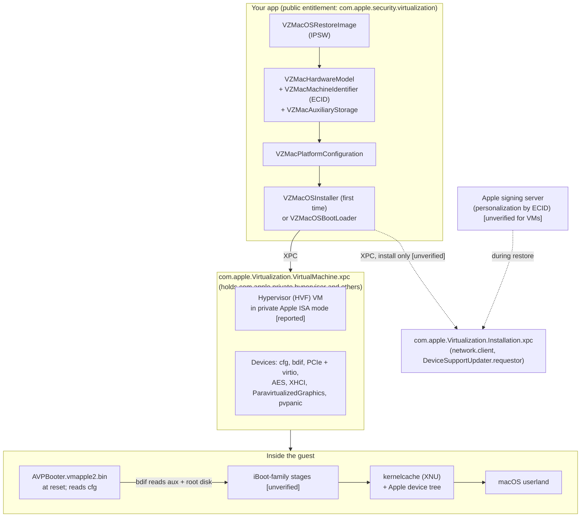

# What it would take to boot a macOS guest in a from-scratch Hypervisor.framework VMM

Status: requirements document, 2026-11-19. Role: hypervisor researcher (macOS guest track).
Builds on: `docs/research/macos-guest.md` (the feasibility study), `docs/adr/0008-macos-guest-strategy.md`,
`docs/macos/inventory.md` and `docs/macos/status.md`. Execution plan: `docs/PLAN.md` M20 and M21.

> **Read this first.** macvmm does **not** boot macOS, and nothing in this document says it does.
> No third-party VMM has been observed by us booting *any* macOS guest on this machine (Apple M5 Pro,
> macOS 27.2.1). This document is the map for anyone who wants to try: what the guest needs, what QEMU
> built, which walls are engineering and which are owned by Apple.

---

## 0. How to read this document

### 0.1 Evidence tags

Every factual claim carries one tag.

| Tag | Meaning |
|---|---|
| **[verified-on-machine]** | Observed on the dev machine: Apple M5 Pro (`Mac17,16`), macOS 27.2.1 build 26B131, Darwin 27.2.0, Virtualization.framework `CFBundleVersion` 308.2.7. Unless marked "(M20, 2026-11-18)", it was re-run for this document on 2026-11-19 with a small throwaway program signed ad hoc with **only** `com.apple.security.hypervisor`. The probe sources lived in the session scratchpad and are not in the repo. |
| **[primary-source]** | Read in a primary source: Apple SDK headers on this machine, the macOS licence text shipped on this machine, or QEMU `master` source and docs (fetched 2026-11-19). |
| **[reported]** | Stated by a secondary source (mailing-list patch, issue tracker, blog, forum). Read, not reproduced. |
| **[unverified]** | Our inference or an educated guess. Treat it as a hypothesis to test. |

Method limits: Apple binaries were inspected only with `ls`, `shasum`, `strings`, `codesign -d`, the
SDK `.tbd` export lists and the Objective-C runtime (listing class methods). **Nothing was
disassembled or decompiled** (the licence forbids it, §6). Device behaviour comes from QEMU's public
GPL source, never from Apple binaries.

### 0.2 Concepts you'll need

This repo's audience has never worked with virtualization. If a word below is new, start here.

| Term | Plain meaning | Where the course teaches it |
|---|---|---|
| **VM / guest / host** | A **virtual machine** is a pretend computer made of software plus CPU help. The OS inside it is the **guest**; the real Mac is the **host**. | ch00 |
| **VMM** | **Virtual Machine Monitor**: the host program that creates the VM, runs its virtual CPUs and pretends to be its devices. macvmm is one. | ch00, ch01 |
| **HVF** | Hypervisor.framework: Apple's *low-level* API. It gives us virtual CPUs and memory mapping; *we* write every device. | ch01, ch02 |
| **VZ** | Virtualization.framework: Apple's *high-level*, ready-made VMM. You configure it; Apple's code does everything. | ch01, ch23 |
| **Exception levels (EL0–EL2)** | ARM64 privilege rings: EL0 apps, EL1 the OS kernel, EL2 the hypervisor. Guests run at EL1. | ch02 |
| **VM exit / trap** | The CPU stops the guest and hands control to the VMM when the guest does something the VMM must handle. | ch02 |
| **MMIO** | Memory-mapped I/O: devices appear as addresses; a guest load or store there becomes an exit we emulate. | ch07 |
| **ISV** | A bit in the exit syndrome (ESR) saying "the CPU already decoded this load/store for you". **ISV=0** means it did not, so the VMM must decode the instruction itself. | ch07, ch21 |
| **HVC / PSCI** | `hvc` is the instruction a guest uses to call the hypervisor. **PSCI** is the standard set of such calls for "start CPU", "power off". | ch08 |
| **GIC, SPI, INTID** | The ARM interrupt controller. Device interrupts are **SPIs**; each interrupt has a number, its **INTID** (SPI *n* is INTID 32+*n*). | ch05, ch12 |
| **PCIe, ECAM, BAR** | The PCI Express bus. **ECAM** is the memory window where the OS reads device configuration; a **BAR** is a window a device asks the OS to place. | ch10 (pointer) |
| **virtio** | A standard family of simple, VM-friendly devices (disk, network, console). | ch15, ch17 |
| **Entitlement** | A permission baked into an app's code signature. `com.apple.security.hypervisor` lets an app use HVF. Keys starting `com.apple.private.` are reserved for Apple's own binaries. | primer `codesign-entitlements` |
| **SIP, AMFI** | System Integrity Protection and Apple Mobile File Integrity: the macOS protections that, among other things, stop third-party code from carrying Apple-private entitlements. | primer `codesign-entitlements` (pointer) |
| **IPSW** | Apple's restore-image file format: the whole OS, as installed by a restore. | ch23 |
| **ECID** | Exclusive Chip ID: a 64-bit unique ID. Apple signs ("personalizes") boot files for one ECID, so they refuse to boot on another machine. | ch23, ch24 |
| **AVPBooter, iBoot, kernelcache** | The VM's first-stage boot ROM, Apple's boot loader family, and the prelinked macOS kernel image. | ch24 aside |
| **PAC** | Pointer Authentication: ARM64 instructions that sign and check pointers to stop memory-corruption attacks. | pointer |
| **FGT** | Fine-Grained Traps: an ARMv8.6 feature that lets a hypervisor trap individual system-register accesses. | pointer |
| **SSBS** | Speculative Store Bypass Safe: an ARM feature (FEAT_SSBS) that lets the OS switch a speculation-attack mitigation on and off per thread. | pointer |

---

## 1. Executive summary

**Status today** [verified-on-machine]:

- macvmm ships no macOS guest support. The `experimental-vmapple` cargo feature exists in
  `crates/vmm/Cargo.toml` and `crates/macvmm/Cargo.toml`, but the vmapple machine (PLAN M21, stage S1)
  is not started; it is blocked on a lead decision about tracing Apple firmware (PLAN D4, ADR-0009).
- The S0 companion tool `tools/vz-mac` (PLAN M20) exists: it boots Linux through VZ, creates macOS VM
  bundles, extracts the ECID and trims the auxiliary storage (M20, 2026-11-18; `docs/macos/status.md`).
  No macOS has been installed or booted with it yet.

**The hard blockers, and who controls them.**

| # | Blocker | Kind | Controlled by | Evidence |
|---|---|---|---|---|
| B1 | Modern macOS guests need a private "Apple ISA" CPU mode; asking HVF for it returns `HV_DENIED` without the private `com.apple.private.hypervisor` entitlement | entitlement | **Apple** | [verified-on-machine] + [reported] |
| B2 | That entitlement is only usable by third-party code with SIP and AMFI weakened; we will not advise it | platform security policy | **Apple** (and each Mac's owner) | [reported] |
| B3 | macOS can only be *installed* (restored and personalized for an ECID) through VZ | platform | **Apple** | [primary-source] + [unverified] |
| B4 | ParavirtualizedGraphics (the Mac guest GPU) removed its documented memory-mapping API in macOS 27 and the MMIO flavour vmapple needs is private | private API churn | **Apple** | [primary-source] + [verified-on-machine] |
| B5 | M4/M5 CPUs lack FEAT_SSBS; older macOS guests (below 13.4) fail on M4 even under VZ | hardware | **Apple silicon** generation | [verified-on-machine] + [reported] |
| B6 | The only guest **upstream QEMU** documents is macOS 12: "newer versions than 12.x are currently NOT supported on the guest side". (Newer guests reportedly "fail during early boot"; one out-of-tree RFC boots macOS 26 with the private entitlement, §3.5) | engineering + unknowns | open source community | [primary-source: QEMU docs] + [reported: v17 cover letter, RFC] |
| B7 | Under the §2B(iii) grant, the macOS licence caps macOS VMs at two per Mac, for listed purposes (§2A, for preinstalled copies, has no virtualization grant at all); every grant is Apple-hardware-only and forbids reverse engineering and redistribution | licensing | **Apple** | [primary-source] |

Put together: B1 rules out current guests (macOS 13 to 27) for an ad-hoc-signed VMM; B5 probably makes
the one QEMU-proven guest (macOS 12) need an unheadered HVF knob on this M5 host [unverified: the M4
failure is reported, its SSBS cause comes only from a QEMU RFC, and M5 was not tested]; B4 means QEMU's graphics
device does not work on macOS 15.4+ hosts as merged. **We know of no path, on this machine and under
the public entitlement, that has been observed to boot any macOS guest.** [unverified: absence of
evidence, not proof of impossibility]

Everything else (PCIe, virtio-pci, an AES engine, a USB controller, a boot-disk "backdoor"
interface) is ordinary, if large, engineering: roughly 3–5 person-months to reach a hypothetical
"macOS 12 at an SSH prompt" (§4, §7), with low confidence it works on M4/M5 hosts.

**What we recommend** (unchanged from ADR-0008): ship the lesson, the VZ companion (S0) and an
experimental "AVPBooter first device probe" (S1). Build the parts that Linux and FreeBSD also use
(ISV=0 decoding, PCIe, virtio-pci). Treat S2 onwards as research with no boot promise.

---

## 2. How Apple boots a macOS VM

### 2.1 The stack

Apple's own macOS-guest VMM is VZ. An app links `Virtualization.framework` and holds the public
`com.apple.security.virtualization` entitlement. The framework launches an XPC service (a helper
process), `com.apple.Virtualization.VirtualMachine.xpc`, which does the real work: it creates the VM
through the hypervisor, emulates every device and runs the boot ROM. [primary-source: framework
layout on this machine]

That helper is privileged in ways a third-party binary cannot be. Its signature carries, among 35
entitlement keys, **`com.apple.private.hypervisor`**, `com.apple.private.virtualization`,
`com.apple.private.AppleVirtualPlatformIdentity`, `com.apple.private.FairPlayIOKitUserClient.Virtual.access`,
`com.apple.private.PCIPassthrough.access`, `com.apple.private.ane.privileged-vm-client` and
`com.apple.vm.networking`, next to the public `com.apple.security.hypervisor`.
[verified-on-machine: `codesign -d --entitlements -` on the XPC service, 2026-11-19]

VZ ships a second helper next to it, `com.apple.Virtualization.Installation.xpc`. Its entitlements are
quite different: `com.apple.security.network.client` (outbound network), `com.apple.private.DeviceSupportUpdater.requestor`,
`com.apple.diskimages.attach`, `com.apple.private.security.message-filter` and the hardened-process
keys [verified-on-machine: `codesign -d --entitlements -`, 2026-11-19]. Network access plus a
device-support updater key makes it the likely home of restore and signing-server personalization
(§2.4 step 3) [unverified inference from entitlements; the XPC split is not documented].

Lesson: **VZ is not "just an HVF client".** It is an HVF client with Apple-only privileges.

### 2.2 The objects a macOS VM needs

All `API_AVAILABLE(macos(12.0))` unless noted [primary-source: SDK headers].

| Object | What it is | What we know about its contents |
|---|---|---|
| `VZMacOSRestoreImage` | A handle on an IPSW: local file or `fetchLatestSupported`. Its `mostFeaturefulSupportedConfiguration` gives a hardware model and minimum CPU/RAM. | Latest on this host: macOS 27.2.1 build 26B131, 2 CPUs, 4096 MiB minimum [verified-on-machine (M20, 2026-11-18), metadata only, nothing downloaded] |
| `VZMacHardwareModel` | The "virtual Mac model": an opaque `dataRepresentation` that "abstracts a set of virtualized hardware elements and configurations" and must be kept for later boots. | A 132-byte opaque blob [verified-on-machine (M20, 2026-11-18)]. Its meaning is undocumented. |
| `VZMacMachineIdentifier` | The VM's identity. | A property list with one key, `ECID`, an unsigned 64-bit integer that can exceed `Int64.max` (seen: `0xca8d706a46fe7143`) [verified-on-machine (M20, 2026-11-18)]. |
| `VZMacAuxiliaryStorage` | Per-VM non-volatile storage: boot policy and NVRAM-like state. `initWithURL:` is 13.0+. | A fresh one is 33,570,816 bytes = 32 MiB plus a `0x4000`-byte header [verified-on-machine (M20, 2026-11-18)]. QEMU strips that header before use [primary-source: QEMU docs]. |
| `VZMacPlatformConfiguration` | Bundles the three above. | |
| `VZMacOSBootLoader` | "Boot this as a Mac": runs the boot ROM. | |
| `VZMacOSInstaller` | Restores an IPSW onto the VM's disk. | |
| `VZMacGraphicsDeviceConfiguration`, `VZMacKeyboardConfiguration` (14.0+), `VZMacTrackpadConfiguration` (13.0+) | Mac-specific display and input. | Graphics is ParavirtualizedGraphics underneath [reported]. |
| `VZMacOSVirtualMachineStartOptions` | Start options such as booting into Recovery (13.0+). | |
| `VZMacGuestProvisioningOptions` | **New in macOS 27**: first user, auto-login and SSH on first boot after restore. | `API_AVAILABLE(macos(27.0))` [primary-source]; needs a macOS 27 guest [primary-source: header doc]. |

### 2.3 The boot ROM on this machine

`/System/Library/Frameworks/Virtualization.framework/Versions/A/Resources/` holds
[verified-on-machine]:

| File | Size | sha256 | Role |
|---|---|---|---|
| `AVPBooter.vmapple2.bin` | 335 KB | `9cefbfa5e7478945ab909c4300bd375072bd2ae4d4d5c28c63f50ece5162f928` | Boot ROM of the `vmapple2` (macOS guest) platform. Banner `AVPBooter for vmapple2 Copyright 2007-2026, Apple Inc.`, version string `mBoot-20457.41.3`. |
| `AVPBooter.vresearch1.bin`, `AVPSEPBooter.vresearch1.bin` | 336 KB, 168 KB | (not needed) | The Security Research VM platform. Out of scope. |
| `VZG11.fd`, `VZG21.fd` | 2.1 MB, 1.0 MB | (not needed) | EFI firmware volumes, presumably for generic (Linux) guests [unverified]. |

`strings` on `AVPBooter.vmapple2.bin` shows an embedded `Apple DDI Secure Boot Root CA - G11` and an
iBoot-style identity line `SDOM:%02X CPID:%04X CPRV:%02X CPFM:%02X SCEP:%02X BDID:%02X ECID:%016llX IBFL:%02X`
[verified-on-machine]. So the ROM checks Apple signatures and knows the machine's ECID [unverified
inference from strings]. The sha256 matches the one recorded on 2026-11-18, so the ROM did not change
between those runs.

**Policy (ADR-0008):** macvmm reads this file at run time, read-only, into a host allocation. It is
never copied into the repo, the cache, test fixtures, release artefacts or the course site.

### 2.4 Install, then boot

1. **Get a restore image.** A local `.ipsw` or `VZMacOSRestoreImage.fetchLatestSupported`
   [primary-source].
2. **Create the bundle.** A raw disk image, an auxiliary storage created for the restore image's
   hardware model, and a fresh machine identifier (a new ECID). Keep the hardware-model and
   machine-identifier blobs [primary-source].
3. **Restore.** `VZMacOSInstaller` boots the VM in an installer mode (QEMU's cfg region has
   `run_installer1/2` fields for this [primary-source: QEMU `hw/vmapple/cfg.c`]) and installs macOS.
   On physical Apple-silicon Macs, boot objects are personalized by Apple's signing server for one
   ECID [reported: Apple Platform Security guide]. That a VM restore does the same (probably inside VZ's Installation XPC helper,
   §2.1), which would
   explain why the ECID must stay fixed and why QEMU must be given VZ's ECID, is [unverified].
4. **Boot.** `VZMacOSBootLoader` starts AVPBooter at the VM's reset address. AVPBooter reads a
   configuration page (cfg), reads the auxiliary and root disks through a simple "backdoor" block
   interface (bdif), verifies what it loads, and hands control to the next stage [reported: QEMU
   commit messages and docs; consistent with the strings in §2.3]. The next stages are iBoot-family
   loaders that load the **kernelcache** from the guest disk and build the Apple device tree that
   the macOS kernel (XNU) expects [unverified: inferred from the physical-Mac chain and the strings
   `boot-args`, `iBoot Panic`; QEMU documents only "AVPBooter → disk"].
5. **Run.** The kernel talks to virtio devices over PCIe, an XHCI USB controller with keyboard and
   trackpad, ParavirtualizedGraphics, an AES engine, pvpanic, an RTC and a GPIO power button
   [primary-source: QEMU vmapple; reported: VZ class names in `strings`].

VZ refuses a third concurrent macOS VM on one host [reported: Apple DTS forum thread 845455;
Eclectic Light]. That cap matches the licence (§6).

---

## 3. The existence proof: QEMU's `vmapple` machine

### 3.1 History

Alexander Graf wrote the original reverse-engineered vmapple machine (2023). Phil Dennis-Jordan
revived it with the `apple-gfx` display device; vmapple was merged on 2025-03-04 for QEMU 10.0
[primary-source: QEMU git log; reported: v17 cover letter]. Later fixes for newer hosts and guests
(Mohamed Mediouni, 2025–2026) are mailing-list series, not on `master` as of 2026-11-19 (§3.5).

QEMU is **GPL-2.0-or-later**. We read it for facts (addresses, register layouts); we never copy its
code or prose (ADR-0008 decision 4).

### 3.2 Memory map and interrupts [primary-source: `hw/vmapple/vmapple.c`, fetched 2026-11-19]

| Region | Base | Size | Interrupt (SPI index → INTID) |
|---|---|---|---|
| Firmware (AVPBooter, loaded into RAM) | `0x0010_0000` | 1 MiB | |
| Config region (cfg) | `0x0040_0000` | 64 KiB | |
| GICv3 distributor | `0x1000_0000` | 64 KiB | |
| GICv3 redistributors | `0x1001_0000` | 4 MiB | |
| PL011 UART | `0x2001_0000` | 64 KiB | 1 → 33 |
| PL031 RTC | `0x2005_0000` | 4 KiB | 2 → 34 |
| PL061 GPIO (power key) | `0x2006_0000` | 4 KiB | 5 → 37 |
| pvpanic-mmio | `0x2007_0000` | 2 B | |
| bdif ("backdoor" block interface) | `0x3000_0000` | 2 MiB | |
| apple-gfx (ParavirtualizedGraphics GPU) | `0x3020_0000` | 64 KiB | 0x11 → 49 |
| apple-gfx IOSurface mapper | `0x3021_0000` | 64 KiB | 0x10 → 48 |
| AES engine, windows 1 and 2 | `0x3022_0000`, `0x3023_0000` | 16 KiB each | 0x12 → 50 |
| PCIe ECAM | `0x4000_0000` | 256 MiB | |
| PCIe MMIO window | `0x5000_0000` | `0x1fff_0000` | INTx from 0x20 → 64 |
| RAM | `0x7000_0000` | as configured | |

CPU and platform [primary-source]: PSCI over **HVC**, secondary CPUs start powered off, at most 32
vCPUs, the firmware is copied into RAM at the reset address, and no DTB is loaded (AVPBooter builds
its own device tree). The virtual timer is PPI 27 [primary-source per the study; INTID 27 is also what
VZ's generic platform uses, verified-on-machine (M20)].

**This map conflicts with macvmm's `virt` map**: `0x4000_0000` is RAM in `virt` and ECAM here. vmapple
is therefore a second `MachineProfile` (architecture §5.2–5.3), not a change to `virt`.

Re-verified for this document: HVF's in-kernel GICv3 accepts the vmapple bases.
`hv_gic_config_set_distributor_base(0x1000_0000)`, `hv_gic_config_set_redistributor_base(0x1001_0000)`
and `hv_gic_create` all return `HV_SUCCESS` [verified-on-machine].

### 3.3 Every device, what it does, and what it would cost us

Sizes: XS < 1 day, S 1–3 days, M 1–2 weeks, L 2–4 weeks, XL > 1 month, for one engineer who knows
the codebase. Source of behaviour: QEMU [primary-source] unless marked.

| Device | QEMU file | What it does | Who uses it | Effort for macvmm |
|---|---|---|---|---|
| **cfg** (`vmapple-cfg`) | `hw/vmapple/cfg.c` | A page of RAM the booter reads: version 2, CPU count, `ecid`, RAM size, `run_installer1/2`, a random seed, MAC addresses, CPU IDs, serial `"1234"`, model `"VM0001"`, SoC name `"Apple M1 (Virtual)"`, plus several `unkN` fields holding magic constants. | AVPBooter | S. The `unkN` fields are an unknown: what checks they feed is [unverified]. |
| **bdif** (backdoor block interface) | `hw/vmapple/bdif.c` | MMIO block reader for the **aux** (device ID `0x1_0000`) and **root** (device ID 0) disks; QEMU also defines a third ID, `DEVID_USB` `0x10_0000`. The guest writes the guest-physical address of a `{sector, data, retval}` descriptor triple to a command register; the device reads 512-byte sectors into guest memory and writes a status byte. Read-only (QEMU's comment: "iBoot only reads"). QEMU rejects requests over **128 MiB**. | AVPBooter and early iBoot stages | S–M. Every address and length is guest-controlled: a textbook hostile-input lesson. PLAN M21 POST-6 caps a request at 1 MiB; that cap is a **compatibility risk**, not free hardening: if iBoot reads a large payload such as the kernelcache in one request, 1 MiB breaks boot. S2 must log the largest request actually seen and size the cap from it [unverified until measured]. |
| **pvpanic-mmio** | `hw/misc/pvpanic-mmio.c` | The guest writes here when it panics. VZ uses the same `qemu,pvpanic-mmio` compatible string [reported: `strings` on the XPC service, study §1.3]. | macOS kernel | XS. Very useful as the first "kernel reached" signal. |
| **PL011, PL031, PL061 + gpio-key** | stock | UART, real-time clock, GPIO with pin 3 as the power button. | booter and kernel | S: macvmm already has PL011 and PL031 (M6); PL061 is small. |
| **GICv3** | stock / HVF | Interrupt controller at vmapple bases. | everything | Done by HVF [verified-on-machine]. |
| **GPEX PCIe host** | stock | ECAM configuration space, BAR windows, INTx routing (no MSI in the merged version). | macOS kernel | M–L. Reusable for EDK2/FreeBSD. |
| **virtio-pci (modern only)** | stock | virtio over PCI, `disable-legacy=on`. | macOS kernel | M. Reusable. |
| **vmapple-virtio-blk-pci** | `hw/vmapple/virtio-blk.c` | Normal virtio-blk except: the `max_secure_erase_sectors` config field carries an "apple type" (aux or root), and request type `0x10000` is a BARRIER (QEMU treats it as a no-op). Each disk is attached twice: once to bdif, once here. | macOS kernel | S once virtio-pci exists. |
| **AES engine** (`apple-aes`) | `hw/vmapple/aes.c` | A command FIFO (key, IV, data, store-IV, flag commands) with DMA to and from guest memory; AES-ECB/CBC (QEMU rejects other block-mode values) with 128/192/256-bit keys and "built-in" hardware keys, for which QEMU uses placeholder values. Driven by macOS's AES accelerator driver. | macOS kernel | M. Needs an AES implementation (our minimal-dependency rule: write it or justify a crate in `docs/dependencies.md`). Whether VZ-encrypted data on the disk needs VZ's real keys is [unverified]. |
| **virtio-net-pci** | stock | Network. QEMU uses user-mode NAT (slirp). | macOS userland (SSH) | M–L. macvmm's M24 unixgram backend avoids the restricted `com.apple.vm.networking` entitlement. |
| **XHCI + usb-kbd + usb-tablet** | stock + 3 XHCI fixes | Keyboard and pointer. macOS's XHCI driver uses event rings 1 and 2 even without MSI, which forced a "conditional interrupt mapping" quirk. Only created when defaults are enabled. | macOS UI | L–XL. Not needed for a headless SSH boot [unverified]. |
| **apple-gfx-mmio** | `hw/display/apple-gfx{,-mmio}.m` | Bridges two MMIO windows and two interrupts to Apple's `ParavirtualizedGraphics.framework` (`PGDevice` and the private `PGIOSurfaceHostDevice`), which renders with Metal on the host. | macOS UI | L–XL from Rust: Objective-C runtime FFI, Blocks ABI for callbacks, private classes, and the macOS 27 API change (§5.4). Whether macOS boots headless without it is [unverified]. |

### 3.4 QEMU's documented workflow [primary-source: `docs/system/arm/vmapple.rst`]

1. Install a **macOS 12** VM with a VZ-based tool (the docs assume `macosvm`).
2. Extract the ECID from the machine identifier (`contrib/vmapple/uuid.sh`).
3. Strip the first `0x4000` bytes of the auxiliary storage.
4. Run QEMU with `-M vmapple,uuid=$ECID -bios …/AVPBooter.vmapple2.bin`, the aux and root images each
   attached as a bdif ("pflash") drive and as a `vmapple-virtio-blk-pci` device, and `virtio-net-pci`
   with port forwards for SSH and VNC.

Note what this means: **even QEMU installs with VZ and only boots elsewhere.** macvmm's `vz-mac` tool
(S0) produces exactly these inputs (`install`, `ecid`, `trim-aux`).

### 3.5 Which guests and hosts work

| Guest | Host chip | Host macOS | QEMU vmapple status | Tag |
|---|---|---|---|---|
| macOS 12 | M1–M3 | 12 to 15.3 | Works (the documented configuration) | [primary-source: docs require only Apple silicon and "macOS 12.0 or above" on the host, and say "newer versions than 12.x are currently NOT supported on the guest side"]; the M1–M3 limit [reported: M4 reports below] and the 15.3 upper bound [reported: issue #2913] are not in the docs |
| macOS 12 | any | 15.4 and later | `apple-gfx-mmio` breaks: the host framework removed the memory-mapping hook it uses (QEMU issue #2913). `master` on 2026-11-19 still sets `iosfc_desc.mapMemory` and has no version check. | [primary-source: `apple-gfx-mmio.m` fetched 2026-11-19] + [reported: #2913] |
| macOS < 13.4 | M4 (and, we infer, M5) | any | Fails even under VZ on M4 [reported: Eclectic Light, MacRumors, Nov 2024; Eclectic Light names no cause and suspects the early guest kernel]. Only the QEMU RFC links it to the missing FEAT_SSBS, and emulates `SCTLR_EL1.DSSBS` with fine-grained traps [reported: QEMU RFC Oct 2025]. | M5 lacks SSBS [verified-on-machine]; that the SSBS cause is right, and that the same failure hits M5, are [unverified] |
| Sequoia < 15.4 (VM updating to 15.4+) | M4 | 15.4 era | Not a QEMU row, but it affects S0: existing VMs on M4 hosts often fail to update from 15.3.x to 15.4 or later (kernel panic); the advice is to build a new VM from a 15.4+ restore image | [reported: Eclectic Light, Apr 2025]; behaviour on M5 [unverified] |
| macOS 13 and later | any | any | Not supported: "newer versions than 12.x are currently NOT supported on the guest side". The series cover letter says they "fail during early boot". | [primary-source: QEMU docs] + [reported: v17 cover letter] |
| macOS 26 ("Tahoe") | M-series | recent | Boots only in an out-of-tree RFC that enables private ISA mode with `com.apple.private.hypervisor`, SIP off and AMFI bypassed. Without it, "Apple PAC is paravirtualised … hvc #0 … the guest dutifully goes into an infinite loop". Also needs ISV=0 emulation. | [reported: Mediouni RFC v7 7/7, Mar 2026] |

**On this host (M5 Pro, macOS 27.2.1) there is no row that works under the public entitlement.**

---

## 4. Complete requirements list for macvmm

"Blocker" column: **none** (plain engineering), **engineering-unknown** (doable, but behaviour is
undocumented), **hardware**, **platform** (Apple owns the mechanism), **entitlement**, **licensing**.
"W#" refers to the work items in the feasibility study §5.

| # | Requirement | Why the guest needs it | How QEMU does it | Effort | Blocker |
|---|---|---|---|---|---|
| R1 | A second machine profile with the vmapple map (W1) | AVPBooter and XNU expect devices at fixed addresses (§3.2) | `hw/vmapple/vmapple.c` memmap | S | none |
| R2 | Load AVPBooter at `0x10_0000`, read-only from the system path (W2) | It is the first instruction the guest runs | `-bios`, copied into RAM | XS | **licensing**: never copy or redistribute (§6) |
| R3 | vCPU bring-up: EL1, PC `0x10_0000`, no DTB, secondaries off, PSCI over HVC, sensible `MPIDR` (W3) | Matches what the booter expects at reset | machine init | S | none |
| R4 | GICv3 at `0x1000_0000` / `0x1001_0000`; virtual timer PPI 27 | Interrupts | QEMU GICv3 or HVF's | done | none [verified-on-machine] |
| R5 | cfg region (W4) with VZ's ECID | AVPBooter reads identity, CPU count, RAM size, install mode | `hw/vmapple/cfg.c` | S | engineering-unknown (`unkN` fields) |
| R6 | ECID and hardware model from a VZ bundle | Boot files are tied to the ECID [unverified]; hardware model ties the guest to a platform version [unverified] | user passes `uuid=` | S (`vz-mac ecid`, done) | **platform**: only VZ creates them |
| R7 | Trimmed auxiliary storage | Boot policy and NVRAM | `dd … skip=1` | XS (`vz-mac trim-aux`, done) | **platform**: only VZ creates it |
| R8 | bdif block reads, hostile-input hardened (W5) | The booter reads aux and root disks before any kernel driver exists | `hw/vmapple/bdif.c` | S–M | none |
| R9 | PL011 / PL031 / PL061 + power key / pvpanic at vmapple bases (W6) | Console, clock, shutdown, panic signal | stock devices | S | none |
| R10 | Unknown-MMIO logger with a hard cap (S1) | Shows where we are when something is missing | (QEMU logs unassigned access) | XS | licensing gray area: how far tracing Apple firmware may go (PLAN D4) |
| R11 | PCIe host bridge: ECAM, BAR placement, INTx (W7) | XNU finds disks and NICs by PCI enumeration | GPEX | M–L | none (reusable for EDK2/FreeBSD) |
| R12 | virtio-pci modern transport (W8) | All kernel-visible virtio devices sit on PCI | stock | M | none (reusable) |
| R13 | vmapple virtio-blk variant: aux/root type, BARRIER `0x10000` (W9) | The kernel mounts the root and aux disks | `hw/vmapple/virtio-blk.c` | S | none |
| R14 | AES engine (W10) | macOS's AES accelerator driver uses it | `hw/vmapple/aes.c` | M | engineering-unknown (hardware keys; see §6, §2N "decrypt") + dependency decision |
| R15 | ISV=0 data-abort emulation (W14) | Recent guests access MMIO with instructions the CPU does not decode for us | out-of-tree library (Lucas Amaral, 2026) [reported] | M | none (**planned as M17**, needed by firmware anyway) |
| R16 | ID-register masking (W15, public part) | Guests must not see CPU features (for example SME, present here [verified-on-machine]) they mishandle | QEMU CPU model | S–M | engineering-unknown (which registers HVF lets us override) |
| R17 | FEAT_SSBS workaround for old guests | M4/M5 lack SSBS; macOS < 13.4 fails without it [reported] | RFC: FGT traps on `SCTLR_EL1` | S–M + ADR | **hardware**; uses the unheadered `_hv_vcpu_config_set_fgt_enabled` (accepted here [verified-on-machine]; effect untested) |
| R18 | Private Apple ISA mode / PAC paravirtualization (W16) | macOS 13+ guests (reported for 26) need it | RFC: `_hv_vm_config_set_isa(cfg, 3)` + private entitlement | n/a | **entitlement**: `HV_DENIED` [verified-on-machine] |
| R19 | virtio-net + a host backend (W13) | SSH is the first useful "it is alive" signal | slirp | M–L | none with M24 unixgram; vmnet would need a restricted entitlement |
| R20 | XHCI + USB HID (W11) | Keyboard and pointer in the GUI | stock + quirks | L–XL | none (optional for headless) |
| R21 | ParavirtualizedGraphics bridge (W12) | GUI display | `apple-gfx-mmio.m` | L–XL | **platform**: private, changed in 15.4 and again in 27 (§5.4) |
| R22 | Installation and personalization | Getting macOS onto the disk at all | not done; uses VZ | — | **platform**: VZ only |
| R23 | Two-instance guard (W17) | Licence §2B(iii) | VZ enforces it; QEMU does not | S | **licensing** |
| R24 | Clean-room provenance notes per device | QEMU is GPL; macvmm must not copy it | — | XS per device | **licensing** |
| R25 | Secure Enclave (SEP) | Unclear: VZ's helper has a `SepCoprocessor` class [reported: study §1.3], but QEMU boots macOS 12 without one | none | unknown | engineering-unknown |

Effort to a hypothetical "macOS 12 reachable over SSH" (R1–R17, R19, R23, R24): about **3–5
person-months**, with low confidence on M4/M5 [unverified estimate; QEMU needed years of part-time work
to reach macOS 12 with many devices already written].

---

## 5. Hard blockers in detail

### 5.1 The private entitlement and the private ISA mode (B1)

**What the mode is.** Apple's CPUs implement Apple-specific extensions, including their own flavour of
pointer authentication (PAC). A modern macOS guest expects the hypervisor to run it in an "Apple ISA"
mode in which some of this is paravirtualized: the guest makes `hvc #0` calls that the hypervisor must
answer [reported: Mediouni RFC v7 7/7]. Without the mode, those guests loop forever [reported].

**How it is requested.** `Hypervisor.tbd` in the SDK exports symbols that have **no header**
[primary-source]: `__hv_vm_config_set_isa`, `__hv_vm_config_get_isa`, `__hv_vm_get_isa`,
`__hv_vcpu_config_set_fgt_enabled` / `get_`, `__hv_vcpu_config_set_vmkey` / `get_` and
`__hv_vcpu_config_set_tlbi_workaround_enabled` / `get_`. The list is longer than those mode
knobs. It also includes `__hv_vm_config_set_vhe_enabled` / `get_`, `__hv_vcpu_get_ext_reg` /
`set_`, `__hv_vcpu_get_context`, `__hv_vcpu_get_control_field` / `set_`, `__hv_vcpu_invalidate_tlb`,
`__hv_vcpu_set_space`, the `__hv_vm_space_*` and `__hv_vm_{map,unmap,protect}_space` family,
`__hv_vm_stage1_tlb_op`, the `__hv_vcpu_*amx*` family and `__hv_capability`
[verified-on-machine: `grep -o '__hv_[a-z0-9_]*' Hypervisor.tbd`, 2026-11-19]. (Mach-O adds one leading underscore, so C code
declares them as `_hv_vm_config_set_isa` and so on.) Their signatures are guesses [unverified].

**The experiment, re-run for this document** [verified-on-machine, 2026-11-19]. A C program, ad-hoc
signed with only `com.apple.security.hypervisor` and the hardened runtime, created a VM config, set the
ISA value, then called `hv_vm_create(cfg)`:

| ISA value | `_hv_vm_config_set_isa` | `hv_vm_create(cfg)` |
|---|---|---|
| (no config, `hv_vm_create(NULL)`) | — | `0x00000000` `HV_SUCCESS` |
| 0 | `0x00000000` | `0xfae94007` **`HV_DENIED`** |
| 1 | `0x00000000` | `0x00000000` `HV_SUCCESS` |
| 2 | `0x00000000` | `0xfae94007` **`HV_DENIED`** |
| 3 (the value the QEMU RFC uses) | `0x00000000` | `0xfae94007` **`HV_DENIED`** |
| 4, 5 | `0x00000000` | `0xfae94007` **`HV_DENIED`** |

Readings: the setter accepts any value; the check happens in `hv_vm_create`; with the public
entitlement only value 1 is allowed, which is presumably the standard ARM mode [unverified]. What
values other than 3 mean is unknown [unverified]. `HV_DENIED = 0xfae94007` is from `hv_error.h`
[primary-source].

**Who controls it:** Apple. The entitlement is `com.apple.private.*`; Apple grants such keys to its
own binaries (VZ's XPC helper has it, §2.1). There is no public request process we know of
[unverified]. ADR-0008 forbids using these symbols inside macvmm without a new ADR; the planned
`tools/hv-denied-probe` (PLAN M21) exists only to *demonstrate* the denial.

**What would unblock it:** Apple documenting a public API (or a public entitlement) for macOS-guest CPU
modes. Re-check every WWDC and every SDK's `Hypervisor.framework` headers.

### 5.2 SIP and AMFI (B2)

A third-party binary signed with a `com.apple.private.*` entitlement is killed at launch on a normally
configured Mac; AMFI enforces this, and SIP protects AMFI's policy [reported]. The known workaround,
used by the out-of-tree QEMU RFC for testing, is to disable SIP and bypass AMFI on the host [reported].

**We do not advise it, document how to do it, or ship anything that needs it.** Reasons:

- It weakens the whole host, not just the VMM: unsigned or self-entitled code of any origin gains the
  same freedom.
- It breaks this project's rules: one public entitlement, no elevated privileges, nothing a learner
  must change about their Mac's security posture (`CLAUDE.md`, ADR-0008 decision 4, threat model AS9).
- It gives no shippable result: no learner or user could run it on a stock Mac.

That is the full extent of what this document says about it.

### 5.3 CPU feature gaps on M4/M5 (B5)

| Feature | This M5 Pro (`sysctl hw.optional.arm.*`) | Why it matters |
|---|---|---|
| `FEAT_SSBS` | **0** [verified-on-machine] | Older macOS kernels misbehave without it: VMs older than macOS 13.4 fail on M4 even in VZ [reported]. M5 also lacks it, so the same failure is likely [unverified]. |
| `FEAT_SME`, `FEAT_SME2` | 1, 1 [verified-on-machine] | Visible to guests unless masked (VZ shows SME to a Linux guest [verified-on-machine (M20)]). Old guests may not save and restore SME state correctly [unverified]. |
| `FEAT_PAuth`, `FEAT_BTI`, `FEAT_ECV` | 1, 1, 1 [verified-on-machine] | Present; how the guest's Apple-specific PAC use maps onto them is what the private ISA mode handles (§5.1). |

The QEMU RFC workaround uses fine-grained traps to emulate `SCTLR_EL1.DSSBS` [reported]. On this host,
`_hv_vcpu_config_set_fgt_enabled(cfg, true)` returns 0 and `hv_vcpu_create` then succeeds under the
public entitlement [verified-on-machine, 2026-11-19]. **Whether any trap actually fires was not
tested** [unverified]. Using it in macvmm needs its own ADR and a default-off feature (ADR-0008
decision 4).

Consequence: the one QEMU-proven guest, macOS 12, is older than 13.4, so on M4/M5 it likely needs this
workaround [unverified]. Eclectic Light (Nov 2026) calls macOS 12 the VM floor "regardless of chip"
[reported]; we found no statement that the M4 problem was fixed.

A second M4 host problem touches S0, not macvmm: Eclectic Light (April 2025) reports that VMs on M4
hosts running Sequoia before 15.4 usually fail, with a kernel panic, to update to 15.4 or later, and
advises building a new VM from a 15.4+ restore image [reported]. So S0 bundles should be created
fresh from a current restore image, not updated in place. Whether M5 behaves the same is [unverified].

### 5.4 ParavirtualizedGraphics API changes (B4)

In the macOS 27 SDK, `PGDevice.h` [primary-source]:

- marks `PGTask_t`, `PGTraceRange_t` and the `createTask`, `destroyTask`, `mapMemory`, `unmapMemory`,
  `readMemory`, `addTraceRange` and `removeTraceRange` properties
  `API_OBSOLETED("No longer supported", macos(11.0, 27.0, 27.0))`, with the note *"The legacy memory
  mapping path has been removed."*;
- deprecates `PGNewDeviceWithDescriptor` at 15.2 and **obsoletes it at 27.0**
  (`API_OBSOLETED_WITH_REPLACEMENT("PGCreateDeviceWithDescriptor", macos(11.0, 15.2, 27.0))`);
- deprecates `PGCopyOptionROMURL` (*"The Option ROM is no longer used"*).

**No public replacement for guest-memory mapping appears in the headers** [primary-source: no
`memoryMap` or `PGMemoryMapDescriptor` in any PG header]. The replacement exists only in the
Objective-C runtime [verified-on-machine, 2026-11-19]:

- `PGMemoryMapDescriptor` has `addRange:` and `getRanges` (a static table of guest-physical to
  host-virtual ranges given at device creation);
- `PGDeviceDescriptor` responds to `setMemoryMapDescriptor:`, `setUsingIOSurfaceMapper:`,
  `setEnableProcessIsolation:` and `setDeviceFeatureLevel:` (it also still responds to the obsoleted
  `setMapMemory:` and `setCreateTask:`; whether they still do anything is [unverified]);
- `PGIOSurfaceHostDeviceDescriptor` (the second MMIO window vmapple needs, itself not in any header)
  has exactly `init`, `dealloc`, `memoryMapDescriptor`, `setMemoryMapDescriptor:`, `mmioLength`,
  `setMmioLength:`, `raiseInterrupt`, `setRaiseInterrupt:`. **It no longer responds to
  `setMapMemory:`**, which QEMU `master` still calls (`iosfc_desc.mapMemory = …`) [primary-source,
  2026-11-19]. We did not run QEMU, but issue #2913 already reports the run-time crash on 15.4:
  *"-[PGIOSurfaceHostDeviceDescriptor setMapMemory:]: unrecognized selector sent to instance …"*
  [reported].

`PGDisplay.h` also marks the `PGDisplayCursorGlyphHandler` type and the `cursorGlyphHandler`
properties `API_OBSOLETED("No longer supported", macos(11.0, 27.0, 27.0))` [primary-source].

So **the PCI/core path breaks on 27 too, not only the IOSurface mapper.** QEMU `master`'s shared
`hw/display/apple-gfx.m` calls `PGNewDeviceWithDescriptor(desc)`, sets `desc.createTask` and
`desc.mapMemory`, and sets `disp_desc.cursorGlyphHandler` [primary-source, fetched 2026-11-19]: all
four are obsoleted at macOS 27.0. Whether the runtime still honours them on 27.2 is [unverified].

The public `PGDeviceSpec.h` describes only the **PCI** flavour (vendor `0x106b`, device `0xeeee`, MMIO
BAR 0, one MSI vector) [primary-source]. vmapple uses the MMIO flavour, which is private.

**Who controls it:** Apple, and it has changed twice (15.4, 27). Any Rust bridge would chase a private
target. This is why graphics is the last stage of the roadmap.

### 5.5 Installation and personalization (B3)

Only `VZMacOSInstaller` restores an IPSW into a VM [primary-source: it is the only installer API]. Any
signing-server personalization happens inside VZ [unverified]. A from-scratch VMM therefore boots a
disk that VZ installed. This is not a problem for teaching (S0 makes the bundle), but it means macvmm
can never be independent of VZ for macOS.

### 5.6 Not blockers, but large

PCIe (R11), XHCI (R20) and the AES engine (R14) are each bigger than macvmm's whole Linux MVP. They are
documented or QEMU-documented, so they are engineering, not walls. PCIe and virtio-pci pay for
themselves on EDK2 and FreeBSD.

---

## 6. Licensing

Source: `/System/Library/CoreServices/Setup Assistant.app/Contents/Resources/en.lproj/OSXSoftwareLicense.rtf`,
"Software License Agreement for macOS", as shipped with 27.2.1 [primary-source; section numbers checked
2026-11-19]. **This is not legal advice.** The project owner should read the clauses themselves.

**§2B(iii), the virtualization grant** (quoted):

> "(iii) except as otherwise provided in writing, signed, or issued by an authorized representative of
> Apple, to install, use and run up to two (2) additional copies or instances of the Apple Software,
> or any prior macOS or OS X operating system software or subsequent release of the Apple Software,
> within virtual operating system environments on each Apple-branded computer you own or control that
> is already running the Apple Software, for purposes of: (a) software development; (b) testing during
> software development; (c) using macOS Server; or (d) personal, non-commercial use."

Note that (iii) sits inside §2B, headed "Mac App Store License" (software obtained from the Mac App
Store or "through an automatic download"); §2A covers preinstalled single-copy use. Which grant
applies to a given person depends on how they obtained macOS; we do not interpret that.

**The paragraph after §2B(iii)**: except as permitted in Section 3, the virtualized copies may not be
used "in connection with service bureau, time-sharing, terminal sharing, relay service or other
similar types of services", and no other Apple OS (iOS, iPadOS, watchOS, tvOS) may be run in VMs on a
Mac.

**§2J, Other Use Restrictions**: no use on non-Apple-branded computers; except as otherwise permitted,
"(i) only one user may use the Apple Software at a time, and (ii) you may not make the Apple Software
available over a network where it could be run or used by multiple computers at the same time"; and
"you may not rent, lease, lend, sell, redistribute or sublicense the Apple Software" except under
Section 3. Clause (ii) is one more reason a hosted macOS-guest service is out of scope.

**§2K, Backup Copy**: "Apple Boot ROM code and firmware is provided only for use on Apple-branded
hardware and you may not copy, modify or redistribute the Apple Boot ROM code or firmware, or any
portions thereof." Whether AVPBooter counts as "Boot ROM code" here is a legal question; our policy
of never copying it satisfies either reading.

**§2N, No Reverse Engineering**: "You may not, and you agree not to or enable others to, copy (except
as expressly permitted by this License …), decompile, reverse engineer, disassemble, attempt to derive
the source code or training data of, decrypt, modify, or create derivative works of the Apple Software … (except as
and only to the extent any foregoing restriction is prohibited by applicable law …)."
Note **"decrypt"**: it bears on the open question in R14 (the AES engine's "built-in" keys). If VZ
data on the disk can only be read with VZ's real keys, recovering or using those keys could itself
count as decrypting Apple Software. macvmm will not try to obtain them; this is part of the D4 /
ADR-0009 question [unverified: our reading].

**§3A and §3D, leasing**: leasing macOS is allowed only for "Permitted Developer Services" (continuous
integration and similar), each lease at least **twenty-four (24) consecutive hours** (§3A(ii)), with
advance notice to Apple; §3D lets either lessor or lessee (not both) use the §2B(iii) virtualization
grant.

**What this means for macvmm.**

1. Apple hardware only: HVF already guarantees it.
2. At most two macOS guests per Mac, for the listed purposes, under §2B(iii) (§2A has no
   virtualization grant). macvmm's vmapple profile takes one of two
   lock files (ADR-0008 decision 6, R23). Teaching and course development fit "software development"
   and "personal, non-commercial use" [unverified: our reading]. A hosted service or a CI farm would
   need §3 compliance.
3. No Apple bits in the repo, the cache, test fixtures, releases or the course site: no AVPBooter, IPSW,
   aux image or disk image. Learners use the copies already on their Mac.
4. No reverse engineering by this project. Device facts come from QEMU's public source and Apple's
   public headers. **The open question** is whether observing which addresses AVPBooter touches in our
   own VMM counts as reverse engineering under §2N; that is PLAN decision D4 (ADR-0009), and M21 waits
   on it. Default until decided: traces only check our implementation of QEMU-documented devices, raw
   traces of Apple firmware are never published, nothing is disassembled.
5. QEMU is GPL-2.0-or-later. Facts (offsets, struct layouts) may be used; code and prose may not be
   copied. Each vmapple device module records its sources in its `//!` doc comment.

---

## 7. Staged roadmap

Each stage ends with an observable exit criterion recorded in `docs/macos/status.md` as
"observed X; blocked at Y". **No stage before S4 may be described as booting macOS**, and S4 only with
a captured transcript (ADR-0008 decision 1).

| Stage | Scope | Requirements | Exit criterion (observable) | Effort | Confidence on this M5 / 27.2 host | PLAN |
|---|---|---|---|---|---|---|
| **S0** VZ companion | `tools/vz-mac`: Linux under VZ for comparison; `install`, `boot`, `ecid`, `trim-aux` for macOS bundles | R6, R7 | `tools/vz-mac/test.sh` passes on M9's artefacts; optionally, a manual install whose boot under **VZ** shows a macOS login, with build number and ECID recorded | 1 week (largely done) | High | **M20** (code exists; acceptance waits on M9) |
| **S1** first probe | vmapple profile behind `experimental-vmapple`; AVPBooter loaded read-only; GIC, PL011; capped unknown-MMIO logger; `tools/hv-denied-probe` | R1–R4, R10 | stderr shows `vmapple: first exit at pc=0x1…` inside `0x10_0000..0x20_0000`, then either "N unknown MMIO accesses logged" or "stopped at unsupported HVC"; the probe prints `HV_DENIED (0xfae94007)` | 3–5 days after M17 | High for "first exit observed"; unknown beyond | **M21** (blocked on D4 / ADR-0009) |
| **S2** early platform | cfg with the bundle's ECID; bdif over the trimmed aux and the root image; PL031/PL061/pvpanic at vmapple bases; two-instance lock | R5–R9, R23, R24 | bdif reads of aux and root succeed (sector log), and execution leaves the ROM range (PC in RAM) or stops with a documented, reproducible reason | 1–2 weeks | Low–medium (personalization and `unkN` checks are unknown) | post-v1, none |
| **S3** kernel I/O | PCIe ECAM + INTx, virtio-pci, vmapple virtio-blk, AES engine, ID-register masking; SSBS/FGT workaround **only with its own ADR** | R11–R17 | The macOS kernel enumerates PCI and issues virtio-blk reads of the root disk (trace), or reports a panic via pvpanic or the UART | 6–9 weeks | Infrastructure high; kernel progress low; macOS 12 only | post-v1; R11/R12 may come earlier for EDK2/FreeBSD; R15 is **M17** |
| **S4** reachable guest | virtio-net with the M24 unixgram backend; optionally XHCI/HID | R19, (R20) | A captured SSH session into a **macOS 12** guest running under macvmm. This is the first point at which "boots macOS" may be written. | 4–8 weeks | Low (hardware gap B5) | post-v1 |
| **S5** graphics and modern guests | ParavirtualizedGraphics bridge from Rust; private ISA mode | R21, R18 | Blocked. Re-open only if Apple ships a public API for the macOS-guest CPU mode and a public PG memory-map API. | n/a | **Blocked** (B1, B4) | none |

Mapping to the feasibility study's stages: S0, S1 and S2 are the same; this S3 merges the study's S3
and S4; this S4 is the study's S5; this S5 merges the study's S6 and S7.

Decision gates along the way: D4 before S1; a dependency decision for AES before S3; an ADR for any
unheadered HVF symbol before S3 uses FGT; a re-check of QEMU `master` (has the Mediouni series landed?)
before S3 and S5.

---

## 8. What macvmm ships today vs later

| Item | Today (2026-11-19) | Later |
|---|---|---|
| Research: `docs/research/macos-guest.md`, this document, ADR-0008 | Written | Refresh each WWDC and each QEMU release |
| `tools/vz-mac` (S0, M20) | Built; boots Linux under VZ; creates bundles, extracts the ECID, trims aux [verified-on-machine (M20)]. Acceptance waits on M9's initramfs. No macOS installed or booted with it yet. | Optional manual macOS install and VZ boot, recorded in `status.md` |
| `docs/macos/inventory.md` (VZ vs macvmm) | Written from observations of VZ booting Linux | Extend with a macOS-guest column once S0 installs one |
| `experimental-vmapple` feature | Declared in both `Cargo.toml`s; no vmapple machine code yet | S1 (M21) after D4 |
| `tools/hv-denied-probe` | Not in the repo yet; the result is reproduced in §5.1 | Ships with M21 |
| ISV=0 emulation | Planned (M17) for firmware | Reused by S3 |
| PCIe / virtio-pci, AES, cfg, bdif, XHCI, PG | Not planned for v1 | S2–S5, research only, no boot promise |
| A macOS guest booting in macvmm | **No, and never claimed** | Only with a captured S4 transcript |

---

## 9. References

On this machine [primary-source / verified-on-machine]:

- `/System/Library/Frameworks/Virtualization.framework/Versions/A/Resources/` (AVPBooter files, sizes, sha256)
- `/System/Library/Frameworks/Virtualization.framework/Versions/A/XPCServices/com.apple.Virtualization.VirtualMachine.xpc` and `com.apple.Virtualization.Installation.xpc` (entitlements via `codesign -d`)
- SDK `Virtualization.framework/Headers/VZMac*.h`, `VZMacGuestProvisioningOptions.h`
- SDK `Hypervisor.framework/Hypervisor.tbd` (unheadered exports) and `Headers/hv_error.h` (`HV_DENIED`)
- SDK `ParavirtualizedGraphics.framework/Headers/PGDevice.h`, `PGDisplay.h`, `PGDeviceSpec.h`
- `/System/Library/CoreServices/Setup Assistant.app/Contents/Resources/en.lproj/OSXSoftwareLicense.rtf` (SLA §2A, §2B(iii), §2J, §2K, §2N, §3A, §3D)
- `sysctl hw.optional.arm.*`, `sw_vers`, `sysctl hw.model`

Project documents:

- `docs/research/macos-guest.md`, `docs/adr/0008-macos-guest-strategy.md`, `docs/macos/status.md`,
  `docs/macos/inventory.md`, `docs/architecture.md` §5.2–5.3, `docs/PLAN.md` M17, M20, M21, M24, D3, D4

QEMU (GPL-2.0-or-later; read, never copied) [primary-source unless noted]:

- vmapple docs: <https://www.qemu.org/docs/master/system/arm/vmapple.html>
- Machine: <https://gitlab.com/qemu-project/qemu/-/blob/master/hw/vmapple/vmapple.c>; devices in
  <https://gitlab.com/qemu-project/qemu/-/tree/master/hw/vmapple>
- Display: <https://gitlab.com/qemu-project/qemu/-/blob/master/hw/display/apple-gfx-mmio.m>,
  <https://gitlab.com/qemu-project/qemu/-/blob/master/hw/display/apple-gfx.m>
- v17 series cover letter [reported]: <https://patchew.org/QEMU/20250112210056.16658-1-phil@philjordan.eu>
- Issue #2913, vmapple unusable on macOS 15.4 [reported]: <https://gitlab.com/qemu-project/qemu/-/issues/2913>
- Mediouni, apple-gfx for 15.4+, v5 [reported]: <https://patchew.org/QEMU/20260306145246.10274-1-mohamed@unpredictable.fr/20260306145246.10274-2-mohamed@unpredictable.fr>
- Mediouni, RFC v1 incl. M4 workaround [reported]: <https://patchew.org/QEMU/20251007201837.28992-1-mohamed@unpredictable.fr>
- Mediouni, RFC v7 and 7/7 "enable private ISA" [reported]: <https://patchew.org/QEMU/20260324204855.29759-1-mohamed@unpredictable.fr>,
  <https://patchew.org/QEMU/20260324204855.29759-1-mohamed@unpredictable.fr/20260324204855.29759-8-mohamed@unpredictable.fr>
- Lucas Amaral, ISV=0 data-abort emulation library v6 [reported]: <https://patchew.org/QEMU/20260409220614.65558-1-lucaaamaral@gmail.com>

Other [reported]:

- Apple Platform Security guide (boot process for a Mac with Apple silicon): <https://support.apple.com/guide/security/welcome/web>
- Apple DTS on the two-macOS-VM cap: <https://developer.apple.com/forums/thread/845455>
- Eclectic Light, how Apple limits VMs: <https://eclecticlight.co/2022/08/04/virtualisation-on-apple-silicon-macs-8-how-apple-limits-vms/>
- Eclectic Light, M4 cannot virtualise older macOS: <https://eclecticlight.co/2024/11/14/m4-macs-cant-virtualise-older-macos/>
- Eclectic Light, Apple silicon VMs struggle to update to 15.4 (Apr 2025): <https://eclecticlight.co/2025/04/04/apple-silicon-vms-struggle-to-update-to-sequoia-15-4/>;
  the perils of virtualisation on M4 Macs: <https://eclecticlight.co/2025/04/21/the-perils-of-virtualisation-on-m4-macs/>
- MacRumors, M4 and macOS < 13.4 VMs: <https://www.macrumors.com/2024/11/18/m4-macs-do-not-run-early-macos-vms>
- Eclectic Light, older macOS on Apple silicon (Nov 2026): <https://eclecticlight.co/2026/11/06/install-an-older-version-of-macos-on-an-apple-silicon-mac/>
- macosvm (the VZ CLI QEMU's docs assume): <https://github.com/s-u/macosvm>
