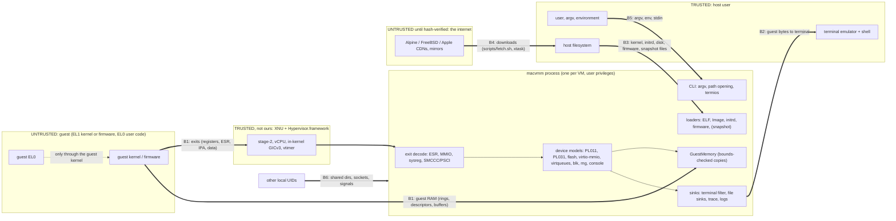

# macvmm threat model

- **Status:** v1 draft, 2026-11-18, written before implementation by the security engineer. It is
  normative for every milestone. M10 checks it against the code that exists then (PLAN M10 "v0"),
  and M22 completes it with measured results (sandbox self-test, fuzz campaign numbers).
  Revision 2 (same day) adds four on-machine experiments (hardened runtime, `sandbox-exec` with
  HVF, Unix-socket permissions and sender filtering; §13) and flaws F19–F24.
  **v0 review against the code: done in M10 (2026-11-19).** Every §5 row for M0–M10 now names
  the real files and the tests that prove its hardening (rows S1–S19, S22, and the new S23, S24);
  no `[U]` item is owned by M0–M10 (the remaining ones belong to M22 and M26, §13); the drift
  found (the gate script is `scripts/check.sh`, not `ci.sh`; guest memory and the FFI had no §5
  row) is fixed in this document. Facts verified by the Linux boot are in §13.
- **Audience:** every engineer and agent building macvmm, reviewers, and the ch25 (`security`)
  course authors.
- **Inputs:** `CLAUDE.md`, `docs/architecture.md`, `docs/PLAN.md`, `docs/research/{hvf-api,guest-boot,macos-guest}.md`,
  `spikes/hvf-hello/RESULTS.md`, `course/CURRICULUM.md` ch25, and the macOS 27.2 SDK headers on the dev
  machine.
- **Prior art this model borrows from:** the Firecracker design doc's threat-containment section
  (the guest is malicious; one VMM process per VM; jail and seccomp as a second line), crosvm's
  per-device sandboxing, and the rust-vmm `vm-memory` / `virtio-queue` hardening. It also
  borrows the lessons of real escapes, listed in §14.

Normative words: **MUST**, **MUST NOT**, **SHOULD** are as in `docs/architecture.md`. Tags:
`[V]` verified on this machine, `[V-src]` verified by reading the source (std, SDK header), `[H]`
from a header, `[U]` unverified. Requirements carry IDs (`VQ-4`, `TTY-2`, …) so PRs and lessons
can cite them.

---

## 1. Summary

macvmm runs **untrusted guest code** on top of Hypervisor.framework. The guest owns its vCPUs,
its RAM and every byte it writes to an emulated device. Everything the guest can reach on the
host runs inside one unprivileged user process. The main security property is:

> **A guest, or a hostile input file, can at most stop or corrupt *its own* VM. It must never
> read or write host memory outside its RAM, run code in the VMM process, touch any host file
> or terminal the user did not give to that VM, make the host do unbounded work or use unbounded
> storage, or harm other VMs.**

Rust removes most memory-corruption bugs, but not all, and it does nothing about logic bugs.
The remaining risk is concentrated in six places, in rough priority order:

1. **The virtqueue and virtio-blk parsers.** These are the classic escape surface (VENOM-class
   device emulation bugs). Mitigation: §7.2, §7.3, and the fuzz targets in §9.
2. **Guest bytes reaching the host terminal.** A guest can drive the user's terminal emulator
   with escape sequences. This is under-specified in the architecture (F1). Mitigation: §7.5.
3. **Guest-driven host resource use and stalls.** Trace and file sinks can grow without bound,
   workers can livelock, a vCPU can block forever writing to a stalled stdout pipe, and a full
   input queue makes Ctrl-A x unreachable (F2, F8, F20, F21). Mitigation: §7.5, §7.9, VQ-12.
4. **Host-side handling of downloaded artifacts.** Host decompressors and extractors (gzip, xz,
   `unsquashfs`, our own tar and cpio) run on downloaded bytes. Mitigation: §7.11.
5. **Data races on guest memory.** The "copy then validate" design needs volatile copies to be
   sound against compiler double-fetches (F4). Mitigation: §7.1.
6. **The confinement story.** The "no network entitlement" layer gives no confinement without a
   sandbox (F5), and `sandbox_init` with a custom profile is undocumented in the current SDK `[H]`.
   Mitigation: §7.12.

The flaws found in the architecture as written are listed in §11, each with a fix and an
owning milestone.

---

## 2. Assets

| ID | Asset | Why it matters | Where it lives |
|---|---|---|---|
| AS1 | **Host user account integrity**: files, keychain, shell, other processes | A VMM compromise runs with the user's full privileges. There is no privilege drop on macOS without a sandbox. | everything outside the VM |
| AS2 | **Host terminal and shell session** | Guest output reaches the terminal emulator. Escape-sequence bugs in the terminal (iTerm2 CVE-2019-9535, CVE-2022-45872) or injected input to the shell turn guest output into host code execution. | stdin/stdout of `macvmm` |
| AS3 | **VMM process memory and control flow** | It holds host pointers to guest RAM, the hvf handles and the open file descriptors. Owning it means AS1. | `macvmm` process |
| AS4 | **Disk images given to the VM** | The guest may change them, but only in-bounds, only if not `,ro`, and only the images it was given. | `--disk` files |
| AS5 | **Other host files near the VM's files** | Path confusion and symlinks can make the VMM write to or read from the wrong file (F6). | cwd, `./.cache/macvmm`, `$TMPDIR` |
| AS6 | **Host availability**: CPU, RAM, disk space, terminal responsiveness | A guest that fills the host disk through `--trace`, or spins every core, harms the user. | host |
| AS7 | **Guest confidentiality from other local users** | Trace files, serial logs and snapshots contain guest secrets (register values, console text, RAM). | output files |
| AS8 | **Build and supply chain**: toolchain, the `libc` crate, scripts, pinned artifacts, CI | A poisoned artifact or script runs on the dev machine and in hosted CI. | `scripts/`, `Cargo.lock`, `.github/`, `.cache/` |
| AS9 | **The learner's machine posture** | The course must never ask a learner to disable SIP or AMFI, run `sudo`, or add private entitlements (macos-guest.md §4 item 6). | course text, scripts |
| AS10 | **Integrity of reported results** | "Never claim a guest booted without seeing it." A guest-forged marker, or a DEBUG_EXIT code, must not be mistaken for a VMM verdict where that matters. | e2e harness, exit codes |

There are **no secrets** in the project: no keys, no tokens, no telemetry (CLAUDE.md). If a
future feature needs a secret (for example a snapshot HMAC key, §7.13), it lives in a 0600 file
under `~/.cache/macvmm/` and is never logged.

---

## 3. Trust boundaries

| ID | Boundary | Direction of distrust | Notes |
|---|---|---|---|
| **B1** | **guest ↔ VMM** | The guest is fully hostile. | This is the primary boundary. It covers every register value read on an exit, every MMIO write value, every IPA, every byte of guest RAM (read at any time, possibly concurrently mutated by other vCPUs), and every PSCI/SMCCC argument. EL0 code inside the guest cannot reach the VMM directly: HVC and SMC are UNDEFINED at EL0 (ARM ARM, HVC/SMC pseudocode), so EL0 reaches us only through MMIO the guest kernel maps for it. We still assume the guest kernel itself is malicious. |
| **B1k** | guest ↔ XNU/HVF | not ours to defend | Stage-2, the in-kernel GIC (GICD/GICR/ICC are emulated in the kernel with zero exits `[V]`), and the vtimer. Kernel bugs are **residual risk** (§12). We reduce exposure by not enabling features we don't need: no EL2 guests in v1, no GICv2m without PCI, no private ISA. |
| **B2** | **VMM → host terminal** | Guest output is hostile to the terminal. | PL011 TX, virtio-console TX and DEBUG_PUTC all carry guest-chosen bytes. See §7.5. |
| **B3** | **host files → VMM** | Hostile content, trusted path. | The user chose the path, but the *content* of an Image, ELF, initrd, firmware, disk image or snapshot may be crafted. A pinned hash does **not** make a guest kernel trustworthy: it only means "the bytes upstream published". The VMM still treats that kernel as A1. |
| **B4** | **internet → host cache** | Hostile until the sha256 matches the manifest. | After verification, the bytes are still parsed by host tools (gzip, xz, unsquashfs, `tar.rs`, `cpio.rs`, `mkfs.ext4`). They are never executed on the host. |
| **B5** | host user → VMM | Trusted intent, but validated. | argv and env are trusted (the user can run anything anyway), but the CLI MUST protect the user from foot-guns that become attacks when commands are copy-pasted or scripted: clobbering inputs, following symlinks in shared directories, opening devices (§7.8). |
| **B6** | other local users → VMM | Hostile. | They may plant symlinks in `/tmp`, read world-readable output files, connect to loopback TCP ports (gdbstub, F13), or race on shared directories. **Same-UID processes are out of scope**: they can already sign their own binary with the hypervisor entitlement (ad-hoc signing needs no certificate `[V]`) and read the user's files. |

---

## 4. Attacker model

| ID | Attacker | Capabilities | Goal |
|---|---|---|---|
| **A1** | **Malicious guest**: the kernel, firmware, bootloader, or a test guest | Arbitrary EL1 code on every vCPU, running concurrently. It can mutate RAM while the VMM reads it, from another vCPU, at any moment (TOCTOU). It can trap at any rate. It can issue any MMIO access (any IPA, width, value, ISV=0 instructions), any sysreg access, any HVC/SMC with any x0–x17, and PSCI calls in any order. It can build any ring layout, descriptor graph or indirect table, and any blk request. It controls all serial and console output, the reboot frequency, and the DEBUG_EXIT code. It **cannot** touch host memory directly: stage-2 confines it to mapped IPAs `[V]`. | Escape to AS3 or AS1, drive AS2, exhaust AS6, read or write files beyond AS4, forge AS10. |
| **A2** | **Malicious input file**: a crafted Image, ELF, initrd, firmware, disk image, or (post-v1) snapshot | Any bytes, any size, or a path that names a special file. | Crash or exploit a loader or parser, or make it read or write outside its range. |
| **A3** | **Network or supply-chain attacker**: a compromised CDN or mirror, MITM, a hijacked upstream, a poisoned Homebrew formula or GitHub Action | Serves arbitrary bytes for a URL, or changes a tool we invoke. | Code execution on the dev machine or in CI through the host-side tooling (B4), or a backdoored guest for the learner. |
| **A4** | **Other local user** (a different UID on the same Mac) | Can write to world-writable directories, read world-readable files, connect to `127.0.0.1` ports, and send signals only to their own processes. | Read guest data (AS7), redirect VMM output with symlinks (AS5), drive a gdbstub. |
| **A5** | **Compromised VMM process** (post-exploitation of A1 or A2) | Arbitrary code as the user, with the hypervisor entitlement and the open fds. | Persist or pivot to AS1. This is what §7 confinement limits. |

**Out of scope:** root, physical access, same-UID malware (B6), Apple's kernel and framework
bugs (residual, §12), microarchitectural side channels between the guest and host processes
(residual, §12), and malicious contributors to this repo (handled by review, not by this model).

**Security goals** (each requirement in §6 serves one or more):

- **G1 Isolation.** No guest action yields a host read or write outside the guest's RAM, or
  outside the device files given to it.
- **G2 No VMM crash from guest input.** No panic, `unwrap`, abort, unbounded allocation or
  infinite loop. Guest-induced conditions map to device error states, injected exceptions, or
  `StopReason::GuestFatal` (architecture §15).
- **G3 Bounded host resources.** CPU time per exit is bounded. Memory use is O(configuration),
  never O(guest value). Disk writes are capped, except writes into the guest's own disk images.
- **G4 Terminal safety.** Guest bytes cannot make the terminal emulator act outside the terminal
  window's text grid (clipboard, notifications, files, titles, queries, printing), and they
  cannot leave input for the host shell.
- **G5 File-path safety.** The VMM opens only paths the user named, only as the right file type,
  never through symlinks it didn't intend, and never clobbers an input.
- **G6 Supply-chain integrity.** Nothing unverified is parsed by host tools beyond the hash check.
  Nothing downloaded is executed on the host.
- **G7 Least privilege.** One entitlement. No sudo. After setup, the process cannot open new
  files, sockets or processes (M22 target).

---

## 5. Attack-surface inventory

| # | Surface | Entry point (code) | Reached by | First milestone | Hardening |
|---|---|---|---|---|---|
| S1 | ESR / exit decode | `arch/esr.rs` `Exit::decode`, `vcpu/exit.rs` | A1 | M4 | §7.4. **v0 (M10):** `crates/vmm/src/arch/esr.rs`, `crates/vmm/src/vcpu/{exit,run_loop}.rs`. Tests: `vmm/tests/esr_vectors.rs` (`esr_vectors`, `decode_never_panics_sweep`), `hvf/tests/smoke.rs` (PC-advance and syndrome facts), e2e `self_fault`, `regcheck` |
| S2 | MMIO decode and dispatch (ISV=1) | `vcpu/mmio.rs`, `bus.rs` | A1 | M4 | §7.4. **v0 (M10):** `crates/vmm/src/vcpu/mmio.rs`, `crates/vmm/src/bus.rs`. Tests: `vmm/tests/bus_overlap.rs` (5), `vcpu::mmio` unit tests, e2e `mmio_poke`, `mmio_poke_log_policy`, `mmio_probe` (+ trace markers); a Linux boot has no `unhandled MMIO` (e2e `linux_boot`, `![stderr]` marker) |
| S3 | ISV=0 instruction decode and stage-1 walk | `arch/insn.rs`, `arch/stage1_walk.rs` | A1 | M17 | §7.4. **v0 (M17):** `crates/vmm/src/arch/{insn,stage1_walk}.rs`, the ISV=0 path in `crates/vmm/src/vcpu/mmio.rs` (`isv0`), `arch/inject.rs` `data_abort`. Tests: `vmm/tests/insn_decode.rs` (incl. `isv0_ipa_mismatch_aborts`, `random_words_decode_totally`), `vmm/tests/stage1_walk.rs` (incl. `self_referencing_table_terminates`, `hostile_tables_property`), `check-insn-corpus.sh`, `vcpu::mmio::tests::isv0_*`; e2e `isv0_probe` (+ trace markers) and `hostile_isv0` (TEST-7 phase 2) |
| S4 | Sysreg traps | `arch/sysreg.rs` | A1 | M5 | §7.6. **v0 (M10):** `crates/vmm/src/arch/sysreg.rs` (policy table), `crates/vmm/src/arch/inject.rs` (UNDEF). Tests: `vmm/tests/sysreg_policy.rs` (incl. `unknown_is_undef_sweep`), `vmm/tests/inject.rs`, e2e `sysreg_probe`; e2e `linux_boot_exits` proves every EC 0x18 of a Linux 6.18 boot (only `OSDLR_EL1`, `OSLAR_EL1`) is in the table or UNDEF |
| S5 | SMCCC, PSCI, debug hypercalls | `smccc.rs`, `psci.rs` | A1 | M3/M5 | §7.6. **v0 (M10):** `crates/vmm/src/{smccc,psci}.rs` (`PROBES`: the Linux probes answered -1 without a warning). Tests: `vmm/tests/smccc_dispatch.rs` (8, incl. a random-call sweep), `vmm/tests/psci_state.rs` (7), `vmm/tests/hypercall_caps.rs` (`memhash_len_cap`, `debug_hvc_defaults`, `debug_hvc_auto_image_off` on the real Alpine header, HC-2), e2e `psci_probe_*`, `reset_storm`, `linux_boot_exits` (no `DEBUG_*` call answered for an Image; no `unknown SMCCC`), `linux_panic_resets` |
| S6 | Platform devices | `devices/{pl011,pl031,flash,razwi,testdev}.rs` | A1 | M4–M18 | §7.4. **v0 (M10):** `crates/vmm/src/devices/{pl011,pl031,razwi,testdev}.rs` (`flash.rs` is M18). Tests: `vmm/tests/pl011_regs.rs` (9, incl. bounded RX), `vmm/tests/pl031_regs.rs` (7, `every_offset_and_width_is_total`), `vmm/tests/pl031_alarm.rs`, e2e `uart_echo`, `irq`, `linux_shell` (PL011 RX/TX and IRQ under Linux) |
| S7 | virtio-mmio transport | `virtio/mmio.rs`, `virtio/interrupt.rs` | A1 | M11 | §7.2 |
| S8 | **Split virtqueue, descriptor chains** | `virtio/queue.rs`, `virtio/chain.rs` | A1 | M11 | §7.2 |
| S9 | virtio devices | `virtio/{rng,console,blk}.rs` (+`net.rs` M24) | A1 | M12–M14 | §7.2, §7.3 |
| S10 | **Block backend** | `backend/file.rs` | A1 (requests), A2 (image) | M14 | §7.3 |
| S11 | **Guest output to the terminal and files** | `backend/serial.rs`, PL011 TX, console TX, DEBUG_PUTC | A1 | M3/M6 | §7.5. **v0 (M10):** `crates/vmm/src/backend/{ansi,serial}.rs`. Tests: `vmm/tests/ansi_filter.rs` (41), `vmm/tests/sink_queue.rs` (6, SINK-1), `vmm/tests/sinks_cap.rs` (4, LOG-4), e2e `tty_hygiene`, `sink_backpressure*`, `serial_file`, `serial_raw_warns`, and `linux_tty_attack` (the full TTY-3 forbidden list written by Linux's tty layer; none of `ESC ]`, `ESC P`, `ESC [ c`, `ESC [ 6 n`, `ESC _`, `0x9b` reaches stdout) |
| S12 | Loaders | `loader/{elf,image,initrd,raw,firmware,plan}.rs` | A2 | M3/M9/M18 | §7.7. M9: Image header (LDR-3) `loader/image.rs`, initrd placement and the booting.rst window `loader/initrd.rs`, pure plan (LDR-5) `loader/plan.rs`; `--initrd` read by `HostIo::open` under the RAM-size cap (LDR-1). Tests: `vmm/tests/image_hostile.rs` (18), `vmm/tests/bootplan.rs` (10,000-case property), `macvmm/tests/dry_run.rs` (unentitled `--dry-run`, zboot refused exit 2) |
| S13 | DTB writer and reader; DTB seeds; `--dtb-out` | `fdt/{writer,machine,reader}.rs`, `backend/entropy.rs` (`getentropy(2)`), `HostIo::write_dtb_out` | user input (cmdline from M9; `--dtb-out` path, B5/A4); reader is test-only (`cfg(any(test, feature = "test-util"))`, audit rule `fdt-reader-unreachable`) | M7 | §7.7 (FDT-1..4); `--dtb-out` is a PATH-3..6 output; `fdt::machine::redact_seeds` walks only the VMM's own freshly generated blob (bounds-checked). Tests: `fdt_writer.rs` (`fdt_reader_hostile`), `fdt_machine.rs` (`seeds_differ_per_run`, `dtb_out_zeroes_seeds`), `paths.rs` (`dtb_out_path_policy`), e2e `dtb_out_has_no_seeds` |
| S14 | CLI and path handling | `macvmm/src/cli.rs`, sink and disk opening | B5, A4 | M3+ | §7.8. **v0 (M10):** `crates/macvmm/src/cli.rs`, `crates/vmm/src/backend/hostio.rs` (`HostIo::open`, outputs). Tests: `macvmm/tests/paths.rs` (12: FIFO, `/dev/zero`, directory, symlink, hard link, 0600, input/output aliasing), `cli` unit tests, `macvmm/tests/dry_run.rs`, e2e `input_not_regular`, `input_too_large`; `scripts/run-linux.sh` (M10) resolves the cache from the repo root to an absolute path and passes only cache paths it checked (regular, not a symlink) and a `[A-Za-z0-9_-]` test name; the e2e `support::artifact` helper refuses a symlinked or non-regular artifact and an SC-3-failing cache dir (relative `MACVMM_CACHE` taken from the repo root in both). The enforcing check stays macvmm's own `O_NOFOLLOW_ANY` regular-file open (PATH-2). `scripts/fetch.sh` (common.sh `cache_dir`) still takes a relative `MACVMM_CACHE` from the cwd (common.sh is M0-owned; open follow-up: resolve it from the repo root there too) |
| S15 | Logs, exit trace, stats, fatal dump | `log.rs`, `trace.rs`, `stats.rs`, `vcpu/dump.rs` | A1 (content and volume) | M2/M4 | §7.9. **v0 (M10):** `crates/vmm/src/{log,trace,stats}.rs`, `crates/vmm/src/vcpu/dump.rs`. Tests: `trace::tests` (`jsonl_golden`, `trace_json_escape_golden`, `categories`, `cap_writes_one_truncation_record`, `ring_dump_format`), `log::tests` (rate limit), `vmm/tests/sinks_cap.rs`, e2e `trace_cap`, `hello_trace_counts`, `linux_ring_dump` (SIGUSR1 under Linux, LOG-6) |
| S16 | Terminal and signals | `macvmm/src/term.rs`, `signals.rs`, `hvf::host` (`Termios`, `SignalPipe`), `vmm/src/hostctl.rs` (quit and ring-dump requests, M6) | B5, A1 (indirectly) | M6 | §7.5, §7.10. **v0 (M10):** `crates/macvmm/src/{term,signals,main}.rs` (`RLIMIT_CORE=0`, `tcflush`), `crates/vmm/src/hostctl.rs`. Tests: `hostctl::tests` (3), e2e `tty_escape`, `stdin_escape_when_full`, `sigterm`, `sigint`, `linux_sigint` (exit 130 within 2 s under Linux), `linux_ring_dump`; the manual `scripts/run-linux.sh` run in a pty restores the terminal (M10 report) |
| S17 | Fetch and host tooling | `scripts/fetch.sh`, `xtask {unzboot, extract-apk, mkinitramfs, mkrootfs, mkdisk}` | A3 | M9/M15/M18/M19 | §7.11. M9: `xtask/src/{zboot,cpio,tar,disk}.rs`; `gzip` spawned by absolute path with an empty environment, only after SC-5; `tar.rs` implements SC-7 (two-pass, symlinks last, `O_NOFOLLOW_ANY`, exec bits off on the host per SC-4). Tests: `xtask/tests/{zboot,cpio,tar}.rs` (tar with the outside canary), `scripts/test-fetch.sh` (48 cases incl. the `unzboot` derive) |
| S18 | Code signing and entitlements | `entitlements.plist`, `scripts/sign*.sh`, `.cargo/config.toml` runner | A3/A5 | M0 | §7.12. **v0 (M10):** `entitlements.plist`, `scripts/{sign,sign-and-run}.sh`, `crates/xtask/src/audit.rs`. Tests: `scripts/test-signing.sh` (run by `scripts/check.sh --hvf`), `xtask/tests/audit.rs` (17, incl. `audit_rejects_extra_entitlement`), `macvmm doctor` |
| S19 | CI | `.github/workflows/ci.yml`, `scripts/check.sh` | A3 | M0 | §7.11. **v0 (M10):** the gate is `scripts/check.sh` (fmt, clippy `-D warnings`, tests, `check-unsafe` = the full `xtask audit`, `check-ffi.sh`, anchors, guests, SC-1 preamble check, `shellcheck -S warning -x`, `test-fetch.sh`); `ci.yml` runs its host half. The draft's `scripts/ci.sh` never existed (drift fixed) |
| S20 | virtio-net unixgram backend (v1, M24); post-v1: snapshot restore, gdbstub, API socket; experimental vmapple bdif | `virtio/net.rs`, `net/unixgram.rs`; §18 of the architecture | A1, A2, A4 | M21/M24–M26 | §7.13, §7.14 |
| S21 | vz-mac companion (separate binary, Virtualization.framework): guest console bytes to the terminal; user-given kernel/initrd/IPSW paths; bundle files (guest-written `aux.img`/`disk.img` are only handed to VZ or byte-copied, never parsed, SC-14); the opt-in `--latest` IPSW download (DECISIONS D3, SC-10) | `tools/vz-mac/Sources/vz-mac/{Console,Files,ECID,IPSW}.swift` | A1 (console), A2/A3 (files, IPSW), A4 (paths) | M20 | TTY-5 `strict` filter, PATH-1..6, SIGN-1 (own single entitlement), AS9; tests in `tools/vz-mac/Tests/` and `crates/xtask/tests/vz_audit.rs` |
| S22 | Interrupt lines and guest time (M8): `GicSpi` level changes; the `--irqchip none` teaching mode's VTIMER/WFI emulation reading guest `CNTV_CTL_EL0`/`CNTV_CVAL_EL0` | `irq.rs`, `timer.rs`, `vcpu/exit.rs` (`nogic_wfi`), `vcpu/mod.rs` (before-entry rule), `vm.rs` (`check_gic`) | A1 (line toggles; timer registers in no-GIC mode); B5 (`--irqchip none`) | M8 | INTIDs are VMM constants validated at build (`GicSpi::new` against the live SPI range and the GICv2m MSI block); an `hv_gic_set_spi` error is logged once per line, never fatal; the no-GIC WFI sleep is total over every `CNTV_*` value and bounded by 100 ms slices interruptible by stop; `--irqchip none` only for ELF/`--raw` and one vCPU (exit 2). Not a user-space GIC: one line, no GICD/GICR/ICC emulation. Tests: `irq_lines.rs`, `irq::tests::set_spi_failure_logged_once_per_line`, `timer::tests::nogic_wfi_deadline`, `config::tests::irqchip_none_restrictions`, `vm::tests::gic_checks_name_both_values`, e2e `timer_nogic_wfi_forever_times_out` |
| S23 | Guest memory and the HVF FFI (added by the M10 review: the draft had no row) | `crates/hvf/src/` (the FFI and `OwnedMapping`), `crates/vmm/src/memory/` | A1 (addresses and lengths from every other surface) | M1/M2 | §7.1 (MEM-1..11), §7.0. Tests: `vmm/tests/memory_hostile.rs` (37), `vmm/tests/memory_property.rs` (volatile-copy property), `vmm/tests/layout_invariants.rs` (10), `hvf/tests/smoke.rs` (17), `hvf/tests/teardown.rs` (6, MEM-11 fault injection), `scripts/check-unsafe` (quarantine and SAFETY audit), `scripts/check-ffi.sh` (ABI oracle) |
| S24 | Linux boot inputs (M10; no new parser) | the M9 loaders (S12) fed the pinned Alpine `Image-virt` and `initramfs-test.img`; `scripts/initramfs/init` runs **in the guest only** (SC-4); `scripts/run-linux.sh` | A2 (kernel, initrd), A1 (the running kernel) | M10 | Same checks as S12 (LDR-1, LDR-3..5); the kernel and initramfs are hash-pinned or built from tracked sources (SC-5, §0.4 PLAN). The kernel then exercises S1–S6, S11, S15, S16 as a real hostile-capable guest. Tests: e2e suite `linux` (`linux_boot`, `linux_boot_exits`, `linux_shell`, `linux_panic_resets`, `linux_sigint`, `linux_timer_latency`, `linux_tty_attack`, `linux_ring_dump`) |

Surfaces that **do not exist** in v1, and must not appear without an ADR that updates this
model: guest-named host paths (9p or virtiofs), PCI config space, USB, a user-space GIC, host
networking, disk image formats other than raw (qcow2 backing files: CVE-2008-2004 class), and
any code path that executes a host binary chosen by guest data.

---

## 6. STRIDE table

| Category | Threat | Surface | Mitigation (requirement IDs) | Residual |
|---|---|---|---|---|
| **S**poofing | The guest prints text that imitates VMM messages, for example `macvmm: error: …` or a fake shell prompt after "exit", to mislead the user. | S11 | VMM messages go to **stderr** with a fixed prefix; guest output goes to the serial sink (stdout). TTY-7 (visible marker on exit). | Users can still be fooled inside the guest console. That is inherent. |
| S | The guest forges e2e markers, or exits through DEBUG_EXIT(0), so a test "passes". | AS10 | Tests assert the **process exit code** and VMM-side `[stderr]` markers, not only guest text. Gate tests (Linux boot) also require kernel strings that only a real boot produces, plus `!` negative markers. | Test-only concern. |
| S | Another local user (A4) connects to a loopback gdbstub or API socket and acts as the user. | S20 | POST-3 (Unix socket in a 0700 dir; no TCP by default). | — |
| S | A process other than the peer VM injects Ethernet frames into a `--net unixgram` NIC, or becomes the peer by sending the first datagram (F19). A `connect()`ed AF_UNIX datagram socket on macOS still accepts datagrams from any sender `[V]`. | S20 (M24) | NET-1..4: source address checked on every datagram, no first-sender learning, sockets in a 0700 dir. | Same-UID senders (out of scope). |
| **T**ampering | Guest DMA (virtio) writes outside guest RAM, into ROM, or into device MMIO (DMA reentrancy, CVE-2021-3929 class). | S8–S10 | MEM-1..4: `GuestMemory` reaches only RAM regions. ROM and MMIO are unreachable through it, which removes the reentrancy class by construction. | — |
| T | blk writes outside the image, or to a `,ro` image. | S10 | BLK-1..6. RO images are opened `O_RDONLY`, so the kernel enforces it as well as our check. | — |
| T | VMM output files clobber inputs (`--serial file:disk.img`) or follow a planted symlink. | S14 | PATH-3..6. | — |
| T | The guest kernel changes between reboots (file swapped on disk mid-session). | S12 | HOSTIO-1: boot inputs are read once. | — |
| T | Poisoned downloads, mirrors or tools. | S17 | SC-1..12. | Upstream compromise of a pinned release: the pin protects reproducibility, not upstream honesty. |
| T | A double-fetch of guest memory defeats validation (TOCTOU). | S8 | MEM-5..7 and VQ-4: copy once, validate the copy, volatile copies. | — |
| **R**epudiation | A guest-caused fatal stop cannot be diagnosed. | S15 | The fatal dump and exit ring (architecture §15) and `--trace`. | Not a security goal beyond debuggability. |
| **I**nformation disclosure | Host heap or stale bounce-buffer bytes leak into guest RAM (short read, reused buffer). | S9, S10 | BLK-7, VQ-11: zeroed per-request buffers; used `len` equals the bytes actually produced. | — |
| I | Guest RAM leaks into a core dump, crash report, or world-readable trace, serial or snapshot file. | S15 | PROC-4 (`RLIMIT_CORE=0` from M3, not M22), PATH-6 (0600 outputs). | macOS swap holds guest pages; swap is encrypted by the OS. |
| I | The guest learns host details (wall-clock time, CPU features). | S6 | Accepted: PL031 time and CPU ID registers are part of the virtual platform. | Side channels (§12). |
| I | A deterministic test seed is used for the DTB `rng-seed` or `kaslr-seed` in production. | S13 | FDT-3. | — |
| **D**enial of service | Descriptor loops, huge chains, `avail.idx` jumps (the CVE-2016-5403 class). | S8 | VQ-2, VQ-5, VQ-6, VQ-8. | — |
| D | A worker livelocks on a ring the guest keeps refilling. This holds the device mutex and stalls vCPU config accesses and stop (F8). | S9 | VQ-12: per-wakeup budget, stop check, lock release between batches. | — |
| D | Guest output fills the host disk through `--trace` or file sinks (F2). | S11, S15 | LOG-3, LOG-4: byte caps. | — |
| D | Guest-triggered panics, for example arithmetic overflow, slice indexing, or `print!` on EPIPE. | all | RUST-1..5. | — |
| D | Unbounded work on a vCPU thread (DEBUG_MEMHASH over 255 GiB) that cannot be interrupted by stop (F7). | S5 | HC-2. | — |
| D | Reboot storm (`SYSTEM_RESET` in a loop). | S5 | HC-5: reboot rate limit. | — |
| D | A vCPU blocks inside `write(2)` to a stalled stdout pipe while holding the PL011 mutex. It is not in `hv_vcpu_run`, so the stop kick cannot reach it and SIGINT hangs (F20). | S11 | SINK-1: guest output goes through a bounded queue to a writer thread; vCPUs never block on host I/O. | — |
| D | The guest stops draining the UART, `SerialInput` fills, the stdin thread blocks, and Ctrl-A x is never read (F21). | S16 | TTY-10: the stdin thread never blocks; it drops guest-bound bytes when full and always parses escapes. | — |
| D | The guest spins every vCPU at 100%. | B1k | Accepted: the user chose `--cpus`. Document `nice` and `taskpolicy`. | Inherent. |
| D | Terminal DoS: charset switch (SO/SI), alternate screen left on, mouse reporting left on, a 10 MB OSC string. | S11 | TTY-2..6. | — |
| **E**levation of privilege | A memory-safety bug in `unsafe` (`hvf`, `memory/host.rs`) or in std. | S2, S8 | The `unsafe` quarantine (architecture §4), MEM-1..7, Miri on the pure parts (TEST-6). | A std or compiler bug. |
| E | A logic bug in a device gives host code execution. | S6–S10 | Rust, plus §7 limits, plus fuzzing (§9). Containment by the sandbox (§7.12). | Until M22, a full compromise of the VMM equals the user account. |
| E | Terminal-emulator escape to host code execution (OSC/DCS bugs in iTerm2, tmux passthrough). | S11 | TTY-1..8 (allow-list filter, default on). | Bugs in the terminal's handling of *allowed* sequences such as SGR and CSI cursor movement. Low. |
| E | Host extraction tools write outside the staging dir (`tar.rs` symlink chains, unsquashfs CVE-2021-40153 and CVE-2021-41072). | S17 | SC-7..9. | Bugs in Homebrew tools. Dev-only. |
| E | A guest kernel bug reaches XNU's hypervisor (stage-2, GIC, vtimer). | B1k | Keep exposure minimal (no EL2, no MSI, no private ISA), track macOS updates. | Residual (§12). |

---

## 7. Hardening requirements per component

Every requirement is testable. "Test:" names where it is checked. A requirement without a test
is not done.

### 7.0 Rust-level rules for guest-facing code (RUST)

"Guest-facing modules" means `arch/{esr,insn,stage1_walk,sysreg,inject}.rs`, `vcpu/{exit,mmio}.rs`,
`bus.rs`, `smccc.rs`, `psci.rs`, `devices/`, `virtio/`, `backend/`, `loader/`, `fdt/`, `memory/`,
`trace.rs`, and the future `snapshot/`, `gdbstub/` and `net/`.

- **RUST-1** In guest-facing modules, `#![deny(clippy::arithmetic_side_effects, clippy::indexing_slicing, clippy::cast_possible_truncation)]`
  SHOULD be enabled at module level. Exceptions are allowed only with a local `#[allow]` and a
  comment proving the bound. Rationale: release builds wrap silently, debug builds panic, and both
  are wrong for guest values. Use `checked_*` (reject), `wrapping_*` (ring indices, where the
  spec says so), or `saturating_*` (counters).
- **RUST-2** `[profile.release] overflow-checks = true`. An overflow we missed becomes a clean
  stop (exit 1, TTY restored), not silent wrong-address arithmetic. The perf cost is negligible
  for a VMM whose hot path is the hardware.
- **RUST-3** No `unwrap`/`expect` (architecture §4, already in place), no `panic!`/`unreachable!`
  on guest-reachable paths, and no `slice[a..b]` with guest-derived bounds: use `.get(a..b)`.
- **RUST-4** No allocation sized by a guest value without a cap that is a named constant next to
  the code (for example `MAX_BOUNCE = 64 * 1024`, `MAX_CHAIN_TOTAL = 126 * 64 * 1024`).
- **RUST-5** No `print!`, `println!`, `eprint!` or `eprintln!` anywhere in `crates/vmm` (they
  panic on EPIPE and bypass the TTY filter). Sinks use `write_all` and handle errors: EPIPE on a
  serial sink → that sink becomes `none`, plus one warning. `cargo xtask audit` enforces this.
- **RUST-6** `cargo xtask audit` also fails on `std::process::Command` outside `crates/xtask` and
  `crates/macvmm/src/doctor.rs`, on `std::net` outside the post-v1 `net/` and `gdbstub/`, and on
  `File::open`/`OpenOptions` inside `crates/vmm` outside `backend/` and `loader/` (all opening is
  centralized, HOSTIO-1).
- **RUST-7** Any panic on a vCPU **or worker** thread stops the whole VM (exit 1). `sync::lock()`
  poison recovery (architecture §4) exists only so that shutdown and TTY restore work after a
  panic. It MUST NOT be used to keep a VM running after a device panic (F15).

### 7.1 GuestMemory and `memory/host.rs` (MEM)

- **MEM-1** Every guest-physical access from the VMM goes through `GuestMemory`. No other module
  holds a host pointer to guest RAM. Test: `scripts/check-unsafe` (the token audit).
- **MEM-2** A range is valid only if `addr.checked_add(len)` succeeds and the whole range lies in
  **one** RAM region (architecture §6.1). `len == 0` → `check_range` is false. Test:
  `memory_hostile.rs` (≥ 30 cases, PLAN M2).
- **MEM-3** ROM (`RomRegion`), MMIO and unmapped IPAs are never reachable through `GuestMemory`.
  Device DMA cannot hit ROM or MMIO, which eliminates the DMA-reentrancy class (QEMU
  CVE-2021-3929). Test: `rom_region_maps_rx_and_rejects_guest_memory_write`, plus a case per
  MMIO region.
- **MEM-4** Host-side mappings of guest RAM are never executable (`hv_vm_allocate` memory is
  RW in the host). The stage-2 RWX permission applies to the guest only. The VMM never jumps to,
  `mprotect`s to X, or otherwise interprets guest memory as host code.
- **MEM-5** **No Rust reference to guest memory, ever** (architecture §6.1). Copies in and out
  MUST use **volatile** copies: `core::intrinsics::volatile_copy_nonoverlapping_memory` is
  unstable, so use a loop of `ptr::read_volatile`/`write_volatile` over `u64` for aligned bulk
  and `u8` for edges. Alternatively, use per-element `AtomicU8`/`AtomicU64` `Relaxed` loads. Do
  not use `ptr::copy_nonoverlapping`. Rationale (F4): the guest, and other VMM threads, mutate
  this memory concurrently, so a non-atomic, non-volatile read is a data race in Rust's abstract
  machine. The optimizer may then legally **re-read the source instead of the local copy**,
  which is a double fetch that silently breaks the TOCTOU argument. rust-vmm's `vm-memory` uses
  volatile access for the same reason. Benchmark it in M14; a `u64` volatile loop is
  memory-bandwidth bound.
- **MEM-6** The two ordered accessors use `AtomicU16::from_ptr` on a 2-aligned address, as
  designed. The SAFETY comment states that the guest is not Rust, so mixed-size guest accesses
  are outside the Rust memory model, and that we only ever read a value we then validate.
- **MEM-7** Validate the copy, never the original. Structures (descriptors, blk headers, ring
  entries) are read **exactly once** into locals. A helper `read_obj::<T: FromLeBytes>()` copies
  `size_of::<T>()` bytes and decodes them LE. Test: VQ-4.
- **MEM-8** Region-table construction rejects overlap, zero size, unaligned base or size (16 KiB),
  and `base + size` overflow (PLAN M2), and every region lies below `1 << ipa_bits`.
- **MEM-9** Lifetime: the host allocation outlives every mapping and every
  `Arc<dyn GuestMemory>` clone. Drop order: unmap, `hv_vm_destroy`, then deallocate only after
  all workers have joined (architecture §14.5). Test: a worker holding an `Arc` past stop is
  joined before deallocation (debug assertion on the strong count).
- **MEM-10** Fresh guest RAM is zero-filled. Verify `hv_vm_allocate` returns zeroed pages `[V]` (M2)
  (M2 HVF test: allocate 64 MiB, check that every byte is 0). Each reboot allocates fresh RAM, so
  no host or previous-boot data survives into a new boot, except what the user explicitly
  persists on disk.
- **MEM-11** (F22) **Teardown fails closed.** If `hv_vm_unmap` or `hv_vm_destroy` returns an
  error, the host allocation MUST be **leaked** (never `hv_vm_deallocate`d or reused), and the
  process exits after reporting the error. Freeing host pages that a stage-2 mapping may still
  reference would give the guest a window onto recycled host memory: an escape primitive. The
  same rule applies to the flash `RomRegion` if a future CFI romd remap fails. Test: an HVF test
  with a fault-injected `Vm::drop` asserts that the deallocate path is skipped.

### 7.2 virtio-mmio transport and split virtqueues (VQ)

These extend architecture §11.2, whose 11 items are all mandatory. The numbering here matches
that list where it overlaps.

- **VQ-1** Ring placement is validated at DRIVER_OK: alignment (16/2/4), sizes `16·N`, `6+2·N`,
  `6+8·N` computed with `checked_mul`/`checked_add`, and each range `check_range`d in a single
  RAM region. The 64-bit addresses are assembled from Low/High registers with `u64::from(hi) << 32 | u64::from(lo)`,
  never by adding.
- **VQ-2** `pending = avail_idx.wrapping_sub(next_avail)`, and `pending > N` → NEEDS_RESET.
- **VQ-3** The head index from `avail.ring[next_avail % N]` must be `< N`. `N` is a power of two,
  `1 ≤ N ≤ QueueNumMax ≤ 32768`.
- **VQ-4** Each descriptor is copied once (MEM-7). Checks run on the copy: `addr + len` does not
  overflow and lies in RAM; `len > 0`; `next < N` when `F_NEXT` is set. **Test (TOCTOU):** a
  `VecMemory` hook that rewrites the descriptor bytes after the first read. The device must use
  the first value and must never read the same descriptor twice (asserted through the access log).
- **VQ-5** Hop budget `N` per chain, and `len/16` inside an indirect table. Exceeding it →
  NEEDS_RESET. This catches self-loops and cycles without a visited set.
- **VQ-6** Indirect descriptors: `len % 16 == 0`, `1 ≤ len/16 ≤ N`, the table in RAM, no
  `F_NEXT` together with `F_INDIRECT` on the referring descriptor, no nested indirect, and
  `F_INDIRECT` only if negotiated (only blk offers it).
- **VQ-7** All readable descriptors come before all writable ones. Device-specific direction
  rules (the blk header readable, the status writable) are checked by the device.
- **VQ-8** `readable_len` and `writable_len` are accumulated with `checked_add` and capped by a
  per-device `max_total`: blk `126 × 64 KiB`; rng 64 KiB (writable only); console 64 KiB per
  chain; net (M24) TX `12 + 1514` (NET-5).
- **VQ-9** `add_used` writes `{id, len}` and then `used.idx` with release ordering. `len` MUST
  equal the bytes the device actually wrote into writable buffers, never the requested length.
  A `SeqCst` fence comes before reading `avail.flags` (NO_INTERRUPT).
- **VQ-10** Any `QueueError` → NEEDS_RESET, plus a config interrupt, plus a rate-limited
  `guest_warn!`. Nothing more is processed until the driver writes Status = 0. No error path
  panics.
- **VQ-11** Bounce buffers are allocated per request, ≤ 64 KiB, **zero-initialized**
  (`vec![0u8; n]`), and never reused across requests or devices without being cleared.
- **VQ-12** (new, F8) **Worker budget.** On each wake-up a worker processes at most `N` chains
  (one ring's worth), then releases the device mutex, checks the stop and pause flags, and
  re-queues itself if work remains. A guest that refills the ring forever gets fair round-robin
  service, but it can never hold the device mutex for more than one batch, and stop latency stays
  bounded (target: < 100 ms, PLAN M12 `stop()` test).
- **VQ-13** Transport registers: only aligned 32-bit accesses to 0x000–0x0ff (architecture
  §11.1). Config-space accesses check `offset.checked_add(size) ≤ config_len` **per device**.
  Writes to read-only config fields are ignored. A QueueNotify value ≥ the number of queues is
  ignored with a warning.
- **VQ-14** Status machine: bits only in order; FEATURES_OK requires `accepted ⊆ offered` and
  `VERSION_1`; queue registers are frozen after QueueReady=1 or DRIVER_OK; Status=0 resets and
  **waits for the worker to finish its batch** (it takes the device mutex) before dropping the
  queues and the memory handle. No use of the old ring addresses after a reset.
- **VQ-15** Features not offered in v1 (`EVENT_IDX`, `RING_PACKED`, `RING_RESET`,
  `ACCESS_PLATFORM`, `NOTIFICATION_DATA`) are rejected if the driver sets them (the `accepted ⊆ offered`
  rule). Adding any of them requires new hostile tests.
- **VQ-16** Interrupt state (`VirtioInterrupt`) uses one mutex for status and level. InterruptACK
  values with unknown bits are masked to bits 0–1.

### 7.3 virtio-blk and the file backend (BLK)

- **BLK-1** The 16-byte header is read once from a readable descriptor (MEM-7). A shorter
  header, or a header in a writable descriptor, → IOERR (if a status byte exists) or NEEDS_RESET.
- **BLK-2** `offset = sector.checked_mul(512)`, then `offset.checked_add(data_len) ≤ capacity_bytes`.
  `data_len % 512 == 0`.
- **BLK-3** The status descriptor is the last one, writable, and `len ≥ 1`. Only one byte is
  written.
- **BLK-4** Request types: IN, OUT, FLUSH, GET_ID. Anything else → UNSUPP. GET_ID writes
  `min(20, writable_len)` bytes.
- **BLK-5** `,ro` disks are opened **`O_RDONLY`** at the OS level, so a VMM bug cannot write them.
  `VIRTIO_BLK_F_RO` is offered, and OUT → IOERR.
- **BLK-6** `capacity` is computed once at open from `fstat` of the **open fd** (not the path).
  Short reads, which happen if another process truncates the file despite the advisory lock,
  → IOERR. The buffer has already been zeroed (VQ-11), and the used `len` counts only the bytes
  actually read.
- **BLK-7** No reuse of buffers between requests or disks (VQ-11). This prevents cross-disk
  disclosure.
- **BLK-8** Locks: `try_lock` (exclusive) for read-write, `try_lock_shared` for `,ro`. On macOS
  these are `flock(2)` `[V-src: std 1.99.0 sys/fs/unix.rs]`, which is advisory, per open file
  description, and not reliable on network filesystems (SMB/NFS). The same image passed twice to
  one VM conflicts with itself and fails cleanly (exit 2). Document that locks do not protect
  against non-macvmm writers.
- **BLK-9** FLUSH → `File::sync_all()`. **Resolved (risk R11):** on Apple targets std's
  `sync_all` and `sync_data` both call `fcntl(fd, F_FULLFSYNC)` `[V-src: rustup toolchain
  1.99.0, library/std/src/sys/fs/unix.rs, os_fsync/os_datasync]`. The FLUSH status is written
  only after `sync_all` returns `Ok`. On error → IOERR.
- **BLK-10** Raw images only. There is no format probing, ever. A future qcow2 or other format
  must never auto-follow a backing-file path from the image (CVE-2008-2004 class). Backing files,
  if ever supported, come from argv only.
- **BLK-11** The disk path must be a regular file (PATH-2). Block and character devices
  (`/dev/diskN`) are refused unless the user passes an explicit `--disk-allow-device` (not
  planned for v1).

### 7.4 Exit decode, MMIO decode, devices (MMIO)

- **MMIO-1** `Exit::decode(u64)` is total: it never panics for any u64 (PLAN M4: a 1,000,000-ESR
  sweep). Unknown EC → `Unknown`, which is a fatal stop with a dump. That is acceptable: only the
  guest's own VM stops.
- **MMIO-2** Classify by the **exit IPA against our own map**, never by DFSC `[V]` (architecture
  §8.3). `S1PTW=1` → fatal. RAM IPA without dirty tracking → fatal (a VMM bug signal).
- **MMIO-3** ISV=1: `size = 1 << SAS` is always valid. `SRT=31` is XZR (write 0, discard loads).
  Write values are masked to the size, and sign extension follows SSE and SF.
- **MMIO-4** (F18) **ISV=0:** the first emulated access MUST use the **IPA reported by the exit**,
  not an IPA recomputed by walking the guest page tables. The decoded base register + offset
  (translated by `stage1_walk`) MUST agree with the exit's IPA page. If they disagree, the guest
  changed its code or page tables between the fault and our fetch: inject a synchronous external
  abort and do not emulate. For LDP/STP, the second access is `ipa + size`, and it must lie
  in the **same device**; otherwise inject an abort. Writeback happens only after both accesses
  succeed (PLAN M17). With Rn=31, writeback goes to the SP that PSTATE.SP selects.
- **MMIO-5** `stage1_walk` is bounded by the number of levels for the granule (≤ 4, or 5 with
  52-bit addressing, which we reject), reads descriptors only through `GuestMemory` (MEM-1),
  rejects T0SZ/T1SZ out of range and table addresses outside RAM, and never recurses.
- **MMIO-6** Unsupported instruction classes (exclusives, atomics, SIMD/FP, `DC ZVA`) → an
  injected external abort (DFSC `0x10`). Never a panic or a VMM error. Other `DC`/`IC`
  maintenance by VA (`DC CIVAC`, `DC CVAC`, `IC IVAU`, …) is **not** in this class. Hardware
  allows it on Device memory, so the VMM skips it: no bus access, PC += 4, only when ESR.CM = 1.
  This matches KVM's `kvm_vcpu_dabt_is_cm()` rule (`arch/insn.rs` `Insn::CacheMaintenance`).
- **MMIO-7** `Bus` rejects overlap, size 0 and overflow at build time. A straddling access →
  `Straddle`, handled like `Unmapped`. Lookup never panics for any `(ipa, size)`.
- **MMIO-8** Every `MmioDevice` handles **every** `(offset, size)` inside its window, including
  unaligned offsets and widths it doesn't support: RAZ/WI plus `guest_warn!`. Register arrays use
  `.get()` (RUST-3). Fuzz target per device (§9.3).
- **MMIO-9** PL031: `LR` and offset arithmetic uses `wrapping_*` on u32 seconds (the RTC
  semantics). PL011: the RX FIFO is 32 entries, and `SerialInput` is bounded to 4 KiB. TX goes
  through the TTY filter (TTY-1).
- **MMIO-10** `FlashDevice` (v1) ignores writes. Later CFI emulation must bound command
  sequences and keep the romd remap atomic relative to other vCPUs (a stale mapping only affects
  the guest).
- **MMIO-11** `--unhandled-mmio fatal` stays the default (fail closed). `log` mode is
  rate-limited (LOG-1).

### 7.5 Guest output to the terminal and files (TTY) — the console escape problem

**Why this matters.** The PL011 is the Linux console, so a guest controls a byte stream that
lands in the user's terminal emulator. Terminals interpret far more than text:

- **Query sequences make the terminal type a reply into stdin:** DA `CSI c`, DSR `CSI 6 n`,
  DECRQSS `DCS $ q`, XTGETTCAP `DCS + q`, the title report `CSI 21 t`, the color query
  `OSC 10/11 ;?`, and ENQ (answerback). While the VM runs, stdin belongs to the guest, so the
  reply goes back to the guest. But a reply still in flight when macvmm exits, or queued in the
  TTY input buffer, is **read by the host shell**. That is input injection into the user's shell.
- **Clipboard write** (`OSC 52`), **hyperlinks** (`OSC 8`), **notifications** (`OSC 9`,
  `OSC 777`), and **iTerm2 proprietary** `OSC 1337` (`File=` downloads, `SetUserVar`,
  `CurrentDir`, `RequestAttention`, …).
- **tmux passthrough** `DCS tmux; …`, the class of iTerm2 CVE-2019-9535. Kitty graphics `APC G …`
  and sixel.
- **Printer controller mode** `CSI 5 i`, window manipulation `CSI … t` (resize, move, iconify),
  font changes `OSC 50`.
- **State that outlives the VM:** the alternate screen, mouse reporting, bracketed paste,
  application keypad mode, SO/SI charset switching, a hidden cursor, a scroll region.
- **8-bit C1 controls** (0x9B = CSI, 0x9D = OSC), and **UTF-8-encoded C1** (U+009B), which some
  terminals honour.

The architecture's rule ("sanitized when the sink is a TTY", §16) is under-specified and
bypassable (F1): `macvmm run … | tee log` makes stdout a pipe, so nothing is filtered, but tee
still prints to the terminal. It also doesn't say *what* is filtered. Stripping all escapes would
break the Linux shell experience: busybox `ash` line editing, `top`, `vi` and colours need CSI.

Requirements:

- **TTY-1** A single streaming filter, `AnsiFilter` (proposed location
  `crates/vmm/src/backend/ansi.rs`; pure, `forbid(unsafe)`, host-testable, a fuzz target). It is
  applied to **every guest-originated byte stream that reaches a host sink**: PL011 TX,
  virtio-console TX and DEBUG_PUTC. It applies to stdio **regardless of `isatty`**, and to file
  sinks by default (a file is later `cat`-ed to a terminal).
- **TTY-2** Policies per sink: `safe` (the default), `strict`, and `raw`. `raw` needs an explicit
  per-sink opt-in (`--serial stdio,raw`, `--console file:F,raw`) and prints a one-line warning on
  stderr. Tests that need byte-exact output (M13 `linux_console_tx`) use plain bytes that `safe`
  leaves unchanged; they don't need `raw`.
- **TTY-3** `safe` is an **allow-list**. Anything not listed is dropped, whole sequence, without
  output.
  - **Text:** valid UTF-8 for printable code points. Invalid UTF-8 → U+FFFD. C1 code points
    U+0080–U+009F, whether raw 8-bit or UTF-8-encoded, → dropped.
  - **C0:** BS, HT, LF, CR, and BEL (rate-limited to 1 per second). NUL, ENQ, SO, SI, VT, FF and
    the rest → dropped.
  - **ESC two-byte sequences:** `ESC 7`, `ESC 8` (save and restore cursor), `ESC M` (reverse
    index), `ESC =`, `ESC >` (keypad), `ESC ( B`, `ESC ( 0`, `ESC ) B`, `ESC ) 0` (ASCII and DEC line
    drawing only). Everything else (`ESC c` RIS, `ESC Z` DECID, `ESC # 8`, …) → dropped.
  - **CSI** with parameters `0-9 ; :` and at most 16 parameters, each at most 5 digits, and final
    bytes from this set:
    - SGR `m`;
    - cursor `A B C D E F G H f d` and `` ` `` (HPA);
    - erase `J K X`;
    - edit `@ P L M`;
    - scroll `S T` and DECSTBM `r`;
    - DECSCUSR `SP q`;
    - `h` and `l`: only private modes `?1` (DECCKM), `?7`, `?12`, `?25`, `?47`, `?1047`, `?1048`,
      `?1049`, `?2004`, and public mode `4` (IRM).
    - **Not allowed:** `c` (DA), `n` (DSR), `t` (window ops and reports), `i` (media copy),
      `x`, `$p` (DECRQM), `!p`, `"p`, `?…$p`, mouse modes `?9`, `?1000`–`?1016`, and any
      intermediate other than SP.
  - **OSC, DCS, APC, PM, SOS:** **dropped entirely**, including titles (title-set plus a report
    elsewhere is an injection vector; a title is also a spoofing channel). The filter consumes
    up to the terminator (BEL, or `ESC \`) or the length cap.
- **TTY-4** The filter state is bounded: at most 64 bytes in a pending sequence. On overflow the
  whole sequence is dropped and the filter resynchronises at the next ESC or printable byte. It
  is O(1) per byte, has no allocation per byte, and never panics.
- **TTY-5** `strict`: printable ASCII and UTF-8, plus CR, LF, HT and BS. Every other control is
  rendered visibly, for example `^[` and `\x9b`. This is for logs and CI.
- **TTY-6** **Exit hygiene** (in `macvmm/src/term.rs`). When the stdio sink is a TTY, on every
  exit path (normal, signal, panic hook):
  1. emit a reset of every mode the `safe` filter allowed the guest to set: `CSI 0 m`,
     `CSI ? 25 h`, `CSI ? 1049 l`, `CSI ? 1047 l`, `CSI ? 47 l`, `CSI ? 2004 l`, `CSI ? 1 l`,
     `CSI ? 7 h`, `CSI ? 12 l`, `CSI 0 SP q`, `CSI 4 l`, `ESC >`, `ESC ( B`, `ESC ) B`, and last
     `ESC 7` `CSI r` `ESC 8` (DECSTBM homes the cursor, so DECSC/DECRC keep it in place and the
     TTY-7 line lands below the guest's output). `CSI ? 1048 h|l` is an action, not a mode. A
     unit test probes the filter so the allow-list and this list cannot drift apart. If the
     stdio sink could not write the reset (off after a write error, or its writer abandoned),
     the CLI writes it with a bounded non-blocking write to whichever of stdout/stderr is a TTY;
  2. restore termios;
  3. `tcflush(STDIN_FILENO, TCIFLUSH)`, which discards any terminal reply or keystroke queued for
     the guest so the host shell never reads it.

  The filter tracks which modes were actually set, so it only resets those, but resetting all of
  them is acceptable.
- **TTY-7** On exit, if the guest produced output on a TTY sink, macvmm prints a newline (if the
  cursor is not at column 0) and then `macvmm: <reason>` on stderr, so a guest-drawn fake prompt
  is not the last thing on screen.
- **TTY-8** VMM logs never include raw guest bytes: always `{:?}` (architecture §16). The JSONL
  trace contains only numbers and names from static tables. If a string field ever carries guest
  data (for example the vmapple unknown-MMIO logger), it is JSON-escaped, including U+0000–U+001F,
  U+007F–U+009F, U+2028 and U+2029. `trace.rs` has a golden test with ESC, quote, backslash and
  NUL.
- **TTY-9** Input direction: stdin bytes go only to the bound device. The Ctrl-A escape is
  processed **before** the bytes reach the guest, so the guest cannot synthesize host-side
  commands. A terminal reply forged by guest output and containing `^A x` can at most quit its
  own VM (acceptable). Bracketed-paste markers are passed through as data.
- **TTY-10** (F21) **The stdin thread never blocks on the guest.** Architecture §14.4 says the
  reader blocks when the 4 KiB `SerialInput` is full. Then a guest that stops reading its UART
  also stops the host from reading stdin, so Ctrl-A x (and Ctrl-A t / s) is never seen, and in
  raw mode Ctrl-C goes to the guest. The fix: the stdin thread always keeps reading and always
  parses escapes. When `SerialInput` is full, guest-bound bytes are dropped and counted (shown in
  `--stats`, one rate-limited warning). Under a pipe (tests), where losing input matters, the
  harness writes slowly enough; the drop counter makes any loss visible. Test:
  `stdin_escape_when_full` (fill the queue with a guest that never reads, then send `\x01x`;
  exit 130 within 1 s).
- **SINK-1** (F20) **No vCPU or worker ever blocks on host output.** Today the PL011 DR write
  emits the byte to the sink "at once" on the vCPU thread under the device mutex (architecture
  §8.2, §10). If stdout is a pipe whose reader has stopped (`macvmm run … | less` waiting on a
  keypress, a stuck CI log collector), `write(2)` blocks indefinitely. The blocked vCPU is not in
  `hv_vcpu_run`, so `hv_vcpus_exit` cannot reach it, stop never completes, and the user cannot
  quit. Guest output instead goes into a per-sink bounded queue (64 KiB), and one writer thread
  per sink drains it. When the queue is full, the producer waits on a condvar for at most 10 ms
  **and also wakes on the stop flag**, then drops the byte and counts it. Writer errors (EPIPE)
  turn the sink into `none` (RUST-5). This keeps byte-exactness when the consumer keeps up, and
  bounds latency when it doesn't. Test: `sink_backpressure` (stdout to a pipe nobody reads;
  SIGTERM → exit 130 within 1 s). **The same holds for stderr** (M6 review): log lines,
  including guest-triggerable warnings emitted under a device mutex, go into a bounded 64 KiB
  queue drained by one `log` writer thread (whole lines dropped and counted when full), and the
  exit paths of last resort (second quit signal, panic hook) use only bounded raw writes and
  `_exit`, taking no lock a blocked writer may hold. Test: `sink_backpressure_shared_stderr`
  (stdout and stderr on one unread pipe; SIGTERM → exit 130 within 1 s).

### 7.6 Exits handled on the vCPU thread: sysregs, SMCCC/PSCI, debug hypercalls (HC)

- **HC-1** SMCCC dispatch is a total function over `x0` (any u64). `imm ≠ 0` → `NOT_SUPPORTED`.
  Unknown → `NOT_SUPPORTED` plus a rate-limited warning. Only x0–x3 are written, and only as
  defined (architecture §8.6).
- **HC-2** (F7) **Debug hypercalls are default-off for Image, `--bios` and `--machine vmapple`
  boots**, and default-on only for ELF and `--raw` test guests; `--debug-hvc` and `--no-debug-hvc`
  override. This keeps the debug surface away from real OSes. `DEBUG_MEMHASH` caps `len` at
  1 GiB (more → `-2`), or hashes in 64 MiB chunks and checks the stop flag between chunks.
  `DEBUG_PUTC` goes through TTY-1.
- **HC-3** PSCI: `CPU_ON` validates the MPIDR against created vCPUs and requires the entry to be
  in RAM or ROM (`-9` otherwise). State transitions run under the per-target mutex (PLAN M16). A
  guest racing CPU_ON gets ALREADY_ON or ON_PENDING, never a double start.
- **HC-4** `AFFINITY_INFO` with level > 0 → `-2`. Unknown PSCI IDs → `-1`.
- **HC-5** Reboot storms: more than 10 `SYSTEM_RESET`s in 10 seconds → stop with
  `StopReason::GuestFatal("reset storm")` (exit 3). This prevents a guest from turning the
  rebuild path (VM create, 512 MiB allocation, DTB) into a host CPU and VM-churn loop.
- **HC-6** Sysreg policy (architecture §8.4): the default is **inject UNDEF**. RAZ/WI exceptions
  are added only with evidence. Writes never reach host state. The OS-lock emulation is per-vCPU
  state.
- **HC-7** `inject.rs` computes the vector offset from the saved CPSR mode with a total `match`.
  Unknown modes (for example AArch32 encodings, which our vCPUs never run) → GuestFatal, not a
  panic.

### 7.7 Loaders and the DTB (LDR, FDT)

- **LDR-1** Each input file is opened once (HOSTIO-1), must be a regular file (PATH-2), and its
  size is checked against the cap **before** reading: kernel and Image ≤ RAM size, ELF ≤ RAM size,
  initrd ≤ RAM size, firmware ≤ 64 MiB. Reads use `take(cap + 1)`, so a file that grows during
  the read is detected.
- **LDR-2** ELF (architecture §12.1 and PLAN M3): ELF64 LE, EM_AARCH64, ET_EXEC, `e_phentsize == 56`,
  `e_phnum ≤ 64`, every offset and size with `checked_add`, `p_filesz ≤ p_memsz`, every segment
  inside RAM, no overlap with other segments or the DTB, `e_entry` in an executable PT_LOAD.
  Section headers are ignored entirely (smaller surface). Test: `elf_hostile.rs` (≥ 20).
- **LDR-3** Image (booting.rst §4): length ≥ 64, magic, LE flag, page-size field, `image_size ≠ 0`,
  `text_offset` alignment, `load + image_size` inside RAM with `checked_add`, and file length
  ≤ `image_size`. Test: `image_hostile.rs` (≥ 15).
- **LDR-4** EFI zboot is rejected in the VMM. The VMM has no decompressor, so there is no
  decompression-bomb surface in the VMM process. `xtask unzboot` (host tool) caps its output at
  256 MiB (PLAN M9).
- **LDR-5** BootPlan is pure and checked: `plan()` is property-tested (10,000 random size
  combinations → no overlap, nothing outside RAM, PLAN M9).
- **FDT-1** The DTB is **generated**, never parsed from the user or the guest in the VMM.
  `fdt/reader.rs` is test and fuzz only, and MUST NOT be reachable from `macvmm run`. A future
  `--dtb F` override would be a new A2 surface, needing an ADR and a fuzz target.
- **FDT-2** `--cmdline` ≤ 2048 bytes, no NUL (architecture §12.1). Property names and values come
  from code. Blob ≤ 2 MiB. `begin_node` rejects names with NUL or `/`.
- **FDT-3** `rng-seed` (64 bytes) and `kaslr-seed` come from the OS CSPRNG (`getentropy` in a
  loop via `hvf::host`, or a `/dev/urandom` fd opened before lockdown). Deterministic seeds are
  accepted **only** through `MachineDesc` in tests. The CLI has no flag to set them. Test: two
  `--dry-run`s produce different seeds.
- **FDT-4** (F23) `--dtb-out F` writes the blob with `rng-seed` and `kaslr-seed` **zeroed** (same
  length, so offsets and the golden DTS stay stable), and `--dry-run` never prints seed bytes.
  Otherwise every dumped DTB records the guest's KASLR offset seed and its initial entropy pool
  input for that boot. The guest still receives the real seeds. Test: `--dtb-out` output contains
  64 zero bytes at the `rng-seed` value.

### 7.8 Host I/O, paths and the CLI (HOSTIO, PATH)

- **HOSTIO-1** (F3) **Open and read every host input exactly once, before the first vCPU runs.**
  `HostIo` holds the kernel, initrd, firmware and raw blobs **as bytes** (`Arc<[u8]>`), plus the
  open fds for disks, sinks, the trace, and the entropy source. The reboot loop rebuilds the
  `Machine` from `HostIo`, **never from paths**. This closes the kernel-swap-between-reboots
  TOCTOU and makes the sandbox lockdown (§7.12) compatible with reboot.
- **PATH-1** Inputs (`--kernel`, `--initrd`, `--bios`, `--raw`, `--disk`) are opened with
  `O_CLOEXEC`, then `fstat`ed on the fd (not the path). Symlinks given by the user are followed,
  because that is user intent.
- **PATH-2** The opened inode must be `S_ISREG`. FIFOs (which would block), character devices
  (`/dev/zero` means unbounded reads; `/dev/tty`), block devices (raw host disks) and directories
  are refused with exit 2 and the message `not a regular file: <path>`.
- **PATH-3** Outputs (`--serial file:F`, `--console file:F`, `--trace exits:F`, `--dtb-out F`,
  and post-v1 `--snapshot-to F`) are opened with `O_WRONLY|O_CREAT|O_CLOEXEC|O_NOFOLLOW`, mode
  `0600`, then checked with `fstat` to be a regular file owned by the current uid. If the file
  already exists it is truncated only after these checks. `O_NOFOLLOW` defeats the classic
  planted `/tmp/serial.log -> ~/.ssh/authorized_keys` link (A4). For outputs inside directories
  that others can write (sticky `/tmp`), macOS's `O_NOFOLLOW_ANY` (`0x20000000` `[H]` in
  `sys/fcntl.h`) SHOULD be used. The flag lives in `hvf::host`, because it needs `libc`.
  **(M4, verified on machine)** macOS refuses `O_NOFOLLOW | O_NOFOLLOW_ANY` together with
  `EINVAL`, so `HostIo::open_output` resolves the parent directory and then opens with
  `O_NOFOLLOW_ANY` alone, which also refuses a final-component link (`ELOOP`;
  `docs/research/hvf-api.md` §16).
  **(M4 review)** The `fstat` checks are `S_ISREG`, `st_uid == getuid()` **and `st_nlink == 1`**,
  all before the truncate. `O_NOFOLLOW*` does not see a planted *hard* link: macOS lets an
  unprivileged user hard-link a file they do not own on the same volume (`/tmp` and `/Users`
  share the Data volume), so `ln ~victim/.zshrc /tmp/trace.jsonl` makes an output whose inode the
  victim owns, which passes the owner check. A file `open_output` just created has one link.
  Refused with `refusing output <path>: it has N hard links` (exit 2). Every output (M6 file
  sinks, `--dtb-out`) goes through `HostIo::open_output` and inherits the check.
- **PATH-4** An output MUST NOT be the same inode (`st_dev`, `st_ino`) as any input or any other
  output. Check after opening everything, and exit 2 on a clash. This prevents
  `--serial file:disk.img` and `--trace exits:Image` accidents.
- **PATH-5** `--disk` paths are de-duplicated by inode. The same image twice → exit 2 (the flock
  conflict, BLK-8, also catches it).
- **PATH-6** All files macvmm creates are 0600: sinks, traces, DTBs, snapshots, and fuzz
  crashes. The process sets `umask(0o077)` at startup. The cache dir (SC-3) is 0700.
- **PATH-7** No path is ever derived from guest data in v1 (§5). The vmapple SLA lock files
  (`~/.cache/macvmm/vmapple-slots/{0,1}.lock`) have fixed names under a 0700 dir.
- **PATH-8** CLI parsing: unknown flag → exit 2 (architecture §13.1). Sizes are parsed with
  checked multiplication (`--mem 99999999999G` → exit 2, not wrap). `--cpus` ≤ min(64, caps).
  `--raw F@ADDR` hex with an explicit prefix and no overflow.

### 7.9 Logs, trace, stats (LOG)

- **LOG-1** `guest_warn!` rate limits per call site (first 10, then every 1000th with a
  suppressed count), as designed. It also MUST be used for every guest-triggerable message,
  including `--unhandled-mmio log`, sysreg UNDEFs, and unknown SMCCC calls.
- **LOG-2** Messages escape guest bytes (`{:?}`) (TTY-8).
- **LOG-3** (F2) `--trace` has a byte cap: `--trace exits:F[:cats][,max=SIZE]`, default
  **1 GiB**. On reaching it, the writer appends one record `{"action":"trace_truncated",…}`,
  stops writing, and warns once. The per-vCPU ring (256 entries) is unaffected.
- **LOG-4** (F2) File sinks (`--serial file:F`, `--console file:F`) have a byte cap, default
  **1 GiB**, configurable with `,max=SIZE`. On reaching it, output is dropped with one warning.
  The guest is not stopped: dropping console output is safe. Stdout has no byte cap, but its
  backpressure MUST NOT reach a vCPU (SINK-1).
- **LOG-5** The fatal dump and `--stats` print only numbers and static names.
- **LOG-6** `SIGUSR1` and Ctrl-A t dump the ring to stderr. These are local actions by the user
  (signals from other UIDs are refused by the kernel).

### 7.10 Terminal, signals, process (PROC)

- **PROC-1** Raw mode only when stdin is a TTY. Restore is guaranteed by the `Drop` guard, the
  panic hook and the signal path (architecture §14.4), plus TTY-6.
- **PROC-2** The signal handler is async-signal-safe: it only `write(2)`s one byte to the
  self-pipe, saving and restoring `errno`. The pipe is non-blocking and `O_CLOEXEC`.
- **PROC-3** All fds are `O_CLOEXEC`. macvmm never `exec`s or `fork`s on the `run` path (RUST-6).
  `doctor` is the only subcommand that runs a child (`codesign -d`, with an absolute path
  `/usr/bin/codesign`, no shell).
- **PROC-4** `setrlimit(RLIMIT_CORE, 0)` **at startup from M3**, not M22. It costs one call and
  prevents guest RAM in cores. `RLIMIT_NOFILE` is lowered to (the fds actually needed + 16) after
  setup (M22).
- **PROC-5** No environment variable changes security behaviour, except `MACVMM_LOG` (verbosity)
  and `MACVMM_CACHE` (scripts only). The `MACVMM_E2E_ALLOW_SKIP` variable is read by the test
  harness, never by `macvmm`.

### 7.11 Scripts and supply chain (SC)

- **SC-1** Every script starts with `#!/usr/bin/env bash`, `set -euo pipefail`, `IFS=$'\n\t'`, and
  `umask 077`. It quotes every expansion, uses `--` before path arguments, has no `eval`, and
  never pipes a download into a shell. Every `rm -rf` uses `"${var:?}"`. Temp dirs come from
  `mktemp -d` with a `trap` cleanup. `shellcheck -S warning -x` over every script runs in `scripts/check.sh`
  when installed, and it is mandatory in hosted CI.
- **SC-2** `fetch.sh`:
  - `curl --proto '=https' --proto-redir '=https' --tlsv1.2 -fSL --retry 3 --max-filesize <cap>`.
  - The `.part` file is written in the cache dir, then hashed with `shasum -a 256`, compared
    **exactly** (lowercase hex, 64 chars) and renamed. A mismatch deletes the file and exits
    non-zero.
  - The manifest `name` field must match `^[A-Za-z0-9._-]+$` and must not be `.` or `..`. This
    blocks path traversal from a tampered manifest line. URLs must start with `https://`.
- **SC-3** Cache dir: `${MACVMM_CACHE:-./.cache/macvmm}` is created with mode 0700. If it already
  exists, it must be a directory (not a symlink) owned by the current uid and not
  group- or world-writable; otherwise exit with a clear error. `.gitignore` covers it.
- **SC-4** **Never execute a downloaded byte on the host** (CLAUDE.md). This includes not
  `source`-ing, not `chmod +x`-ing, not mounting (no `hdiutil attach` of downloaded images), and
  not opening with `open(1)`.
- **SC-5** **Verify before parse.** No host tool (gzip, xz, `xtask unzboot`, `extract-apk`,
  `mkinitramfs`, `mkrootfs`, unsquashfs, `mkfs.ext4`) runs on an artifact until its sha256 matched
  a **pinned** value. TOFU pins (modloop, the FreeBSD derived raw, IPSW) are a documented
  exception (SC-10).
- **SC-6** Decompression caps: `unzboot` 256 MiB (PLAN M9). `xz -dc` for FreeBSD: the output is
  capped by piping through a byte counter (`head -c 16G` and checking the size), after the 8 GiB
  free-space check (PLAN M19). `tar.rs` caps each member and the total.
- **SC-7** (F10) **Extraction never follows a symlink on the host.** `tar.rs` (and any extractor
  we write):
  - writes regular files with `O_CREAT|O_EXCL|O_NOFOLLOW` (better: `O_NOFOLLOW_ANY`) relative to a
    fresh `mktemp -d` staging root;
  - verifies that every parent component is a real directory created by the extractor;
  - creates **all symlinks in a final pass**, after every regular file and directory exists, and
    never writes through them;
  - **keeps** absolute and relative symlink *targets* unchanged, because they are data for the
    guest (Alpine's minirootfs contains legitimate absolute links like `/bin/sh -> /bin/busybox`).
    The architecture's rule "reject symlinks escaping the root" is the wrong model: it rejects
    valid rootfs content while missing chains like `a -> .`, `b -> a/../..`;
  - rejects `..` components, absolute member names, device, FIFO and socket nodes, hard links
    outside the archive, and setuid/setgid bits (stripped and logged).
- **SC-8** `unsquashfs` (Homebrew) is invoked as `unsquashfs -no-xattrs -d <fresh-empty-dir> <file> <explicit paths…>`,
  only after SC-5, and its output tree is then validated (no symlink outside the tree resolves to
  the host) before being copied by our own code into the overlay. Known traversal CVEs
  (CVE-2021-40153, CVE-2021-41072) are why: require squashfs-tools ≥ 4.5.1 in `setup.sh`.
  `setup.sh` also refuses Homebrew `xz` 5.6.0 and 5.6.1 (the CVE-2024-3094 backdoored releases)
  for the M19 decompression step.
- **SC-9** `mkfs.ext4 -d <staging>` reads only the staging dir we created. Files in it are owned
  by the user, so a setuid bit gives no privilege on the host (setuid-to-self), but SC-7 strips
  setuid anyway. `chown 0:0` happens inside the guest (PLAN M15).
- **SC-10** TOFU pins: modloop (M12/M15), the derived FreeBSD raw (M19), and the IPSW (M20,
  ADR-0008). For **modloop**, the first pin MUST be cross-checked once by a maintainer against
  Alpine's signed release metadata (the GPG-signed netboot tarball's sha256 in
  `latest-releases.yaml`, guest-boot.md §2) and recorded in the manifest comment with the date and
  method. A derived artifact is the deterministic output of a pinned input, so its pin is a
  regression check, not a trust root. The IPSW is verified by Apple's restore signature inside
  Virtualization.framework, so TOFU is acceptable there.
- **SC-11** Cargo: `Cargo.lock` is committed. CI builds with `--locked`. `libc` is the only
  dependency (`docs/dependencies.md`), and its checksum lives in `Cargo.lock`. `cargo xtask audit`
  fails if any `[dependencies]` entry is not listed in `docs/dependencies.md`. Optional cargo-fuzz
  (TEST-5) lives **outside** the workspace and is never built by `scripts/check.sh`.
- **SC-12** CI (`.github/workflows/ci.yml`):
  - `permissions: contents: read`;
  - actions pinned by **full commit SHA** (not tag);
  - no `pull_request_target`, no secrets, and no caching of `.cache/macvmm` across untrusted PRs;
  - the hosted runner fetches artifacts with the same pinned manifest.
- **SC-14** (F24) **Guest-written disk images are hostile to host parsers.** After a VM has run,
  every byte of its writable disk is A1-controlled. Host-side consumers are a parser attack
  surface on the host, and some of them run in the macOS kernel:
  - `e2fsck -fn` in `rootfs_fsck_clean` (PLAN M15) parses a guest-written ext4 image. It is
    allowed only in tests, only read-only (`-n`), and only on the per-test APFS clone. e2fsprogs
    has had memory-safety CVEs (CVE-2019-5094, CVE-2022-1304), so `setup.sh` requires a current
    Homebrew e2fsprogs.
  - Scripts and docs MUST NOT `hdiutil attach`, `mount`, or `open` a guest-written image. That
    would hand a guest-crafted FAT/HFS/APFS filesystem to the host kernel. The course tells
    learners the same, with the reason.
  - Inspecting a guest disk is done **inside a VM** (attach it as a second `,ro` disk to a fresh
    guest), never on the host.
- **SC-13** The course site's in-browser labs (decoders, virtqueue visualizer) treat pasted or
  loaded traces and transcripts as hostile. They render them with `textContent`, never
  `innerHTML`, send a strict CSP with no third-party scripts, and make no network fetches beyond
  the site's own origin.

### 7.12 Entitlements, code signing, confinement (SIGN, SBX)

- **SIGN-1** `entitlements.plist` contains exactly `com.apple.security.hypervisor = true`.
  `doctor` and `sign.sh` verify that the **entire** entitlement set equals that one key
  (PLAN M0). These entitlements MUST NOT appear in the plist:
  - `com.apple.security.cs.allow-jit`
  - `com.apple.security.cs.allow-unsigned-executable-memory`
  - `com.apple.security.cs.disable-library-validation`
  - `com.apple.security.cs.allow-dyld-environment-variables`
  - `com.apple.security.get-task-allow`
  - `com.apple.vm.networking`
  - `com.apple.private.*`

  The vz-mac tool keeps its own single entitlement, `com.apple.security.virtualization`, in its
  own binary (macos-guest.md §5).
- **SIGN-2** **Note on what the entitlement means.** `com.apple.security.hypervisor` is
  self-grantable by any local user through ad-hoc signing `[V]`. It is a capability marker, not
  a security boundary: compromising macvmm gains nothing a same-UID attacker didn't already have.
  The entitlement set matters for confinement **only together with a sandbox** (F5).
- **SIGN-3** `scripts/sign.sh` SHOULD sign `macvmm` with the **hardened runtime** by default
  (`codesign -s - -o runtime --entitlements entitlements.plist -f`). This is a code-signing flag,
  not an entitlement, so the single-entitlement rule still holds. **Verified on this machine
  `[V]`, 2026-11-18:** an ad-hoc, `-o runtime` copy of the spike binary (`flags=0x10002(adhoc,runtime)`)
  created a VM, ran a vCPU through 17 exits, destroyed it and re-created a VM. Without the
  runtime flag, dyld honours `DYLD_*` variables in the entitled process (`DYLD_PRINT_LIBRARIES=1`
  printed 705 lines); with it they are stripped (0 lines). So without SIGN-3, anything that can
  set the environment of a `macvmm` launch (a shell rc file, direnv, a cargo `[env]` table in a
  cloned learner repo) can inject code via `DYLD_INSERT_LIBRARIES`. `sign.sh --debug` may omit
  the flag so that lldb can attach.
- **SIGN-4** The cargo runner (`sign-and-run.sh`) signs whatever cargo runs, including test
  binaries and `xtask` (F12). It SHOULD sign with the hypervisor entitlement only when the binary
  needs HVF: `macvmm`, and the test binaries of `hvf`, `vmm` and `macvmm` with `hvf-tests`.
  Everything else runs unsigned or ad-hoc without entitlements. The runner refuses paths outside
  `$CARGO_TARGET_DIR`.
- **SBX-1** **Confinement options compared** (ch25 objective 3):

  | Option | What it confines | Fit for an ad-hoc CLI | Status |
  |---|---|---|---|
  | Entitlements alone (no sandbox) | **Nothing.** A non-sandboxed process can open sockets, files and processes freely. "No networking entitlement" means nothing outside App Sandbox (F5). | n/a | Not a layer. Do not count it. |
  | `setrlimit` (CORE=0, NOFILE, NPROC=current) | core dumps, fd count, fork | yes | PROC-4, M3 and M22 |
  | `sandbox_init` with a custom SBPL profile after setup | file opens, network, `process-exec`, `process-fork`, mach-lookups | yes (no bundle needed) | **`[H]` The macOS 27.2 SDK `sandbox.h` marks `sandbox_init` deprecated since 10.8, says `flags` "must be `SANDBOX_NAMED`, all other values are reserved", and no longer declares the `kSBXProfile*` constants.** Passing SBPL text with `flags = 0` is therefore undocumented. It historically works and is what `sandbox-exec -p` relies on, but it may break in any release. HVF under an exec-time profile is now `[V]` (next row); HVF after a *mid-process* `sandbox_init` is still `[U]` (risk R9, M22). |
  | `sandbox-exec -p <profile> -D PATH=… macvmm …` wrapper | the same, from exec onward; the profile must allow the user's specific paths through `-D` parameters | yes | Deprecated CLI, still shipped as `/usr/bin/sandbox-exec` `[V]`. **`[V]` 2026-11-18:** the signed spike ran `hv_vm_create`, vCPU exits and `hv_vm_destroy` under `(deny default)` allowing only `process-exec*`, `file-read*`, `file-read-metadata`, `sysctl-read` and writes to `/dev/stdout`, `/dev/stderr`, `/dev/null`, with **no `iokit-open` and no `mach-lookup`**. HVF therefore needs no IOKit user client or mach service, which makes a tight lockdown plausible. Not yet tested: the GIC, SMP and a re-create after lockdown. A fallback if `sandbox_init` misbehaves. |
  | App Sandbox (`com.apple.security.app-sandbox` + hypervisor) | full App Sandbox container | **Poor**: a sandboxed CLI needs an embedded Info.plist with a bundle id, and it cannot open argv paths outside its container without powerbox (GUI) or `temporary-exception` entitlements. Ad-hoc signed launch is `[U]` (CURRICULUM K3). | Investigate in M22 and document. Not the default. |
  | Process split: device process(es) without the entitlement, sandboxed with `(deny default)` plus shared-memory RAM (`Backing::SharedFd`) | separates the emulation of hostile input from the process holding the VM | yes, but a large change | post-v1. This is the real long-term answer (crosvm model). |

- **SBX-2** The M22 lockdown profile (whichever mechanism):
  - `(deny default)`;
  - allow `file-read*` and `file-write*` **only on fds already open**. SBPL cannot express
    "already open", so the profile denies `file-read*` and `file-write*` on all paths, which
    leaves already-open fds usable. Verify this `[U]`;
  - allow `sysctl-read`. Start with **no** `mach-lookup` and **no** `iokit-open`: the
    `sandbox-exec` experiment (SBX-1) shows that VM create, vCPU run and destroy need neither
    `[V]`. Add an allowance only if the M22 self-test (GIC, SMP, reboot) proves it is needed, and
    record which one and why;
  - deny `network*`, `process-exec*`, `process-fork`, `file-write-create`.
- **SBX-3** (F5) **Lockdown timing.** Apply it after `HostIo` is complete (HOSTIO-1) and before
  the first guest instruction. Because vCPU creation, and on reboot `hv_vm_create`,
  `hv_vm_allocate`, `hv_gic_create` and the entropy reads, all happen after lockdown, the M22
  self-test MUST cover:
  1. boot with `--cpus 4`;
  2. **an in-process reboot** (psci-probe with `--on-reset reboot`);
  3. a virtio-blk read and a FLUSH;
  4. probes that `open("/etc/hosts")`, `socket()` and `posix_spawn` all fail.

  CURRICULUM ch25 also requires booting the ch18 guest, which reboots, under the sandbox.
- **SBX-4** If the sandbox cannot coexist with HVF, `--sandbox` stays opt-in and off, and this
  document records the evidence (PLAN M22). Never ship a sandbox flag that silently does nothing:
  if `sandbox_init` returns an error, macvmm exits 1 unless `--sandbox=best-effort` was given.

### 7.13 Post-v1 surfaces (POST)

- **POST-1 Snapshot restore** (M25). The file is hostile (A2):
  - length-prefixed sections, each length checked against the remaining file **and** a
    per-section cap (`MEMORY` = the configured RAM size, which must match the config);
  - the version, the framework version, and the vCPU count match;
  - all register values are passed to HVF, which validates them;
  - the GIC blob is a binary plist that goes to **`hv_gic_set_state`, a kernel parser**. macvmm
    MUST NOT be a convenient conduit for kernel-fuzzing payloads from untrusted files: snapshots
    are authenticated with HMAC-SHA256 under a per-user key in `~/.cache/macvmm/snapshot.key`
    (0600, created on first use). Restore refuses a bad MAC unless `--restore-unauthenticated` is
    passed. SHA-256 and HMAC are hand-written or come from a justified dependency, so record
    the choice in `docs/dependencies.md`.
  - Snapshot files are 0600 (they contain all of guest RAM).
- **POST-2 Dirty tracking:** a protect/fault/retry loop with no PC advance. It is bounded: a page
  that faults twice without progress is fatal.
- **POST-3 gdbstub** (M26) (F13):
  - Listen on a **Unix domain socket** in a 0700 directory by default
    (`lldb`: `process connect unix-connect://…` `[U]`). `127.0.0.1` TCP is opt-in only, because
    any local UID can connect to a loopback port, and a browser can send a cross-protocol POST
    whose body contains RSP packets.
  - When TCP is used, require a random token in the first packet, or bind only after printing a
    one-time port and refusing a second connection.
  - Packets are capped (4 KiB) and checksummed. Memory reads and writes go through
    `GuestMemory` and `stage1_walk` with length caps.
  - **Never implement host-side packets:** no `vFile:*`, no `vRun`, no `qXfer:exec-file`, and no
    `!` extended mode.
- **POST-4 API socket:** a Unix stream socket, 0600, in a 0700 directory. The peer uid is checked
  with `getpeereid`. Line-delimited JSON with a 64 KiB line cap, and a hand-written parser that is
  a fuzz target.
- **POST-5 virtio-net:** moved into v1 as M24. See §7.14 (NET).
- **POST-6 vmapple `bdif`:** every `{sector, data, retval}` triple is read once (MEM-7), the
  length is capped (QEMU uses 128 MiB; we SHOULD use 1 MiB per request), the disk is read-only,
  and the unknown-MMIO logger escapes strings (TTY-8) and stops after 256 entries (PLAN M21).
  AVPBooter is read at run time and never written to disk (SLA, PLAN M21).
- **POST-7 PCI:** config space is a new MMIO surface (S7-class). The BAR sizing and MSI routing
  (`hv_gic_send_msi`) must validate the INTID range, like `GicSpi`.

### 7.14 virtio-net over Unix datagram sockets (NET, M24)

The peer of a NIC is another VM, so frames in both directions are A1-controlled. The socket
path is also reachable by other local processes (A4). Two facts measured on this machine
(macOS 27.2.1, 2026-11-18, §13) shape the rules:

- AF_UNIX socket **file permissions are enforced**: with the socket file at mode `000` or `0400`,
  `sendto` and `connect` from the same user fail with `EACCES` `[V]`. A 0600 socket in a 0700
  directory therefore keeps other UIDs out.
- A **`connect()`ed AF_UNIX datagram socket still receives datagrams from any sender** that can
  write to its path: a third socket's `sendto` succeeded, and `recvfrom` returned its payload with
  the third socket's path as the source `[V]`. Unlike UDP on Linux, `connect` is not a receive
  filter here.

Requirements:

- **NET-1** Every received datagram's source address is compared with the configured peer path.
  A mismatch (including an unnamed sender) → drop and count `rx_dropped_foreign`. This is
  required even when `peer=` was given and the socket is connected.
- **NET-2** (F19) **No first-sender learning.** PLAN M24 says that without `peer=`, "the first
  received datagram's source path becomes the peer". Any process able to write to LOCAL can win
  that race and become the VM's network, and with NET-1 missing, it could inject frames forever.
  `peer=` becomes mandatory. If learning is kept for the course, it requires
  `--net unixgram:LOCAL,learn`, it locks to the first peer for the lifetime of the VM, it logs
  that peer path, and NET-1 applies from then on.
- **NET-3** LOCAL and the peer live in a directory that is owned by the user and is not group- or
  world-writable (checked with `symlink_metadata` on the directory). Otherwise exit 2. The socket
  file is 0600 (the startup `umask(0o077)`, PATH-6, makes this race-free; architecture §11.3's
  "umask 077 around `bind`" is process-wide and races with other threads, so set it once at
  startup instead).
- **NET-4** Replacing an existing LOCAL: use `symlink_metadata` (never `metadata`, which follows
  a symlink to, for example, the user's `$SSH_AUTH_SOCK`), require a socket owned by the current
  uid, and require it to be **stale**: a test `connect` fails with `ECONNREFUSED`. A live socket
  belongs to another process → exit 2 `refusing to replace a live socket`.
- **NET-5** Frame rules as in PLAN M24: TX readable-only, `12 ≤ total ≤ 12 + 1514`, header
  `flags == 0` and `gso_type == 0`, copied once; RX datagrams outside `14..=1514` bytes dropped;
  RX into a writable-only chain with capacity ≥ 12 + frame; drops counted and warned with
  `guest_warn!`. The RX thread never blocks a vCPU or the worker (read timeout 100 ms). Offloads
  (CSUM, TSO, MRG_RXBUF) are not offered; each would need its own hostile tests first.
- **NET-6** No host network stack, no `com.apple.vm.networking`, no TCP/UDP sockets anywhere in
  the VMM (RUST-6 audit).

---

## 8. What "a guest can only stop its own VM" means in practice

| Guest action | VMM response | Exit code |
|---|---|---|
| Malformed virtqueue | That device → NEEDS_RESET. The VM keeps running. | — |
| Bad blk request | IOERR or UNSUPP status | — |
| Unknown sysreg | UNDEF injected into the guest | — |
| ISV=0 we can't emulate, or a mismatch (MMIO-4) | External abort injected | — |
| Unknown SMCCC or PSCI call | `-1` in x0 | — |
| Unmapped MMIO (default policy) | Stop | 3 |
| Instruction abort, unknown EC, S1PTW to non-RAM | Stop with dump | 3 |
| Reset storm | Stop | 3 |
| SYSTEM_OFF, DEBUG_EXIT | Stop | 0 / 6 |
| Anything that panics the VMM | **A bug.** Stop, TTY restored. | 1 |

Exit code 1 caused by a guest is always a bug to fix, and it gets a regression test.

---

## 9. Testing requirements

### 9.1 Static gates (in `scripts/check.sh`, every milestone)

- **TEST-1** `cargo clippy --workspace --all-targets -- -D warnings`, with RUST-1 lints in the
  guest-facing modules, plus `cargo xtask audit`:
  - the unsafe and SAFETY audit;
  - layout literals;
  - RUST-5 (`print!`) and RUST-6 (`Command`, `std::net`, `File::open` locations);
  - dependency allow-list (SC-11);
  - entitlement plist content (SIGN-1).
- **TEST-2** `shellcheck` on `scripts/` (SC-1). In hosted CI it is mandatory.

### 9.2 Hostile corpora and property tests (host, `cargo test`)

Existing PLAN requirements stay: `memory_hostile` ≥ 30, `elf_hostile` ≥ 20, `image_hostile` ≥ 15,
`virtqueue_hostile` ≥ 40, `virtio_mmio_state` ≥ 20, `virtio_blk_hostile` ≥ 15, ESR sweep 1e6,
`insn_decode` ≥ 60, `stage1_walk`, `bootplan` property 10,000. **Additions:**

| Test file | Cases (minimum) | Milestone |
|---|---|---|
| `crates/vmm/tests/ansi_filter.rs` | ≥ 40: each allowed CSI passes byte-exact; each forbidden class (DA, DSR, `CSI t`, `CSI i`, OSC 0/2/8/52/1337, DCS DECRQSS, DCS tmux, APC, PM, SOS, ENQ, SO/SI, raw C1 0x9B/0x9D, UTF-8 C1 U+009B) produces **no ESC in the output**; a 10 MB OSC is dropped in bounded memory; a sequence split across byte-by-byte pushes behaves the same as one push; invalid UTF-8 → U+FFFD; property: `filter(filter(x)) == filter(x)`; property: for random input, the output parsed by a strict reference recognizer contains only allow-listed sequences. | M3 (DEBUG_PUTC), M6 |
| `crates/vmm/tests/virtqueue_toctou.rs` | descriptor rewritten after the first read; `avail.ring` entry rewritten mid-pop; `used.idx` overwritten by the guest; indirect table rewritten. All must be either consistent with the first copy or NEEDS_RESET, and **each descriptor is read once** (access log). | M11 |
| `crates/vmm/tests/worker_budget.rs` | a ring refilled by a test thread forever: the worker yields the device mutex at least once per `N` chains, and `stop()` returns within 100 ms (VQ-12). | M12 |
| `crates/vmm/tests/blk_short_read.rs` | the backend returns short reads and EIO: status IOERR, used `len` = bytes produced, the buffer contains zeros beyond the short read (BLK-6, VQ-11). | M14 |
| `crates/macvmm/tests/paths.rs` (host) | FIFO, `/dev/zero`, directory and symlink-to-device inputs → exit 2; a symlinked output → refused; output = input inode → exit 2; created files are 0600; the cache-dir checks (SC-3). | M3, M6, M14 |
| `crates/vmm/tests/sinks_cap.rs` | the trace cap and file-sink caps (LOG-3, LOG-4) stop at the cap and write a single truncation record. | M4, M6 |
| `crates/vmm/tests/hypercall_caps.rs` | DEBUG_MEMHASH `len` > 1 GiB → -2; debug HVC default-off for an Image BootSource (HC-2); reset storm → GuestFatal (HC-5). | M5 |
| `crates/xtask/tests/tar.rs` (extended) | SC-7: symlink chain `a -> .`, `b -> a/../..` then `b/x`; a file through a symlinked directory; an absolute symlink target **kept** as data; device, FIFO and hardlink entries; setuid stripped; `..`. **Run in a temp dir, with a canary file outside it whose mtime and content are checked afterwards.** | M9 |
| `crates/macvmm/tests/e2e_hygiene.rs` (`hvf-tests`) | `sink_backpressure`: stdout is a pipe nobody reads, the guest prints in a loop, then SIGTERM → exit 130 within 1 s (SINK-1). `stdin_escape_when_full`: a guest that never reads the UART, 8 KiB of input, then `\x01x` → exit 130 within 1 s, and `--stats` shows the input drop count (TTY-10). | M6 |
| `crates/vmm/tests/unixgram.rs` (extended) | a third socket sending to LOCAL is dropped and counted (NET-1); no `peer=` without `learn` → config error (NET-2); LOCAL in a world-writable dir → refused (NET-3); a live socket at LOCAL → refused, a stale one replaced, a symlink at LOCAL → refused (NET-4). | M24 |
| `crates/hvf/tests/teardown.rs` (`hvf-tests,fault-injection`) | a fault-injected unmap/destroy error leaks the allocation instead of deallocating it (MEM-11). | M2 |
| `scripts/test-fetch.sh` | A manifest with a `../x` name → refused; an `http://` URL → refused; a hash mismatch → file deleted and non-zero exit; a symlinked cache dir → refused. Runs offline: it uses a temp cache and a temp manifest, with a stub `curl` placed first on `PATH`. | M9 |

**Property tests without dependencies.** Use the in-tree xorshift PRNG (shared from the fuzz
crate's `rng.rs` via a `test-util` module) with a fixed seed printed on failure, ≥ 10,000
iterations in `cargo test` and more under `--release`. Targets: `GuestAddress` arithmetic vs a
`u128` model, `Bus::find` vs a linear-scan model, `Queue::pop` vs a reference model of the split
ring, and `BootPlan`.

### 9.3 Fuzz targets (`crates/fuzz`, M22; dependency-free, deterministic)

Each target runs under `cargo run -p fuzz --release -- <target> --seconds S --seed N`, uses
`VecMemory`, `TestIrq` and mock backends, and checks **invariants**, not just "no panic":

| Target | Input structure | Invariants checked |
|---|---|---|
| `virtqueue` | a ring layout + descriptor graph + indirect tables + avail entries, mutated structurally (flip flags, point `next` at earlier nodes, overflow lengths) | no panic; every `GuestMemory` access lies inside RAM (access log); each descriptor read once per pop; `used.idx` advances by ≤ the avail entries consumed; NEEDS_RESET or success, never a half-written used element; bounded steps (≤ `2N` hops per pop) |
| `virtqueue_race` | as above, plus a second thread that randomly rewrites ring bytes **during** `process_queue` | the same invariants; no panic; no hang over 1 s |
| `virtio_mmio` | sequences of `(offset, size, value, r/w)` against the transport with a MockDevice | the status machine never reaches DRIVER_OK without FEATURES_OK and VERSION_1; no queue register change after ready; the interrupt line equals `InterruptStatus != 0` after every step |
| `blk` | request headers + data layouts + backend failure injection | no write outside `[0, capacity)` in the mock backend; no write at all if RO; status byte ∈ {0,1,2}; used `len` ≤ writable_len |
| `rng`, `console` | chains | written bytes ≤ cap; readable descriptors never written |
| `elf`, `image`, `initrd_plan` | file bytes (seeded from a valid minimal file, then mutated) | `Err` or a plan whose placements are inside RAM and disjoint |
| `esr` | u64 | total; decode round-trips the fields it extracts |
| `insn` | u32 + register file | total; supported classes emulate exactly 1 or 2 accesses; writeback only after success |
| `stage1` | page-table bytes in VecMemory + TCR/TTBR/SCTLR | terminates within the level bound; every read in RAM |
| `pl011`, `pl031`, `testdev`, `razwi`, `flash` | MMIO sequences | no panic; the PL011 IRQ level equals `(RIS & IMSC) != 0` |
| `smccc` | x0–x3 + PSCI state | total; x4+ are never written; state-machine invariants (at most one ON per CPU_ON race) |
| `ansi` | byte streams biased toward ESC, `[`, `]`, `P`, `_`, 0x9B, and UTF-8 lead bytes | the output contains no forbidden sequence (reference recognizer); bounded state; idempotent |
| `cli` | argv vectors | `Err` or a validated config; no panic on any UTF-8 |
| `tar`, `cpio`, `zboot` (xtask) | archive bytes | the extraction root contains everything written (a canary outside is untouched) |
| post-v1: `snapshot`, `gdb_packet`, `api_json`, `net` | — | caps and no panic |

- **TEST-3** `scripts/fuzz.sh all --seconds 60` → 0 failures on every target. Weekly (or
  pre-release) `--seconds 3600` per target. Crashes are saved to `target/fuzz/crashes/` (0600)
  and reproduced with `--replay`. **Every crash becomes a regression case** in the matching
  `tests/*_hostile.rs`.
- **TEST-4** The planted-bug self-test (`scripts/bughunt-selftest.sh`, PLAN M22) must find all 3
  planted bugs within 10 minutes each. **Add a fourth:** a double fetch of `desc.len`, where the
  re-read happens after validation. Only `virtqueue_race` or `virtqueue_toctou` catches it, which
  proves those targets have teeth.
- **TEST-5** (optional) **cargo-fuzz / libFuzzer.** A separate, out-of-workspace crate
  `fuzz-libfuzzer/` (nightly, the `libfuzzer-sys` dependency, justified in
  `docs/dependencies.md` as dev-only, never built by `scripts/check.sh`) wraps the same target functions
  (`pub fn fuzz_<target>(data: &[u8])` exported from `crates/fuzz` as a library). Coverage
  guidance finds deeper paths in `virtqueue`, `blk`, `insn` and `ansi`. Run it before a release
  and on the post-v1 parsers.
- **TEST-6** (optional) **Miri** (nightly) on the pure modules and on the VecMemory-based tests:
  `cargo +nightly miri test -p vmm --test virtqueue_hostile --test memory_hostile`. Structure the
  `GuestRam` bounds-and-copy logic so its pure part (range computation) is testable under Miri;
  the FFI part is not.

### 9.4 Hostile guest (on machine)

- **TEST-7** `guests/hostile/` is a bare-metal test guest, run by `scripts/test-e2e.sh hostile`
  from M11 on, and extended per milestone. It attacks from inside a real VM. The VMM must survive
  each phase and end with the expected exit code (0 for phases that only stress devices, 3 where a
  fatal stop is the defined response). The phases:
  1. an MMIO sweep: every device window, every width (1/2/4/8), at every 1-byte offset, reads
     and writes of random values;
  2. ISV=0 garbage: STP/LDP across a device boundary, then SIMD stores (expect external aborts);
  3. sysreg sweep over the `S3_*` encodings (expect UNDEFs, no VMM stop);
  4. SMCCC/PSCI garbage: random x0, CPU_ON to bad MPIDRs and entry points, a CPU_ON storm from
     4 vCPUs;
  5. virtqueue attacks on a real device (rng, blk): loops, rings at the end of RAM, `avail.idx`
     jumps, **a second vCPU rewriting descriptors in a tight loop while the first notifies**
     (live TOCTOU), and indirect tables pointing at MMIO;
  6. **terminal attack strings on the PL011**, the full TTY-3 forbidden list. The e2e harness
     checks the captured stdout with `!` markers: no `\x1b]`, no `\x1bP`, no `\x1b[c`, no
     `\x1b[6n`, no `\x1b_`, no `\x9b`;
  7. a reset storm (expect exit 3, HC-5);
  8. output flood with `--serial file:F,max=1M` (expect the file to stop at 1 MiB).
- **TEST-8** `tty_escape_hygiene` (M6) runs under `script -q /dev/null`: the guest enables the
  alternate screen, hides the cursor, sets bracketed paste, then calls DEBUG_EXIT. The test checks
  that the captured stream ends with the TTY-6 reset sequence, and that `stty -g` is unchanged.

### 9.5 Supply chain and signing checks

- **TEST-9** `doctor` checks that the entitlement set is exactly `{com.apple.security.hypervisor}`,
  and that the hardened runtime flag is present when SIGN-3 is adopted (`codesign -dv` shows
  `flags=0x10000(runtime)`).
- **TEST-10** M22 sandbox self-test as in SBX-3.
- **TEST-11** M21: no file in the repo or in `.cache/` has AVPBooter's sha256 (PLAN M21).

---

## 10. Milestone security checklist

### 10.1 Every milestone (added to PLAN §0.1 Definition of done)

- [ ] New guest-facing code follows §7.0 (RUST-1..7). Every new guest-controlled value is listed
      in the PR description, with the check applied to it.
- [ ] Every new parser or device has a hostile-input test file, and (from M22) a fuzz target.
- [ ] No new `unsafe` outside the quarantine. Every `unsafe` block has a SAFETY comment.
- [ ] No new host file opens outside `HostIo` setup (HOSTIO-1). New outputs follow PATH-3..6.
- [ ] Guest bytes reaching any sink go through `AnsiFilter` (TTY-1) and the sink queue (SINK-1); no vCPU or worker blocks on host I/O. Logs use `{:?}`.
- [ ] New allocations sized by guest values have named caps (RUST-4).
- [ ] No new dependency, entitlement, network use or process spawn without updating
      `docs/dependencies.md` and this document.
- [ ] This threat model's §5 inventory is updated if a surface was added.

### 10.2 Per milestone

| Milestone | Security items that must be satisfied before the milestone is done |
|---|---|
| **M0** | SIGN-1, SIGN-2 text in the README's "why one entitlement"; SIGN-3 adopted in `sign.sh` (hardened runtime already `[V]` with HVF; `doctor` checks the flag, TEST-9); SIGN-4 runner scope; SC-1 for every script; SC-11 (`Cargo.lock`, `--locked`); SC-12 CI hardening; TEST-1 audit includes the plist check; `.gitignore` covers `.cache`. |
| **M1** | Exit-struct reads volatile; `Vcpu` `!Send`; `OwnedMapping::write` bounds-checked; no FFI function exposed as safe that can create aliasing to guest memory. |
| **M2** | MEM-1..11, including **volatile copies (MEM-5)**, the zero-fill check (MEM-10) and **leak-on-teardown-failure (MEM-11)**; `memory_hostile` ≥ 30; region table MEM-8. |
| **M3** | ELF loader LDR-1, LDR-2; PATH-1, PATH-2, PATH-8; HOSTIO-1 in place from the first `run` (the reboot loop arrives in M5, so build it now); PROC-4 `RLIMIT_CORE=0`; **AnsiFilter** applied to DEBUG_PUTC (TTY-1, a basic `safe` policy), RUST-5 audit; `umask 077` (PATH-6). |
| **M4** | MMIO-1..3, MMIO-7, MMIO-8 (testdev); trace LOG-3 cap and TTY-8 JSON escaping golden test; ESR sweep. |
| **M5** | HC-1, HC-3..7; **HC-2** (debug HVC defaults per boot source); HC-5 reset-storm limit; the reboot loop rebuilds from `HostIo` only. |
| **M6** | Full TTY-1..10, **SINK-1** (writer thread per sink; no vCPU blocks on output) and TEST-8; `e2e_hygiene.rs`; `ansi_filter.rs` ≥ 40 cases; PL011 MMIO-9; LOG-4 file-sink caps; PATH-3..6 for `--serial file:`; PROC-1..3; `tcflush` on exit. |
| **M7** | FDT-1..4 (CSPRNG seeds, the reader unreachable from `run`, seeds zeroed in `--dtb-out`). |
| **M8** | `GicSpi` INTID validation (architecture §6.3); `set_spi` errors never panic. |
| **M9** | LDR-3..5; xtask `zboot` cap; SC-2..7 (fetch hardening, cache dir, tar extraction model **with the symlink fix F10**); `test-fetch.sh`; `tar.rs` canary test. |
| **M10** | Threat model v0 review against the code: every row in §5 for M0–M10 has a pointer to the real file and test. Run the TTY-3 forbidden list from inside Linux (`printf` in the initramfs) and check the stdout markers. **Done 2026-11-19:** §5 rows carry `v0 (M10)` pointers; e2e `linux_tty_attack` (TTY-3), `linux_boot_exits` (EC 0x18 policy, no debug HVC: HC-2), host `debug_hvc_auto_image_off` (HC-2 on the real Alpine header); stderr of `linux_boot` has no `unknown SMCCC` and no `unhandled MMIO`. |
| **M11** | VQ-1..7, VQ-9, VQ-10, VQ-13..16; `virtqueue_hostile` ≥ 40, `virtqueue_toctou`, `virtio_mmio_state` ≥ 20; TEST-7 phases 1 and 5 (rng-less parts). |
| **M12** | **VQ-12 worker budget** and `worker_budget.rs`; VQ-8 (rng cap), VQ-11; entropy fd opened before lockdown (FDT-3). |
| **M13** | Console TX through `AnsiFilter` (TTY-1); RX bounded; console `max_total`. |
| **M14** | BLK-1..11, `virtio_blk_hostile` ≥ 15, `blk_short_read.rs`; PATH-4, PATH-5; the MEM-5 volatile-copy benchmark recorded; R11 closed (BLK-9 already verified from std source; re-check if the toolchain changes). |
| **M15** | SC-14 for `rootfs_fsck_clean` (read-only e2fsck on the clone only; no host mounts); SC-5, SC-7..10 for minirootfs, modloop (maintainer cross-check of the TOFU pin, SC-10) and `mkfs.ext4`; squashfs-tools version check. |
| **M16** | HC-3 under SMP races; TEST-7 phase 4 with 4 vCPUs; the live-TOCTOU phase 5 with 2 vCPUs. |
| **M17** | **MMIO-4** (exit IPA authority, mismatch → abort), MMIO-5, MMIO-6; the `insn` and `stage1` fuzz seeds; TEST-7 phase 2. |
| **M18** | Firmware LDR-1 (≤ 64 MiB, regular file); ROM is RX and unreachable through `GuestMemory` (MEM-3); FlashDevice MMIO-10; HC-2 (debug HVC off for `--bios`). |
| **M19** | SC-6 xz output cap; the `xz` version floor (SC-8); free-space check; the FreeBSD TOFU derived pin documented (SC-10). |
| **M20** | vz-mac has a single entitlement, `com.apple.security.virtualization`, in its own binary; IPSW handling per ADR (TOFU plus Apple's signature); no private entitlements; no SIP or AMFI changes in any instruction (AS9). |
| **M21** | POST-6; lock files PATH-7; AVPBooter never copied (TEST-11); `hv-denied-probe` documents `HV_DENIED` and never suggests disabling SIP. |
| **M22** | This document completed with measured results: fuzz (TEST-3, TEST-4 including the double-fetch plant), sandbox (SBX-1..4, TEST-10; start from the no-IOKit, no-mach-lookup profile of SBX-2 and add the GIC, SMP and reboot cases), rlimits (PROC-4 NOFILE), the residual-risk review; TEST-7 complete. |
| **M23** | The fresh-clone run exercises fetch from an **empty** cache (SC-2..5); `git status` is clean (no stray artifacts); every checklist row above is green or has a recorded exception. |
| **M24** | NET-1..6 (sender check on every datagram, no first-sender learning, private dir, stale-socket replacement only); the extended `unixgram.rs`; the `net` fuzz target; still no host network stack and no `com.apple.vm.networking`. |
| **M25** | POST-1 (HMAC-authenticated snapshots, section caps, 0600) and POST-2; the `snapshot` fuzz target. |
| **M26** | POST-3 (Unix socket by default, no `vFile`, packet caps); the `gdb_packet` fuzz target. |

---

## 11. Security flaws in the architecture as written

Severity is for this project's threat model: a single user, local, with hostile guests.
"Arch" is `docs/architecture.md`.

| # | Severity | Where | Flaw | Fix (requirement) | Owner |
|---|---|---|---|---|---|
| **F1** | **High** | Arch §8.6, §16, §11.3 | Guest-to-terminal output is "sanitized when it is a TTY", with no definition of what is filtered. It is bypassed whenever stdout is a pipe (`| tee`); virtio-console TX is not mentioned; there is no post-exit `tcflush`, so terminal replies to guest queries can reach the host shell; and modes set by the guest (alternate screen, mouse, charset) persist after exit. | TTY-1..9: an allow-list `AnsiFilter` on every sink regardless of `isatty`, an explicit `raw` opt-in, and exit hygiene. | M3/M6 |
| **F2** | **Medium** | Arch §16 (`--trace`), §13.1 (`file:F` sinks) | Unbounded host disk writes driven by the guest. One JSONL line per exit, at millions of exits per second, can fill the host disk in minutes. File sinks are equally unbounded. | LOG-3, LOG-4: byte caps with a truncation record. | M4/M6 |
| **F3** | **Medium** | Arch §14.5 (reboot "builds a fresh Machine from the same `VmConfig`") | If the rebuild re-reads the kernel, initrd and firmware by path: (a) a TOCTOU, because the file can be replaced between boots; (b) it is incompatible with the M22 lockdown (file opens after `sandbox_init`); (c) more open surface after boot. | HOSTIO-1: read boot inputs once into `HostIo` as bytes, keep fds, and rebuild from memory. | M3/M5 |
| **F4** | **Medium** | Arch §6.1 (`ptr::copy_nonoverlapping` from guest RAM) | A non-volatile, non-atomic copy from memory that other threads and the guest concurrently write is a data race in Rust's abstract machine. The compiler may legally re-fetch from the source instead of using the local copy, which reintroduces the double-fetch TOCTOU the design meant to defeat. | MEM-5: volatile (or relaxed-atomic) element copies, as rust-vmm `vm-memory` does. | M2 |
| **F5** | **Medium** | Arch §18 sandboxing row; CLAUDE.md "no networking entitlement" | (a) "One entitlement, no network" is counted as a confinement layer, but entitlements confine nothing without App Sandbox: an unsandboxed process can open sockets regardless. (b) `sandbox_init` with an SBPL string is **undocumented in the current SDK** (`flags` "must be SANDBOX_NAMED", the profile constants are gone `[H]`). (c) Lockdown "after `Machine::build`, before the first vCPU run" precedes `hv_vcpu_create` and, on reboot, `hv_vm_create`/`allocate`/`gic_create`; the planned self-test (hello only) would not exercise these. | SBX-1..4: drop the entitlement-as-layer claim; treat `sandbox_init` as best-effort with a `sandbox-exec` fallback; a self-test covering SMP, reboot and blk; fail closed. | M22 |
| **F6** | **Medium** | Arch §13.1 (`--serial file:F`, `--console file:F`, `--trace`, `--dtb-out`, `--disk`, `--kernel`) | No path policy: outputs can clobber inputs (`--serial file:disk.img`), follow planted symlinks in shared directories (A4), and are created with the default umask (0644, so guest data is readable by other users). Inputs can be FIFOs (hang), `/dev/zero` (unbounded read, OOM) or raw block devices. `fs::read` of an unbounded file comes before any size check. | PATH-1..8, LDR-1, BLK-11. | M3/M6/M14 |
| **F7** | **Low–Med** | Arch §8.6 (debug calls "on by default") | `0xC600_*` debug hypercalls are enabled for real OS guests that never need them. `DEBUG_MEMHASH` hashes up to 255 GiB on the vCPU thread, which makes stop and Ctrl-A x unresponsive for minutes. | HC-2: default-on only for ELF and raw test guests; a length cap or chunking with stop checks. | M5 |
| **F8** | **Low–Med** | Arch §14.3 step 2 ("pops chains until the queue is empty", under the device mutex) | A guest that keeps refilling the avail ring livelocks the worker, holds the device mutex indefinitely (blocking vCPU config-space accesses, §14.2), and delays stop. This is the CVE-2016-5403 family (unbounded request processing). | VQ-12: per-wakeup budget, release the lock, check stop. | M12 |
| **F9** | **Low–Med** | Arch §4 lints | Lints catch `unwrap`/`expect`, but nothing forces checked arithmetic or non-panicking indexing in guest-facing code. Release builds wrap silently on overflow (wrong addresses); debug builds panic. | RUST-1 (clippy `arithmetic_side_effects`, `indexing_slicing`, `cast_possible_truncation` in guest-facing modules), RUST-2 (`overflow-checks = true` in release). | M0/M2 |
| **F10** | **Low** | PLAN M9 `tar.rs` ("rejects symlinks escaping the root") | The wrong model for rootfs extraction. Alpine's minirootfs has legitimate absolute symlinks (data for the guest), and target-based checks miss symlink chains that redirect *later writes* on the host. The real invariant is: never follow a symlink on the host while extracting. `unsquashfs` has had traversal CVEs, and the modloop input it processes is TOFU. | SC-7, SC-8, SC-10. | M9/M15 |
| **F11** | **Low** | PLAN M12/M15/M19 TOFU pins | The modloop pin is "the hash of whatever the CDN served the first time", with no cross-check. | SC-10: a one-time maintainer cross-check against Alpine's signed release metadata, recorded in the manifest. | M12/M15 |
| **F12** | **Low** | Arch §3 `.cargo/config.toml` runner | The runner signs *every* binary cargo runs (xtask, all test binaries) with the hypervisor entitlement, ad-hoc, without the hardened runtime. It is not an escalation (SIGN-2), but it is broader than needed, and without the hardened runtime dyld honours `DYLD_*` variables in the shipped binary `[V]` (§13). | SIGN-3, SIGN-4. | M0 |
| **F13** | **Low** (post-v1) | Arch §18 gdbstub on `127.0.0.1` TCP | Loopback TCP is reachable by every local UID and by browser cross-protocol requests. A gdbstub grants full guest control; any host-side RSP extension (`vFile`) would grant host file access. | POST-3: a Unix socket in a 0700 dir by default, a token for TCP, no host-side packets. | M26 |
| **F14** | **Low** (post-v1) | Arch §18 snapshot | Restore passes a file-supplied binary plist to `hv_gic_set_state`, a kernel parser, so macvmm becomes a conduit from untrusted files to XNU. Snapshot files would also hold all of guest RAM, with no stated permissions. | POST-1: HMAC-authenticated snapshots, section caps, 0600. | M25 |
| **F15** | **Low** | Arch §4/§3 `sync::lock` recovers from poisoning | Recovering a poisoned device mutex lets a VM continue with device state that a panic left half-updated. That hides bugs and could turn a logic bug into a memory-confusion primitive later. | RUST-7: any thread panic stops the VM; recovery exists only for shutdown and TTY restore. | M2/M12 |
| **F16** | **Info** | Arch §16 | Guest output written with `print!` would panic on EPIPE (`macvmm run … \| head`). | RUST-5. | M3 |
| **F17** | **Info** | Arch §8.3 ISV=0 | Re-deriving the target address from the guest's instruction and page tables, after the fault, lets a racing guest make the emulated access differ from the faulting one (a confused deputy between devices). | MMIO-4: the exit IPA is authoritative; a mismatch → abort. | M17 |
| **F18** | **Info** | Arch §7 `doctor`/PLAN M0 | `doctor` verifies the entitlement set, but nothing in CI checks `entitlements.plist` content. A drive-by PR adding `allow-jit` or `disable-library-validation` would pass CI. | TEST-1 plist check (SIGN-1). | M0 |
| **F19** | **Medium** | Arch §11.3, PLAN M24 (unixgram backend) | "Without `peer=`, the first received datagram's source path becomes the peer", and no rule checks the sender of later datagrams. On macOS a connected AF_UNIX datagram socket accepts datagrams from **any** sender with write access to its path `[V]`. So any process that can reach LOCAL can hijack the NIC first, or inject frames into the guest at any time (ARP spoofing, crafted packets aimed at the guest's network stack). The "replace LOCAL if it is our socket" rule also uses `metadata`-style checks that follow symlinks and do not test whether the socket is live. | NET-1..4. | M24 |
| **F20** | **Medium** | Arch §8.2, §10 PL011 ("emits the byte to the sink at once"), §14.2 | Guest output is written synchronously on the vCPU thread under the device mutex. A stalled stdout pipe blocks the vCPU in `write(2)`, outside `hv_vcpu_run`, so the stop kick cannot reach it: Ctrl-A x, SIGINT, SIGTERM and `--timeout` all hang (only SIGKILL works, which leaves the TTY raw). Any guest that prints a lot triggers it whenever the reader stops. | SINK-1: bounded queue plus a writer thread per sink; producers wait with a stop-aware timeout, then drop and count. | M6 |
| **F21** | **Medium** | Arch §14.4 ("the reader blocks when it is full (backpressure)") | When the guest stops reading its UART, the 4 KiB `SerialInput` fills and the stdin thread blocks, so it never reads the Ctrl-A x the user types. In raw mode Ctrl-C goes to the guest. The user loses every in-band way to stop the VM. | TTY-10: never block the stdin thread; drop guest-bound input when full and always parse escapes. | M6 |
| **F22** | **Low–Med** | Arch §14.5 drop order, §6.1 SAFETY argument | The drop order (devices, GIC, `hv_vm_destroy`, then `hv_vm_deallocate`) assumes the destroy succeeds. If unmap or destroy fails, deallocating would free host pages that stage-2 may still map, handing recycled host memory to the guest. | MEM-11: leak on teardown failure; exit. | M2 |
| **F23** | **Low** | Arch §12.2 (`rng-seed`, `kaslr-seed`), §13.1 `--dtb-out` | `--dtb-out` writes the exact blob the guest booted with, so the file records that boot's KASLR seed and initial entropy input. | FDT-4: zero the seeds in the dumped copy; never print them. | M7 |
| **F24** | **Low** | PLAN M15 `rootfs_fsck_clean`; no rule on host handling of guest disks | Host-side parsers run on guest-written disk images: `e2fsck` in a test today, and potentially the macOS kernel if a script or learner mounts an image with `hdiutil`. A guest-crafted filesystem is then a host parser exploit vector. SC-4 covers downloaded images only. | SC-14: read-only e2fsck on clones in tests only; never mount guest-written images on the host; inspect inside a VM. | M15 |

Things the architecture already gets right, which this model relies on and which MUST NOT
regress:

- copy-only guest memory with no references;
- ROM unreachable through `GuestMemory`, which removes DMA reentrancy;
- DFSC not trusted;
- `unhandled-mmio` fails closed;
- the 11-item virtqueue checklist;
- no VMM-side decompressor;
- the DTB generated, not parsed;
- raw disks only;
- level-triggered IRQs with a single mutex;
- one VM per process;
- no networking in v1;
- rate-limited guest warnings;
- `{:?}` escaping in logs;
- the `unsafe` quarantine with an audit.

---

## 12. Residual risks (accepted, documented)

| ID | Risk | Why accepted | Watch |
|---|---|---|---|
| RR1 | **Bugs in XNU or Hypervisor.framework** (stage-2, in-kernel GICv3, vtimer, `hv_gic_set_state`). A guest escape there bypasses macvmm entirely. | Not ours to fix. Exposure is reduced: no EL2 guests in v1, no MSI frame without PCI, no private ISA, snapshot blobs authenticated (POST-1). | Apple security notes; keep macOS updated; re-evaluate before enabling EL2 (the architecture §18 row needs an ADR). |
| RR2 | **Microarchitectural side channels** (Spectre-class, cache timing) between the guest and host processes. | Mitigations live in XNU and in hardware. macvmm holds no secrets. | Guest-internal: `SMCCC_ARCH_FEATURES` returns `-1` for ARCH_WORKAROUND_1/2/3 (architecture §8.6), so the guest relies on its own CPU-feature checks. M10 records `/sys/devices/system/cpu/vulnerabilities/*` from the Alpine guest in `docs/research/hvf-api.md`. |
| RR3 | **Guest CPU DoS**: N vCPUs at 100%. | The user chose `--cpus`. WFI idles in the kernel `[V]`. | Document `taskpolicy -b` and `nice`. |
| RR4 | **Host RAM pressure** from a large `--mem`. | User-chosen; it is bounded by the configuration. | — |
| RR5 | **Terminal-emulator bugs in allow-listed sequences** (SGR, CSI cursor). | These are the most exercised paths in every terminal. Users who want zero risk use `strict`. | Terminal CVEs. |
| RR6 | **Advisory locks** (flock) don't stop non-macvmm writers or work over network filesystems. | Documented (BLK-8). The guest can only corrupt its own disk. | — |
| RR7 | **Upstream compromise of a pinned release** (Alpine, FreeBSD, U-Boot). | The pin gives reproducibility. The VMM treats the guest as hostile anyway (A1). Host tools parse but never execute it (SC-4). | Upstream advisories. |
| RR8 | **Homebrew dev tools** (`dtc`, `e2fsprogs`, `squashfs`, `xz`) are unpinned. | Dev-only and optional, with version floors (SC-8). | — |
| RR9 | **Until M22, a compromised VMM process equals the user account** (no confinement). | It is a teaching project, and Rust plus §7 reduce the likelihood. | M22 SBX results. |
| RR10 | **`sandbox_init` may break in any macOS release** (deprecated, undocumented string mode `[H]`). | Best effort, with a fail-closed flag and a `sandbox-exec` fallback. | Each macOS major. |

---

## 13. Verified facts used here and open questions

**Verified or sourced:**

- `[V]` `com.apple.security.hypervisor` works ad-hoc signed; without it `hv_vm_create` → `HV_DENIED`
  (spike, hvf-api.md §1).
- `[V]` The in-kernel GIC handles GICD/GICR/ICC with zero exits; unclaimed GICR frames exit to the
  VMM (spike findings 13 and 16). This is why the GICR remainder is `RazWi`.
- `[V-src]` std 1.99.0 on Apple: `File::sync_all` and `sync_data` → `fcntl(F_FULLFSYNC)`; `try_lock`
  and `try_lock_shared` → `flock(LOCK_EX|LOCK_NB)` and `flock(LOCK_SH|LOCK_NB)`
  (`library/std/src/sys/fs/unix.rs` in the rustup 1.99.0 toolchain). **Risk R11 is resolved.**
- `[H]` macOS 27.2 SDK `sandbox.h`: `sandbox_init` is deprecated (10.5–10.8), flags "must be
  `SANDBOX_NAMED`", and the `kSBXProfile*` constants are absent.
- `[H]` `sys/fcntl.h` defines `O_NOFOLLOW_ANY 0x20000000` ("no symlinks allowed in path") and
  `O_RESOLVE_BENEATH 0x1000`.
- ARM ARM: HVC and SMC are UNDEFINED at EL0, so guest userspace cannot issue hypercalls to the
  VMM directly.

**On-machine experiments, revision 2** (macOS 27.2.1, M5 Pro, 2026-11-18). These used throwaway
copies of the `spikes/hvf-hello` release binary and Python scripts in the session scratchpad;
nothing in the repo was modified.

- `[V]` **Hardened runtime + HVF.** `codesign -s - -o runtime --entitlements spikes/hvf-hello/entitlements.plist -f <copy>`
  gives `flags=0x10002(adhoc,runtime)`. `<copy> basic` ran VM create, a vCPU through 17 exits,
  destroy, and re-create, all `HV_SUCCESS`. `DYLD_PRINT_LIBRARIES=1 <copy> info` printed 0 dyld
  lines with the runtime flag and 705 without it (SIGN-3).
- `[V]` **HVF under `sandbox-exec`.** A signed copy ran `basic` (VM create, vCPU exits, destroy)
  under `(version 1)(deny default)(allow process-exec*)(allow file-read*)(allow file-read-metadata)(allow sysctl-read)(allow file-write* (literal "/dev/stdout") (literal "/dev/stderr") (literal "/dev/null"))`:
  no `iokit-open` and no `mach-lookup` were needed (SBX-1, SBX-2). Not covered: the in-kernel GIC,
  SMP, `sandbox_init` mid-process, and `file-read*` denied.
- `[V]` **Unix socket permissions.** An AF_UNIX datagram socket file at mode `000` or `0400`
  refuses `sendto` and `connect` from the owning user with `EACCES`; at `0600` both succeed (NET-3).
- `[V]` **Connected datagram sockets do not filter senders.** Socket S bound and `connect`ed to
  peer P; a third socket O did `sendto(S)` → success, and `S.recvfrom` returned O's payload with
  O's path as the source (NET-1, F19).
- `[V]` **vz-mac's single public entitlement is enough** (M20, 2026-11-18, architecture risk R13).
  An ad-hoc, `-o runtime` vz-mac (`flags=0x10002(adhoc,runtime)`) holding only
  `com.apple.security.virtualization` validates VZ configurations (Linux and a macOS platform)
  and boots and powers off a Linux guest; the same binary with no entitlement is refused with
  `VZErrorDomain 2` ("The process doesn’t have the com.apple.security.virtualization
  entitlement"). No private entitlement or system-security change is involved (SIGN-1, AS9).
  Evidence: `tools/vz-mac/test.sh`, `docs/macos/status.md`.

**Verified by the Linux boot (M10, 2026-11-19, macOS 27.2, M5 Pro):**

- `[V]` A stock Alpine 6.18 boot to power-off traps only `OSDLR_EL1` and `OSLAR_EL1` as EC 0x18
  (both emulated by the policy table) and makes only named PSCI/SMCCC calls; `TRNG_VERSION` and
  `VENDOR_HYP_CALL_UID` are answered -1 by the `PROBES` table without a warning. No `0xC600_*`
  debug call is answered for an Image (HC-2). Evidence: e2e `linux_boot_exits`,
  `docs/research/hvf-api.md` §19.
- `[V]` The TTY-3 forbidden list written by Linux's own tty layer to the PL011 (OSC 52, DSR,
  DA, DCS DECRQSS, APC, C1 CSI in UTF-8 and 8-bit) is dropped by the default `safe` filter.
  Evidence: e2e `linux_tty_attack`.
- `[V]` SIGINT under Linux exits 130 within 2 s (measured 4.5–7 ms), and SIGUSR1 dumps the exit
  ring without stopping the guest. Evidence: e2e `linux_sigint`, `linux_ring_dump`.
- No `[U]` item below is owned by M0–M10: the M0 and M2 ones are resolved, the rest belong to
  M14, M22 and M26.

**Open (`[U]`), each with an owner:**

| Question | Owner |
|---|---|
| ~~Does HVF work with the hardened runtime under ad-hoc signing?~~ **Resolved `[V]`: yes** (above). ~~Remaining: does lldb attach to a `-o runtime` build without `get-task-allow`?~~ **Resolved `[V]` 2026-11-18 (M0): no.** `lldb -b -o 'process launch --stop-at-entry'` on the `scripts/sign.sh` build (`flags=0x10002(adhoc,runtime)`) fails at once with `attach failed (Not allowed to attach to process ...)`. On the `sign.sh --debug` build (`flags=0x2(adhoc)`) the launch is not refused but waits for the Developer Tools authorization, exactly like a plain linker-signed C binary on the same Mac (Developer Mode disabled, headless session: timed out after 60 s). So `--debug` is necessary and sufficient on the signing side; the learner may additionally need `DevToolsSecurity -enable` or to answer the prompt. | M0 (SIGN-3) |
| ~~Does `hv_vm_allocate` return zero-filled memory?~~ **Resolved `[V]` 2026-11-18 (M2): yes.** `hv_allocate_is_zeroed` allocates 64 MiB and reads every byte through `GuestRam` (volatile loads): all zero. `GuestRam::new` therefore does not pre-zero; the test re-checks on every run. | M2 (MEM-10) |
| ~~Can `hv_vm_destroy` or `hv_vm_unmap` fail in practice after a normal run (which error codes)?~~ **Resolved `[V]` 2026-11-18 (M2): not observed.** In a normal run (vCPUs destroyed, exactly the mapped ranges unmapped) both returned `HV_SUCCESS` in every M1/M2 HVF test, including 20 back-to-back create/map/teardown cycles in `teardown_failure_codes_probe`. The failures seen are misuse only: unmapping at a non-16 KiB-aligned IPA → `HV_BAD_ARGUMENT`; `hv_vm_destroy` while a vCPU exists → `HV_BUSY`, and the VM stays usable (a later destroy succeeds). An aligned partial unmap (one 16 KiB page of a 32 KiB mapping) and unmapping an unmapped range succeed. The fail-closed path is therefore exercised by fault injection (`crates/hvf/tests/teardown.rs`), not by the framework. | M2 (MEM-11) |
| What does the volatile-copy (MEM-5) throughput cost on the blk path? | M14 |
| Does `sandbox_init` (string profile, applied mid-process) coexist with `hv_vcpu_create`, the in-kernel GIC and the reboot path? (Under an exec-time `sandbox-exec` profile, VM create/run/destroy needed no IOKit and no mach-lookup `[V]`.) | M22 (SBX-3) |
| Does an ad-hoc-signed App Sandbox CLI launch, and can it use HVF? | M22 (CURRICULUM K3) |
| Does LLDB connect to a gdbstub over `unix-connect://`? | M26 (POST-3) |

---

## 14. References

- **VENOM**, CVE-2015-3456: QEMU floppy controller (FDC) buffer overflow from guest I/O. This is
  the archetype of an "obscure legacy device as the escape vector", and the reason we expose only
  the devices we need and keep empty virtio slots as `NullDevice`.
- CVE-2016-5403: QEMU virtio unbounded request processing and memory allocation (VQ-8, VQ-12).
- CVE-2021-3929: QEMU NVMe DMA reentrancy, where device DMA targets its own MMIO (MEM-3).
- CVE-2020-14364: QEMU USB emulation OOB read/write from guest-controlled lengths (RUST-3, RUST-4).
- CVE-2019-14378: QEMU SLIRP `ip_reass` heap overflow. This is why there is no user-mode network
  stack in v1.
- CVE-2019-18960: Firecracker vsock buffer overflow. A memory-safe language does not save you in
  `unsafe` or logic code (ch25 misconception).
- CVE-2008-2004: QEMU disk format probing lets a guest read host files through a crafted qcow2
  header (BLK-10).
- CVE-2019-9535 (iTerm2 tmux integration) and CVE-2022-45872 (iTerm2 DECRQSS): terminal output
  leads to code execution (§7.5).
- CVE-2021-40153 and CVE-2021-41072: squashfs-tools `unsquashfs` path traversal (SC-8).
- Firecracker design document, "Threat Containment" and the jailer; crosvm's device sandboxing;
  rust-vmm `vm-memory` (volatile access) and `virtio-queue` (descriptor-chain hardening).
- Virtio 1.2 §2.7 (split virtqueues), §4.2.2 (MMIO transport), §5.2 (blk). Linux
  `Documentation/arch/arm64/booting.rst` §4. ARM ARM D17 (ESR_EL2), C6 (A64 load/store).
- ECMA-48 and xterm's *ctlseqs* (the control-sequence grammar for TTY-3).
